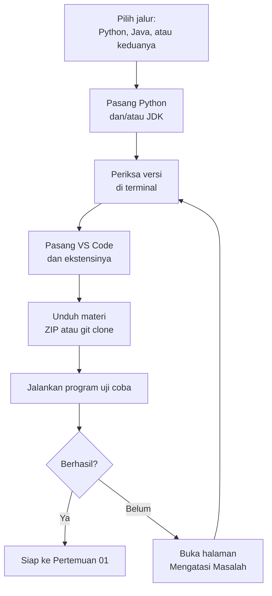

# 00 — Persiapan Belajar

[🏠 Beranda](../README.md) · [Pertemuan 01 ➡️](../Pertemuan-01-Pengenalan-PBO/README.md)

> Sebelum masuk Pertemuan 01, kita siapkan dulu "dapur"-nya: bahasa pemrograman, editor kode, dan cara menjalankan program. Bagian ini cukup dikerjakan **sekali**, kira-kira 1–2 jam. Setelah itu, kamu bisa fokus belajar tanpa terganggu urusan teknis.

## 🎯 Tujuan Pembelajaran

Setelah menyelesaikan bagian persiapan ini, kamu mampu:

1. Memasang Python dan/atau JDK (Java) dengan versi yang sesuai.
2. Memasang VS Code beserta ekstensi Python dan Java.
3. Membuka folder materi dengan benar di VS Code.
4. Menjalankan program Python dan Java dari terminal maupun dari VS Code.
5. Mengunduh materi dan memperbaruinya setiap minggu.

## Daftar Isi

1. [Pilih Jalurmu Dulu](#1-pilih-jalurmu-dulu)
2. [Daftar Panduan Persiapan](#2-daftar-panduan-persiapan)
3. [Alur Persiapan](#3-alur-persiapan)
4. [Uji Coba: Apakah Semuanya Sudah Siap?](#4-uji-coba-apakah-semuanya-sudah-siap)
5. [Checklist Siap Belajar](#5-checklist-siap-belajar)
6. [Kalau Ada Masalah](#6-kalau-ada-masalah)

---

## 1. Pilih Jalurmu Dulu

Mata kuliah ini punya dua jalur praktik: 🐍 **Python** dan ☕ **Java**. Konsepnya sama, yang berbeda hanya bahasanya. Pilihanmu menentukan apa yang wajib dipasang.

| Jalur | Wajib dipasang | Sangat disarankan |
|---|---|---|
| 🐍 Python | Python 3.10 ke atas (disarankan 3.12 atau lebih baru) | VS Code + ekstensi Python |
| ☕ Java | JDK 17 ke atas (disarankan JDK LTS 21 atau 25) | VS Code + Extension Pack for Java |

> [!TIP]
> Jika laptopmu cukup lega, pasang **keduanya**. Kamu jadi bisa mencoba kode di jalur lain saat membaca halaman Jembatan Python ↔ Java. Namun, kalau waktumu terbatas, pasang yang sesuai jalurmu dulu.

Belum yakin memilih jalur yang mana? Baca bagian "Dua Jalur" di [Beranda](../README.md) atau [FAQ](../Lampiran/faq.md).

## 2. Daftar Panduan Persiapan

Ikuti panduan berikut secara berurutan. Lewati yang tidak kamu perlukan.

| No | Panduan | Isinya | Untuk siapa |
|---|---|---|---|
| 1 | [Instalasi Python](instalasi-python.md) | memasang Python di Windows, macOS, dan Linux, lalu memeriksa versinya | jalur Python |
| 2 | [Instalasi Java (JDK)](instalasi-java.md) | bedanya JDK dan JRE, memasang JDK, mengatur `JAVA_HOME` dan `PATH` | jalur Java |
| 3 | [Editor VS Code](editor-vscode.md) | memasang VS Code, ekstensi, membuka folder yang benar, tombol *Run* | semua |
| 4 | [Menjalankan Program](menjalankan-program.md) | dasar terminal, menjalankan Python, menjalankan Java satu file dan banyak file | semua |
| 5 | [Git dan GitHub](git-dan-github.md) | mengunduh materi (ZIP atau `git clone`) dan memperbaruinya | semua |
| 6 | [Mengatasi Masalah](mengatasi-masalah.md) | kumpulan masalah instalasi yang sering terjadi beserta solusinya | buka saat perlu |

## 3. Alur Persiapan



## 4. Uji Coba: Apakah Semuanya Sudah Siap?

Setelah semua terpasang dan materi sudah diunduh, lakukan uji coba berikut. Kita memakai studi kasus KedaiKita dari Pertemuan 02 karena programnya sudah tersedia.

**Langkah 1.** Periksa versi di terminal. Jalankan perintah yang sesuai jalurmu:

```bash
python --version
java -version
javac -version
```

Di macOS dan Linux, gunakan `python3 --version`. Pastikan Python minimal **3.10**, serta `java` dan `javac` minimal **17** dengan angka versi yang sama.

**Langkah 2.** Buka terminal di folder materi (folder `PBO2026`, atau `PBO2026-main` jika kamu mengunduh ZIP). Lalu jalankan studi kasus Pertemuan 02.

Jalur 🐍 Python:

```bash
cd Pertemuan-02-Kelas-dan-Objek/python/studi-kasus
python kedaikita.py
```

Jalur ☕ Java:

```bash
cd Pertemuan-02-Kelas-dan-Objek/java/studi-kasus
java KedaiKita.java
```

Jika semuanya beres, kedua program menampilkan hasil yang sama persis seperti ini:

```text
=== MENU KEDAIKITA ===
Kopi Susu Gula Aren - Rp18000
Es Teh Manis - Rp8000
Nasi Goreng Kampung - Rp25000

=== PESANAN BUDI ===
2 x Kopi Susu Gula Aren = Rp36000
1 x Nasi Goreng Kampung = Rp25000
Total bayar: Rp61000

=== HARGA ES TEH NAIK ===
Es Teh Manis - Rp10000
Kopi Susu Gula Aren - Rp18000
```

**Langkah 3.** Coba jalankan program yang sama dari VS Code dengan tombol *Run* (lihat [Editor VS Code](editor-vscode.md)). Hasilnya harus sama.

Selamat! Jika kamu melihat menu KedaiKita di layarmu, artinya "dapur"-mu sudah siap dipakai.

> [!NOTE]
> Pemisah folder di Windows sebenarnya `\`, misalnya `cd Pertemuan-02-Kelas-dan-Objek\python\studi-kasus`. PowerShell juga menerima `/`. Jika perintah dengan `/` bermasalah di Command Prompt, ganti dengan `\`.

## 5. Checklist Siap Belajar

Periksa setiap butir berikut. Jika semuanya sudah terpenuhi, kamu siap belajar.

- [ ] Jalur utama sudah dipilih: Python atau Java.
- [ ] `python --version` (atau `python3 --version`) menampilkan Python 3.10 atau lebih baru. *(jalur Python)*
- [ ] `java -version` dan `javac -version` sama-sama menampilkan versi 17 atau lebih baru. *(jalur Java)*
- [ ] VS Code sudah terpasang beserta ekstensi **Python** dan/atau **Extension Pack for Java**.
- [ ] Kamu bisa membuka terminal dan berpindah folder dengan `cd`.
- [ ] Materi sudah ada di laptopmu, dan kamu tahu cara memperbaruinya.
- [ ] Hasil uji coba di bagian 4 sudah muncul dengan benar.
- [ ] Folder terpisah untuk menyimpan latihanmu sendiri sudah disiapkan.

## 6. Kalau Ada Masalah

Masalah instalasi itu wajar dan **sangat** sering terjadi, bahkan pada programmer berpengalaman. Jangan menyerah. Langkah yang disarankan:

1. Baca pesan error-nya pelan-pelan. Pesan error adalah petunjuk, bukan hukuman.
2. Cari gejalanya di halaman [Mengatasi Masalah](mengatasi-masalah.md).
3. Tutup **semua** terminal dan VS Code, lalu buka lagi. Banyak masalah `PATH` beres dengan cara ini.
4. Masih buntu? Tanyakan ke asisten atau dosen. Sertakan teks pesan error, sistem operasi, dan langkah yang sudah kamu coba.

## 📝 Ringkasan

- Jalur Python butuh Python 3.10+, jalur Java butuh JDK 17+. Keduanya boleh dipasang.
- VS Code dengan ekstensi Python dan Extension Pack for Java dipakai sebagai editor utama.
- Untuk Java di VS Code, buka folder `java/` milik satu pertemuan, bukan seluruh repositori.
- Uji coba yang berhasil: studi kasus Pertemuan 02 menampilkan menu KedaiKita.
- Simpan latihanmu sendiri di folder terpisah agar tidak tertimpa saat materi diperbarui.

## ➡️ Langkah Berikutnya

Semua siap? Mari mulai belajar di [Pertemuan 01 — Pengenalan PBO](../Pertemuan-01-Pengenalan-PBO/README.md).

---

[🏠 Beranda](../README.md) · [Pertemuan 01 ➡️](../Pertemuan-01-Pengenalan-PBO/README.md)
