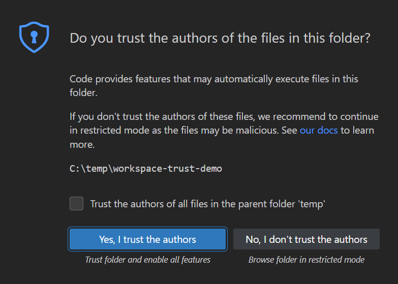
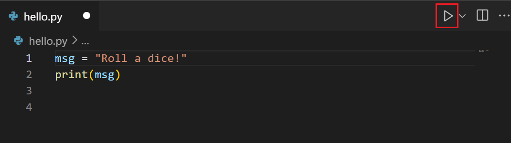
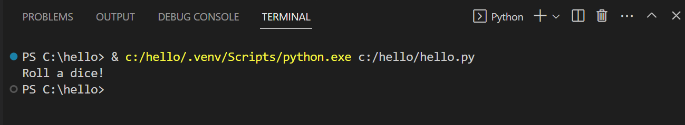
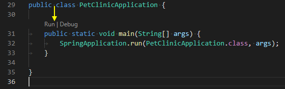
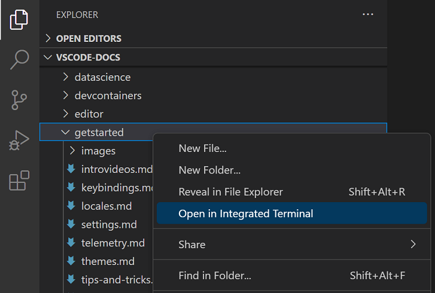

# Editor VS Code

[⬅️ Persiapan](README.md) · [🏠 Beranda](../README.md) · [Menjalankan Program ➡️](menjalankan-program.md)

> Kita memakai **Visual Studio Code** (VS Code) sebagai editor utama karena gratis, ringan, dan bisa dipakai untuk Python maupun Java. Halaman ini membahas cara memasangnya, ekstensi yang dibutuhkan, dan satu hal yang sangat penting: **membuka folder yang benar**. Agar bisa langsung mencoba setiap langkah, pastikan materi sudah ada di laptopmu (lihat [Git dan GitHub](git-dan-github.md)).

## Daftar Isi

1. [Memasang VS Code](#1-memasang-vs-code)
2. [Memasang Ekstensi](#2-memasang-ekstensi)
3. [Membuka Folder yang Benar](#3-membuka-folder-yang-benar)
4. [Menjalankan Program dari VS Code](#4-menjalankan-program-dari-vs-code)
5. [Terminal Terintegrasi](#5-terminal-terintegrasi)
6. [Pengaturan Kecil yang Membantu](#6-pengaturan-kecil-yang-membantu)
7. [Alternatif Editor dan IDE](#7-alternatif-editor-dan-ide)

---

## 1. Memasang VS Code

Unduh VS Code dari situs resminya: [code.visualstudio.com](https://code.visualstudio.com/). Tombol unduhannya biasanya sudah menyesuaikan dengan sistem operasimu.

**Windows**

1. Unduh *installer* untuk Windows. Pilihan bawaannya, **User Installer**, sudah tepat dan tidak butuh izin administrator.
2. Jalankan *installer*, pilih **I accept the agreement**, lalu klik **Next**.
3. Di halaman **Select Additional Tasks**, centang:
   - **Add "Open with Code" action to Windows Explorer file context menu**
   - **Add "Open with Code" action to Windows Explorer directory context menu**
   - **Add to PATH** (biasanya sudah tercentang)
4. Klik **Next**, lalu **Install**. Setelah selesai, klik **Finish**.

Dua pilihan **Open with Code** membuatmu bisa klik kanan sebuah folder di File Explorer lalu langsung membukanya di VS Code. Sangat praktis. Di Windows 11, pilihan itu mungkin baru terlihat setelah kamu mengklik **Show more options**.

**macOS**

1. Unduh VS Code untuk macOS. *File*-nya berupa *disk image* (`.dmg`).
2. Buka *file* itu, lalu seret **Visual Studio Code** ke folder **Applications**.
3. Buka VS Code dari folder **Applications** atau lewat Spotlight (Cmd+Spasi, ketik `Visual Studio Code`).
4. (Opsional) Di VS Code, tekan Cmd+Shift+P, ketik `shell command`, lalu pilih **Shell Command: Install 'code' command in PATH**. Setelah itu, di Terminal yang baru dibuka, kamu bisa membuka folder aktif di VS Code dengan perintah `code .`.

**Linux**

Unduh paket `.deb` (Ubuntu/Debian) atau `.rpm` (Fedora) dari situs VS Code, lalu pasang seperti aplikasi biasa. Sebagian distribusi juga menyediakan VS Code lewat Snap.

### Mengenal tampilan VS Code

Setelah VS Code terbuka, kenali dulu bagian-bagian utamanya. Nama-nama bagian ini akan sering disebut di seluruh materi.


<sub>Sumber gambar: dokumentasi Visual Studio Code, halaman [*User interface*](https://code.visualstudio.com/docs/editing/getting-started/userinterface), © Microsoft Corporation, lisensi [CC BY 3.0 US](https://creativecommons.org/licenses/by/3.0/us/).</sub>

| Huruf | Nama di VS Code | Gunanya |
|---|---|---|
| A | **Activity Bar** | deretan ikon di sisi paling kiri untuk berpindah tampilan, misalnya **Explorer** (ikon dua lembar kertas) dan **Extensions** (ikon empat kotak) |
| B | **Primary Side Bar** | panel di sebelah kiri editor. Isinya mengikuti ikon yang dipilih di A. Yang paling sering dipakai adalah panel **Explorer**, berisi daftar folder dan *file* |
| C | **Editor Groups** | area editor, tempat membuka dan mengetik isi *file*. Setiap *file* yang dibuka muncul sebagai tab. Pada gambar, ada dua editor yang dibuka berdampingan |
| D | **Panel** | area di bagian bawah. Tab **TERMINAL** dipakai untuk mengetik perintah dan melihat hasil program. Tab lainnya, misalnya **PROBLEMS** dan **OUTPUT**, jarang kita pakai |
| E | **Status Bar** | bilah paling bawah yang berisi keterangan singkat, misalnya posisi kursor (**Ln 1, Col 1**) dan bahasa *file* yang sedang dibuka |

Di bagian paling atas jendela ada **bilah menu**: **File**, **Edit**, **Selection**, **View**, **Go**, **Run**, **Terminal**, dan **Help**. Di macOS, bilah menu ini berada di bagian atas layar. Petunjuk seperti **File → Open Folder** berarti: klik menu **File**, lalu pilih **Open Folder**.

> [!NOTE]
> Gambar-gambar VS Code di halaman ini diambil dari dokumentasi resminya dan memakai tema gelap. Tampilan di laptopmu bisa sedikit berbeda, misalnya warnanya terang atau letak ikonnya bergeser karena versinya lebih baru. Nama menu dan tombolnya tetap sama.

## 2. Memasang Ekstensi

Ekstensi menambah kemampuan VS Code. Caranya:

1. Buka tampilan **Extensions**: klik ikon empat kotak di bilah paling kiri, atau tekan Ctrl+Shift+X (macOS: Cmd+Shift+X).
2. Ketik nama ekstensinya di kotak pencarian paling atas.
3. Pilih ekstensi yang nama dan penerbitnya sesuai tabel berikut, lalu klik **Install**.

| Jalur | Nama ekstensi | Penerbit | Gunanya |
|---|---|---|---|
| 🐍 Python | **Python** | Microsoft | menjalankan dan men-*debug* Python, pewarnaan kode, saran otomatis |
| ☕ Java | **Extension Pack for Java** | Microsoft | paket berisi beberapa ekstensi Java sekaligus: dukungan bahasa, *debugger*, pengelola proyek, dan lainnya |


<sub>Hasil pencarian `python` di tampilan **Extensions** (ikon empat kotak yang sedang aktif di sisi kiri). Pilih yang paling atas: penerbitnya **Microsoft** dan bertanda centang biru. Di gambar ini ekstensinya sudah terpasang, jadi tombol **Install**-nya sudah tidak tampak. Sumber gambar: dokumentasi Visual Studio Code, halaman [*Extension Marketplace*](https://code.visualstudio.com/docs/configure/extensions/extension-marketplace), © Microsoft Corporation, lisensi [CC BY 3.0 US](https://creativecommons.org/licenses/by/3.0/us/). Gambar dipotong dan diperkecil oleh penyusun materi.</sub>

> [!WARNING]
> Ada banyak ekstensi dengan nama mirip. Pastikan penerbitnya **Microsoft** dan jumlah unduhannya besar. Ekstensi Python resmi otomatis memasang ekstensi pendamping, seperti Pylance dan Python Debugger. Extension Pack for Java juga memasang ekstensi dari penerbit lain, misalnya Language Support for Java dari Red Hat. Semua itu normal.

Setelah ekstensi terpasang, lakukan pemeriksaan singkat berikut. Perintah VS Code seperti **Python: Select Interpreter** diketik di **Command Palette** (palet perintah), yang dibuka dengan Ctrl+Shift+P (macOS: Cmd+Shift+P). Ketik sebagian namanya, lalu pilih dari daftar yang muncul.

- **Python:** buka sebuah *file* `.py`. Jika VS Code memintamu memilih *interpreter* (program Python yang dipakai), pilih Python yang tadi kamu pasang. Kamu juga bisa memilihnya kapan saja lewat **Python: Select Interpreter**.
- **Java:** buka sebuah *file* `.java`. VS Code biasanya menemukan JDK secara otomatis. Untuk memeriksanya, jalankan **Java: Configure Java Runtime**. Jika JDK baru saja dipasang, tutup dan buka lagi VS Code.

> [!TIP]
> Untuk Windows dan macOS, Microsoft juga menyediakan **Coding Pack for Java**, yaitu satu *installer* yang memasang VS Code, JDK, dan ekstensi Java sekaligus. Ini pilihan praktis jika kamu memulai dari nol untuk jalur Java. Jika sudah memasang JDK sendiri, cukup pasang Extension Pack for Java agar laptopmu tidak punya dua JDK (lihat [Instalasi Java bagian 9](instalasi-java.md#9-jebakan-lebih-dari-satu-java-terpasang)).

## 3. Membuka Folder yang Benar

Ini bagian **paling penting** di halaman ini. Bacalah pelan-pelan.

VS Code bekerja paling baik jika kamu membuka sebuah **folder**, bukan satu *file* saja. Caranya: pilih menu **File → Open Folder** (di macOS boleh juga **File → Open**), pilih foldernya, lalu klik **Select Folder** (macOS: **Open**). Di Windows, kamu juga bisa klik kanan folder di File Explorer lalu pilih **Open with Code**.

Semua folder pertemuan berada di dalam **folder utama materi**, yaitu folder hasil unduhan di [Git dan GitHub](git-dan-github.md): `PBO2026` (jika memakai `git clone`) atau `PBO2026-master` (jika mengunduh ZIP). Dari folder itu, buka subfolder berikut:

| Jalur | Folder yang dibuka di VS Code | Contoh untuk Pertemuan 02 |
|---|---|---|
| 🐍 Python | folder `python` milik pertemuan yang sedang dipelajari | `Pertemuan-02-Kelas-dan-Objek/python` |
| ☕ Java | folder `java` milik **satu** pertemuan, bukan seluruh folder materi | `Pertemuan-02-Kelas-dan-Objek/java` |

Untuk Python, membuka seluruh folder utama materi sebenarnya juga boleh. Namun, membuka folder `python` milik pertemuan membuat panel **Explorer** lebih ringkas dan sama dengan petunjuk di halaman praktik.

Ingat satu akibat penting: **terminal VS Code dimulai di folder yang kamu buka**. Jika kamu membuka `Pertemuan-02-Kelas-dan-Objek/java`, terminalnya berada di folder `java` itu, bukan di folder utama materi. Cara menyesuaikan perintah `cd` dari halaman praktik dibahas di [bagian 5](#5-terminal-terintegrasi).

### Kenapa Java tidak boleh membuka seluruh repositori?

Ekstensi Java menganggap semua *file* `.java` di dalam folder yang kamu buka sebagai **satu proyek**. Masalahnya, hampir setiap pertemuan punya kelas dengan nama yang sama, misalnya `Menu`, `Pesanan`, atau `Kedai`. Di dalam satu proyek Java, dua kelas tidak boleh bernama sama.

Akibatnya jika kamu membuka seluruh folder `PBO2026`, VS Code akan memberi garis merah bergelombang di banyak *file*, dengan pesan seperti:

```text
The type Menu is already defined
```

Padahal kodenya tidak salah. Di dalam satu folder `java/` pertemuan, setiap nama kelas sudah dibuat unik, sehingga masalah ini tidak muncul.

> [!IMPORTANT]
> Untuk jalur Java: **satu pertemuan, satu jendela VS Code**. Saat pindah pertemuan, buka folder `java/` pertemuan berikutnya (**File → Open Folder** atau **File → Open Recent**).

> [!TIP]
> Garis merah masih tersisa setelah kamu berpindah folder? Tekan Ctrl+Shift+P, jalankan **Java: Clean Java Language Server Workspace**, lalu setujui konfirmasinya. Ekstensi Java akan dimulai ulang dan memeriksa folder itu dari awal.

### Kotak dialog "Do you trust the authors?"

Saat membuka folder baru, VS Code mungkin bertanya **Do you trust the authors of the files in this folder?** Untuk folder materi ini dan folder latihanmu sendiri, pilih **Yes, I trust the authors**.



<sub>Kotak dialog yang muncul saat membuka folder baru. Klik tombol biru **Yes, I trust the authors**. Kotak centang di atas tombol itu adalah pilihan untuk memercayai folder induknya sekaligus (dijelaskan di bawah). Sumber gambar: dokumentasi Visual Studio Code, halaman [*Workspace Trust*](https://code.visualstudio.com/docs/editing/workspaces/workspace-trust), © Microsoft Corporation, lisensi [CC BY 3.0 US](https://creativecommons.org/licenses/by/3.0/us/).</sub>

Jika kamu memilih **No, I don't trust the authors**, VS Code masuk ke **Restricted Mode**. Di mode ini, sebagian fitur dimatikan atau dibatasi, termasuk tombol ▷/**Run**, *debugging*, dan terminal. Untuk keluar dari mode itu, klik **Manage** pada spanduk **Restricted Mode** di bagian atas jendela, lalu klik **Trust**.

Kepercayaan yang diberikan pada sebuah folder juga berlaku untuk semua subfoldernya. Jadi jika kotak dialog itu menawarkan pilihan untuk memercayai folder induknya (misalnya `PBO2026`), kamu boleh mencentangnya agar tidak ditanya lagi setiap membuka pertemuan baru.

## 4. Menjalankan Program dari VS Code

**Python** (contoh: folder `Pertemuan-02-Kelas-dan-Objek/python` sudah dibuka)

1. Di panel **Explorer** (sisi kiri), buka *file* `.py` yang ingin dijalankan, misalnya `contoh/contoh01_kelas_dan_objek.py`.
2. Klik tombol ▷ (**Run Python File**) di pojok kanan atas editor.

   

   <sub>Tombol ▷ **Run Python File** (dalam kotak merah) ada di pojok kanan atas editor. Sumber gambar: dokumentasi Visual Studio Code, halaman [*Getting Started with Python in VS Code*](https://code.visualstudio.com/docs/python/python-tutorial), © Microsoft Corporation, lisensi [CC BY 3.0 US](https://creativecommons.org/licenses/by/3.0/us/).</sub>

3. Hasilnya muncul di panel **TERMINAL** di bagian bawah. Baris pertamanya berisi perintah panjang yang diketik VS Code secara otomatis (alamat Python dan alamat *file*-mu). Itu normal; *output* programmu muncul di bawahnya.

   

   <sub>Baris pertama adalah perintah yang diketik VS Code secara otomatis, dan *output* program (`Roll a dice!`) muncul di bawahnya. Di laptopmu alamat Python dan alamat *file*-nya akan berbeda. Sumber gambar: dokumentasi Visual Studio Code, halaman [*Getting Started with Python in VS Code*](https://code.visualstudio.com/docs/python/python-tutorial), © Microsoft Corporation, lisensi [CC BY 3.0 US](https://creativecommons.org/licenses/by/3.0/us/).</sub>

**Java** (contoh: folder `Pertemuan-02-Kelas-dan-Objek/java` sudah dibuka)

1. Di panel **Explorer**, buka *file* `.java` yang berisi *method* `main`, misalnya `contoh/Contoh01KelasDanObjek.java`.
2. Klik tulisan **Run** yang muncul tepat di atas baris `public static void main` (bagian dari **Run | Debug**), atau klik tombol ▷ di pojok kanan atas editor.

   

   <sub>Tulisan kecil **Run | Debug** muncul tepat di atas baris `main` (ditunjuk panah kuning). Kode pada gambar adalah contoh dari dokumentasi VS Code, bukan kode materi ini. Sumber gambar: dokumentasi Visual Studio Code, halaman [*Running and debugging Java*](https://code.visualstudio.com/docs/java/java-debugging), © Microsoft Corporation, lisensi [CC BY 3.0 US](https://creativecommons.org/licenses/by/3.0/us/).</sub>

3. Hasilnya muncul di panel **TERMINAL** (kadang di **DEBUG CONSOLE**) di bagian bawah.

Kedua contoh di atas mencetak baris pertama yang sama: `=== DUA OBJEK DARI SATU KELAS ===`. Tombol ▷ selalu menjalankan *file* yang sedang aktif, yaitu tab yang sedang kamu lihat. Jadi, pastikan tab yang benar sedang terbuka sebelum mengkliknya.

Untuk studi kasus Java mulai Pertemuan 05 yang terdiri atas banyak *file*, jalankan *file* `Main.java`. VS Code akan mengompilasi *file-file* lain yang dibutuhkan secara otomatis. Untuk proyek ber-*package* di Pertemuan 15, ikuti petunjuk di halaman praktik pertemuan itu.

> [!NOTE]
> Tombol ▷ sangat praktis, tetapi kamu tetap perlu bisa menjalankan program dari terminal. Saat ujian praktik atau saat ada masalah dengan editor, terminal adalah penyelamatmu. Pelajari caranya di [Menjalankan Program](menjalankan-program.md).

## 5. Terminal Terintegrasi

VS Code punya terminal di dalamnya, jadi kamu tidak perlu berpindah jendela. Semua perintah di halaman [Menjalankan Program](menjalankan-program.md) bisa diketik di sini. Ada tiga cara membukanya:

| Cara membuka | Terminal mulai di folder ... |
|---|---|
| Menu **Terminal → New Terminal** (Ctrl+Shift+\`) | yang sedang dibuka di VS Code |
| Menu **View → Terminal** (Ctrl+\`) | yang sedang dibuka di VS Code |
| Klik kanan sebuah folder di panel **Explorer**, lalu pilih **Open in Integrated Terminal** | yang kamu klik kanan |

Tombol \` (*backtick*) biasanya berada di kiri angka 1 pada papan ketik. Di macOS, kombinasi tombol terminal ini tetap memakai Control, bukan Cmd.

### Menyesuaikan perintah `cd` dari halaman praktik

Semua perintah `cd` di halaman praktik ditulis dari **folder utama materi** (`PBO2026` atau `PBO2026-master`). Padahal, terminal VS Code dimulai di folder yang kamu buka, misalnya `Pertemuan-02-Kelas-dan-Objek/java`. Sesuaikan baris `cd`-nya seperti tabel berikut (untuk jalur Python, ganti `java` dengan `python`):

| Terminalmu sedang berada di ... | Untuk masuk ke folder `contoh`, ketik |
|---|---|
| folder utama materi (`PBO2026` atau `PBO2026-master`) | `cd Pertemuan-02-Kelas-dan-Objek/java/contoh` |
| folder `java` pertemuan itu (terminal VS Code setelah **File → Open Folder**) | `cd contoh` |
| folder `contoh` itu sendiri (misalnya lewat **Open in Integrated Terminal**) | tidak perlu `cd`; lewati baris `cd`-nya |

> [!TIP]
> Cara paling cepat membuka terminal tepat di folder yang benar: di panel **Explorer**, klik kanan folder tujuan (misalnya `contoh`), lalu pilih **Open in Integrated Terminal**. Kamu tidak perlu mengetik `cd` lagi.



<sub>Klik kanan folder di panel **Explorer**, lalu pilih **Open in Integrated Terminal**. Pada gambar, folder yang diklik kanan bernama `getstarted`; di materi ini biasanya folder `contoh` atau `studi-kasus`. Sumber gambar: dokumentasi Visual Studio Code, halaman [*Terminal Basics*](https://code.visualstudio.com/docs/terminal/basics), © Microsoft Corporation, lisensi [CC BY 3.0 US](https://creativecommons.org/licenses/by/3.0/us/).</sub>

Tidak yakin sedang berada di folder mana? Lihat teks di depan kursor terminal. Di PowerShell, teks itu berisi alamat lengkap folder aktif, misalnya `PS C:\Users\Budi\Documents\PBO2026\Pertemuan-02-Kelas-dan-Objek\java>`. Di macOS/Linux, ketik `pwd` lalu tekan Enter. Penjelasan lengkapnya ada di [Menjalankan Program bagian 4](menjalankan-program.md#4-berpindah-ke-folder-materi).

Di Windows, terminal bawaan VS Code adalah **PowerShell**. Jika kamu lebih suka Command Prompt, tekan Ctrl+Shift+P, jalankan **Terminal: Select Default Profile**, lalu pilih **Command Prompt**.

## 6. Pengaturan Kecil yang Membantu

| Pengaturan | Cara | Manfaat |
|---|---|---|
| Simpan otomatis | **File → Auto Save** | tidak ada lagi program yang dijalankan sebelum disimpan |
| Merapikan kode | Shift+Alt+F (macOS: Shift+Option+F; Linux: Ctrl+Shift+I) | indentasi dan spasi menjadi rapi |
| Memperbesar huruf | Ctrl+= dan Ctrl+- (macOS: Cmd+= dan Cmd+-) | nyaman dibaca, apalagi saat presentasi |
| Palet perintah | Ctrl+Shift+P (macOS: Cmd+Shift+P) | mencari perintah VS Code apa pun dengan mengetik namanya |

Untuk *file* Python, perintah merapikan kode membutuhkan ekstensi tambahan. Saat pertama kali dipakai, VS Code akan memberi tahu dan menawarkan ekstensinya (misalnya Black Formatter atau autopep8). Langkah ini opsional.

> [!WARNING]
> Jika **Auto Save** tidak aktif, perhatikan titik bulat di tab *file*. Titik itu berarti ada perubahan yang **belum disimpan**. Program yang dijalankan dari terminal selalu memakai versi yang **sudah disimpan**.

## 7. Alternatif Editor dan IDE

VS Code bukan satu-satunya pilihan. Jika kamu sudah nyaman dengan editor lain, silakan dipakai. Prinsipnya tetap sama: satu pertemuan, satu proyek.

| Alat | Bahasa | Catatan |
|---|---|---|
| **IntelliJ IDEA** (JetBrains) | Java | IDE Java yang sangat populer di industri. Gunakan edisi atau fitur gratisnya. |
| **PyCharm** (JetBrains) | Python | IDE khusus Python. Fitur intinya gratis; dulu dikenal sebagai *Community Edition*. |
| **Apache NetBeans** | Java | IDE gratis dan terbuka dari Apache. |
| **Thonny** | Python | editor sederhana untuk pemula, sudah membawa Python sendiri. |
| **BlueJ** | Java | dirancang untuk belajar PBO; kelas dan objek bisa dilihat dan dicoba secara visual. |

> [!NOTE]
> Cara membuka proyek dan menjalankan program di setiap IDE sedikit berbeda. Materi ini menulis petunjuk untuk terminal dan VS Code. Jika memakai IDE lain, sesuaikan sendiri, ya.

## 📝 Ringkasan

- Pasang VS Code, lalu ekstensi **Python** dan/atau **Extension Pack for Java** dari Microsoft.
- Selalu buka **folder**, bukan satu *file* saja: folder `python` atau `java` milik pertemuan yang sedang dipelajari.
- Jalur Java: buka folder `java/` milik **satu** pertemuan agar tidak muncul pesan `The type ... is already defined`.
- Pilih **Yes, I trust the authors** agar ekstensi berjalan penuh.
- Tombol ▷ menjalankan program, dan terminal terintegrasi dibuka dengan Ctrl+\`.
- Terminal VS Code dimulai di folder yang kamu buka. Klik kanan folder di **Explorer** → **Open in Integrated Terminal** untuk membuka terminal tepat di folder itu, lalu lewati baris `cd` di halaman praktik.

---

[⬅️ Persiapan](README.md) · [🏠 Beranda](../README.md) · [Menjalankan Program ➡️](menjalankan-program.md)
