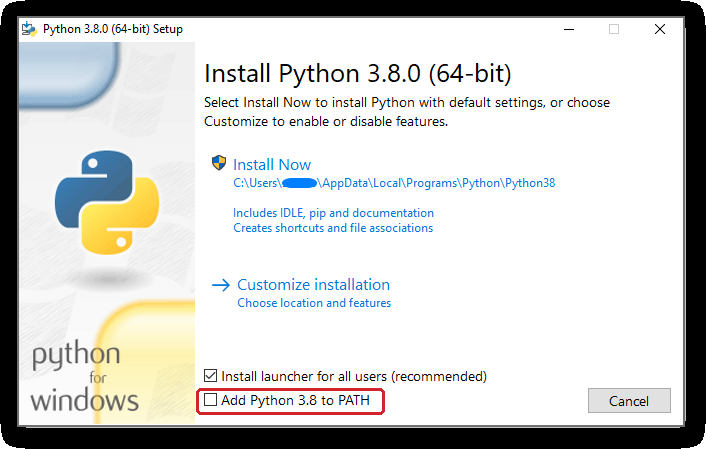

# Instalasi Python

[⬅️ Persiapan](README.md) · [🏠 Beranda](../README.md) · [Instalasi Java ➡️](instalasi-java.md)

> Halaman ini memandumu memasang Python di Windows, macOS, atau Linux, lalu memastikan versinya benar. Jika kamu memilih jalur Java saja, halaman ini boleh dilewati.

## Daftar Isi

1. [Versi yang Kita Butuhkan](#1-versi-yang-kita-butuhkan)
2. [Cek Dulu: Mungkin Python Sudah Terpasang](#2-cek-dulu-mungkin-python-sudah-terpasang)
3. [Windows](#3-windows)
4. [macOS](#4-macos)
5. [Linux](#5-linux)
6. [Memeriksa Hasil Instalasi](#6-memeriksa-hasil-instalasi)
7. [Mencoba Mode Interaktif Python](#7-mencoba-mode-interaktif-python)
8. [Tidak Perlu Memasang Pustaka Tambahan](#8-tidak-perlu-memasang-pustaka-tambahan)

---

## 1. Versi yang Kita Butuhkan

| | Versi |
|---|---|
| **Disarankan** | Python **3.12 atau lebih baru** (versi terbaru saat ini: 3.15) |
| **Minimal** | Python **3.10** |

Kenapa minimal 3.10? Beberapa kode di materi ini memakai penulisan yang baru tersedia sejak Python 3.10, misalnya petunjuk tipe `Menu | None`. Di versi yang lebih lama, program seperti itu akan gagal berjalan.

Nomor versi Python ditulis seperti `3.12.4`. Angka pertama (`3`) adalah generasi utama, angka kedua (`12`) adalah versi fitur, dan angka ketiga (`4`) adalah perbaikan kecil. Untuk mata kuliah ini, yang penting adalah **dua angka pertama**: harus 3.10 atau lebih tinggi.

> [!NOTE]
> Kamu tidak harus memakai versi paling baru. Versi yang lebih baru biasanya punya pesan *error* yang lebih ramah, tetapi semua kode di materi ini sudah diuji agar berjalan mulai Python 3.10. Jika baru akan memasang, pilih saja versi terbaru.

## 2. Cek Dulu: Mungkin Python Sudah Terpasang

Pertama, buka **terminal**, yaitu jendela untuk mengetik perintah:

- **Windows:** klik **Start**, ketik `PowerShell`, lalu tekan Enter. Command Prompt juga boleh.
- **macOS:** tekan Cmd+Spasi, ketik `Terminal`, lalu tekan Enter.
- **Linux:** tekan Ctrl+Alt+T, atau cari aplikasi **Terminal**.

Lalu ketik perintah yang sesuai dengan sistem operasimu, satu per satu, masing-masing diakhiri Enter. Folder aktif terminalnya tidak berpengaruh untuk perintah ini.

**Windows** (PowerShell atau Command Prompt):

```bash
python --version
py --version
```

**macOS / Linux** (Terminal):

```bash
python3 --version
```

Jika muncul tulisan seperti `Python 3.12.4` dan angkanya **3.10 atau lebih**, Python-mu sudah siap. Lanjutkan ke [Instalasi Java](instalasi-java.md) jika kamu juga memilih jalur Java, atau langsung ke [Git dan GitHub](git-dan-github.md) untuk mengunduh materi.

Jika muncul pesan "tidak dikenali" (*not recognized*), "*command not found*", atau versinya di bawah 3.10, lanjutkan ke bagian sistem operasimu di bawah ini.

> [!WARNING]
> Di Windows, mengetik `python` saat Python belum terpasang bisa **membuka Microsoft Store** atau menampilkan pesan `Python was not found`. Itu bukan tanda Python sudah terpasang. Penjelasannya ada di [bagian 3.3](#33-jebakan-alias-microsoft-store).

## 3. Windows

Situs resmi Python menyediakan dua cara memasang Python di Windows. Pilih **salah satu** saja agar tidak membingungkan.

| | Cara A: Python install manager | Cara B: *installer* klasik |
|---|---|---|
| Bentuknya | aplikasi pengelola yang bisa memasang berbagai versi Python | satu *file* `.exe` untuk satu versi Python |
| Status | cara yang **dianjurkan** dokumentasi resmi Python | usang (*deprecated*) sejak Python 3.14 dan tidak dibuat lagi mulai Python 3.16 |
| Perintah `python` dan `py` | langsung tersedia | `python` baru tersedia jika kotak **Add python.exe to PATH** dicentang |

Kedua cara sama-sama resmi dari python.org. Jika ragu, ikuti **Cara A**. Cara B masih tersedia sampai Python 3.15, misalnya untuk komputer kampus atau kantor yang tidak mengizinkan Cara A.

### 3.1 Cara A: Python Install Manager

1. Pasang **Python install manager** lewat salah satu jalan berikut:
   - **Microsoft Store:** buka aplikasi **Microsoft Store**, cari `Python Install Manager`, lalu klik **Install**.
   - **python.org:** buka [python.org/downloads/windows](https://www.python.org/downloads/windows/). Di bagian **Python install manager** (versi terbarunya ada di bagian atas halaman), klik **Download Installer (MSIX)**. Klik dua kali *file* yang terunduh, lalu klik **Install**.
2. Buka terminal **baru** (PowerShell), ketik `python`, lalu tekan Enter. Karena belum ada Python sama sekali, *install manager* otomatis mengunduh dan memasang Python versi stabil terbaru (saat ini 3.15). Tunggu sampai selesai; langkah ini butuh internet.
3. Saat pertama kali memasang Python, kamu mungkin ditanya apakah sebuah folder boleh ditambahkan ke `PATH`. Langkah ini opsional karena perintah `python` dan `py` tetap bisa dipakai tanpanya. Menyetujuinya juga tidak masalah.
4. Setelah muncul tanda `>>>`, ketik `exit()` lalu tekan Enter untuk keluar. Periksa versinya seperti di [bagian 6](#6-memeriksa-hasil-instalasi).

Beberapa perintah berguna dari *install manager*. Ketik di terminal (PowerShell atau Command Prompt), dari folder mana saja:

```bash
py list
py install 3.13
py help
```

| Perintah | Artinya |
|---|---|
| `py list` | menampilkan daftar versi Python yang terpasang |
| `py install 3.13` | memasang versi tertentu, misalnya 3.13 |
| `py help` | menampilkan semua perintah *install manager* |

### 3.2 Cara B: *Installer* Klasik

1. Buka halaman [python.org/downloads/windows](https://www.python.org/downloads/windows/).
2. Di bagian **Stable Releases**, pilih Python 3.15 atau 3.14, lalu klik **Download Windows installer (64-bit)**. Jika laptopmu memakai prosesor ARM (misalnya Snapdragon), pilih **Download Windows installer (ARM64)**.
3. Jalankan *file* `.exe` yang sudah diunduh.
4. Di halaman pertama *installer*, lihat bagian bawah jendela. Centang kotak **Add python.exe to PATH**.

   

   <sub>Gambar dari dokumentasi resmi ini memakai Python 3.8, jadi kotaknya bertuliskan **Add Python 3.8 to PATH**. Di versi baru, tulisannya **Add python.exe to PATH**, dan letaknya sama: di bagian bawah jendela (kotak merah). Sumber gambar: dokumentasi Python, halaman [*Using Python on Windows*](https://docs.python.org/3/using/windows.html). Copyright © 2001 Python Software Foundation; All Rights Reserved. Lisensi: [PSF License Version 2](https://docs.python.org/3/license.html). Perubahan: kotak merah ditambahkan oleh penyusun materi.</sub>
5. Klik **Install Now**, lalu tunggu sampai selesai. Jika Windows meminta izin, pilih **Yes**.
6. Di halaman terakhir (**Setup was successful**), mungkin muncul tombol **Disable path length limit**. Kamu boleh mengkliknya agar Windows mengizinkan alamat folder yang panjang. Langkah ini butuh izin administrator dan tidak wajib.
7. Klik **Close**. **Tutup semua terminal yang terbuka**, lalu buka terminal baru dan periksa hasilnya (lihat [bagian 6](#6-memeriksa-hasil-instalasi)).

> [!IMPORTANT]
> Kotak **Add python.exe to PATH** tidak tercentang secara bawaan. Inilah penyebab nomor satu munculnya pesan `'python' is not recognized` setelah instalasi. Jangan lupa mencentangnya!

Lupa mencentang? Tidak perlu panik. Jalankan *installer* yang sama sekali lagi, pilih **Modify**, klik **Next**, lalu di halaman **Advanced Options** centang **Add Python to environment variables** dan klik **Install**. Cara lain: hapus Python lewat **Settings → Apps**, lalu pasang ulang dengan kotak tadi tercentang.

> [!NOTE]
> Mengapa harus membuka terminal **baru**? Daftar lokasi program (`PATH`) dibaca saat terminal dibuka. Terminal yang sudah terbuka sebelum instalasi tidak tahu ada Python baru.

### 3.3 Jebakan Alias Microsoft Store

Windows 10 dan 11 punya "jalan pintas" bernama `python.exe` yang mengarah ke Microsoft Store. Jalan pintas ini disebut *app execution alias*. Ia dipakai ketika Windows tidak menemukan Python sungguhan.

Gejalanya:

- Mengetik `python` **membuka Microsoft Store**, atau
- muncul pesan berikut:

```text
Python was not found; run without arguments to install from the Microsoft Store, or disable this shortcut from Settings > Manage App Execution Aliases.
```

Artinya, Windows belum menemukan Python yang kamu pasang. Penyebab paling umum adalah lupa mencentang **Add python.exe to PATH** (Cara B), atau Python memang belum terpasang.

Cara mengatasinya:

1. Pastikan Python sudah terpasang lewat [Cara A](#31-cara-a-python-install-manager) atau [Cara B](#32-cara-b-installer-klasik). Untuk Cara B, pastikan kotak **Add python.exe to PATH** sudah dicentang (langkah 4).
2. Klik **Start**, ketik `alias`, lalu buka **Manage app execution aliases** (nama menunya bisa berbeda sedikit jika Windows-mu berbahasa Indonesia).
3. Jika kamu memakai **Cara A**, pastikan alias **Python (default)** **menyala**. Jika sudah menyala tetapi tetap bermasalah, matikan lalu nyalakan lagi.
4. Jika kamu memakai **Cara B**, justru matikan alias **App Installer python.exe** dan **App Installer python3.exe**.
5. Tutup terminal, buka terminal baru, lalu coba `python --version` lagi.

### 3.4 Perintah `py`

Selain `python`, Windows punya perintah `py`. Perintah ini biasanya ikut terpasang oleh kedua cara di atas, dan sering tetap berjalan walaupun `python` bermasalah. Ketik di terminal; khusus `py nama_file.py`, ketik dari folder tempat *file* itu berada.

```bash
py --version
py nama_file.py
py -0
```

| Perintah | Artinya |
|---|---|
| `py --version` | menampilkan versi Python yang dipakai |
| `py nama_file.py` | menjalankan *file* Python, sama seperti `python nama_file.py` |
| `py -0` | menampilkan semua versi Python yang terpasang |

> [!TIP]
> Di seluruh materi ini kami menulis `python nama_file.py`. Jika di laptopmu yang berjalan adalah `py`, ganti saja `python` dengan `py`. Hasilnya sama.

## 4. macOS

1. Buka [python.org/downloads/macos](https://www.python.org/downloads/macos/).
2. Pilih versi Python 3 terbaru (saat ini 3.15), lalu klik **Download macOS installer** (*file* `.pkg`). *Installer* ini cocok untuk Mac berprosesor Apple Silicon maupun Intel.
3. Buka *file* `.pkg`, lalu ikuti langkahnya: **Continue**, setujui lisensi, lalu **Install**. Masukkan kata sandi Mac jika diminta.
4. Di akhir instalasi, Finder mungkin membuka folder Python. Kamu boleh menutupnya.
5. Tutup aplikasi **Terminal** sepenuhnya (Cmd+Q), buka lagi, lalu periksa versinya:

```bash
python3 --version
```

> [!WARNING]
> macOS kadang sudah punya perintah `python3` bawaan dari Command Line Tools milik Apple, dan versinya bisa lebih lama dari 3.10. Jika `python3 --version` menampilkan versi di bawah 3.10 setelah kamu memasang Python dari python.org, tutup Terminal lalu buka lagi. Jika masih sama, ketik `which python3` dan tunjukkan hasilnya ke asisten.

Di macOS, perintah `python` (tanpa angka 3) biasanya **tidak ada**. Itu normal. Setiap kali materi menulis `python nama_file.py`, ketik `python3 nama_file.py`.

Jika kamu sudah terbiasa memakai Homebrew, Python juga bisa dipasang dengan `brew install python`. Pilih salah satu cara saja.

## 5. Linux

Hampir semua distribusi Linux sudah membawa Python 3. Periksa dulu di Terminal:

```bash
python3 --version
```

Contohnya, Ubuntu 22.04 membawa Python 3.10 dan Ubuntu 24.04 membawa Python 3.12. Keduanya sudah memenuhi syarat.

Jika Python belum ada, pasang lewat pengelola paket distribusimu. Ketik di Terminal:

```bash
sudo apt update
sudo apt install python3
```

Perintah di atas untuk Ubuntu dan Debian. Untuk Fedora, gunakan `sudo dnf install python3`. Perintah `sudo` akan meminta kata sandi akunmu. Saat kata sandi diketik, hurufnya memang tidak terlihat sama sekali; ketik saja, lalu tekan Enter.

Di Ubuntu, perintah `python` (tanpa angka 3) mungkin tidak tersedia. Kamu bisa selalu mengetik `python3`, atau memasang paket kecil yang membuat `python` menunjuk ke `python3`:

```bash
sudo apt install python-is-python3
```

> [!CAUTION]
> Jangan menghapus atau mengganti Python bawaan Linux. Banyak program sistem bergantung padanya. Jika butuh versi lain, pasang **berdampingan**, jangan menimpa.

## 6. Memeriksa Hasil Instalasi

Buka terminal **baru**, lalu jalankan:

```bash
python --version
```

Di macOS/Linux gunakan `python3 --version`, dan di Windows boleh juga `py --version`. Hasilnya kira-kira seperti ini (angkamu boleh berbeda, asalkan minimal 3.10):

```text
Python 3.15.0
```

Selanjutnya, pastikan Python bisa menjalankan sebuah *file* program:

1. Buat folder untuk latihanmu sendiri, misalnya `PBO-latihan-saya` di dalam **Documents**. Folder ini nanti dipakai untuk menyimpan semua latihanmu (lihat [Git dan GitHub bagian 5](git-dan-github.md#5-menyimpan-latihanmu-sendiri)).
2. Di folder itu, buat *file* baru bernama `halo.py`, salin kode di bawah ini ke dalamnya, lalu simpan. Jika VS Code sudah terpasang, pakai VS Code. Jika belum, Notepad (Windows) atau TextEdit (macOS) juga bisa; baca catatan di bawah agar *file*-nya tersimpan dengan benar.
3. Buka terminal di folder `PBO-latihan-saya` (caranya ada di [Menjalankan Program bagian 2](menjalankan-program.md#2-membuka-terminal)), lalu jalankan *file*-nya.

Isi *file* `halo.py`:

```python
def main():
    print("Halo, KedaiKita!")


if __name__ == "__main__":
    main()
```

> [!NOTE]
> Di Notepad, saat menyimpan, ubah pilihan **Save as type** menjadi **All Files (\*.\*)** agar nama *file*-nya tidak menjadi `halo.py.txt`. Di TextEdit, pilih menu **Format → Make Plain Text** sebelum menyimpan.

Ketik perintah berikut di terminal yang berada di folder `PBO-latihan-saya` (di macOS/Linux: `python3 halo.py`):

```bash
python halo.py
```

Hasilnya:

```text
Halo, KedaiKita!
```

Belum paham arti `def main()` dan `if __name__ == "__main__":`? Tidak apa-apa. Keduanya dijelaskan di Pertemuan 01.

## 7. Mencoba Mode Interaktif Python

Jika kamu mengetik `python` (di macOS/Linux: `python3`) di terminal **tanpa nama *file***, lalu menekan Enter, Python masuk ke **mode interaktif**. Tandanya, muncul tanda `>>>`. Di sini kamu bisa mencoba perintah Python satu per satu. Ketik baris setelah `>>>`, lalu tekan Enter; Python langsung menjawab di baris berikutnya:

```text
>>> print("Halo, KedaiKita!")
Halo, KedaiKita!
>>> 18000 * 2
36000
>>> exit()
```

Ketik `exit()` untuk kembali ke terminal biasa. Di Python 3.13 ke atas, `exit` tanpa tanda kurung juga bisa.

> [!WARNING]
> Perintah seperti `python halo.py` atau `cd folder` adalah perintah **terminal**, bukan perintah Python. Jika kamu mengetiknya setelah tanda `>>>`, Python akan menjawab `SyntaxError: invalid syntax`. Keluar dulu dengan `exit()`, baru jalankan perintah terminal.

## 8. Tidak Perlu Memasang Pustaka Tambahan

Semua kode di materi ini hanya memakai **pustaka standar** yang ikut terpasang bersama Python. Kamu **tidak** perlu menjalankan `pip install` apa pun untuk mengikuti mata kuliah ini.

## 📝 Ringkasan

- Gunakan Python **3.12 atau lebih baru**, minimal **3.10**. Versi terbaru saat ini adalah 3.15.
- Windows, Cara A (dianjurkan): pasang **Python install manager**, lalu ketik `python` di terminal baru untuk memasang versi terbaru.
- Windows, Cara B: pakai *installer* klasik dan centang **Add python.exe to PATH** sebelum klik **Install Now**.
- Jika `python` membuka Microsoft Store, periksa `PATH` dan **Manage app execution aliases**.
- macOS dan Linux memakai perintah `python3`.
- Selalu buka terminal **baru** setelah instalasi, lalu periksa dengan `python --version`.

Masih ada kendala? Lihat [Mengatasi Masalah](mengatasi-masalah.md). Jika Python sudah siap, lanjutkan ke [Instalasi Java](instalasi-java.md) (jalur Java) atau [Git dan GitHub](git-dan-github.md) (jalur Python).

---

[⬅️ Persiapan](README.md) · [🏠 Beranda](../README.md) · [Instalasi Java ➡️](instalasi-java.md)
