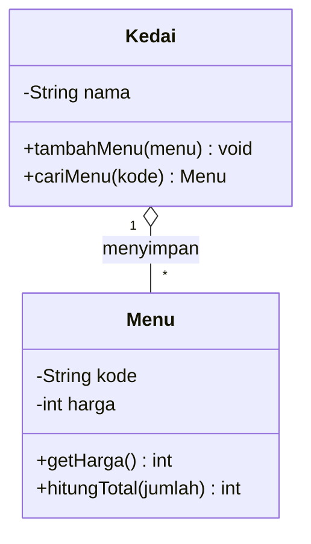

# *Cheat Sheet* Python ↔ Java

[🏠 Beranda](../README.md) · [Lampiran](README.md) · [Glosarium](glosarium.md) · ***Cheat Sheet* Python ↔ Java** · [Referensi](referensi.md) · [FAQ](faq.md)

> Contekan sintaks penting dari Pertemuan 01 sampai 15, dengan Python dan Java berdampingan. Contohnya bertema KedaiKita. Gunakan halaman ini saat kamu lupa cara menulis sesuatu, atau saat membaca kode di jalur yang bukan pilihanmu.

**Cara membaca halaman ini:**

- Setiap bagian dibuka dengan **tabel ringkas**, lalu **contoh kode Python** diikuti **contoh kode Java** untuk ide yang sama.
- Hasil yang dicetak sebuah baris ditulis sebagai komentar di ujung baris itu, misalnya `# 36000` atau `// 36000`.
- Setiap bagian berdiri sendiri. Kelas seperti `Menu` sengaja dibuat berbeda-beda di tiap bagian, disederhanakan sesuai topiknya.
- Potongan Java yang berupa **pernyataan** (bukan deklarasi kelas) diletakkan di dalam *method* `main`, seperti pada kerangka `Coba.java` di bawah.
- Semua potongan kode sudah diuji agar berjalan di Python 3.10 ke atas dan Java 17 ke atas.

**Ingin mencoba sebuah potongan?** Buat *file* baru di folder latihan pribadimu, misalnya `PBO-latihan-saya/pertemuan-12` (lihat [Git dan GitHub](../00-Persiapan/git-dan-github.md) bagian 5), bukan di folder materi.

- **Python:** salin potongannya ke *file* baru, misalnya `coba.py`. Jika bagian itu memakai kelas dari bagian lain, salin juga kelas tersebut ke atasnya. Jalankan di terminal, dari folder tempat *file* itu disimpan: `python coba.py`. Di macOS/Linux, ketik `python3` sebagai ganti `python`, termasuk pada perintah lain di halaman ini.
- **Java:** susun *file* `Coba.java` seperti kerangka di bawah ini, lalu jalankan di terminal, dari folder tempat *file* itu disimpan: `java Coba.java`. Jika sebuah potongan diawali baris `import`, pindahkan baris itu ke bagian paling atas *file*.

```java
import java.util.*;  // dibutuhkan jika memakai List, Map, dan sejenisnya

public class Coba {  // kelas yang punya main ditulis PALING ATAS
    public static void main(String[] args) {
        // tempel potongan PERNYATAAN di sini
    }
}

// tempel potongan DEKLARASI KELAS (class ..., interface ...) di sini, di bawah kelas Coba
```

> [!TIP]
> Contekan ini hanya pengingat. Penjelasan lengkap, alasan, dan jebakannya ada di halaman konsep, praktik, dan **Jembatan Python ↔ Java** di setiap pertemuan. Tautan **Materi lengkap** di awal setiap bagian membawamu langsung ke pertemuannya.

## Daftar Isi

0. [Dasar Sintaks (Pertemuan 01)](#0-dasar-sintaks-pertemuan-01)
1. [Kelas, Objek, dan Konstruktor (Pertemuan 02)](#1-kelas-objek-dan-konstruktor-pertemuan-02)
2. [Atribut Kelas dan *Method* Milik Kelas (Pertemuan 03)](#2-atribut-kelas-dan-method-milik-kelas-pertemuan-03)
3. [Representasi Teks Objek (Pertemuan 03)](#3-representasi-teks-objek-pertemuan-03)
4. [Referensi dan Nilai Kosong (Pertemuan 03)](#4-referensi-dan-nilai-kosong-pertemuan-03)
5. [Enkapsulasi (Pertemuan 04)](#5-enkapsulasi-pertemuan-04)
6. [Relasi Antarkelas dan *List* (Pertemuan 05)](#6-relasi-antarkelas-dan-list-pertemuan-05)
7. [Dari Diagram UML ke Kode (Pertemuan 06)](#7-dari-diagram-uml-ke-kode-pertemuan-06)
8. [Pewarisan dan `super` (Pertemuan 07)](#8-pewarisan-dan-super-pertemuan-07)
9. [Polimorfisme (Pertemuan 09)](#9-polimorfisme-pertemuan-09)
10. [Kelas Abstrak (Pertemuan 10)](#10-kelas-abstrak-pertemuan-10)
11. [*Interface* dan `Protocol` (Pertemuan 10)](#11-interface-dan-protocol-pertemuan-10)
12. [*Exception* (Pertemuan 11)](#12-exception-pertemuan-11)
13. [Koleksi, *Generics*, dan Pengurutan (Pertemuan 12)](#13-koleksi-generics-dan-pengurutan-pertemuan-12)
14. [Kesamaan dan Urutan Alami Objek (Pertemuan 12)](#14-kesamaan-dan-urutan-alami-objek-pertemuan-12)
15. [Prinsip SOLID dalam Kode (Pertemuan 13)](#15-prinsip-solid-dalam-kode-pertemuan-13)
16. [*Design Pattern* (Pertemuan 14)](#16-design-pattern-pertemuan-14)
17. [*File*, *Package*, dan *Unit Test* (Pertemuan 15)](#17-file-package-dan-unit-test-pertemuan-15)
18. [Jebakan saat Pindah Bahasa](#18-jebakan-saat-pindah-bahasa)

---

## 0. Dasar Sintaks (Pertemuan 01)

Materi lengkap: [Pertemuan 01: Pengenalan PBO dan Persiapan Alat](../Pertemuan-01-Pengenalan-PBO/README.md).

| Konsep | 🐍 Python | ☕ Java |
|---|---|---|
| Mencetak teks | `print("Halo")` | `System.out.println("Halo");` |
| Komentar satu baris | `# komentar` | `// komentar` |
| Variabel bilangan bulat | `harga = 18000` | `int harga = 18000;` |
| Variabel teks | `nama = "Kopi"` | `String nama = "Kopi";` |
| Nilai benar dan salah | `True`, `False` | `true`, `false` |
| Tidak ada nilai | `None` | `null` |
| Menggabungkan teks | `f"Total: {total}"` | `"Total: " + total` |
| Percabangan | `if x > 0:` ... `elif x == 0:` ... `else:` | `if (x > 0) { } else if (x == 0) { } else { }` |
| Operator logika | `and`, `or`, `not` | `&&`, `\|\|`, `!` |
| Perulangan dengan hitungan | `for i in range(5):` | `for (int i = 0; i < 5; i++) { }` |
| Perulangan isi daftar | `for menu in daftar:` | `for (Menu menu : daftar) { }` |
| Perulangan bersyarat | `while stok > 0:` | `while (stok > 0) { }` |
| Pembagian bulat | `7 // 2` menghasilkan `3` | `7 / 2` menghasilkan `3` (jika keduanya `int`) |
| Pembagian desimal | `7 / 2` menghasilkan `3.5` | `7 / 2.0` menghasilkan `3.5` |
| Panjang teks | `len(nama)` | `nama.length()` |
| Ukuran daftar | `len(daftar)` | `daftar.size()` (*List*) atau `arr.length` (*array*) |
| Blok kode | indentasi | kurung kurawal `{ }` |
| Akhir pernyataan | ganti baris | titik koma `;` |
| Pintu masuk program | `if __name__ == "__main__":` lalu `main()` | `public static void main(String[] args)` |

**Python** (*file* `program_pertama.py`, jalankan dengan `python program_pertama.py`):

```python
def main():
    harga = 18000
    jumlah = 2
    print(f"Total: Rp{harga * jumlah}")  # Total: Rp36000


if __name__ == "__main__":
    main()
```

**Java** (*file* `ProgramPertama.java`, jalankan dengan `java ProgramPertama.java`):

```java
public class ProgramPertama {
    public static void main(String[] args) {
        int harga = 18000;
        int jumlah = 2;
        System.out.println("Total: Rp" + (harga * jumlah));  // Total: Rp36000
    }
}
```

## 1. Kelas, Objek, dan Konstruktor (Pertemuan 02)

Materi lengkap: [Pertemuan 02: Kelas dan Objek](../Pertemuan-02-Kelas-dan-Objek/README.md).

| Konsep | 🐍 Python | ☕ Java |
|---|---|---|
| Mendefinisikan kelas | `class Menu:` | `class Menu { }` |
| Atribut | dibuat saat diisi: `self.harga = harga` | dideklarasikan dulu: `int harga;` |
| Konstruktor | `def __init__(self, nama, harga):` | `Menu(String nama, int harga) { }` |
| Kata ganti objek | `self` (wajib ditulis sebagai parameter pertama) | `this` (tersedia otomatis) |
| Membuat objek | `Menu("Kopi", 18000)` | `new Menu("Kopi", 18000)` |
| Memanggil *method* | `kopi.hitung_total(2)` | `kopi.hitungTotal(2)` |
| Gaya nama *method* | `snake_case` | `camelCase` |

**Python:**

```python
class Menu:
    def __init__(self, nama, harga):  # konstruktor
        self.nama = nama  # atribut milik objek
        self.harga = harga

    def hitung_total(self, jumlah):  # method dengan nilai kembalian
        return self.harga * jumlah


kopi = Menu("Kopi Susu Gula Aren", 18000)  # membuat objek
print(kopi.nama)  # Kopi Susu Gula Aren
print(kopi.hitung_total(2))  # 36000
```

**Java:**

```java
class Menu {
    String nama;  // atribut (field) dideklarasikan beserta tipenya
    int harga;

    Menu(String nama, int harga) {  // konstruktor: namanya sama dengan nama kelas
        this.nama = nama;
        this.harga = harga;
    }

    int hitungTotal(int jumlah) {  // method dengan nilai kembalian
        return harga * jumlah;
    }
}
```

```java
Menu kopi = new Menu("Kopi Susu Gula Aren", 18000);  // membuat objek
System.out.println(kopi.nama);            // Kopi Susu Gula Aren
System.out.println(kopi.hitungTotal(2));  // 36000
```

## 2. Atribut Kelas dan *Method* Milik Kelas (Pertemuan 03)

Materi lengkap: [Pertemuan 03: Atribut dan *Method* Lebih Dalam](../Pertemuan-03-Atribut-dan-Method/README.md).

| Konsep | 🐍 Python | ☕ Java |
|---|---|---|
| Atribut milik kelas | ditulis di badan kelas: `jumlah_menu = 0` | `static int jumlahMenu = 0;` |
| Mengakses atribut kelas | `Menu.jumlah_menu` | `Menu.jumlahMenu` |
| *Method* milik kelas | `@classmethod` (menerima `cls`) atau `@staticmethod` | `static` |
| Konstruktor alternatif | `@classmethod def dari_teks(cls, teks)` | `static Menu dariTeks(String teks)` |
| Nilai bawaan parameter | `def __init__(self, ..., stok=0)` | tidak ada; pakai *overloading* konstruktor |
| Memanggil konstruktor lain | (tidak perlu) | `this(kode, nama, harga, kategori, 0);` |

**Python:**

```python
def format_rupiah(angka):  # fungsi biasa di tingkat modul
    return f"Rp{angka:,}".replace(",", ".")


class Menu:
    jumlah_menu = 0  # atribut KELAS: satu nilai untuk semua objek

    def __init__(self, kode, nama, harga, kategori, stok=0):  # stok bawaan 0
        self.kode = kode  # atribut OBJEK: milik masing-masing objek
        self.nama = nama
        self.harga = harga
        self.kategori = kategori
        self.stok = stok
        Menu.jumlah_menu += 1  # ubah atribut kelas lewat nama kelas

    @classmethod
    def dari_teks(cls, teks):  # "konstruktor alternatif"
        kode, nama, harga, kategori = teks.split(";")
        return cls(kode, nama, int(harga), kategori)

    @staticmethod
    def kode_valid(kode):  # tidak butuh self maupun cls
        return len(kode) == 3 and kode.startswith("M")


kopi = Menu("M01", "Kopi Susu Gula Aren", 18000, "Minuman", 20)
teh = Menu.dari_teks("M02;Es Teh Manis;8000;Minuman")
print(Menu.jumlah_menu)  # 2
print(teh.stok)  # 0
print(Menu.kode_valid("M09"))  # True
print(format_rupiah(kopi.harga))  # Rp18.000
```

**Java:**

```java
import java.util.Locale;

class Rupiah {
    static String format(int angka) {  // method static: dipanggil lewat nama kelas
        return "Rp" + String.format(Locale.US, "%,d", angka).replace(',', '.');
    }
}

class Menu {
    static int jumlahMenu = 0;  // atribut KELAS: satu nilai untuk semua objek

    String kode;  // atribut OBJEK: milik masing-masing objek
    String nama;
    int harga;
    String kategori;
    int stok;

    Menu(String kode, String nama, int harga, String kategori, int stok) {
        this.kode = kode;
        this.nama = nama;
        this.harga = harga;
        this.kategori = kategori;
        this.stok = stok;
        jumlahMenu++;
    }

    Menu(String kode, String nama, int harga, String kategori) {  // overloading
        this(kode, nama, harga, kategori, 0);  // panggil konstruktor lain, stok 0
    }

    static Menu dariTeks(String teks) {  // "konstruktor alternatif"
        String[] bagian = teks.split(";");
        return new Menu(bagian[0], bagian[1], Integer.parseInt(bagian[2]), bagian[3]);
    }

    static boolean kodeValid(String kode) {
        return kode.length() == 3 && kode.startsWith("M");
    }
}
```

```java
Menu kopi = new Menu("M01", "Kopi Susu Gula Aren", 18000, "Minuman", 20);
Menu teh = Menu.dariTeks("M02;Es Teh Manis;8000;Minuman");
System.out.println(Menu.jumlahMenu);            // 2
System.out.println(teh.stok);                   // 0
System.out.println(Menu.kodeValid("M09"));      // true
System.out.println(Rupiah.format(kopi.harga));  // Rp18.000
```

> [!WARNING]
> Jebakan khusus Python: `kopi.jumlah_menu += 1` **tidak** mengubah atribut kelas. Perintah itu membuat atribut **objek** baru bernama sama milik `kopi` saja. Ubahlah atribut kelas lewat nama kelasnya: `Menu.jumlah_menu += 1`.

## 3. Representasi Teks Objek (Pertemuan 03)

Materi lengkap: [Pertemuan 03: Atribut dan *Method* Lebih Dalam](../Pertemuan-03-Atribut-dan-Method/README.md).

| Konsep | 🐍 Python | ☕ Java |
|---|---|---|
| Teks saat objek dicetak | `def __str__(self):` | `public String toString()` dengan `@Override` |
| Dipakai oleh | `print(objek)`, `str(objek)`, *f-string* | `System.out.println(objek)`, `"..." + objek` |
| Teks untuk pemrogram | `def __repr__(self):` | (biasanya cukup `toString()`) |

**Python:**

```python
class Pelanggan:
    def __init__(self, nama, no_hp):
        self.nama = nama
        self.no_hp = no_hp
        self.poin = 0

    def __str__(self):  # dipakai oleh print() dan str()
        return f"{self.nama} ({self.no_hp}) - {self.poin} poin"


budi = Pelanggan("Budi Santoso", "081234567890")
print(budi)  # Budi Santoso (081234567890) - 0 poin
```

**Java:**

```java
class Pelanggan {
    String nama;
    String noHp;
    int poin;

    Pelanggan(String nama, String noHp) {
        this.nama = nama;
        this.noHp = noHp;
    }

    @Override
    public String toString() {  // dipakai oleh println dan penggabungan teks
        return nama + " (" + noHp + ") - " + poin + " poin";
    }
}
```

```java
Pelanggan budi = new Pelanggan("Budi Santoso", "081234567890");
System.out.println(budi);  // Budi Santoso (081234567890) - 0 poin
```

> [!NOTE]
> `toString()` wajib ditulis `public` karena ia menimpa (meng-*override*) *method* `public` milik kelas `Object`. Detailnya dibahas di Pertemuan 07.

## 4. Referensi dan Nilai Kosong (Pertemuan 03)

Materi lengkap: [Pertemuan 03: Atribut dan *Method* Lebih Dalam](../Pertemuan-03-Atribut-dan-Method/README.md). Contoh di bagian ini memakai kelas `Menu` dari [bagian 1](#1-kelas-objek-dan-konstruktor-pertemuan-02).

| Konsep | 🐍 Python | ☕ Java |
|---|---|---|
| Objek yang sama? (identitas) | `a is b` | `a == b` |
| Isinya sama? (kesamaan) | `a == b` | `a.equals(b)` |
| Membandingkan teks | `kategori == "Minuman"` | `kategori.equals("Minuman")` |
| Tidak menunjuk objek apa pun | `None`, diperiksa dengan `x is None` | `null`, diperiksa dengan `x == null` |

**Python:**

```python
kopi = Menu("Kopi Susu Gula Aren", 18000)
kopi_favorit = kopi  # BUKAN salinan: dua nama untuk objek yang sama
kopi_favorit.harga = 20000
print(kopi.harga)  # 20000 (ikut berubah)
print(kopi_favorit is kopi)  # True: objek yang sama

kopi_lain = Menu("Kopi Susu Gula Aren", 20000)
print(kopi_lain is kopi)  # False: objek berbeda, walaupun isinya sama

menu_dicari = None  # belum menunjuk objek apa pun
if menu_dicari is None:
    print("Menu tidak ditemukan")  # Menu tidak ditemukan
```

**Java:**

```java
Menu kopi = new Menu("Kopi Susu Gula Aren", 18000);
Menu kopiFavorit = kopi;  // BUKAN salinan: dua nama untuk objek yang sama
kopiFavorit.harga = 20000;
System.out.println(kopi.harga);           // 20000 (ikut berubah)
System.out.println(kopiFavorit == kopi);  // true: objek yang sama

Menu kopiLain = new Menu("Kopi Susu Gula Aren", 20000);
System.out.println(kopiLain == kopi);     // false: objek berbeda, walaupun isinya sama

Menu menuDicari = null;  // belum menunjuk objek apa pun
if (menuDicari == null) {
    System.out.println("Menu tidak ditemukan");  // Menu tidak ditemukan
}

String kategori = "Minuman";
System.out.println(kategori.equals("Minuman"));  // true: bandingkan ISI teks dengan equals
```

> [!WARNING]
> Di Java, jangan membandingkan isi teks dengan `==`. Operator `==` hanya memeriksa apakah dua variabel menunjuk objek yang sama. Hasilnya bisa tampak benar di satu tempat, lalu salah di tempat lain. Selalu gunakan `.equals()`.

## 5. Enkapsulasi (Pertemuan 04)

Materi lengkap: [Pertemuan 04: Enkapsulasi](../Pertemuan-04-Enkapsulasi/README.md).

| Konsep | 🐍 Python | ☕ Java |
|---|---|---|
| Atribut yang disembunyikan | konvensi `self._harga` | `private int harga;` |
| Membaca nilai | `@property` lalu akses `kopi.harga` | *getter*: `kopi.getHarga()` |
| Mengubah nilai | `@harga.setter` lalu `kopi.harga = 20000` | *setter*: `kopi.setHarga(20000)` |
| Menolak data tidak valid | `raise ValueError("...")` | `throw new IllegalArgumentException("...")` |
| Atribut *read-only* | `@property` tanpa *setter* | *getter* tanpa *setter* |
| Nama *getter* untuk *boolean* | `kopi.dingin` | `kopi.isDingin()` |

**Python:**

```python
class Menu:
    def __init__(self, kode, nama, harga, stok=0):
        self._kode = kode  # awalan _ : urusan internal kelas
        self._nama = nama
        self._stok = stok
        self.harga = harga  # lewat setter, jadi ikut divalidasi

    @property
    def kode(self):  # read-only: tidak ada setter
        return self._kode

    @property
    def harga(self):  # getter
        return self._harga

    @harga.setter
    def harga(self, nilai):  # setter dengan validasi
        if nilai <= 0:
            raise ValueError("Harga harus lebih dari 0")
        self._harga = nilai

    @property
    def stok(self):
        return self._stok

    def kurangi_stok(self, jumlah):  # "pintu resmi" untuk mengubah stok
        if jumlah > self._stok:
            raise ValueError(f"Stok {self._nama} tidak cukup")
        self._stok -= jumlah


kopi = Menu("M01", "Kopi Susu Gula Aren", 18000, 20)
kopi.harga = 20000  # terlihat seperti atribut, tetapi memanggil setter
print(kopi.harga)  # 20000
try:
    kopi.harga = -5000
except ValueError as e:
    print(f"Ditolak: {e}")  # Ditolak: Harga harus lebih dari 0
```

**Java:**

```java
class Menu {
    private String kode;  // private: hanya bisa diakses dari dalam kelas ini
    private String nama;
    private int harga;
    private int stok;

    public Menu(String kode, String nama, int harga, int stok) {
        this.kode = kode;
        this.nama = nama;
        setHarga(harga);  // lewat setter, jadi ikut divalidasi
        this.stok = stok;
    }

    public String getKode() {  // read-only: tidak ada setKode()
        return kode;
    }

    public int getHarga() {  // getter
        return harga;
    }

    public void setHarga(int harga) {  // setter dengan validasi
        if (harga <= 0) {
            throw new IllegalArgumentException("Harga harus lebih dari 0");
        }
        this.harga = harga;
    }

    public int getStok() {
        return stok;
    }

    public void kurangiStok(int jumlah) {  // "pintu resmi" untuk mengubah stok
        if (jumlah > stok) {
            throw new IllegalArgumentException("Stok " + nama + " tidak cukup");
        }
        stok -= jumlah;
    }
}
```

```java
Menu kopi = new Menu("M01", "Kopi Susu Gula Aren", 18000, 20);
kopi.setHarga(20000);
System.out.println(kopi.getHarga());  // 20000
try {
    kopi.setHarga(-5000);
} catch (IllegalArgumentException e) {
    System.out.println("Ditolak: " + e.getMessage());  // Ditolak: Harga harus lebih dari 0
}
```

**Jangkauan *access modifier* Java:**

| *Modifier* | Kelas itu sendiri | Kelas lain di *package* yang sama | Kelas anak di *package* lain | Semua kelas lain |
|---|---|---|---|---|
| `public` | ya | ya | ya | ya |
| `protected` | ya | ya | ya | tidak |
| (tanpa *modifier*) | ya | ya | tidak | tidak |
| `private` | ya | tidak | tidak | tidak |

**Konvensi nama di Python:**

| Penulisan | Artinya |
|---|---|
| `nama` | publik, boleh dipakai dari luar |
| `_nama` | urusan internal kelas; masih bisa diakses, tetapi sebaiknya tidak |
| `__nama` | *name mangling*: Python mengganti namanya menjadi `_NamaKelas__nama`. Ini bukan fitur keamanan. |

## 6. Relasi Antarkelas dan *List* (Pertemuan 05)

Materi lengkap: [Pertemuan 05: Relasi Antarkelas](../Pertemuan-05-Relasi-Antarkelas/README.md). Contoh di bagian ini memakai `Menu` dari [bagian 5](#5-enkapsulasi-pertemuan-04) dan `Pelanggan` dari [bagian 3](#3-representasi-teks-objek-pertemuan-03).

| Relasi | Ciri di kode | Contoh KedaiKita |
|---|---|---|
| Dependensi | objek lain hanya dipakai sebagai parameter atau variabel lokal | `Kedai` hanya menerima `Pelanggan` sebagai parameter saat membuat pesanan |
| Asosiasi | atribut berisi referensi ke objek lain | `ItemPesanan` menyimpan `Menu` |
| Agregasi | menyimpan objek yang **diterima dari luar**; bagian bisa hidup sendiri | `Kedai` menyimpan daftar `Menu` |
| Komposisi | **membuat sendiri** objek bagian dan menyimpannya; bagian ikut lenyap | `Pesanan` membuat `ItemPesanan` |

**Python:**

```python
class ItemPesanan:
    def __init__(self, menu: Menu, jumlah: int):
        self.menu = menu  # asosiasi: item "mengenal" sebuah Menu
        self.jumlah = jumlah

    def hitung_subtotal(self) -> int:
        return self.menu.harga * self.jumlah


class Pesanan:
    def __init__(self, pelanggan: Pelanggan):
        self.pelanggan = pelanggan
        self._daftar_item: list[ItemPesanan] = []

    def tambah_item(self, menu: Menu, jumlah: int):
        # komposisi: ItemPesanan dibuat DI DALAM pesanan
        self._daftar_item.append(ItemPesanan(menu, jumlah))

    @property
    def daftar_item(self) -> list[ItemPesanan]:
        return list(self._daftar_item)  # SALINAN, agar isi aslinya aman

    def hitung_total(self) -> int:
        total = 0
        for item in self._daftar_item:
            total += item.hitung_subtotal()
        return total


class Kedai:
    def __init__(self, nama: str):
        self.nama = nama
        self._daftar_menu: list[Menu] = []  # agregasi: menu bisa ada tanpa kedai

    def tambah_menu(self, menu: Menu):
        self._daftar_menu.append(menu)

    def cari_menu(self, kode: str) -> Menu | None:
        for menu in self._daftar_menu:
            if menu.kode == kode:
                return menu
        return None  # tidak ditemukan
```

```python
kedai = Kedai("KedaiKita")
kedai.tambah_menu(Menu("M01", "Kopi Susu Gula Aren", 18000, 20))
kedai.tambah_menu(Menu("M03", "Nasi Goreng Kampung", 25000, 15))

pesanan = Pesanan(Pelanggan("Budi Santoso", "081234567890"))
pesanan.tambah_item(kedai.cari_menu("M01"), 2)
pesanan.tambah_item(kedai.cari_menu("M03"), 1)
print(pesanan.hitung_total())  # 61000
print(len(pesanan.daftar_item))  # 2
print(kedai.cari_menu("M99"))  # None
```

**Java:**

```java
import java.util.ArrayList;
import java.util.List;

class ItemPesanan {
    private Menu menu;  // asosiasi: item "mengenal" sebuah Menu
    private int jumlah;

    public ItemPesanan(Menu menu, int jumlah) {
        this.menu = menu;
        this.jumlah = jumlah;
    }

    public int hitungSubtotal() {
        return menu.getHarga() * jumlah;
    }
}

class Pesanan {
    private Pelanggan pelanggan;
    private List<ItemPesanan> daftarItem = new ArrayList<>();  // "list berisi ItemPesanan"

    public Pesanan(Pelanggan pelanggan) {
        this.pelanggan = pelanggan;
    }

    public void tambahItem(Menu menu, int jumlah) {
        // komposisi: ItemPesanan dibuat DI DALAM pesanan
        daftarItem.add(new ItemPesanan(menu, jumlah));
    }

    public List<ItemPesanan> getDaftarItem() {
        return new ArrayList<>(daftarItem);  // SALINAN, agar isi aslinya aman
    }

    public int hitungTotal() {
        int total = 0;
        for (ItemPesanan item : daftarItem) {
            total += item.hitungSubtotal();
        }
        return total;
    }
}

class Kedai {
    private String nama;
    private List<Menu> daftarMenu = new ArrayList<>();  // agregasi: menu bisa ada tanpa kedai

    public Kedai(String nama) {
        this.nama = nama;
    }

    public void tambahMenu(Menu menu) {
        daftarMenu.add(menu);
    }

    public Menu cariMenu(String kode) {
        for (Menu menu : daftarMenu) {
            if (menu.getKode().equals(kode)) {
                return menu;
            }
        }
        return null;  // tidak ditemukan
    }
}
```

```java
Kedai kedai = new Kedai("KedaiKita");
kedai.tambahMenu(new Menu("M01", "Kopi Susu Gula Aren", 18000, 20));
kedai.tambahMenu(new Menu("M03", "Nasi Goreng Kampung", 25000, 15));

Pesanan pesanan = new Pesanan(new Pelanggan("Budi Santoso", "081234567890"));
pesanan.tambahItem(kedai.cariMenu("M01"), 2);
pesanan.tambahItem(kedai.cariMenu("M03"), 1);
System.out.println(pesanan.hitungTotal());           // 61000
System.out.println(pesanan.getDaftarItem().size());  // 2
System.out.println(kedai.cariMenu("M99"));           // null
```

**Operasi *list* yang paling sering dipakai:**

| Operasi | 🐍 Python (`list`) | ☕ Java (`List`/`ArrayList`) |
|---|---|---|
| Membuat *list* kosong | `daftar = []` | `List<Menu> daftar = new ArrayList<>();` |
| Menambah di akhir | `daftar.append(menu)` | `daftar.add(menu)` |
| Mengambil elemen ke-0 | `daftar[0]` | `daftar.get(0)` |
| Jumlah elemen | `len(daftar)` | `daftar.size()` |
| Apakah kosong? | `not daftar` | `daftar.isEmpty()` |
| Apakah berisi? | `menu in daftar` | `daftar.contains(menu)` |
| Menghapus | `daftar.remove(menu)` | `daftar.remove(menu)` |
| Membuat salinan | `list(daftar)` | `new ArrayList<>(daftar)` |

**Program banyak *file*:**

| | 🐍 Python | ☕ Java |
|---|---|---|
| Satu *file* berisi | boleh beberapa kelas; nama *file* bebas, misalnya `menu.py` | satu kelas `public` per *file*; nama *file* = nama kelas, misalnya `Menu.java` |
| Memakai kelas dari *file* lain | `from menu import Menu` | tidak perlu `import` jika di folder (*package*) yang sama |
| Menjalankan | `python main.py` | `javac *.java` lalu `java Main` |

## 7. Dari Diagram UML ke Kode (Pertemuan 06)

Materi lengkap: [Pertemuan 06: UML *Class Diagram*](../Pertemuan-06-UML-Class-Diagram/README.md).

| Di diagram UML | Artinya | 🐍 Python | ☕ Java |
|---|---|---|---|
| `+ nama: String` | atribut publik | `self.nama` | `public String nama;` |
| `- harga: int` | atribut privat | `self._harga` (konvensi) | `private int harga;` |
| `# stok: int` | atribut *protected* | `self._stok` (konvensi) | `protected int stok;` |
| `~ kode: String` | atribut *package* | (tidak ada padanannya) | `String kode;` (tanpa *modifier*) |
| `+ hitungTotal(jumlah: int): int` | *method* publik | `def hitung_total(self, jumlah: int) -> int:` | `public int hitungTotal(int jumlah)` |
| nama digarisbawahi | milik kelas (*static*) | atribut kelas, `@classmethod`, atau `@staticmethod` | `static` |
| nama dicetak miring | abstrak | `@abstractmethod` | `abstract` |

| Relasi | Notasi Mermaid | Wujud di kode |
|---|---|---|
| Asosiasi | `A --> B` | atribut di `A` berisi objek `B` |
| Agregasi | `A o-- B` | `A` menyimpan `B` yang diterima dari luar |
| Komposisi | `A *-- B` | `A` membuat sendiri `B` lalu menyimpannya |
| Dependensi | `A ..> B` | `B` hanya muncul sebagai parameter atau variabel lokal di `A` |
| Pewarisan | `A <\|-- B` | `class B(A):` atau `class B extends A` |
| Realisasi | `A <\|.. B` | `class B(A):` dengan `A` berupa kelas abstrak/*interface*, atau `class B implements A` |

Contoh diagram Mermaid kecil (GitHub menampilkannya sebagai gambar):



## 8. Pewarisan dan `super` (Pertemuan 07)

Materi lengkap: [Pertemuan 07: Pewarisan (*Inheritance*)](../Pertemuan-07-Pewarisan/README.md).

| Konsep | 🐍 Python | ☕ Java |
|---|---|---|
| Membuat kelas anak | `class Makanan(Menu):` | `class Makanan extends Menu` |
| Memanggil konstruktor induk | `super().__init__(...)` | `super(...);` di baris pertama konstruktor (wajib di Java 17 dan 21) |
| Memanggil *method* induk | `super().__str__()` | `super.toString()` |
| Menandai *override* | (tidak ada tanda wajib) | `@Override` |
| Memeriksa jenis objek | `isinstance(nasi, Menu)` | `nasi instanceof Menu` |
| Mewarisi beberapa kelas | boleh: `class C(A, B):` | tidak boleh untuk kelas; gunakan *interface* |
| Kelas akar semua kelas | `object` | `Object` |
| Mencegah *override* | (konvensi saja) | `final` |

> [!NOTE]
> Java 25 melonggarkan aturan `super(...)` di baris pertama: pernyataan yang tidak memakai objek yang sedang dibuat, misalnya memeriksa nilai parameter, boleh ditulis sebelum `super(...)`. Mata kuliah ini berpatokan pada Java 17, dan menulis `super(...)` di baris pertama tetap aman di semua versi.
>
> Sejak Python 3.12, modul `typing` punya dekorator `@override`, dan sejak lama ada `@final`. Keduanya hanya diperiksa alat pemeriksa tipe, misalnya mypy atau Pylance di VS Code (pemeriksaan Pylance mati secara bawaan), bukan oleh Python saat program berjalan. Karena itu, materi ini tidak memakainya.

**Python** (memakai `format_rupiah()` dari [bagian 2](#2-atribut-kelas-dan-method-milik-kelas-pertemuan-03)):

```python
class Menu:
    def __init__(self, kode, nama, harga, kategori):
        self.kode = kode
        self.nama = nama
        self.harga = harga
        self.kategori = kategori

    def __str__(self):
        return f"[{self.kode}] {self.nama} - {format_rupiah(self.harga)}"


class Makanan(Menu):  # Makanan ADALAH Menu
    def __init__(self, kode, nama, harga, level_pedas=0):
        super().__init__(kode, nama, harga, "Makanan")  # konstruktor induk
        self.level_pedas = level_pedas  # atribut tambahan khusus Makanan

    def __str__(self):  # override, sambil memakai versi induk
        return f"{super().__str__()} | pedas level {self.level_pedas}"


nasi = Makanan("M03", "Nasi Goreng Kampung", 25000, 2)
print(nasi)  # [M03] Nasi Goreng Kampung - Rp25.000 | pedas level 2
print(nasi.kategori)  # Makanan
print(isinstance(nasi, Menu))  # True
```

**Java** (memakai kelas `Rupiah` dari [bagian 2](#2-atribut-kelas-dan-method-milik-kelas-pertemuan-03)):

```java
class Menu {
    private String kode;
    private String nama;
    private int harga;
    private String kategori;

    public Menu(String kode, String nama, int harga, String kategori) {
        this.kode = kode;
        this.nama = nama;
        this.harga = harga;
        this.kategori = kategori;
    }

    public String getKategori() {
        return kategori;
    }

    @Override
    public String toString() {
        return "[" + kode + "] " + nama + " - " + Rupiah.format(harga);
    }
}

class Makanan extends Menu {  // Makanan ADALAH Menu
    private int levelPedas;  // atribut tambahan khusus Makanan

    public Makanan(String kode, String nama, int harga, int levelPedas) {
        super(kode, nama, harga, "Makanan");  // konstruktor induk, ditulis paling awal
        this.levelPedas = levelPedas;
    }

    @Override
    public String toString() {  // override, sambil memakai versi induk
        return super.toString() + " | pedas level " + levelPedas;
    }
}
```

```java
Makanan nasi = new Makanan("M03", "Nasi Goreng Kampung", 25000, 2);
System.out.println(nasi);                  // [M03] Nasi Goreng Kampung - Rp25.000 | pedas level 2
System.out.println(nasi.getKategori());    // Makanan
System.out.println(nasi instanceof Menu);  // true
```

> [!TIP]
> Uji cepat sebelum memakai pewarisan: apakah kalimat "X **adalah** Y" masuk akal? "Makanan adalah Menu" cocok untuk pewarisan. "Pesanan adalah Pelanggan" tidak masuk akal karena hubungannya adalah "pesanan **punya** pelanggan". Untuk hubungan seperti itu, asosiasi atau komposisi lebih cocok.

## 9. Polimorfisme (Pertemuan 09)

Materi lengkap: [Pertemuan 09: Polimorfisme](../Pertemuan-09-Polimorfisme/README.md).

| Konsep | 🐍 Python | ☕ Java |
|---|---|---|
| Koleksi polimorfik | `daftar = [PembayaranTunai(), PembayaranKartu()]` | `List<Pembayaran> daftar` berisi objek kelas-kelas anak |
| *Upcasting* | tidak perlu dipikirkan | otomatis: `Pembayaran p = new PembayaranKartu();` |
| *Downcasting* | tidak perlu | eksplisit: `(PembayaranKartu) p` |
| Memeriksa jenis | `isinstance(p, PembayaranKartu)` | `p instanceof PembayaranKartu` |
| *Overloading* | tidak ada; gunakan nilai bawaan parameter | boleh: nama sama, parameter berbeda |
| *Duck typing* | ya: cukup punya *method* yang sama | tidak; butuh induk atau *interface* yang sama |

**Python:**

```python
class Pembayaran:
    def nama_metode(self):
        return "Umum"

    def hitung_biaya_layanan(self, total):
        return 0  # bawaan: tanpa biaya


class PembayaranTunai(Pembayaran):
    def nama_metode(self):
        return "Tunai"


class PembayaranKartu(Pembayaran):
    def nama_metode(self):
        return "Kartu Kredit"

    def hitung_biaya_layanan(self, total):  # override: biaya 2%
        return total * 2 // 100


daftar = [PembayaranTunai(), PembayaranKartu()]  # koleksi polimorfik
for pembayaran in daftar:
    # versi method yang dipanggil = milik objek SEBENARNYA (dynamic dispatch)
    biaya = pembayaran.hitung_biaya_layanan(50000)
    print(f"{pembayaran.nama_metode()}: biaya {biaya}")
# Tunai: biaya 0
# Kartu Kredit: biaya 1000

for pembayaran in daftar:
    if isinstance(pembayaran, PembayaranKartu):  # periksa jenis sebenarnya
        print("Siapkan mesin EDC")  # Siapkan mesin EDC
```

**Java:**

```java
class Pembayaran {
    public String namaMetode() {
        return "Umum";
    }

    public int hitungBiayaLayanan(int total) {
        return 0;  // bawaan: tanpa biaya
    }
}

class PembayaranTunai extends Pembayaran {
    @Override
    public String namaMetode() {
        return "Tunai";
    }
}

class PembayaranKartu extends Pembayaran {
    @Override
    public String namaMetode() {
        return "Kartu Kredit";
    }

    @Override
    public int hitungBiayaLayanan(int total) {  // override: biaya 2%
        return total * 2 / 100;
    }

    public void siapkanMesinEdc() {  // method khusus kelas ini
        System.out.println("Siapkan mesin EDC");
    }
}
```

```java
List<Pembayaran> daftar = new ArrayList<>();  // koleksi polimorfik
daftar.add(new PembayaranTunai());  // upcasting otomatis
daftar.add(new PembayaranKartu());
for (Pembayaran pembayaran : daftar) {
    // versi method yang dipanggil = milik objek SEBENARNYA (dynamic dispatch)
    int biaya = pembayaran.hitungBiayaLayanan(50000);
    System.out.println(pembayaran.namaMetode() + ": biaya " + biaya);
}
// Tunai: biaya 0
// Kartu Kredit: biaya 1000

for (Pembayaran pembayaran : daftar) {
    if (pembayaran instanceof PembayaranKartu) {  // periksa jenis sebenarnya
        PembayaranKartu kartu = (PembayaranKartu) pembayaran;  // downcasting
        kartu.siapkanMesinEdc();  // Siapkan mesin EDC
    }
}
```

Sejak Java 16, pemeriksaan dan *downcasting* bisa digabung: `if (pembayaran instanceof PembayaranKartu kartu) { kartu.siapkanMesinEdc(); }`.

**Khusus Python, *duck typing*:** objek dari kelas yang tidak berhubungan pun bisa ikut asalkan punya *method* yang dibutuhkan.

```python
class Voucher:  # TIDAK mewarisi Pembayaran
    def nama_metode(self):
        return "Voucher"

    def hitung_biaya_layanan(self, total):
        return 0


daftar.append(Voucher())  # tetap bisa ikut di perulangan yang sama
```

**Khusus Java, *overloading*:** beberapa *method* bernama sama dengan parameter berbeda. Padanannya di Python adalah nilai bawaan parameter.

```java
class Kalkulator {
    static int total(int harga, int jumlah) {
        return harga * jumlah;
    }

    static int total(int harga) {  // overloading: nama sama, parameter berbeda
        return total(harga, 1);
    }
}
```

```python
def total(harga, jumlah=1):  # Python: pakai nilai bawaan, bukan overloading
    return harga * jumlah
```

> [!WARNING]
> Jika di Python kamu menulis dua `def total(...)` dengan parameter berbeda di kelas atau modul yang sama, `def` yang kedua **menimpa** yang pertama. Python tidak mengenal *overloading*.

## 10. Kelas Abstrak (Pertemuan 10)

Materi lengkap: [Pertemuan 10: *Abstract Class* dan *Interface*](../Pertemuan-10-Abstract-Class-dan-Interface/README.md).

| Konsep | 🐍 Python | ☕ Java |
|---|---|---|
| Kelas abstrak | `class Pembayaran(ABC):` | `abstract class Pembayaran` |
| *Method* abstrak | `@abstractmethod` | `public abstract String namaMetode();` |
| Mencoba membuat objeknya | `TypeError` saat program **berjalan** | *error* saat **kompilasi** |
| Boleh punya konstruktor, atribut, *method* biasa | ya | ya |

**Python** (memakai `format_rupiah()` dari [bagian 2](#2-atribut-kelas-dan-method-milik-kelas-pertemuan-03)):

```python
from abc import ABC, abstractmethod


class Pembayaran(ABC):
    @abstractmethod
    def nama_metode(self) -> str:
        """Wajib diisi oleh kelas anak."""

    def deskripsi(self, total: int) -> str:  # method biasa tetap boleh ada
        return f"{self.nama_metode()} untuk {format_rupiah(total)}"


class PembayaranQRIS(Pembayaran):
    def nama_metode(self) -> str:
        return "QRIS"


print(PembayaranQRIS().deskripsi(26400))  # QRIS untuk Rp26.400
# Pembayaran()  -> TypeError saat berjalan: kelas abstrak tidak bisa dibuat objeknya
```

**Java** (memakai kelas `Rupiah` dari [bagian 2](#2-atribut-kelas-dan-method-milik-kelas-pertemuan-03)):

```java
abstract class Pembayaran {
    public abstract String namaMetode();  // tanpa isi: wajib di-override

    public String deskripsi(int total) {  // method biasa tetap boleh ada
        return namaMetode() + " untuk " + Rupiah.format(total);
    }
}

class PembayaranQRIS extends Pembayaran {
    @Override
    public String namaMetode() {
        return "QRIS";
    }
}
```

```java
System.out.println(new PembayaranQRIS().deskripsi(26400));  // QRIS untuk Rp26.400
// new Pembayaran();  -> error kompilasi: Pembayaran is abstract; cannot be instantiated
```

## 11. *Interface* dan `Protocol` (Pertemuan 10)

Materi lengkap: [Pertemuan 10: *Abstract Class* dan *Interface*](../Pertemuan-10-Abstract-Class-dan-Interface/README.md).

| Konsep | 🐍 Python | ☕ Java |
|---|---|---|
| Kontrak kemampuan | kelas `ABC` yang semua *method*-nya abstrak | `interface DapatDicetak` |
| Memenuhi kontrak | mewarisi: `class Kedai(DapatDicetak):` | `class Kedai implements DapatDicetak` |
| Banyak kontrak sekaligus | `class Bebek(BisaTerbang, BisaBerenang):` | `class Bebek implements BisaTerbang, BisaBerenang` |
| Kontrak tanpa pewarisan | `typing.Protocol` (cukup punya *method* yang sama) | tidak ada; harus `implements` |
| *Method* berisi di kontrak | *method* biasa di kelas `ABC` | `default` *method* (sejak Java 8) |

**Python**, gaya kelas abstrak (dipakai KedaiKita):

```python
from abc import ABC, abstractmethod


class DapatDicetak(ABC):  # "interface": isinya hanya method abstrak
    @abstractmethod
    def cetak(self):
        """Mencetak isi objek ke layar."""


class Kedai(DapatDicetak):
    def __init__(self, nama: str):
        self.nama = nama

    def cetak(self):
        print(f"=== MENU {self.nama} ===")


def cetak_semua(daftar: list[DapatDicetak]):
    for objek in daftar:
        objek.cetak()  # tidak peduli kelas aslinya


cetak_semua([Kedai("KedaiKita")])  # === MENU KedaiKita ===
```

**Python**, gaya `Protocol` (kontrak struktural, mirip *duck typing* yang diresmikan):

```python
from typing import Protocol


class BisaDicetak(Protocol):  # kelas lain cukup punya method cetak()
    def cetak(self): ...


class Struk:  # tidak mewarisi apa pun, tetapi punya cetak()
    def cetak(self):
        print("=== STRUK ===")


def cetak_dokumen(dokumen: BisaDicetak):
    dokumen.cetak()


cetak_dokumen(Struk())  # === STRUK ===
```

Kecocokan `Protocol` (*structural typing*) hanya diperiksa alat pemeriksa tipe, misalnya Pylance di VS Code setelah pengaturan **Python › Analysis: Type Checking Mode** diubah dari `off` (bawaan) menjadi `standard`. Saat program berjalan, Python tidak memeriksanya.

**Java:**

```java
interface DapatDicetak {
    void cetak();  // otomatis public dan abstract

    default void cetakDenganJudul(String judul) {  // default method (sejak Java 8)
        System.out.println("## " + judul);
        cetak();
    }
}

class Kedai implements DapatDicetak {
    private String nama;

    public Kedai(String nama) {
        this.nama = nama;
    }

    @Override
    public void cetak() {
        System.out.println("=== MENU " + nama + " ===");
    }
}
```

```java
DapatDicetak dokumen = new Kedai("KedaiKita");  // tipe variabel = interface
dokumen.cetak();                       // === MENU KedaiKita ===
dokumen.cetakDenganJudul("Hari ini");  // ## Hari ini, lalu === MENU KedaiKita ===
```

**Kelas abstrak atau *interface*?**

| | Kelas abstrak | *Interface* |
|---|---|---|
| Hubungan | "adalah" (*is-a*): `PembayaranQRIS` adalah `Pembayaran` | "bisa" (*can-do*): `Kedai` bisa dicetak |
| Atribut dan konstruktor | boleh | tidak ada atribut objek (Java hanya mengizinkan konstanta) |
| Jumlah per kelas (Java) | hanya satu induk | boleh banyak |
| Cocok untuk | berbagi kode di antara kelas-kelas yang sejenis | kemampuan yang bisa dimiliki kelas-kelas yang tidak sejenis |

## 12. *Exception* (Pertemuan 11)

Materi lengkap: [Pertemuan 11: *Exception Handling*](../Pertemuan-11-Exception-Handling/README.md).

| Konsep | 🐍 Python | ☕ Java |
|---|---|---|
| Menangkap | `try:` ... `except ValueError as e:` | `try { } catch (IllegalArgumentException e) { }` |
| Blok jika tidak ada *error* | `else:` | (tidak ada; tulis di akhir blok `try`) |
| Blok yang selalu dijalankan | `finally:` | `finally { }` |
| Melempar | `raise ValueError("pesan")` | `throw new IllegalArgumentException("pesan");` |
| Melempar ulang yang sedang ditangani | `raise` | `throw e;` |
| Beberapa jenis sekaligus | `except (ValueError, KeyError) as e:` | `catch (IllegalArgumentException \| NullPointerException e)` |
| *Exception chaining* (menyimpan penyebab) | `raise KedaiError("...") from e` | `throw new KedaiException("...", e);` (konstruktornya harus menerima penyebab) |
| Membaca penyebab | `e.__cause__` | `e.getCause()` |
| Mengambil pesan | `str(e)` atau langsung `f"{e}"` | `e.getMessage()` |
| *Exception* buatan sendiri | `class KedaiError(Exception):` | `class KedaiException extends Exception` |
| Wajib ditangani? | tidak pernah | ya untuk *checked exception*; tidak untuk turunan `RuntimeException` |

**Python:**

```python
class KedaiError(Exception):
    """Induk semua error KedaiKita."""


class StokTidakCukupError(KedaiError):
    def __init__(self, nama_menu: str, diminta: int, tersedia: int):
        super().__init__(f"Stok {nama_menu} tidak cukup: "
                         f"diminta {diminta}, tersedia {tersedia}")
        self.tersedia = tersedia  # data tambahan untuk penangkapnya


def kurangi_stok(stok: int, jumlah: int) -> int:
    if jumlah > stok:
        raise StokTidakCukupError("Mie Goreng Jawa", jumlah, stok)  # lempar
    return stok - jumlah


try:
    sisa = kurangi_stok(10, 100)
except StokTidakCukupError as e:  # yang paling spesifik ditulis lebih dulu
    print(f"[GAGAL] {e}")
except KedaiError:
    print("Error KedaiKita lainnya")
else:
    print(f"Berhasil, sisa {sisa}")  # hanya jika TIDAK ada error
finally:
    print("Selesai")  # SELALU dijalankan
# [GAGAL] Stok Mie Goreng Jawa tidak cukup: diminta 100, tersedia 10
# Selesai
```

**Java:**

```java
class KedaiException extends Exception {  // turunan Exception = checked
    public KedaiException(String pesan) {
        super(pesan);
    }
}

class StokTidakCukupException extends KedaiException {
    private final int tersedia;  // data tambahan untuk penangkapnya

    public StokTidakCukupException(String namaMenu, int diminta, int tersedia) {
        super("Stok " + namaMenu + " tidak cukup: diminta " + diminta
                + ", tersedia " + tersedia);
        this.tersedia = tersedia;
    }

    public int getTersedia() {
        return tersedia;
    }
}
```

*Method* `static` berikut ditulis di dalam kelas yang berisi `main`, sejajar dengan `main` (bukan di dalamnya). Potongan `try` sesudahnya diletakkan di dalam `main`.

```java
static int kurangiStok(int stok, int jumlah) throws KedaiException {  // wajib diumumkan
    if (jumlah > stok) {
        throw new StokTidakCukupException("Mie Goreng Jawa", jumlah, stok);  // lempar
    }
    return stok - jumlah;
}
```

```java
try {
    int sisa = kurangiStok(10, 100);
    System.out.println("Berhasil, sisa " + sisa);  // Java tidak punya blok else
} catch (StokTidakCukupException e) {  // yang paling spesifik ditulis lebih dulu
    System.out.println("[GAGAL] " + e.getMessage());
} catch (KedaiException e) {
    System.out.println("Error KedaiKita lainnya");
} finally {
    System.out.println("Selesai");  // SELALU dijalankan
}
// [GAGAL] Stok Mie Goreng Jawa tidak cukup: diminta 100, tersedia 10
// Selesai
```

**Padanan *exception* yang sering ditemui:**

| Situasi | 🐍 Python | ☕ Java |
|---|---|---|
| Data tidak valid | `ValueError` | `IllegalArgumentException` |
| Teks bukan angka | `int("abc")` melempar `ValueError` | `Integer.parseInt("abc")` melempar `NumberFormatException` |
| Indeks di luar batas | `IndexError` | `IndexOutOfBoundsException` (*List*) atau `ArrayIndexOutOfBoundsException` (*array*) |
| Pembagian bilangan bulat dengan nol | `ZeroDivisionError` | `ArithmeticException` |
| Memanggil *method* lewat variabel yang kosong | `AttributeError` (variabelnya berisi `None`) | `NullPointerException` (variabelnya berisi `null`) |
| Kunci tidak ada | `KeyError` | tidak ada *exception*; `map.get(kunci)` mengembalikan `null` |

## 13. Koleksi, *Generics*, dan Pengurutan (Pertemuan 12)

Materi lengkap: [Pertemuan 12: Koleksi dan *Generics*](../Pertemuan-12-Koleksi-dan-Generics/README.md).

**Memilih koleksi:**

| Kebutuhan | 🐍 Python | ☕ Java |
|---|---|---|
| Daftar berurutan, boleh ganda | `list` | `List` dengan `ArrayList` |
| Daftar tetap, tidak bisa diubah | `tuple` | `List.of(...)` |
| Kumpulan unik, urutan bebas | `set` | `Set` dengan `HashSet` (urutan **tidak** dijamin) |
| Kumpulan unik, terurut | `sorted(set)` saat ditampilkan | `TreeSet` |
| Pasangan kunci dan nilai | `dict` (menjaga urutan saat ditambahkan) | `Map` dengan `LinkedHashMap` (menjaga urutan), `TreeMap` (urut kunci), atau `HashMap` (urutan **tidak** dijamin) |

**Python:**

```python
harga_menu: dict[str, int] = {"M01": 18000, "M02": 8000}  # kunci -> nilai
harga_menu["M03"] = 25000  # tambah atau ubah
print(harga_menu.get("M99", 0))  # 0 (nilai bawaan jika kunci tidak ada)
for kode, harga in harga_menu.items():
    print(kode, harga)  # M01 18000, lalu M02 8000, lalu M03 25000

kategori = {"Minuman", "Makanan", "Minuman"}  # set: data ganda dibuang
print(sorted(kategori))  # ['Makanan', 'Minuman']
```

**Java:**

```java
Map<String, Integer> hargaMenu = new LinkedHashMap<>();  // kunci -> nilai, urutan terjaga
hargaMenu.put("M01", 18000);
hargaMenu.put("M02", 8000);
hargaMenu.put("M03", 25000);  // tambah atau ubah
System.out.println(hargaMenu.getOrDefault("M99", 0));  // 0
for (Map.Entry<String, Integer> entri : hargaMenu.entrySet()) {
    System.out.println(entri.getKey() + " " + entri.getValue());  // M01 18000, lalu ...
}

Set<String> kategori = new TreeSet<>(List.of("Minuman", "Makanan", "Minuman"));  // unik, urut
System.out.println(kategori);  // [Makanan, Minuman]
```

> [!WARNING]
> Di Java, isi `HashSet` dan `HashMap` bisa tercetak dalam urutan yang tampak acak dan berbeda antarkomputer. Jika urutan penting, pakai `LinkedHashMap`, `TreeMap`, `TreeSet`, atau urutkan dulu sebelum dicetak.

### Mengurutkan objek

**Python:**

```python
class Menu:
    def __init__(self, nama, harga, kategori):
        self.nama = nama
        self.harga = harga
        self.kategori = kategori


daftar = [
    Menu("Nasi Goreng Kampung", 25000, "Makanan"),
    Menu("Es Teh Manis", 8000, "Minuman"),
    Menu("Kopi Susu Gula Aren", 18000, "Minuman"),
]
termurah = sorted(daftar, key=lambda m: m.harga)  # sorted() membuat list baru
termahal = sorted(daftar, key=lambda m: m.harga, reverse=True)
per_kategori = sorted(daftar, key=lambda m: (m.kategori, m.nama))  # dua kriteria
print([m.nama for m in termurah])
# ['Es Teh Manis', 'Kopi Susu Gula Aren', 'Nasi Goreng Kampung']
```

**Java:**

```java
class Menu {
    private String nama;
    private int harga;
    private String kategori;

    public Menu(String nama, int harga, String kategori) {
        this.nama = nama;
        this.harga = harga;
        this.kategori = kategori;
    }

    public String getNama() {
        return nama;
    }

    public int getHarga() {
        return harga;
    }

    public String getKategori() {
        return kategori;
    }
}
```

```java
List<Menu> daftar = List.of(
        new Menu("Nasi Goreng Kampung", 25000, "Makanan"),
        new Menu("Es Teh Manis", 8000, "Minuman"),
        new Menu("Kopi Susu Gula Aren", 18000, "Minuman"));
List<Menu> termurah = new ArrayList<>(daftar);  // salin dulu: sort() mengubah list, padahal List.of() tidak boleh diubah
termurah.sort(Comparator.comparing(Menu::getHarga));
List<Menu> termahal = new ArrayList<>(daftar);
termahal.sort(Comparator.comparing(Menu::getHarga).reversed());
List<Menu> perKategori = new ArrayList<>(daftar);
perKategori.sort(Comparator.comparing(Menu::getKategori).thenComparing(Menu::getNama));
for (Menu m : termurah) {
    System.out.println(m.getNama());  // Es Teh Manis, Kopi Susu Gula Aren, Nasi Goreng Kampung
}
```

| Cara mengurutkan | 🐍 Python | ☕ Java |
|---|---|---|
| Menghasilkan *list* baru | `sorted(daftar, key=...)` | salin dulu dengan `new ArrayList<>(daftar)`, lalu `.sort(...)` |
| Mengubah urutan *list* itu sendiri | `daftar.sort(key=...)`; hasilnya `None`, bukan *list* baru | `daftar.sort(...)` atau `Collections.sort(daftar)`; gagal jika *list* dibuat dengan `List.of(...)` |
| Berdasarkan satu nilai | `key=lambda m: m.harga` | `Comparator.comparing(Menu::getHarga)` |
| *Lambda* pembanding dua objek | jarang perlu; cukup pakai `key` | `(a, b) -> Integer.compare(a.getHarga(), b.getHarga())` |
| Terbalik | `reverse=True` | `.reversed()` |
| Dua kriteria | `key=lambda m: (m.kategori, m.nama)` | `Comparator.comparing(Menu::getKategori).thenComparing(Menu::getNama)` |
| Urutan alami | `__lt__` (lihat bagian 14) | `implements Comparable<Menu>` (lihat bagian 14) |
| Menyaring daftar | `[m for m in daftar if m.harga < 20000]` | perulangan `for` + `if`, atau *stream* (bonus) |

### Kelas generik

**Python** (petunjuk tipe ini tidak diperiksa saat program berjalan):

```python
from typing import Generic, TypeVar

A = TypeVar("A")
B = TypeVar("B")


class Pasangan(Generic[A, B]):
    def __init__(self, pertama: A, kedua: B):
        self.pertama = pertama
        self.kedua = kedua


terlaris: Pasangan[str, int] = Pasangan("Es Teh Manis", 2)
print(f"{terlaris.pertama} ({terlaris.kedua} porsi)")  # Es Teh Manis (2 porsi)
```

**Java** (tipe diperiksa oleh *compiler*):

```java
class Pasangan<A, B> {
    private final A pertama;
    private final B kedua;

    public Pasangan(A pertama, B kedua) {
        this.pertama = pertama;
        this.kedua = kedua;
    }

    public A getPertama() {
        return pertama;
    }

    public B getKedua() {
        return kedua;
    }
}
```

```java
Pasangan<String, Integer> terlaris = new Pasangan<>("Es Teh Manis", 2);  // <> = diamond
String nama = terlaris.getPertama();  // tidak perlu casting
int porsi = terlaris.getKedua();      // auto-unboxing: Integer menjadi int
System.out.println(nama + " (" + porsi + " porsi)");  // Es Teh Manis (2 porsi)
```

> [!WARNING]
> Jebakan khusus Java: `Integer` adalah objek. Membandingkan dua `Integer` dengan `==` memeriksa apakah keduanya objek yang sama, bukan nilainya. Untuk nilai kecil (-128 sampai 127) hasilnya kebetulan benar, tetapi untuk nilai lain bisa salah:
>
> ```java
> Integer x = 1000;
> Integer y = 1000;
> System.out.println(x == y);       // false!
> System.out.println(x.equals(y));  // true
> ```

## 14. Kesamaan dan Urutan Alami Objek (Pertemuan 12)

Materi lengkap: [Pertemuan 12: Koleksi dan *Generics*](../Pertemuan-12-Koleksi-dan-Generics/README.md).

| Konsep | 🐍 Python | ☕ Java |
|---|---|---|
| Kapan dua objek dianggap sama | `def __eq__(self, lain):` | `public boolean equals(Object o)` |
| "Sidik jari" untuk set dan dict/Map | `def __hash__(self):` | `public int hashCode()` |
| Aturan wajib | objek yang sama menurut `__eq__` harus punya `__hash__` yang sama | objek yang sama menurut `equals` harus punya `hashCode` yang sama |
| Urutan alami | `def __lt__(self, lain):` | `implements Comparable<Menu>` dan `compareTo()` |

**Python:**

```python
class Menu:
    def __init__(self, kode, nama, harga):
        self.kode = kode
        self.nama = nama
        self.harga = harga

    def __eq__(self, lain):  # kapan dua Menu dianggap SAMA?
        if not isinstance(lain, Menu):
            return NotImplemented
        return self.kode == lain.kode

    def __hash__(self):  # WAJIB konsisten dengan __eq__
        return hash(self.kode)

    def __lt__(self, lain):  # urutan alami: termurah dulu
        return self.harga < lain.harga


a = Menu("M01", "Kopi Susu Gula Aren", 18000)
b = Menu("M01", "Kopi Susu Gula Aren", 18000)
c = Menu("M02", "Es Teh Manis", 8000)
print(a == b, a is b)  # True False: isinya sama, tetapi objeknya berbeda
print(len({a, b, c}))  # 2: a dan b dianggap satu di dalam set
print([m.nama for m in sorted([a, c])])  # ['Es Teh Manis', 'Kopi Susu Gula Aren']
```

**Java:**

```java
class Menu implements Comparable<Menu> {
    private String kode;
    private String nama;
    private int harga;

    public Menu(String kode, String nama, int harga) {
        this.kode = kode;
        this.nama = nama;
        this.harga = harga;
    }

    public String getNama() {
        return nama;
    }

    @Override
    public boolean equals(Object o) {  // kapan dua Menu dianggap SAMA?
        if (this == o) {
            return true;
        }
        if (!(o instanceof Menu)) {
            return false;
        }
        Menu lain = (Menu) o;
        return kode.equals(lain.kode);
    }

    @Override
    public int hashCode() {  // WAJIB konsisten dengan equals
        return kode.hashCode();
    }

    @Override
    public int compareTo(Menu lain) {  // urutan alami: termurah dulu
        return Integer.compare(harga, lain.harga);
    }
}
```

```java
Menu a = new Menu("M01", "Kopi Susu Gula Aren", 18000);
Menu b = new Menu("M01", "Kopi Susu Gula Aren", 18000);
Menu c = new Menu("M02", "Es Teh Manis", 8000);
System.out.println(a.equals(b) + " " + (a == b));            // true false
System.out.println(new HashSet<>(List.of(a, b, c)).size());  // 2
List<Menu> urut = new ArrayList<>(List.of(a, c));
Collections.sort(urut);  // memakai compareTo()
for (Menu m : urut) {
    System.out.println(m.getNama());  // Es Teh Manis, lalu Kopi Susu Gula Aren
}
```

> [!IMPORTANT]
> Jika kamu menulis `__eq__`/`equals`, tulis juga `__hash__`/`hashCode`. Tanpa pasangannya, set dan dict/Map bisa gagal mengenali bahwa dua objek itu sama. Di Python, kelas yang hanya menulis `__eq__` bahkan menjadi tidak bisa dimasukkan ke set sama sekali.

## 15. Prinsip SOLID dalam Kode (Pertemuan 13)

Materi lengkap: [Pertemuan 13: Prinsip SOLID](../Pertemuan-13-Prinsip-SOLID/README.md).

| Prinsip | Arti singkat | Pertanyaan untuk menguji kodemu | Contoh di KedaiKita |
|---|---|---|---|
| SRP | satu kelas, satu alasan untuk berubah | Adakah lebih dari satu pihak atau aturan yang bisa memaksa kelas ini berubah? | `StrukPesanan` hanya mengurus format struk |
| OCP | terbuka untuk ditambah, tertutup untuk diubah | Bisakah fitur baru ditambahkan tanpa membongkar kelas lama? | promo baru = kelas `Diskon` baru |
| LSP | kelas anak bisa menggantikan induknya tanpa kejutan | Apakah kelas anak menepati semua janji kelas induknya? | semua `Diskon` menepati jaminan "potongan tidak pernah negatif" |
| ISP | *interface* kecil yang fokus | Adakah kelas yang dipaksa menulis *method* yang tidak ia butuhkan? | `PenyimpananPesanan` hanya mewajibkan `simpan()` dan `semua()` |
| DIP | bergantung pada abstraksi, bukan pada kelas konkret | Apakah kelas pengatur ini terikat langsung pada kelas konkret, misalnya menciptakan sendiri alat yang dipakainya? | `Kedai` menerima `PenyimpananPesanan` lewat konstruktor (*dependency injection*) |

**Python** (contoh disederhanakan):

```python
from abc import ABC, abstractmethod


class Diskon(ABC):  # abstraksi yang diandalkan kelas lain
    @abstractmethod
    def hitung_potongan(self, subtotal: int) -> int:
        """Besar potongan dalam rupiah, tidak pernah negatif."""


class TanpaDiskon(Diskon):
    def hitung_potongan(self, subtotal: int) -> int:
        return 0


class DiskonPersen(Diskon):
    def __init__(self, persen: int):
        self._persen = persen

    def hitung_potongan(self, subtotal: int) -> int:
        return subtotal * self._persen // 100


class Kasir:
    def __init__(self, diskon: Diskon):  # DIP: diskon "disuntikkan" dari luar
        self._diskon = diskon

    def atur_diskon(self, diskon: Diskon):  # bisa ditukar kapan saja
        self._diskon = diskon

    def total_bayar(self, subtotal: int) -> int:
        return subtotal - self._diskon.hitung_potongan(subtotal)


kasir = Kasir(TanpaDiskon())
print(kasir.total_bayar(61000))  # 61000
kasir.atur_diskon(DiskonPersen(10))  # promo baru tanpa mengubah kelas Kasir (OCP)
print(kasir.total_bayar(61000))  # 54900
```

**Java:**

```java
interface Diskon {  // abstraksi yang diandalkan kelas lain
    int hitungPotongan(int subtotal);  // tidak pernah negatif
}

class TanpaDiskon implements Diskon {
    @Override
    public int hitungPotongan(int subtotal) {
        return 0;
    }
}

class DiskonPersen implements Diskon {
    private final int persen;

    public DiskonPersen(int persen) {
        this.persen = persen;
    }

    @Override
    public int hitungPotongan(int subtotal) {
        return subtotal * persen / 100;
    }
}

class Kasir {
    private Diskon diskon;

    public Kasir(Diskon diskon) {  // DIP: diskon "disuntikkan" dari luar
        this.diskon = diskon;
    }

    public void aturDiskon(Diskon diskon) {  // bisa ditukar kapan saja
        this.diskon = diskon;
    }

    public int totalBayar(int subtotal) {
        return subtotal - diskon.hitungPotongan(subtotal);
    }
}
```

```java
Kasir kasir = new Kasir(new TanpaDiskon());
System.out.println(kasir.totalBayar(61000));  // 61000
kasir.aturDiskon(new DiskonPersen(10));       // promo baru tanpa mengubah kelas Kasir (OCP)
System.out.println(kasir.totalBayar(61000));  // 54900
```

## 16. *Design Pattern* (Pertemuan 14)

Materi lengkap: [Pertemuan 14: *Design Pattern* Dasar](../Pertemuan-14-Design-Pattern/README.md).

| Pola | Masalah yang diselesaikan | Ciri di kode | Contoh di KedaiKita |
|---|---|---|---|
| *Singleton* | butuh tepat satu objek untuk seluruh program | konstruktor tertutup dan *method* `get_instance()`/`getInstance()` | `PengaturanKedai` (pajak 10%) |
| *Simple Factory* | pembuatan objek bergantung pada pilihan | satu *method* (biasanya `static`) `buat(jenis)` berisi `if` yang mengembalikan objek yang sesuai | `PembayaranFactory` |
| *Factory Method* (GoF) | kelas anak yang menentukan objek apa yang dibuat | *method* pembuat di kelas induk (biasanya abstrak) yang di-*override* kelas anak | tidak dipakai di KedaiKita; lihat contoh 05 Pertemuan 14 |
| *Strategy* | aturan atau algoritma ingin bisa ditukar | objek aturan disimpan di atribut dan bisa diganti | kelas-kelas `Diskon` |
| *Observer* | banyak pihak perlu tahu saat sesuatu berubah | subjek menyimpan daftar pengamat lalu memanggil *method* mereka | `LayarDapur`, `NotifikasiPelanggan` |

### *Singleton*

**Python:**

```python
class PengaturanKedai:
    _instance = None  # tempat menyimpan satu-satunya objek

    def __init__(self):
        self.pajak_persen = 10

    @classmethod
    def get_instance(cls) -> "PengaturanKedai":
        if cls._instance is None:  # lazy: dibuat saat pertama kali diminta
            cls._instance = cls()
        return cls._instance


a = PengaturanKedai.get_instance()
b = PengaturanKedai.get_instance()
print(a is b)  # True: objek yang sama
```

**Java:**

```java
class PengaturanKedai {
    private static PengaturanKedai instance;  // satu-satunya objek
    private int pajakPersen = 10;

    private PengaturanKedai() {  // private: tidak bisa di-new dari luar kelas
    }

    public static PengaturanKedai getInstance() {
        if (instance == null) {  // lazy: dibuat saat pertama kali diminta
            instance = new PengaturanKedai();
        }
        return instance;
    }

    public int getPajakPersen() {
        return pajakPersen;
    }
}
```

```java
PengaturanKedai a = PengaturanKedai.getInstance();
PengaturanKedai b = PengaturanKedai.getInstance();
System.out.println(a == b);  // true: objek yang sama
```

> [!NOTE]
> Python tidak punya konstruktor `private` sehingga `PengaturanKedai()` tetap bisa dipanggil langsung. Versi KedaiKita menolaknya dengan melempar `RuntimeError` jika objeknya sudah ada. Versi *lazy* di atas juga belum *thread-safe*: jika dua alur kerja (*thread*) memintanya bersamaan, bisa tercipta dua objek. Program kita hanya punya satu alur kerja, jadi aman. Detailnya ada di Pertemuan 14.

### *Simple Factory*

Contoh ini memakai kelas `Pembayaran`, `PembayaranTunai`, dan `PembayaranQRIS` seperti di KedaiKita.

**Python:**

```python
class PembayaranFactory:
    @staticmethod
    def buat(jenis: str, nominal: int = 0) -> Pembayaran:
        pilihan = jenis.lower()
        if pilihan == "tunai":
            return PembayaranTunai(nominal)
        if pilihan == "qris":
            return PembayaranQRIS(nominal)
        raise ValueError(f"Metode pembayaran tidak dikenal: {jenis}")


pembayaran = PembayaranFactory.buat("qris", 50000)  # tidak perlu tahu nama kelasnya
print(pembayaran.nama_metode())  # QRIS
```

**Java:**

```java
class PembayaranFactory {
    public static Pembayaran buat(String jenis, int nominal) {
        String pilihan = jenis.toLowerCase();
        if (pilihan.equals("tunai")) {
            return new PembayaranTunai(nominal);
        }
        if (pilihan.equals("qris")) {
            return new PembayaranQRIS(nominal);
        }
        throw new IllegalArgumentException("Metode pembayaran tidak dikenal: " + jenis);
    }
}
```

```java
Pembayaran pembayaran = PembayaranFactory.buat("qris", 50000);  // tidak perlu tahu nama kelasnya
System.out.println(pembayaran.namaMetode());  // QRIS
```

> [!NOTE]
> *Simple Factory* bukan salah satu dari 23 pola GoF, melainkan idiom populer yang lebih sederhana. Pola GoF yang mirip adalah *Factory Method*: kelas induk menyediakan *method* pembuat (biasanya abstrak), lalu setiap kelas anak meng-*override*-nya. Menambah jenis baru pada *Simple Factory* berarti menambah cabang `if`, sedangkan pada *Factory Method* cukup menambah kelas anak baru.

### *Strategy*

Kelas-kelas `Diskon` di [bagian 15](#15-prinsip-solid-dalam-kode-pertemuan-13) sebenarnya sudah menerapkan pola *Strategy*. Setiap kelas diskon adalah satu "strategi", dan `kasir.atur_diskon(DiskonPersen(10))` atau `kasir.aturDiskon(new DiskonPersen(10))` menukar strategi itu saat program berjalan.

### *Observer*

**Python:**

```python
from abc import ABC, abstractmethod


class PengamatPesanan(ABC):
    @abstractmethod
    def perbarui(self, pesanan):
        """Dipanggil setiap kali status pesanan berubah."""


class LayarDapur(PengamatPesanan):
    def perbarui(self, pesanan):
        print(f"[DAPUR] {pesanan.nomor} -> {pesanan.status}")


class Pesanan:  # subjek yang diamati
    def __init__(self, nomor: str):
        self.nomor = nomor
        self.status = "BARU"
        self._daftar_pengamat: list[PengamatPesanan] = []

    def tambah_pengamat(self, pengamat: PengamatPesanan):
        self._daftar_pengamat.append(pengamat)

    def ubah_status(self, status_baru: str):
        self.status = status_baru
        for pengamat in self._daftar_pengamat:  # beri tahu SEMUA pengamat
            pengamat.perbarui(self)


pesanan = Pesanan("P001")
pesanan.tambah_pengamat(LayarDapur())
pesanan.ubah_status("DIPROSES")  # [DAPUR] P001 -> DIPROSES
```

**Java:**

```java
import java.util.ArrayList;
import java.util.List;

interface PengamatPesanan {
    void perbarui(Pesanan pesanan);  // dipanggil setiap kali status pesanan berubah
}

class LayarDapur implements PengamatPesanan {
    @Override
    public void perbarui(Pesanan pesanan) {
        System.out.println("[DAPUR] " + pesanan.getNomor() + " -> " + pesanan.getStatus());
    }
}

class Pesanan {  // subjek yang diamati
    private String nomor;
    private String status = "BARU";
    private List<PengamatPesanan> daftarPengamat = new ArrayList<>();

    public Pesanan(String nomor) {
        this.nomor = nomor;
    }

    public String getNomor() {
        return nomor;
    }

    public String getStatus() {
        return status;
    }

    public void tambahPengamat(PengamatPesanan pengamat) {
        daftarPengamat.add(pengamat);
    }

    public void ubahStatus(String statusBaru) {
        status = statusBaru;
        for (PengamatPesanan pengamat : daftarPengamat) {  // beri tahu SEMUA pengamat
            pengamat.perbarui(this);
        }
    }
}
```

```java
Pesanan pesanan = new Pesanan("P001");
pesanan.tambahPengamat(new LayarDapur());
pesanan.ubahStatus("DIPROSES");  // [DAPUR] P001 -> DIPROSES
```

## 17. *File*, *Package*, dan *Unit Test* (Pertemuan 15)

Materi lengkap: [Pertemuan 15: Proyek Terintegrasi](../Pertemuan-15-Proyek-Terintegrasi/README.md).

| Konsep | 🐍 Python | ☕ Java |
|---|---|---|
| Alamat *file* | `Path("data") / "menu.csv"` | `Path.of("data", "menu.csv")` |
| Menutup *file* otomatis | `with open(...) as f:` | `try (BufferedWriter w = ...) { }` (*try-with-resources*) |
| Pengodean teks | `encoding="utf-8"` | `StandardCharsets.UTF_8` |
| Membaca semua baris | `for baris in f:` | `Files.readAllLines(path, StandardCharsets.UTF_8)` |
| Memecah kolom CSV | modul `csv` dengan `delimiter=";"` | `baris.split(";", -1)` |
| Menandai *package* | folder berisi *file* `__init__.py` | baris `package kedaikita;` di awal setiap *file* |
| Memakai kelas dari *package* | `from kedaikita.menu import Menu` | `import kedaikita.Menu;` (jika dari *package* lain) |
| Kerangka *unit test* | `unittest` (bawaan) | JUnit (standar industri, perlu dipasang) |

**Python** (program lengkap, misalnya *file* `contoh_file.py`; *file* CSV contohnya dibuat lalu dihapus lagi):

```python
import csv
from pathlib import Path


def main():
    berkas = Path("contoh-menu.csv")
    with open(berkas, "w", encoding="utf-8", newline="") as f:  # otomatis ditutup
        penulis = csv.writer(f, delimiter=";", lineterminator="\n")
        penulis.writerow(["kode", "nama", "harga"])
        penulis.writerow(["M01", "Kopi Susu Gula Aren", "18000"])
        penulis.writerow(["M02", "Es Teh Manis", "8000"])

    with open(berkas, encoding="utf-8", newline="") as f:
        pembaca = csv.reader(f, delimiter=";")
        next(pembaca)  # lewati baris judul
        for kode, nama, harga in pembaca:
            print(f"{kode} - {nama} - Rp{int(harga)}")
    berkas.unlink()  # hapus file contoh


if __name__ == "__main__":
    main()
```

**Java** (program lengkap, *file* `ContohFile.java`; *file* CSV contohnya juga dibuat lalu dihapus):

```java
import java.io.BufferedWriter;
import java.io.IOException;
import java.nio.charset.StandardCharsets;
import java.nio.file.Files;
import java.nio.file.Path;
import java.util.List;

public class ContohFile {
    public static void main(String[] args) throws IOException {
        Path berkas = Path.of("contoh-menu.csv");
        try (BufferedWriter penulis = Files.newBufferedWriter(berkas, StandardCharsets.UTF_8)) {
            penulis.write("kode;nama;harga\n");  // try-with-resources: otomatis ditutup
            penulis.write("M01;Kopi Susu Gula Aren;18000\n");
            penulis.write("M02;Es Teh Manis;8000\n");
        }

        List<String> semuaBaris = Files.readAllLines(berkas, StandardCharsets.UTF_8);
        for (String baris : semuaBaris.subList(1, semuaBaris.size())) {  // lewati baris judul
            String[] kolom = baris.split(";", -1);  // -1: kolom kosong tetap dihitung
            System.out.println(kolom[0] + " - " + kolom[1] + " - Rp" + Integer.parseInt(kolom[2]));
        }
        Files.delete(berkas);  // hapus file contoh
    }
}
```

Kedua program mencetak:

```text
M01 - Kopi Susu Gula Aren - Rp18000
M02 - Es Teh Manis - Rp8000
```

**Struktur *package*:**

```text
Python                                  Java
studi-kasus/                            studi-kasus/
├── main.py                             └── src/
└── kedaikita/                              └── kedaikita/
    ├── __init__.py                             ├── Main.java      (package kedaikita;)
    ├── menu.py                                 ├── Menu.java      (package kedaikita;)
    └── pesanan.py                              └── Pesanan.java   (package kedaikita;)

python main.py                          javac -d out src/kedaikita/*.java
                                        java -cp out kedaikita.Main
```

### *Unit test*

**Python** dengan `unittest` (program lengkap, misalnya *file* `uji_menu.py`, jalankan dengan `python uji_menu.py`):

```python
import unittest


class Menu:  # kelas yang diuji (disederhanakan)
    def __init__(self, nama, harga):
        if harga <= 0:
            raise ValueError("Harga harus lebih dari 0")
        self.nama = nama
        self.harga = harga

    def hitung_total(self, jumlah):
        return self.harga * jumlah


class TestMenu(unittest.TestCase):
    def setUp(self):  # dijalankan ulang sebelum SETIAP test
        self.kopi = Menu("Kopi Susu Gula Aren", 18000)

    def test_hitung_total(self):
        self.assertEqual(self.kopi.hitung_total(2), 36000)

    def test_harga_nol_ditolak(self):
        with self.assertRaises(ValueError):
            Menu("Gratisan", 0)


if __name__ == "__main__":
    unittest.main()
```

Jika semua pengujian lulus, `unittest` menampilkan ringkasan seperti `Ran 2 tests` lalu `OK`.

**Java** tanpa pustaka tambahan (penguji mini buatan sendiri, *file* `UjiMenu.java`, jalankan dengan `java UjiMenu.java`):

```java
public class UjiMenu {
    static int lulus = 0;
    static int gagal = 0;

    static void periksaSama(String namaUji, int diharapkan, int hasil) {
        if (diharapkan == hasil) {
            lulus++;
        } else {
            gagal++;
            System.out.println("[GAGAL] " + namaUji + ": diharapkan " + diharapkan
                    + ", hasil " + hasil);
        }
    }

    public static void main(String[] args) {
        Menu kopi = new Menu("Kopi Susu Gula Aren", 18000);
        periksaSama("hitungTotal 2 porsi", 36000, kopi.hitungTotal(2));
        try {
            new Menu("Gratisan", 0);
            gagal++;
            System.out.println("[GAGAL] harga 0 seharusnya ditolak");
        } catch (IllegalArgumentException e) {
            lulus++;  // memang harus ditolak
        }
        System.out.println("Lulus: " + lulus + ", gagal: " + gagal);  // Lulus: 2, gagal: 0
    }
}

class Menu {  // kelas yang diuji (disederhanakan)
    private String nama;
    private int harga;

    public Menu(String nama, int harga) {
        if (harga <= 0) {
            throw new IllegalArgumentException("Harga harus lebih dari 0");
        }
        this.nama = nama;
        this.harga = harga;
    }

    public String getNama() {
        return nama;
    }

    public int hitungTotal(int jumlah) {
        return harga * jumlah;
    }
}
```

Di dunia kerja, pengujian Java biasanya memakai JUnit. Penguji mini di atas memperlihatkan ide dasarnya tanpa perlu memasang pustaka apa pun.

## 18. Jebakan saat Pindah Bahasa

| Jika terbiasa dengan ... | Lalu menulis di ... | Jebakannya |
|---|---|---|
| Python | Java | lupa `;`, lupa menulis tipe, atau lupa `new` saat membuat objek |
| Python | Java | membandingkan teks dengan `==`; gunakan `.equals()` |
| Python | Java | `7 / 2` menghasilkan `3` (bukan `3.5`) karena keduanya `int` |
| Python | Java | `"Total: " + 36000 + 25000` menjadi `Total: 3600025000`; beri kurung pada penjumlahan |
| Python | Java | menulis `True`/`False`/`None`, padahal di Java `true`/`false`/`null` |
| Python | Java | memberi tipe kembalian `void` pada konstruktor sehingga ia berubah menjadi *method* biasa |
| Python | Java | `remove(1)` pada `List<Integer>` menghapus **indeks** 1, bukan angka 1; untuk angka 1, tulis `remove(Integer.valueOf(1))` |
| Java | Python | menulis `hasil = daftar.sort()`, padahal `sort()` mengembalikan `None`; pakai `sorted(daftar)` jika butuh *list* baru |
| Java | Python | lupa menulis `self` sebagai parameter pertama *method* |
| Java | Python | menulis `harga` padahal maksudnya `self.harga` |
| Java | Python | menulis dua *method* bernama sama dan berharap terjadi *overloading* |
| Java | Python | mengira `_harga` benar-benar privat; itu hanya konvensi |
| Java | Python | lupa titik dua `:` di akhir `if`, `for`, `def`, dan `class` |
| keduanya | keduanya | memakai bilangan desimal untuk uang; gunakan bilangan bulat (rupiah) |

---

[🏠 Beranda](../README.md) · [Lampiran](README.md) · [Glosarium](glosarium.md) · ***Cheat Sheet* Python ↔ Java** · [Referensi](referensi.md) · [FAQ](faq.md)
