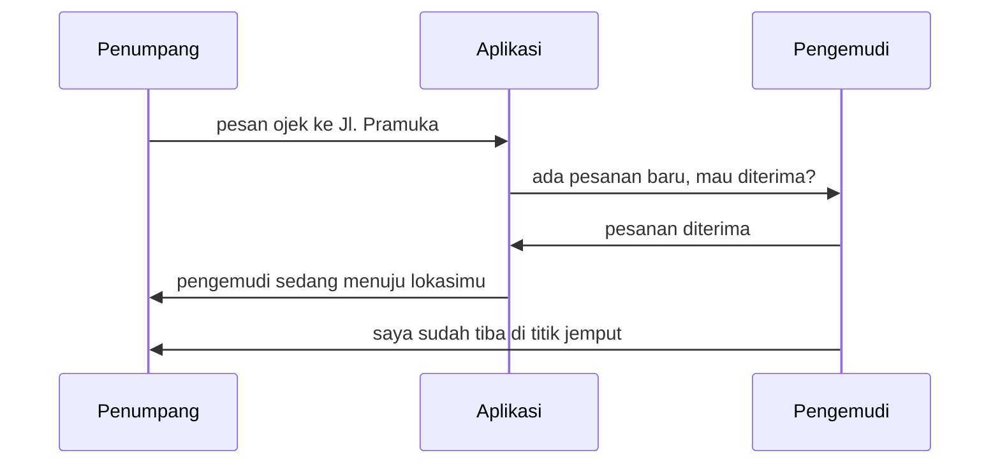
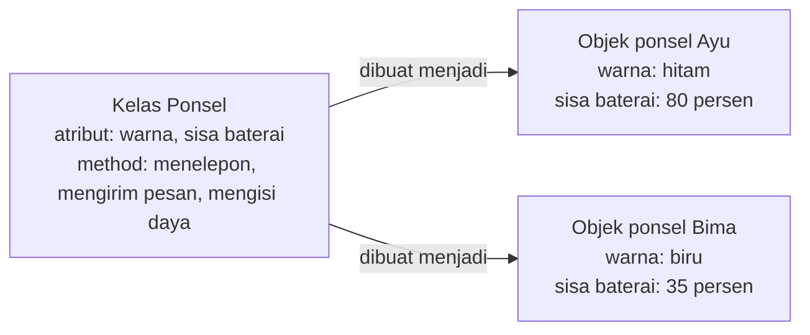
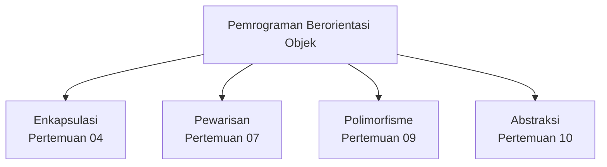
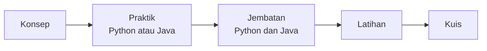
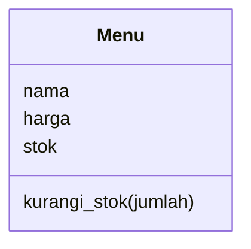

# Pertemuan 01: Pengenalan PBO dan Persiapan Alat

[⬅️ Persiapan](../00-Persiapan/README.md) · [🏠 Beranda](../README.md) · [Pertemuan 02 ➡️](../Pertemuan-02-Kelas-dan-Objek/README.md)

> Selamat datang di mata kuliah Pemrograman Berorientasi Objek (PBO)! Hari ini kita belum menulis kelas. Kita berkenalan dengan sebuah **cara pandang** baru dalam menyusun program, melihat sendiri mengapa program yang makin besar membutuhkannya, lalu menyiapkan alat untuk praktik sepanjang semester.

## 🎯 Tujuan Pembelajaran

Setelah pertemuan ini, kamu mampu:

1. Menjelaskan arti **paradigma pemrograman** dan membedakan paradigma **prosedural** dengan **berorientasi objek**.
2. Menjelaskan masalah yang muncul pada program prosedural saat program membesar, dengan contoh data menu KedaiKita yang tertukar.
3. Memandang sebuah sistem sebagai kumpulan **objek** yang punya **atribut** dan ***method***, serta saling mengirim pesan.
4. Menyebutkan **empat pilar PBO** beserta analogi sederhananya.
5. Menimbang kelebihan PBO dan mengenali situasi ketika PBO kurang cocok.
6. Memilih jalur praktik (Python atau Java), memeriksa alatnya, dan menjalankan program pertamamu.

## 🧭 Peta Belajar

| Langkah | Bagian | Perkiraan waktu |
|---|---|---|
| 1 | Konsep (halaman ini) | 45 menit |
| 2 | Praktik: [🐍 Python](python/README.md) **atau** [☕ Java](java/README.md) | 90 menit |
| 3 | [Jembatan Python ↔ Java](jembatan-python-java.md) | 15 menit |
| 4 | [Latihan](latihan.md) | 60 menit |
| 5 | [Kuis](kuis.md) | 15 menit |

## 🔁 Mengingat Kembali

Pertemuan ini adalah titik awal semester. Jadi, kita menengok bekal dari mata kuliah pemrograman dasar yang sudah kamu tempuh. Kamu sudah mengenal:

- **Variabel** dan **tipe data**: angka, teks, serta nilai benar/salah.
- **Percabangan** (`if`) dan **perulangan** (`for`, `while`).
- ***List*** atau ***array*** untuk menyimpan banyak data sekaligus.
- **Fungsi** yang menerima parameter dan mengembalikan nilai.

Semua bekal itu tetap terpakai di PBO. Bedanya, kita akan menyusunnya dengan cara pandang baru. Kalau ada yang terlupa, tenang saja. Halaman praktik pertemuan ini menyediakan pemanasan singkat untuk semuanya.

> [!NOTE]
> Belum memasang Python atau Java di komputermu? Ikuti dulu panduan [00-Persiapan](../00-Persiapan/README.md), lalu kembali ke halaman ini.

## Daftar Isi

1. [Cerita Pembuka: Kasir KedaiKita yang Kacau](#1-cerita-pembuka-kasir-kedaikita-yang-kacau)
2. [Paradigma Pemrograman: Cara Pandang saat Menyusun Program](#2-paradigma-pemrograman-cara-pandang-saat-menyusun-program)
3. [Paradigma Prosedural dan Masalahnya saat Program Membesar](#3-paradigma-prosedural-dan-masalahnya-saat-program-membesar)
4. [Paradigma Berorientasi Objek: Dunia Penuh Objek](#4-paradigma-berorientasi-objek-dunia-penuh-objek)
5. [Kelas, Objek, Atribut, dan *Method*: Perkenalan Singkat](#5-kelas-objek-atribut-dan-method-perkenalan-singkat)
6. [Empat Pilar PBO Sekilas](#6-empat-pilar-pbo-sekilas)
7. [Kelebihan PBO dan Kapan PBO Kurang Cocok](#7-kelebihan-pbo-dan-kapan-pbo-kurang-cocok)
8. [Sejarah Singkat dan Bahasa PBO Populer](#8-sejarah-singkat-dan-bahasa-pbo-populer)
9. [Dua Jalur Praktik: Python dan Java](#9-dua-jalur-praktik-python-dan-java)
10. [Cara Belajar dengan Materi Ini](#10-cara-belajar-dengan-materi-ini)
11. [Studi Kasus KedaiKita: Apa yang Kita Bangun Hari Ini](#11-studi-kasus-kedaikita-apa-yang-kita-bangun-hari-ini)
12. [Miskonsepsi yang Sering Terjadi](#12-miskonsepsi-yang-sering-terjadi)

---

## 1. Cerita Pembuka: Kasir KedaiKita yang Kacau

Di dekat kampus, tepatnya di Jl. Pramuka No. 10, Samarinda, ada kafe kecil bernama **KedaiKita**. Pemiliknya menulis sendiri program kasir sederhana untuk kafenya.

Programnya memang sederhana. Data menu disimpan di **tiga daftar terpisah**: daftar nama menu, daftar harga, dan daftar stok. Menu pertama ada di urutan pertama pada ketiga daftar itu, menu kedua di urutan kedua, dan seterusnya.

Berminggu-minggu program itu berjalan lancar. Suatu sore, setelah Budi memesan dua kopi susu dan satu es teh, pemilik kedai ingin daftar menu tampil **urut abjad** agar mudah dibaca pelanggan. Ia menambahkan satu perintah untuk mengurutkan daftar nama. Hasilnya seperti ini:

```text
=== DAFTAR MENU KEDAIKITA ===
1. Es Teh Manis - Rp18000 (stok 18)
2. Kopi Susu Gula Aren - Rp25000 (stok 15)
3. Nasi Goreng Kampung - Rp8000 (stok 29)
```

Es teh manis tiba-tiba seharga Rp18.000, sedangkan nasi goreng hanya Rp8.000. Kalau kasir tidak sadar, kedai bisa rugi dan pelanggan bisa kesal.

Apa yang salah? Anehnya, **tidak ada pesan *error*** sama sekali. Program berjalan "lancar", tetapi datanya **tertukar**. Yang diurutkan hanya daftar nama, sedangkan daftar harga dan daftar stok tetap di tempatnya.

Kejadian kecil ini adalah pintu masuk kita ke PBO. Sepanjang pertemuan ini, kita menjawab dua pertanyaan:

1. **Mengapa** cara menyusun program seperti ini mudah rusak?
2. **Bagaimana** cara pandang berorientasi objek mencegahnya?

> [!NOTE]
> Program KedaiKita yang "kacau" ini benar-benar ada di folder praktik, lengkap dalam versi Python dan Java. Nanti kamu akan menjalankannya sendiri dan melihat datanya tertukar di depan matamu.

## 2. Paradigma Pemrograman: Cara Pandang saat Menyusun Program

Bayangkan dua cara mengelola dapur kafe yang sedang ramai.

- **Cara pertama:** ada satu buku resep raksasa berisi langkah-langkah dari atas ke bawah. Semua bahan diletakkan di satu meja besar. Siapa pun boleh mengambil dan mengubah bahan apa saja.
- **Cara kedua:** ada beberapa petugas, yaitu kasir, barista, dan koki. Masing-masing punya meja, peralatan, dan tugasnya sendiri. Mereka bekerja sama dengan saling memberi pesan, misalnya *"Barista, tolong buatkan dua kopi susu!"*

Kedua dapur sama-sama bisa menyajikan pesanan. Bedanya ada pada **cara mengatur pekerjaan**. Dalam pemrograman, cara mengatur seperti ini disebut **paradigma**.

> **Paradigma pemrograman** adalah cara pandang atau gaya dalam menyusun program: bagaimana masalah dipecah, di mana data disimpan, dan bagaimana bagian-bagian program bekerja sama.

Tiga paradigma yang paling sering kamu temui:

| Paradigma | Ide utama | Analogi dapur | Contoh bahasa |
|---|---|---|---|
| **Prosedural** (*procedural*) | Program adalah urutan langkah dan fungsi yang mengolah data | Satu buku resep, semua bahan di meja bersama | C, Pascal |
| **Berorientasi objek** (*object-oriented*) | Program adalah kumpulan objek yang membawa data dan perilakunya sendiri, lalu bekerja sama | Tim petugas dengan meja dan tugas masing-masing | Java, C#, Python |
| **Fungsional** (*functional*) | Program adalah rangkaian fungsi yang mengubah masukan menjadi keluaran, sebisa mungkin tanpa mengubah data lama | Jalur produksi: bahan masuk, diolah tahap demi tahap, hasil keluar | Haskell |

> [!NOTE]
> Banyak bahasa modern bersifat **multiparadigma**, artinya mendukung lebih dari satu gaya. Python bisa dipakai secara prosedural, berorientasi objek, maupun (sebagian) fungsional. Java dirancang berorientasi objek sejak awal, tetapi sejak Java 8 juga punya fitur bergaya fungsional (kita sentuh di Pertemuan 12). Jadi, paradigma bukanlah "jenis bahasa", melainkan **cara kita berpikir** saat menulis program. Paradigma fungsional tidak kita bahas mendalam di mata kuliah ini.

## 3. Paradigma Prosedural dan Masalahnya saat Program Membesar

Kemungkinan besar, program yang kamu tulis di mata kuliah pemrograman dasar bergaya **prosedural**. Datanya disimpan di variabel, *list*, atau *array*, lalu fungsi-fungsi mengolahnya langkah demi langkah.

```text
                         PROGRAM PROSEDURAL

   DATA (disimpan terpisah)             FUNGSI (mengolah data)
   +-----------------------+            +------------------------+
   | daftar nama menu      |            | tampilkan menu         |
   | daftar harga menu     |  <-------  | hitung total           |
   | daftar stok menu      |            | urutkan menu           |
   +-----------------------+            +------------------------+
         semua fungsi boleh membaca dan mengubah semua data
```

Untuk program kecil, gaya ini **baik-baik saja**: mudah ditulis dan mudah dipahami. Masalah baru terasa ketika program **membesar**: menunya ratusan, fiturnya puluhan, dan pemrogramnya lebih dari satu orang. Ada tiga masalah utama.

### Masalah 1: Data dan fungsi terpisah

Data disimpan di satu tempat, sedangkan fungsi yang mengolahnya ditulis di tempat lain. Tidak ada yang "mengikat" keduanya. Lebih dari itu, data satu menu (nama, harga, stok) pun tidak tinggal di satu tempat. Data itu tersebar di tiga daftar dan hanya "direkatkan" oleh **nomor urut** (indeks) yang sama.

Akibatnya, setiap fungsi wajib mematuhi aturan tak tertulis: "indeks yang sama berarti menu yang sama". Data yang tersebar dan bergantung pada indeks yang sama seperti ini disebut **data paralel**.

### Masalah 2: Data global yang bisa diubah siapa saja

Data disimpan di tempat yang bisa dijangkau **semua** fungsi. Data seperti ini disebut data **global**. Memang praktis karena data tidak perlu dioper ke mana-mana. Namun, ketika data rusak, kita harus memeriksa semua fungsi untuk mencari "pelakunya". Bayangkan mencari satu fungsi yang keliru di antara ratusan fungsi.

### Masalah 3: Mudah rusak saat diubah

Lihat lagi kasus KedaiKita. Tabel berikut menunjukkan isi ketiga daftar setelah Budi memesan 2 kopi dan 1 es teh, sebelum dan sesudah daftar nama diurutkan.

```text
SEBELUM diurutkan
indeks | nama menu            | harga | stok
-------+----------------------+-------+-----
   0   | Kopi Susu Gula Aren  | 18000 |  18
   1   | Nasi Goreng Kampung  | 25000 |  15
   2   | Es Teh Manis         |  8000 |  29

SESUDAH daftar nama diurutkan (harga dan stok TIDAK ikut pindah)
indeks | nama menu            | harga | stok
-------+----------------------+-------+-----
   0   | Es Teh Manis         | 18000 |  18   <- harga & stok milik kopi
   1   | Kopi Susu Gula Aren  | 25000 |  15   <- milik nasi goreng
   2   | Nasi Goreng Kampung  |  8000 |  29   <- milik es teh
```

Satu perintah yang kurang lengkap sudah cukup untuk merusak data. Masalah serupa muncul saat **menambah** jenis data baru. Misalnya, pemilik kedai ingin menambah kategori (Makanan atau Minuman). Ia harus membuat daftar keempat, lalu memeriksa **setiap** fungsi yang memindahkan, menghapus, atau menampilkan data. Satu fungsi saja terlewat, data kembali tertukar.

> [!IMPORTANT]
> Inti masalah gaya prosedural pada program besar: **data satu benda tercerai-berai** dan **semua fungsi bebas mengubah semua data**. Pemrogram harus selalu ingat menjaga semuanya tetap sinkron. Padahal, manusia pasti suatu saat lupa.

> [!NOTE]
> Ini tidak berarti gaya prosedural itu "salah". Untuk program kecil, gaya prosedural justru sering menjadi pilihan yang tepat. Kapan PBO kurang cocok dibahas di [bagian 7](#7-kelebihan-pbo-dan-kapan-pbo-kurang-cocok).

## 4. Paradigma Berorientasi Objek: Dunia Penuh Objek

Coba lihat sekelilingmu. Dunia nyata tidak tersusun dari "daftar nama" dan "daftar harga" yang terpisah. Dunia tersusun dari **benda-benda**: ponsel, motor, mahasiswa, dosen, secangkir kopi. Setiap benda membawa **datanya sendiri** dan punya **kemampuannya sendiri**. Paradigma berorientasi objek meniru cara pandang ini.

> **Pemrograman Berorientasi Objek** (PBO, *Object-Oriented Programming* atau OOP) adalah paradigma yang menyusun program sebagai kumpulan **objek**. Setiap objek menyatukan **data** (disebut **atribut**) dan **perilaku** (disebut ***method***). Objek-objek bekerja sama dengan **saling mengirim pesan**.

Mari lihat cara pandang ini di tiga tempat yang akrab denganmu.

### Di kampus

| Objek | Data yang dibawa (atribut) | Yang bisa dilakukan (*method*) |
|---|---|---|
| Mahasiswa | nama, NIM, IPK | mengisi KRS, membayar UKT |
| Dosen | nama, NIP | memberi nilai, menyetujui KRS |
| Mata kuliah | kode, nama, jumlah SKS | menerima pendaftar, menampilkan jadwal |

### Di aplikasi ojek *online*

Saat kamu memesan ojek dari kampus, beberapa objek bekerja sama dengan saling mengirim pesan:



Penumpang tidak perlu tahu cara aplikasi mencari pengemudi terdekat. Ia cukup **mengirim pesan** "pesan ojek", lalu aplikasi mengerjakan sisanya. Setiap objek mengurus datanya sendiri: aplikasi tahu daftar pengemudi yang aktif, pengemudi tahu posisinya, dan penumpang tahu tujuannya.

> **Mengirim pesan** ke sebuah objek berarti meminta objek itu melakukan sesuatu. Di dalam kode, mengirim pesan berwujud **pemanggilan *method*** milik objek tersebut.

### Di kafe

Kembali ke KedaiKita. Dengan cara pandang objek, setiap menu adalah **satu objek** yang membawa nama, harga, dan stoknya sendiri:

```text
 [ objek menu | nama: Kopi Susu Gula Aren | harga: 18000 | stok: 20 ]
 [ objek menu | nama: Nasi Goreng Kampung | harga: 25000 | stok: 15 ]
 [ objek menu | nama: Es Teh Manis        | harga:  8000 | stok: 30 ]
```

Saat menu diurutkan, yang dipindah adalah **objeknya**, lengkap dengan seluruh isinya. Harga tidak mungkin "tertinggal" karena harga adalah bagian dari objek itu sendiri. Mirip memindahkan tas ransel: buku, dompet, dan botol minum di dalamnya ikut pindah bersama tasnya.

Perbandingan kedua paradigma:

| Aspek | Prosedural | Berorientasi objek |
|---|---|---|
| Unit utama program | fungsi (langkah-langkah) | objek (data + perilaku) |
| Letak data satu benda | tersebar di beberapa variabel atau daftar | terkumpul di dalam satu objek |
| Siapa yang mengubah data | fungsi mana saja | terutama *method* milik objek itu sendiri |
| Cara bagian program bekerja sama | fungsi memanggil fungsi lain sambil mengoper data | objek mengirim pesan ke objek lain |
| Paling terasa manfaatnya untuk | program kecil dan skrip sekali pakai | program besar yang terus berkembang |

## 5. Kelas, Objek, Atribut, dan *Method*: Perkenalan Singkat

Bayangkan sebuah pabrik ponsel. Para insinyur membuat **satu rancangan** untuk sebuah model ponsel. Rancangan itu menentukan data yang dimiliki setiap ponsel, misalnya warna dan sisa baterai, serta kemampuannya: menelepon, mengirim pesan, dan mengisi daya.

Dari rancangan itu, pabrik memproduksi ribuan ponsel sungguhan. Semuanya dibuat dari rancangan yang sama, tetapi nilai datanya bisa berbeda. Misalnya, ponsel Ayu berwarna hitam dengan sisa baterai 80%, sedangkan ponsel Bima berwarna biru dengan sisa baterai 35%.

| Dunia pabrik ponsel | Istilah PBO |
|---|---|
| Rancangan model ponsel | **Kelas** (*class*) |
| Ponsel sungguhan milik Ayu, milik Bima | **Objek** (*object*) |
| Warna, sisa baterai | **Atribut** |
| Menelepon, mengirim pesan, mengisi daya | ***Method*** |

> **Kelas** (*class*) adalah rancangan atau cetak biru yang menentukan data apa yang dimiliki dan apa yang bisa dilakukan oleh sekelompok objek sejenis.
>
> **Objek** (*object*) adalah wujud nyata yang dibuat dari sebuah kelas, lengkap dengan nilai datanya sendiri.
>
> **Atribut** adalah data atau ciri yang dimiliki objek. ***Method*** adalah perilaku atau aksi yang bisa dilakukan objek.



### Trik menemukan atribut dan *method*

Saat membaca deskripsi sebuah masalah, gunakan trik sederhana ini:

- **Kata benda** atau keterangan yang menjelaskan sesuatu → calon **kelas** atau **atribut**.
- **Kata kerja** → calon ***method***.

Contoh: *"Setiap **akun e-wallet** punya **nomor HP pemilik** dan **saldo**. Pemilik bisa **mengisi saldo**, **membayar**, dan **melihat saldo**."*

| Hasil analisis | Isinya |
|---|---|
| Kelas | `AkunEwallet` |
| Atribut | `nomor_hp`, `saldo` |
| *Method* | `isi_saldo()`, `bayar()`, `lihat_saldo()` |

> [!TIP]
> **Coba sendiri:** gunakan trik di atas untuk kalimat *"Sebuah **akun media sosial** punya **username**, **jumlah pengikut**, dan **daftar unggahan**. Pemilik akun bisa **mengunggah foto**, **mengikuti akun lain**, dan **menyukai unggahan**."* Tentukan kelas, atribut, dan *method*-nya.

<details>
<summary>Lihat jawaban</summary>

Kelas `AkunMediaSosial`; atribut `username`, `jumlah_pengikut`, `daftar_unggahan`; *method* `unggah_foto()`, `ikuti()`, dan `sukai()`. Nama boleh sedikit berbeda, asalkan pembagian atribut (data) dan *method* (perilaku) sudah tepat.

</details>

> [!NOTE]
> Ini baru perkenalan. Cara menulis kelas dan objek di Python dan Java kita pelajari tuntas di [Pertemuan 02](../Pertemuan-02-Kelas-dan-Objek/README.md). Di sana kamu juga akan bertemu analogi "cetakan kue" yang sangat membantu.

## 6. Empat Pilar PBO Sekilas

PBO bertumpu pada empat konsep besar yang disebut **empat pilar**. Hari ini cukup kenali nama dan gambaran kasarnya. Setiap pilar punya pertemuan khusus.



### Pilar 1: Enkapsulasi (membungkus dan melindungi)

Pikirkan **mesin ATM**. Uangnya tersimpan aman di brankas mesin, dan saldomu tercatat di sistem bank. Kamu tidak bisa membuka brankasnya lalu mengambil uang sesukamu, apalagi mengubah angka saldomu sendiri.

Kamu hanya bisa memakai menu resmi: tarik tunai, cek saldo, transfer. Mesin juga memeriksa setiap permintaan, misalnya menolak penarikan yang melebihi saldo.

> **Enkapsulasi** (*encapsulation*) adalah membungkus data dan *method* yang mengolahnya menjadi satu kesatuan, lalu membatasi akses langsung ke data agar perubahan hanya terjadi lewat "pintu resmi".

Di KedaiKita, stok menu hanya boleh berubah lewat *method* seperti "kurangi stok" sehingga stok tidak bisa tiba-tiba bernilai negatif. Dibahas di **Pertemuan 04**.

### Pilar 2: Pewarisan (mewarisi ciri yang sudah ada)

Semua **kendaraan bermotor** punya roda dan mesin, serta bisa berjalan. **Motor** dan **mobil** mewarisi semua itu, lalu menambah ciri khasnya sendiri. Misalnya, mobil punya bagasi.

> **Pewarisan** (*inheritance*) adalah mekanisme ketika sebuah kelas baru mewarisi atribut dan *method* dari kelas yang sudah ada, lalu boleh menambah atau mengubahnya.

Di KedaiKita, **makanan** dan **minuman** sama-sama **menu** (punya nama dan harga). Namun, makanan punya level pedas, sedangkan minuman bisa disajikan dingin atau panas. Dibahas di **Pertemuan 07**.

### Pilar 3: Polimorfisme (satu perintah, banyak cara)

Pikirkan tombol **"Bayar"** di mesin kasir. Perintahnya sama, tetapi cara kerjanya berbeda: bayar **tunai** menghitung uang kembalian, bayar **QRIS** menampilkan kode QR, bayar **kartu** meminta PIN. Kasir cukup menekan "Bayar", dan setiap metode pembayaran tahu cara kerjanya sendiri.

> **Polimorfisme** (*polymorphism*; dari bahasa Yunani *poly* = banyak dan *morph* = bentuk) adalah kemampuan objek-objek yang berbeda untuk menanggapi perintah yang sama dengan caranya masing-masing.

Dibahas di **Pertemuan 09**.

### Pilar 4: Abstraksi (fokus pada yang penting)

Pikirkan saat kamu **menyetir mobil**. Kamu cukup tahu setir, pedal gas, dan rem. Kamu tidak perlu paham cara kerja busi atau sistem bahan bakar untuk bisa sampai ke kampus.

> **Abstraksi** (*abstraction*) adalah menonjolkan hal-hal penting yang perlu diketahui pemakai, dan menyembunyikan detail rumit yang tidak perlu ia ketahui.

Dibahas di **Pertemuan 10**.

| Pilar | Inti dalam satu kalimat | Analogi | Pertemuan |
|---|---|---|---|
| Enkapsulasi | Data dibungkus dan hanya diubah lewat pintu resmi | Mesin ATM | 04 |
| Pewarisan | Kelas baru mewarisi ciri kelas yang sudah ada | Kendaraan bermotor → motor dan mobil | 07 |
| Polimorfisme | Satu perintah, cara kerjanya berbeda-beda | Tombol "Bayar" | 09 |
| Abstraksi | Tampilkan yang penting, sembunyikan yang rumit | Menyetir mobil | 10 |

> [!NOTE]
> Sebagian buku hanya menyebut **tiga** pilar (enkapsulasi, pewarisan, polimorfisme) karena abstraksi dianggap sebagai dasar dari semuanya. Mata kuliah ini memakai empat pilar agar abstraksi mendapat perhatian khusus.

> [!TIP]
> Jangan khawatir jika keempat pilar ini masih terasa abstrak. Itu wajar sekali. Pilar-pilar ini baru benar-benar "klik" setelah kamu menulis kodenya sendiri di pertemuan-pertemuan berikutnya.

## 7. Kelebihan PBO dan Kapan PBO Kurang Cocok

### Kelebihan PBO

| Kelebihan | Penjelasan singkat | Contoh di KedaiKita |
|---|---|---|
| Data tidak tercerai-berai | Data dan perilaku satu benda berada di satu objek | Harga tidak lagi tertukar saat menu diurutkan |
| Lebih mudah dirawat | Perubahan cukup dilakukan di satu kelas | Aturan stok cukup diubah di kelas menu |
| Bisa dipakai ulang (*reusable*) | Kelas yang sudah jadi bisa dipakai lagi, bahkan di program lain | Kelas menu bisa dipakai lagi di aplikasi pesan antar |
| Mudah dikerjakan bersama | Program dipecah menjadi kelas-kelas yang bisa dikerjakan terpisah | Satu orang mengurus pembayaran, yang lain mengurus laporan |
| Dekat dengan dunia nyata | Kelas meniru benda dan konsep yang dikenal pemakai | Menu, pelanggan, pesanan, pembayaran |
| Data lebih terlindungi | Akses ke data bisa dibatasi (enkapsulasi) | Stok tidak bisa diisi angka negatif |

### Kapan PBO kurang cocok?

PBO bukan obat untuk semua penyakit. Ada situasi ketika gaya lain lebih tepat:

- **Program sangat kecil atau skrip sekali pakai.** Misalnya program untuk mengganti nama 200 *file* foto, atau menghitung rata-rata nilai satu kelas. Membuat kelas di sini hanya menambah baris tanpa manfaat berarti.
- **Pengolahan data berupa aliran langkah.** Misalnya membaca data, menyaring, lalu menjumlahkan. Gaya prosedural atau fungsional sering terasa lebih alami.
- **Rancangan berlebihan** (*over-engineering*). Membuat terlalu banyak kelas untuk masalah sederhana justru membuat program sulit dibaca. Prinsip "jangan berlebihan" ini kita bahas lagi di Pertemuan 13.

PBO juga punya "harga": konsep yang harus dipahami lebih banyak, dan untuk program kecil kodenya bisa menjadi lebih panjang. Karena itu, kita mempelajarinya pelan-pelan, satu konsep per pertemuan.

> [!IMPORTANT]
> Dalam praktik, paradigma sering **dicampur**. Bahkan di dalam sebuah *method*, kita tetap menulis langkah-langkah prosedural: percabangan, perulangan, dan perhitungan. Itulah sebabnya dasar-dasar prosedural di halaman praktik pertemuan ini tetap penting. PBO tidak menggantikan dasar-dasar itu, melainkan **mengatur di mana** dasar-dasar itu diletakkan.

## 8. Sejarah Singkat dan Bahasa PBO Populer

PBO bukan ide baru. Berikut tonggak-tonggak pentingnya:

| Tahun | Peristiwa |
|---|---|
| 1967 | **Simula 67** lahir di Norwegia, karya Ole-Johan Dahl dan Kristen Nygaard. Bahasa ini dianggap sebagai bahasa pertama yang memperkenalkan konsep kelas dan objek. Sesuai namanya, Simula awalnya dipakai untuk membuat simulasi. |
| 1970-an | **Smalltalk** dikembangkan di Xerox PARC oleh tim yang di dalamnya ada Alan Kay, tokoh yang dikenal sebagai pencetus istilah *object-oriented*. Di Smalltalk, *semua hal adalah objek*, dan objek bekerja dengan saling mengirim pesan. |
| Awal 1980-an | **C++** dikembangkan oleh Bjarne Stroustrup, awalnya bernama "C with Classes". C++ menambahkan konsep kelas ke bahasa C yang sudah populer. |
| 1991 | **Python** dirilis oleh Guido van Rossum. Python mendukung beberapa paradigma, termasuk PBO. |
| 1995 | **Java** dirilis oleh Sun Microsystems, dikembangkan oleh tim yang dipimpin James Gosling. Semboyannya *"write once, run anywhere"*: tulis sekali, jalankan di mana saja. |

Saat ini, konsep PBO dipakai di banyak bahasa populer. Daftar berikut tidak disusun berdasarkan peringkat:

| Bahasa | Banyak dipakai untuk |
|---|---|
| Java | aplikasi perusahaan, sistem *backend*, aplikasi Android |
| Python | analisis data, kecerdasan buatan, web, otomasi |
| C# | aplikasi berbasis .NET, *game* dengan Unity |
| C++ | *game*, sistem yang menuntut kinerja tinggi |
| Kotlin | aplikasi Android |
| Swift | aplikasi iPhone dan Mac |
| PHP | aplikasi web, misalnya dengan Laravel |

> [!NOTE]
> Begitu kamu memahami PBO di Python atau Java, mempelajari bahasa-bahasa lain di atas akan jauh lebih mudah. Konsep kelas, objek, pewarisan, dan polimorfisme ada di hampir semuanya. Yang berbeda hanyalah cara menuliskannya.

## 9. Dua Jalur Praktik: Python dan Java

Mata kuliah ini punya **dua jalur praktik**: Python dan Java. Konsep yang dipelajari **sama persis**. Yang berbeda hanya cara menuliskannya.

- **Python** kemungkinan besar sudah kamu pakai di mata kuliah pemrograman dasar. Sintaksnya ringkas sehingga kamu bisa lebih fokus pada konsep.
- **Java** dirancang berorientasi objek sejak awal: semua kode wajib berada di dalam kelas, dan setiap variabel wajib punya tipe. Java banyak dipakai di industri dan untuk mengajarkan PBO.

Lihat program yang sama dalam kedua bahasa. Untuk sekarang, cukup dibaca saja. Kamu akan mengetik dan menjalankan versi yang lebih lengkap di halaman praktik (contoh 01).

**Python:**

```python
def main():
    print("Halo, Samarinda!")


if __name__ == "__main__":
    main()
```

**Java:**

```java
public class Halo {
    public static void main(String[] args) {
        System.out.println("Halo, Samarinda!");
    }
}
```

Keduanya mencetak tulisan yang sama: `Halo, Samarinda!`. Versi Java terlihat lebih "ramai" karena Java mewajibkan kelas dan menuliskan banyak hal secara eksplisit. Setiap katanya akan kamu bedah di halaman praktik.

### Cara memilih jalur

| Pilih **Python** jika... | Pilih **Java** jika... |
|---|---|
| kamu ingin fokus pada konsep dengan sintaks yang ringkas | kamu siap dengan aturan penulisan yang lebih ketat, termasuk tipe data |
| kamu sudah nyaman dengan Python dari mata kuliah sebelumnya | kamu tertarik pada Android, aplikasi perusahaan, atau sistem *backend* |
| kamu tertarik pada analisis data, kecerdasan buatan, atau otomasi | kamu ingin tantangan baru sekaligus menguasai bahasa kedua |

> [!IMPORTANT]
> Pilih **satu** jalur utama dan ikuti sampai akhir semester. Jalur lainnya boleh dipelajari sebagai bonus lewat halaman [Jembatan Python ↔ Java](jembatan-python-java.md) di setiap pertemuan. Jika dosen pengampu menetapkan bahasa tertentu untuk tugas atau ujian, ikuti ketentuan dosen.

Apa pun jalur pilihanmu, ada jaminan berikut:

- Hampir setiap contoh punya pasangan di jalur lain dengan **nomor yang sama**, dan *output* keduanya sama. Contoh yang khusus untuk satu bahasa akan diberi keterangan.
- Studi kasus KedaiKita versi Python dan Java menghasilkan *output* yang **identik**, sampai ke spasi terakhir.

### Alat yang kamu butuhkan

| Kebutuhan | Jalur Python | Jalur Java |
|---|---|---|
| Bahasa | Python 3.10 atau lebih baru | JDK (*Java Development Kit*) versi 17 atau lebih baru, misalnya 17, 21, atau 25 |
| Editor | Visual Studio Code + ekstensi Python | Visual Studio Code + Extension Pack for Java, atau IntelliJ IDEA |
| Terminal | Command Prompt atau PowerShell (Windows), Terminal (macOS/Linux) | sama |
| Perintah cek instalasi | `python --version` (macOS/Linux: `python3 --version`) | `java -version` dan `javac -version` |

Untuk jalur Java, pastikan yang terpasang adalah **JDK**. JDK berisi ***compiler*** bernama `javac`, yaitu program penerjemah yang mengubah kode Java menjadi ***bytecode***. Proses menerjemahkan ini disebut **kompilasi**. *Bytecode* itulah yang kemudian dijalankan oleh **JVM** (*Java Virtual Machine*).

Python bekerja sedikit berbeda. Secara sederhana, ***interpreter*** Python membaca *file* kodemu, lalu langsung menjalankannya. Detail kedua cara ini kamu lihat sendiri di halaman praktik. Panduan pemasangan langkah demi langkah ada di [00-Persiapan](../00-Persiapan/README.md).

## 10. Cara Belajar dengan Materi Ini

Setiap pertemuan punya alur yang sama:



| Bagian | Isinya | *Tips* |
|---|---|---|
| Konsep (`README.md`) | Ide, analogi, dan diagram, tanpa kode yang rumit | Baca dulu sebelum menyentuh kode |
| Praktik (`python/` atau `java/`) | Contoh kode dari yang kecil sampai studi kasus | Ketik ulang, jalankan, lalu ubah sedikit |
| Jembatan | Perbandingan Python dan Java | Baca walaupun kamu hanya memilih satu jalur |
| Latihan | Soal bertingkat (bintang satu sampai tiga) beserta solusi | Coba sendiri dulu, baru buka solusi |
| Kuis | 10 soal pilihan ganda beserta pembahasan | Targetkan minimal 8 jawaban benar |

### Mengenal tanda-tanda di dalam materi

Materi ini memakai kotak berwarna yang tampil rapi saat materi dibuka di situs GitHub. Beberapa di antaranya sudah kamu lihat di halaman ini. Setiap kotak diawali label yang menunjukkan jenisnya:

| Label kotak | Warna di GitHub | Isinya |
|---|---|---|
| **Note** | biru | informasi tambahan yang memperkaya pemahaman |
| **Tip** | hijau | saran praktis dan tantangan **Coba sendiri** |
| **Important** | ungu | hal yang wajib kamu ingat |
| **Warning** | kuning | jebakan atau kesalahan yang sering terjadi |
| **Caution** | merah | hal berisiko, misalnya perintah yang bisa menghapus pekerjaanmu (jarang dipakai) |

Selain itu:

- Penanda seperti `[1]` dan `[2]` di dalam komentar kode dijelaskan satu per satu tepat di bawah kode.
- Tulisan ***Output:*** di halaman praktik selalu diikuti hasil asli program, bukan karangan.
- Tulisan seperti **Lihat jawaban** atau **Petunjuk** yang diawali segitiga kecil bisa diklik untuk membuka isi yang disembunyikan. Tebak dulu sebelum membukanya, ya.
- Istilah teknis ditulis dalam bahasa Indonesia, diikuti istilah Inggris bercetak miring saat pertama muncul, misalnya kelas (*class*). Istilah asing yang belum punya padanan baku, seperti *method* dan *file*, selalu ditulis miring. Daftar lengkapnya ada di [Glosarium](../Lampiran/glosarium.md).

### *Tips* belajar

1. **Ketik ulang** kodenya, jangan hanya menyalin. Jari yang mengetik membantu otak mengingat.
2. **Jalankan, lalu ubah.** Ganti angka, hapus satu baris, dan perhatikan apa yang terjadi.
3. **Baca pesan *error* dengan tenang.** Setiap halaman praktik punya bagian khusus tentang *error*.
4. **Jangan buru-buru membuka solusi.** Buntu sebentar itu bagian dari belajar.
5. **Belajar sedikit tetapi rutin**, misalnya 30 menit setiap hari, daripada semalam suntuk menjelang ujian.
6. **Bertanyalah** kepada dosen, asisten, atau teman. Lihat juga [FAQ](../Lampiran/faq.md) dan [*Cheat Sheet* Python ↔ Java](../Lampiran/cheatsheet-python-java.md).

> [!TIP]
> Asisten AI boleh membantumu memahami konsep atau membaca pesan *error*. Namun, pastikan kamu sanggup menjelaskan setiap baris kode yang kamu kumpulkan dengan kata-katamu sendiri.

## 11. Studi Kasus KedaiKita: Apa yang Kita Bangun Hari Ini

**KedaiKita** adalah aplikasi kasir untuk kafe kecil di Jl. Pramuka No. 10, Samarinda. Aplikasi ini akan **tumbuh sedikit demi sedikit** di setiap pertemuan, sampai menjadi aplikasi kasir utuh di akhir semester.

| Pertemuan | KedaiKita bertambah dengan... |
|---|---|
| 01 | Versi prosedural yang datanya tertukar, dan intipan versi objek |
| 02 | Kelas `Menu` pertama: nama, harga, dan cara menghitung total |
| 03 | Kode menu, kategori, stok, diskon, dan pelanggan dengan poin |
| 04 | Data menu dilindungi: harga tidak boleh negatif, stok hanya berubah lewat *method* |
| 05 | Pesanan berisi beberapa item, nomor pesanan otomatis, dan struk |
| 06 | Diagram kelas (UML) lengkap untuk KedaiKita |
| 07 | Makanan dan minuman sebagai jenis khusus dari menu |
| 09 | Pembayaran tunai, QRIS, dan kartu |
| 10 | Pembayaran abstrak dan kemampuan "dapat dicetak" |
| 11 | Penanganan kesalahan, misalnya stok tidak cukup dan menu tidak ditemukan |
| 12 | Koleksi menu dan laporan penjualan |
| 13 | Desain dirapikan dengan prinsip SOLID, termasuk diskon yang fleksibel |
| 14 | Pola desain: pengaturan pajak, pembuatan pembayaran, dan notifikasi |
| 15 | Aplikasi kasir lengkap: menu interaktif, simpan ke *file*, dan pengujian |

Pertemuan 08 dan 16 adalah ujian (UTS dan UAS).

### Hari ini: dua program kecil

Hari ini kita menjalankan **dua program** dengan skenario yang sama:

1. Menampilkan daftar menu: Kopi Susu Gula Aren (Rp18.000, stok 20), Nasi Goreng Kampung (Rp25.000, stok 15), dan Es Teh Manis (Rp8.000, stok 30).
2. Budi memesan 2 Kopi Susu Gula Aren dan 1 Es Teh Manis. Total bayar dihitung dan stok berkurang.
3. Daftar menu diurutkan sesuai abjad, lalu ditampilkan lagi.

Bedanya hanya pada **cara menyimpan data**:

```text
VERSI PROSEDURAL                        VERSI OBJEK
tiga daftar terpisah                    satu daftar berisi objek menu

nama : [Kopi..., Nasi..., Es Teh...]    [ Kopi Susu Gula Aren | 18000 | 20 ]
harga: [18000,   25000,   8000     ]    [ Nasi Goreng Kampung | 25000 | 15 ]
stok : [20,      15,      30       ]    [ Es Teh Manis        |  8000 | 30 ]

saat diurutkan: hanya nama yang pindah  saat diurutkan: objek pindah utuh
```

Pada versi objek, setiap menu dibuat dari satu kelas `Menu` yang sederhana:



**Hasil yang diharapkan dari versi prosedural** (sama persis untuk Python maupun Java):

```text
=== DAFTAR MENU KEDAIKITA ===
1. Kopi Susu Gula Aren - Rp18000 (stok 20)
2. Nasi Goreng Kampung - Rp25000 (stok 15)
3. Es Teh Manis - Rp8000 (stok 30)

Pesanan Budi: 2 x Kopi Susu Gula Aren, 1 x Es Teh Manis
Total bayar : Rp44000

Mengurutkan nama menu sesuai abjad...
=== DAFTAR MENU KEDAIKITA ===
1. Es Teh Manis - Rp18000 (stok 18)
2. Kopi Susu Gula Aren - Rp25000 (stok 15)
3. Nasi Goreng Kampung - Rp8000 (stok 29)

Lho? Es Teh Manis jadi Rp18000 dan Nasi Goreng Kampung jadi Rp8000!
Data satu menu tercerai-berai di tiga list, jadi mudah tertukar.
```

**Hasil yang diharapkan dari versi objek** (bagian akhirnya saja; bagian awalnya sama):

```text
Mengurutkan menu sesuai abjad...
=== DAFTAR MENU KEDAIKITA ===
1. Es Teh Manis - Rp8000 (stok 29)
2. Kopi Susu Gula Aren - Rp18000 (stok 18)
3. Nasi Goreng Kampung - Rp25000 (stok 15)

Aman! Setiap menu membawa datanya sendiri, jadi tidak ada yang tertukar.
```

Perhatikan bagian akhir kedua program. Versi prosedural berseru "Lho?", sedangkan versi objek berkata "Aman!". Perbedaannya **bukan** karena pemrogram versi objek lebih teliti, melainkan karena **cara menyimpan datanya** membuat kesalahan itu tidak mungkin terjadi.

Kode lengkap kedua program dibahas baris demi baris di halaman praktik: [🐍 Python](python/README.md#7-studi-kasus-kedaikita) atau [☕ Java](java/README.md#7-studi-kasus-kedaikita).

## 12. Miskonsepsi yang Sering Terjadi

Lima anggapan keliru berikut sering muncul di awal belajar PBO.

1. **Keliru:** "PBO itu sekadar menulis kata `class`."

   **Yang benar:** PBO adalah **cara berpikir**: memandang program sebagai objek-objek yang membawa data dan perilakunya sendiri. Program Java di pertemuan ini pun ditulis di dalam `class`, tetapi gayanya masih prosedural.

2. **Keliru:** "Program prosedural itu salah dan kuno."

   **Yang benar:** untuk program kecil, gaya prosedural justru sering menjadi pilihan terbaik. Bahkan di dalam *method*, kita tetap menulis langkah-langkah prosedural.

3. **Keliru:** "Python bukan bahasa berorientasi objek, jadi lebih baik langsung belajar Java."

   **Yang benar:** di Python, semua nilai, bahkan angka dan teks, adalah objek. Python mendukung PBO sepenuhnya, hanya saja tidak **mewajibkan** kita memakainya.

4. **Keliru:** "Kalau program tidak menampilkan *error*, berarti hasilnya benar."

   **Yang benar:** belum tentu. KedaiKita versi prosedural berjalan tanpa *error*, tetapi harganya tertukar. Kesalahan logika seperti ini justru paling berbahaya karena terjadi diam-diam.

5. **Keliru:** "Keempat pilar PBO harus langsung dikuasai di pertemuan pertama."

   **Yang benar:** hari ini cukup mengenal nama dan gambarannya. Setiap pilar punya pertemuan sendiri.

## 📝 Ringkasan

- **Paradigma pemrograman** adalah cara pandang dalam menyusun program. Tiga yang utama adalah prosedural, berorientasi objek, dan fungsional.
- Gaya **prosedural** memisahkan data dan fungsi. Pada program besar, data satu benda mudah tercerai-berai, data global bisa diubah siapa saja, dan program mudah rusak saat diubah.
- KedaiKita versi prosedural membuktikannya: mengurutkan daftar nama tanpa memindahkan harga dan stok membuat data **tertukar**, tanpa satu pun pesan *error*.
- **PBO** menyusun program sebagai kumpulan **objek** yang menyatukan **atribut** (data) dan ***method*** (perilaku), lalu saling **mengirim pesan**.
- **Kelas** adalah rancangan, sedangkan **objek** adalah wujud nyatanya. Detailnya dibahas di Pertemuan 02.
- **Empat pilar PBO**: enkapsulasi (Pertemuan 04), pewarisan (Pertemuan 07), polimorfisme (Pertemuan 09), dan abstraksi (Pertemuan 10).
- PBO unggul untuk program besar yang terus berkembang, tetapi bisa berlebihan untuk skrip kecil sekali pakai. Dalam praktik, paradigma sering dicampur.
- Mata kuliah ini punya dua jalur, **Python** dan **Java**. Pilih satu jalur utama. Konsepnya sama, dan *output* contohnya pun sama.

## 📖 Istilah Penting

| Istilah | Arti singkat |
|---|---|
| Paradigma pemrograman | Cara pandang atau gaya dalam menyusun program |
| Prosedural (*procedural*) | Paradigma yang menyusun program sebagai urutan langkah dan fungsi yang mengolah data |
| Berorientasi objek (*object-oriented*) | Paradigma yang menyusun program sebagai kumpulan objek yang bekerja sama |
| Fungsional (*functional*) | Paradigma yang menyusun program sebagai rangkaian fungsi yang mengubah masukan menjadi keluaran |
| Data global | Data yang bisa dibaca dan diubah oleh semua bagian program |
| Data paralel | Data satu benda yang tersebar di beberapa daftar dan direkatkan oleh indeks yang sama |
| Kelas (*class*) | Rancangan yang menentukan atribut dan *method* sekelompok objek sejenis |
| Objek (*object*) | Wujud nyata dari sebuah kelas, membawa nilai datanya sendiri |
| Atribut | Data atau ciri milik objek |
| *Method* | Perilaku atau aksi yang bisa dilakukan objek |
| Mengirim pesan | Meminta objek melakukan sesuatu; di kode berwujud pemanggilan *method* |
| Enkapsulasi (*encapsulation*) | Membungkus data dan *method*, serta membatasi akses langsung ke data |
| Pewarisan (*inheritance*) | Kelas baru mewarisi atribut dan *method* kelas yang sudah ada |
| Polimorfisme (*polymorphism*) | Objek berbeda menanggapi perintah yang sama dengan caranya masing-masing |
| Abstraksi (*abstraction*) | Menonjolkan yang penting dan menyembunyikan detail yang rumit |
| *Compiler* | Program penerjemah kode sebelum program dijalankan; di Java perintahnya `javac` |
| *Interpreter* | Program yang membaca kode lalu langsung menjalankannya, seperti pada Python |
| JVM (*Java Virtual Machine*) | Mesin yang menjalankan *bytecode*, yaitu hasil kompilasi program Java |

## ➡️ Langkah Berikutnya

Pilih jalur praktikmu: [🐍 Praktik Python](python/README.md) atau [☕ Praktik Java](java/README.md).

---

[⬅️ Persiapan](../00-Persiapan/README.md) · [🏠 Beranda](../README.md) · [Pertemuan 02 ➡️](../Pertemuan-02-Kelas-dan-Objek/README.md)
