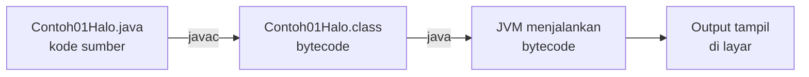

# ☕ Praktik Java — Pertemuan 01: Pengenalan PBO & Persiapan Alat

[⬅️ Konsep](../README.md) · [🐍 Praktik Python](../python/README.md) · [Jembatan Python ↔ Java ➡️](../jembatan-python-java.md)

> **Prasyarat:** sudah membaca [Konsep Pertemuan 01](../README.md). Semua kode di halaman ini ada di folder `contoh/` dan `studi-kasus/`, dan bisa langsung dijalankan.

Mungkin ini pertama kalinya kamu menulis Java. Tenang, halaman ini dimulai dari nol. Kita belajar anatomi program Java, cara menjalankannya, tipe data, percabangan, perulangan, array, dan method. Setelah itu, kita membedah **KedaiKita versi prosedural** untuk melihat sendiri masalahnya, lalu mengintip versi berorientasi objeknya.

> [!TIP]
> Sudah pernah belajar Python? Kamu akan menemukan banyak kemiripan. Perbedaan-perbedaan pentingnya dirangkum di halaman [Jembatan Python ↔ Java](../jembatan-python-java.md).

## Daftar Isi

- [Persiapan](#persiapan)
1. [Program Pertama: Anatomi Program Java](#1-program-pertama-anatomi-program-java)
2. [Variabel dan Tipe Data](#2-variabel-dan-tipe-data)
3. [Percabangan dan Perulangan](#3-percabangan-dan-perulangan)
4. [Array: Menyimpan Banyak Data](#4-array-menyimpan-banyak-data)
5. [Method static dengan Parameter dan Nilai Kembalian](#5-method-static-dengan-parameter-dan-nilai-kembalian)
6. [Data Paralel: Rapi tetapi Rapuh](#6-data-paralel-rapi-tetapi-rapuh)
7. [Studi Kasus KedaiKita](#7-studi-kasus-kedaikita)
8. [Kesalahan Umum dan Cara Membaca Pesan Error](#8-kesalahan-umum-dan-cara-membaca-pesan-error)

## Persiapan

### Cek instalasi Java

Untuk menulis dan menjalankan program Java, kamu butuh **JDK** (*Java Development Kit*) versi **17 atau lebih baru**. Buka terminal (Command Prompt atau PowerShell di Windows, Terminal di macOS/Linux, atau terminal bawaan VS Code), lalu ketik dua perintah ini:

```bash
java -version
javac -version
```

- `java` adalah perintah untuk **menjalankan** program Java.
- `javac` (*Java compiler*) adalah perintah untuk **mengompilasi**, yaitu memeriksa dan menerjemahkan kode yang kita tulis menjadi bentuk yang bisa dijalankan Java.

Jika JDK sudah terpasang, kedua perintah menampilkan nomor versi. Tampilan persisnya berbeda-beda, tergantung versi dan pembuat JDK-nya. Bentuknya kira-kira seperti ini (huruf `x` mewakili angka apa saja):

```text
openjdk version "21.0.x" ...      <- baris pertama hasil java -version
javac 21.0.x                      <- hasil javac -version
```

Yang penting, angka versi pertamanya **17 atau lebih besar**, misalnya 17, 21, atau 25.

> [!WARNING]
> Jika `java -version` berhasil tetapi `javac -version` menampilkan pesan bahwa perintah tidak dikenali, kemungkinan yang terpasang bukan JDK, atau pengaturan *PATH*-nya belum benar. Ikuti panduan [00-Persiapan](../../00-Persiapan/README.md).

### Struktur folder

```text
java/
├── contoh/          <- 6 contoh kecil untuk pemanasan dasar Java
├── studi-kasus/     <- KedaiKita versi prosedural dan versi objek
└── solusi/          <- solusi latihan (buka setelah mencoba sendiri!)
```

### Cara menjalankan program

Ada dua cara. Pindah dulu ke folder tempat file berada dengan perintah `cd` (*change directory*).

**Cara 1 (paling praktis, Java 11 ke atas):** jalankan langsung file `.java`-nya.

```bash
cd Pertemuan-01-Pengenalan-PBO/java/contoh
java Contoh01Halo.java
```

**Cara 2 (cara klasik, dua langkah):** kompilasi dulu dengan `javac`, lalu jalankan dengan `java`.

```bash
javac Contoh01Halo.java
java Contoh01Halo
```

Perhatikan: pada langkah kedua, nama kelas ditulis **tanpa** akhiran `.java` maupun `.class`.

Apa yang sebenarnya terjadi di balik layar?



- **Kode sumber** (*source code*, file `.java`) adalah kode yang kita tulis.
- `javac` memeriksa kode sumber, lalu menerjemahkannya menjadi **bytecode** (file `.class`). Jika ada kesalahan penulisan, `javac` menolak dan menampilkan pesan error. Proses ini disebut **kompilasi** (*compile*).
- **JVM** (*Java Virtual Machine*) menjalankan bytecode. Setiap sistem operasi punya JVM sendiri, sehingga bytecode yang sama bisa berjalan di Windows, macOS, maupun Linux. Inilah makna semboyan Java *"write once, run anywhere"*.

> [!NOTE]
> Cara 1 tetap melakukan kompilasi, hanya saja di memori dan tanpa meninggalkan file `.class`. Cara 2 menghasilkan file `Contoh01Halo.class` di folder yang sama. File `.class` boleh dihapus kapan saja, dan sudah diabaikan oleh Git di repositori ini.

> [!TIP]
> Jika memakai VS Code, buka folder `java/` **milik pertemuan ini** (*File → Open Folder*), bukan seluruh repositori. Alasannya, beberapa pertemuan punya kelas dengan nama yang sama (misalnya `Menu`), dan VS Code akan protes jika dua kelas bernama sama berada dalam satu proyek. Panduan lengkap ada di [00-Persiapan](../../00-Persiapan/README.md).

Saran belajar: **ketik ulang** kodenya, jangan hanya menyalin. Jari yang mengetik membantu otak mengingat.

## 1. Program Pertama: Anatomi Program Java

File: [`contoh/Contoh01Halo.java`](contoh/Contoh01Halo.java)

```java
public class Contoh01Halo { // [1] kelas pembungkus; namanya sama dengan nama file

    public static void main(String[] args) { // [2] method main: pintu masuk program
        System.out.println("=== PROGRAM PERTAMAKU ==="); // [3] cetak teks, lalu pindah baris
        System.out.println("Halo, Samarinda!");
        System.out.println("Selamat datang di mata kuliah PBO 2026.");
        System.out.println(); // [4] println tanpa isi = baris kosong
        // [5] baris yang diawali dua garis miring adalah komentar, tidak dijalankan
        System.out.println("Perintah dijalankan berurutan dari atas ke bawah:");
        System.out.println("Langkah 1: siapkan alat");
        System.out.println("Langkah 2: tulis kode");
        System.out.println("Langkah 3: jalankan program"); // [6] setiap perintah diakhiri ;
    } // [7] kurung kurawal tutup: akhir method main
} // akhir kelas Contoh01Halo
```

**Output:**

```text
=== PROGRAM PERTAMAKU ===
Halo, Samarinda!
Selamat datang di mata kuliah PBO 2026.

Perintah dijalankan berurutan dari atas ke bawah:
Langkah 1: siapkan alat
Langkah 2: tulis kode
Langkah 3: jalankan program
```

Penjelasan:

- **[1]** Setiap program Java berada di dalam sebuah **kelas** (*class*). Baris `public class Contoh01Halo` membuat kelas bernama `Contoh01Halo`. Kelas yang diberi kata `public` wajib bernama **sama persis** dengan nama filenya, yaitu `Contoh01Halo.java`.
- **[2]** Method `main` adalah **pintu masuk** program. Saat program dijalankan, Java mencari method `main`, lalu menjalankan isinya. Bentuk `public static void main(String[] args)` adalah bentuk standar yang berlaku di semua versi Java.
- **[3]** `System.out.println(...)` mencetak teks lalu pindah ke baris baru. Teks diapit tanda kutip **ganda**.
- **[4]** `System.out.println()` tanpa isi mencetak baris kosong.
- **[5]** Komentar satu baris diawali `//`. Komentar beberapa baris diapit `/*` dan `*/`, seperti penjelasan di bagian atas setiap file contoh. Java mengabaikan semua komentar.
- **[6]** Setiap **perintah** (*statement*) diakhiri titik koma `;`. Lupa titik koma adalah kesalahan paling umum pemula Java.
- **[7]** Kurung kurawal `{` dan `}` menandai awal dan akhir sebuah **blok**: blok kelas, blok method, dan nanti blok percabangan serta perulangan. Setiap `{` wajib punya pasangan `}`.

Perintah di dalam `main` dijalankan **berurutan dari atas ke bawah**. Inilah ciri khas gaya prosedural.

Baris `main` memang terlihat panjang. Kita bedah satu per satu:

| Bagian | Arti secara sederhana |
|---|---|
| `public` | boleh dipanggil dari luar kelas, termasuk oleh Java saat program dimulai (hak akses dibahas di Pertemuan 04) |
| `static` | bisa dijalankan tanpa membuat objek lebih dulu (dibahas di Pertemuan 03) |
| `void` | method ini tidak mengembalikan nilai apa pun |
| `main` | nama khusus; Java mencari method yang bernama persis `main` |
| `String[] args` | parameter berupa array teks, berisi argumen tambahan dari terminal; belum kita pakai |

Begitu juga dengan `System.out.println`:

| Bagian | Arti |
|---|---|
| `System` | kelas bawaan Java yang berhubungan dengan sistem komputer |
| `out` | saluran keluaran standar, yaitu layar terminal |
| `println` | singkatan *print line*: cetak, lalu pindah baris. Ada juga `print` yang mencetak **tanpa** pindah baris |

Rangkuman anatomi program Java yang akan kamu temui di semua contoh:

```text
public class Contoh01Halo {                    <- kelas pembungkus; nama = nama file

    public static void main(String[] args) {   <- pintu masuk program
        System.out.println("Halo!");           <- perintah, diakhiri titik koma
    }                                          <- akhir blok method main
}                                              <- akhir blok kelas
```

> [!NOTE]
> **Kenapa sudah ada kata `class`, padahal kita belum belajar kelas?** Java dirancang berorientasi objek sejak awal, sehingga **semua kode wajib berada di dalam kelas**. Untuk sekarang, anggap kelas di contoh-contoh ini sebagai "pembungkus" wajib. Isinya masih bergaya prosedural. Mulai Pertemuan 02, kita memakai kelas sebagaimana mestinya.
>
> Java 25 juga menerima bentuk yang lebih ringkas, misalnya `void main()` tanpa kelas pembungkus yang ditulis sendiri. Mata kuliah ini tetap memakai bentuk standar di atas, agar semua program berjalan di Java 17 maupun versi sesudahnya.

> [!IMPORTANT]
> Java membedakan huruf besar dan kecil (*case-sensitive*). `System` tidak sama dengan `system`, dan `String` tidak sama dengan `string`. Kebiasaan penamaan di Java: nama kelas memakai **PascalCase** (`Contoh01Halo`), sedangkan nama variabel dan method memakai **camelCase** (`hargaKopi`, `hitungOngkos`).

Berbeda dengan Python, Java tidak memakai indentasi untuk menandai blok, melainkan kurung kurawal. Meski begitu, tetap rapikan indentasi (4 spasi per tingkat) agar kodemu mudah dibaca.

> [!TIP]
> **Coba sendiri:** ganti `println` pada baris "Langkah 1" dan "Langkah 2" menjadi `print`, lalu jalankan. Tebak dulu tampilannya.

<details>
<summary>Lihat jawaban</summary>

Ketiga langkah menempel di satu baris:

```text
Langkah 1: siapkan alatLangkah 2: tulis kodeLangkah 3: jalankan program
```

`print` tidak pindah baris setelah mencetak, sehingga teks berikutnya langsung menyambung di baris yang sama.

</details>

## 2. Variabel dan Tipe Data

File: [`contoh/Contoh02VariabelDanTipe.java`](contoh/Contoh02VariabelDanTipe.java)

Variabel adalah "kotak bernama" untuk menyimpan nilai. Di Java, setiap variabel **wajib dideklarasikan** beserta tipenya, dengan format `Tipe namaVariabel = nilai;`.

```java
public class Contoh02VariabelDanTipe {

    public static void main(String[] args) {
        // [1] format deklarasi: Tipe namaVariabel = nilai;
        String nama = "Ayu Lestari"; // String: teks, diapit tanda kutip GANDA
        char inisial = 'A';          // char: tepat satu karakter, diapit kutip TUNGGAL
        int semester = 3;            // int: bilangan bulat
        double ipk = 3.75;           // double: bilangan pecahan, memakai TITIK desimal

        System.out.println("=== DATA MAHASISWA ===");
        System.out.println("Nama     : " + nama); // [2] + menggabungkan teks dengan nilai
        System.out.println("Inisial  : " + inisial);
        System.out.println("Semester : " + semester);
        System.out.println("IPK      : " + ipk);

        System.out.println();
        System.out.println("=== HITUNG UANG JAJAN ===");
        int uangSaku = 50000;
        int hargaKopi = 18000;
        int jumlahCup = uangSaku / hargaKopi; // [3] int / int = pembagian bulat (sisa dibuang)
        int sisaUang = uangSaku % hargaKopi;  // [4] % sisa hasil bagi
        System.out.println("Uang saku     : Rp" + uangSaku);
        System.out.println("Harga kopi    : Rp" + hargaKopi);
        System.out.println("Bisa beli     : " + jumlahCup + " cup");
        System.out.println("Total belanja : Rp" + (jumlahCup * hargaKopi)); // [5] hitung dulu
        System.out.println("Sisa uang     : Rp" + sisaUang);

        System.out.println();
        System.out.println("=== MENGUBAH NILAI VARIABEL ===");
        semester = semester + 1; // [6] mengubah nilai: tipe TIDAK ditulis lagi
        System.out.println("Semester depan " + nama + " masuk semester " + semester);
    }
}
```

**Output:**

```text
=== DATA MAHASISWA ===
Nama     : Ayu Lestari
Inisial  : A
Semester : 3
IPK      : 3.75

=== HITUNG UANG JAJAN ===
Uang saku     : Rp50000
Harga kopi    : Rp18000
Bisa beli     : 2 cup
Total belanja : Rp36000
Sisa uang     : Rp14000

=== MENGUBAH NILAI VARIABEL ===
Semester depan Ayu Lestari masuk semester 4
```

Penjelasan:

- **[1]** Deklarasi variabel terdiri atas **tipe**, **nama**, lalu nilai awal. Tanda `=` berarti **mengisi**, bukan "sama dengan". Setelah dideklarasikan, sebuah variabel hanya boleh berisi nilai yang sesuai dengan tipenya. Variabel `semester` yang bertipe `int` tidak bisa diisi teks.
- **[2]** Operator `+` antara teks dan nilai lain **menggabungkan** keduanya menjadi teks baru. Angka diubah menjadi teks secara otomatis, sehingga `"Semester : " + 3` menjadi `"Semester : 3"`.
- **[3]** Pembagian dua bilangan `int` menghasilkan `int`, dan bagian desimalnya **dibuang**: `50000 / 18000` hasilnya `2`.
- **[4]** `%` (modulo) menghasilkan sisa hasil bagi: `50000 % 18000` hasilnya `14000`.
- **[5]** Perhitungan diletakkan di dalam kurung agar dikerjakan **lebih dulu**, baru kemudian digabung dengan teks. Lihat jebakannya di bawah.
- **[6]** Saat mengubah nilai variabel yang sudah ada, tipenya **tidak ditulis lagi**. Menulis `int semester = ...` untuk kedua kalinya justru ditolak, karena variabel itu sudah ada.

Tipe data dasar yang akan sering kita pakai:

| Tipe | Isi | Contoh nilai | Catatan |
|---|---|---|---|
| `int` | bilangan bulat | `3`, `18000`, `-5` | kira-kira dari -2,1 miliar sampai 2,1 miliar |
| `long` | bilangan bulat besar | `8000000000L` | diberi akhiran `L` |
| `double` | bilangan pecahan | `3.75`, `0.5` | memakai titik, bukan koma |
| `boolean` | benar atau salah | `true`, `false` | dipakai di bagian 3 |
| `char` | tepat satu karakter | `'A'`, `'7'` | diapit kutip **tunggal** |
| `String` | teks | `"Ayu Lestari"`, `"A"` | diapit kutip **ganda** |

> [!NOTE]
> `int`, `long`, `double`, `boolean`, dan `char` disebut **tipe primitif** dan selalu ditulis dengan huruf kecil. `String` berbeda: ia sebuah **kelas**, itulah sebabnya diawali huruf kapital. Maknanya akan makin jelas setelah kita belajar kelas mulai Pertemuan 02.

Operator aritmetika:

| Operator | Arti | Contoh | Hasil |
|---|---|---|---|
| `+` `-` `*` | tambah, kurang, kali | `3 * 4` | `12` |
| `/` | bagi; jika kedua angkanya `int`, hasilnya `int` | `7 / 2` | `3` |
| `/` | bagi; jika salah satunya `double`, hasilnya `double` | `7.0 / 2` | `3.5` |
| `%` | sisa bagi | `7 % 2` | `1` |

> [!IMPORTANT]
> Di seluruh materi ini, **uang selalu disimpan sebagai `int`** (Rupiah), tidak pernah sebagai `double`. Bilangan pecahan disimpan komputer dalam bentuk biner, sehingga kadang tidak tepat. Untuk menghitung persen, gunakan pola `nilai * persen / 100`.

### Jebakan: urutan penggabungan teks

Java mengerjakan `+` dari **kiri ke kanan**. Begitu bertemu teks, `+` berikutnya ikut berarti "gabungkan", bukan "jumlahkan". Perhatikan tiga baris berikut:

```java
System.out.println("Total: Rp" + 36000 + 8000);
System.out.println("Total: Rp" + (36000 + 8000));
System.out.println("Mahasiswa ke-" + i + 1); // misalkan i bernilai 0
```

Hasilnya:

```text
Total: Rp360008000
Total: Rp44000
Mahasiswa ke-01
```

Baris pertama menggabungkan `"Total: Rp"` dengan `36000`, lalu menggabungkan lagi dengan `8000`. Baris kedua benar, karena penjumlahan di dalam kurung dikerjakan lebih dulu. Baris ketiga salah dengan cara yang sama, dan harus ditulis `"Mahasiswa ke-" + (i + 1)`.

> [!WARNING]
> Bungkus setiap **penjumlahan** dengan kurung saat menggabungkannya dengan teks. Perkalian dan pembagian sebenarnya selalu dikerjakan lebih dulu, tetapi menambahkan kurung tetap membuat kodemu lebih mudah dibaca.

Aturan memberi nama variabel:

- Gunakan gaya **camelCase**: kata pertama huruf kecil, kata berikutnya diawali huruf kapital, misalnya `uangSaku` atau `hargaKopi`.
- Huruf besar dan kecil dibedakan: `nama` dan `Nama` adalah dua variabel yang berbeda.
- Nama tidak boleh diawali angka, tidak boleh mengandung spasi, dan tidak boleh berupa kata kunci Java seperti `class` atau `int`.

> [!TIP]
> **Coba sendiri:** tambahkan baris `semester = "empat";` tepat sebelum baris `semester = semester + 1;`, lalu jalankan. Java langsung menolak dengan pesan `incompatible types: String cannot be converted to int`. Inilah salah satu perbedaan besar dengan Python: kesalahan tipe ketahuan **sebelum** program berjalan.

## 3. Percabangan dan Perulangan

File: [`contoh/Contoh03PercabanganPerulangan.java`](contoh/Contoh03PercabanganPerulangan.java)

```java
public class Contoh03PercabanganPerulangan {

    public static void main(String[] args) {
        System.out.println("=== PERCABANGAN: DISKON TOKO ALAT TULIS ===");
        int totalBelanja = 120000;
        boolean member = true; // [1] boolean: hanya bernilai true atau false

        int persenDiskon; // dideklarasikan dulu, nilainya diisi di percabangan
        if (totalBelanja >= 100000) { // [2] diperiksa dari atas; yang pertama benar dipilih
            persenDiskon = 10;
        } else if (totalBelanja >= 50000) {
            persenDiskon = 5;
        } else {
            persenDiskon = 0;
        }

        if (member) { // [3] kondisi berupa variabel boolean
            persenDiskon = persenDiskon + 5;
        }

        int potongan = totalBelanja * persenDiskon / 100;
        System.out.println("Total belanja : Rp" + totalBelanja);
        System.out.println("Diskon        : " + persenDiskon + "%");
        System.out.println("Potongan      : Rp" + potongan);
        System.out.println("Harus dibayar : Rp" + (totalBelanja - potongan));

        String hari = "Sabtu";
        if (hari.equals("Sabtu") || hari.equals("Minggu")) { // [4] ||: cukup salah satu benar
            System.out.println("Hari " + hari + ": toko tutup pukul 15.00");
        } else {
            System.out.println("Hari " + hari + ": toko tutup pukul 21.00");
        }

        System.out.println();
        System.out.println("=== PERULANGAN FOR: DAFTAR HARGA FOTOKOPI ===");
        int hargaPerLembar = 500;
        for (int lembar = 1; lembar <= 5; lembar++) { // [5] lembar = 1, 2, 3, 4, 5
            System.out.println(lembar + " lembar = Rp" + (lembar * hargaPerLembar));
        }

        System.out.println();
        System.out.println("=== PERULANGAN WHILE: MENABUNG UNTUK BUKU ===");
        int target = 100000;
        int tabungan = 0;
        int minggu = 0;
        while (tabungan < target) { // [6] diulang SELAMA kondisinya benar
            tabungan = tabungan + 30000;
            minggu = minggu + 1;
            System.out.println("Minggu ke-" + minggu + ": tabungan Rp" + tabungan);
        }
        System.out.println("Target Rp" + target + " tercapai dalam " + minggu + " minggu");
    }
}
```

**Output:**

```text
=== PERCABANGAN: DISKON TOKO ALAT TULIS ===
Total belanja : Rp120000
Diskon        : 15%
Potongan      : Rp18000
Harus dibayar : Rp102000
Hari Sabtu: toko tutup pukul 15.00

=== PERULANGAN FOR: DAFTAR HARGA FOTOKOPI ===
1 lembar = Rp500
2 lembar = Rp1000
3 lembar = Rp1500
4 lembar = Rp2000
5 lembar = Rp2500

=== PERULANGAN WHILE: MENABUNG UNTUK BUKU ===
Minggu ke-1: tabungan Rp30000
Minggu ke-2: tabungan Rp60000
Minggu ke-3: tabungan Rp90000
Minggu ke-4: tabungan Rp120000
Target Rp100000 tercapai dalam 4 minggu
```

Penjelasan:

- **[1]** Tipe `boolean` hanya punya dua nilai: `true` dan `false`, ditulis dengan huruf kecil.
- **[2]** `if`, `else if`, dan `else` diperiksa dari atas ke bawah. Kondisi ditulis di dalam kurung `( )`, dan blok perintahnya di dalam `{ }`. Total 120000 sudah memenuhi syarat pertama, jadi diskonnya 10. Variabel `persenDiskon` sengaja dideklarasikan tanpa nilai awal, lalu diisi di setiap cabang. Java memeriksa bahwa variabel ini **pasti** sudah terisi sebelum dipakai.
- **[3]** `if (member)` artinya "jika `member` bernilai `true`". Diskon bertambah 5, menjadi 15.
- **[4]** `||` artinya "atau": bernilai benar jika **salah satu** syarat benar. Perhatikan bahwa teks dibandingkan dengan method `.equals()`, bukan `==`. Alasannya ada di peringatan di bawah.
- **[5]** Perulangan `for` punya tiga bagian di dalam kurung. Lihat diagram di bawah.
- **[6]** `while` mengulang **selama** kondisinya benar. Setelah minggu ke-4, tabungan menjadi 120000, kondisi `tabungan < target` menjadi salah, dan perulangan berhenti.

Tiga bagian perulangan `for`:

```text
for (int lembar = 1;   lembar <= 5;   lembar++) {
     --------------    -----------    --------
     1. mulai          2. syarat      3. langkah
     dijalankan        diperiksa      dijalankan setelah
     sekali di awal    sebelum        setiap putaran
                       setiap putaran
```

`lembar++` adalah cara singkat menulis `lembar = lembar + 1`. Perulangan berhenti ketika syaratnya (`lembar <= 5`) bernilai salah, yaitu saat `lembar` menjadi 6.

Operator perbandingan dan logika:

| Operator | Arti | Contoh |
|---|---|---|
| `==` | sama dengan (untuk angka) | `minggu == 4` |
| `!=` | tidak sama dengan (untuk angka) | `minggu != 0` |
| `<` `>` | kurang dari, lebih dari | `tabungan < target` |
| `<=` `>=` | kurang dari atau sama dengan, lebih dari atau sama dengan | `totalBelanja >= 100000` |
| `&&` | "dan": kedua syarat harus benar | `member && totalBelanja >= 100000` |
| `\|\|` | "atau": salah satu syarat benar sudah cukup | `hari.equals("Sabtu") \|\| hari.equals("Minggu")` |
| `!` | "tidak": membalik nilai benar/salah | `!member` |

> [!WARNING]
> **Membandingkan teks di Java memakai `.equals()`**, misalnya `hari.equals("Sabtu")`. Operator `==` pada teks memeriksa apakah keduanya **objek yang sama** di memori, bukan apakah isinya sama, sehingga hasilnya bisa menipu. Penjelasan lengkapnya ada di Pertemuan 03. Untuk angka (`int`, `double`), `==` tetap dipakai seperti biasa.

> [!WARNING]
> Pada `while`, pastikan ada baris yang membuat kondisinya suatu saat menjadi salah. Jika baris `tabungan = tabungan + 30000;` terhapus, tabungan tidak pernah bertambah dan perulangan berjalan **tanpa henti**. Hentikan program seperti itu dengan menekan **Ctrl+C** di terminal.

> [!TIP]
> **Coba sendiri:** hapus cabang `else { persenDiskon = 0; }` sehingga yang tersisa hanya `if` dan `else if`, lalu jalankan. Tebak dulu apa yang terjadi.

<details>
<summary>Lihat jawaban</summary>

Program ditolak sebelum sempat berjalan. Pesan pertamanya:

```text
Contoh03PercabanganPerulangan.java:28: error: variable persenDiskon might not have been initialized
            persenDiskon = persenDiskon + 5;
                           ^
```

Tanpa `else`, ada kemungkinan (misalnya total belanja di bawah 50000) `persenDiskon` tidak pernah diisi. Java tidak mau mengambil risiko itu, sehingga program ditolak saat kompilasi.

</details>

## 4. Array: Menyimpan Banyak Data

File: [`contoh/Contoh04Array.java`](contoh/Contoh04Array.java)

Bayangkan menyimpan nilai kuis 40 mahasiswa dengan 40 variabel berbeda. Repot sekali! **Array** menyimpan banyak nilai bertipe sama dalam satu variabel.

```java
import java.util.Arrays; // [1] Arrays: kelas bawaan Java berisi alat bantu untuk array

public class Contoh04Array {

    public static void main(String[] args) {
        int[] nilai = {78, 92, 65, 88, 70}; // [2] array int berisi lima nilai kuis

        System.out.println("=== NILAI KUIS ===");
        System.out.println("Banyak data    : " + nilai.length); // [3] length tanpa kurung
        System.out.println("Nilai pertama  : " + nilai[0]); // [4] indeks pertama adalah 0
        System.out.println("Nilai terakhir : " + nilai[nilai.length - 1]);

        System.out.println();
        System.out.println("=== SEMUA NILAI ===");
        for (int i = 0; i < nilai.length; i++) { // [5] perulangan dengan indeks: i = 0..4
            System.out.println("Mahasiswa ke-" + (i + 1) + ": " + nilai[i]);
        }

        int total = 0;
        int tertinggi = nilai[0];
        for (int n : nilai) { // [6] for-each: n berisi setiap elemen bergantian
            total = total + n;
            if (n > tertinggi) {
                tertinggi = n;
            }
        }
        System.out.println("Total          : " + total);
        System.out.println("Rata-rata      : " + (total / nilai.length)); // dibulatkan ke bawah
        System.out.println("Tertinggi      : " + tertinggi);

        System.out.println();
        System.out.println("=== MENGUBAH DAN MENGURUTKAN ===");
        nilai[2] = 75; // [7] mengganti elemen di indeks 2 (elemen ketiga)
        System.out.println("Setelah nilai ke-3 diperbaiki: " + Arrays.toString(nilai)); // [8]
        Arrays.sort(nilai); // [9] mengurutkan dari kecil ke besar
        System.out.println("Setelah diurutkan            : " + Arrays.toString(nilai));

        String[] kota = {"Samarinda", "Balikpapan", "Bontang"};
        Arrays.sort(kota); // teks diurutkan sesuai abjad
        String daftarKota = String.join(", ", kota); // [10] gabungkan isi array jadi satu teks
        System.out.println("Kota urut abjad: " + daftarKota);
    }
}
```

**Output:**

```text
=== NILAI KUIS ===
Banyak data    : 5
Nilai pertama  : 78
Nilai terakhir : 70

=== SEMUA NILAI ===
Mahasiswa ke-1: 78
Mahasiswa ke-2: 92
Mahasiswa ke-3: 65
Mahasiswa ke-4: 88
Mahasiswa ke-5: 70
Total          : 393
Rata-rata      : 78
Tertinggi      : 92

=== MENGUBAH DAN MENGURUTKAN ===
Setelah nilai ke-3 diperbaiki: [78, 92, 75, 88, 70]
Setelah diurutkan            : [70, 75, 78, 88, 92]
Kota urut abjad: Balikpapan, Bontang, Samarinda
```

Setiap elemen array punya nomor urut yang disebut **indeks**, dimulai dari **0**:

```text
int[] nilai = { 78,  92,  65,  88,  70 };
indeks:         0    1    2    3    4
```

Penjelasan:

- **[1]** `import java.util.Arrays;` memberi tahu Java bahwa kita memakai kelas bawaan `Arrays` dari paket (*package*) `java.util`. Baris `import` ditulis paling atas, sebelum kelas. Kelas `System` dan `String` tidak perlu di-*import*, karena keduanya selalu tersedia otomatis.
- **[2]** `int[]` dibaca "array int". Isi awalnya ditulis di dalam kurung kurawal `{ }`, dipisah koma.
- **[3]** `nilai.length` memberi banyaknya elemen, yaitu 5. Perhatikan: **tanpa** tanda kurung. (Untuk teks, panjangnya diambil dengan `nama.length()`, **dengan** tanda kurung. Jangan tertukar.)
- **[4]** `nilai[0]` adalah elemen **pertama**. Elemen terakhir ada di indeks `nilai.length - 1`, yaitu 4.
- **[5]** Perulangan `for` dengan indeks dipakai jika kita butuh nomor indeksnya. Kurung pada `(i + 1)` wajib, sesuai jebakan penggabungan teks di bagian 2.
- **[6]** Perulangan *for-each* `for (int n : nilai)` dibaca "untuk setiap `n` di dalam `nilai`". Lebih ringkas jika nomor indeks tidak dibutuhkan.
- **[7]** Isi array bisa diubah lewat indeksnya.
- **[8]** `Arrays.toString(nilai)` mengubah isi array menjadi teks seperti `[78, 92, 75, 88, 70]`.
- **[9]** `Arrays.sort(nilai)` mengurutkan isi array **itu sendiri** dari kecil ke besar. Untuk teks, urutannya sesuai abjad. Ingat baik-baik perintah ini, karena ia akan muncul lagi di studi kasus.
- **[10]** `String.join(", ", kota)` menggabungkan semua teks di dalam array, dengan `", "` sebagai pemisah.

> [!NOTE]
> - Ukuran array **tetap** sejak dibuat. Array berisi 5 elemen tidak bisa ditambah menjadi 6. Wadah yang ukurannya bisa bertambah, `ArrayList`, kita pakai mulai Pertemuan 05.
> - Array juga bisa dibuat kosong dengan ukuran tertentu: `int[] skor = new int[5];` menghasilkan lima elemen yang semuanya bernilai `0`.
> - Semua elemen dalam satu array harus bertipe sama.

> [!TIP]
> **Coba sendiri:** ganti `Arrays.toString(nilai)` dengan `nilai` saja, lalu jalankan. Yang tercetak adalah sesuatu seperti `[I@1ee807c6`, bukan isi array. Itu adalah tanda pengenal objek array (`[I` artinya "array int"), dan angka di belakangnya bisa berbeda di komputermu. Karena itu, gunakan `Arrays.toString()` untuk mencetak isi array.

## 5. Method static dengan Parameter dan Nilai Kembalian

File: [`contoh/Contoh05MethodStatic.java`](contoh/Contoh05MethodStatic.java)

Di Java, "fungsi" disebut **method** dan selalu berada di dalam kelas. Untuk program bergaya prosedural seperti ini, method-nya kita beri kata kunci `static` agar bisa dipanggil langsung dari `main`. Contoh ini menghitung ongkos ojek online dengan tarif rekaan: Rp10000 untuk 4 km pertama, ditambah Rp2500 untuk setiap km berikutnya.

```java
public class Contoh05MethodStatic {

    static final int TARIF_DASAR = 10000; // [1] konstanta: final = nilainya tidak bisa diubah
    static final int TARIF_PER_KM = 2500;

    /** Tarif dasar untuk 4 km pertama, ditambah tarif per km berikutnya. */
    static int hitungOngkos(int jarakKm) { // [2] mengembalikan int, parameter int jarakKm
        if (jarakKm <= 4) {
            return TARIF_DASAR; // [3] return langsung mengakhiri method
        }
        return TARIF_DASAR + (jarakKm - 4) * TARIF_PER_KM;
    }

    static String labelJarak(int jarakKm) { // method juga boleh mengembalikan String
        if (jarakKm <= 4) {
            return "dekat";
        } else if (jarakKm <= 10) {
            return "sedang";
        } else {
            return "jauh";
        }
    }

    static int hitungPotongan(int total, int persen) { // boleh lebih dari satu parameter
        return total * persen / 100; // persen dihitung dengan bilangan bulat
    }

    static void cetakGaris(int panjang) { // [4] void: tidak mengembalikan nilai
        System.out.println("-".repeat(panjang));
    }

    public static void main(String[] args) {
        System.out.println("=== TARIF OJEK ONLINE ===");
        cetakGaris(32);
        int jarakBudi = 3;
        int jarakSiti = 7;
        int jarakRina = 12;
        int ongkosBudi = hitungOngkos(jarakBudi); // [5] nilai kembalian disimpan ke variabel
        int ongkosSiti = hitungOngkos(jarakSiti);
        int ongkosRina = hitungOngkos(jarakRina);
        // [6] nilai kembalian juga bisa langsung dipakai saat menggabungkan teks
        System.out.println("Budi : " + jarakBudi + " km (" + labelJarak(jarakBudi) + ") -> Rp"
                + ongkosBudi);
        System.out.println("Siti : " + jarakSiti + " km (" + labelJarak(jarakSiti) + ") -> Rp"
                + ongkosSiti);
        System.out.println("Rina : " + jarakRina + " km (" + labelJarak(jarakRina) + ") -> Rp"
                + ongkosRina);
        cetakGaris(32);

        int total = ongkosBudi + ongkosSiti + ongkosRina;
        int potongan = hitungPotongan(total, 20);
        System.out.println("Total ongkos        : Rp" + total);
        System.out.println("Promo 20%           : -Rp" + potongan);
        System.out.println("Total setelah promo : Rp" + (total - potongan));
    }
}
```

**Output:**

```text
=== TARIF OJEK ONLINE ===
--------------------------------
Budi : 3 km (dekat) -> Rp10000
Siti : 7 km (sedang) -> Rp17500
Rina : 12 km (jauh) -> Rp30000
--------------------------------
Total ongkos        : Rp57500
Promo 20%           : -Rp11500
Total setelah promo : Rp46000
```

Penjelasan:

- **[1]** **Konstanta** adalah nilai yang tidak boleh berubah. Kata kunci `final` membuat Java **menolak** setiap usaha mengubahnya. Konstanta ditulis di dalam kelas tetapi di luar method, sehingga bisa dipakai semua method. Namanya ditulis HURUF_BESAR dengan garis bawah.
- **[2]** Di depan nama method ditulis **tipe nilai kembaliannya** (`int`). Setiap parameter ditulis lengkap dengan tipenya (`int jarakKm`).
- **[3]** `return` mengirim hasil kembali ke pemanggil sekaligus **mengakhiri** method. Java juga memeriksa bahwa nilai yang dikembalikan memang bertipe `int`.
- **[4]** Method bertipe `void` tidak mengembalikan apa pun; tugasnya hanya mencetak. `"-".repeat(panjang)` mengulang teks `"-"` sebanyak `panjang` kali (tersedia sejak Java 11).
- **[5]** Hasil `return` disimpan ke variabel yang tipenya cocok (`int`), sehingga bisa dipakai lagi untuk menghitung total.
- **[6]** Nilai kembalian juga bisa langsung dipakai saat menggabungkan teks. Satu perintah yang panjang boleh dipecah ke beberapa baris, karena Java hanya melihat titik koma sebagai akhir perintah.

Anatomi sebuah method `static`:

```text
static  int  hitungOngkos(int jarakKm) {
  |      |        |            |
  |      |        |            +-- parameter: tipe + nama
  |      |        +-- nama method (camelCase)
  |      +-- tipe nilai kembalian (void jika tidak mengembalikan apa pun)
  +-- static: bisa dipanggil langsung dari main (dibahas di Pertemuan 03)

int ongkos = hitungOngkos(7);       <- argumen 7 masuk ke parameter jarakKm,
                                       hasilnya (17500) disimpan ke ongkos
```

Nilai yang dikirim saat memanggil method, misalnya `7`, disebut **argumen**. Variabel penerimanya di dalam method, yaitu `jarakKm`, disebut **parameter**.

> [!IMPORTANT]
> Bedakan **mencetak** (`System.out.println`) dengan **mengembalikan** (`return`). Hasil method yang di-`return` bisa disimpan, dijumlahkan, atau dibandingkan. Method `void` yang hanya mencetak, hasilnya tidak bisa diolah lagi.

> [!NOTE]
> Urutan method di dalam kelas bebas: `main` boleh ditulis di atas maupun di bawah method lain. Di materi ini, method pembantu ditulis lebih dulu dan `main` di akhir, mengikuti urutan versi Python.

> [!TIP]
> **Coba sendiri:** berapa ongkos untuk jarak 4 km dan 5 km? Tebak dulu, lalu buktikan dengan menambahkan `System.out.println(hitungOngkos(4));` dan `System.out.println(hitungOngkos(5));` di `main`.

<details>
<summary>Lihat jawaban</summary>

4 km → Rp10000 (masih tarif dasar). 5 km → 10000 + (5 - 4) x 2500 = Rp12500.

</details>

## 6. Data Paralel: Rapi tetapi Rapuh

File: [`contoh/Contoh06DataParalel.java`](contoh/Contoh06DataParalel.java)

Sekarang kita gabungkan semua bekal tadi untuk melihat masalah yang dibahas di halaman konsep. Data empat mahasiswa disimpan di tiga array **paralel**: nama, NIM, dan nilai. Indeks yang sama berarti mahasiswa yang sama.

Ceritanya begini. Method pengurut ditulis ketika datanya baru berisi nama dan nilai. Belakangan, array NIM ditambahkan, tetapi method pengurut **lupa diperbarui**.

```java
public class Contoh06DataParalel {

    static void tampilkan(String[] nama, String[] nim, int[] nilai) {
        for (int i = 0; i < nama.length; i++) {
            System.out.println((i + 1) + ". " + nim[i] + " " + nama[i] + " - nilai " + nilai[i]);
        }
    }

    /** Bubble sort: bandingkan dua tetangga, tukar jika urutannya salah. */
    static void urutkanBerdasarkanNilai(String[] nama, int[] nilai) { // [1] hanya kenal 2 array
        int n = nilai.length;
        for (int putaran = 0; putaran < n - 1; putaran++) {
            for (int i = 0; i < n - 1 - putaran; i++) {
                if (nilai[i] > nilai[i + 1]) {
                    // [2] tukar nilai (pakai variabel sementara), lalu tukar nama juga
                    int sementaraNilai = nilai[i];
                    nilai[i] = nilai[i + 1];
                    nilai[i + 1] = sementaraNilai;

                    String sementaraNama = nama[i];
                    nama[i] = nama[i + 1];
                    nama[i + 1] = sementaraNama;
                }
            }
        }
    }

    public static void main(String[] args) {
        // [3] tiga array paralel: indeks yang sama = mahasiswa yang sama
        String[] nama = {"Ayu", "Bima", "Citra", "Dimas"};
        String[] nim = {"2409106001", "2409106002", "2409106003", "2409106004"};
        int[] nilai = {90, 55, 78, 62};

        System.out.println("=== DATA AWAL ===");
        tampilkan(nama, nim, nilai);

        System.out.println();
        System.out.println("=== DIURUTKAN DARI NILAI TERKECIL ===");
        urutkanBerdasarkanNilai(nama, nilai); // [4] array nim tidak ikut dikirim!
        tampilkan(nama, nim, nilai);

        System.out.println();
        System.out.println("Nama dan nilai pindah bersama, tetapi NIM tertinggal di tempatnya.");
        System.out.println("Sekarang NIM " + nim[0] + " milik Ayu tercatat bersama "
                + nama[0] + "!");
    }
}
```

**Output:**

```text
=== DATA AWAL ===
1. 2409106001 Ayu - nilai 90
2. 2409106002 Bima - nilai 55
3. 2409106003 Citra - nilai 78
4. 2409106004 Dimas - nilai 62

=== DIURUTKAN DARI NILAI TERKECIL ===
1. 2409106001 Bima - nilai 55
2. 2409106002 Dimas - nilai 62
3. 2409106003 Citra - nilai 78
4. 2409106004 Ayu - nilai 90

Nama dan nilai pindah bersama, tetapi NIM tertinggal di tempatnya.
Sekarang NIM 2409106001 milik Ayu tercatat bersama Bima!
```

Penjelasan:

- **[1]** Method ini memakai algoritma *bubble sort*: dua elemen yang bertetangga dibandingkan, lalu ditukar jika urutannya salah. Proses ini diulang sampai semua urut. Tidak perlu menghafal algoritmanya. Fokuslah pada bagian penukarannya.
- **[2]** Menukar dua nilai di Java butuh **variabel sementara**. Setiap kali dua nilai ditukar, dua nama di posisi yang sama juga ditukar, agar tetap sejajar.
- **[3]** Ketiga array sejajar: `nama[0]`, `nim[0]`, dan `nilai[0]` adalah milik Ayu.
- **[4]** Method menerima array yang **sama** dengan milik `main`, bukan salinannya. Karena itu, perubahan urutan di dalam method ikut terlihat di `main` (alasan lengkapnya dibahas di Pertemuan 03). Masalahnya, array `nim` tidak pernah dikirim, sehingga tidak ikut ditukar.

Menukar isi dua elemen mirip menukar isi dua gelas: kamu butuh gelas ketiga yang kosong.

```text
int sementaraNilai = nilai[i];     1. tuang isi gelas A ke gelas kosong
nilai[i] = nilai[i + 1];           2. tuang isi gelas B ke gelas A
nilai[i + 1] = sementaraNilai;     3. tuang isi gelas kosong ke gelas B
```

Seperti inilah yang terjadi pada penukaran pertama:

```text
                 indeks 0      indeks 1
nilai SEBELUM :  90            55             -> 90 > 55, maka ditukar
nilai SESUDAH :  55            90
nama  SESUDAH :  "Bima"        "Ayu"          <- ikut ditukar
nim           :  "2409106001"  "2409106002"   <- TIDAK disentuh!
```

> [!IMPORTANT]
> Method `urutkanBerdasarkanNilai` **tidak salah saat ditulis**. Ia menjadi salah ketika program **membesar** dan array baru ditambahkan. Inilah kelemahan data paralel: setiap method yang memindahkan data harus selalu ingat **semua** array yang ada.

> [!TIP]
> **Coba sendiri:** perbaiki method-nya agar menerima parameter `String[] nim` dan ikut menukarnya. Berapa baris yang harus kamu tambahkan? Sekarang bayangkan jika ada sepuluh array dan dua puluh method yang memindahkan data.

## 7. Studi Kasus KedaiKita

Saatnya membedah studi kasus pertemuan ini. Ada dua file di folder `studi-kasus/`:

| File | Isi |
|---|---|
| [`KedaiKitaProsedural.java`](studi-kasus/KedaiKitaProsedural.java) | Versi prosedural: data menu di tiga array terpisah. Datanya tertukar saat diurutkan. |
| [`KedaiKitaOop.java`](studi-kasus/KedaiKitaOop.java) | Versi berorientasi objek (intipan): setiap menu adalah satu objek. Datanya aman. |

Skenario keduanya sudah kita bahas di [halaman konsep](../README.md#11-studi-kasus-kedaikita-apa-yang-kita-bangun-hari-ini).

### Versi prosedural: jalankan dulu

```bash
cd Pertemuan-01-Pengenalan-PBO/java/studi-kasus
java KedaiKitaProsedural.java
```

**Output:**

```text
=== DAFTAR MENU KEDAIKITA ===
1. Kopi Susu Gula Aren - Rp18000 (stok 20)
2. Nasi Goreng Kampung - Rp25000 (stok 15)
3. Es Teh Manis - Rp8000 (stok 30)

Pesanan Budi: 2 x Kopi Susu Gula Aren, 1 x Es Teh Manis
Total bayar : Rp44000

Mengurutkan nama menu sesuai abjad...
=== DAFTAR MENU KEDAIKITA ===
1. Es Teh Manis - Rp18000 (stok 18)
2. Kopi Susu Gula Aren - Rp25000 (stok 15)
3. Nasi Goreng Kampung - Rp8000 (stok 29)

Lho? Es Teh Manis jadi Rp18000 dan Nasi Goreng Kampung jadi Rp8000!
Data satu menu tercerai-berai di tiga list, jadi mudah tertukar.
```

Output ini sama persis dengan versi Python, sampai ke kata "list" di baris terakhir. Sekarang kita bedah kodenya bagian demi bagian.

### Bagian A — `import` dan data di tiga array static

```java
import java.util.Arrays;

public class KedaiKitaProsedural {

    // Data menu dipisah ke tiga array. Indeks yang sama = menu yang sama.
    static String[] namaMenu = {"Kopi Susu Gula Aren", "Nasi Goreng Kampung", "Es Teh Manis"};
    static int[] hargaMenu = {18000, 25000, 8000};
    static int[] stokMenu = {20, 15, 30};
```

- `import java.util.Arrays;` dibutuhkan karena nanti kita memakai `Arrays.sort`.
- Kelas `KedaiKitaProsedural` hanya berperan sebagai "pembungkus" wajib. Isinya tetap bergaya prosedural: data terpisah dari method yang mengolahnya.
- Ketiga array ditulis di dalam kelas tetapi **di luar method**, dengan kata `static`. Akibatnya, semua method `static` di kelas ini bisa membaca dan mengubahnya. Inilah wujud **data global** versi Java.
- Data Kopi Susu Gula Aren ada di indeks 0 pada ketiga array, Nasi Goreng Kampung di indeks 1, dan Es Teh Manis di indeks 2. Satu-satunya "lem" yang menyatukan data satu menu adalah **nomor indeks yang sama**.

### Bagian B — Method `tampilkanMenu()`

```java
    /** Mencetak semua menu beserta harga dan stoknya. */
    static void tampilkanMenu() {
        System.out.println("=== DAFTAR MENU KEDAIKITA ===");
        for (int i = 0; i < namaMenu.length; i++) {
            System.out.println((i + 1) + ". " + namaMenu[i] + " - Rp" + hargaMenu[i]
                    + " (stok " + stokMenu[i] + ")");
        }
    }
```

- Komentar `/** ... */` adalah **komentar dokumentasi** (*Javadoc*): penjelasan singkat tentang tugas sebuah method.
- Perulangan menghasilkan indeks 0, 1, 2. Untuk setiap indeks `i`, method mengambil elemen dari **tiga** array sekaligus. Method ini "percaya" bahwa indeks `i` di ketiga array adalah milik menu yang sama.
- `(i + 1)` membuat penomoran dimulai dari 1. Di sini kurungnya sebenarnya tidak wajib, karena `i + 1` sudah dijumlahkan sebelum bertemu teks. Namun, kurung membuat maksudnya jelas.

### Bagian C — Method `hitungTotal()`

```java
    /**
     * Menghitung total harga sekaligus mengurangi stok.
     *
     * daftarPesanan berisi pasangan {indeksMenu, jumlah}.
     */
    static int hitungTotal(int[][] daftarPesanan) {
        int total = 0;
        for (int[] pesanan : daftarPesanan) {
            int indeks = pesanan[0];
            int jumlah = pesanan[1];
            total = total + hargaMenu[indeks] * jumlah;
            stokMenu[indeks] = stokMenu[indeks] - jumlah;
        }
        return total;
    }
```

- `int[][]` adalah **array dua dimensi**: array yang setiap elemennya berupa array `int`. Di sini, setiap elemen berisi pasangan dua angka: indeks menu dan jumlah porsi.

```text
pesananBudi = { {0, 2}, {2, 1} }
                  |       |
                  |       +-- pesanan kedua : menu indeks 2, sebanyak 1 porsi
                  +-- pesanan pertama: menu indeks 0, sebanyak 2 porsi
```

- `for (int[] pesanan : daftarPesanan)` mengambil satu pasangan pada setiap putaran. `pesanan[0]` adalah indeks menu dan `pesanan[1]` adalah jumlahnya.
- Method ini menjumlahkan harga **dan** mengurangi stok di array static `stokMenu`. Perhatikan: method mana pun di kelas ini boleh mengubah data itu tanpa izin apa pun. Inilah "data global yang bisa diubah siapa saja" dari halaman konsep.

### Bagian D — Method `main()`: skenarionya

```java
    public static void main(String[] args) {
        tampilkanMenu();
        System.out.println();

        // Budi memesan 2 Kopi Susu Gula Aren (indeks 0) dan 1 Es Teh Manis (indeks 2)
        int[][] pesananBudi = {{0, 2}, {2, 1}};
        int total = hitungTotal(pesananBudi);
        System.out.println("Pesanan Budi: 2 x Kopi Susu Gula Aren, 1 x Es Teh Manis");
        System.out.println("Total bayar : Rp" + total);
        System.out.println();

        // Pemilik kedai ingin daftar menu tampil urut abjad.
        // Ia hanya mengurutkan array nama... dan lupa bahwa harga & stok ada di array lain!
        System.out.println("Mengurutkan nama menu sesuai abjad...");
        Arrays.sort(namaMenu);
        tampilkanMenu();
        System.out.println();
        System.out.println("Lho? Es Teh Manis jadi Rp18000 dan Nasi Goreng Kampung jadi Rp8000!");
        // Kata "list" di bawah sengaja dipakai agar output SAMA PERSIS dengan versi Python.
        System.out.println("Data satu menu tercerai-berai di tiga list, jadi mudah tertukar.");
    }
}
```

- Method `static` di kelas yang sama cukup dipanggil dengan namanya, misalnya `tampilkanMenu()`.
- Pesanan Budi ditulis dengan **indeks**, bukan nama menu. Totalnya 18000 x 2 + 8000 x 1 = 44000. Stok kopi berkurang dari 20 menjadi 18, dan stok es teh dari 30 menjadi 29.
- `Arrays.sort(namaMenu)` adalah **sumber masalahnya**. Perintah ini hanya mengurutkan array nama. Array harga dan stok tidak tahu-menahu.
- Setelah itu, `tampilkanMenu()` dengan polos memasangkan nama di indeks `i` dengan harga dan stok di indeks `i`. Hasilnya kacau.

### Masalahnya: mengapa data tertukar?

```text
            SEBELUM Arrays.sort(namaMenu)       SESUDAH Arrays.sort(namaMenu)
indeks 0:  Kopi Susu Gula Aren | 18000 | 18     Es Teh Manis        | 18000 | 18
indeks 1:  Nasi Goreng Kampung | 25000 | 15     Kopi Susu Gula Aren | 25000 | 15
indeks 2:  Es Teh Manis        |  8000 | 29     Nasi Goreng Kampung |  8000 | 29
                                                ^^^ hanya kolom ini yang berpindah
```

Pelajaran dari studi kasus ini:

1. **Data satu menu tercerai-berai** di tiga array. Satu-satunya pengikatnya adalah nomor indeks.
2. **Data global** (array `static`) bisa diubah oleh method atau perintah mana saja, termasuk perintah yang ceroboh.
3. **Indeks itu rapuh.** Setelah diurutkan, indeks 0 bukan lagi Kopi Susu Gula Aren. Pesanan lama yang menyimpan `{0, 2}` kini menunjuk menu lain.
4. **Tidak ada pesan error.** Kode lolos kompilasi dan berjalan dengan patuh. Kesalahan logika seperti ini paling sulit dilacak, bahkan oleh *compiler* Java yang ketat sekalipun.

> [!TIP]
> **Coba sendiri:** hapus baris `Arrays.sort(namaMenu);` lalu jalankan lagi. Datanya tidak tertukar, tetapi menu juga tidak urut abjad. Bisakah kamu mengurutkan menu **tanpa** merusak data, tetap dengan tiga array? Itulah tantangan [Latihan 6](../latihan.md).

### Intipan versi berorientasi objek

File: [`studi-kasus/KedaiKitaOop.java`](studi-kasus/KedaiKitaOop.java)

> [!NOTE]
> Bagian ini hanya **intipan**. Jangan khawatir jika `class Menu`, `new`, konstruktor, `this`, `ArrayList`, dan tanda `->` masih terasa asing. Semuanya kita bahas pelan-pelan mulai Pertemuan 02. Untuk sekarang, cukup perhatikan **idenya**.

```java
import java.util.ArrayList;

public class KedaiKitaOop {

    static void tampilkanMenu(ArrayList<Menu> daftarMenu) {
        System.out.println("=== DAFTAR MENU KEDAIKITA ===");
        int nomor = 1;
        for (Menu menu : daftarMenu) {
            System.out.println(nomor + ". " + menu.nama + " - Rp" + menu.harga
                    + " (stok " + menu.stok + ")");
            nomor = nomor + 1;
        }
    }

    public static void main(String[] args) {
        Menu kopi = new Menu("Kopi Susu Gula Aren", 18000, 20);
        Menu nasiGoreng = new Menu("Nasi Goreng Kampung", 25000, 15);
        Menu esTeh = new Menu("Es Teh Manis", 8000, 30);
        // ArrayList = daftar yang isinya bisa bertambah (dibahas di Pertemuan 05).
        // ArrayList<Menu> dibaca "daftar berisi objek Menu".
        ArrayList<Menu> daftarMenu = new ArrayList<>();
        daftarMenu.add(kopi);
        daftarMenu.add(nasiGoreng);
        daftarMenu.add(esTeh);

        tampilkanMenu(daftarMenu);
        System.out.println();

        // Budi memesan 2 Kopi Susu Gula Aren dan 1 Es Teh Manis
        int total = kopi.harga * 2 + esTeh.harga * 1;
        kopi.kurangiStok(2);
        esTeh.kurangiStok(1);
        System.out.println("Pesanan Budi: 2 x Kopi Susu Gula Aren, 1 x Es Teh Manis");
        System.out.println("Total bayar : Rp" + total);
        System.out.println();

        // Mengurutkan daftar menu berdasarkan nama.
        // Yang dipindah adalah OBJEK-nya, jadi harga & stok ikut terbawa.
        // Bentuk (a, b) -> ... disebut lambda; sintaksnya dipelajari di Pertemuan 12.
        System.out.println("Mengurutkan menu sesuai abjad...");
        daftarMenu.sort((a, b) -> a.nama.compareTo(b.nama));
        tampilkanMenu(daftarMenu);
        System.out.println();
        System.out.println("Aman! Setiap menu membawa datanya sendiri, "
                + "jadi tidak ada yang tertukar.");
    }
}

/** Cetak biru untuk satu menu: punya nama, harga, dan stok. */
class Menu {
    String nama;
    int harga;
    int stok;

    Menu(String nama, int harga, int stok) {
        this.nama = nama;
        this.harga = harga;
        this.stok = stok;
    }

    void kurangiStok(int jumlah) {
        stok = stok - jumlah;
    }
}
```

Cara menjalankan (masih di folder `studi-kasus`):

```bash
java KedaiKitaOop.java
```

**Output:**

```text
=== DAFTAR MENU KEDAIKITA ===
1. Kopi Susu Gula Aren - Rp18000 (stok 20)
2. Nasi Goreng Kampung - Rp25000 (stok 15)
3. Es Teh Manis - Rp8000 (stok 30)

Pesanan Budi: 2 x Kopi Susu Gula Aren, 1 x Es Teh Manis
Total bayar : Rp44000

Mengurutkan menu sesuai abjad...
=== DAFTAR MENU KEDAIKITA ===
1. Es Teh Manis - Rp8000 (stok 29)
2. Kopi Susu Gula Aren - Rp18000 (stok 18)
3. Nasi Goreng Kampung - Rp25000 (stok 15)

Aman! Setiap menu membawa datanya sendiri, jadi tidak ada yang tertukar.
```

Baca kodenya dengan "kacamata" konsep, tanpa memusingkan sintaksnya:

- `class Menu` di bagian bawah file adalah **kelas**, rancangan untuk semua menu: setiap menu punya nama, harga, dan stok, serta bisa mengurangi stoknya.
- `new Menu("Kopi Susu Gula Aren", 18000, 20)` membuat satu **objek** menu. Kita membuat tiga objek dari satu kelas yang sama.
- `kopi.harga` dibaca "harga milik kopi". Datanya menempel pada objek, bukan tersebar di array lain.
- `kopi.kurangiStok(2)` adalah **mengirim pesan** ke objek kopi: "kurangi stokmu 2". Objek kopi sendiri yang mengurus stoknya.
- `ArrayList<Menu>` adalah daftar berisi objek `Menu` yang ukurannya bisa bertambah lewat `add`.
- `daftarMenu.sort((a, b) -> a.nama.compareTo(b.nama))` artinya "urutkan daftar menu berdasarkan nama setiap menu". Method `compareTo` membandingkan dua teks sesuai abjad. Yang berpindah adalah objeknya, utuh dengan harga dan stoknya.

| Hal | Versi prosedural | Versi objek |
|---|---|---|
| Data satu menu | tersebar: `namaMenu[0]`, `hargaMenu[0]`, `stokMenu[0]` | menyatu: `kopi.nama`, `kopi.harga`, `kopi.stok` |
| Menyebut menu yang dipesan | lewat indeks, misalnya `{0, 2}` | lewat objeknya, misalnya `kopi` |
| Mengurangi stok | method mengubah array static | `kopi.kurangiStok(2)`: objek mengurus dirinya sendiri |
| Mengurutkan | `Arrays.sort(namaMenu)` hanya memindahkan nama | `daftarMenu.sort(...)` memindahkan objek utuh |
| Hasil | harga dan stok tertukar | semua data tetap benar |

> [!IMPORTANT]
> Di file ini, kelas `KedaiKitaOop` (yang punya `main`) sengaja ditulis **paling atas**, dan kelas `Menu` di bawahnya. Perintah `java NamaFile.java` mencari `main` di kelas **pertama** di dalam file. Jika urutannya dibalik, program bisa gagal dengan pesan seperti `error: can't find main(String[]) method in class: Menu`. Kelas `Menu` juga tidak diberi kata `public`, karena dalam satu file hanya boleh ada **satu** kelas `public`, yang namanya sama dengan nama file.

> [!TIP]
> **Coba sendiri:** tambahkan menu keempat dengan baris `Menu pisang = new Menu("Pisang Goreng Keju", 15000, 10);` lalu `daftarMenu.add(pisang);` tepat setelah `daftarMenu.add(esTeh);`. Jalankan dan perhatikan: kamu sama sekali **tidak perlu mengubah** perintah pengurutnya.

<details>
<summary>Lihat jawaban</summary>

Bagian akhir output menjadi:

```text
Mengurutkan menu sesuai abjad...
=== DAFTAR MENU KEDAIKITA ===
1. Es Teh Manis - Rp8000 (stok 29)
2. Kopi Susu Gula Aren - Rp18000 (stok 18)
3. Nasi Goreng Kampung - Rp25000 (stok 15)
4. Pisang Goreng Keju - Rp15000 (stok 10)
```

Menu baru langsung ikut terurut dengan benar, tanpa satu pun perubahan pada perintah pengurut.

</details>

Selamat! Kamu baru saja melihat sendiri **mengapa** PBO dibutuhkan. Masalahnya hilang bukan karena kita lebih teliti, tetapi karena **cara menyimpan datanya** membuat kesalahan itu tidak mungkin terjadi. Di Pertemuan 02, kita belajar menulis kelas seperti `Menu` ini dari nol.

## 8. Kesalahan Umum dan Cara Membaca Pesan Error

Java punya dua jenis kesalahan:

- **Error saat kompilasi** (*compile error*): ditemukan **sebelum** program berjalan. Pesannya diawali nama file dan nomor baris, misalnya `Halo.java:3: error: ...`, lalu tanda `^` menunjuk posisi kesalahannya. Jika dijalankan dengan `java Halo.java`, di akhir pesan muncul juga baris `error: compilation failed`.
- **Error saat program berjalan** (*runtime error*): program sempat berjalan, lalu berhenti di tengah jalan. Pesannya diawali `Exception in thread "main"`.

Pada contoh di bawah, kodenya disimpan sebagai file `Halo.java`, dan pesan error-nya berasal dari perintah `javac Halo.java`.

### Kesalahan 1: Lupa titik koma

```java
public class Halo {
    public static void main(String[] args) {
        System.out.println("Halo, Samarinda!")
        System.out.println("Selamat datang di PBO 2026.");
    }
}
```

Pesan error-nya:

```text
Halo.java:3: error: ';' expected
        System.out.println("Halo, Samarinda!")
                                              ^
1 error
```

**Artinya:** di baris 3, Java mengharapkan titik koma (`';' expected`) di posisi yang ditunjuk `^`. **Perbaikan:** tambahkan `;` di akhir baris 3.

### Kesalahan 2: Salah huruf besar atau kecil

```java
        system.out.println("Halo, Samarinda!");
```

Pesan error-nya:

```text
Halo.java:3: error: package system does not exist
        system.out.println("Halo, Samarinda!");
              ^
1 error
```

```java
        string nama = "Ayu";
```

Pesan error-nya:

```text
Halo.java:3: error: cannot find symbol
        string nama = "Ayu";
        ^
  symbol:   class string
  location: class Halo
1 error
```

**Artinya:** Java tidak mengenal `system` maupun `string` yang ditulis dengan huruf kecil. Pesan `cannot find symbol` berarti "nama ini tidak ditemukan". **Perbaikan:** tulis `System` dan `String` dengan huruf S kapital. Pesan `cannot find symbol` juga muncul jika kamu salah mengetik nama variabel atau method.

### Kesalahan 3: Kutip tunggal dan kutip ganda tertukar

```java
        String sapaan = 'Halo';
```

Pesan error-nya:

```text
Halo.java:3: error: unclosed character literal
        String sapaan = 'Halo';
                        ^
Halo.java:3: error: unclosed character literal
        String sapaan = 'Halo';
                             ^
Halo.java:3: error: not a statement
        String sapaan = 'Halo';
                          ^
3 errors
```

```java
        char inisial = "A";
```

Pesan error-nya:

```text
Halo.java:3: error: incompatible types: String cannot be converted to char
        char inisial = "A";
                       ^
1 error
```

**Artinya:** di Java, kutip **tunggal** hanya untuk **satu karakter** (`char`), sedangkan kutip **ganda** untuk **teks** (`String`). Pada kasus pertama, Java bingung karena kutip tunggal berisi empat huruf, sehingga satu kesalahan memunculkan tiga pesan. **Perbaikan:** `String sapaan = "Halo";` dan `char inisial = 'A';`.

> [!TIP]
> Jika muncul banyak pesan error sekaligus, perbaiki yang **pertama** dulu, lalu kompilasi ulang. Sering kali pesan-pesan berikutnya hanyalah akibat dari kesalahan pertama.

### Kesalahan 4: Nama file berbeda dengan nama kelas `public`

Misalkan file `Salah.java` berisi `public class Halo { ... }`. Perintah `javac Salah.java` menolak:

```text
Salah.java:1: error: class Halo is public, should be declared in a file named Halo.java
public class Halo {
       ^
1 error
```

**Artinya:** kelas `public` bernama `Halo` wajib disimpan di file `Halo.java`. **Perbaikan:** samakan nama file dengan nama kelas `public`-nya, termasuk huruf besar dan kecilnya.

> [!NOTE]
> Perintah `java Salah.java` (cara 1) tidak memeriksa aturan nama file ini, sehingga programnya tetap berjalan. Namun, `javac`, VS Code, dan IntelliJ IDEA akan menolaknya. Jadi, biasakan selalu menyamakan nama file dengan nama kelas `public`.

### Kesalahan 5: Mengisi bilangan pecahan ke variabel `int`

```java
        int harga = 18500.5;
```

Pesan error-nya:

```text
Halo.java:3: error: incompatible types: possible lossy conversion from double to int
        int harga = 18500.5;
                    ^
1 error
```

**Artinya:** `18500.5` adalah `double`. Memasukkannya ke `int` akan membuang bagian desimalnya (*lossy conversion*), dan Java tidak mau melakukannya diam-diam. **Perbaikan:** pakai tipe yang tepat. Untuk uang, gunakan bilangan bulat Rupiah. Jika memang ingin membuang desimalnya, tulis secara eksplisit dengan *cast*: `int harga = (int) 18500.5;`, hasilnya `18500`.

### Kesalahan 6: Method lupa mengembalikan nilai di semua cabang

```java
    static String labelJarak(int jarakKm) {
        if (jarakKm <= 4) {
            return "dekat";
        } else if (jarakKm <= 10) {
            return "sedang";
        }
    }
```

Pesan error-nya:

```text
Halo.java:8: error: missing return statement
    }
    ^
1 error
```

**Artinya:** method bertipe `String` wajib mengembalikan nilai di **semua** kemungkinan jalur. Jika jarak lebih dari 10, tidak ada `return` yang dijalankan. **Perbaikan:** tambahkan cabang `else { return "jauh"; }`, seperti di contoh 05.

### Kesalahan 7: Indeks di luar batas array (saat program berjalan)

```java
        int[] nilai = {78, 92, 65};
        System.out.println(nilai[3]);
```

Pesan error-nya:

```text
Exception in thread "main" java.lang.ArrayIndexOutOfBoundsException: Index 3 out of bounds for length 3
	at Halo.main(Halo.java:4)
```

**Artinya:** kode lolos kompilasi, tetapi saat berjalan program mencoba membaca indeks 3 dari array yang panjangnya 3. Indeks yang sah hanya 0, 1, dan 2. Baris `at Halo.main(Halo.java:4)` menunjukkan lokasinya: baris 4. **Perbaikan:** ingat bahwa indeks terakhir adalah `nilai.length - 1`.

> [!NOTE]
> Contoh pesan di atas berasal dari JDK 21. Bunyi pesan bisa sedikit berbeda antarversi Java. Fokuslah pada **nomor baris**, tanda `^`, dan kata-kata kuncinya, misalnya `';' expected`, `cannot find symbol`, atau `incompatible types`.

## 📝 Ringkasan Sintaks

| Konsep | Sintaks Java | Contoh |
|---|---|---|
| Kerangka program | `public class Nama { public static void main(String[] args) { ... } }` | `public class Contoh01Halo { ... }` |
| Menampilkan teks | `System.out.println(...)` | `System.out.println("Halo!");` |
| Komentar | `// ...` atau `/* ... */` | `// ini komentar` |
| Deklarasi variabel | `Tipe nama = nilai;` | `int hargaKopi = 18000;` |
| Menggabungkan teks | `"teks" + nilai` | `"Rp" + hargaKopi` |
| Pembagian bulat dan sisa bagi | `/` (pada dua `int`) dan `%` | `50000 / 18000` |
| Percabangan | `if (...) { } else if (...) { } else { }` | `if (totalBelanja >= 100000) { ... }` |
| Operator logika | `&&`, `\|\|`, `!` | `member && totalBelanja >= 100000` |
| Membandingkan teks | `a.equals(b)` | `hari.equals("Sabtu")` |
| Perulangan dengan penghitung | `for (int i = a; i <= b; i++) { }` | `for (int lembar = 1; lembar <= 5; lembar++)` |
| Perulangan bersyarat | `while (kondisi) { }` | `while (tabungan < target)` |
| Membuat array | `Tipe[] nama = {a, b, c};` | `int[] nilai = {78, 92, 65};` |
| Mengakses elemen array | `nama[indeks]` | `nilai[0]` |
| Banyak elemen array | `nama.length` | `nilai.length` |
| Menelusuri array | `for (Tipe x : nama) { }` | `for (int n : nilai)` |
| Mengurutkan array | `Arrays.sort(nama);` | `Arrays.sort(nilai);` |
| Method static | `static TipeKembali nama(Tipe param) { return ...; }` | `static int hitungOngkos(int jarakKm)` |
| Konstanta | `static final Tipe NAMA = nilai;` | `static final int TARIF_DASAR = 10000;` |

## ➡️ Langkah Berikutnya

- Bandingkan dengan Python: [Jembatan Python ↔ Java](../jembatan-python-java.md)
- Kerjakan [Latihan](../latihan.md), lalu uji pemahamanmu dengan [Kuis](../kuis.md).
- Setelah itu, lanjutkan ke [Pertemuan 02](../../Pertemuan-02-Kelas-dan-Objek/README.md) untuk belajar menulis kelas dan objek.

---

[⬅️ Konsep](../README.md) · [🐍 Praktik Python](../python/README.md) · [Jembatan Python ↔ Java ➡️](../jembatan-python-java.md)
