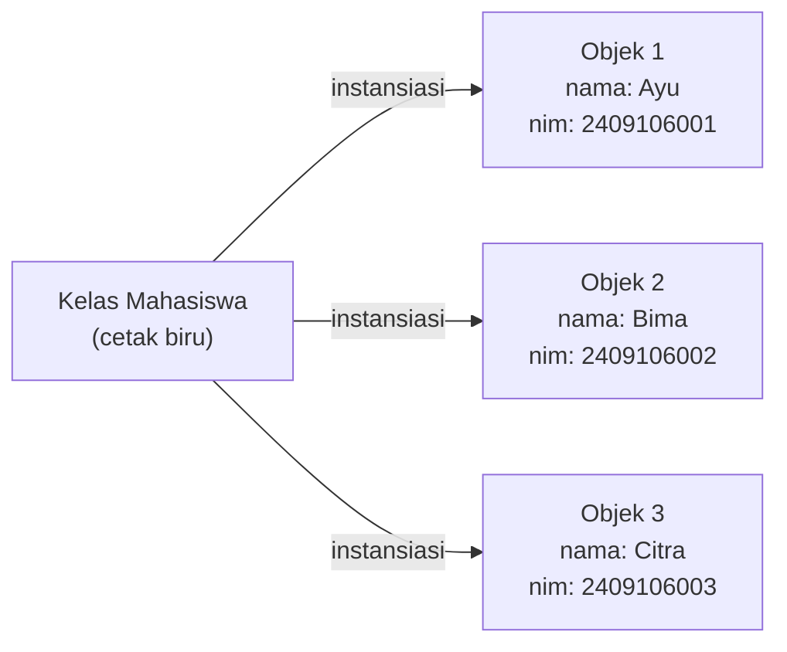
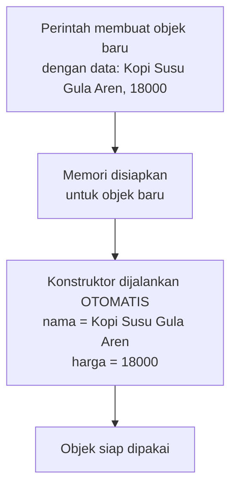
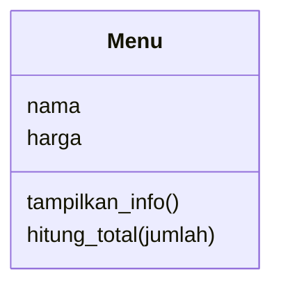

# Pertemuan 02 — Kelas dan Objek

[⬅️ Pertemuan 01](../Pertemuan-01-Pengenalan-PBO/README.md) · [🏠 Beranda](../README.md) · [Pertemuan 03 ➡️](../Pertemuan-03-Atribut-dan-Method/README.md)

> Hari ini kita berkenalan dengan dua kata yang akan kamu dengar sepanjang semester: **kelas** dan **objek**. Keduanya adalah fondasi Pemrograman Berorientasi Objek. Kalau dua konsep ini sudah mantap, materi-materi berikutnya akan terasa jauh lebih ringan.

## 🎯 Tujuan Pembelajaran

Setelah pertemuan ini, kamu mampu:

1. Menjelaskan perbedaan **kelas** dan **objek** dengan analogi sehari-hari.
2. Menemukan **atribut** (ciri) dan **method** (perilaku) dari sebuah benda atau konsep nyata.
3. Menjelaskan peran **konstruktor** saat sebuah objek dibuat.
4. Menjelaskan arti `self` (Python) atau `this` (Java) secara konsep.
5. Membuat beberapa objek dari satu kelas dan menjelaskan mengapa data mereka tidak saling bercampur.
6. Membaca diagram kelas sederhana berbentuk kotak tiga bagian.

## 🧭 Peta Belajar

| Langkah | Bagian | Perkiraan waktu |
|---|---|---|
| 1 | Konsep (halaman ini) | 40 menit |
| 2 | Praktik: [🐍 Python](python/README.md) **atau** [☕ Java](java/README.md) | 90 menit |
| 3 | [Jembatan Python ↔ Java](jembatan-python-java.md) | 15 menit |
| 4 | [Latihan](latihan.md) | 60 menit |
| 5 | [Kuis](kuis.md) | 15 menit |

## 🔁 Mengingat Kembali

Di [Pertemuan 01](../Pertemuan-01-Pengenalan-PBO/README.md) kita sudah melihat bahwa:

- Program **prosedural** memisahkan data (variabel, list) dari perintah yang mengolahnya (fungsi).
- Pada KedaiKita versi prosedural, data satu menu tercerai-berai di tiga list (nama, harga, stok). Saat daftar nama diurutkan, harga dan stok tidak ikut berpindah sehingga datanya **tertukar**.
- PBO menyatukan data dan perilaku ke dalam satu wadah bernama **objek**, sehingga data satu menu selalu "jalan bersama".

Hari ini kita belajar cara membuat wadah itu.

## Daftar Isi

1. [Cerita Pembuka: Satu Cetakan, Banyak Kue](#1-cerita-pembuka-satu-cetakan-banyak-kue)
2. [Kelas: Cetak Biru Sebuah Objek](#2-kelas-cetak-biru-sebuah-objek)
3. [Objek: Wujud Nyata dari Kelas](#3-objek-wujud-nyata-dari-kelas)
4. [Atribut dan Method: Ciri dan Kemampuan](#4-atribut-dan-method-ciri-dan-kemampuan)
5. [Konstruktor: Mengisi Data Saat Objek Lahir](#5-konstruktor-mengisi-data-saat-objek-lahir)
6. [self dan this: Kata Ganti "Diriku Sendiri"](#6-self-dan-this-kata-ganti-diriku-sendiri)
7. [Mengirim Pesan ke Objek](#7-mengirim-pesan-ke-objek)
8. [Satu Kelas, Banyak Objek yang Mandiri](#8-satu-kelas-banyak-objek-yang-mandiri)
9. [Membaca Diagram Kelas Sederhana](#9-membaca-diagram-kelas-sederhana)
10. [Studi Kasus KedaiKita: Kelas Menu Pertama](#10-studi-kasus-kedaikita-kelas-menu-pertama)
11. [Miskonsepsi yang Sering Terjadi](#11-miskonsepsi-yang-sering-terjadi)

---

## 1. Cerita Pembuka: Satu Cetakan, Banyak Kue

Bayangkan kamu membantu Bu Rina membuat kue putu ayu untuk dijual di depan kampus. Bu Rina punya **satu cetakan** berbentuk bunga. Dari cetakan yang sama itu, ia bisa membuat puluhan kue.

Perhatikan beberapa hal:

- Semua kue punya **bentuk yang sama**, karena dibuat dari cetakan yang sama.
- Tetapi setiap kue adalah **benda yang berbeda**. Kue yang satu bisa diberi topping kelapa lebih banyak, kue yang lain warnanya lebih hijau.
- Kalau kamu memakan satu kue, kue lainnya **tidak ikut hilang**.
- Cetakannya sendiri **tidak bisa dimakan**. Cetakan hanyalah alat untuk membuat kue.

Pemrograman Berorientasi Objek bekerja dengan cara yang sangat mirip:

| Dunia kue | Dunia PBO |
|---|---|
| Cetakan kue | **Kelas** (*class*) |
| Kue hasil cetakan | **Objek** (*object*) |
| Bentuk yang sama untuk semua kue | Semua objek dari satu kelas punya **atribut dan method yang sama jenisnya** |
| Topping tiap kue berbeda | Setiap objek punya **nilai atribut sendiri** |

Pegang analogi ini baik-baik. Hampir semua yang kita pelajari hari ini bisa dijelaskan dengan "cetakan dan kue".

## 2. Kelas: Cetak Biru Sebuah Objek

Analogi lain yang sering dipakai adalah **denah rumah**. Seorang arsitek menggambar denah: ada berapa kamar, di mana pintu, seberapa luas dapur. Denah itu belum bisa ditinggali. Baru setelah tukang membangun rumah berdasarkan denah tersebut, ada rumah sungguhan.

> **Kelas** adalah cetak biru (*blueprint*) yang mendefinisikan **data apa saja** yang dimiliki sebuah objek dan **apa saja yang bisa dilakukan** objek tersebut.

Ciri-ciri kelas:

- Kelas punya **nama**, biasanya kata benda dengan huruf awal kapital: `Menu`, `Mahasiswa`, `Kucing`, `RekeningBank`.
- Kelas hanya **mendeskripsikan**. Menulis sebuah kelas tidak otomatis menciptakan data apa pun.
- Satu kelas cukup ditulis **sekali**, lalu bisa dipakai untuk membuat objek sebanyak apa pun.

> [!NOTE]
> Nama kelas ditulis dengan gaya **PascalCase**: setiap kata diawali huruf kapital dan tanpa spasi, misalnya `RekeningBank` atau `PersegiPanjang`. Aturan ini berlaku di Python maupun Java.

## 3. Objek: Wujud Nyata dari Kelas

Kalau kelas adalah denah, maka **objek** adalah rumah yang sudah dibangun. Rumah itu nyata: punya alamat, punya warna cat, bisa dihuni.

> **Objek** adalah wujud nyata yang dibuat dari sebuah kelas. Objek menyimpan data miliknya sendiri dan bisa melakukan aksi yang didefinisikan oleh kelasnya. Objek disebut juga ***instance*** dari kelasnya.

Proses membuat objek dari kelas disebut **instansiasi** (*instantiation*). Ini mirip proses "mencetak kue" atau "membangun rumah dari denah".



Beberapa contoh pasangan kelas dan objek:

| Kelas (cetak biru) | Objek (wujud nyata) |
|---|---|
| `Mahasiswa` | Ayu (NIM 2409106001), Bima (NIM 2409106002) |
| `Motor` | Motor Budi (Honda Beat merah), motor Siti (Yamaha NMAX hitam) |
| `Ponsel` | Ponsel milikmu, ponsel milik dosenmu |
| `Menu` | Kopi Susu Gula Aren Rp18.000, Es Teh Manis Rp8.000 |

> [!IMPORTANT]
> Kelas itu **satu**, objeknya bisa **banyak**. Kelas `Mahasiswa` hanya ditulis sekali, sedangkan objek mahasiswa bisa ada ribuan, satu untuk setiap mahasiswa.

## 4. Atribut dan Method: Ciri dan Kemampuan

Setiap objek di dunia nyata punya dua hal: **ciri** dan **kemampuan**. Ambil contoh ponselmu.

| | Ponsel |
|---|---|
| **Ciri** (sesuatu yang *dimiliki*) | merek, warna, kapasitas baterai, sisa baterai |
| **Kemampuan** (sesuatu yang bisa *dilakukan*) | menelepon, mengirim pesan, mengisi daya |

Dalam PBO, kedua hal itu punya nama resmi:

> **Atribut** adalah data atau ciri yang dimiliki sebuah objek, misalnya `nama`, `harga`, atau `warna`.
>
> **Method** adalah perilaku atau aksi yang bisa dilakukan sebuah objek, misalnya `tampilkan_info()` atau `hitung_total()`. Secara sederhana, method adalah fungsi yang "menempel" pada objek.

Kelas mendefinisikan **atribut apa saja** dan **method apa saja** yang dimiliki objek. Setiap objek lalu mengisi atribut itu dengan **nilainya sendiri**.

```text
Kelas Lampu
  Atribut : ruangan, menyala
  Method  : nyalakan(), matikan(), tampilkan_status()

Objek lampu_kamar  -> ruangan = "kamar", menyala = True
Objek lampu_dapur  -> ruangan = "dapur", menyala = False
```

### Trik menemukan atribut dan method

Saat membaca deskripsi masalah, gunakan trik sederhana ini:

- **Kata benda** atau kata sifat yang menjelaskan sesuatu → calon **kelas** atau **atribut**.
- **Kata kerja** → calon **method**.

Coba kalimat ini: *"Setiap **rekening** punya **nama pemilik** dan **saldo**. Nasabah bisa **menyetor** dan **menarik** uang, serta **melihat saldo**."*

| Hasil analisis | Isinya |
|---|---|
| Kelas | `RekeningBank` |
| Atribut | `pemilik`, `saldo` |
| Method | `setor()`, `tarik()`, `cek_saldo()` |

> [!TIP]
> **Coba sendiri:** gunakan trik di atas untuk kalimat *"Sebuah **lagu** punya **judul**, **penyanyi**, dan **durasi**. Lagu bisa **diputar** dan **ditampilkan** di playlist."* Tentukan kelas, atribut, dan method-nya.

<details>
<summary>Lihat jawaban</summary>

Kelas `Lagu`; atribut `judul`, `penyanyi`, `durasi`; method `putar()` dan `tampilkan()`.

</details>

## 5. Konstruktor: Mengisi Data Saat Objek Lahir

Bayangkan kamu mendaftar menjadi member sebuah kafe. Petugas langsung memintamu mengisi **nama** dan **nomor HP**. Kartu member tidak akan dibuat sebelum data itu lengkap. Mustahil ada member tanpa nama.

Objek juga sebaiknya begitu. Begitu lahir, datanya harus sudah lengkap. Di sinilah peran **konstruktor**.

> **Konstruktor** (*constructor*) adalah method khusus yang **dijalankan otomatis tepat saat sebuah objek dibuat**. Tugas utamanya mengisi nilai awal atribut objek tersebut.



Hal penting tentang konstruktor:

- Kita **tidak memanggil** konstruktor secara langsung seperti method biasa. Konstruktor terpanggil dengan sendirinya saat objek dibuat.
- Data yang kita berikan saat membuat objek akan diterima oleh konstruktor sebagai **parameter**.
- Di Python, konstruktor ditulis sebagai method bernama `__init__`. Di Java, konstruktor ditulis dengan **nama yang sama persis dengan nama kelas**. Detailnya ada di halaman praktik.

> [!WARNING]
> Tanpa konstruktor, kita bisa saja membuat objek lalu lupa mengisi sebagian atributnya. Akibatnya objek "setengah jadi". Di Python, membaca atribut yang belum pernah diisi akan memunculkan error. Di Java, atribut yang lupa diisi berisi nilai kosong seperti `null` atau `0`. Kedua situasi ini sering menjadi sumber *bug*.

## 6. self dan this: Kata Ganti "Diriku Sendiri"

Bayangkan dosen berkata di depan kelas: *"Silakan tulis nama**mu** di kertas."* Kalimat itu satu, tetapi setiap mahasiswa menulis nama yang berbeda. Akhiran "-mu" otomatis merujuk ke **diri masing-masing**.

Method juga ditulis sekali di dalam kelas, tetapi dijalankan oleh banyak objek yang berbeda. Supaya method tahu "atribut milik siapa" yang sedang diolah, kita butuh kata ganti untuk **objek yang sedang menjalankan method itu**.

| Bahasa | Kata ganti | Arti |
|---|---|---|
| Python | `self` | "objek ini", objek yang sedang menjalankan method |
| Java | `this` | "objek ini", objek yang sedang menjalankan method |

Contoh: method `tampilkan_info()` milik kelas `Menu` mencetak "nama dan harga milik **objek ini**".

- Saat dipanggil oleh objek kopi, `self`/`this` berarti **objek kopi**, sehingga yang tercetak adalah nama dan harga kopi.
- Saat dipanggil oleh objek es teh, `self`/`this` berarti **objek es teh**.

`self`/`this` juga berguna untuk membedakan **atribut** dengan **parameter** yang namanya sama. Di dalam konstruktor, kita sering melihat bentuk seperti ini:

```text
atribut nama milik objek ini  <-  diisi dengan  <-  parameter nama yang dikirim
          (self.nama / this.nama)                          (nama)
```

> [!NOTE]
> Di Python, `self` **wajib** ditulis sebagai parameter pertama setiap method dan wajib dipakai saat mengakses atribut. Di Java, `this` sudah tersedia otomatis dan boleh tidak ditulis, kecuali ada parameter yang namanya sama dengan atribut. Perbedaan ini dibahas di [Jembatan Python ↔ Java](jembatan-python-java.md).

## 7. Mengirim Pesan ke Objek

Bagaimana cara "menyuruh" objek melakukan sesuatu? Pikirkan **remote TV**. Kamu tidak membongkar TV untuk menaikkan volume. Kamu cukup menekan tombol, dan TV yang mengerjakan sisanya.

Dalam PBO, menekan tombol itu disebut **memanggil method**. Para ahli PBO menyebutnya juga **mengirim pesan ke objek**. Bentuk penulisannya sama di Python dan Java, yaitu memakai **notasi titik**:

```text
objek.method(argumen)     -> menyuruh objek melakukan sesuatu
objek.atribut             -> membaca data milik objek
```

Contoh dalam bahasa sehari-hari:

| Notasi titik | Artinya |
|---|---|
| `kopi.tampilkan_info()` | "Hai objek kopi, tampilkan informasimu!" |
| `kopi.hitung_total(2)` | "Hai objek kopi, berapa total harga untuk 2 porsi?" |
| `kopi.harga` | "Berapa harga milik objek kopi?" |

> [!TIP]
> Saat membaca kode, ucapkan notasi titik sebagai "milik". `kopi.harga` dibaca "harga **milik** kopi". `lampu_dapur.nyalakan()` dibaca "nyalakan lampu **milik** dapur". Kebiasaan kecil ini sangat membantu.

## 8. Satu Kelas, Banyak Objek yang Mandiri

Sekarang kita buat tiga objek menu dari kelas `Menu` yang sama. Di memori komputer, keadaannya kira-kira seperti ini:

```text
 Variabel               Objek di memori
 ---------              ----------------------------------------------
 kopi        ------->   [Menu]  nama  = "Kopi Susu Gula Aren"
                                harga = 18000

 es teh      ------->   [Menu]  nama  = "Es Teh Manis"
                                harga = 8000

 nasi goreng ------->   [Menu]  nama  = "Nasi Goreng Kampung"
                                harga = 25000
```

Perhatikan bahwa **setiap objek menyimpan atributnya sendiri**. Jika harga es teh dinaikkan menjadi 10000, hanya objek es teh yang berubah. Objek kopi dan nasi goreng tetap seperti semula. Ini sama seperti memakan satu kue: kue lainnya tidak ikut habis.

Variabel seperti `kopi` sebenarnya hanyalah **nama panggilan** yang menunjuk ke sebuah objek. Variabel bukan objek itu sendiri. Hal ini akan kita bahas lebih dalam di Pertemuan 03.

## 9. Membaca Diagram Kelas Sederhana

Programmer sering menggambarkan kelas dalam bentuk **diagram kelas** (*class diagram*). Bentuk paling sederhananya adalah kotak dengan tiga bagian:



| Bagian kotak | Isi |
|---|---|
| Atas | Nama kelas |
| Tengah | Daftar atribut |
| Bawah | Daftar method |

Diagram seperti ini membantu kita merancang program **sebelum** menulis kode, dan membantu orang lain memahami program kita dengan cepat. Notasi lengkapnya (tipe data, tanda `+` dan `-`, dan garis hubungan antarkelas) akan kita pelajari di Pertemuan 06.

> [!NOTE]
> Nama method di diagram di atas memakai gaya Python (`tampilkan_info`). Di Java, nama yang sama ditulis dengan gaya camelCase: `tampilkanInfo`. Konsepnya tetap sama.

## 10. Studi Kasus KedaiKita: Kelas Menu Pertama

Masih ingat KedaiKita, kafe kecil di Jl. Pramuka, Samarinda, yang data menunya kacau di Pertemuan 01? Hari ini kita membuat **versi pertama** KedaiKita yang benar-benar memakai kelas.

**Rancangan:**


- Atribut `nama` dan `harga` diisi lewat konstruktor saat menu dibuat.
- Method `tampilkan_info()` mencetak nama dan harga menu.
- Method `hitung_total(jumlah)` **mengembalikan** total harga untuk sejumlah porsi.

**Skenario program:**

1. Membuat tiga objek menu: Kopi Susu Gula Aren (18000), Es Teh Manis (8000), dan Nasi Goreng Kampung (25000).
2. Menampilkan informasi ketiganya.
3. Menghitung pesanan Budi: 2 kopi dan 1 nasi goreng, lalu menampilkan totalnya.
4. Menaikkan harga es teh menjadi 10000, lalu membuktikan bahwa objek kopi tidak ikut berubah.

**Hasil yang diharapkan** (sama persis untuk versi Python maupun Java):

```text
=== MENU KEDAIKITA ===
Kopi Susu Gula Aren - Rp18000
Es Teh Manis - Rp8000
Nasi Goreng Kampung - Rp25000

=== PESANAN BUDI ===
2 x Kopi Susu Gula Aren = Rp36000
1 x Nasi Goreng Kampung = Rp25000
Total bayar: Rp61000

=== HARGA ES TEH NAIK ===
Es Teh Manis - Rp10000
Kopi Susu Gula Aren - Rp18000
```

Bandingkan dengan versi prosedural di Pertemuan 01. Kini nama dan harga satu menu **terbungkus dalam satu objek**. Data tidak mungkin tertukar dengan menu lain, karena setiap objek membawa datanya sendiri.

Kode lengkapnya dibahas baris demi baris di halaman praktik: [🐍 Python](python/README.md#9-studi-kasus-kedaikita) atau [☕ Java](java/README.md#9-studi-kasus-kedaikita).

## 11. Miskonsepsi yang Sering Terjadi

> [!WARNING]
> **"Kelas dan objek itu sama saja."**
> Tidak. Kelas adalah cetak biru, objek adalah hasil cetakannya. Kamu tidak bisa memakan cetakan kue, dan kamu juga tidak bisa menyimpan data mahasiswa tertentu di dalam "kelas Mahasiswa" yang belum dibuat objeknya.

> [!WARNING]
> **"Kalau atribut satu objek diubah, objek lain dari kelas yang sama ikut berubah."**
> Tidak. Setiap objek menyimpan atributnya sendiri. Mengubah harga es teh tidak mengubah harga kopi.

> [!WARNING]
> **"Konstruktor harus dipanggil manual setelah objek dibuat."**
> Tidak. Konstruktor berjalan otomatis tepat saat objek dibuat. Kita cukup memberikan datanya.

> [!WARNING]
> **"Nama variabel adalah nama objeknya."**
> Variabel hanyalah label yang menunjuk ke objek. Satu objek bahkan bisa ditunjuk oleh dua variabel sekaligus (kita bahas di Pertemuan 03).

> [!WARNING]
> **"Method sama saja dengan fungsi biasa."**
> Mirip, tetapi method selalu terikat pada objek. Method bisa membaca dan mengubah atribut milik objeknya sendiri lewat `self`/`this`. Fungsi biasa tidak punya "pemilik".

## 📝 Ringkasan

- **Kelas** adalah cetak biru. **Objek** adalah wujud nyata yang dibuat dari kelas. Satu kelas bisa menghasilkan banyak objek.
- **Atribut** menyimpan data atau ciri objek. **Method** adalah perilaku atau aksi objek.
- Trik analisis: kata benda menjadi kelas atau atribut, kata kerja menjadi method.
- **Konstruktor** dijalankan otomatis saat objek dibuat dan bertugas mengisi nilai awal atribut.
- `self` (Python) dan `this` (Java) berarti "objek yang sedang menjalankan method ini".
- Objek disuruh bekerja dengan **notasi titik**: `objek.method()` dan `objek.atribut`.
- Setiap objek menyimpan datanya sendiri, sehingga perubahan pada satu objek tidak memengaruhi objek lain.
- **Diagram kelas** sederhana terdiri atas tiga bagian: nama kelas, atribut, dan method.

## 📖 Istilah Penting

| Istilah | Arti singkat |
|---|---|
| Kelas (*class*) | Cetak biru yang mendefinisikan atribut dan method sebuah jenis objek |
| Objek (*object*) / *instance* | Wujud nyata yang dibuat dari kelas, menyimpan datanya sendiri |
| Instansiasi | Proses membuat objek dari sebuah kelas |
| Atribut | Data atau ciri milik objek (di Java disebut juga *field*) |
| Method | Perilaku atau aksi yang bisa dilakukan objek |
| Konstruktor (*constructor*) | Method khusus yang otomatis berjalan saat objek dibuat |
| `self` / `this` | Kata ganti untuk objek yang sedang menjalankan method |
| Notasi titik | Cara mengakses atribut atau memanggil method: `objek.nama`, `objek.method()` |
| Diagram kelas | Gambar kotak tiga bagian: nama kelas, atribut, method |

## ➡️ Langkah Berikutnya

Pilih jalur praktikmu: [🐍 Praktik Python](python/README.md) atau [☕ Praktik Java](java/README.md).

---

[⬅️ Pertemuan 01](../Pertemuan-01-Pengenalan-PBO/README.md) · [🏠 Beranda](../README.md) · [Pertemuan 03 ➡️](../Pertemuan-03-Atribut-dan-Method/README.md)
