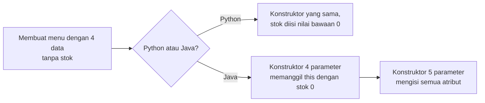
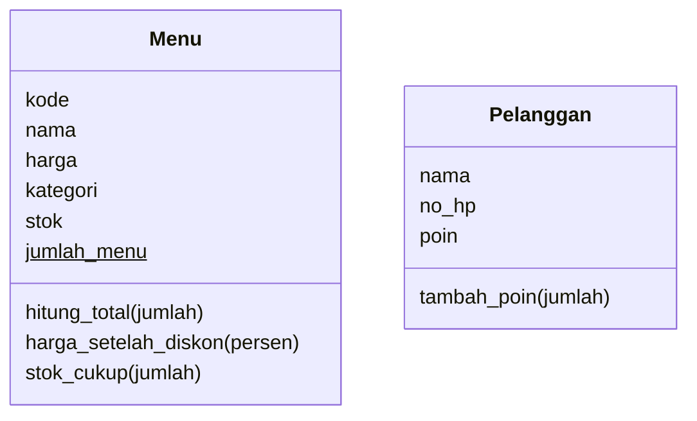

# Pertemuan 03: Atribut dan *Method* Lebih Dalam

[⬅️ Pertemuan 02](../Pertemuan-02-Kelas-dan-Objek/README.md) · [🏠 Beranda](../README.md) · [Pertemuan 04 ➡️](../Pertemuan-04-Enkapsulasi/README.md)

> Di Pertemuan 02 kamu sudah bisa membuat kelas dan objek. Hari ini kita mengupas isinya lebih dalam: data yang dimiliki **bersama**, *method* yang **tidak butuh objek**, konstruktor yang **luwes**, objek yang bisa **memperkenalkan diri**, dan apa sebenarnya yang disimpan sebuah **variabel**. Bekal ini akan terus dipakai sampai akhir semester.

## 🎯 Tujuan Pembelajaran

Setelah pertemuan ini, kamu mampu:

1. Membedakan **atribut objek** dan **atribut kelas**, lalu menentukan data mana yang cocok menjadi milik bersama.
2. Menjelaskan perbedaan ***method* objek** dan ***method* milik kelas** (*static method*), termasuk kegunaan **konstruktor alternatif**.
3. Membuat konstruktor yang luwes dengan **nilai bawaan** (Python) atau ***overloading*** (Java).
4. Membuat **representasi teks** sebuah objek dan ***method boolean*** dengan nama yang mudah dibaca.
5. Menjelaskan bahwa variabel menyimpan **referensi**, lalu memprediksi akibat ***aliasing*** dan nilai kosong (`None`/`null`).
6. Memakai objek sebagai **parameter** dan sebagai **nilai kembalian** sebuah *method*.

## 🧭 Peta Belajar

| Langkah | Bagian | Perkiraan waktu |
|---|---|---|
| 1 | Konsep (halaman ini) | 45 menit |
| 2 | Praktik: [🐍 Python](python/README.md) **atau** [☕ Java](java/README.md) | 100 menit |
| 3 | [Jembatan Python ↔ Java](jembatan-python-java.md) | 15 menit |
| 4 | [Latihan](latihan.md) | 60 menit |
| 5 | [Kuis](kuis.md) | 15 menit |

🖼️ ***Slide* pertemuan ini:** [lihat di PowerPoint Online](https://view.officeapps.live.com/op/view.aspx?src=https%3A%2F%2Fraw.githubusercontent.com%2Fantonprafanto%2FPBO2026%2Fmaster%2FSlide%2FPBO2026-P03-Atribut-dan-Method.pptx) · [baca PDF](../Slide/PBO2026-P03-Atribut-dan-Method.pdf) · [unduh PowerPoint](https://raw.githubusercontent.com/antonprafanto/PBO2026/master/Slide/PBO2026-P03-Atribut-dan-Method.pptx) · [unduh PDF](https://raw.githubusercontent.com/antonprafanto/PBO2026/master/Slide/PBO2026-P03-Atribut-dan-Method.pdf)

## 🔁 Mengingat Kembali

Di [Pertemuan 02](../Pertemuan-02-Kelas-dan-Objek/README.md) kita sudah belajar bahwa:

- **Kelas** adalah cetak biru, sedangkan **objek** adalah wujud nyatanya. Satu kelas bisa menghasilkan banyak objek.
- **Konstruktor** berjalan otomatis saat objek dibuat dan mengisi nilai awal atributnya.
- `self` (Python) dan `this` (Java) berarti "objek yang sedang menjalankan *method* ini".
- Setiap objek menyimpan atributnya sendiri. Menaikkan harga es teh tidak mengubah harga kopi.
- Variabel hanyalah "label" yang menunjuk ke objek, dan satu objek bisa ditunjuk oleh dua variabel. Waktu itu kita baru menyinggungnya; hari ini kita bahas tuntas.

## Daftar Isi

1. [Cerita Pembuka: Buku Catatan dan Papan Pengumuman](#1-cerita-pembuka-buku-catatan-dan-papan-pengumuman)
2. [Atribut Objek dan Atribut Kelas](#2-atribut-objek-dan-atribut-kelas)
3. [*Method* Milik Objek dan *Method* Milik Kelas](#3-method-milik-objek-dan-method-milik-kelas)
4. [Konstruktor yang Lebih Luwes](#4-konstruktor-yang-lebih-luwes)
5. [Objek yang Bisa Memperkenalkan Diri](#5-objek-yang-bisa-memperkenalkan-diri)
6. [*Method* yang Menjawab Ya atau Tidak](#6-method-yang-menjawab-ya-atau-tidak)
7. [Variabel Menyimpan Referensi, Bukan Objek](#7-variabel-menyimpan-referensi-bukan-objek)
8. [Objek sebagai Parameter](#8-objek-sebagai-parameter)
9. [Objek sebagai Nilai Kembalian](#9-objek-sebagai-nilai-kembalian)
10. [Studi Kasus KedaiKita: Menu yang Lebih Lengkap](#10-studi-kasus-kedaikita-menu-yang-lebih-lengkap)
11. [Miskonsepsi yang Sering Terjadi](#11-miskonsepsi-yang-sering-terjadi)

---

## 1. Cerita Pembuka: Buku Catatan dan Papan Pengumuman

Bayangkan suasana kelas PBO di kampus. Setiap mahasiswa membawa **buku catatan** sendiri. Di buku itu tertulis nama, NIM, dan catatan miliknya. Buku Ayu berbeda isinya dengan buku Bima.

Di depan kelas ada **papan pengumuman**. Papan itu hanya ada **satu** dan dibaca oleh semua orang: "Kampus: Universitas Mulawarman", "Jumlah peserta: 40 orang".

Perhatikan bedanya:

- Kalau Ayu mencoret buku catatannya, buku Bima **tidak** ikut tercoret.
- Kalau pengumuman di papan diganti, **semua** mahasiswa langsung membaca informasi yang baru.
- "Jumlah peserta" tidak cocok ditulis di buku catatan masing-masing. Data itu menggambarkan **seluruh kelas**, bukan satu mahasiswa.

Sekarang pindah ke KedaiKita. Pemilik kafe ingin tahu: *"Sudah berapa menu yang terdaftar?"* Di mana angka itu sebaiknya disimpan? Kalau disimpan di setiap objek menu, setiap menu akan punya angkanya sendiri-sendiri, dan tidak ada yang benar. Angka itu butuh "papan pengumuman". Inilah yang akan kita pelajari pertama kali.

## 2. Atribut Objek dan Atribut Kelas

Atribut yang kita buat di Pertemuan 02 (misalnya `nama` dan `harga`) semuanya adalah **atribut objek**. Ada jenis atribut kedua yang dimiliki oleh kelasnya.

> **Atribut objek** (*instance attribute*) adalah data milik **setiap objek**. Setiap objek menyimpan nilainya sendiri.
>
> **Atribut kelas** (*class attribute*) adalah data milik **kelas**. Hanya ada **satu** nilai yang dipakai bersama oleh semua objek dari kelas itu. Di Java, atribut kelas ditandai kata kunci `static` (milik kelas, bukan milik objek).

| | Atribut objek | Atribut kelas |
|---|---|---|
| Analogi | buku catatan tiap mahasiswa | papan pengumuman di depan kelas |
| Pemilik | setiap objek | kelas |
| Banyaknya nilai | satu per objek | satu untuk semua objek |
| Contoh pada `Mahasiswa` | `nim`, `nama` | `kampus`, `jumlah` |
| Contoh pada `Menu` | `kode`, `nama`, `harga`, `stok` | `jumlah_menu` |
| Cara menulis yang dianjurkan | lewat objek: `ayu.nama` | lewat nama kelas: `Mahasiswa.jumlah` |

Sekilas cara menuliskannya di kedua bahasa (potongan kode, tidak untuk dijalankan sendiri; program lengkapnya ada di halaman praktik):

**Python:** atribut kelas ditulis langsung di badan kelas, di luar `__init__`.

```python
class Mahasiswa:
    kampus = "Unmul"  # atribut kelas
    jumlah = 0  # atribut kelas

    def __init__(self, nim, nama):
        self.nim = nim  # atribut objek
        self.nama = nama  # atribut objek
```

**Java:** atribut kelas diberi kata kunci `static`.

```java
class Mahasiswa {
    static String kampus = "Unmul"; // atribut kelas
    static int jumlah = 0;          // atribut kelas

    String nim;  // atribut objek
    String nama; // atribut objek
}
```

Gambaran di memori kira-kira seperti ini:

```text
          Kelas Mahasiswa (hanya ada SATU)
       +---------------------------------+
       |  kampus = "Unmul"               |   <- atribut kelas
       |  jumlah = 3                     |
       +---------------------------------+
        ^               ^               ^
        |               |               |      semua objek membaca
        |               |               |      nilai yang sama
 +-------------+ +-------------+ +-------------+
 | objek ayu   | | objek bima  | | objek citra |   <- atribut objek
 | nama: Ayu   | | nama: Bima  | | nama: Citra |
 +-------------+ +-------------+ +-------------+
```

### Atribut kelas sebagai penghitung objek

Pemakaian atribut kelas yang paling sering adalah **penghitung**. Caranya, konstruktor menambah atribut kelas setiap kali ada objek baru lahir:

```text
jumlah = 0                         <- atribut kelas, mulai dari nol
buat objek Ayu    -> jumlah = 1
buat objek Bima   -> jumlah = 2
buat objek Citra  -> jumlah = 3    <- semua objek membaca angka yang sama: 3
```

Atribut kelas sudah ada **sebelum** objek mana pun dibuat. Karena itu, kita bisa membaca `jumlah` lewat nama kelasnya walaupun belum ada satu objek pun (hasilnya 0).

> [!WARNING]
> **Ubah atribut kelas selalu lewat nama kelasnya**, misalnya `Mahasiswa.jumlah += 1`, bukan lewat objek seperti `ayu.jumlah += 1`. Akibat cara yang kedua justru **berbeda** di kedua bahasa:
>
> - **Python:** mengisi atribut lewat objek akan **membuat atribut objek baru** yang namanya sama. Atribut baru itu "membayangi" atribut kelas, sedangkan nilai bersama di kelas **tidak berubah**.
> - **Java:** nilai bersama memang berubah, tetapi tulisannya **menyesatkan** karena terlihat seperti milik objek `ayu` saja.
>
> Kedua perilaku ini dibuktikan dengan program di halaman praktik: [Python bagian 2](python/README.md#2-jebakan-mengubah-atribut-kelas-lewat-objek) dan [Java bagian 2](java/README.md#2-atribut-static-selalu-lewat-nama-kelas).

> [!TIP]
> **Coba sendiri:** dari daftar berikut, mana yang cocok menjadi atribut kelas `Menu` KedaiKita? (a) nama menu, (b) jumlah menu yang terdaftar, (c) harga, (d) nama kafe "KedaiKita", (e) stok.

<details>
<summary>Lihat jawaban</summary>

(b) dan (d). Jumlah menu dan nama kafe berlaku sama untuk seluruh menu. Nama, harga, dan stok berbeda untuk setiap menu, jadi tetap menjadi atribut objek.

</details>

## 3. *Method* Milik Objek dan *Method* Milik Kelas

Semua *method* di Pertemuan 02 adalah ***method* objek**. *Method* seperti `hitung_total(jumlah)` membutuhkan data milik satu objek tertentu, yaitu harga menu itu. Tanpa objek, *method* ini tidak tahu harga siapa yang harus dihitung.

Sekarang bayangkan pertanyaan *"Apakah tahun 2024 tahun kabisat?"*. Untuk menjawabnya, kita tidak butuh objek tanggal tertentu. Cukup angka tahunnya. Pertanyaan seperti ini lebih mirip **kalkulator di meja kasir**: alat bantu milik bersama yang bisa dipakai siapa saja, tanpa harus "menanyai" menu tertentu.

> ***Method* milik kelas** (*static method*) adalah *method* yang dipanggil lewat **nama kelas** dan **tidak membutuhkan objek**. Karena tidak terikat pada objek, *method* ini tidak bisa memakai `self`/`this`. Semua data yang dibutuhkannya datang dari parameter (atau dari atribut kelas).

| | *Method* objek | *Method* milik kelas |
|---|---|---|
| Cara memanggil | `objek.method()` | `NamaKelas.method()` |
| Butuh objek? | ya | tidak |
| Punya `self`/`this`? | ya | tidak |
| Contoh | `kopi.hitung_total(2)` | `Tanggal.kabisat(2024)` |
| Cocok untuk | perilaku yang memakai data objek | fungsi bantu, konversi, pembuat objek |

### Konstruktor alternatif

Bayangkan kamu mendaftar sebagai anggota KedaiKita. Ada dua cara: mengisi **formulir** (nama, nomor HP, dan seterusnya), atau cukup menyerahkan **KTP** untuk dipindai karena datamu sudah tercetak di sana. Bentuk datanya berbeda, tetapi hasil akhirnya sama, yaitu kartu anggota baru.

Objek juga begitu. Selain konstruktor biasa, kita bisa membuat *method* milik kelas yang **membuat objek dari bentuk data lain**, misalnya dari sebaris teks `"17-08-1945"`.

> **Konstruktor alternatif** adalah *method* milik kelas yang membuat lalu **mengembalikan objek baru** dari bentuk data yang berbeda. Namanya biasanya diawali `dari_...` (Python) atau `dari...` (Java), misalnya `dari_teks()` atau `dariTeks()`.

Kedua bahasa punya caranya sendiri:

| Jenis *method* | Python | Java |
|---|---|---|
| *Method* objek | *method* biasa dengan `self` | *method* biasa |
| Fungsi bantu tanpa objek | `@staticmethod` atau fungsi biasa di luar kelas | *method* `static` |
| Konstruktor alternatif | `@classmethod` (menerima kelasnya sebagai `cls`) | *method* `static` yang mengembalikan objek |

> [!NOTE]
> Mengapa *method* `main` di Java ditulis `static`? Saat program baru mulai, **belum ada objek apa pun**. Karena `main` milik kelas, Java bisa menjalankannya lewat nama kelasnya saja, tanpa membuat objek lebih dulu. Penjelasan lengkapnya ada di [halaman praktik Java](java/README.md#3-method-static-dan-konstruktor-alternatif).

## 4. Konstruktor yang Lebih Luwes

Saat memesan es teh, kamu cukup berkata *"Es teh satu!"*. Barista langsung memakai pilihan standar: gula normal, ukuran reguler. Kalau kamu ingin berbeda, barulah kamu menyebutnya: *"Es teh satu, kurang gula."*

KedaiKita butuh hal yang sama. Menu yang baru didaftarkan sering belum punya stok. Memaksa kasir selalu menulis "stok 0" itu merepotkan. Lebih enak jika stok boleh tidak disebut, lalu otomatis bernilai 0.

> **Nilai bawaan** (*default value*) adalah nilai yang otomatis dipakai sebuah parameter jika argumennya tidak dikirim.

Python dan Java mewujudkannya dengan cara berbeda:

- **Python** menulis nilai bawaan langsung di daftar parameter: `stok=0`. Satu konstruktor bisa dipanggil dengan 4 atau 5 argumen.
- **Java** tidak mengenal nilai bawaan. Sebagai gantinya, Java mengizinkan **beberapa konstruktor** dengan daftar parameter berbeda. Teknik ini disebut ***overloading***. Konstruktor yang pendek biasanya meneruskan pekerjaannya ke konstruktor yang lengkap dengan `this(...)`.

Sekilas bentuknya (potongan kode, tidak untuk dijalankan sendiri; `...` berarti isinya tidak ditampilkan):

**Python:**

```python
class Menu:
    def __init__(self, kode, nama, harga, kategori, stok=0):
        ...

mie = Menu("M04", "Mie Goreng Jawa", 23000, "Makanan")  # stok = 0
```

**Java:**

```java
class Menu {
    Menu(String kode, String nama, int harga, String kategori, int stok) { ... }

    Menu(String kode, String nama, int harga, String kategori) {
        this(kode, nama, harga, kategori, 0); // teruskan, stok = 0
    }
}
```



> [!NOTE]
> *Overloading* juga berlaku untuk *method* biasa di Java: beberapa *method* boleh bernama sama asalkan daftar parameternya berbeda. Topik ini akan kita bahas lagi di Pertemuan 09 (Polimorfisme).

## 5. Objek yang Bisa Memperkenalkan Diri

Apa yang terjadi jika sebuah objek menu dicetak langsung, tanpa persiapan apa pun? Hasilnya kira-kira seperti ini:

```text
Python : <__main__.Menu object at 0x7f3a2c1b5e10>
Java   : Menu@1b6d3586
```

Kode angka di bagian belakangnya bisa berbeda setiap kali program dijalankan. Kedua teks itu benar, tetapi tidak berguna bagi manusia. Rasanya seperti datang ke seminar dan diperkenalkan dengan "nomor loker 1b6d3586", bukan dengan nama. Kita ingin objek bisa memperkenalkan dirinya dengan jelas, seperti **kartu nama**: `[M01] Kopi Susu Gula Aren (Minuman) - Rp18.000 | stok 20`.

> **Representasi teks** adalah teks yang mewakili sebuah objek saat objek itu dicetak atau digabung dengan teks lain. Kita mengaturnya dengan *method* khusus: `__str__` di Python dan `toString()` di Java.

*Method* khusus ini **dipanggil otomatis** setiap kali objek perlu diubah menjadi teks, misalnya saat dicetak. Tugasnya hanya satu: **mengembalikan** teks, bukan mencetaknya.

Misalnya untuk kelas `Motor` yang punya atribut `plat`, `merek`, dan `warna` (potongan kode, tidak untuk dijalankan sendiri):

**Python:**

```python
def __str__(self):
    return f"{self.plat} - {self.merek} ({self.warna})"
```

**Java:**

```java
@Override
public String toString() {
    return plat + " - " + merek + " (" + warna + ")";
}
```

Dengan *method* ini, motor berplat KT 1234 AB bermerek Honda Beat berwarna merah tercetak sebagai `KT 1234 AB - Honda Beat (merah)`.

Kedua bahasa sebenarnya sudah punya versi bawaan, dan versi bawaan itulah yang menghasilkan teks aneh seperti `Menu@1b6d3586` tadi. Di Java, tanda `@Override` berarti kita **menimpa** versi bawaan itu dengan versi buatan sendiri. Detail tentang menimpa *method* (*override*) dibahas di Pertemuan 07.

> [!TIP]
> Biasakan setiap kelas yang kamu buat punya representasi teks. Mencetak objek jadi mudah, dan saat mencari *bug*, kamu langsung bisa melihat isi objeknya.

## 6. *Method* yang Menjawab Ya atau Tidak

Kasir sering bertanya, *"Stok kopi masih cukup untuk 2 gelas?"* Jawabannya cukup **ya** atau **tidak**. *Method* yang menjawab pertanyaan seperti ini mengembalikan nilai *boolean* (`True`/`False` di Python, `true`/`false` di Java).

> ***Method boolean*** adalah *method* yang mengembalikan nilai benar atau salah. Namanya sebaiknya dibaca seperti **pertanyaan ya/tidak**.

| Nama yang baik | Dibaca sebagai | Nama yang kurang baik |
|---|---|---|
| `stok_cukup(2)` / `stokCukup(2)` | "stoknya cukup untuk 2?" | `cek_stok(2)` (hasilnya apa?) |
| `kabisat(2024)` / `isKabisat(2024)` | "2024 kabisat?" | `tahun(2024)` |
| `saldo_cukup(50000)` / `saldoCukup(50000)` | "saldonya cukup?" | `proses_saldo(50000)` |
| `sudah_lunas()` / `sudahLunas()` | "sudah lunas?" | `status()` |

Di Java ada kebiasaan memberi awalan `is` untuk *method boolean*, seperti `isEmpty()` milik `String`. Untuk nama berbahasa Indonesia, bentuk pertanyaan seperti `stokCukup()` atau `sudahLunas()` juga lazim. Yang terpenting, pembaca langsung tahu bahwa jawabannya ya atau tidak.

Mengapa **mengembalikan** *boolean* lebih baik daripada mencetak "Bisa" atau "Tidak bisa"? Karena hasilnya bisa langsung dipakai dalam percabangan. Dalam bentuk kode semu (*pseudocode*), bukan kode sungguhan:

```text
jika menu.stok_cukup(2):
    proses pesanan
jika tidak:
    tampilkan "stok tidak cukup"
```

> [!WARNING]
> Tidak perlu menulis `if menu.stok_cukup(2) == True`. *Method boolean* sudah menghasilkan benar/salah, jadi cukup `if menu.stok_cukup(2)` (Python) atau `if (menu.stokCukup(2))` (Java).

## 7. Variabel Menyimpan Referensi, Bukan Objek

Inilah janji kita dari Pertemuan 02. Perhatikan kontak di ponselmu. Kamu mungkin menyimpan nomor yang sama dengan dua nama: **"Budi"** dan **"Ketua Tingkat"**. Dua kontak, tetapi orangnya **satu**. Kalau kamu mengirim pesan ke "Ketua Tingkat", Budi yang menerimanya karena memang orang yang sama.

Variabel bekerja persis seperti kontak itu. Variabel **tidak berisi objek**. Variabel hanya menyimpan **petunjuk** ke tempat objek berada.


> **Referensi** adalah penunjuk ke sebuah objek di memori. Variabel bertipe objek menyimpan referensi, bukan objeknya.
>
> ***Aliasing*** terjadi saat dua variabel atau lebih menyimpan referensi ke **objek yang sama**. Perubahan lewat satu variabel akan terlihat lewat variabel lainnya.

Perintah `b = a` hanya **menyalin referensinya**, bukan objeknya. Tidak ada objek baru yang lahir.

```text
ponsel_budi = Ponsel("Budi", 80)        ponsel_a = Ponsel("Rina", 50)
ponsel_dipinjam = ponsel_budi           ponsel_b = Ponsel("Rina", 50)

 ponsel_budi -------+                    ponsel_a -----> [Ponsel] Rina, 50%
                    v
                [Ponsel] Budi, 80%       ponsel_b -----> [Ponsel] Rina, 50%
                    ^
 ponsel_dipinjam ---+                    dua objek berbeda, walaupun datanya kembar

 SATU objek, DUA variabel (aliasing)
```

Misalnya Siti meminjam ponsel Budi lewat variabel `ponsel_dipinjam`, lalu memakainya sampai baterainya tinggal 50%. Saat dilihat lewat `ponsel_budi`, baterainya juga 50%. Bukan karena datanya "disalin ulang", melainkan karena keduanya memang **objek yang sama**.

### Objek yang sama atau data yang sama?

Ada dua pertanyaan berbeda yang sering tertukar:

| Pertanyaan | Python | Java |
|---|---|---|
| Apakah `a` dan `b` menunjuk **objek yang sama**? | `a is b` | `a == b` |
| Apakah **isinya** sama? | `a == b` | `a.equals(b)` |

Untuk kelas buatan kita sendiri, pertanyaan kedua secara bawaan **masih** membandingkan objeknya. Dua ponsel dengan data kembar tetap dianggap berbeda, kecuali kita sendiri yang mengatur cara membandingkan isinya. Cara mengaturnya dibahas di Pertemuan 12. Satu hal yang perlu diingat sejak sekarang: di Java, **teks (`String`) dibandingkan dengan `.equals()`**, bukan dengan `==`.

### Variabel yang tidak menunjuk apa pun

Kadang sebuah variabel memang belum punya objek, misalnya "Dimas belum punya ponsel". Untuk itu, ada nilai khusus `None` (Python) dan `null` (Java).

> **`None` / `null`** berarti variabel **tidak menunjuk objek apa pun**. Memanggil *method* lewat variabel seperti ini akan menimbulkan *error* (`AttributeError` di Python, `NullPointerException` di Java).

Mengisi variabel dengan `None`/`null` hanya **melepas labelnya**. Objek yang tadinya ditunjuk tidak ikut hilang selama masih ada variabel lain yang menunjuknya. Objek yang sudah tidak ditunjuk variabel mana pun nantinya dibersihkan otomatis dari memori, jadi kita tidak perlu menghapusnya sendiri.

## 8. Objek sebagai Parameter

Saat kamu meminjamkan ponsel ke teman, yang kamu serahkan adalah **ponsel aslinya**, bukan fotokopinya. Kalau temanmu memakai baterainya, ponselmu yang kembali juga sudah berkurang baterainya.

Hal yang sama terjadi saat objek dikirim ke *method*. Yang dikirim adalah **salinan referensinya** sehingga *method* memegang objek yang **sama** dengan pemanggil.

| Yang dikirim ke *method* | Yang diterima *method* | Jika *method* mengubahnya |
|---|---|---|
| Angka, misalnya `10000` | salinan nilainya | nilai milik pemanggil **tidak** berubah |
| Objek, misalnya `dompet_siti` | salinan referensinya (objeknya sama) | objek milik pemanggil **ikut** berubah |

Baris pertama tabel ini ditulis secara sederhana. Di Python, angka sebenarnya juga objek, tetapi isinya tidak bisa diubah sehingga hasil akhirnya sama: angka milik pemanggil tidak berubah. Detailnya ada di [halaman praktik Python](python/README.md#7-objek-sebagai-parameter).

Contoh nyata adalah transfer dompet digital. *Method* `transfer(tujuan, jumlah)` milik dompet Budi menerima objek dompet Siti sebagai parameter, lalu menambah saldo **objek itu**. Setelah *method* selesai, saldo Siti benar-benar bertambah.

> [!WARNING]
> Kemampuan ini sangat berguna, tetapi juga bisa mengejutkan. *Method* yang diam-diam mengubah objek kiriman sering menjadi sumber *bug*. Beri nama *method* yang jujur (misalnya `transfer`, `tambah_bonus`) supaya pembaca tahu bahwa objek yang dikirim akan berubah.

## 9. Objek sebagai Nilai Kembalian

Kalkulator menghitung `2 + 3` dan menghasilkan `5`. Angka `2` dan `3` tidak berubah sedikit pun. Hasilnya adalah angka **baru**.

Objek bisa diperlakukan dengan cara yang sama. Misalnya, kita punya kelas `Durasi` (jam dan menit). *Method* `tambah(lain)` menerima durasi lain, lalu **mengembalikan objek `Durasi` baru** berisi jumlah keduanya.

```text
kuliah    = 2 jam 30 menit
praktikum = 1 jam 40 menit

total = kuliah.tambah(praktikum)   ->  objek BARU: 4 jam 10 menit
                                       kuliah dan praktikum tidak berubah
```

Keuntungannya:

- Objek asal tetap aman, tidak berubah tanpa sengaja.
- Hasilnya bisa langsung dipakai lagi, bahkan secara berantai: `kuliah.tambah(istirahat).tambah(praktikum)`.

Konstruktor alternatif di bagian 3 juga termasuk *method* yang mengembalikan objek baru. Bedanya, konstruktor alternatif adalah *method* milik kelas, sedangkan `tambah` adalah *method* milik objek.

## 10. Studi Kasus KedaiKita: Menu yang Lebih Lengkap

Sekarang semua konsep di atas kita pakai untuk mengembangkan KedaiKita dari Pertemuan 02.

**Rancangan:**



Atribut yang **digarisbawahi** (`jumlah_menu`) adalah atribut kelas. Notasi lengkap diagram kelas dibahas di Pertemuan 06.

> [!NOTE]
> Nama di diagram memakai gaya Python. Di Java, namanya ditulis dengan *camelCase*: `jumlahMenu`, `hitungTotal`, `hargaSetelahDiskon`, `stokCukup`, `noHp`, dan `tambahPoin`.

**Apa yang baru?**

| Perubahan | Konsep yang dipakai |
|---|---|
| `Menu` kini punya `kode`, `nama`, `harga`, `kategori`, dan `stok` | atribut objek |
| Stok boleh tidak disebut saat membuat menu (otomatis 0) | nilai bawaan / *overloading* konstruktor |
| `jumlah_menu` mencatat banyaknya menu yang sudah dibuat | atribut kelas sebagai penghitung |
| Menu bisa langsung dicetak; `tampilkan_info()` tidak dipakai lagi | representasi teks |
| `harga_setelah_diskon(persen)` menghitung harga promo | *method* yang mengembalikan nilai |
| `stok_cukup(jumlah)` menjawab apakah stok mencukupi | *method boolean* |
| Uang ditampilkan dengan titik ribuan: `Rp18.000` | fungsi bantu / *method* milik kelas |
| Kelas baru `Pelanggan` dengan poin belanja yang mulai dari 0 | atribut dengan nilai awal tetap |

Untuk menampilkan uang dengan rapi, Python memakai **fungsi biasa** `format_rupiah()`. Java tidak mengizinkan fungsi di luar kelas sehingga Java memakai **kelas utilitas** `Rupiah` dengan *method* `static` `Rupiah.format()`. Kelas utilitas adalah kelas yang hanya berisi *method* milik kelas, seperti kotak perkakas yang bisa dipakai tanpa membuat objek. Alasan lengkapnya ada di [Jembatan Python ↔ Java](jembatan-python-java.md#3-format_rupiah-atau-rupiahformat).

**Skenario program:**

1. Membuat empat menu. Mie Goreng Jawa dibuat tanpa menyebut stok sehingga stoknya 0.
2. Mencetak semua menu dan jumlah menu yang terdaftar.
3. Mengecek stok: apakah kopi cukup untuk 2 porsi dan mie goreng cukup untuk 1 porsi?
4. Menampilkan harga promo diskon 10% untuk kopi dan nasi goreng.
5. Mendaftarkan Budi sebagai pelanggan. Budi membeli 2 kopi dan 1 es teh, lalu mendapat 1 poin untuk setiap Rp10.000 belanja.

**Hasil yang diharapkan** (sama persis untuk versi Python maupun Java):

```text
=== MENU KEDAIKITA ===
[M01] Kopi Susu Gula Aren (Minuman) - Rp18.000 | stok 20
[M02] Es Teh Manis (Minuman) - Rp8.000 | stok 30
[M03] Nasi Goreng Kampung (Makanan) - Rp25.000 | stok 15
[M04] Mie Goreng Jawa (Makanan) - Rp23.000 | stok 0
Jumlah menu terdaftar: 4

=== CEK STOK ===
Pesan 2 Kopi Susu Gula Aren? Bisa
Pesan 1 Mie Goreng Jawa? Stok tidak cukup

=== PROMO HARI INI: DISKON 10% ===
Kopi Susu Gula Aren: Rp18.000 -> Rp16.200
Nasi Goreng Kampung: Rp25.000 -> Rp22.500

=== PELANGGAN ===
Budi Santoso (081234567890) - 0 poin
Budi belanja Rp44.000, dapat 4 poin
Budi Santoso (081234567890) - 4 poin
```

Perhatikan baris terakhir. Poin Budi berubah dari 0 menjadi 4 karena *method* `tambah_poin` mengubah atribut objek `budi`. Kelas `Pelanggan` belum berhubungan langsung dengan `Menu`; hubungan antarkelas baru kita bangun di Pertemuan 05.

Kode lengkapnya dibahas di halaman praktik: [🐍 Python](python/README.md#9-studi-kasus-kedaikita) atau [☕ Java](java/README.md#9-studi-kasus-kedaikita).

> [!NOTE]
> Masih ada satu celah di KedaiKita versi ini: siapa pun bisa menulis `kopi.harga = -5000` atau mengubah stok sesukanya, dan program diam saja. Di Pertemuan 04 (Enkapsulasi), kita belajar cara melindungi data seperti ini.

## 11. Miskonsepsi yang Sering Terjadi

Berikut enam anggapan keliru yang paling sering muncul. Jika salah satunya masih terasa benar bagimu, baca lagi bagian yang disebutkan.

**Seputar atribut dan *method* milik kelas** ([bagian 2](#2-atribut-objek-dan-atribut-kelas) dan [bagian 3](#3-method-milik-objek-dan-method-milik-kelas)):

1. **Keliru:** "Atribut kelas sama saja dengan atribut objek, hanya beda tempat menulisnya."

   **Yang benar:** atribut objek dimiliki setiap objek, jadi nilainya bisa berbeda-beda. Atribut kelas hanya ada satu dan dipakai bersama. Mengubah atribut kelas berarti mengubah nilai yang dibaca oleh semua objek.

2. **Keliru:** "*Static method* bisa membaca atribut objek seperti `nama` atau `harga`."

   **Yang benar:** tidak bisa secara langsung. *Static method* tidak terikat pada objek mana pun, jadi tidak punya `self`/`this`. Jika butuh data objek, kirim objeknya sebagai parameter atau jadikan *method* objek biasa.

**Seputar representasi teks** ([bagian 5](#5-objek-yang-bisa-memperkenalkan-diri)):

3. **Keliru:** "Mencetak objek otomatis menampilkan semua atributnya."

   **Yang benar:** tanpa `__str__`/`toString()` buatan sendiri, yang tercetak hanyalah nama kelas dan sebuah kode, misalnya `<__main__.Menu object at 0x...>` (Python) atau `Menu@1b6d3586` (Java).

**Seputar referensi dan nilai kosong** ([bagian 7](#7-variabel-menyimpan-referensi-bukan-objek)):

4. **Keliru:** "`b = a` membuat salinan objek."

   **Yang benar:** `b = a` hanya menyalin referensi sehingga `a` dan `b` menunjuk objek yang sama. Objek baru hanya lahir saat konstruktor dipanggil.

5. **Keliru:** "`None`/`null` adalah objek kosong yang tetap bisa dipakai."

   **Yang benar:** `None`/`null` berarti "tidak ada objek". Memanggil *method* lewat variabel berisi `None`/`null` pasti menimbulkan *error*.

**Seputar objek sebagai parameter** ([bagian 8](#8-objek-sebagai-parameter)):

6. **Keliru:** "*Method* tidak bisa mengubah objek yang dikirim kepadanya."

   **Yang benar:** bisa. *Method* menerima salinan referensi, jadi ia memegang objek yang sama dengan pemanggil. Yang tidak bisa dilakukan *method* adalah mengubah nilai angka milik pemanggil atau mengganti objek yang dipegang variabel pemanggil.

## 📝 Ringkasan

- **Atribut objek** dimiliki setiap objek; **atribut kelas** (Java: `static`) dimiliki kelas dan dipakai bersama. Atribut kelas cocok untuk penghitung dan data yang sama untuk semua objek.
- Ubah atribut kelas **lewat nama kelasnya**, bukan lewat objek.
- ***Method* milik kelas** (*static method*) dipanggil lewat nama kelas tanpa objek. **Konstruktor alternatif** adalah *method* milik kelas yang membuat objek dari bentuk data lain, misalnya teks.
- Konstruktor bisa dibuat luwes: Python memakai **nilai bawaan**, Java memakai ***overloading*** dan `this(...)`.
- `__str__` / `toString()` mengatur **representasi teks** objek dan dipanggil otomatis saat objek dicetak. *Method* ini **mengembalikan** teks, bukan mencetaknya.
- ***Method boolean*** dinamai seperti pertanyaan ya/tidak, misalnya `stok_cukup()` atau `isKabisat()`.
- Variabel menyimpan **referensi**. `b = a` membuat ***aliasing***, bukan salinan. `None`/`null` berarti tidak menunjuk objek apa pun.
- Objek yang dikirim sebagai **parameter** bisa diubah oleh *method*. *Method* juga bisa **mengembalikan objek baru** tanpa mengubah objek asalnya.

## 📖 Istilah Penting

| Istilah | Arti singkat |
|---|---|
| Atribut objek (*instance attribute*) | Data milik satu objek; setiap objek punya nilainya sendiri |
| Atribut kelas (*class attribute*) | Data milik kelas; satu nilai dipakai bersama semua objek |
| `static` | Kata kunci Java untuk anggota milik kelas, bukan milik objek |
| *Method* objek | *Method* yang bekerja dengan data milik objek (punya `self`/`this`) |
| *Static method* | *Method* milik kelas; dipanggil lewat nama kelas tanpa objek |
| *Class method* | (Python) *method* milik kelas yang menerima kelasnya sendiri sebagai `cls` |
| Konstruktor alternatif | *Method* milik kelas yang membuat objek dari bentuk data lain |
| Kelas utilitas | Kelas yang hanya berisi *method* milik kelas, misalnya `Rupiah` di KedaiKita versi Java |
| Nilai bawaan (*default value*) | Nilai yang dipakai parameter jika argumennya tidak dikirim |
| *Overloading* | (Java) beberapa konstruktor/*method* bernama sama dengan daftar parameter berbeda |
| Representasi teks | Teks yang mewakili objek saat dicetak (`__str__` / `toString()`) |
| *Override* | Menimpa *method* bawaan dengan versi buatan sendiri (detail di Pertemuan 07) |
| *Method boolean* | *Method* yang mengembalikan benar/salah, dinamai seperti pertanyaan |
| Referensi | Penunjuk ke sebuah objek; itulah yang disimpan variabel |
| *Aliasing* | Dua variabel atau lebih menunjuk objek yang sama |
| `None` / `null` | Nilai khusus: variabel tidak menunjuk objek apa pun |

## ➡️ Langkah Berikutnya

Pilih jalur praktikmu: [🐍 Praktik Python](python/README.md) atau [☕ Praktik Java](java/README.md).

---

[⬅️ Pertemuan 02](../Pertemuan-02-Kelas-dan-Objek/README.md) · [🏠 Beranda](../README.md) · [Pertemuan 04 ➡️](../Pertemuan-04-Enkapsulasi/README.md)
