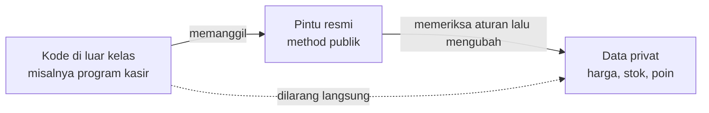
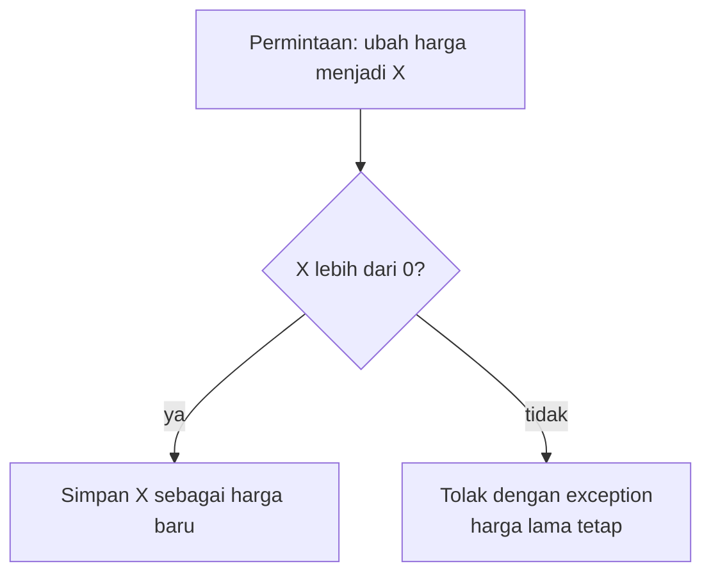
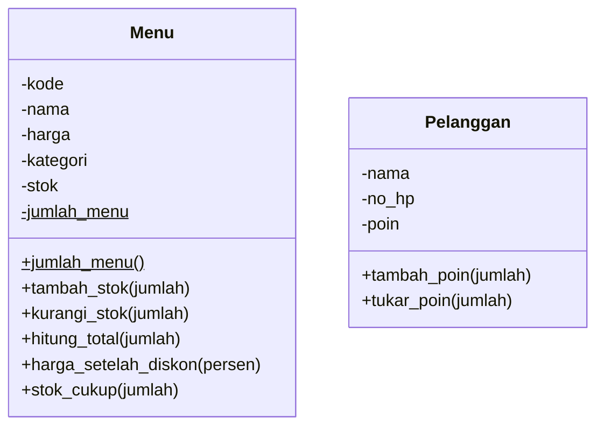

# Pertemuan 04 — Enkapsulasi

[⬅️ Pertemuan 03](../Pertemuan-03-Atribut-dan-Method/README.md) · [🏠 Beranda](../README.md) · [Pertemuan 05 ➡️](../Pertemuan-05-Relasi-Antar-Kelas/README.md)

> Sampai Pertemuan 03, data sebuah objek bisa diubah siapa saja menjadi nilai apa saja, termasuk harga kopi yang minus. Hari ini kita belajar **enkapsulasi**: cara membuat objek menjaga datanya sendiri, sehingga data yang tidak masuk akal ditolak sejak di pintu masuk. Inilah pilar PBO pertama yang kita pelajari secara mendalam.

## 🎯 Tujuan Pembelajaran

Setelah pertemuan ini, kamu mampu:

1. Menjelaskan masalah yang muncul jika data objek bisa diubah sembarangan dari luar kelas.
2. Menjelaskan arti **enkapsulasi** dan ***information hiding*** dengan analogi sehari-hari.
3. Membedakan tingkat akses `public`, `protected`, *default*, dan `private` di Java, serta konvensi `_nama` dan `__nama` di Python.
4. Merancang *getter*, *setter*, dan atribut *read-only* yang memvalidasi data, baik di setter maupun di konstruktor.
5. Memilih method "penjaga aturan" alih-alih setter, dan menjelaskan kapan getter/setter tidak diperlukan.
6. Menerapkan enkapsulasi pada studi kasus KedaiKita.

## 🧭 Peta Belajar

| Langkah | Bagian | Perkiraan waktu |
|---|---|---|
| 1 | Konsep (halaman ini) | 40 menit |
| 2 | Praktik: [🐍 Python](python/README.md) **atau** [☕ Java](java/README.md) | 90 menit |
| 3 | [Jembatan Python ↔ Java](jembatan-python-java.md) | 15 menit |
| 4 | [Latihan](latihan.md) | 60 menit |
| 5 | [Kuis](kuis.md) | 15 menit |

## 🔁 Mengingat Kembali

Di [Pertemuan 03](../Pertemuan-03-Atribut-dan-Method/README.md) kita sudah belajar bahwa:

- Ada **atribut objek** (milik tiap objek, misalnya `nama` setiap menu) dan **atribut kelas** (milik bersama, misalnya penghitung `jumlah_menu`).
- Method juga bisa menjadi milik kelas: `@staticmethod` dan `@classmethod` di Python, `static` di Java.
- Konstruktor bisa dibuat lebih luwes: nilai bawaan `stok=0` di Python, *overloading* konstruktor dengan `this(...)` di Java.
- `__str__` (Python) dan `toString()` (Java) membuat objek bisa langsung dicetak dengan rapi.
- Variabel hanya menyimpan **referensi** ke objek. Dua variabel bisa menunjuk objek yang sama, dan objek bisa dikirim ke method lain sebagai parameter.

Poin terakhir itu penting untuk hari ini. Karena satu objek bisa "dipegang" oleh banyak bagian program, **siapa pun** yang memegang referensinya bisa mengubah datanya. Lalu, bagaimana objek bisa melindungi dirinya sendiri?

## Daftar Isi

1. [Cerita Pembuka: Harga Kopi Jadi Minus](#1-cerita-pembuka-harga-kopi-jadi-minus)
2. [Enkapsulasi: Membungkus dan Menjaga](#2-enkapsulasi-membungkus-dan-menjaga)
3. [Wajah Depan dan Dapur Sebuah Kelas](#3-wajah-depan-dan-dapur-sebuah-kelas)
4. [Access Modifier: Siapa Boleh Masuk?](#4-access-modifier-siapa-boleh-masuk)
5. [Getter dan Setter: Pintu Baca dan Pintu Ubah](#5-getter-dan-setter-pintu-baca-dan-pintu-ubah)
6. [Validasi: Menolak Data yang Tidak Masuk Akal](#6-validasi-menolak-data-yang-tidak-masuk-akal)
7. [Atribut Read-Only: Boleh Dilihat, Tidak Boleh Diubah](#7-atribut-read-only-boleh-dilihat-tidak-boleh-diubah)
8. [Method Penjaga Aturan](#8-method-penjaga-aturan)
9. [Kapan Tidak Perlu Getter dan Setter?](#9-kapan-tidak-perlu-getter-dan-setter)
10. [Melindungi Atribut Kelas](#10-melindungi-atribut-kelas)
11. [Studi Kasus KedaiKita: Menu yang Menjaga Dirinya](#11-studi-kasus-kedaikita-menu-yang-menjaga-dirinya)
12. [Miskonsepsi yang Sering Terjadi](#12-miskonsepsi-yang-sering-terjadi)

---

## 1. Cerita Pembuka: Harga Kopi Jadi Minus

Bayangkan program kasir KedaiKita versi Pertemuan 03 sudah dipakai di kafe. Suatu sore, seorang programmer magang menambahkan fitur promo. Karena terburu-buru, kodenya berisi baris seperti ini:

**Python:**

```python
kopi.harga = -18000   # maksudnya diskon, malah jadi minus
kopi.stok = -5        # stok minus? kok bisa?
budi.poin = 1000000   # poin pelanggan "disulap"
```

**Java:**

```java
kopi.harga = -18000;  // maksudnya diskon, malah jadi minus
kopi.stok = -5;       // stok minus? kok bisa?
budi.poin = 1000000;  // poin pelanggan "disulap"
```

Program tetap berjalan tanpa protes sedikit pun. Akibatnya di kafe bisa kacau:

| Data yang rusak | Akibatnya |
|---|---|
| Harga kopi -Rp18.000 | Pelanggan yang memesan 2 kopi justru "dibayar" Rp36.000 |
| Stok kopi -5 | Kasir masih menerima pesanan untuk menu yang sebenarnya sudah habis |
| Poin Budi 1.000.000 | Budi bisa menukar poinnya menjadi potongan Rp1 miliar |

Masalahnya bukan pada programmer magang itu. Masalahnya ada pada **desain kelas**. Kelas `Menu` dan `Pelanggan` membiarkan datanya diubah oleh siapa saja, dari mana saja, menjadi nilai apa saja. Kelas tidak punya cara untuk berkata **"tidak"**.

Ingat juga kelas `RekeningBank` di Pertemuan 02. Method `tarik()`-nya sudah menolak penarikan yang melebihi saldo. Namun, atribut `saldo` masih bisa diubah langsung, misalnya `rekening.saldo = 999999999`. Satpam di pintu depan tidak ada gunanya jika jendela samping terbuka lebar.

> [!IMPORTANT]
> Data sebuah objek seharusnya **selalu masuk akal** sepanjang hidupnya: harga selalu positif, stok tidak pernah negatif, saldo tidak bisa disulap. Tugas menjaga aturan itu sebaiknya dipegang oleh **kelas itu sendiri**, bukan diserahkan pada kehati-hatian setiap programmer yang memakainya.

## 2. Enkapsulasi: Membungkus dan Menjaga

Coba perhatikan sebutir **kapsul obat**. Serbuk obat dibungkus oleh cangkang kapsul. Kamu menelan kapsulnya utuh tanpa perlu menyentuh atau menakar serbuknya. Cangkang itu melindungi isinya dan memastikan dosisnya selalu tepat.

Sekarang perhatikan **mesin ATM**. Di dalamnya ada brankas berisi uang tunai, tetapi kamu tidak bisa membukanya. Kamu hanya bisa memakai menu di layar: cek saldo, tarik tunai, transfer. Setiap menu memeriksa aturan lebih dulu (PIN benar? saldo cukup? melebihi batas harian?), baru kemudian uang keluar.

Kedua benda itu memakai prinsip yang sama, dan prinsip inilah yang kita pakai di PBO:

> **Enkapsulasi** (*encapsulation*) adalah prinsip membungkus data dan method yang mengolahnya ke dalam satu kelas, lalu **membatasi akses langsung** ke data tersebut. Pihak luar hanya boleh berinteraksi lewat "pintu resmi", yaitu method yang memang disediakan oleh kelas.

Enkapsulasi punya dua sisi:

| Sisi | Artinya | Pada mesin ATM |
|---|---|---|
| **Membungkus** | Data dan method yang mengolahnya disatukan dalam satu kelas (sudah kita lakukan sejak Pertemuan 02) | Uang dan mesin pengolahnya berada dalam satu mesin |
| **Menyembunyikan** (*information hiding*) | Detail di dalam kelas disembunyikan. Pihak luar cukup tahu **apa** yang bisa dilakukan objek, bukan **bagaimana** caranya | Brankas tertutup rapat; yang terlihat hanya menu di layar |



Apa untungnya bersusah payah membuat pintu resmi?

- **Data selalu valid.** Aturan diperiksa di satu tempat, sehingga tidak ada jalan pintas untuk memasukkan data aneh.
- **Mudah dipakai.** Pemakai kelas cukup mengenal pintu resminya, tanpa perlu memahami isi "dapurnya".
- **Mudah diubah.** Isi kelas boleh dirombak (misalnya cara menyimpan data) tanpa mengganggu kode yang memakainya, selama pintu resminya tetap sama.
- **Mudah dilacak.** Jika data ternyata salah, tersangkanya hanya method di dalam kelas itu, bukan ribuan baris kode di seluruh program.

> [!NOTE]
> Di Pertemuan 01 kamu sudah mendengar sekilas tentang empat pilar PBO: enkapsulasi, pewarisan, polimorfisme, dan abstraksi. Enkapsulasi adalah pilar pertama yang kita pelajari secara mendalam. Pilar lainnya menyusul di Pertemuan 07, 09, dan 10.

## 3. Wajah Depan dan Dapur Sebuah Kelas

Masuklah ke KedaiKita. Kamu memesan dan membayar di meja kasir. Pintu dapur bertuliskan *"Selain karyawan dilarang masuk"*. Kamu tidak perlu tahu resep, cara menyimpan bahan, atau urutan memasak. Yang penting, pesananmu datang dengan benar.

Jika koki mengganti cara menyimpan bahan, kamu sebagai pelanggan tidak terganggu sama sekali. Cara memesan tetap sama. Setiap kelas yang terenkapsulasi juga punya dua bagian seperti kafe itu:

| Bagian | Isinya | Siapa yang boleh memakai |
|---|---|---|
| **Bagian publik** (wajah depan, *public interface*) | Method yang memang disediakan untuk dipakai, misalnya baca harga, ubah harga, kurangi stok | Semua kode |
| **Bagian privat** (dapur) | Data mentah dan method pembantu internal | Hanya kode di dalam kelas itu sendiri |

```text
                 +------------------------------------------+
                 |                Kelas Menu                |
                 |                                          |
  kode di luar   |  BAGIAN PUBLIK (wajah depan)             |
  ------------>  |    baca harga, ubah harga,               |
                 |    tambah stok, kurangi stok, ...        |
                 |              |                           |
                 |              v  (aturan diperiksa dulu)  |
                 |  BAGIAN PRIVAT (dapur)                   |
                 |    kode, nama, harga, kategori, stok     |
                 +------------------------------------------+
```

> [!TIP]
> Pegangan praktis: **sembunyikan data secara bawaan**, lalu buka hanya pintu yang benar-benar dibutuhkan pihak luar. Membuka pintu baru di kemudian hari itu mudah. Menutup pintu yang terlanjur dipakai banyak orang itu sulit.

## 4. Access Modifier: Siapa Boleh Masuk?

Bayangkan gedung fakultas di kampus. Lobi terbuka untuk siapa saja. Ruang himpunan mahasiswa hanya untuk warga fakultas itu. Lemari pribadi di ruang dosen hanya bisa dibuka pemilik kuncinya.

Setiap ruang punya **aturan siapa yang boleh masuk**, dan kode juga butuh aturan seperti itu.

> ***Access modifier*** (pengatur hak akses) adalah penanda yang menentukan bagian kode mana saja yang boleh mengakses sebuah atribut, method, atau kelas.

### Di Java: kata kunci yang dijaga compiler

Java punya empat tingkat akses. Sebelum melihat tabelnya, kenali dulu istilah **paket** (*package*). Paket adalah kelompok kelas, mirip folder yang mengelompokkan file.

Sejauh ini, semua kelas kita berada di paket yang sama, yaitu paket tanpa nama. Paket bernama baru akan kita pakai di Pertemuan 15.

| *Access modifier* | Kelas itu sendiri | Kelas lain di paket yang sama | Kelas anak di paket lain | Kelas lain di paket lain |
|---|---|---|---|---|
| `public` | boleh | boleh | boleh | boleh |
| `protected` | boleh | boleh | boleh | tidak |
| *default* (tanpa kata kunci, *package-private*) | boleh | boleh | tidak | tidak |
| `private` | boleh | tidak | tidak | tidak |

Kolom "kelas anak" berkaitan dengan pewarisan (*inheritance*) yang baru dibahas di Pertemuan 07. Untuk saat ini, cukup pegang pola paling umum: **atribut dibuat `private`, method yang memang untuk umum dibuat `public`**. Jika kode lain mencoba menyentuh atribut `private`, Java menolaknya saat **kompilasi**, sebelum program sempat berjalan.

> [!NOTE]
> `protected` sering disangka "hanya untuk kelas anak". Padahal, kelas lain di paket yang sama pun boleh mengaksesnya. Kita akan kembali ke `protected` saat membahas pewarisan.

### Di Python: kesepakatan lewat nama

Python tidak punya kata kunci `public` atau `private`. Python memakai **konvensi penamaan**:

| Penulisan nama | Contoh | Artinya | Dijaga Python? |
|---|---|---|---|
| Tanpa garis bawah | `nama` | Publik, boleh dipakai siapa saja | - |
| Satu garis bawah di depan | `_harga` | "Ini urusan internal, jangan disentuh dari luar kelas" | Tidak, hanya kesepakatan |
| Dua garis bawah di depan | `__pin` | Namanya diganti diam-diam menjadi `_NamaKelas__pin` (*name mangling*) | Hanya namanya yang diganti; tetap bisa diakses |

Python memegang semboyan bahwa programmer adalah orang dewasa yang bertanggung jawab. Garis bawah adalah rambu "dilarang masuk" yang dihormati oleh komunitas Python, bukan gembok. Dalam praktik, programmer Python memakai **satu garis bawah** untuk data internal, lalu menyediakan pintu resmi bernama *property* (lihat bagian 5).

> [!WARNING]
> Jangan tertukar dengan nama yang diapit dua garis bawah di **depan dan belakang**, seperti `__init__` dan `__str__`. Itu adalah method khusus Python, bukan atribut privat, dan namanya tidak diganti.

> [!CAUTION]
> *Access modifier* **bukan fitur keamanan**. Tujuannya mencegah kesalahan pemakaian oleh sesama programmer, bukan menghalangi peretas. `_harga` dan `_Kelas__pin` di Python tetap bisa dibaca. Java pun punya fitur lanjutan (refleksi) yang bisa menembus `private`. Data yang benar-benar rahasia, seperti password, dilindungi dengan cara lain, misalnya *hash* dan enkripsi.

## 5. Getter dan Setter: Pintu Baca dan Pintu Ubah

Jika data disembunyikan, bagaimana pihak luar membacanya atau mengubahnya? Pikirkan bagian akademik kampus. Kamu tidak boleh mengubah sendiri data yang tersimpan di komputer kampus. Kamu bisa **melihat** datamu lewat portal, dan untuk **mengubahnya** kamu mengisi formulir yang diperiksa petugas dulu.

Dua pintu itu punya nama resmi dalam PBO:

> ***Getter*** adalah method untuk **membaca** nilai sebuah atribut privat.
>
> ***Setter*** adalah method untuk **mengubah** nilai sebuah atribut privat, biasanya sambil memeriksa apakah nilai barunya masuk akal.

Konsepnya sama di kedua bahasa, tetapi cara menuliskannya berbeda:

| Kebutuhan | Python (*property*) | Java (getter/setter) |
|---|---|---|
| Membaca harga | `kopi.harga` | `kopi.getHarga()` |
| Mengubah harga | `kopi.harga = 20000` | `kopi.setHarga(20000)` |
| Membaca data ya/tidak | `parkiran.penuh` | `parkiran.isPenuh()` |
| Di balik layar | method yang ditandai `@property` dan `@harga.setter` | method biasa bernama `getX`, `setX`, atau `isX` |

Perhatikan kolom Python. Dari luar, `kopi.harga` **terlihat** seperti atribut biasa, sama seperti di Pertemuan 03. Bedanya, di balik layar ada method yang bekerja dan bisa memeriksa data. Itulah sebabnya programmer Python tidak perlu menulis `get_harga()`.

Di Java, nama `getHarga`, `setHarga`, dan `isPenuh` adalah **kesepakatan penamaan** yang diikuti hampir semua programmer Java. Editor dan banyak *library* Java mengandalkan pola nama ini.

> [!TIP]
> Getter tidak harus mengembalikan atribut apa adanya. Getter boleh **menghitung** atau **merapikan** data. Contohnya, `sisa` tempat parkir dihitung dari kapasitas dikurangi jumlah motor, dan nomor antrean `7` disajikan sebagai `A007`. Pemakai tidak perlu tahu apakah nilainya disimpan atau dihitung.

## 6. Validasi: Menolak Data yang Tidak Masuk Akal

Setter yang hanya menyimpan nilai tanpa memeriksa apa pun tidak banyak gunanya. Kekuatan setter ada pada **validasi**.

> **Validasi** adalah pemeriksaan data sebelum data itu disimpan. Data yang tidak memenuhi aturan **ditolak**, dan data lama tetap utuh.



### Dua pintu yang wajib dijaga

Data bisa masuk ke objek lewat **dua** pintu: setter dan **konstruktor**. Jika setter rajin memeriksa tetapi konstruktor menyimpan data begitu saja, objek bisa "lahir cacat". Misalnya, menu baru dibuat dengan harga 0 dan lolos tanpa pemeriksaan.

Solusinya sederhana: konstruktor tidak menyimpan data secara langsung, tetapi **memanggil setter**. Dengan begitu, aturan cukup ditulis sekali dan berlaku di kedua pintu.

### Cara menolak: melempar exception

Bagaimana cara "menolak"? Mencetak pesan seperti `"Harga tidak valid"` saja tidak cukup. Kode pemanggil tidak tahu bahwa perintahnya gagal, lalu melanjutkan seolah-olah semuanya beres.

Cara yang tepat adalah melempar sinyal kesalahan yang disebut ***exception*** (pengecualian). Exception menghentikan perintah yang sedang berjalan dan "melapor" ke pemanggil. Pemanggil boleh **menangkap** exception itu, misalnya untuk menampilkan pesan yang ramah, lalu melanjutkan program.

| | Python | Java |
|---|---|---|
| Menolak (melempar exception) | `raise ValueError("Harga harus lebih dari 0")` | `throw new IllegalArgumentException("Harga harus lebih dari 0");` |
| Menangkap (intip sekilas) | `try: ... except ValueError as e: ...` | `try { ... } catch (IllegalArgumentException e) { ... }` |
| Jika tidak ditangkap | Program berhenti dan menampilkan *traceback* | Program berhenti dan menampilkan *stack trace* |

Secara sederhana, `try` berarti "coba jalankan blok ini". Jika di tengah jalan ada penolakan, sisa blok `try` dilewati, lalu blok `except`/`catch` dijalankan.

> [!NOTE]
> Hari ini kita hanya **mengintip** cara menangkap exception, agar program contoh tetap bisa berjalan setelah data ditolak. Bahasan tuntasnya, termasuk membuat exception sendiri, ada di Pertemuan 11.

## 7. Atribut Read-Only: Boleh Dilihat, Tidak Boleh Diubah

Lihat KTP-mu. NIK tidak pernah berubah seumur hidup. Sebaliknya, alamat boleh berubah saat kamu pindah rumah. Kode menu di KedaiKita juga begitu: `M01` dipakai di struk dan laporan, jadi tidak boleh tiba-tiba berganti.

> Atribut ***read-only*** (hanya-baca) adalah atribut yang bisa dibaca dari luar kelas, tetapi tidak bisa diubah dari luar kelas. Caranya: sediakan **getter**, tetapi **jangan** sediakan setter.

Apa yang terjadi jika ada kode yang tetap mencoba mengubahnya?

| Bahasa | Akibatnya |
|---|---|
| Python | Error saat program **berjalan**: `AttributeError` |
| Java | Error saat **kompilasi**: method `setX` tidak ditemukan |

Karena atribut read-only tidak punya setter, satu-satunya kesempatan untuk memeriksanya adalah di **konstruktor**. Contohnya, panjang NIK diperiksa saat objek penduduk dibuat.

## 8. Method Penjaga Aturan

Kembali ke ATM. Coba perhatikan: tidak ada menu **"ubah saldo"** di ATM. Yang ada hanya **"setor"** dan **"tarik tunai"**, dan masing-masing punya aturan sendiri. Bank sengaja tidak menyediakan pintu "ubah saldo" karena pintu itu terlalu berbahaya.

Stok menu KedaiKita juga sebaiknya diperlakukan begitu. Jika ada setter stok, perintahnya berbunyi "ubah stok menjadi 15". Kelas tidak tahu **alasan** perubahannya: menu terjual? baru restok? atau salah ketik? Akibatnya, kelas sulit menjaga aturan seperti "tidak boleh menjual melebihi stok".

Jauh lebih baik menyediakan **method dengan nama yang bermakna**, misalnya `tambah_stok(jumlah)` untuk restok dan `kurangi_stok(jumlah)` untuk penjualan:

| | Setter stok (dihindari) | Method penjaga aturan |
|---|---|---|
| Perintahnya | "Ubah stok menjadi 15" | "Kurangi stok sebanyak 5" |
| Kelas tahu alasannya? | Tidak | Ya, menu terjual |
| Bisa menolak penjualan yang melebihi stok? | Sulit | Mudah |
| Mudah ditambah pencatatan di kemudian hari? | Sulit | Mudah, cukup di dalam method itu |

> Method **penjaga aturan** adalah method yang menjadi satu-satunya jalan resmi untuk mengubah data tertentu, sambil memastikan aturan bisnisnya tidak pernah dilanggar.

Contoh lain di halaman praktik: jumlah motor di parkiran hanya berubah lewat `masuk(jumlah)` dan `keluar(jumlah)`, sedangkan poin pelanggan hanya berubah lewat `tambah_poin()` dan `tukar_poin()`.

## 9. Kapan Tidak Perlu Getter dan Setter?

Ada kebiasaan buruk yang sering muncul setelah belajar enkapsulasi: membuat semua atribut privat, lalu **otomatis** memberi getter dan setter untuk semuanya. Setter yang menerima nilai apa saja tanpa memeriksa sama saja dengan atribut publik. Pintunya ada, tetapi penjaganya tidak ada.

Untuk setiap atribut, ajukan empat pertanyaan ini secara berurutan:

1. Apakah pihak luar **perlu membaca** data ini? Jika tidak, jangan beri getter. Contohnya password.
2. Apakah pihak luar **perlu mengubah** data ini? Jika tidak, jadikan **read-only**. Contohnya kode menu.
3. Apakah perubahannya punya **makna khusus**, seperti terjual, restok, atau setor? Jika ya, buat **method penjaga aturan**, bukan setter.
4. Jika setter memang tepat, pastikan setter itu **memeriksa** nilai barunya.

### Tell, don't ask: suruh, jangan tanya

Ada prinsip desain yang sederhana tetapi ampuh, yaitu ***tell, don't ask***. Secara sederhana: jika ingin objek melakukan sesuatu terhadap datanya, **suruh** objek itu. Jangan **tanya** datanya, lalu kerjakan sendiri di luar kelas.

```text
GAYA BERTANYA (hindari)                    GAYA MENYURUH (tell, don't ask)
---------------------------------------    -----------------------------------
tanya: berapa stok kopi?                   suruh: "kopi, kurangi stokmu 2"
jika stok >= 2:                            (kopi sendiri yang memeriksa
    ubah stok kopi menjadi stok - 2         aturan dan menolak jika stok
jika tidak:                                 tidak cukup)
    tampilkan "stok tidak cukup"
```

Dengan gaya bertanya, aturan "stok tidak boleh minus" tercecer di setiap tempat yang memakai menu: layar kasir, pesanan daring, laporan. Jika aturannya berubah, semua tempat harus diubah, dan besar kemungkinan ada yang terlupa. Dengan gaya menyuruh, aturannya hanya tinggal di satu tempat, yaitu di dalam kelas `Menu`.

> [!NOTE]
> Getter tetap boleh dipakai untuk **menampilkan** data, misalnya mencetak struk atau laporan. Prinsip *tell, don't ask* berlaku untuk **keputusan dan perubahan** data.

## 10. Melindungi Atribut Kelas

Atribut kelas juga perlu dijaga. Di Pertemuan 03, penghitung `jumlah_menu` masih bisa diubah dari luar, misalnya `Menu.jumlah_menu = 100`. Laporan jumlah menu pun langsung salah.

Caranya sama seperti atribut objek: jadikan penghitung itu **privat**, lalu sediakan **getter milik kelas**. Di Python berupa `@classmethod` bernama `jumlah_menu()`. Di Java berupa method `static` bernama `getJumlahMenu()`.

Ada satu detail penting: penghitung harus dinaikkan **paling akhir** di konstruktor, setelah semua pemeriksaan lolos. Urutan kerja konstruktor `Menu` di KedaiKita:

1. Periksa stok awal. Jika negatif, tolak.
2. Simpan kode, nama, kategori, dan stok.
3. Simpan harga **lewat setter**, sehingga harga ikut diperiksa.
4. Baru setelah semuanya lolos, naikkan penghitung `jumlah_menu`.

Jika pemeriksaan di langkah 1 atau 3 gagal, langkah 4 tidak pernah dijalankan. Menu yang gagal dibuat pun tidak ikut terhitung.

## 11. Studi Kasus KedaiKita: Menu yang Menjaga Dirinya

Hari ini KedaiKita naik kelas. Kelas `Menu` dan `Pelanggan` sekarang menjaga datanya sendiri.

**Rancangan:**



Cara membaca diagram ini: tanda `-` berarti **privat**, tanda `+` berarti **publik**, dan anggota yang digarisbawahi adalah milik **kelas**. Getter dan setter sengaja tidak digambar agar diagram tetap ringkas. Notasi lengkapnya kita pelajari di Pertemuan 06.

> [!NOTE]
> Nama di diagram memakai gaya Python. Di Java, namanya memakai camelCase dan getter berawalan `get`, misalnya `getJumlahMenu()`, `tambahStok()`, dan `getHarga()`.

**Aturan yang kini dijaga oleh kelas:**

| Aturan | Dijaga oleh | Jika dilanggar |
|---|---|---|
| Harga harus lebih dari 0 | Setter harga (juga dipakai konstruktor) | Ditolak: "Harga harus lebih dari 0" |
| Stok awal tidak boleh negatif | Konstruktor | Ditolak: "Stok tidak boleh negatif" |
| Jumlah restok atau penjualan harus lebih dari 0 | `tambah_stok`, `kurangi_stok` | Ditolak: "Jumlah harus lebih dari 0" |
| Penjualan tidak boleh melebihi stok | `kurangi_stok` | Ditolak: "Stok ... tidak cukup (sisa ...)" |
| Kode, nama, dan kategori tidak berubah | Tidak ada setter (read-only) | Python: `AttributeError`; Java: error kompilasi |
| Poin yang ditambahkan harus lebih dari 0 | `tambah_poin` | Ditolak: "Poin yang ditambahkan harus lebih dari 0" |
| Poin yang ditukar tidak boleh melebihi poin yang dimiliki | `tukar_poin` | Ditolak: "Poin tidak cukup (sisa ...)" |
| Penghitung hanya naik jika menu berhasil dibuat | Konstruktor (langkah terakhir) | Menu yang gagal dibuat tidak terhitung |

**Skenario program:**

1. Membuat tiga menu, lalu menampilkannya beserta jumlah menu terdaftar.
2. Mencoba membuat menu dengan harga 0. Menu itu ditolak dan jumlah menu tidak bertambah.
3. Menaikkan harga es teh lewat setter, lalu mencoba mengubahnya menjadi negatif (ditolak).
4. Menjual 5 kopi, merestok 10, lalu mencoba menjual 30 kopi sekaligus (ditolak).
5. Memberi Budi 12 poin, menukar 10 poin menjadi potongan Rp10.000, lalu mencoba menukar 5 poin lagi (ditolak, karena sisa poinnya 2).

**Hasil yang diharapkan** (sama persis untuk versi Python maupun Java):

```text
=== MENU KEDAIKITA ===
[M01] Kopi Susu Gula Aren (Minuman) - Rp18.000 | stok 20
[M02] Es Teh Manis (Minuman) - Rp8.000 | stok 30
[M03] Nasi Goreng Kampung (Makanan) - Rp25.000 | stok 15
Jumlah menu terdaftar: 3

=== DATA TIDAK VALID DITOLAK ===
Gagal membuat menu: Harga harus lebih dari 0
Jumlah menu terdaftar tetap: 3

=== MENGUBAH HARGA LEWAT SETTER ===
Harga Es Teh Manis naik menjadi Rp10.000
Gagal mengubah harga: Harga harus lebih dari 0
Harga Es Teh Manis tetap Rp10.000

=== MENGELOLA STOK ===
Stok awal Kopi Susu Gula Aren: 20
Terjual 5, stok sekarang 15
Restok 10, stok sekarang 25
Gagal menjual: Stok Kopi Susu Gula Aren tidak cukup (sisa 25)

=== POIN PELANGGAN ===
Budi Santoso (081234567890) - 0 poin
Budi Santoso (081234567890) - 12 poin
Tukar 10 poin -> potongan Rp10.000
Budi Santoso (081234567890) - 2 poin
Gagal menukar poin: Poin tidak cukup (sisa 2)
```

Bandingkan dengan Pertemuan 03. Kini baris seperti `kopi.harga = -18000` tidak bisa lagi merusak data. Di Python, setter menolaknya saat program berjalan. Di Java, baris itu bahkan tidak lolos kompilasi, karena atribut `harga` bersifat `private`.

Kode lengkapnya dibahas di halaman praktik: [🐍 Python](python/README.md#9-studi-kasus-kedaikita) atau [☕ Java](java/README.md#9-studi-kasus-kedaikita).

## 12. Miskonsepsi yang Sering Terjadi

> [!WARNING]
> **"Enkapsulasi artinya semua atribut dibuat privat, lalu semuanya diberi getter dan setter."**
> Tidak. Setter yang menerima nilai apa saja sama saja dengan atribut publik. Beri getter hanya jika data perlu dibaca, beri setter hanya jika perubahan bebas memang masuk akal, dan pakai method penjaga aturan untuk perubahan yang punya makna.

> [!WARNING]
> **"Atribut privat membuat data aman dari peretas."**
> Tidak. *Access modifier* mencegah kesalahan pemakaian di dalam program, bukan serangan dari luar. Di Python, garis bawah hanyalah kesepakatan, dan *name mangling* hanya mengganti nama.

> [!WARNING]
> **"Di Python, `__harga` sama dengan `private` di Java."**
> Tidak persis. Python hanya mengganti namanya menjadi `_Kelas__harga`, dan nama itu tetap bisa diakses dari luar. Programmer Python umumnya memakai satu garis bawah (`_harga`) ditambah *property*.

> [!WARNING]
> **"Kalau setter sudah memeriksa data, konstruktor tidak perlu memeriksa."**
> Keliru. Konstruktor adalah pintu masuk pertama. Jika konstruktor menyimpan data secara langsung, objek bisa lahir dengan data yang tidak valid. Panggil setter dari konstruktor.

> [!WARNING]
> **"Getter harus mengembalikan atribut apa adanya."**
> Tidak harus. Getter boleh menghitung (sisa tempat parkir) atau merapikan tampilan (nomor antrean `A007`). Yang penting, pemakai mendapat informasi yang benar.

> [!WARNING]
> **"Enkapsulasi hanya membuat kode lebih panjang."**
> Untuk program sepuluh baris, mungkin terasa begitu. Namun, saat program membesar dan dikerjakan banyak orang, aturan yang dijaga di satu tempat menyelamatkanmu dari *bug* yang sulit dilacak.

## 📝 Ringkasan

- **Enkapsulasi** membungkus data dan method dalam satu kelas, lalu membatasi akses langsung ke data. Pihak luar hanya memakai **pintu resmi**.
- ***Information hiding***: pihak luar cukup tahu **apa** yang bisa dilakukan objek, bukan **bagaimana** caranya.
- Java punya empat tingkat akses: `public`, `protected`, *default*, dan `private`, yang dijaga oleh compiler. Python memakai konvensi `_nama`, sedangkan `__nama` memicu *name mangling* yang **bukan** fitur keamanan.
- **Getter** membaca data, **setter** mengubah data sambil **memvalidasi**. Di Python, keduanya ditulis sebagai *property*. Di Java, keduanya berupa method `getX`, `setX`, dan `isX`.
- Validasi wajib ada di **setter dan konstruktor**. Cara termudah: konstruktor memanggil setter.
- Data tidak valid ditolak dengan **exception** (`ValueError` / `IllegalArgumentException`). Cara menangkapnya baru kita intip; detailnya di Pertemuan 11.
- Atribut **read-only** punya getter tanpa setter.
- Perubahan yang punya makna (terjual, restok, setor) memakai **method penjaga aturan**, bukan setter.
- Jangan membuat getter dan setter secara otomatis. Ingat prinsip ***tell, don't ask***.
- Atribut kelas juga dilindungi: dibuat privat, dibaca lewat getter milik kelas, dan penghitungnya dinaikkan paling akhir di konstruktor.

## 📖 Istilah Penting

| Istilah | Arti singkat |
|---|---|
| Enkapsulasi (*encapsulation*) | Membungkus data dan method dalam satu kelas serta membatasi akses langsung ke data |
| *Information hiding* | Menyembunyikan detail internal kelas dari pihak luar |
| *Access modifier* | Penanda hak akses: `public`, `protected`, *default*, `private` |
| Paket (*package*) | Kelompok kelas di Java, mirip folder |
| *Getter* | Method untuk membaca nilai atribut privat |
| *Setter* | Method untuk mengubah nilai atribut privat, biasanya dengan validasi |
| *Property* | Cara Python membuat getter/setter yang dipakai seperti atribut biasa |
| Validasi | Pemeriksaan data sebelum disimpan |
| *Exception* (pengecualian) | Sinyal kesalahan yang menghentikan perintah dan bisa ditangkap pemanggil |
| *Read-only* | Bisa dibaca dari luar, tetapi tidak bisa diubah dari luar |
| *Name mangling* | Penggantian nama `__x` menjadi `_Kelas__x` oleh Python |
| Method penjaga aturan | Method yang menjadi jalan resmi untuk mengubah data sambil menjaga aturannya |
| *Tell, don't ask* | Suruh objek mengerjakan tugasnya, jangan ambil datanya lalu kerjakan di luar |

## ➡️ Langkah Berikutnya

Pilih jalur praktikmu: [🐍 Praktik Python](python/README.md) atau [☕ Praktik Java](java/README.md).

---

[⬅️ Pertemuan 03](../Pertemuan-03-Atribut-dan-Method/README.md) · [🏠 Beranda](../README.md) · [Pertemuan 05 ➡️](../Pertemuan-05-Relasi-Antar-Kelas/README.md)
