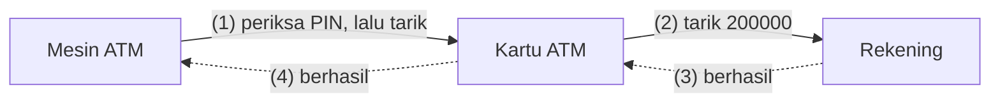
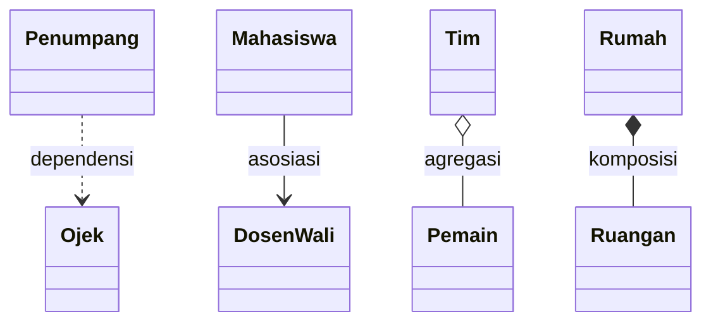
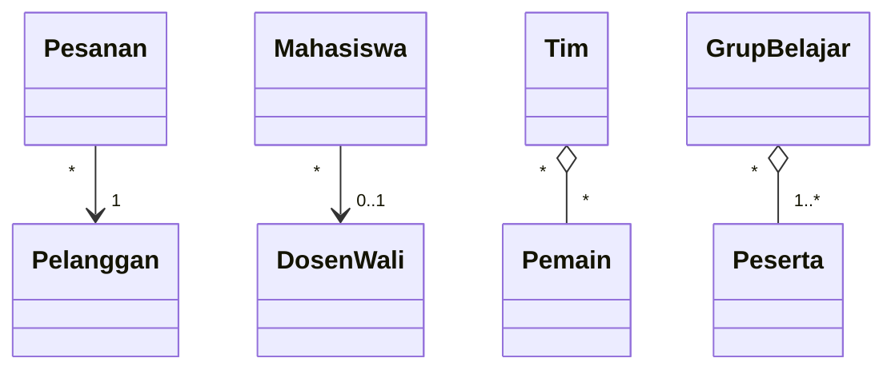
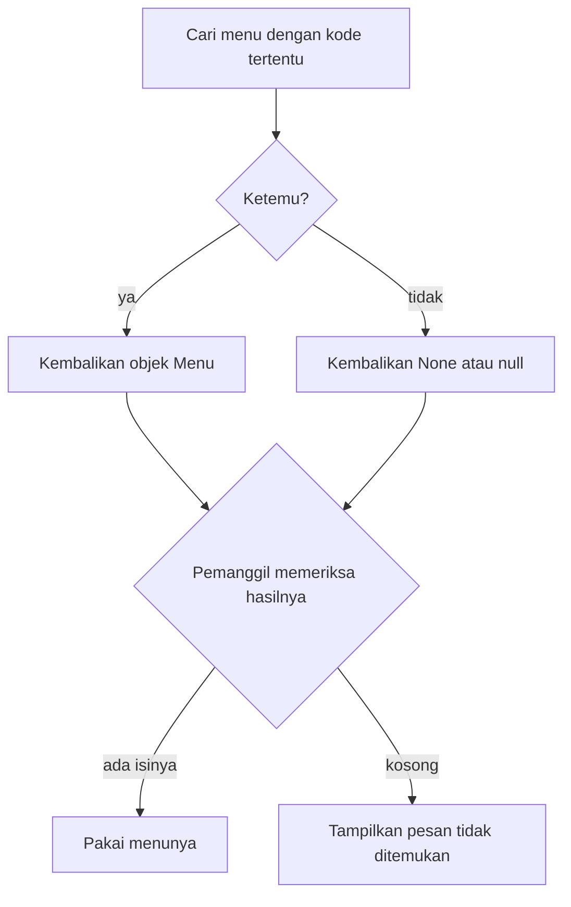
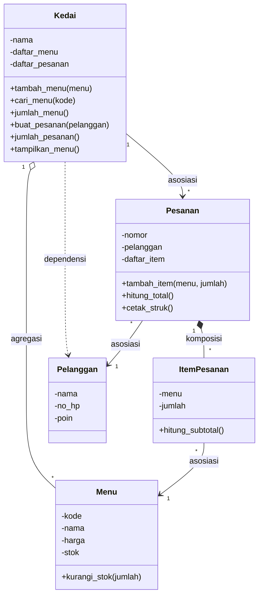

# Pertemuan 05: Relasi Antarkelas

[⬅️ Pertemuan 04](../Pertemuan-04-Enkapsulasi/README.md) · [🏠 Beranda](../README.md) · [Pertemuan 06 ➡️](../Pertemuan-06-UML-Class-Diagram/README.md)

> Sampai Pertemuan 04, setiap objek KedaiKita hidup sendiri-sendiri: menu tidak tahu siapa yang memesannya, dan pelanggan tidak punya pesanan. Hari ini kita belajar **menghubungkan objek**: kapan sebuah objek cukup *memakai* objek lain, kapan ia *mengenal*, dan kapan ia *memiliki*. Kita juga mulai memecah program menjadi beberapa *file*, seperti program sungguhan.

## 🎯 Tujuan Pembelajaran

Setelah pertemuan ini, kamu mampu:

1. Menjelaskan mengapa objek perlu saling berhubungan dan saling mengirim pesan.
2. Membedakan **dependensi**, **asosiasi**, **agregasi**, dan **komposisi** dengan analogi sehari-hari.
3. Membaca dan menentukan **multiplisitas** sebuah hubungan: `1`, `0..1`, `*`, dan `1..*`.
4. Menerjemahkan setiap jenis hubungan ke dalam kode: parameter, atribut berisi objek, *list* berisi objek, dan objek yang dibuat di dalam objek lain.
5. Melindungi *list* di dalam objek dengan mengembalikan **salinan**, serta menangani pencarian yang tidak menemukan apa-apa.
6. Menyusun program menjadi beberapa *file* dan menjalankannya dari folder yang benar.

## 🧭 Peta Belajar

| Langkah | Bagian | Perkiraan waktu |
|---|---|---|
| 1 | Konsep (halaman ini) | 40 menit |
| 2 | Praktik: [🐍 Python](python/README.md) **atau** [☕ Java](java/README.md) | 90 menit |
| 3 | [Jembatan Python ↔ Java](jembatan-python-java.md) | 15 menit |
| 4 | [Latihan](latihan.md) | 60 menit |
| 5 | [Kuis](kuis.md) | 15 menit |

🖼️ ***Slide* pertemuan ini:** [lihat di PowerPoint Online](https://view.officeapps.live.com/op/view.aspx?src=https%3A%2F%2Fraw.githubusercontent.com%2Fantonprafanto%2FPBO2026%2Fmaster%2FSlide%2FPBO2026-P05-Relasi-Antarkelas.pptx) · [baca PDF](../Slide/PBO2026-P05-Relasi-Antarkelas.pdf) · [unduh PowerPoint](https://raw.githubusercontent.com/antonprafanto/PBO2026/master/Slide/PBO2026-P05-Relasi-Antarkelas.pptx) · [unduh PDF](https://raw.githubusercontent.com/antonprafanto/PBO2026/master/Slide/PBO2026-P05-Relasi-Antarkelas.pdf)

## 🔁 Mengingat Kembali

Di [Pertemuan 04](../Pertemuan-04-Enkapsulasi/README.md) kita sudah belajar bahwa:

- **Enkapsulasi** menyembunyikan data di dalam kelas. Pihak luar hanya memakai pintu resmi: *getter*, *setter*, *property*, dan *method* penjaga aturan seperti `kurangi_stok()`.
- Data yang tidak masuk akal ditolak sejak di pintu masuk, baik di *setter* maupun di konstruktor, dengan melempar *exception*.
- Prinsip ***tell, don't ask***: suruh objek mengerjakan tugasnya sendiri, jangan ambil datanya lalu kerjakan di luar.
- Penghitung `jumlah_menu` milik kelas `Menu` dibuat privat dan hanya bisa dibaca lewat *getter* milik kelas.

Satu lagi dari Pertemuan 03 yang sangat penting hari ini: variabel hanya menyimpan **referensi** ke objek, dan objek bisa dikirim ke *method* lain sebagai parameter. Referensi inilah "tali" yang akan kita pakai untuk menghubungkan objek satu dengan objek lainnya.

## Daftar Isi

1. [Cerita Pembuka: Objek Tidak Bisa Bekerja Sendirian](#1-cerita-pembuka-objek-tidak-bisa-bekerja-sendirian)
2. [Objek Saling Mengirim Pesan](#2-objek-saling-mengirim-pesan)
3. [Empat Jenis Hubungan Antarobjek](#3-empat-jenis-hubungan-antarobjek)
4. [Dependensi: Memakai Sebentar](#4-dependensi-memakai-sebentar)
5. [Asosiasi: Saling Mengenal](#5-asosiasi-saling-mengenal)
6. [Agregasi: Punya, tetapi Bagiannya Bisa Hidup Sendiri](#6-agregasi-punya-tetapi-bagiannya-bisa-hidup-sendiri)
7. [Komposisi: Bagian yang Ikut Hilang](#7-komposisi-bagian-yang-ikut-hilang)
8. [Multiplisitas: Berapa Banyak?](#8-multiplisitas-berapa-banyak)
9. [Wujud Relasi di dalam Kode](#9-wujud-relasi-di-dalam-kode)
10. [Menjaga Isi *List* dan Pencarian yang Gagal](#10-menjaga-isi-list-dan-pencarian-yang-gagal)
11. [Program Banyak *File*: Satu Kelas, Satu *File*](#11-program-banyak-file-satu-kelas-satu-file)
12. [Studi Kasus KedaiKita: Kedai, Pesanan, dan Item](#12-studi-kasus-kedaikita-kedai-pesanan-dan-item)
13. [Miskonsepsi yang Sering Terjadi](#13-miskonsepsi-yang-sering-terjadi)

---

## 1. Cerita Pembuka: Objek Tidak Bisa Bekerja Sendirian

Coba ingat lagi KedaiKita versi Pertemuan 04. Kita sudah punya kelas `Menu` yang menjaga harga dan stoknya, serta kelas `Pelanggan` yang menjaga poinnya. Keduanya rapi dan aman.

Sekarang jawab pertanyaan sederhana ini: **Budi memesan apa?** Program kita tidak bisa menjawabnya. Objek Budi dan objek kopi hidup terpisah, seperti dua orang asing yang kebetulan berada di kafe yang sama. Tidak ada yang mencatat bahwa Budi memesan 2 kopi dan 1 nasi goreng.

Di kafe sungguhan, semua pihak saling terhubung:

| Kenyataan di kafe | Pertanyaan untuk program |
|---|---|
| Budi membuat sebuah **pesanan** | Pesanan ini milik siapa? |
| Pesanan berisi beberapa **baris**, misalnya "2 x Kopi Susu Gula Aren" | Baris ini merujuk menu yang mana? |
| Setiap baris punya **subtotal** | Berapa harga menunya sekarang? |
| Kafe mencatat semua **menu** dan **pesanan** hari itu | Di mana daftar menu dan daftar pesanan disimpan? |

Satu kelas tidak mungkin mengerjakan semuanya. Jika semua data dan tugas dijejalkan ke satu kelas raksasa, kelas itu sulit dibaca, sulit diuji, dan sulit diubah. Program yang baik terdiri atas **banyak kelas kecil yang bekerja sama**, masing-masing dengan tugas yang jelas.

> **Relasi antarkelas** adalah hubungan yang membuat objek dari satu kelas bisa **memakai, mengenal, atau memiliki** objek dari kelas lain sehingga objek-objek itu bisa bekerja sama.

## 2. Objek Saling Mengirim Pesan

Di Pertemuan 02 kamu belajar bahwa memanggil *method* sama dengan **mengirim pesan** ke objek. Sejauh ini, yang mengirim pesan hampir selalu program utama. Kini objek juga akan mengirim pesan ke objek **lain**.

Perhatikan apa yang terjadi saat Ayu menarik uang di ATM:



Panah utuh adalah pesan yang dikirim, dan panah putus-putus adalah jawaban yang kembali. Angka di dalam kurung menunjukkan urutannya.

- **Mesin ATM** tidak menyimpan saldo siapa pun. Ia hanya mengurus uang tunai di dalam mesin.
- **Kartu ATM** tahu PIN-nya dan tahu **rekening mana** yang menjadi miliknya.
- **Rekening** menjaga saldonya sendiri, persis seperti kelas yang kita buat di Pertemuan 04.

Setiap objek hanya mengerjakan bagiannya, lalu **meneruskan pesan** ke objek yang ia kenal. Tidak ada satu objek pun yang mengerjakan semuanya. Inilah wujud nyata *tell, don't ask*: mesin ATM tidak membaca saldo lalu menguranginya sendiri. Mesin **menyuruh** kartu, lalu kartu **menyuruh** rekening menarik uang.

> [!IMPORTANT]
> Syarat agar objek A bisa mengirim pesan ke objek B: A harus **memegang referensi** ke B. Referensi itu bisa datang lewat parameter *method*, atau disimpan sebagai atribut. Cara A mendapatkan dan menyimpan referensi itulah yang membedakan jenis-jenis relasi di bagian berikutnya.

## 3. Empat Jenis Hubungan Antarobjek

Hubungan di sekitar kita punya tingkat kedekatan yang berbeda. Ada yang hanya bertemu sebentar (pengemudi ojek), ada yang saling kenal lama (dosen wali), ada yang tergabung dalam satu kelompok (tim futsal), dan ada yang tidak terpisahkan (rumah dan kamarnya). Hubungan antarobjek juga begitu.

| Jenis relasi | Arti sederhana | Contoh sehari-hari | Contoh di KedaiKita |
|---|---|---|---|
| **Dependensi** (*dependency*) | memakai sebentar | mahasiswa memesan ojek | `Kedai` memakai `Pelanggan` saat membuat pesanan |
| **Asosiasi** (*association*) | mengenal | mahasiswa dan dosen walinya | `Pesanan` mengenal `Pelanggan` pemiliknya |
| **Agregasi** (*aggregation*) | punya, tetapi bagiannya bisa hidup sendiri | tim futsal dan pemainnya | `Kedai` punya daftar `Menu` |
| **Komposisi** (*composition*) | punya, dan bagiannya ikut hilang | rumah dan kamarnya | `Pesanan` punya `ItemPesanan` |

Keempatnya bisa diurutkan dari yang paling longgar sampai yang paling erat:

```text
longgar ------------------------------------------------------------> erat
dependensi           asosiasi            agregasi            komposisi
"memakai sebentar"   "mengenal"          "punya, lepas"      "punya, terikat"
```

Dalam **diagram kelas** (*class diagram*), yaitu gambar kotak-kotak kelas beserta garis hubungannya, setiap jenis relasi digambar dengan garis yang berbeda:



| Bentuk garis | Artinya |
|---|---|
| garis putus-putus berpanah | dependensi |
| garis utuh berpanah (panah menunjuk objek yang dikenal) | asosiasi |
| belah ketupat **kosong** di sisi pemilik | agregasi |
| belah ketupat **penuh** di sisi pemilik | komposisi |

> [!NOTE]
> Hari ini cukup kenali bentuk garisnya. Aturan lengkap menggambar diagram kelas, termasuk simbol-simbol lainnya, kita pelajari di Pertemuan 06.

## 4. Dependensi: Memakai Sebentar

Ayu, mahasiswa Unmul, memesan ojek daring dari kos ke kampus. Selama perjalanan, Ayu **memakai** jasa pengemudi. Begitu sampai, urusannya selesai. Ayu tidak "menyimpan" pengemudi itu, dan besok ia bisa saja diantar pengemudi lain.

> **Dependensi** (*dependency*) adalah hubungan "memakai sebentar". Objek A membutuhkan objek B hanya selama sebuah *method* berjalan. Setelah *method* selesai, A tidak lagi memegang B.

Ciri dependensi di kode:

- Objek B datang sebagai **parameter** *method* milik A, atau dibuat sebagai **variabel lokal** di dalam *method* itu.
- B **tidak disimpan** sebagai atribut A.

Alurnya kira-kira seperti ini (ilustrasi alur, bukan kode yang bisa dijalankan):

```text
penumpang.pesan_ojek(ojek, tujuan, jarak)
    -> memakai ojek untuk mengantar
    -> mencatat ongkos perjalanan
    -> selesai; ojek tidak disimpan
```

Kenapa disebut dependensi (ketergantungan)? Karena A **bergantung** pada B. Jika cara memakai B berubah, misalnya *method* `antar()` diganti nama, kode A juga harus diubah. Dependensi adalah hubungan paling longgar, tetapi tetap sebuah hubungan.

## 5. Asosiasi: Saling Mengenal

Setiap mahasiswa punya dosen wali. Hubungan ini tidak sebentar: sepanjang kuliah, kamu tahu siapa dosen walimu dan di ruang mana menemuinya. Namun, kamu dan dosenmu tetap dua pribadi yang berdiri sendiri. Kalau kamu lulus, dosenmu tetap ada. Kalau dosenmu pindah tugas, kamu tetap mahasiswa.

> **Asosiasi** (*association*) adalah hubungan "mengenal" yang bertahan lama. Objek A **menyimpan referensi** ke objek B sebagai atribut sehingga A bisa mengirim pesan ke B kapan saja. A dan B tetap bisa hidup sendiri-sendiri.

Ciri asosiasi di kode: ada **atribut yang isinya objek lain**, bukan angka atau teks. Gambaran kedua objek itu di memori:

```text
 Objek ayu (Mahasiswa)                Objek bu_rina (DosenWali)
 +----------------------------+       +---------------------+
 | nama       = "Ayu"         |       | nama    = "Bu Rina" |
 | dosen_wali = (referensi) --+-----> | ruangan = "C-201"   |
 +----------------------------+       +---------------------+
```

Karena yang disimpan adalah **referensi**, beberapa mahasiswa bisa mengenal objek dosen yang **sama**. Jika dosen pindah ruangan, cukup ubah satu objek dosen itu, dan semua mahasiswanya langsung "tahu". Ini persis materi referensi di Pertemuan 03.

### Arah hubungan (navigasi)

Asosiasi punya **arah**. Pada contoh di atas, mahasiswa tahu siapa dosen walinya, tetapi objek dosen tidak menyimpan daftar mahasiswanya. Hubungan seperti ini disebut **satu arah**: kita bisa "berjalan" dari mahasiswa ke dosen, tetapi tidak sebaliknya.

Pegangan praktis:

- Mulailah dengan **satu arah**, sesuai pertanyaan yang benar-benar perlu dijawab program, misalnya "dosen wali Ayu siapa?".
- Hubungan **dua arah** berarti kedua sisi harus selalu diperbarui bersamaan. Jika satu sisi terlupa, datanya tidak sinkron. Tambahkan arah kedua hanya jika memang dibutuhkan.

Di KedaiKita, `ItemPesanan` mengenal `Menu`-nya, tetapi `Menu` tidak tahu sedang dipesan di item mana saja. Satu arah sudah cukup.

## 6. Agregasi: Punya, tetapi Bagiannya Bisa Hidup Sendiri

Kelasmu membentuk tim futsal untuk turnamen fakultas. Tim terdiri atas beberapa pemain, jadi tim **punya** pemain. Namun, para pemain sudah ada sebelum tim dibentuk. Seorang pemain boleh ikut tim kelas sekaligus tim fakultas. Jika tim kelas bubar setelah turnamen, para pemainnya tidak ikut lenyap.

> **Agregasi** (*aggregation*) adalah bentuk khusus asosiasi berupa hubungan **keseluruhan dan bagian** (*whole-part*) yang longgar. Objek keseluruhan mengumpulkan objek-objek bagian, tetapi bagian-bagian itu **bisa hidup sendiri**, bahkan boleh menjadi bagian dari keseluruhan yang lain.

Ciri agregasi di kode:

- Objek keseluruhan menyimpan ***list* berisi objek bagian**.
- Objek bagian **dibuat di luar**, lalu diserahkan lewat parameter, misalnya `tim.rekrut(pemain)` atau `kedai.tambah_menu(menu)`.

Contoh agregasi lainnya: *playlist* dan lagu, rak dan buku, kelas kuliah dan mahasiswa pesertanya, kedai dan menu-menunya.

## 7. Komposisi: Bagian yang Ikut Hilang

Sekarang bayangkan sebuah rumah dengan ruang tamu, kamar tidur, dan dapur. Kamar tidur itu tidak bisa dipindahkan ke rumah lain, dan tidak ada artinya tanpa rumahnya. Jika rumah dirobohkan, kamar-kamarnya ikut hilang.

Struk kafe juga begitu. Baris "2 x Kopi Susu Gula Aren = Rp36.000" hanya bermakna sebagai bagian dari **satu pesanan tertentu**. Baris itu tidak bisa berdiri sendiri, dan tidak mungkin menjadi milik dua pesanan sekaligus.

> **Komposisi** (*composition*) adalah hubungan keseluruhan dan bagian yang **erat**. Bagian dibuat dan dimiliki penuh oleh keseluruhannya, tidak dibagi dengan pemilik lain, dan **siklus hidupnya ikut** keseluruhan: lahir bersama, hilang bersama.

Ciri komposisi di kode:

- Objek bagian **dibuat di dalam** objek keseluruhan, misalnya di konstruktornya atau di *method* seperti `tambah_item()`.
- Kode di luar hanya mengirim **data** (kode menu, jumlah porsi, ukuran ruangan), bukan objek bagian yang sudah jadi.
- Tidak ada pihak lain yang ikut menyimpan objek bagian itu.

### Agregasi atau komposisi?

Keduanya sama-sama "punya". Untuk membedakannya, ajukan pertanyaan-pertanyaan berikut:

| Pertanyaan | Agregasi | Komposisi |
|---|---|---|
| Bisakah bagian tetap ada tanpa keseluruhannya? | bisa (pemain tanpa tim) | tidak (kamar tanpa rumah) |
| Bisakah satu bagian dimiliki dua keseluruhan sekaligus? | bisa (pemain di dua tim) | tidak (item hanya milik satu pesanan) |
| Siapa yang biasanya membuat objek bagian? | pihak luar | keseluruhan itu sendiri |

> [!TIP]
> Jika masih ragu, pikirkan **siklus hidup**: "Kalau pemiliknya hilang, apakah objek bagian ini masih masuk akal untuk ada?" Jika ya, agregasi. Jika tidak, komposisi.

> [!NOTE]
> Garis batas asosiasi, agregasi, dan komposisi kadang memang samar. Para perancang perangkat lunak pun bisa berbeda pendapat untuk kasus tertentu. Yang terpenting, alasanmu jelas dan kodenya konsisten dengan alasan itu.

## 8. Multiplisitas: Berapa Banyak?

Selain jenis hubungan, kita juga perlu tahu **jumlah** objek yang terlibat. Satu pesanan milik berapa pelanggan? Satu tim berisi berapa pemain? Seorang mahasiswa punya berapa dosen wali?

> **Multiplisitas** (*multiplicity*) adalah keterangan **berapa banyak** objek di satu sisi hubungan yang boleh terhubung dengan **satu** objek di sisi lainnya.

| Notasi | Dibaca | Contoh |
|---|---|---|
| `1` | tepat satu | satu pesanan dimiliki **tepat satu** pelanggan |
| `0..1` | nol atau satu | mahasiswa baru boleh **belum** punya dosen wali |
| `*` | nol atau lebih | tim yang baru dibentuk boleh belum punya pemain |
| `1..*` | minimal satu | grup belajar minimal punya **satu** anggota, yaitu ketuanya |

Notasi lain mengikuti pola yang sama, misalnya `2..4` berarti dua sampai empat. Di diagram, multiplisitas ditulis di **kedua ujung** garis:



Cara membacanya: ambil **satu** objek di satu sisi, lalu lihat angka di **ujung seberang**.

- Satu `Pesanan` terhubung dengan `1` pelanggan. Satu `Pelanggan` boleh punya `*` (banyak) pesanan.
- Satu `Mahasiswa` punya `0..1` dosen wali. Satu `DosenWali` membimbing `*` mahasiswa.
- Satu `Tim` punya `*` pemain. Satu `Pemain` boleh ikut `*` tim.
- Satu `GrupBelajar` punya `1..*` peserta. Satu `Peserta` boleh ikut `*` grup.

Multiplisitas bukan sekadar hiasan diagram. Kode kita harus benar-benar menjaganya:

| Multiplisitas | Bentuk di kode |
|---|---|
| `1` | atribut yang **wajib** diisi lewat konstruktor dan tidak boleh kosong |
| `0..1` | atribut yang **boleh kosong** (`None` di Python, `null` di Java) |
| `*` | *list* yang boleh kosong |
| `1..*` | *list* yang sejak awal sudah berisi minimal satu objek, dan tidak boleh dikosongkan |

> [!NOTE]
> Kelas yang menjaga aturan multiplisitasnya sendiri, misalnya menolak grup tanpa ketua, adalah penerapan enkapsulasi dari Pertemuan 04.

## 9. Wujud Relasi di dalam Kode

Berikut ringkasan bentuk setiap relasi di dalam kode. Semua contoh di kolom kanan bisa kamu jalankan di halaman praktik.

| Jenis relasi | Bentuk di kode | Contoh praktik |
|---|---|---|
| Dependensi | objek lain hanya datang sebagai **parameter** (atau variabel lokal) dan tidak disimpan | `penumpang.pesan_ojek(ojek, ...)` |
| Asosiasi | **atribut** berisi referensi ke objek lain | atribut `dosen_wali` milik `Mahasiswa` |
| Agregasi | ***list*** berisi objek yang **dibuat di luar** lalu diserahkan lewat parameter | `tim.rekrut(pemain)` |
| Komposisi | objek bagian **dibuat di dalam** pemiliknya dari data yang dikirim | `rumah.bangun_ruangan("Dapur", 3, 2)` |

Perhatikan perbedaan halus antara agregasi dan komposisi pada parameternya (dua baris pemanggilan dari contoh praktik, diberi keterangan):

```text
tim.rekrut(pemain)                    <- menerima OBJEK yang sudah jadi       (agregasi)
rumah.bangun_ruangan("Dapur", 3, 2)   <- menerima DATA, objek dibuat di dalam (komposisi)
```

> [!WARNING]
> Ciri di kode hanyalah **petunjuk**, bukan rumus mutlak. Contohnya, `Kedai` membuat objek `Pesanan` di dalam *method* `buat_pesanan()`. Namun, pesanan itu langsung diserahkan ke kasir (program utama) untuk diisi dan dicetak, dan pesanan bukan "bagian" dari kedai seperti kamar bagian dari rumah. Kedai sekadar **mencatat** pesanan-pesanannya sehingga hubungannya kita golongkan sebagai asosiasi. Selalu kembali ke **makna** hubungannya.

### Wadah untuk banyak objek

Hubungan dengan multiplisitas `*` atau `1..*` membutuhkan wadah yang bisa menampung banyak objek dan bisa terus bertambah. Di Python, wadahnya adalah `list` yang sudah kamu kenal. Di Java, kita mulai memakai `ArrayList`, yaitu *list* milik Java yang ukurannya bisa bertambah, tidak seperti *array* biasa. Penulisan `List<Menu>` di Java dibaca "*list* berisi Menu".

Detail sintaksnya ada di halaman praktik. Pembahasan lengkap tentang koleksi ada di Pertemuan 12.

## 10. Menjaga Isi *List* dan Pencarian yang Gagal

### Jangan serahkan *list* aslinya

Bayangkan garasi berkapasitas dua motor. Kelas `Garasi` menjaga aturan itu di *method* `parkir()`: motor ketiga ditolak. Lalu, ada *getter* yang menyerahkan ***list* asli** berisi motor-motor di garasi kepada siapa saja yang memintanya.

Pihak luar kini bisa menambahkan motor langsung ke *list* itu **tanpa lewat** `parkir()`. Aturan kapasitas terlewati, dan garasi berisi tiga motor. Pintu depan dijaga ketat, tetapi kunci gudangnya diserahkan begitu saja.

Analogi yang pas: saat mendaftar sesuatu, kamu menyerahkan **fotokopi KTP**, bukan KTP aslinya. Petugas boleh mencoret-coret fotokopinya, tetapi KTP aslimu tetap utuh di dompet.

> Untuk menjaga *list* di dalam objek, *getter* sebaiknya mengembalikan **salinan** (*copy*) *list*, bukan *list* aslinya. Perubahan pada salinan tidak memengaruhi isi aslinya.

> [!NOTE]
> Yang disalin hanya ***list*-nya**. Objek-objek di dalam salinan tetap objek yang sama dengan isi *list* asli. Itu tidak masalah karena setiap objek itu sudah menjaga datanya sendiri dengan enkapsulasi.

### Pencarian yang tidak menemukan apa-apa

Kedai punya *method* untuk mencari menu berdasarkan kodenya. Bagaimana jika kodenya tidak ada, misalnya `M99`? *Method* itu tetap harus mengembalikan **sesuatu**. Jawabannya adalah nilai khusus yang berarti "tidak ada objek": `None` di Python dan `null` di Java.



> [!WARNING]
> Pemanggil **wajib** memeriksa hasil pencarian sebelum memakainya. Jika `None`/`null` langsung dipakai, misalnya untuk mengurangi stok, program berhenti dengan *error*: `AttributeError` di Python atau `NullPointerException` di Java. Contoh pesan *error*-nya ada di halaman praktik.

## 11. Program Banyak *File*: Satu Kelas, Satu *File*

KedaiKita kini punya lima kelas inti (`Menu`, `Pelanggan`, `ItemPesanan`, `Pesanan`, dan `Kedai`), ditambah pembantu format Rupiah (`format_rupiah()` di Python, kelas `Rupiah` di Java) dan program utama. Jika semuanya ditulis dalam satu *file*, panjangnya ratusan baris. Mencari satu *method* di dalamnya seperti mencari satu resep di buku masak tebal tanpa daftar isi.

Pemrogram biasanya memecah program menjadi beberapa *file*. Bayangkan dapur kafe yang punya beberapa stasiun: stasiun minuman, stasiun gorengan, dan meja kasir. Setiap stasiun punya tugas sendiri, tetapi semuanya bekerja sama melayani pelanggan.

Keuntungan program banyak *file*:

- **Mudah dicari.** Kelas `Pesanan` pasti ada di *file* `pesanan.py` atau `Pesanan.java`.
- **Mudah dikerjakan bersama.** Anggota tim bisa mengerjakan *file* yang berbeda tanpa saling menimpa.
- **Mudah dipakai ulang.** *File* `menu.py` atau `Menu.java` bisa dipakai di program lain.

Cara kerjanya sedikit berbeda di kedua bahasa:

| | Python | Java |
|---|---|---|
| Satu *file* disebut | modul (*module*) | *file* sumber |
| Aturan nama *file* | bebas, lazimnya huruf kecil: `pesanan.py` | **wajib** sama dengan nama kelas `public`-nya: `Pesanan.java` |
| Isi satu *file* | boleh beberapa kelas dan fungsi (`pesanan.py` berisi `ItemPesanan` dan `Pesanan`) | satu kelas `public` (di KedaiKita: satu kelas per *file*) |
| Memakai kelas dari *file* lain | wajib `import`, misalnya `from menu import Menu` | tidak perlu `import` jika *file*-nya berada di folder yang sama |
| Menjalankan | `python main.py` | `javac *.java`, lalu `java Main` |

Struktur folder studi kasus pertemuan ini:

```text
python/studi-kasus/                     java/studi-kasus/
├── utilitas.py    format_rupiah()      ├── Rupiah.java
├── menu.py        Menu                 ├── Menu.java
├── pelanggan.py   Pelanggan            ├── Pelanggan.java
├── pesanan.py     ItemPesanan,         ├── ItemPesanan.java
│                  Pesanan              ├── Pesanan.java
├── kedai.py       Kedai                ├── Kedai.java
└── main.py        program utama        └── Main.java  (program utama)
```

Walaupun terdiri atas banyak *file*, program tetap punya **satu pintu masuk**, yaitu bagian yang dijalankan pertama kali: `main.py` di Python dan kelas `Main` di Java. *File* lain hanya berisi kelas yang dipakai oleh pintu masuk itu. Jika *file* seperti `menu.py` dijalankan sendiri, tidak ada yang tercetak karena isinya hanya definisi kelas. Di Java, kelas seperti `Menu` bahkan tidak bisa dijalankan sendiri karena tidak punya *method* `main`.

> [!IMPORTANT]
> Mulai pertemuan ini, biasakan **masuk dulu ke folder `studi-kasus`** sebelum menjalankan program lewat terminal. Perintah `python main.py`, `javac *.java`, dan `java Main` mencari *file* di **folder aktif**, yaitu folder tempat terminal sedang berada. Jika kamu berada di folder lain, perintahnya gagal. Langkah lengkapnya, termasuk cara memakai tombol ▷ (**Run Python File**) atau tulisan **Run | Debug** (Java) di VS Code dan contoh pesan *error*-nya, ada di halaman praktik. Dasar-dasar terminal ada di [panduan menjalankan program](../00-Persiapan/menjalankan-program.md).

## 12. Studi Kasus KedaiKita: Kedai, Pesanan, dan Item

Hari ini KedaiKita akhirnya bisa mencatat **siapa memesan apa**. Ada tiga kelas baru:

| Kelas baru | Tugasnya |
|---|---|
| `ItemPesanan` | satu baris pesanan: menu apa dan berapa porsi, beserta subtotalnya |
| `Pesanan` | pesanan milik seorang pelanggan; bernomor otomatis (P001, P002, ...), berisi beberapa item, menghitung total, dan mencetak struk |
| `Kedai` | "pusat" kafe: menyimpan daftar menu, mencari menu berdasarkan kode, serta membuat dan mencatat pesanan |

Kelas `Menu` dan `Pelanggan` hampir tidak berubah. Satu perubahan penting: penghitung `jumlah_menu` milik kelas `Menu` **dihapus**. Sekarang ada objek `Kedai` yang menyimpan daftar menunya, jadi jumlah menu cukup dihitung dari isi daftar itu: `kedai.jumlah_menu()`. Tugas menghitung pindah ke objek yang memang memegang datanya.

**Rancangan:**



Diagram ini sengaja diringkas: hanya anggota yang penting untuk relasi yang digambar. Diagram lengkapnya kita buat di Pertemuan 06. Nama di diagram memakai gaya Python; di Java, namanya memakai *camelCase*, misalnya `tambahMenu()` dan `cariMenu()`.

| Hubungan | Jenis | Alasannya |
|---|---|---|
| `Kedai` dan `Menu` | agregasi | menu dibuat di luar lalu didaftarkan; menu tetap ada walau tidak terdaftar di kedai |
| `Pesanan` dan `ItemPesanan` | komposisi | item dibuat oleh pesanan dan tidak bermakna tanpa pesanannya |
| `Pesanan` dan `Pelanggan` | asosiasi | pesanan mengenal pemiliknya; pelanggan tetap ada walau pesanannya selesai |
| `ItemPesanan` dan `Menu` | asosiasi | item menunjuk menu yang dipesan untuk mengetahui nama dan harganya |
| `Kedai` dan `Pesanan` | asosiasi | kedai mencatat pesanan yang dibuatnya; pesanan diserahkan ke kasir untuk diisi |
| `Kedai` dan `Pelanggan` | dependensi | pelanggan hanya lewat sebagai parameter `buat_pesanan(pelanggan)` |

Saat kasir menambah item, pesan berjalan berantai: pesanan **membuat** objek item, lalu **menyuruh** menu mengurangi stoknya. Jika stok tidak cukup, menu menolak dengan *exception*, dan item itu tidak masuk ke pesanan. Saat struk dicetak, pesanan bertanya ke setiap item berapa subtotalnya, dan setiap item bertanya ke menunya berapa harganya.

**Skenario program:**

1. Membuat kedai dengan lima menu, lalu menampilkannya.
2. Budi memesan 2 Kopi Susu Gula Aren dan 1 Nasi Goreng Kampung, lalu struknya dicetak.
3. Siti memesan 2 Es Teh Manis dan 1 Pisang Goreng Keju. Ia juga mencoba memesan 20 Mie Goreng Jawa, tetapi ditolak karena stoknya hanya 10. Item yang gagal tidak masuk ke struk.
4. Mencari menu `M02` (ada) dan `M99` (tidak ada).
5. Menampilkan menu sekali lagi beserta jumlah pesanan yang tercatat.

**Hasil yang diharapkan** saat program utamanya dijalankan (sama persis untuk versi Python maupun Java):

```text
=== MENU KedaiKita ===
[M01] Kopi Susu Gula Aren (Minuman) - Rp18.000 | stok 20
[M02] Es Teh Manis (Minuman) - Rp8.000 | stok 30
[M03] Nasi Goreng Kampung (Makanan) - Rp25.000 | stok 15
[M04] Mie Goreng Jawa (Makanan) - Rp23.000 | stok 10
[M05] Pisang Goreng Keju (Makanan) - Rp15.000 | stok 12
Jumlah menu: 5

========================================
KEDAIKITA - STRUK PESANAN
========================================
No. Pesanan : P001
Pelanggan   : Budi Santoso
----------------------------------------
2 x Kopi Susu Gula Aren         Rp36.000
1 x Nasi Goreng Kampung         Rp25.000
----------------------------------------
TOTAL                           Rp61.000
========================================

Gagal menambah item: Stok Mie Goreng Jawa tidak cukup (sisa 10)
========================================
KEDAIKITA - STRUK PESANAN
========================================
No. Pesanan : P002
Pelanggan   : Siti Aminah
----------------------------------------
2 x Es Teh Manis                Rp16.000
1 x Pisang Goreng Keju          Rp15.000
----------------------------------------
TOTAL                           Rp31.000
========================================

=== MENCARI MENU ===
Cari M02: [M02] Es Teh Manis (Minuman) - Rp8.000 | stok 28
Cari M99: tidak ditemukan

=== SETELAH TRANSAKSI ===
=== MENU KedaiKita ===
[M01] Kopi Susu Gula Aren (Minuman) - Rp18.000 | stok 18
[M02] Es Teh Manis (Minuman) - Rp8.000 | stok 28
[M03] Nasi Goreng Kampung (Makanan) - Rp25.000 | stok 14
[M04] Mie Goreng Jawa (Makanan) - Rp23.000 | stok 10
[M05] Pisang Goreng Keju (Makanan) - Rp15.000 | stok 11
Jumlah pesanan tercatat: 2
```

Perhatikan stok di bagian akhir: kopi berkurang dari 20 menjadi 18, es teh dari 30 menjadi 28, dan seterusnya. Mie goreng tetap 10 karena pesanannya ditolak. Stok di daftar menu milik kedai ikut berubah karena daftar menu `Kedai` dan setiap `ItemPesanan` menunjuk **objek `Menu` yang sama** lewat referensi, bukan salinannya.

Kode lengkapnya dibahas di halaman praktik: [🐍 Python](python/README.md#9-studi-kasus-kedaikita) atau [☕ Java](java/README.md#9-studi-kasus-kedaikita).

## 13. Miskonsepsi yang Sering Terjadi

Tujuh anggapan keliru berikut paling sering muncul saat pertama kali belajar relasi antarkelas. Cocokkan dengan pemahamanmu sendiri.

1. **Keliru:** "Agregasi dan komposisi itu sama saja karena sama-sama punya."

   **Yang benar:** bedanya ada pada siklus hidup dan kepemilikan. Pada agregasi, bagian bisa hidup sendiri dan boleh dimiliki beberapa keseluruhan. Pada komposisi, bagian dibuat oleh pemiliknya dan ikut hilang bersamanya.

2. **Keliru:** "Asosiasi berarti objek B disalin ke dalam objek A."

   **Yang benar:** yang disimpan hanyalah **referensi**. Objek B tetap satu. Jika B berubah, semua objek yang mengenalnya melihat perubahan itu.

3. **Keliru:** "Hubungan antarobjek harus selalu dua arah."

   **Yang benar:** hubungan satu arah sering kali cukup dan lebih mudah dijaga. Hubungan dua arah menuntut kedua sisi selalu diperbarui bersamaan.

4. **Keliru:** "Kalau *getter* mengembalikan salinan *list*, objek-objek di dalamnya juga ikut tersalin."

   **Yang benar:** yang disalin hanya *list*-nya. Objek di dalamnya tetap objek yang sama, dan objek itu menjaga dirinya sendiri lewat enkapsulasi.

5. **Keliru:** "Kalau menu tidak ditemukan, program pasti langsung *error*."

   **Yang benar:** *method* pencarian mengembalikan `None`/`null` dengan tenang. *Error* baru muncul jika pemanggil memakai hasil itu **tanpa memeriksanya** lebih dulu.

6. **Keliru:** "Semakin banyak relasi, semakin bagus desainnya."

   **Yang benar:** setiap relasi menambah ketergantungan antarkelas. Hubungkan objek hanya jika memang perlu bekerja sama, dan pilih relasi paling longgar yang sudah mencukupi.

7. **Keliru:** "Di program banyak *file*, *file* mana pun boleh dijalankan."

   **Yang benar:** yang dijalankan selalu pintu masuknya: `main.py` atau kelas `Main`. *File* lain hanya berisi kelas, jadi tidak menampilkan apa-apa (Python) atau ditolak karena tidak punya `main` (Java).

## 📝 Ringkasan

- Program yang baik terdiri atas banyak kelas kecil yang **bekerja sama** dengan saling **mengirim pesan**. Syaratnya, objek pengirim memegang **referensi** ke objek penerima.
- **Dependensi**: memakai sebentar. Objek lain hanya datang sebagai parameter atau variabel lokal.
- **Asosiasi**: mengenal. Objek lain disimpan sebagai atribut. Hubungan punya **arah**, dan satu arah sering kali cukup.
- **Agregasi**: punya, tetapi bagian bisa hidup sendiri. *List* berisi objek yang dibuat di luar.
- **Komposisi**: punya, dan bagian ikut hilang. Objek bagian dibuat di dalam pemiliknya dari data yang dikirim.
- **Multiplisitas** (`1`, `0..1`, `*`, `1..*`) menyatakan berapa banyak objek yang terhubung, dan kode harus menjaganya.
- *Getter* sebaiknya mengembalikan **salinan *list*** agar aturan di dalam kelas tidak bisa dilewati.
- Pencarian yang gagal mengembalikan `None`/`null`. Pemanggil wajib memeriksanya sebelum memakai hasilnya.
- Program besar dipecah menjadi **beberapa *file***: modul + `import` di Python, satu kelas `public` per *file* di Java. Yang dijalankan selalu pintu masuknya (`main.py` atau `Main`), dari folder `studi-kasus`.

## 📖 Istilah Penting

| Istilah | Arti singkat |
|---|---|
| Relasi antarkelas | Hubungan yang membuat objek dari satu kelas bisa memakai, mengenal, atau memiliki objek kelas lain |
| Dependensi (*dependency*) | Hubungan "memakai sebentar"; objek lain hanya lewat sebagai parameter atau variabel lokal |
| Asosiasi (*association*) | Hubungan "mengenal"; objek lain disimpan sebagai atribut |
| Agregasi (*aggregation*) | Hubungan keseluruhan dan bagian yang longgar; bagian bisa hidup sendiri |
| Komposisi (*composition*) | Hubungan keseluruhan dan bagian yang erat; bagian ikut hilang bersama pemiliknya |
| Navigasi (arah relasi) | Dari objek mana ke objek mana kita bisa "berjalan" lewat referensi |
| Multiplisitas (*multiplicity*) | Berapa banyak objek yang boleh terhubung: `1`, `0..1`, `*`, `1..*` |
| Siklus hidup | Rentang waktu sejak objek dibuat sampai tidak dipakai lagi |
| Salinan *list* | *List* baru berisi objek-objek yang sama agar *list* asli tidak bisa diubah dari luar |
| `None` / `null` | Nilai khusus yang berarti "tidak menunjuk objek apa pun" |
| Diagram kelas (*class diagram*) | Gambar kotak-kotak kelas beserta garis hubungannya; dibahas tuntas di Pertemuan 06 |
| Modul (*module*) | Satu *file* Python yang isinya bisa dipakai *file* lain lewat `import` |
| Program banyak *file* | Program yang kelas-kelasnya tersebar di beberapa *file* |
| Pintu masuk program | Bagian yang dijalankan pertama kali: `main.py` di Python, kelas `Main` di Java |
| Folder aktif | Folder tempat terminal sedang berada; perintah seperti `python main.py` mencari *file* di sini |

## ➡️ Langkah Berikutnya

Pilih jalur praktikmu: [🐍 Praktik Python](python/README.md) atau [☕ Praktik Java](java/README.md).

---

[⬅️ Pertemuan 04](../Pertemuan-04-Enkapsulasi/README.md) · [🏠 Beranda](../README.md) · [Pertemuan 06 ➡️](../Pertemuan-06-UML-Class-Diagram/README.md)
