# Pertemuan 06 — UML Class Diagram

[⬅️ Pertemuan 05](../Pertemuan-05-Relasi-Antar-Kelas/README.md) · [🏠 Beranda](../README.md) · [Pertemuan 07 ➡️](../Pertemuan-07-Pewarisan/README.md)

> KedaiKita kini terdiri atas enam kelas yang tersebar di beberapa file. Hari ini kita belajar **diagram kelas UML**, "bahasa gambar" standar untuk memetakan semua kelas beserta hubungannya. Dengan diagram ini, kamu bisa memahami program besar dalam sekali lihat, dan merancang program sebelum menulis satu baris kode pun.

## 🎯 Tujuan Pembelajaran

Setelah pertemuan ini, kamu mampu:

1. Menjelaskan apa itu UML dan posisi diagram kelas di antara jenis diagram UML lainnya.
2. Membaca dan menulis kotak kelas lengkap: visibilitas (`+ - # ~`), tipe data, parameter, nilai kembalian, dan anggota *static*.
3. Membedakan enam jenis relasi (asosiasi, agregasi, komposisi, dependensi, generalisasi, realisasi) dari bentuk garisnya.
4. Membaca dan menuliskan multiplisitas serta nama peran pada sebuah relasi.
5. Menerjemahkan diagram menjadi kode (*forward engineering*) dan kode menjadi diagram (*reverse engineering*), baik di Python maupun Java.
6. Menulis diagram kelas dengan sintaks Mermaid sehingga tampil langsung di GitHub.

## 🧭 Peta Belajar

| Langkah | Bagian | Perkiraan waktu |
|---|---|---|
| 1 | Konsep (halaman ini) | 50 menit |
| 2 | Praktik: [🐍 Python](python/README.md) **atau** [☕ Java](java/README.md) | 90 menit |
| 3 | [Jembatan Python ↔ Java](jembatan-python-java.md) | 15 menit |
| 4 | [Latihan](latihan.md) | 75 menit |
| 5 | [Kuis](kuis.md) | 15 menit |

## 🔁 Mengingat Kembali

Di [Pertemuan 05](../Pertemuan-05-Relasi-Antar-Kelas/README.md) kita belajar bahwa objek-objek saling terhubung:

- **Dependensi**: sebuah kelas memakai kelas lain sebentar saja, misalnya lewat parameter method.
- **Asosiasi**: sebuah objek "mengenal" objek lain dan menyimpan referensinya di atribut.
- **Agregasi** dan **komposisi**: hubungan "punya". Pada agregasi, bagian bisa hidup sendiri. Pada komposisi, bagian dibuat oleh keseluruhan dan ikut berakhir bersamanya.
- **Multiplisitas** (`1`, `0..1`, `*`, `1..*`) menjawab pertanyaan "berapa banyak".
- KedaiKita dipecah menjadi beberapa file: `Menu`, `Pelanggan`, `ItemPesanan`, `Pesanan`, dan `Kedai`, lalu dirangkai oleh program utama.

Hari ini kita belajar cara **menggambar** semua hubungan itu dengan notasi standar yang dipahami programmer di seluruh dunia.

## Daftar Isi

1. [Cerita Pembuka: Denah Sebelum Membangun](#1-cerita-pembuka-denah-sebelum-membangun)
2. [Apa Itu UML?](#2-apa-itu-uml)
3. [Anatomi Kotak Kelas](#3-anatomi-kotak-kelas)
4. [Visibilitas: Siapa Boleh Mengakses?](#4-visibilitas-siapa-boleh-mengakses)
5. [Relasi: Arti Setiap Garis](#5-relasi-arti-setiap-garis)
6. [Multiplisitas dan Nama Peran](#6-multiplisitas-dan-nama-peran)
7. [Menulis Diagram dengan Mermaid](#7-menulis-diagram-dengan-mermaid)
8. [Alat Bantu Lain: draw.io, PlantUML, StarUML](#8-alat-bantu-lain-drawio-plantuml-staruml)
9. [Forward dan Reverse Engineering](#9-forward-dan-reverse-engineering)
10. [Studi Kasus KedaiKita: Diagram Kelas Lengkap](#10-studi-kasus-kedaikita-diagram-kelas-lengkap)
11. [Kesalahan Umum Saat Menggambar Diagram](#11-kesalahan-umum-saat-menggambar-diagram)

---

## 1. Cerita Pembuka: Denah Sebelum Membangun

Dimas baru bergabung dengan tim yang mengembangkan KedaiKita. Ia membuka folder studi kasus dan menemukan banyak file. Pertanyaannya langsung bermunculan: kelas mana yang menyimpan menu? Siapa yang membuat objek `ItemPesanan`? Kalau sebuah pesanan dihapus, apakah pelanggannya ikut hilang?

Untuk menjawabnya, Dimas harus membaca ratusan baris kode satu per satu. Melelahkan, bukan?

Bayangkan kamu pertama kali datang ke Samarinda dan ingin ke Tepian Mahakam. Kamu tidak menyusuri setiap jalan satu per satu. Kamu membuka **peta**. Peta tidak menampilkan setiap batu di jalan, tetapi cukup untuk memahami di mana letak setiap tempat dan bagaimana menuju ke sana.

Programmer juga punya peta: **diagram kelas** (*class diagram*). Inilah "peta" KedaiKita yang akan kita lengkapi hari ini:

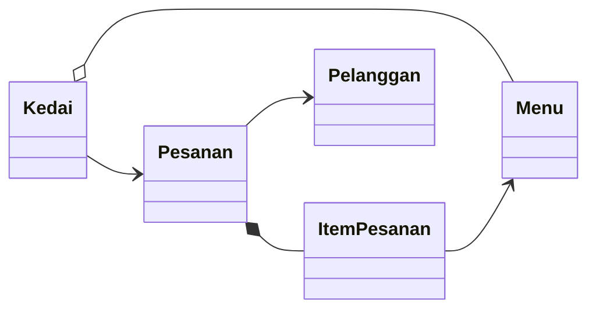

Hanya lima kotak dan lima garis, tetapi cerita besarnya sudah terbaca: kedai menyimpan menu dan mencatat pesanan; pesanan milik seorang pelanggan dan berisi item; setiap item menunjuk ke sebuah menu.

Diagram juga berguna **sebelum** kode ditulis. Arsitek menggambar denah sebelum tukang membangun rumah. Mengubah denah jauh lebih murah daripada membongkar tembok. Begitu juga programmer: menghapus satu garis di diagram jauh lebih mudah daripada merombak lima file kode.

## 2. Apa Itu UML?

> **UML** (*Unified Modeling Language*) adalah bahasa pemodelan visual yang **standar** untuk menggambarkan, merancang, dan mendokumentasikan perangkat lunak.

Perhatikan dua hal penting:

- "Bahasa" di sini **bukan** bahasa pemrograman. UML tidak bisa dijalankan. UML adalah kumpulan simbol dengan arti yang disepakati bersama, mirip rambu lalu lintas.
- Karena standar, diagram buatanmu bisa dibaca oleh programmer mana pun, apa pun bahasa pemrogramannya: Python, Java, C#, atau lainnya.

Sejarah singkatnya: pada pertengahan 1990-an ada banyak cara menggambar rancangan program, masing-masing dengan simbolnya sendiri. Tiga tokoh, yaitu **Grady Booch**, **James Rumbaugh**, dan **Ivar Jacobson**, menyatukan metode mereka menjadi UML. Pada **1997**, UML diadopsi sebagai standar oleh **OMG** (*Object Management Group*), sebuah konsorsium standar teknologi. Versi yang dipakai sekarang adalah keluarga UML 2.

UML 2 mendefinisikan 14 jenis diagram yang terbagi menjadi dua kelompok besar:

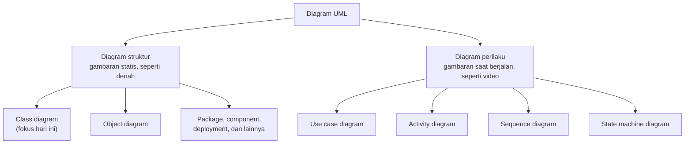

| Diagram | Menjawab pertanyaan | Contoh di KedaiKita |
|---|---|---|
| *Class diagram* | Kelas apa saja, isinya apa, terhubung bagaimana? | `Menu`, `Pesanan`, `Kedai` beserta garis-garisnya |
| *Object diagram* | Objek apa saja yang ada pada satu saat? | Pesanan P001 milik Budi berisi dua item |
| *Use case diagram* | Siapa memakai sistem, untuk apa? | Kasir membuat pesanan, pelanggan menukar poin |
| *Activity diagram* | Bagaimana alur langkah demi langkahnya? | Alur dari memesan sampai struk dicetak |
| *Sequence diagram* | Siapa mengirim pesan ke siapa, dalam urutan apa? | Program utama → `Kedai` → `Pesanan` → `Menu` |
| *State machine diagram* | Keadaan apa saja yang dilalui sebuah objek? | Pesanan: BARU lalu LUNAS (Pertemuan 09) |

Dalam PBO, diagram kelas adalah yang paling sering dipakai, karena berpadanan langsung dengan kode: **satu kotak = satu kelas**.

> [!NOTE]
> Kamu tidak perlu menghafal ke-14 jenis diagram. Di mata kuliah ini kita fokus pada diagram kelas. Diagram alur (*flowchart*) yang sering muncul di materi ini mirip *activity diagram*, tetapi lebih sederhana.

## 3. Anatomi Kotak Kelas

Di Pertemuan 02 kamu sudah mengenal kotak tiga bagian: nama kelas, atribut, dan method. Sekarang kita lengkapi dengan **visibilitas** dan **tipe**. Contohnya kelas `Paket` milik sebuah jasa ekspedisi:

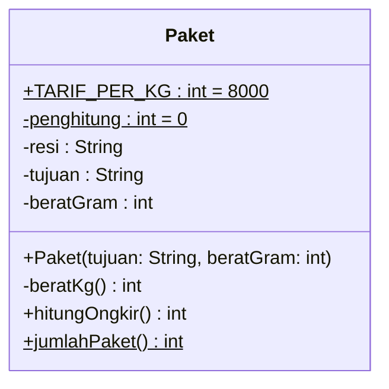

Setiap baris mengikuti pola tetap:

```text
Atribut :  visibilitas  nama : Tipe  [= nilai awal]
Method  :  visibilitas  nama(parameter: Tipe, ...) : TipeKembalian
```

| Baris di kotak | Cara membacanya |
|---|---|
| `-resi : String` | atribut **privat** bernama `resi`, bertipe teks |
| `-beratGram : int` | atribut privat bertipe bilangan bulat |
| `+TARIF_PER_KG : int = 8000` (bergaris bawah) | atribut **publik** milik **kelas** (*static*), nilai awalnya 8000 |
| `+Paket(tujuan: String, beratGram: int)` | **konstruktor**: namanya sama dengan nama kelas, tanpa tipe kembalian |
| `-beratKg() : int` | method privat tanpa parameter, mengembalikan `int` |
| `+hitungOngkir() : int` | method publik yang mengembalikan `int` |
| `+jumlahPaket() : int` (bergaris bawah) | method milik kelas (*static*) |

Beberapa aturan tambahan:

- Method yang tidak mengembalikan apa pun cukup ditulis **tanpa** tipe kembalian, misalnya `+cetakStruk()`. Kadang kamu melihat orang menulis `void`; maksudnya sama.
- Anggota **static** (milik kelas, bukan milik objek) digambar **bergaris bawah**.
- Anggota **abstrak** digambar **miring**. Kelas abstrak dibahas di Pertemuan 10.
- Penanda di atas nama kelas, seperti `<<interface>>`, disebut **stereotip** (*stereotype*). Stereotip memberi keterangan tambahan tentang jenis kelas itu.

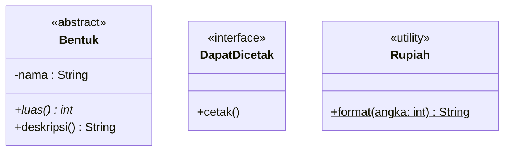

Di diagram di atas, `luas()` tampil miring karena abstrak: badannya belum ada dan wajib diisi kelas anak. `<<interface>>` dan `<<abstract>>` adalah pratinjau Pertemuan 10. Stereotip `<<utility>>` menandai kelas yang semua anggotanya *static*, seperti kelas `Rupiah` di KedaiKita versi Java.

> [!NOTE]
> **Kebiasaan penulisan di halaman konsep.** UML itu netral: ia tidak "milik" Python ataupun Java. Diagram di halaman ini memakai kebiasaan umum UML, yaitu nama **camelCase** (`hitungOngkir`) dan tipe `String`, `int`, `boolean`. Saat diterjemahkan ke Python, nama ditulis snake_case (`hitung_ongkir`) dan tipenya `str`, `int`, `bool`. Di halaman praktik, setiap diagram ditulis ulang dengan nama **persis** seperti di kodenya.

Agar ringkas, cara membaca `resi` dan `tujuan` dari luar kelas (*getter* di Java, *property* di Python) tidak digambar di sini. Diagram boleh disederhanakan sesuai tujuannya:

| Tujuan diagram | Isi yang cukup |
|---|---|
| Diskusi awal rancangan | nama kelas dan garis relasi saja (seperti peta di bagian 1) |
| Rancangan siap dikodekan | atribut, method penting, tipe, visibilitas, relasi, multiplisitas |
| Dokumentasi kode yang sudah jadi | semuanya, termasuk konstruktor dan *getter* |

## 4. Visibilitas: Siapa Boleh Mengakses?

Bayangkan sebuah rumah di kompleks perumahan. Teras boleh disinggahi siapa saja. Kamar tidur hanya untuk pemiliknya. Ruang keluarga terbuka untuk anggota keluarga. Taman kompleks boleh dipakai semua warga kompleks itu.

Diagram kelas memakai empat simbol untuk menunjukkan "siapa boleh masuk" ke sebuah anggota kelas:

| Simbol | Nama | Siapa yang boleh mengakses | Python | Java |
|---|---|---|---|---|
| `+` | *public* | semua kelas (teras) | nama biasa: `harga` | `public` |
| `-` | *private* | hanya kelas itu sendiri (kamar tidur) | awalan `_`: `_harga` (kesepakatan) | `private` |
| `#` | *protected* | kelas itu dan kelas anaknya (ruang keluarga) | awalan `_` juga (kesepakatan) | `protected` (juga terbuka untuk satu paket) |
| `~` | *package* | kelas-kelas dalam satu paket (taman kompleks) | tidak ada padanan | tanpa kata kunci (*default*) |

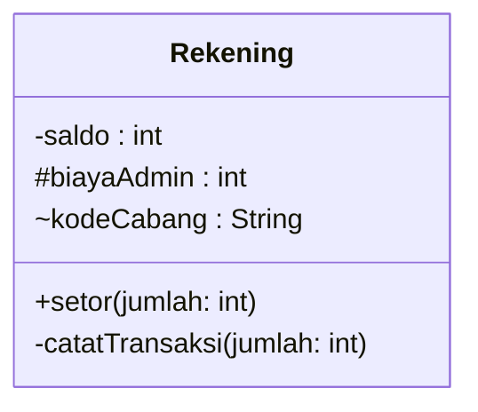

Cara membacanya: `saldo` tersembunyi rapat, `biayaAdmin` boleh dipakai kelas anak (Pertemuan 07), `kodeCabang` terbuka untuk kelas satu paket, `setor()` adalah layanan untuk semua orang, dan `catatTransaksi()` hanya pembantu internal.

> [!IMPORTANT]
> Kebiasaan baik dari Pertemuan 04 tetap berlaku di diagram: atribut umumnya `-` (privat), method layanan `+` (publik), dan method pembantu internal `-`. Jika diagrammu penuh atribut `+`, periksa lagi enkapsulasinya.

> [!NOTE]
> Di Python, `-` dan `#` sama-sama ditulis dengan awalan `_`, karena Python mengandalkan kesepakatan, bukan penjagaan *compiler*. Diagram tetap memakai simbol yang tepat agar maksud perancangnya jelas.

## 5. Relasi: Arti Setiap Garis

Kotak menjelaskan **isi** kelas. Garis menjelaskan **hubungan** antarkelas. Ada enam jenis garis yang paling sering dipakai. Untuk membedakannya, perhatikan tiga hal: garisnya **penuh** atau **putus-putus**, ujungnya berbentuk **panah**, **belah ketupat**, atau **segitiga**, dan di **sisi mana** ujung itu menempel.

```text
Asosiasi      A ──────────> B    garis penuh, panah biasa: A mengenal B
Agregasi      A ◇────────── B    belah ketupat KOSONG di sisi keseluruhan (A)
Komposisi     A ◆────────── B    belah ketupat PENUH di sisi keseluruhan (A)
Dependensi    A - - - - - > B    garis putus-putus, panah biasa: A memakai B sebentar
Generalisasi  A ◁────────── B    segitiga kosong di sisi induk (A): B adalah A
Realisasi     A ◁ - - - - - B    putus-putus + segitiga kosong: B memenuhi kontrak A
```

Begini wujudnya saat digambar:

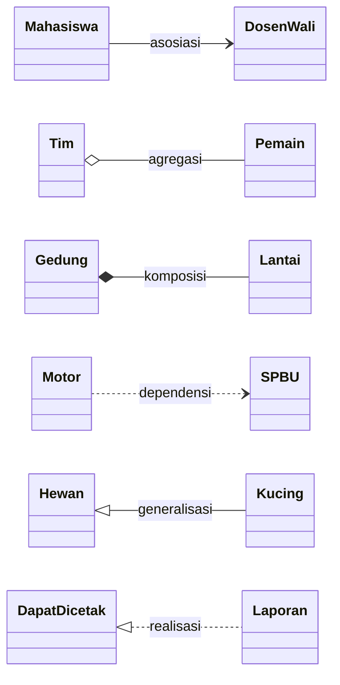

### Asosiasi: "mengenal"

> **Asosiasi** (*association*) adalah hubungan ketika objek sebuah kelas **menyimpan referensi** ke objek kelas lain di atributnya, sehingga bisa menghubunginya kapan saja.

- Digambar dengan **garis penuh**. Panah menunjukkan **arah navigasi**: `Pesanan --> Pelanggan` berarti pesanan tahu siapa pelanggannya, tetapi pelanggan tidak menyimpan daftar pesanannya.
- Garis tanpa panah berarti arahnya belum ditentukan. Itu wajar di rancangan awal. Menjelang menulis kode, tentukan arahnya.
- Wujudnya di kode: atribut yang bertipe kelas lain.

### Agregasi: "punya, tetapi bagian bisa hidup sendiri"

> **Agregasi** (*aggregation*) adalah asosiasi khusus berjenis **keseluruhan–bagian** yang **longgar**: objek bagian dibuat di luar, boleh dipakai bersama, dan tetap ada walaupun keseluruhannya berakhir.

Contohnya kelas kuliah dan mahasiswa. Mahasiswa sudah ada sebelum kelas dibuka, boleh ikut banyak kelas, dan tidak ikut "hilang" saat semester selesai. Simbolnya **belah ketupat kosong** di sisi keseluruhan: `KelasKuliah o-- Mahasiswa`.

### Komposisi: "punya, dan bagian ikut berakhir"

> **Komposisi** (*composition*) adalah hubungan keseluruhan–bagian yang **erat**: objek bagian dibuat dan dimiliki oleh keseluruhan, satu bagian hanya milik satu keseluruhan, dan bagian berakhir bersama keseluruhannya.

Contohnya gedung dan lantainya. Lantai 2 Gedung Informatika tidak bisa dipindahkan ke gedung lain. Jika gedungnya dirobohkan, lantainya ikut lenyap. Simbolnya **belah ketupat penuh** di sisi keseluruhan: `Gedung *-- Lantai`.

Ragu memilih agregasi atau komposisi? Jawab tiga pertanyaan ini:

| Pertanyaan uji | Agregasi | Komposisi |
|---|---|---|
| Siapa yang membuat objek bagian? | pihak luar, lalu diserahkan | keseluruhan itu sendiri |
| Bolehkah satu bagian dimiliki dua keseluruhan sekaligus? | boleh | tidak |
| Jika keseluruhan berakhir, bagian ...? | tetap ada | ikut berakhir |

> [!TIP]
> Bahkan para ahli sering berbeda pendapat soal agregasi. Jika kamu ragu dan hubungannya tidak memenuhi syarat komposisi, menggambarnya sebagai **asosiasi biasa** sudah benar. Yang penting, komposisi dipakai hanya untuk hubungan yang benar-benar erat.

> [!NOTE]
> Python dan Java tidak punya perintah "hapus objek". Secara sederhana, objek "berakhir" ketika tidak ada lagi yang menunjuknya, lalu dibersihkan otomatis oleh *garbage collector*. Pada komposisi, hanya keseluruhan yang memegang referensi ke bagiannya, sehingga nasib bagian mengikuti keseluruhan.

### Dependensi: "memakai sebentar"

> **Dependensi** (*dependency*) adalah hubungan ketika sebuah kelas **memakai** kelas lain hanya sementara: sebagai parameter, variabel lokal, nilai kembalian, atau dengan memanggil method *static*-nya. Objeknya **tidak** disimpan di atribut.

Contohnya motor dan SPBU. Motor memakai SPBU saat mengisi bensin, tetapi tidak membawa SPBU ke mana-mana. Simbolnya **garis putus-putus berpanah**: `Motor ..> SPBU`. Artinya juga: jika kelas `SPBU` berubah, kelas `Motor` mungkin ikut perlu diubah.

### Generalisasi: "adalah" (pratinjau Pertemuan 07)

> **Generalisasi** (*generalization*) adalah hubungan "adalah" (*is-a*) antara kelas yang umum (induk) dan kelas yang lebih khusus (anak).

Kucing **adalah** hewan. Simbolnya **garis penuh dengan segitiga kosong yang menunjuk ke induk**: `Hewan <|-- Kucing`. Kelas anak mewarisi isi induknya, sehingga di kotak anak cukup ditulis anggota yang **baru**. Cara menulis kodenya kita pelajari tuntas di Pertemuan 07.

### Realisasi: "memenuhi kontrak" (pratinjau Pertemuan 10)

> **Realisasi** (*realization*) adalah hubungan ketika sebuah kelas **mewujudkan** kontrak yang dijanjikan sebuah *interface*.

Simbolnya **garis putus-putus dengan segitiga kosong** yang menunjuk ke *interface*: `DapatDicetak <|.. Laporan`. Detailnya di Pertemuan 10.

### Rangkuman enam garis

| Relasi | Bentuk garis | Sintaks Mermaid | Kata kunci |
|---|---|---|---|
| Asosiasi | penuh, panah biasa | `A --> B` | "mengenal" |
| Agregasi | penuh, belah ketupat kosong di A | `A o-- B` | "punya, longgar" |
| Komposisi | penuh, belah ketupat penuh di A | `A *-- B` | "punya, erat" |
| Dependensi | putus-putus, panah biasa | `A ..> B` | "memakai sebentar" |
| Generalisasi | penuh, segitiga kosong di A (induk) | `A <\|-- B` | "B adalah A" |
| Realisasi | putus-putus, segitiga kosong di A (*interface*) | `A <\|.. B` | "B memenuhi kontrak A" |

Dari yang paling longgar ke yang paling erat: **dependensi → asosiasi → agregasi → komposisi**.

> [!TIP]
> **Coba sendiri:** di KedaiKita, objek `ItemPesanan` dibuat di dalam method `tambah_item()`/`tambahItem()` milik `Pesanan`, lalu disimpan di daftar item pesanan itu. Agregasi atau komposisi?

<details>
<summary>Lihat jawaban</summary>

**Komposisi.** Item dibuat oleh pesanan itu sendiri, tidak dibagi dengan pesanan lain, dan tidak punya arti tanpa pesanannya. Belah ketupat penuh menempel di sisi `Pesanan`: `Pesanan *-- ItemPesanan`.

</details>

## 6. Multiplisitas dan Nama Peran

**Multiplisitas** (*multiplicity*) ditulis di ujung garis dan menjawab pertanyaan: "satu objek di ujung sini terhubung dengan **berapa banyak** objek di ujung sana?"

| Tulisan | Arti | Contoh |
|---|---|---|
| `1` | tepat satu | setiap pesanan milik tepat satu pelanggan |
| `0..1` | nol atau satu (boleh kosong) | pesanan ojek punya nol atau satu pengemudi |
| `*` (sama dengan `0..*`) | nol atau lebih | pelanggan boleh punya banyak pesanan, atau belum punya sama sekali |
| `1..*` | minimal satu | gedung punya minimal satu lantai |
| `2..4` | antara dua dan empat | tim lomba beranggotakan dua sampai empat orang |

Kuncinya: angka yang kamu pakai selalu yang berada di **ujung seberang**, dekat kelas tujuan.

```text
 Pesanan  *  ────────────────────>  1  Pelanggan

 Dibaca dari kiri : setiap Pesanan terhubung dengan 1 Pelanggan  (angka di ujung KANAN)
 Dibaca dari kanan: setiap Pelanggan terhubung dengan * Pesanan  (angka di ujung KIRI)
```

Multiplisitas juga menentukan wujud kodenya:

| Multiplisitas di ujung B | Wujud di kelas A |
|---|---|
| `1` | satu atribut bertipe B yang **wajib** diisi, biasanya lewat konstruktor |
| `0..1` | satu atribut bertipe B yang boleh kosong (`None` di Python, `null` di Java) |
| `*` | list berisi objek B (`list[B]` di Python, `List<B>` di Java) |
| `1..*` | list berisi objek B, dan kode harus menjamin isinya minimal satu |

Multiplisitas juga boleh ditempel pada tipe. Misalnya `+cariMenu(kode: String) : Menu [0..1]` berarti method itu mungkin tidak menemukan apa-apa dan mengembalikan `None`/`null`.

### Nama peran

Di dekat ujung garis, UML juga membolehkan **nama peran** (*role name*), yaitu "peran" yang dimainkan objek di ujung itu. Di kode, nama peran biasanya sama dengan **nama atribut** yang menyimpan referensinya.

```text
 ┌─────────┐                     -pelanggan   ┌───────────┐
 │ Pesanan │ *  ─────────────────────────> 1  │ Pelanggan │
 └─────────┘                                  └───────────┘
```

Mermaid belum punya tempat khusus untuk nama peran di ujung garis. Di materi ini, nama peran kita tulis sebagai **label garis** setelah titik dua:

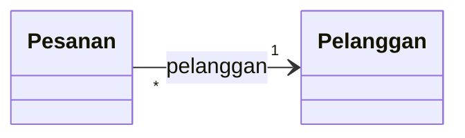

Label garis boleh juga berisi kata kerja, misalnya `berisi` atau `milik`. Label seperti itu disebut **nama asosiasi**. Pilih salah satu gaya dan pakai secara konsisten.

> [!NOTE]
> Atribut bertipe kelas lain bisa ditulis di dalam kotak (`-pelanggan : Pelanggan`) **atau** digambar sebagai garis bernama peran. UML yang ketat cukup memakai salah satunya. Diagram hasil *reverse engineering* di materi ini sengaja menampilkan **keduanya**, agar setiap garis mudah dicocokkan dengan atribut di kode.

> [!TIP]
> **Coba sendiri:** baca relasi `Gedung "1" *-- "1..*" Lantai` dari dua arah.

<details>
<summary>Lihat jawaban</summary>

Dari kiri: setiap gedung terdiri atas **minimal satu** lantai. Dari kanan: setiap lantai milik **tepat satu** gedung. Belah ketupat penuh di sisi `Gedung` menandakan komposisi.

</details>

## 7. Menulis Diagram dengan Mermaid

**Mermaid** adalah alat yang mengubah **teks** menjadi diagram. GitHub otomatis menampilkan blok kode berlabel `mermaid` sebagai gambar. Semua diagram di materi ini dibuat dengan Mermaid.

Kelebihannya: diagram berupa teks, sehingga mudah diedit, disimpan bersama kode, dan setiap perubahannya tercatat di riwayat Git.

Cara menulisnya: buat blok kode biasa (diawali tiga tanda *backtick*), beri label `mermaid`, lalu tulis isi diagramnya. Misalnya isi berikut:

```text
classDiagram
    direction LR
    class Gedung {
        -nama : String
        -daftarLantai : List~Lantai~
        +jumlahLantai() int
    }
    class Lantai {
        -nomor : int
    }
    Gedung "1" *-- "1..*" Lantai : daftarLantai
```

Hasilnya:

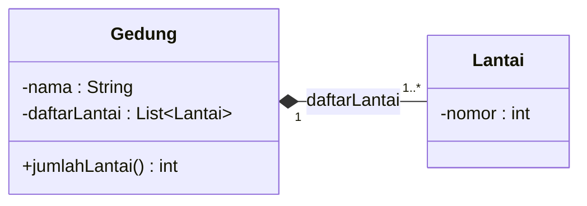

Ringkasan sintaks Mermaid untuk diagram kelas:

| Yang ingin digambar | Tulis di Mermaid | Tampil sebagai |
|---|---|---|
| Kelas tanpa isi | `class Menu` | kotak berisi nama saja |
| Kelas dengan isi | `class Menu { ... }` | kotak tiga bagian |
| Atribut | `-harga : int` | `-harga : int` |
| Method | `+hitungTotal(jumlah: int) int` | `+hitungTotal(jumlah: int) : int` |
| Anggota *static* | akhiri baris dengan `$`, misalnya `+format(angka: int) String$` | bergaris bawah |
| Anggota abstrak | akhiri baris dengan `*`, misalnya `+luas() int*` | miring |
| Tipe generik | `List~Menu~` | `List<Menu>` |
| Stereotip | `<<interface>>` di baris pertama badan kelas | «interface» |
| Relasi lengkap | `Pesanan "1" *-- "*" ItemPesanan : daftarItem` | garis + multiplisitas + label |
| Arah tata letak | `direction LR` (kiri ke kanan) atau `direction TB` (atas ke bawah) | susunan kotak berubah |
| Catatan | `note for Menu "isi catatan"` | kotak catatan |

Perhatikan bahwa tipe kembalian method ditulis **setelah** tanda kurung tanpa titik dua. Mermaid sendiri yang menambahkan ` : ` saat menggambar. Untuk relasi, simbol boleh ditulis di kiri atau kanan: `Laporan ..|> DapatDicetak` sama artinya dengan `DapatDicetak <|.. Laporan`. Yang penting, segitiga selalu menempel pada induk atau *interface*.

Tempat mencoba Mermaid:

- **GitHub**: simpan diagram di file `.md`, lalu buka file itu di repositorimu.
- **Mermaid Live Editor** (<https://mermaid.live>): ketik di kiri, hasilnya langsung terlihat di kanan, dan bisa diekspor menjadi PNG atau SVG.
- **VS Code**: pasang ekstensi pratinjau Mermaid, misalnya *Markdown Preview Mermaid Support*.

### Jebakan saat menulis Mermaid

**1. Kurung kurawal di dalam badan kelas.** UML punya notasi `{readOnly}` untuk atribut yang tidak bisa diubah. Jika kamu menulisnya di Mermaid:

```text
classDiagram
    class Menu {
        -kode : String {readOnly}
        +hitungTotal(jumlah: int) int
    }
```

diagram gagal digambar dengan pesan:

```text
Parse error on line 3:
...     -kode : String {readOnly}        +
-----------------------^
Expecting 'STRUCT_STOP', 'MEMBER', got 'OPEN_IN_STRUCT'
```

**Artinya:** di baris ke-3 isi diagram, Mermaid menemukan `{` yang tidak ia harapkan (`OPEN_IN_STRUCT`). **Perbaikan:** hapus `{readOnly}`, lalu jelaskan aturan itu di teks atau dengan `note for Menu "kode hanya-baca"`.

**2. Tanda `$` dan `*` harus berada di paling akhir baris**, setelah tipe kembalian.

**3. Dua garis bawah dianggap huruf tebal.** Mermaid memproses teks anggota kelas seperti Markdown, sehingga `__init__` tampil sebagai **init** bercetak tebal. Tulis `\_\_init\_\_` agar garis bawahnya tetap tampil. Jebakan ini terutama dialami pengguna Python.

**4. Hindari tanda kurung dan simbol aneh di label garis.** Cukup pakai kata atau nama atribut.

**5. Mermaid hanya memeriksa sintaks, bukan kebenaran desain.** Panah pewarisan yang terbalik tetap digambar tanpa protes. Kebenaran diagram tetap tanggung jawabmu.

> [!NOTE]
> Bunyi pesan error Mermaid bisa sedikit berbeda antarversi. Fokuslah pada nomor baris dan simbol yang ditunjuk tanda `^`.

## 8. Alat Bantu Lain: draw.io, PlantUML, StarUML

Mermaid bukan satu-satunya alat. Berikut beberapa alat lain yang sering dipakai:

| Alat | Cara kerja | Kelebihan | Kekurangan |
|---|---|---|---|
| **Mermaid** | teks → gambar | tampil langsung di GitHub, mudah diubah | tata letak diatur otomatis, kurang leluasa |
| **draw.io** (diagrams.net) | seret dan lepas (*drag and drop*) | gratis, bisa di browser atau aplikasi desktop, tata letak bebas | gambar dirapikan manual, tidak terhubung dengan kode |
| **PlantUML** | teks → gambar | notasi UML lebih lengkap, banyak jenis diagram | perlu Java jika dipasang di komputer sendiri |
| **StarUML** | aplikasi pemodelan UML | fitur lengkap, model tersimpan rapi | berbayar untuk pemakaian penuh (bisa dicoba gratis) |

PlantUML juga berbasis teks, mirip Mermaid. Berikut potongan `Pesanan` dan `ItemPesanan` dalam sintaks PlantUML (cukup dibaca, tidak perlu dijalankan):

```text
@startuml
skinparam classAttributeIconSize 0
class Pesanan {
  - nomor : String
  - nomorTerakhir : int {static}
  + hitungTotal() : int
}
class ItemPesanan {
  - jumlah : int
  + hitungSubtotal() : int
}
Pesanan "1" *-- "*" ItemPesanan : daftarItem
@enduml
```

Perbedaan dengan Mermaid: anggota static ditandai `{static}` (bukan `$`), tipe kembalian ditulis dengan titik dua seperti di UML, dan baris `skinparam classAttributeIconSize 0` membuat visibilitas tampil sebagai simbol `+ -`, bukan ikon berwarna. Sintaks relasinya hampir sama persis.

> [!TIP]
> Alat apa pun yang kamu pilih, **notasinya tetap UML**. Kalau kamu sudah lancar membaca simbol di halaman ini, kamu bisa memakai alat mana saja.

## 9. Forward dan Reverse Engineering

Ada dua arah perjalanan antara diagram dan kode:

> **Forward engineering** adalah membuat kode **dari** diagram: rancang dulu, baru tulis kodenya.
>
> **Reverse engineering** adalah membuat diagram **dari** kode yang sudah ada: pahami dulu, baru ubah.

Analoginya: membangun rumah baru dari denah arsitek adalah *forward engineering*. Merenovasi rumah tua yang denahnya hilang dimulai dengan mengukur ruangan lalu menggambar ulang denahnya. Itulah *reverse engineering*.

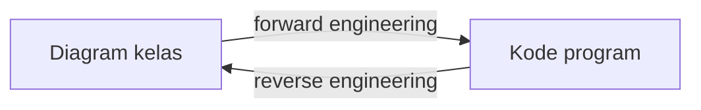

**Langkah reverse engineering** (kode → diagram):

1. **Kelas.** Setiap kelas menjadi satu kotak.
2. **Atribut.** Tulis nama, tipe, dan visibilitasnya. Atribut milik kelas diberi garis bawah.
3. **Method.** Tulis nama, parameter beserta tipenya, tipe kembalian, dan visibilitasnya. Konstruktor ditulis dengan nama kelas.
4. **Garis dari atribut.** Atribut yang bertipe kelas lain (atau list berisi kelas lain) menjadi garis. Lihat siapa yang membuat objeknya: dibuat di dalam berarti komposisi; diterima dari luar berarti agregasi atau asosiasi.
5. **Multiplisitas.** Atribut tunggal yang wajib menjadi `1`, yang boleh kosong menjadi `0..1`, dan list menjadi `*` (atau `1..*` jika kode menjamin minimal satu).
6. **Dependensi.** Kelas lain yang hanya muncul sebagai parameter, variabel lokal, atau pemanggilan method *static* menjadi garis putus-putus.
7. **Pewarisan.** Kelas anak (Pertemuan 07) menjadi generalisasi; kelas yang mewujudkan *interface* (Pertemuan 10) menjadi realisasi.

**Langkah forward engineering** (diagram → kode):

1. Setiap kotak menjadi satu kelas. Di Java, setiap kelas publik berada di filenya sendiri.
2. Atribut menjadi atribut privat, ditambah *getter* atau *property* hanya jika memang dibutuhkan.
3. Method ditulis dengan tanda tangan (*signature*) persis seperti diagram: nama, parameter, dan tipe kembalian.
4. Setiap garis menjadi atribut referensi, list, atau parameter, sesuai jenis relasinya.
5. Multiplisitas dijaga oleh kode, misalnya konstruktor menolak gedung tanpa lantai (`1..*`).

Tabel pemetaan berikut akan sering kamu pakai:

| Elemen diagram | Wujud di Python | Wujud di Java |
|---|---|---|
| Kotak kelas `Menu` | `class Menu:` | `public class Menu { ... }` |
| `-harga : int` | `self._harga = harga` di `__init__` | `private int harga;` |
| Baca harga dari luar | `@property def harga(self) -> int:` | `public int getHarga()` |
| `-penghitung : int` (*static*) | atribut kelas `_penghitung = 0` | `private static int penghitung = 0;` |
| `+Menu(kode: String, ...)` | `def __init__(self, kode: str, ...):` | `public Menu(String kode, ...)` |
| `+hitungTotal(jumlah: int) int` | `def hitung_total(self, jumlah: int) -> int:` | `public int hitungTotal(int jumlah)` |
| `+jumlahPaket() int` (*static*) | `@classmethod` atau `@staticmethod` | `public static int jumlahPaket()` |
| `A --> "1" B` | atribut `self._b` yang wajib diisi | field `private B b;` yang wajib diisi |
| `A --> "0..1" B` | `self._b: B \| None = None` | field `private B b;` yang boleh `null` |
| `A o-- "*" B` | list; objek `B` diterima lewat parameter | `List<B>`; objek `B` diterima lewat parameter |
| `A *-- "*" B` | list; objek `B` dibuat di dalam `A` | `List<B>`; `new B(...)` di dalam `A` |
| `A ..> B` | `B` hanya parameter atau variabel lokal | `B` hanya parameter atau variabel lokal |
| `A <\|-- B` | `class B(A):` (Pertemuan 07) | `class B extends A` (Pertemuan 07) |
| `A <\|.. B` | `B` mewarisi kelas abstrak `A` (Pertemuan 10) | `class B implements A` (Pertemuan 10) |

| Di diagram konsep | Python | Java |
|---|---|---|
| `String` | `str` | `String` |
| `int` | `int` | `int` |
| `boolean` | `bool` | `boolean` |
| `List~Menu~` (tampil `List<Menu>`) | `list[Menu]` | `List<Menu>` |
| `hitungTotal` | `hitung_total` | `hitungTotal` |

## 10. Studi Kasus KedaiKita: Diagram Kelas Lengkap

Kode KedaiKita di pertemuan ini **sama persis** dengan Pertemuan 05. Hanya komentar pembuka program utamanya yang berbeda. Tugas kita kali ini ada dua:

1. **Reverse engineering**: membaca kode itu lalu menggambarkannya sebagai diagram kelas yang lengkap.
2. **Forward engineering**: memakai diagram untuk merencanakan perubahan di Pertemuan 07 dan 09.

### Langkah 1: Kenali kelas-kelasnya

| Kelas | File Python | File Java | Tugasnya |
|---|---|---|---|
| `Menu` | `menu.py` | `Menu.java` | satu menu: kode, nama, harga, kategori, stok |
| `Pelanggan` | `pelanggan.py` | `Pelanggan.java` | pelanggan beserta poinnya |
| `ItemPesanan` | `pesanan.py` | `ItemPesanan.java` | satu baris pesanan: menu apa, berapa porsi |
| `Pesanan` | `pesanan.py` | `Pesanan.java` | pesanan seorang pelanggan, berisi beberapa item |
| `Kedai` | `kedai.py` | `Kedai.java` | pusat: menyimpan menu dan mencatat pesanan |
| `Rupiah` | fungsi `format_rupiah()` di `utilitas.py` | kelas `Rupiah` | mengubah 18000 menjadi `Rp18.000` |

Program utama (`main.py` / `Main.java`) hanya **memakai** kelas-kelas itu, sehingga tidak digambar.

### Langkah 2: Tarik garis dari atribut

| Atribut | Milik kelas | Bertipe | Relasi | Alasan |
|---|---|---|---|---|
| `daftarMenu` | `Kedai` | list berisi `Menu` | agregasi `"1" o-- "*"` | menu dibuat di luar lalu didaftarkan lewat `tambahMenu()` |
| `daftarPesanan` | `Kedai` | list berisi `Pesanan` | asosiasi `"1" --> "*"` | kedai mencatat pesanan, tetapi objek pesanan juga diserahkan ke program utama untuk dipakai |
| `pelanggan` | `Pesanan` | `Pelanggan` | asosiasi `"*" --> "1"` | wajib diisi lewat konstruktor; pelanggan tetap ada walau pesanan selesai |
| `daftarItem` | `Pesanan` | list berisi `ItemPesanan` | komposisi `"1" *-- "*"` | item dibuat **di dalam** `tambahItem()` dan tidak berarti tanpa pesanannya |
| `menu` | `ItemPesanan` | `Menu` | asosiasi `"*" --> "1"` | item menunjuk menu yang dipesan; satu menu bisa dipesan di banyak item |

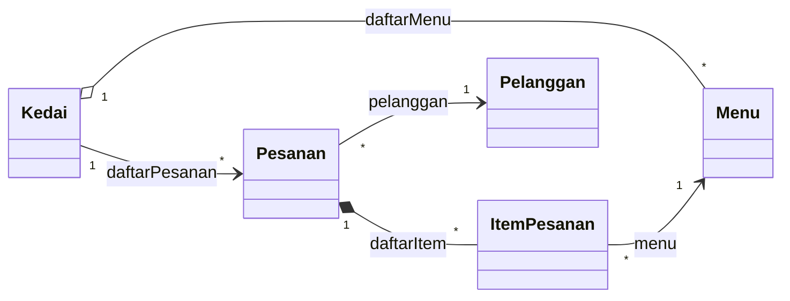

Dua hal yang patut dicermati:

- `Kedai` memang **membuat** objek `Pesanan` di `buatPesanan()`, tetapi objek itu lalu **diserahkan** ke program utama dan dipakai di sana. Kepemilikannya tidak eksklusif, sehingga relasinya asosiasi, bukan komposisi.
- Multiplisitas item adalah `*`, bukan `1..*`. Secara bisnis, pesanan seharusnya berisi minimal satu item. Namun kodenya membolehkan pesanan kosong (baru dibuat, belum diisi). *Reverse engineering* menggambar apa yang **dilakukan kode**, bukan apa yang kita harapkan.

### Langkah 3: Cari dependensi

| Dari | Ke | Karena |
|---|---|---|
| `Kedai` | `Pelanggan` | `buatPesanan(pelanggan)` menerima pelanggan sebagai parameter lalu meneruskannya ke `Pesanan` |
| `Pesanan` | `Menu` | `tambahItem(menu, jumlah)` menerima menu sebagai parameter lalu memanggil `kurangiStok()` |
| `Menu` dan `Pesanan` | `Rupiah` | memanggil fungsi format Rupiah saat menampilkan harga dan total |

### Langkah 4: Diagram rancangan lengkap

Inilah diagram kelas KedaiKita dalam notasi UML umum. Semua atribut, konstruktor, dan method yang menjalankan aturan bisnis digambar lengkap dengan tipe dan visibilitasnya. Yang sengaja tidak digambar hanyalah *getter*/*property* dan method representasi teks (`__str__`/`toString`), agar diagram tetap terbaca.

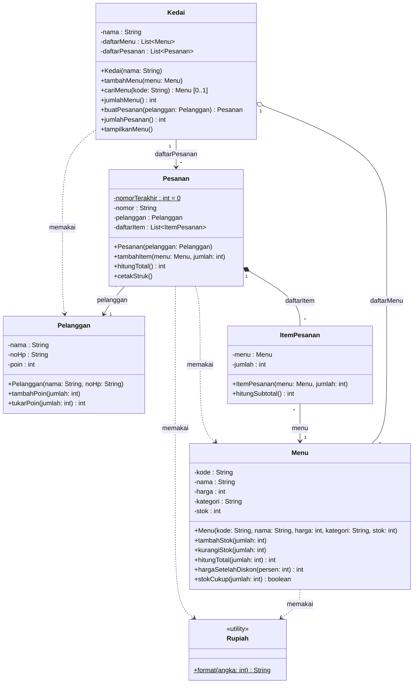

Cara membaca beberapa bagian pentingnya:

- `-nomorTerakhir : int = 0` bergaris bawah: penghitung **milik kelas** `Pesanan`, dipakai bersama semua pesanan untuk membuat nomor P001, P002, dan seterusnya.
- `+cariMenu(kode: String) : Menu [0..1]`: pencarian bisa gagal dan mengembalikan `None`/`null`.
- `Menu` menerima dua garis: agregasi dari `Kedai` dan asosiasi dari `ItemPesanan`. Objek "Kopi Susu Gula Aren" yang **sama** disimpan oleh kedai dan sekaligus ditunjuk oleh item pesanan Budi. Itulah sebabnya stoknya berkurang saat Budi memesan.
- Di Python, konstruktor `Menu` punya nilai bawaan `stok: int = 0`. Di diagram rancangan, nilai bawaan seperti itu boleh ditulis atau tidak.

Versi **implementasi** yang benar-benar lengkap, termasuk *getter*/*property* dan nama persis seperti di kode, digambar langkah demi langkah di halaman praktik: [🐍 Python](python/README.md#7-studi-kasus-kedaikita) atau [☕ Java](java/README.md#7-studi-kasus-kedaikita).

### Langkah 5: Merencanakan Pertemuan 07 (forward engineering)

Menu makanan dan minuman punya kebutuhan berbeda. Makanan punya level pedas, sedangkan minuman bisa disajikan dingin atau panas. Rencananya, kita membuat dua kelas anak dari `Menu`:

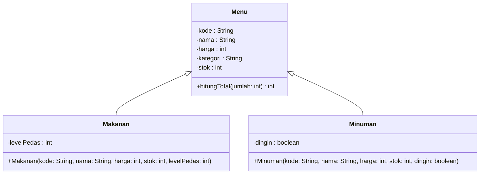

- Kotak `Menu` sengaja disingkat. Semua method lain tetap ada.
- Kotak `Makanan` dan `Minuman` hanya berisi anggota **baru**. Atribut seperti `nama` dan `harga` diwarisi dari `Menu`, jadi tidak ditulis ulang.
- Konstruktor anak tidak meminta `kategori`, karena kategorinya otomatis: `"Makanan"` atau `"Minuman"`.
- Garis `ItemPesanan --> Menu` tidak perlu diubah. Karena makanan **adalah** menu, sebuah item boleh menunjuk ke objek `Makanan` maupun `Minuman`.

### Langkah 6: Mengintip Pertemuan 09

Kasir KedaiKita nantinya menerima tiga cara bayar: tunai, QRIS, dan kartu kredit. Rancangannya:

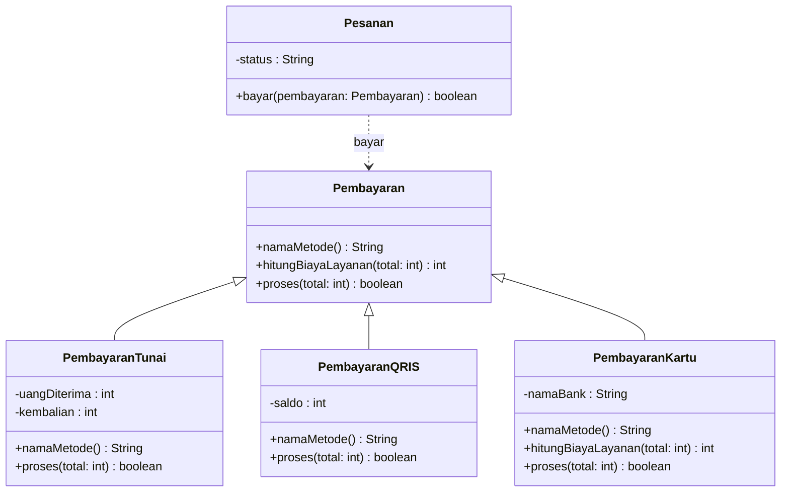

- Kotak `Pesanan` hanya menampilkan anggota yang akan **ditambahkan**.
- `Pesanan ..> Pembayaran` adalah dependensi, karena objek pembayaran hanya datang sebagai parameter `bayar()`.
- Method yang ditulis ulang di kotak anak, misalnya `proses()`, akan di-*override* oleh kelas anak itu. Inilah bahan polimorfisme di Pertemuan 09.
- Di Pertemuan 10, `Pembayaran` akan menjadi kelas abstrak: diberi stereotip `<<abstract>>`, dan method abstraknya ditandai `*` sehingga tampil miring.

> [!TIP]
> Simpan kedua diagram rencana ini. Saat Pertemuan 07 dan 09 tiba, bandingkan kode yang kita tulis dengan rancangannya. Begitulah *forward engineering* dipakai di dunia kerja.

## 11. Kesalahan Umum Saat Menggambar Diagram

> [!WARNING]
> **Panah pewarisan terbalik.** Segitiga harus menempel pada **induk**. `Menu <|-- Makanan` benar ("makanan adalah menu"). `Makanan <|-- Menu` salah, karena berarti "menu adalah makanan". Ingat: anak yang "menunjuk" ke induknya.

> [!WARNING]
> **Belah ketupat di sisi yang salah.** Belah ketupat selalu menempel pada **keseluruhan**: `Pesanan *-- ItemPesanan`, bukan `ItemPesanan *-- Pesanan`.

> [!WARNING]
> **Salah memilih agregasi atau komposisi.** Pakai tiga pertanyaan uji di bagian 5: siapa yang membuat bagian, bolehkah dimiliki bersama, dan apakah bagian ikut berakhir.

> [!WARNING]
> **Multiplisitas tertukar sisi.** "Setiap pesanan punya satu pelanggan" ditulis dengan `1` di ujung **Pelanggan**: `Pesanan "*" --> "1" Pelanggan`.

> [!WARNING]
> **Semua hubungan digambar sebagai asosiasi.** Kelas yang hanya muncul sebagai parameter atau variabel lokal adalah dependensi (garis putus-putus), bukan asosiasi.

> [!WARNING]
> **Menggambar objek sebagai kelas.** Budi dan Siti adalah **objek** dari kelas `Pelanggan`. Diagram kelas hanya berisi kelas `Pelanggan`, bukan kotak "Budi" dan kotak "Siti".

> [!WARNING]
> **Diagram terlalu ramai atau sudah usang.** Diagram yang memuat setiap *getter* dan setiap dependensi kecil justru sulit dibaca. Pilih tingkat detail sesuai tujuan. Saat kode berubah, perbarui diagramnya juga, karena diagram yang usang lebih menyesatkan daripada tidak ada diagram sama sekali.

## 📝 Ringkasan

- **UML** adalah bahasa pemodelan visual standar (diadopsi OMG pada 1997). Diagram kelas termasuk diagram struktur dan paling sering dipakai dalam PBO.
- Kotak kelas berisi nama, atribut (`visibilitas nama : Tipe`), dan method (`visibilitas nama(param: Tipe) : TipeKembalian`). Anggota *static* digaris bawah, anggota abstrak dimiringkan.
- Visibilitas: `+` *public*, `-` *private*, `#` *protected*, `~` *package*.
- Enam relasi: asosiasi (`-->`), agregasi (`o--`), komposisi (`*--`), dependensi (`..>`), generalisasi (`<|--`), dan realisasi (`<|..`). Belah ketupat menempel di keseluruhan, segitiga menempel di induk atau *interface*.
- **Multiplisitas** (`1`, `0..1`, `*`, `1..*`) dibaca dari angka di ujung seberang. **Nama peran** biasanya sama dengan nama atribut di kode.
- **Mermaid** mengubah teks menjadi diagram dan dirender langsung oleh GitHub: `$` untuk *static*, `*` untuk abstrak, `List~Menu~` untuk tipe generik.
- **Forward engineering** membuat kode dari diagram, sedangkan **reverse engineering** membuat diagram dari kode.
- Diagram KedaiKita lengkap menunjukkan agregasi `Kedai`–`Menu`, komposisi `Pesanan`–`ItemPesanan`, tiga asosiasi, dan beberapa dependensi, serta rencana pewarisan untuk Pertemuan 07 dan 09.

## 📖 Istilah Penting

| Istilah | Arti singkat |
|---|---|
| UML (*Unified Modeling Language*) | Bahasa pemodelan visual standar untuk perangkat lunak |
| Diagram kelas (*class diagram*) | Diagram struktur yang menampilkan kelas, isinya, dan hubungannya |
| Visibilitas | Tingkat akses anggota kelas: `+`, `-`, `#`, `~` |
| Stereotip (*stereotype*) | Penanda jenis kelas, misalnya `<<interface>>` atau `<<utility>>` |
| Asosiasi | Objek menyimpan referensi ke objek lain ("mengenal") |
| Agregasi | Keseluruhan–bagian yang longgar; bagian bisa hidup sendiri |
| Komposisi | Keseluruhan–bagian yang erat; bagian dibuat dan berakhir bersama keseluruhan |
| Dependensi | Memakai kelas lain sementara (parameter, variabel lokal) |
| Generalisasi | Hubungan "adalah" antara kelas induk dan kelas anak |
| Realisasi | Kelas mewujudkan kontrak sebuah *interface* |
| Multiplisitas | Jumlah objek yang terhubung: `1`, `0..1`, `*`, `1..*` |
| Nama peran (*role name*) | Nama di ujung garis, biasanya nama atribut penyimpan referensi |
| Arah navigasi | Arah panah asosiasi: siapa yang mengenal siapa |
| *Forward engineering* | Membuat kode dari diagram |
| *Reverse engineering* | Membuat diagram dari kode |
| Mermaid | Alat yang mengubah teks menjadi diagram, dirender langsung oleh GitHub |

## ➡️ Langkah Berikutnya

Pilih jalur praktikmu: [🐍 Praktik Python](python/README.md) atau [☕ Praktik Java](java/README.md).

---

[⬅️ Pertemuan 05](../Pertemuan-05-Relasi-Antar-Kelas/README.md) · [🏠 Beranda](../README.md) · [Pertemuan 07 ➡️](../Pertemuan-07-Pewarisan/README.md)
