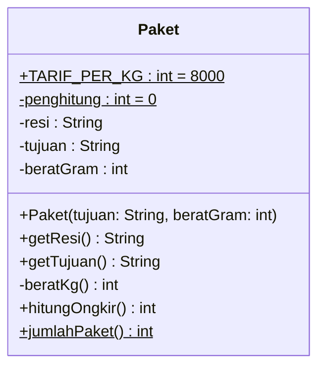
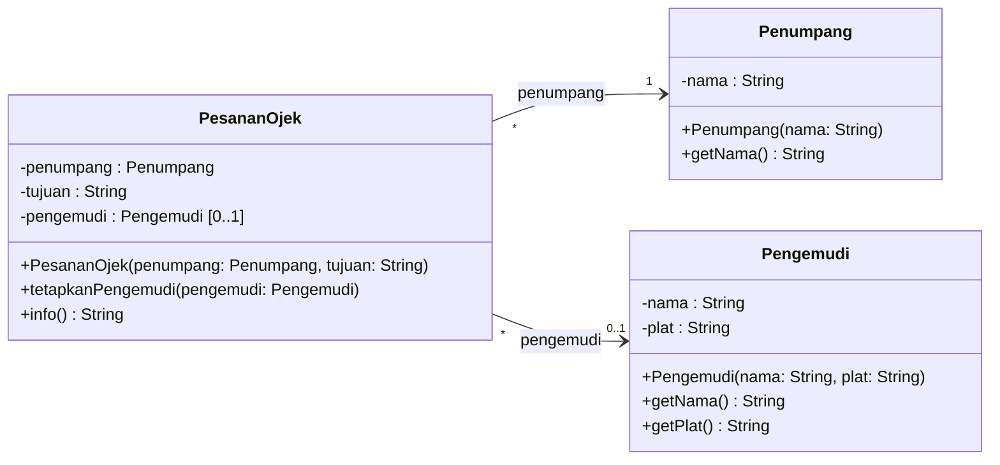
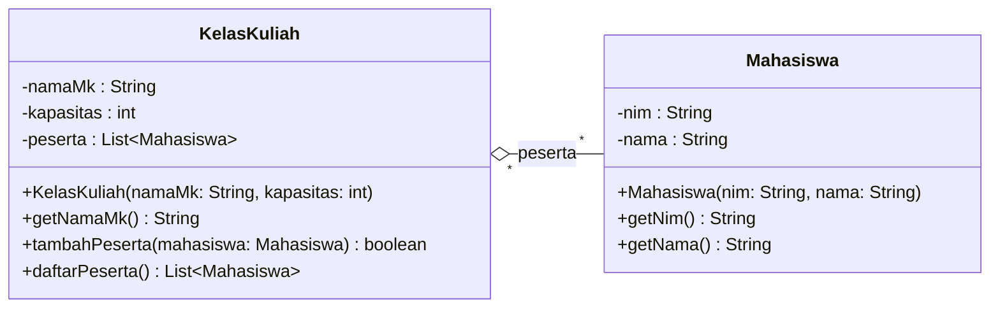
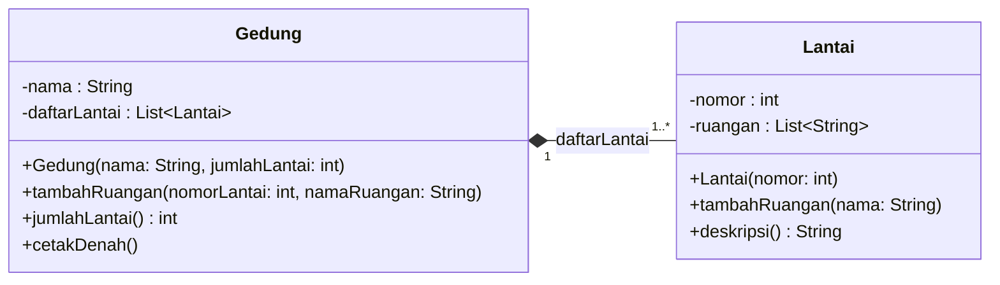
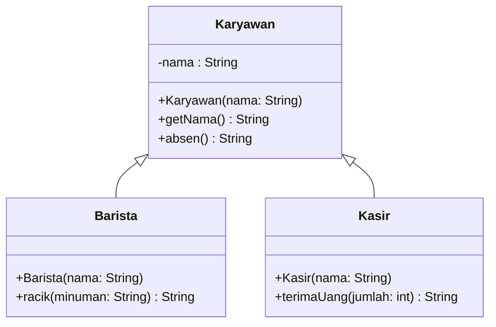
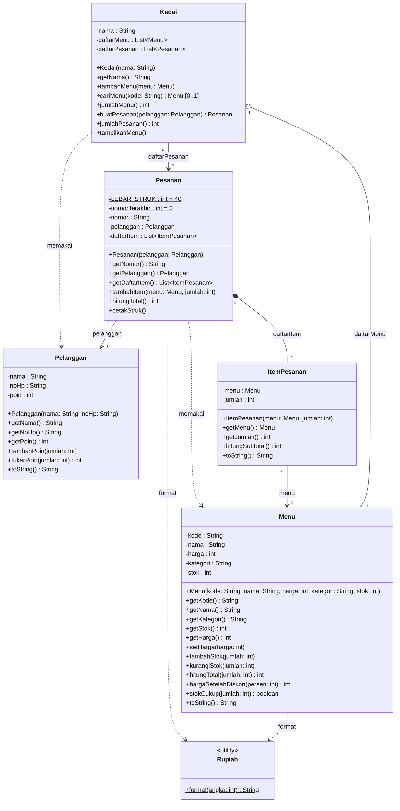

# ☕ Praktik Java Pertemuan 06: UML *Class Diagram*

[⬅️ Konsep](../README.md) · [🐍 Praktik Python](../python/README.md) · [Jembatan Python ↔ Java ➡️](../jembatan-python-java.md)

> **Prasyarat:** sudah membaca [Konsep Pertemuan 06](../README.md). Semua contoh di halaman ini ada di folder `contoh/` dan `studi-kasus/`, dan bisa langsung dijalankan.

## Daftar Isi

- [Persiapan](#persiapan)
  - [Cara Menjalankan Contoh](#cara-menjalankan-contoh)
  - [Cara Menjalankan Studi Kasus](#cara-menjalankan-studi-kasus)
  - [Tempat Menyimpan Kodemu Sendiri](#tempat-menyimpan-kodemu-sendiri)
  - [Cara Membaca Kode di Halaman Ini](#cara-membaca-kode-di-halaman-ini)
  - [Cara Melihat Diagram di Halaman Ini](#cara-melihat-diagram-di-halaman-ini)
  - [Aturan Menulis Diagram Versi Java](#aturan-menulis-diagram-versi-java)

1. [Kotak Kelas Lengkap: Visibilitas, Tipe, dan *Static*](#1-kotak-kelas-lengkap-visibilitas-tipe-dan-static)
2. [Asosiasi Berarah dan Multiplisitas](#2-asosiasi-berarah-dan-multiplisitas)
3. [Agregasi: Bagian Datang dari Luar](#3-agregasi-bagian-datang-dari-luar)
4. [Komposisi: Bagian Dibuat di Dalam](#4-komposisi-bagian-dibuat-di-dalam)
5. [Dependensi: Cukup Lewat Parameter](#5-dependensi-cukup-lewat-parameter)
6. [Generalisasi: Pratinjau Pewarisan](#6-generalisasi-pratinjau-pewarisan)
7. [Studi Kasus KedaiKita](#7-studi-kasus-kedaikita)
8. [Kesalahan Umum dan Cara Membaca Pesan *Error*](#8-kesalahan-umum-dan-cara-membaca-pesan-error)

## Persiapan

**Yang perlu sudah siap:** JDK 17 atau lebih baru (disarankan JDK LTS 21 atau 25), VS Code dengan **Extension Pack for Java**, dan materi ini sudah ada di laptopmu. Belum? Ikuti dulu [00-Persiapan](../../00-Persiapan/README.md).

Struktur folder Java pertemuan ini:

```text
java/
├── contoh/          <- 6 contoh: setiap contoh = satu diagram kecil + kodenya
├── studi-kasus/     <- KedaiKita versi Pertemuan 06 (kodenya sama dengan Pertemuan 05)
└── solusi/          <- solusi latihan yang berupa kode (buka setelah mencoba sendiri!)
```

Setiap *file* di folder `contoh/` dan `solusi/` adalah **program satu *file***: semua kelas yang dibutuhkan ada di dalam satu *file* itu.

> [!IMPORTANT]
> Di setiap *file* contoh, kelas yang memiliki `main` ditulis **paling atas**, lalu kelas-kelas pembantunya di bawahnya. Kelas pembantu tidak diberi `public` karena satu *file* hanya boleh punya satu kelas `public`.

### Cara Menjalankan Contoh

Pilih salah satu cara. Hasilnya sama.

**Cara 1: tombol Run di VS Code (paling mudah).**

1. Di VS Code, pilih **File → Open Folder**, lalu buka folder `Pertemuan-06-UML-Class-Diagram/java`. Buka **hanya** folder `java` milik pertemuan ini, bukan seluruh folder materi. Alasannya, banyak pertemuan punya kelas bernama sama (misalnya `Menu`), dan VS Code akan protes *The type Menu is already defined* jika semuanya terbuka sebagai satu proyek.
2. Buka *file* contoh yang ingin dicoba, misalnya `contoh/Contoh01KotakKelas.java`.
3. Klik **Run** pada tulisan **Run | Debug** yang muncul tepat di atas baris `public static void main` (atau tombol ▷ di pojok kanan atas). Hasilnya muncul di panel **TERMINAL** (kadang di **DEBUG CONSOLE**) di bagian bawah.

**Cara 2: lewat terminal.** Buka terminal, pastikan kamu berada di folder yang tepat, lalu ketik perintahnya.

| Terminalmu sedang berada di ... | Ketik dulu |
|---|---|
| folder utama materi (`PBO2026` atau `PBO2026-master`) | `cd Pertemuan-06-UML-Class-Diagram/java/contoh` |
| folder `java` pertemuan ini (terminal VS Code setelah langkah Cara 1) | `cd contoh` |

Setelah itu jalankan:

```bash
java Contoh01KotakKelas.java
```

Yang tercetak di terminal sama persis dengan blok ***Output:*** di [bagian 1](#1-kotak-kelas-lengkap-visibilitas-tipe-dan-static), diawali baris `=== PAKET MASUK ===`.

> [!TIP]
> Cara paling cepat membuka terminal tepat di folder yang benar: di panel **Explorer** VS Code, klik kanan folder `contoh`, lalu pilih **Open in Integrated Terminal**. Kamu tidak perlu mengetik `cd` lagi.

> [!NOTE]
> Semua perintah `cd` di halaman ini ditulis dari **folder utama materi**. Jika terminalmu sudah berada di folder tujuan, lewati baris `cd`-nya. Perintah `java` dan `javac` sama di Windows, macOS, dan Linux.

### Cara Menjalankan Studi Kasus

Studi kasus pertemuan ini **bukan** program satu *file*. Kelas-kelasnya tersebar di tujuh *file*, dan pintu masuknya adalah kelas `Main`. Karena itu, perintah `java Main.java` tidak bisa dipakai untuknya di JDK 17 dan 21. Pilih salah satu cara:

**Cara 1: VS Code.** Dengan folder `java` pertemuan ini terbuka di VS Code, buka `studi-kasus/Main.java`, lalu klik **Run** pada tulisan **Run | Debug** di atas baris `public static void main`. VS Code mengompilasi *file*-*file* lain yang dibutuhkan secara otomatis.

**Cara 2: terminal.** Masuk dulu ke folder `studi-kasus`:

| Terminalmu sedang berada di ... | Ketik dulu |
|---|---|
| folder utama materi (`PBO2026` atau `PBO2026-master`) | `cd Pertemuan-06-UML-Class-Diagram/java/studi-kasus` |
| folder `java` pertemuan ini | `cd studi-kasus` |

Setelah itu jalankan dua perintah ini, satu per satu:

```bash
javac *.java
java Main
```

Perintah pertama mengompilasi **semua** *file* `.java` di folder itu menjadi *file* `.class`. Perintah kedua menjalankan kelas `Main` (ditulis tanpa `.java`). Jika kodenya kamu ubah, ulangi kedua perintah itu. Yang tercetak di terminal sama persis dengan blok ***Output:*** di [bagian 7](#7-studi-kasus-kedaikita).

### Tempat Menyimpan Kodemu Sendiri

Simpan semua kode buatanmu (salinan contoh untuk "Coba sendiri", *file* percobaan *error* di bagian 8, dan jawaban latihan) di folder `PBO-latihan-saya/pertemuan-06/`, **di luar** folder materi. Jika sebuah percobaan memintamu mengubah *file* contoh, salin dulu *file* itu ke folder tersebut tanpa mengganti namanya (nama *file* Java harus sama dengan nama kelas `public`-nya), lalu ubah dan jalankan salinannya. Untuk studi kasus, salin **seluruh folder** `studi-kasus` karena `Main.java` membutuhkan semua kelas lain di folder itu. Buka folder salinan itu di jendela VS Code baru (**File → New Window**, lalu **File → Open Folder**) atau arahkan terminal ke sana dengan `cd`; alasan dan cara menyalinnya ada di [aturan emas 00-Persiapan](../../00-Persiapan/git-dan-github.md#5-menyimpan-latihanmu-sendiri).

### Cara Membaca Kode di Halaman Ini

- Bagian 1 sampai 6 diawali baris **Potongan dari** yang menautkan *file* contohnya. Bagian 7 diawali baris **Folder:** karena studi kasusnya terdiri atas beberapa *file*.
- Setiap bagian dimulai dengan **diagram** Mermaid. Baca diagramnya dulu, tebak seperti apa kodenya, baru bandingkan dengan kode aslinya. Itulah latihan *forward engineering*.
- Blok kode di bawah diagram adalah **potongan** penting dari *file* itu, disalin persis. Jangan mengetik ulang potongannya saja; jalankan *file* lengkapnya dengan cara di atas.
- Tanda `// [1]`, `// [2]`, dan seterusnya di komentar kode dijelaskan di daftar **Penjelasan** di bawah blok kodenya. Di halaman ini, komentar itu sekaligus menyebut baris diagram yang diwujudkan.
- Blok berlabel ***Output:*** adalah hasil asli saat *file* materi itu dijalankan. Hasil percobaan yang sengaja dibuat salah di bagian 8 diberi label lain, misalnya "Hasilnya:".

### Cara Melihat Diagram di Halaman Ini

Jika kamu membaca halaman ini di situs GitHub, diagramnya langsung tampil sebagai gambar. Jika kamu membukanya di VS Code dan diagram hanya tampil sebagai teks yang diawali `classDiagram`, ikuti langkah di [Konsep bagian 7](../README.md#cara-melihat-dan-mencoba-diagram-mermaid).

### Aturan Menulis Diagram Versi Java

Diagram di halaman ini ditulis dengan nama **persis** seperti di kode Java agar setiap baris mudah dicocokkan:

| Di kode Java | Ditulis di diagram sebagai |
|---|---|
| `private int harga;` | `-harga : int` |
| `public int getHarga()` | `+getHarga() int` (*getter* adalah *method* biasa) |
| `public Menu(String kode)` | `+Menu(kode: String)` |
| `public int hitungTotal(int jumlah)` | `+hitungTotal(jumlah: int) int` |
| `public void cetakStruk()` | `+cetakStruk()` (kata `void` tidak ditulis) |
| `static` | baris diakhiri `$` sehingga tampil bergaris bawah |
| `public static final int TARIF = 8000;` | `+TARIF : int = 8000$` (konstanta) |
| `List<Menu>` | `List~Menu~` (tampil `List<Menu>`) |
| nilai yang boleh `null` | tambahkan multiplisitas `[0..1]`, misalnya `Menu [0..1]` |

> [!WARNING]
> Java menulis tipe **sebelum** nama (`int harga`), sedangkan UML menulis tipe **sesudah** nama (`harga : int`). Begitu juga *method*: Java `int hitungTotal(int jumlah)`, UML `hitungTotal(jumlah: int) : int`. Ini sumber salah ketik yang paling sering saat pindah dari kode ke diagram.

## 1. Kotak Kelas Lengkap: Visibilitas, Tipe, dan *Static*

Potongan dari [`contoh/Contoh01KotakKelas.java`](contoh/Contoh01KotakKelas.java)

Mulai dari satu kotak saja, tetapi lengkap: *field* objek, *field* *static*, konstanta, konstruktor, *getter*, *method* publik, *method* privat, dan *method* *static*.



Kodenya (komentar `[n]` menunjukkan baris diagram yang diwujudkan):

```java
/** Paket kiriman di sebuah jasa ekspedisi. */
class Paket {
    public static final int TARIF_PER_KG = 8000; // [1] +TARIF_PER_KG : int = 8000$
    private static int penghitung = 0;           // [2] -penghitung : int = 0$

    private String resi;                         // [4] -resi : String
    private String tujuan;
    private int beratGram;

    public Paket(String tujuan, int beratGram) { // [3] +Paket(...)
        penghitung++;
        this.resi = String.format("KRM%03d", penghitung);
        this.tujuan = tujuan;
        this.beratGram = beratGram;
    }

    public String getResi() { // [5] +getResi() String
        return resi;
    }

    public String getTujuan() {
        return tujuan;
    }

    /** Berat dibulatkan ke atas per kilogram: 1200 gram dihitung 2 kg. */
    private int beratKg() { // [6] -beratKg() int (method privat)
        return (beratGram + 999) / 1000;
    }

    public int hitungOngkir() { // [7] +hitungOngkir() int
        return beratKg() * TARIF_PER_KG;
    }

    public static int jumlahPaket() { // [8] +jumlahPaket() int$ (method static)
        return penghitung;
    }
}
```

Program utamanya membuat tiga paket (ke Samarinda 1200 gram, Balikpapan 500 gram, dan Bontang 3000 gram), mencetak ongkirnya, lalu membaca data milik kelas. Potongan akhir `main`-nya:

```java
        System.out.println("=== DATA MILIK KELAS ===");
        System.out.println("Tarif per kg : Rp" + Paket.TARIF_PER_KG); // [9] static dibaca lewat kelas
        System.out.println("Jumlah paket : " + Paket.jumlahPaket());
```

***Output:***

```text
=== PAKET MASUK ===
KRM001 ke Samarinda: ongkir Rp16000
KRM002 ke Balikpapan: ongkir Rp8000
KRM003 ke Bontang: ongkir Rp24000

=== DATA MILIK KELAS ===
Tarif per kg : Rp8000
Jumlah paket : 3
```

Penjelasan:

- **[1]** `public static final` adalah **konstanta** milik kelas. Di diagram: `+` (*public*), nilai awal `= 8000`, dan `$` (bergaris bawah). UML biasanya menambahkan `{readOnly}` untuk konstanta, tetapi Mermaid tidak menerima kurung kurawal. Karena itu, penandanya cukup nama yang ditulis dengan huruf kapital semua, seperti `TARIF_PER_KG`.
- **[2]** *Field* `private static`: visibilitas `-` dan `$`.
- **[3]** Konstruktor digambar dengan nama kelas dan parameternya, tanpa tipe kembalian.
- **[4]** *Field* objek biasa: `private String resi` menjadi `-resi : String`. Perhatikan urutan tipe dan nama yang terbalik.
- **[5]** *Getter* adalah *method* publik biasa sehingga masuk bagian *method*: `+getResi() String`.
- **[6]** *Method* `private` menjadi `-beratKg() int`. Ia hanya dipakai di dalam kelas, oleh `hitungOngkir()`.
- **[7]** *Method* publik dengan nilai kembalian `int`.
- **[8]** *Method* `static` milik kelas: `+jumlahPaket() int$`.
- **[9]** Anggota *static* dipanggil lewat **nama kelas**: `Paket.TARIF_PER_KG` dan `Paket.jumlahPaket()`.

> [!TIP]
> **Coba sendiri:** biasakan *forward engineering*. Salin dulu `contoh/Contoh01KotakKelas.java` ke folder latihanmu sendiri, `PBO-latihan-saya/pertemuan-06/`, lalu ubah salinannya:
>
> 1. Di diagram pada komentar paling atas, tambahkan baris `-layanan : String` dan `+getLayanan() String`.
> 2. Wujudkan di kode: tambahkan *field* `private String layanan;`, parameter ketiga `String layanan` di konstruktor, dan *getter* `getLayanan()`.
> 3. Di `main`, kirim `"KILAT"` atau `"REG"` saat membuat setiap paket, lalu tampilkan layanannya di baris cetak.
> 4. Simpan, lalu jalankan `java Contoh01KotakKelas.java` dari folder latihanmu.

<details>
<summary>Lihat contoh hasilnya</summary>

Misalnya paket ke Samarinda memakai `"KILAT"`, dua paket lainnya `"REG"`, dan baris cetaknya ditambah `+ " (" + paket.getLayanan() + ")"` setelah `paket.getTujuan()`. Bagian awal hasilnya menjadi:

```text
=== PAKET MASUK ===
KRM001 ke Samarinda (KILAT): ongkir Rp16000
KRM002 ke Balikpapan (REG): ongkir Rp8000
KRM003 ke Bontang (REG): ongkir Rp24000
```

Ongkirnya belum berubah karena rumus `hitungOngkir()` belum memakai layanan. Ingin layanan KILAT lebih mahal? Rancang dulu aturannya di diagram, baru tulis kodenya.

</details>

## 2. Asosiasi Berarah dan Multiplisitas

Potongan dari [`contoh/Contoh02Asosiasi.java`](contoh/Contoh02Asosiasi.java)

Aplikasi ojek daring: setiap pesanan **wajib** punya penumpang, sedangkan pengemudinya baru ditetapkan setelah ditemukan.



Kelas `Penumpang` dan `Pengemudi` hanya berisi *field*, konstruktor, dan *getter*. Inti contoh ini ada di `PesananOjek`:

```java
/** Satu pesanan ojek: penumpang wajib ada, pengemudi menyusul. */
class PesananOjek {
    private Penumpang penumpang; // [1] multiplisitas 1: diisi saat objek lahir
    private String tujuan;
    private Pengemudi pengemudi; // [2] multiplisitas 0..1: boleh null

    public PesananOjek(Penumpang penumpang, String tujuan) {
        this.penumpang = penumpang;
        this.tujuan = tujuan;
        this.pengemudi = null;
    }

    public void tetapkanPengemudi(Pengemudi pengemudi) {
        this.pengemudi = pengemudi; // [3] tautan ke pengemudi dibuat belakangan
    }

    public String info() {
        String teksPengemudi;
        if (pengemudi == null) { // [4] 0..1 berarti harus siap menghadapi null
            teksPengemudi = "belum ada";
        } else {
            teksPengemudi = pengemudi.getNama() + " (" + pengemudi.getPlat() + ")";
        }
        return penumpang.getNama() + " -> " + tujuan + " | pengemudi: " + teksPengemudi;
    }
}
```

Program utamanya membuat penumpang Rina dan pengemudi Pak Joko, lalu dua pesanan atas nama Rina. Pengemudi hanya ditetapkan untuk pesanan pertama. Potongan dari `main`:

```java
        PesananOjek pesanan1 = new PesananOjek(rina, "Kampus Unmul Gunung Kelua");
        PesananOjek pesanan2 = new PesananOjek(rina, "Pasar Segiri"); // [5] satu penumpang, dua pesanan
```

***Output:***

```text
=== PESANAN BARU ===
Rina -> Kampus Unmul Gunung Kelua | pengemudi: belum ada
Rina -> Pasar Segiri | pengemudi: belum ada

=== SETELAH PENGEMUDI DITEMUKAN ===
Rina -> Kampus Unmul Gunung Kelua | pengemudi: Pak Joko (KT 4521 AB)
Rina -> Pasar Segiri | pengemudi: belum ada
```

Penjelasan:

- **[1]** Multiplisitas `1` di ujung `Penumpang` berarti wajib. Cara paling aman menjaminnya: minta objek penumpang **di konstruktor**.
- **[2]** Multiplisitas `0..1` di ujung `Pengemudi` berarti boleh kosong. Di Java, "kosong" berarti `null`. Di kotak diagram, kita menegaskannya dengan `Pengemudi [0..1]`.
- **[3]** Tautan `0..1` boleh dibuat belakangan lewat *method* biasa.
- **[4]** Karena boleh `null`, setiap kode yang memakai `pengemudi` wajib memeriksanya lebih dulu. Jika lupa, hasilnya `NullPointerException`.
- **[5]** Multiplisitas `*` di ujung `PesananOjek`: satu penumpang (Rina) boleh dirujuk oleh banyak pesanan.

Perhatikan arah panahnya: `PesananOjek --> Penumpang`. Pesanan tahu penumpangnya, tetapi `Penumpang` tidak punya *field* apa pun tentang pesanan. Itulah **navigasi satu arah**.

## 3. Agregasi: Bagian Datang dari Luar

Potongan dari [`contoh/Contoh03Agregasi.java`](contoh/Contoh03Agregasi.java)



Kelas `Mahasiswa` hanya berisi NIM, nama, dan *getter*-nya. Perhatikan kelas `KelasKuliah`:

```java
/** Kelas kuliah yang menampung mahasiswa sampai kapasitas tertentu. */
class KelasKuliah {
    private String namaMk;
    private int kapasitas;
    private List<Mahasiswa> peserta; // [1] list berisi referensi Mahasiswa

    public KelasKuliah(String namaMk, int kapasitas) {
        this.namaMk = namaMk;
        this.kapasitas = kapasitas;
        this.peserta = new ArrayList<>();
    }

    public String getNamaMk() {
        return namaMk;
    }

    public boolean tambahPeserta(Mahasiswa mahasiswa) { // [2] bagian datang dari luar
        if (peserta.size() >= kapasitas) {
            return false;
        }
        peserta.add(mahasiswa);
        return true;
    }

    public List<Mahasiswa> daftarPeserta() {
        return new ArrayList<>(peserta); // [3] salinan list, isi asli tetap aman
    }
}
```

Program utamanya membuat tiga mahasiswa **lebih dulu** (penanda `[4]` di awal `main`), lalu mendaftarkan ketiganya ke kelas PBO yang kapasitasnya hanya 2. Lanjutan `main`-nya:

```java
        basisData.tambahPeserta(ayu); // [5] Ayu ikut dua kelas sekaligus
        basisData.tambahPeserta(citra);

        System.out.println();
        System.out.println("=== PESERTA BASIS DATA ===");
        for (Mahasiswa mhs : basisData.daftarPeserta()) {
            System.out.println(mhs.getNim() + " " + mhs.getNama());
        }
        if (pbo.daftarPeserta().get(0) == basisData.daftarPeserta().get(0)) {
            System.out.println("Ayu di kelas PBO dan di kelas Basis Data adalah objek yang SAMA");
        }

        System.out.println();
        System.out.println("=== KELAS PBO SELESAI ===");
        pbo = null; // [6] si keseluruhan dibubarkan
        System.out.println(ayu.getNama() + " tetap ada, NIM " + ayu.getNim());
        System.out.println("Peserta Basis Data masih " + basisData.daftarPeserta().size() + " orang");
```

***Output:***

```text
=== PENDAFTARAN KELAS PBO ===
Ayu Lestari masuk kelas Pemrograman Berorientasi Objek
Bima Saputra masuk kelas Pemrograman Berorientasi Objek
Citra Dewi gagal: kelas Pemrograman Berorientasi Objek penuh

=== PESERTA BASIS DATA ===
2409106001 Ayu Lestari
2409106003 Citra Dewi
Ayu di kelas PBO dan di kelas Basis Data adalah objek yang SAMA

=== KELAS PBO SELESAI ===
Ayu Lestari tetap ada, NIM 2409106001
Peserta Basis Data masih 2 orang
```

Penjelasan:

- **[1]** Multiplisitas `*` menjadi `List<Mahasiswa>`. Isinya hanya **referensi** ke objek `Mahasiswa` yang sudah ada.
- **[2]** Bagian (mahasiswa) **datang dari luar** lewat parameter. Inilah ciri agregasi.
- **[3]** *Method* mengembalikan **salinan** *list*, seperti yang kamu pelajari di Pertemuan 05.
- **[4]** Objek mahasiswa dibuat di program utama, sebelum kelas kuliah mana pun ada.
- **[5]** Objek `ayu` yang **sama** tercatat di dua kelas kuliah. Operator `==` pada objek membandingkan referensi sehingga hasilnya "SAMA". Itulah sebabnya multiplisitas di ujung `KelasKuliah` juga `*`.
- **[6]** Setelah `pbo` diisi `null`, objek kelas kuliah PBO tidak dipakai lagi. Mahasiswanya tetap ada dan tetap tercatat di kelas Basis Data.

## 4. Komposisi: Bagian Dibuat di Dalam

Potongan dari [`contoh/Contoh04Komposisi.java`](contoh/Contoh04Komposisi.java)



Kelas `Lantai` hanya menyimpan nomor dan daftar nama ruangan. Perhatikan cara `Gedung` mengurus lantainya:

```java
/** Gedung yang tersusun atas lantai-lantai. */
class Gedung {
    private String nama;
    private List<Lantai> daftarLantai;

    public Gedung(String nama, int jumlahLantai) {
        if (jumlahLantai < 1) { // [1] menjaga multiplisitas 1..*
            throw new IllegalArgumentException("Gedung minimal punya 1 lantai");
        }
        this.nama = nama;
        this.daftarLantai = new ArrayList<>();
        for (int nomor = 1; nomor <= jumlahLantai; nomor++) {
            daftarLantai.add(new Lantai(nomor)); // [2] bagian dibuat OLEH gedung
        }
    }

    public void tambahRuangan(int nomorLantai, String namaRuangan) {
        Lantai lantai = daftarLantai.get(nomorLantai - 1);
        lantai.tambahRuangan(namaRuangan); // [3] gedung meneruskan perintah
    }

    public int jumlahLantai() {
        return daftarLantai.size();
    }

    public void cetakDenah() {
        System.out.println("=== DENAH " + nama + " ===");
        for (Lantai lantai : daftarLantai) {
            System.out.println(lantai.deskripsi());
        }
    }
}
```

Potongan dari `main`:

```java
        Gedung gedung = new Gedung("Gedung Informatika", 3); // [4] hanya data mentah yang dikirim
        gedung.tambahRuangan(1, "Lobi");
        gedung.tambahRuangan(1, "Ruang Dosen");
        gedung.tambahRuangan(2, "Lab Pemrograman");
        gedung.tambahRuangan(2, "Lab Jaringan");
        gedung.cetakDenah();
        System.out.println("Jumlah lantai: " + gedung.jumlahLantai());
```

***Output:***

```text
=== DENAH Gedung Informatika ===
Lantai 1: Lobi, Ruang Dosen
Lantai 2: Lab Pemrograman, Lab Jaringan
Lantai 3: (kosong)
Jumlah lantai: 3

=== MENCOBA GEDUNG TANPA LANTAI ===
Gagal membuat gedung: Gedung minimal punya 1 lantai
```

Penjelasan:

- **[1]** Multiplisitas `1..*` dijaga di konstruktor: gedung tanpa lantai ditolak dengan `IllegalArgumentException`.
- **[2]** `new Lantai(nomor)` dijalankan **di dalam** `Gedung`. Inilah ciri utama komposisi.
- **[3]** Pihak luar tidak pernah memegang objek `Lantai`. Mereka cukup menyuruh gedung, lalu gedung meneruskan perintah ke lantai yang tepat.
- **[4]** Program utama hanya mengirim data mentah (nama dan jumlah lantai), bukan objek `Lantai`.

Bandingkan dengan agregasi di contoh 03:

| Pertanyaan | Agregasi (contoh 03) | Komposisi (contoh 04) |
|---|---|---|
| `new` untuk objek bagian ada di mana? | program utama: `new Mahasiswa(...)` | di dalam konstruktor `Gedung`: `new Lantai(nomor)` |
| Isi *list* datang dari mana? | parameter `tambahPeserta(mahasiswa)` | dibuat sendiri, bukan dari parameter |
| Bagian dipakai bersama? | ya, Ayu ada di dua kelas | tidak, setiap lantai milik satu gedung |

## 5. Dependensi: Cukup Lewat Parameter

Potongan dari [`contoh/Contoh05Dependensi.java`](contoh/Contoh05Dependensi.java)

```mermaid
classDiagram
    direction LR
    class SPBU {
        -nama : String
        -hargaPerLiter : int
        +SPBU(nama: String, hargaPerLiter: int)
        +getNama() String
        +getHargaPerLiter() int
    }
    class Motor {
        -plat : String
        -kapasitasTangki : int
        -isiTangki : int
        +Motor(plat: String, kapasitasTangki: int)
        +isiBensin(spbu: SPBU, liter: int) int
        +info() String
    }
    Motor ..> SPBU : isiBensin
```



Perhatikan: di kotak `Motor` tidak ada *field* bertipe `SPBU`. `SPBU` hanya muncul sebagai **parameter**. Inilah kelas `Motor`:

```java
/** Motor dengan tangki bensin (dalam liter, bilangan bulat). */
class Motor {
    private String plat;
    private int kapasitasTangki;
    private int isiTangki;

    public Motor(String plat, int kapasitasTangki) {
        this.plat = plat;
        this.kapasitasTangki = kapasitasTangki;
        this.isiTangki = 0;
    }

    public int isiBensin(SPBU spbu, int liter) { // [1] SPBU hanya parameter
        int ruangKosong = kapasitasTangki - isiTangki;
        int literMasuk = Math.min(liter, ruangKosong); // tangki tidak bisa melebihi kapasitas
        isiTangki += literMasuk;
        int biaya = literMasuk * spbu.getHargaPerLiter(); // [2] memakai data milik SPBU
        System.out.println(plat + " isi " + literMasuk + " liter di " + spbu.getNama()
                + ", bayar Rp" + biaya);
        return biaya; // [3] selesai: motor tidak menyimpan SPBU
    }

    public String info() {
        return plat + ": tangki " + isiTangki + "/" + kapasitasTangki + " liter";
    }
}
```

Program utamanya membuat dua SPBU (harga contoh Rp10000 dan Rp12500 per liter) serta sebuah motor bertangki 5 liter, lalu (potongan dari `main`):

```java
        total += motor.isiBensin(spbuJuanda, 3); // [4] SPBU dikirim saat dibutuhkan
        total += motor.isiBensin(spbuPahlawan, 4); // hanya muat 2 liter lagi
```

***Output:***

```text
=== ISI BENSIN ===
KT 3344 XY isi 3 liter di SPBU Jl. Juanda, bayar Rp30000
KT 3344 XY isi 2 liter di SPBU Jl. Pahlawan, bayar Rp25000
KT 3344 XY: tangki 5/5 liter
Total biaya: Rp55000
```

Penjelasan:

- **[1]** Objek `SPBU` masuk lewat parameter. Tidak ada *field* `private SPBU spbu;` sehingga relasinya **dependensi**, bukan asosiasi.
- **[2]** Selama *method* berjalan, motor boleh memakai data milik SPBU lewat *getter*-nya.
- **[3]** Begitu *method* selesai, parameter `spbu` hilang. Motor tidak "mengingat" SPBU mana pun.
- **[4]** Setiap kali mengisi bensin, motor boleh memakai SPBU yang berbeda.

> [!IMPORTANT]
> Tes paling cepat untuk membedakan asosiasi dan dependensi: **apakah objeknya disimpan di sebuah *field*?** Jika ya, asosiasi (atau agregasi/komposisi). Jika hanya parameter atau variabel lokal, dependensi.

## 6. Generalisasi: Pratinjau Pewarisan

Potongan dari [`contoh/Contoh06Generalisasi.java`](contoh/Contoh06Generalisasi.java)



Kotak `Barista` dan `Kasir` hanya berisi anggota **baru**. Isi `Karyawan` (*field* `nama`, `getNama()`, `absen()`) ikut diwariskan sehingga tidak ditulis ulang.

Konstruktornya tetap ditulis karena di Java **konstruktor tidak diwariskan**. Konstruktor `Karyawan` meminta `nama`, jadi setiap kelas anak wajib menulis konstruktornya sendiri dan meneruskan `nama` ke induknya. Kedua kelas anaknya:

```java
/** Karyawan yang meracik minuman. */
class Barista extends Karyawan { // [1] Barista ADALAH Karyawan: panah menunjuk ke induk

    public Barista(String nama) {
        super(nama); // meneruskan nama ke konstruktor Karyawan (detail di Pertemuan 07)
    }

    public String racik(String minuman) { // [2] anggota baru milik Barista
        return getNama() + " meracik " + minuman;
    }
}

/** Karyawan yang menerima pembayaran. */
class Kasir extends Karyawan {

    public Kasir(String nama) {
        super(nama);
    }

    public String terimaUang(int jumlah) {
        return getNama() + " menerima uang Rp" + jumlah;
    }
}
```

Potongan dari `main`:

```java
        System.out.println("=== SHIFT PAGI ===");
        System.out.println(dimas.absen()); // [3] method warisan dari Karyawan
        System.out.println(sari.absen());
        System.out.println(dimas.racik("Kopi Susu Gula Aren"));
        System.out.println(sari.terimaUang(50000));

        System.out.println();
        System.out.println("=== PANAH GENERALISASI DI DALAM PROGRAM ===");
        System.out.println("Induk Barista: " + Barista.class.getSuperclass().getSimpleName()); // [4]
        System.out.println("Induk Kasir  : " + Kasir.class.getSuperclass().getSimpleName());
```

***Output:***

```text
=== SHIFT PAGI ===
Dimas sudah absen masuk
Sari sudah absen masuk
Dimas meracik Kopi Susu Gula Aren
Sari menerima uang Rp50000

=== PANAH GENERALISASI DI DALAM PROGRAM ===
Induk Barista: Karyawan
Induk Kasir  : Karyawan
```

Penjelasan:

- **[1]** Kata kunci `extends` adalah wujud kode dari panah `Karyawan <|-- Barista`.
- **[2]** Hanya *method* baru yang ditulis di kelas anak, persis seperti isi kotak `Barista` di diagram. Karena `nama` bersifat `private` di `Karyawan`, `Barista` membacanya lewat `getNama()`.
- **[3]** `absen()` tidak ditulis di `Barista`, tetapi bisa dipanggil karena diwarisi dari `Karyawan`.
- **[4]** `Barista.class` mewakili kelas `Barista` itu sendiri, dan `getSuperclass()` mengembalikan kelas induknya. Hasilnya membuktikan bahwa panah di diagram benar-benar tercatat di program.

> [!NOTE]
> Contoh ini hanya pratinjau. Arti `super(...)`, *override*, `protected`, dan aturan pewarisan lainnya kita pelajari tuntas di Pertemuan 07.

## 7. Studi Kasus KedaiKita

Folder: `studi-kasus/`, berisi [`Rupiah.java`](studi-kasus/Rupiah.java), [`Menu.java`](studi-kasus/Menu.java), [`Pelanggan.java`](studi-kasus/Pelanggan.java), [`ItemPesanan.java`](studi-kasus/ItemPesanan.java), [`Pesanan.java`](studi-kasus/Pesanan.java), [`Kedai.java`](studi-kasus/Kedai.java), dan [`Main.java`](studi-kasus/Main.java).

Rancangannya sudah dibahas di [halaman konsep](../README.md#10-studi-kasus-kedaikita-diagram-kelas-lengkap).

**Apa yang berubah dibanding Pertemuan 05?** Kodenya **tidak berubah sama sekali**. Hanya komentar pembuka di [`studi-kasus/Main.java`](studi-kasus/Main.java) yang menjelaskan tugas baru kita (potongan awal *file*):

```java
/*
 * KedaiKita - Pertemuan 06: UML Class Diagram
 *
 * Kode di pertemuan ini SAMA PERSIS dengan Pertemuan 05. Tugas kita kali ini
 * adalah membaca kode ini lalu menggambarkannya sebagai class diagram UML,
 * dan sebaliknya: memastikan setiap kotak & garis di diagram ada wujudnya di kode.
```

Mari kita lakukan *reverse engineering* langkah demi langkah.

### Langkah 1: Inventaris kelas dan *file*

Di Java, setiap kelas `public` berada di *file*-nya sendiri sehingga satu *file* hampir selalu berarti satu kotak.

| *File* | Masuk diagram sebagai |
|---|---|
| [`Rupiah.java`](studi-kasus/Rupiah.java) | kotak `Rupiah` bertanda `<<utility>>` karena isinya hanya *method* *static* |
| [`Menu.java`](studi-kasus/Menu.java), [`Pelanggan.java`](studi-kasus/Pelanggan.java) | kotak `Menu` dan `Pelanggan` |
| [`ItemPesanan.java`](studi-kasus/ItemPesanan.java), [`Pesanan.java`](studi-kasus/Pesanan.java) | kotak `ItemPesanan` dan `Pesanan` |
| [`Kedai.java`](studi-kasus/Kedai.java) | kotak `Kedai` |
| [`Main.java`](studi-kasus/Main.java) | tidak digambar (hanya pemakai) |

### Langkah 2: Isi setiap kotak

Ambil `Menu.java` dan `Pesanan.java` sebagai contoh. Setiap deklarasi menjadi satu baris diagram:

| Kode Java | Baris diagram |
|---|---|
| `private String kode;` (dan empat *field* lainnya) | `-kode : String` |
| `public Menu(String kode, ..., int stok)` | `+Menu(kode: String, ..., stok: int)` |
| `public String getKode()` | `+getKode() String` |
| `public final void setHarga(int harga)` | `+setHarga(harga: int)` |
| `public boolean stokCukup(int jumlah)` | `+stokCukup(jumlah: int) boolean` |
| `@Override public String toString()` | `+toString() String` |
| `private static final int LEBAR_STRUK = 40;` di `Pesanan` | `-LEBAR_STRUK : int = 40$` |
| `private static int nomorTerakhir = 0;` di `Pesanan` | `-nomorTerakhir : int = 0$` |
| `private List<ItemPesanan> daftarItem;` di `Pesanan` | `-daftarItem : List~ItemPesanan~` |

Kata kunci `final` pada `setHarga` berarti *method* itu tidak boleh di-*override*. UML menandainya dengan `{leaf}`, tetapi lagi-lagi Mermaid tidak menerima kurung kurawal, jadi kita mencatatnya di teks saja.

### Langkah 3: Tarik garis dari *field*

Setiap *field* yang tipenya kelas lain menjadi satu garis:

| *Field* | Di kelas | Siapa yang membuat objeknya? | Garis |
|---|---|---|---|
| `List<Menu> daftarMenu` | `Kedai` | `siapkanKedai()` di `Main`, lalu dikirim ke `tambahMenu()` | `Kedai "1" o-- "*" Menu` |
| `List<Pesanan> daftarPesanan` | `Kedai` | `buatPesanan()`, lalu objeknya **dikembalikan** ke pemanggil | `Kedai "1" --> "*" Pesanan` |
| `Pelanggan pelanggan` | `Pesanan` | `Main`, dikirim lewat konstruktor | `Pesanan "*" --> "1" Pelanggan` |
| `List<ItemPesanan> daftarItem` | `Pesanan` | `new ItemPesanan(...)` di dalam `tambahItem()` | `Pesanan "1" *-- "*" ItemPesanan` |
| `Menu menu` | `ItemPesanan` | sudah ada di kedai, dikirim lewat konstruktor | `ItemPesanan "*" --> "1" Menu` |

Komentar pembuka `Pesanan.java` dan `Kedai.java` bahkan sudah mencatat relasi-relasi ini dengan simbol yang sama dengan Mermaid (`-->`, `*--`, `o--`). Bukalah kedua *file* itu dan cocokkan.

### Langkah 4: Cari dependensi dari parameter dan pemanggilan *static*

Kelas-kelas KedaiKita berada di satu folder (paket bawaan yang sama) sehingga mereka **tidak perlu** saling `import`. Baris `import java.util.List;` hanya menyangkut pustaka standar dan tidak digambar. Jadi, carilah nama kelas di **tipe parameter** dan **pemanggilan *static***:

| Dari | Ke | Bukti di kode |
|---|---|---|
| `Kedai` | `Pelanggan` | `buatPesanan(Pelanggan pelanggan)` hanya meneruskan pelanggan ke `new Pesanan(pelanggan)` |
| `Pesanan` | `Menu` | `tambahItem(Menu menu, int jumlah)` memanggil `menu.kurangiStok(jumlah)` |
| `Menu`, `Pesanan` | `Rupiah` | memanggil *method* *static* `Rupiah.format(...)` di `toString()` dan `cetakStruk()` |

### Langkah 5: Diagram kelas lengkap versi Java

Gabungkan semuanya:



Catatan membaca diagram ini:

- `+getDaftarItem() List~ItemPesanan~` mengembalikan **salinan** *list* (`new ArrayList<>(daftarItem)`) sehingga isi asli tetap aman.
- `+cariMenu(kode: String) Menu [0..1]` menegaskan bahwa hasilnya bisa `null`, sesuai komentar di `Kedai.java`.
- `setHarga` bersifat `final` (tidak bisa di-*override*). Mermaid tidak bisa menuliskan `{leaf}`, jadi aturan ini dicatat di teks.

Jalankan studi kasusnya dengan langkah di [Cara Menjalankan Studi Kasus](#cara-menjalankan-studi-kasus).

***Output:***

```text
=== MENU KedaiKita ===
[M01] Kopi Susu Gula Aren (Minuman) - Rp18.000 | stok 20
[M02] Es Teh Manis (Minuman) - Rp8.000 | stok 30
[M03] Nasi Goreng Kampung (Makanan) - Rp25.000 | stok 15
[M04] Mie Goreng Jawa (Makanan) - Rp23.000 | stok 10
[M05] Pisang Goreng Keju (Makanan) - Rp15.000 | stok 12
Jumlah menu: 5

========================================
KEDAIKITA - STRUK PESANAN
========================================
No. Pesanan : P001
Pelanggan   : Budi Santoso
----------------------------------------
2 x Kopi Susu Gula Aren         Rp36.000
1 x Nasi Goreng Kampung         Rp25.000
----------------------------------------
TOTAL                           Rp61.000
========================================

Gagal menambah item: Stok Mie Goreng Jawa tidak cukup (sisa 10)
========================================
KEDAIKITA - STRUK PESANAN
========================================
No. Pesanan : P002
Pelanggan   : Siti Aminah
----------------------------------------
2 x Es Teh Manis                Rp16.000
1 x Pisang Goreng Keju          Rp15.000
----------------------------------------
TOTAL                           Rp31.000
========================================

=== MENCARI MENU ===
Cari M02: [M02] Es Teh Manis (Minuman) - Rp8.000 | stok 28
Cari M99: tidak ditemukan

=== SETELAH TRANSAKSI ===
=== MENU KedaiKita ===
[M01] Kopi Susu Gula Aren (Minuman) - Rp18.000 | stok 18
[M02] Es Teh Manis (Minuman) - Rp8.000 | stok 28
[M03] Nasi Goreng Kampung (Makanan) - Rp25.000 | stok 14
[M04] Mie Goreng Jawa (Makanan) - Rp23.000 | stok 10
[M05] Pisang Goreng Keju (Makanan) - Rp15.000 | stok 11
Jumlah pesanan tercatat: 2
```

Sekarang *output* itu bisa kamu jelaskan dengan diagram:

| Yang terlihat di *output* | Bagian diagram yang menjelaskannya |
|---|---|
| Nomor P001 lalu P002 | *field* *static* `-nomorTerakhir : int = 0$` di `Pesanan` |
| Stok Kopi Susu Gula Aren turun dari 20 menjadi 18 | `ItemPesanan --> Menu` menunjuk objek `Menu` yang **sama** dengan yang disimpan `Kedai o-- Menu` |
| "Cari M99: tidak ditemukan" | tipe kembalian `cariMenu(kode: String) Menu [0..1]` |
| Garis struk selebar 40 karakter | konstanta `-LEBAR_STRUK : int = 40$` |
| Jumlah pesanan tercatat: 2 | `Kedai "1" --> "*" Pesanan : daftarPesanan` |

> [!TIP]
> **Coba sendiri:** tanpa membuka kode, gunakan diagram untuk menjawab: (1) mengapa tidak ada cara menanyakan "daftar pesanan milik Budi" lewat objek `Pelanggan`? (2) Jika nama atau parameter `Rupiah.format()` diubah, kode kelas mana saja yang ikut harus diperbaiki?

<details>
<summary>Lihat jawaban</summary>

1. Panah `Pesanan --> Pelanggan` hanya satu arah. `Pelanggan` tidak punya *field* yang menyimpan pesanan, jadi pelanggan tidak "mengenal" pesanannya.
2. Ikuti garis dependensi yang menuju `Rupiah`: `Menu` dan `Pesanan`. Keduanya memanggil `Rupiah.format(...)`, jadi pemanggilan itu harus disesuaikan. Itulah arti praktis dependensi: perubahan di satu kelas bisa memaksa kelas yang bergantung padanya ikut diubah.

</details>

## 8. Kesalahan Umum dan Cara Membaca Pesan *Error*

*Error* berikut sering muncul saat diagram dan kode tidak selaras. Untungnya, sebagian besar ditangkap Java saat **kompilasi**, sebelum program sempat berjalan.

**Cara mencobanya sendiri.** Jangan mengubah *file* materi secara langsung. Salin dulu *file* contoh yang disebut ke folder latihanmu, `PBO-latihan-saya/pertemuan-06/` (lihat [Tempat Menyimpan Kodemu Sendiri](#tempat-menyimpan-kodemu-sendiri)). Ubah salinannya, simpan, lalu jalankan dari folder itu, misalnya `java Contoh02Asosiasi.java`.

### Kesalahan 1: Diagram menjanjikan `int`, kode lupa `return`

Di salinan `Contoh01KotakKelas.java`, ubah isi *method* `hitungOngkir()` menjadi seperti ini:

```java
    public int hitungOngkir() { // [7] +hitungOngkir() int
        int biaya = beratKg() * TARIF_PER_KG; // lupa return
    }
```

Simpan, lalu jalankan `java Contoh01KotakKelas.java`. Hasilnya:

```text
Contoh01KotakKelas.java:80: error: missing return statement
    }
    ^
1 error
error: compilation failed
```

**Artinya:** *method* bertipe `int` wajib mengembalikan nilai di setiap jalur. Java menunjuk kurung tutup *method* di baris 80, tempat ia "kehabisan kode" tanpa menemukan `return`. **Perbaikan:** tambahkan `return biaya;`. Di sini Java lebih ketat daripada Python: tipe kembalian di diagram benar-benar diperiksa *compiler*.

### Kesalahan 2: Multiplisitas `1` dilanggar dengan `null`

Di salinan `Contoh02Asosiasi.java`, ubah baris pertama `main` dari `Penumpang rina = new Penumpang("Rina");` menjadi:

```java
        Penumpang rina = null;
```

Simpan, lalu jalankan `java Contoh02Asosiasi.java`. Hasilnya:

```text
=== PESANAN BARU ===
Exception in thread "main" java.lang.NullPointerException: Cannot invoke "Penumpang.getNama()" because "this.penumpang" is null
	at PesananOjek.info(Contoh02Asosiasi.java:95)
	at Contoh02Asosiasi.main(Contoh02Asosiasi.java:29)
```

**Artinya:** diagram berkata setiap pesanan punya **tepat satu** penumpang, tetapi objek dibuat dengan `null`. Kompilasinya lolos dan pesanan berhasil dibuat. *Error*-nya baru meledak saat program berjalan, di `info()`, jauh setelah objek dibuat.

Cara membacanya: baris `Exception in thread "main"` menyebut jenis *error*-nya (`NullPointerException`) beserta penyebabnya. Baris-baris `at` di bawahnya disebut *stack trace*, yaitu jejak pemanggilan *method*, dibaca dari atas. Masalahnya ada di `PesananOjek.info` (baris 95), yang dipanggil dari `main` (baris 29). Untuk *field*, Java menyebut namanya dengan jelas (`this.penumpang`). Untuk variabel lokal di mode satu *file*, namanya kadang tertulis `<local1>`.

**Perbaikan:** jaga multiplisitas di konstruktor, misalnya `if (penumpang == null) { throw new IllegalArgumentException("Pesanan wajib punya penumpang"); }` agar kesalahan ketahuan sedini mungkin.

### Kesalahan 3: Bernavigasi melawan arah panah

Kembalikan dulu baris `Penumpang rina = new Penumpang("Rina");` di salinan `Contoh02Asosiasi.java`. Lalu tambahkan baris berikut tepat di bawah baris `PesananOjek pesanan2 = ...`:

```java
        System.out.println(rina.getDaftarPesanan());
```

Simpan, lalu jalankan lagi. Hasilnya:

```text
Contoh02Asosiasi.java:27: error: cannot find symbol
        System.out.println(rina.getDaftarPesanan());
                               ^
  symbol:   method getDaftarPesanan()
  location: variable rina of type Penumpang
1 error
error: compilation failed
```

**Artinya:** panah `PesananOjek --> Penumpang` hanya satu arah. Kelas `Penumpang` memang tidak punya *method* itu sehingga Java tidak menemukan "simbol" (nama) `getDaftarPesanan()`. **Perbaikan:** cari lewat pihak yang mengenal pesanan (misalnya objek pencatat seperti `Kedai`), atau ubah rancangan menjadi dua arah di diagram dulu, baru di kode.

### Kesalahan 4: Melanggar visibilitas `-` di diagram

Hapus dulu baris tambahan dari Kesalahan 3. Lalu ganti baris `pesanan1.tetapkanPengemudi(joko);` menjadi:

```java
        pesanan1.pengemudi = joko;
```

Simpan, lalu jalankan lagi. Hasilnya:

```text
Contoh02Asosiasi.java:34: error: pengemudi has private access in PesananOjek
        pesanan1.pengemudi = joko;
                ^
1 error
error: compilation failed
```

**Artinya:** tanda `-` di diagram berarti `private`, dan Java benar-benar menjaganya. **Perbaikan:** pakai pintu resmi yang bertanda `+`, yaitu `pesanan1.tetapkanPengemudi(joko);`.

> [!NOTE]
> Bunyi pesan *error* bisa sedikit berbeda antarversi Java. Baris `error: compilation failed` muncul karena *file* dijalankan dengan perintah `java NamaFile.java`; jika memakai `javac`, baris itu tidak ada.

## 📝 Ringkasan Sintaks

| Elemen diagram | Wujud di Java | Contoh |
|---|---|---|
| `-nama : Tipe` | *field* `private` | `private String resi;` |
| `+getNama() Tipe` | *getter* | `public String getResi()` |
| `+NAMA : Tipe = nilai$` | konstanta `public static final` | `public static final int TARIF_PER_KG = 8000;` |
| `-nama : Tipe$` | *field* `private static` | `private static int penghitung = 0;` |
| `+Kelas(p: Tipe)` | konstruktor | `public Paket(String tujuan, int beratGram)` |
| `+method(p: Tipe) Tipe` | *method* dengan tipe kembalian | `public int hitungOngkir()` |
| `-method() Tipe` | *method* `private` | `private int beratKg()` |
| `+method() Tipe$` | *method* `static` | `public static int jumlahPaket()` |
| `A --> "1" B` | *field* wajib, diisi lewat konstruktor | `this.penumpang = penumpang;` |
| `A --> "0..1" B` | *field* yang boleh `null` | `private Pengemudi pengemudi;` |
| `A o-- "*" B` | `List<B>`, isinya diterima lewat parameter | `peserta.add(mahasiswa);` |
| `A *-- "1..*" B` | `List<B>`, isinya dibuat di dalam | `daftarLantai.add(new Lantai(nomor));` |
| `A ..> B` | parameter atau variabel lokal saja | `public int isiBensin(SPBU spbu, int liter)` |
| `A <\|-- B` | `extends` | `class Barista extends Karyawan` |
| `List~T~` | `List<T>` | `List<Mahasiswa>` |

## ➡️ Langkah Berikutnya

- Bandingkan dengan Python: [Jembatan Python ↔ Java](../jembatan-python-java.md)
- Kerjakan [Latihan](../latihan.md), lalu uji pemahamanmu dengan [Kuis](../kuis.md).

---

[⬅️ Konsep](../README.md) · [🐍 Praktik Python](../python/README.md) · [Jembatan Python ↔ Java ➡️](../jembatan-python-java.md)
