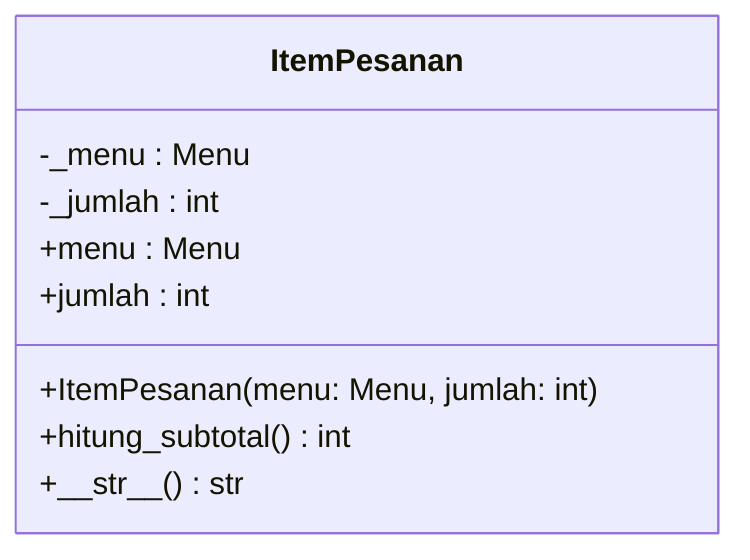
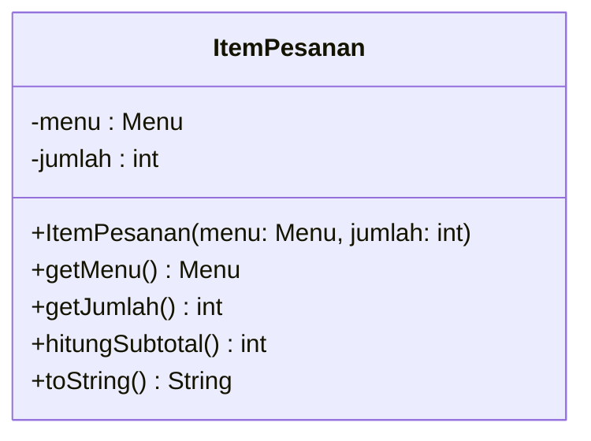

# 🌉 Jembatan Python ↔ Java Pertemuan 06: UML *Class Diagram*

[⬅️ Konsep](README.md) · [🐍 Python](python/README.md) · [☕ Java](java/README.md) · [Latihan ➡️](latihan.md)

Diagram kelas UML **sama** untuk kedua bahasa: kotak, garis, multiplisitas, dan simbol visibilitasnya tidak berubah. Yang berbeda hanyalah "dialek" nama dan cara setiap baris diagram diwujudkan di kode. Halaman ini membantumu membaca satu diagram dari sudut pandang kedua bahasa, sekaligus menjelaskan *mengapa* wujudnya berbeda.

## Tabel Perbandingan Cepat

| Elemen diagram | Python | Java |
|---|---|---|
| Gaya nama atribut dan *method* | *snake_case*: `hitung_total` | *camelCase*: `hitungTotal` |
| Tipe teks / benar-salah | `str` / `bool` | `String` / `boolean` |
| *List* bertipe | `list~Menu~`, di kode `list[Menu]` | `List~Menu~`, di kode `List<Menu>` |
| `-` *private* | awalan `_` (kesepakatan) | `private` (dijaga *compiler*) |
| `#` *protected* | awalan `_` (kesepakatan) | `protected` |
| `~` *package* | tidak ada padanan | tanpa kata kunci (*default*) |
| Akses baca dari luar | *property*, digambar di bagian **atribut** | *getter*, digambar di bagian ***method*** |
| Konstruktor `+Menu(...)` | `def __init__(self, ...):` | `public Menu(...)` |
| Atribut *static* (`$`) | atribut kelas di badan kelas | *field* `static` |
| *Method* *static* (`$`) | `@classmethod` atau `@staticmethod` | *method* `static` |
| Konstanta | huruf kapital (kesepakatan) | `static final` (dijaga *compiler*) |
| Fungsi bantu tanpa kelas | fungsi modul, kotak `<<module>>` | kelas utilitas, kotak `<<utility>>` |
| Multiplisitas `0..1` | `Tipe \| None`, nilai kosong `None` | tipe biasa, nilai kosong `null` |
| Tipe kembalian | petunjuk `-> int`, tidak diperiksa saat jalan | `int`, diperiksa *compiler* |
| Generalisasi `<\|--` | `class Anak(Induk):` | `class Anak extends Induk` |
| Realisasi `<\|..` (Pertemuan 10) | mewarisi kelas abstrak berbasis `ABC` | `implements` |
| Abstrak `*` (Pertemuan 10) | `@abstractmethod` | `abstract` |
| Representasi teks | `__str__` (di Mermaid: `\_\_str\_\_`) | `toString()` |

## 1. Satu Diagram, Dua Dialek

Kelas `ItemPesanan` di KedaiKita, digambar dari kode Python lalu dari kode Java:

**Python:**



**Java:**



Isinya sama: dua data privat, satu konstruktor, cara membaca data, satu perhitungan, dan representasi teks. Bedanya hanya gaya nama dan letak "pintu baca". Di halaman konsep, diagram ditulis dengan kebiasaan umum UML (*camelCase*, `String`, `boolean`), lalu diterjemahkan ke gaya masing-masing bahasa saat dijadikan kode.

## 2. *Property* di Bagian Atribut, *Getter* di Bagian *Method*

**Python** (potongan kelas `ItemPesanan` dari [`python/studi-kasus/pesanan.py`](python/studi-kasus/pesanan.py)):

```python
    @property
    def menu(self) -> Menu:
        return self._menu
```

**Java** (potongan dari [`java/studi-kasus/ItemPesanan.java`](java/studi-kasus/ItemPesanan.java)):

```java
    public Menu getMenu() {
        return menu;
    }
```

**Mengapa letaknya berbeda?** Diagram sebaiknya mencerminkan cara kelas **dipakai**. Di Python, *property* dibaca seperti atribut (`item.menu`, tanpa kurung), jadi ia digambar sebagai atribut publik `+menu : Menu`. Di Java, *getter* dipanggil seperti *method* (`item.getMenu()`), jadi ia digambar sebagai *method* `+getMenu() Menu`. Jika *property* digambar sebagai *method* `menu()`, pembaca bisa salah memanggilnya dengan kurung.

## 3. Visibilitas: Dijaga *Compiler* atau Dijaga Kesepakatan?

Tanda `-` di diagram berarti "jangan disentuh dari luar". Di Java, `private` benar-benar dijaga: kode yang melanggarnya gagal dikompilasi dengan pesan `has private access`. Di Python, atribut `_pengemudi` masih bisa diakses dari luar; awalan `_` hanyalah kesepakatan bahwa "ini urusan dalam kelas".

Jadi, diagram yang sama memberi **perintah** kepada *compiler* Java, tetapi hanya memberi **pesan** kepada pemrogram Python. Karena itu, pemrogram Python perlu lebih disiplin mengikuti tanda `-` di diagram.

## 4. *Static* dan Konstanta

**Python** (potongan dari [`python/contoh/contoh01_kotak_kelas.py`](python/contoh/contoh01_kotak_kelas.py)):

```python
    TARIF_PER_KG = 8000  # [1] +TARIF_PER_KG : int = 8000$ (publik, milik kelas)
    _penghitung = 0  # [2] -_penghitung : int = 0$ (privat, milik kelas)
```

**Java** (potongan dari [`java/contoh/Contoh01KotakKelas.java`](java/contoh/Contoh01KotakKelas.java)):

```java
    public static final int TARIF_PER_KG = 8000; // [1] +TARIF_PER_KG : int = 8000$
    private static int penghitung = 0;           // [2] -penghitung : int = 0$
```

Keduanya digambar dengan `$` (bergaris bawah). Bedanya: Java punya kata kunci `final` yang membuat konstanta benar-benar tidak bisa diubah, sedangkan Python hanya mengandalkan kesepakatan huruf kapital. Untuk *method*, Python punya dua pilihan (`@classmethod` menerima `cls`, `@staticmethod` tidak), sedangkan Java cukup satu kata kunci `static`. Di diagram, ketiganya sama-sama diakhiri `$`.

## 5. Fungsi Modul vs Kelas Utilitas

Python membolehkan fungsi berdiri sendiri di luar kelas, misalnya `format_rupiah()` di `utilitas.py`. Java tidak membolehkannya sehingga fungsi yang sama dibungkus menjadi *method* *static* di kelas `Rupiah`.

| | Python | Java |
|---|---|---|
| Wujud | fungsi modul `format_rupiah(angka)` | *method* `static` `Rupiah.format(angka)` |
| Di diagram | kotak `utilitas` dengan stereotip buatan sendiri `<<module>>` | kotak `Rupiah` dengan stereotip standar UML `<<utility>>` |
| Garis dari `Menu` dan `Pesanan` | dependensi `..>` | dependensi `..>` |

## 6. Multiplisitas 0..1 dan Tipe Kembalian

Multiplisitas `0..1` berarti "boleh kosong". Python menuliskannya langsung di petunjuk tipe, misalnya `Pengemudi | None` atau `-> Menu | None`. Java tidak punya penanda serupa pada tipe biasa: *field* bertipe `Pengemudi` boleh berisi `null` kapan saja. Karena itu, diagram versi Java menegaskannya dengan `Pengemudi [0..1]`.

Untuk tipe kembalian, keadaannya terbalik. Java memeriksa bahwa *method* `int` benar-benar mengembalikan `int`; lupa `return` langsung ditolak dengan `missing return statement`. Python tidak memeriksa petunjuk `-> int` saat program berjalan. Akibatnya, lupa `return` baru ketahuan belakangan, misalnya sebagai `TypeError` saat nilai `None` itu dijumlahkan. Kadang malah tidak ketahuan sama sekali: *output*-nya hanya menampilkan `None`.

## 7. Generalisasi: Apakah Konstruktor Ikut Diwariskan?

Panah `Karyawan <|-- Barista` sama di kedua bahasa, tetapi isi kotak anaknya sedikit berbeda:

| | Python | Java |
|---|---|---|
| Kode kelas anak | `class Barista(Karyawan):` | `class Barista extends Karyawan` |
| Konstruktor anak | tidak wajib; `__init__` milik induk ikut dipakai | wajib ditulis di contoh ini, lalu memanggil `super(nama)` |
| Isi kotak `Barista` | `+racik(minuman: str) str` | `+Barista(nama: String)` dan `+racik(minuman: String) String` |

Di Java, konstruktor **tidak diwariskan**. Karena konstruktor `Karyawan` meminta `nama`, kelas anak harus menulis konstruktornya sendiri, dan konstruktor itu ikut digambar di kotak anak. Detailnya di Pertemuan 07.

## Yang Sama di Kedua Bahasa

- Simbol visibilitas, bentuk enam jenis garis, dan cara membaca multiplisitas.
- Di kode kedua bahasa, komposisi biasanya berarti objek bagian dibuat **di dalam** keseluruhan, sedangkan agregasi berarti objek bagian diterima **dari luar**.
- Dependensi berarti kelas lain hanya muncul sebagai parameter, variabel lokal, atau pemanggilan sesaat.
- Multiplisitas `*` diwujudkan sebagai *list*, dan *getter*/*property* untuk *list* mengembalikan **salinan**.
- Diagram lengkap KedaiKita versi Python dan Java punya kotak dan garis yang sama persis, dan *output* kedua program **identik**.

## Jebakan saat Pindah Bahasa

| Jika kamu terbiasa... | Lalu menulis... | Jebakannya |
|---|---|---|
| Java | diagram UML | menulis tipe di depan nama (`-int harga`), padahal UML menulis `-harga : int` |
| Python | diagram UML | menulis `self` di daftar parameter; di diagram, `self` (dan `this`) tidak pernah ditulis |
| Python | diagram UML di Mermaid | menulis `__init__` atau `__str__` apa adanya sehingga tampil tebal tanpa garis bawah |
| Python | kode Java | mengira tanda `-` di diagram boleh dilanggar; *compiler* Java akan menolaknya |
| Java | kode Python | menulis `get_harga()` untuk setiap atribut; di Python, pintu bacanya adalah *property* |
| Python | kode Java | mengira konstruktor diwariskan; di Java, kelas anak umumnya perlu menulis konstruktornya sendiri |
| Java | kode Python | mengira `-> int` akan dicek; Python tetap menjalankan *method* yang lupa `return` |

---

[⬅️ Konsep](README.md) · [🐍 Python](python/README.md) · [☕ Java](java/README.md) · [Latihan ➡️](latihan.md)
