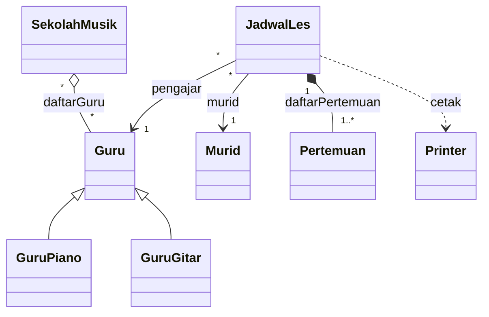
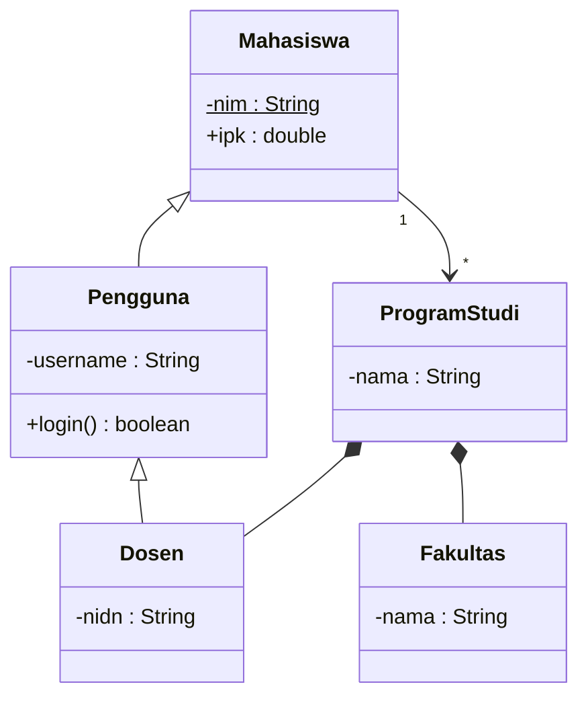
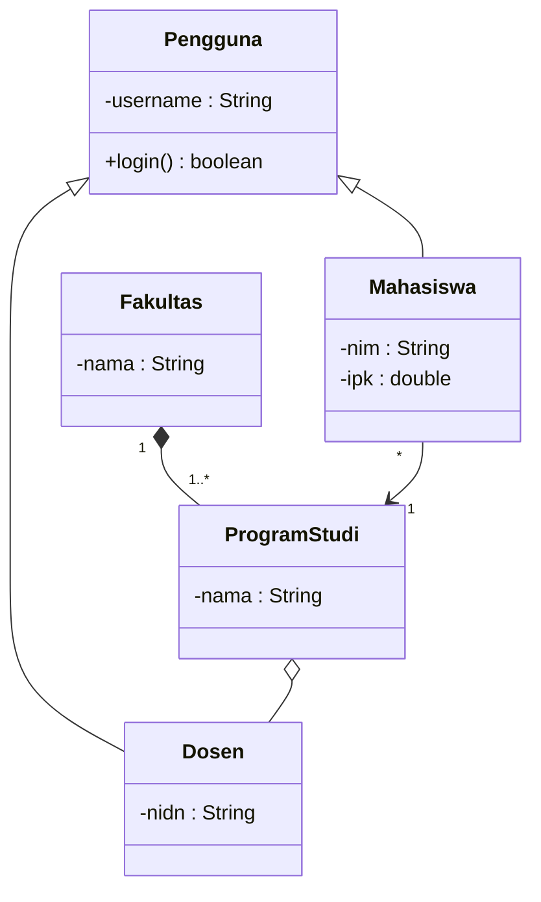
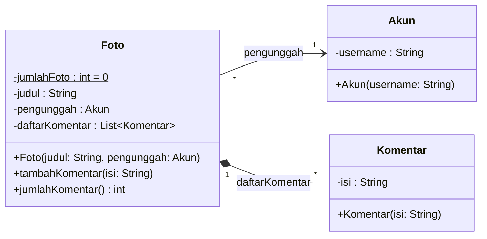
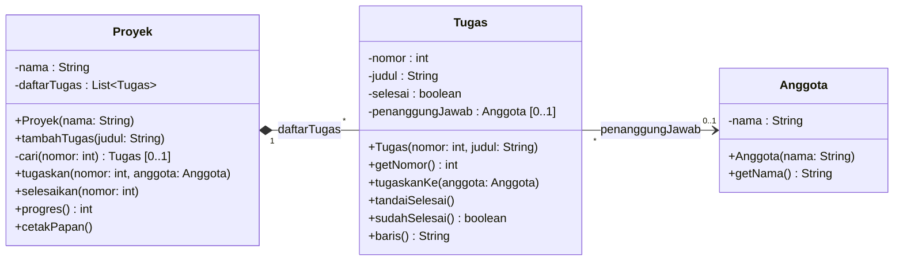
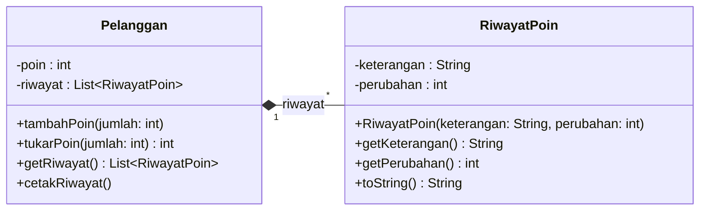

# Latihan Pertemuan 06: UML *Class Diagram*

[⬅️ Konsep](README.md) · [🏠 Beranda](../README.md) · [Kuis ➡️](kuis.md)

**Cara mengerjakan:**

1. **Siapkan folder kerjamu sendiri** di luar folder materi, misalnya `Documents/PBO-latihan-saya/pertemuan-06/`. Simpan semua jawabanmu di sana, jangan di dalam folder materi. Alasannya dijelaskan di [aturan emas 00-Persiapan](../00-Persiapan/git-dan-github.md#5-menyimpan-latihanmu-sendiri).
2. **Latihan 1 sampai 3** dijawab dengan **diagram**. Tulis teks Mermaid-nya di [Mermaid Live Editor](https://mermaid.live), lalu salin teksnya ke *file* `latihan01.md`, `latihan02.md`, dan seterusnya di folder kerjamu. Di *file* `.md`, teks itu diapit baris pembuka dan penutup Mermaid. Cara lengkapnya ada di [Konsep bagian 7](README.md#cara-melihat-dan-mencoba-diagram-mermaid). Menggambar di kertas juga boleh.
3. **Latihan 4 dan 5** dijawab dengan **kode** Python **atau** Java. Beri nama *file*-mu sama dengan nama *file* solusinya, misalnya `latihan04_papan_tugas.py` atau `Latihan04PapanTugas.java`. Di Java, nama *file* harus sama dengan nama kelas `public`-nya.
4. **Jalankan kodemu** dari terminal yang sedang berada di folder kerjamu: `python latihan04_papan_tugas.py` (macOS/Linux: `python3 ...`) atau `java Latihan04PapanTugas.java`. Pengguna VS Code boleh membuka folder kerjamu (**File → Open Folder**), lalu klik ▷ atau **Run**.
5. **Cocokkan hasilnya.** *Output*-mu harus sama persis dengan **Contoh *output* yang diharapkan**, termasuk spasi dan huruf besar-kecilnya. Setelah itu, bandingkan kodemu dengan *file* solusi (tautan **Solusi** di akhir latihan). Untuk latihan diagram, cocokkan dengan bagian **Lihat jawaban**.
6. Buka petunjuk hanya jika buntu. Buka jawaban atau solusi **setelah** kamu mencoba sendiri.
7. Tingkat kesulitan: ⭐ Dasar · ⭐⭐ Menengah · ⭐⭐⭐ Tantangan.

> [!TIP]
> Diagram jawaban memakai kebiasaan UML (*camelCase*, `String`, `boolean`). Versi Python (*snake_case*, `str`, `bool`) atau tata letak yang berbeda tetap benar, selama isi, simbol, dan multiplisitasnya cocok.

---

## Latihan 1: Relasi dari Cerita (⭐ Dasar)

**Tujuan:** memilih jenis relasi dan multiplisitas yang tepat dari sebuah deskripsi.

**Soal:** Gambarkan semua garis relasi (cukup nama kelas) beserta multiplisitasnya:

> Sebuah **sekolah musik** menyimpan daftar **guru**. Guru boleh mengajar di beberapa sekolah, dan tetap ada walaupun sekolahnya tutup. Setiap **jadwal les** dibuat untuk tepat satu **murid** dan diajar tepat satu guru; seorang murid atau guru boleh punya banyak jadwal. Jadwal les terdiri atas minimal satu **pertemuan** yang dibuat oleh jadwal itu sendiri dan ikut hilang jika jadwal dibatalkan. Untuk mencetak, jadwal les memakai **printer** yang dikirim sebagai parameter. **Guru piano** dan **guru gitar** adalah jenis khusus guru.

<details>
<summary>💡 Petunjuk</summary>

Kata kunci: "tetap ada walaupun" (agregasi), "dibuat oleh ... ikut hilang" (komposisi), "dikirim sebagai parameter" (dependensi), "jenis khusus" (generalisasi). Sisanya asosiasi.

</details>

<details>
<summary>Lihat jawaban</summary>



Guru boleh di banyak sekolah, jadi agregasinya bertanda `*` di kedua ujung. Pertemuan minimal satu (`1..*`) dan belah ketupat penuhnya menempel di `JadwalLes`. Segitiga menempel di `Guru` sebagai induk.

Cerita di soal tidak menyebut arah navigasi. Jawaban ini memilih `JadwalLes --> Murid` dan `JadwalLes --> Guru` karena jadwal yang perlu tahu murid dan pengajarnya. Garis asosiasi tanpa panah juga diterima.

</details>

---

## Latihan 2: Perbaiki Diagram yang Salah (⭐ Dasar)

**Tujuan:** melatih ketelitian membaca simbol.

**Soal:** Diagram berikut berisi **enam** kesalahan jika dibandingkan dengan deskripsinya. Temukan dan perbaiki semuanya.

> Fakultas terdiri atas beberapa program studi yang tidak bisa berdiri tanpa fakultasnya. Setiap program studi punya beberapa dosen, dan dosen bisa pindah ke program studi lain. Setiap mahasiswa terdaftar di tepat satu program studi. Mahasiswa dan dosen adalah jenis pengguna sistem akademik. Setiap mahasiswa punya NIM sendiri, dan IPK-nya tidak boleh diubah langsung dari luar.



<details>
<summary>💡 Petunjuk</summary>

Periksa satu per satu: arah segitiga, sisi dan jenis belah ketupat, sisi multiplisitas, tanda `$`, dan tanda visibilitas.

</details>

<details>
<summary>Lihat jawaban</summary>

1. `Mahasiswa <|-- Pengguna` terbalik. Benar: `Pengguna <|-- Mahasiswa`.
2. `-nim : String$` bertanda *static*, padahal NIM milik setiap mahasiswa. Hapus `$`.
3. `+ipk : double` publik, padahal tidak boleh diubah dari luar. Benar: `-ipk : double`.
4. Belah ketupat `ProgramStudi *-- Fakultas` ada di sisi yang salah. Benar: `Fakultas "1" *-- "1..*" ProgramStudi`.
5. `ProgramStudi *-- Dosen` seharusnya agregasi karena dosen bisa pindah: `ProgramStudi o-- Dosen`.
6. Multiplisitas tertukar sisi. Benar: `Mahasiswa "*" --> "1" ProgramStudi`.

Diagram setelah keenam kesalahan diperbaiki:



</details>

---

## Latihan 3: Dari Kode ke Diagram (⭐⭐ Menengah)

**Tujuan:** *reverse engineering* kode menjadi diagram lengkap.

**Soal:** Gambarkan diagram kelas lengkap (atribut, *method*, tipe, visibilitas, relasi, multiplisitas) dari potongan aplikasi galeri foto berikut. Pilih salah satu bahasa; isinya setara. Kode ini cukup dibaca, tidak perlu dijalankan.

**Python:**

```python
class Akun:
    def __init__(self, username: str):
        self._username = username


class Komentar:
    def __init__(self, isi: str):
        self._isi = isi


class Foto:
    _jumlah_foto = 0

    def __init__(self, judul: str, pengunggah: Akun):
        Foto._jumlah_foto += 1
        self._judul = judul
        self._pengunggah = pengunggah
        self._daftar_komentar: list[Komentar] = []

    def tambah_komentar(self, isi: str):
        self._daftar_komentar.append(Komentar(isi))

    def jumlah_komentar(self) -> int:
        return len(self._daftar_komentar)
```

**Java** (baris `import java.util.*` tidak ditampilkan):

```java
class Akun {
    private String username;

    public Akun(String username) {
        this.username = username;
    }
}

class Komentar {
    private String isi;

    public Komentar(String isi) {
        this.isi = isi;
    }
}

class Foto {
    private static int jumlahFoto = 0;
    private String judul;
    private Akun pengunggah;
    private List<Komentar> daftarKomentar = new ArrayList<>();

    public Foto(String judul, Akun pengunggah) {
        jumlahFoto++;
        this.judul = judul;
        this.pengunggah = pengunggah;
    }

    public void tambahKomentar(String isi) {
        daftarKomentar.add(new Komentar(isi));
    }

    public int jumlahKomentar() {
        return daftarKomentar.size();
    }
}
```

<details>
<summary>💡 Petunjuk</summary>

Ikuti langkah *reverse engineering* di halaman konsep. Pertanyaan kuncinya: objek `Komentar` dibuat di mana? Objek `Akun` dibuat di mana?

</details>

<details>
<summary>Lihat jawaban</summary>



- `Foto *-- Komentar` adalah komposisi: komentar dibuat **di dalam** `tambahKomentar()` dari data mentah (`isi`), dan tidak pernah diserahkan ke luar.
- `Foto --> Akun` adalah asosiasi: akun dibuat di luar lalu disimpan referensinya. Satu akun boleh mengunggah banyak foto, jadi ujung `Foto` bertanda `*`.
- `jumlahFoto` milik kelas, jadi diberi `$`. Versi Python memakai nama `_jumlah_foto`, `_daftar_komentar : list~Komentar~`, dan `tambah_komentar()`.

</details>

---

## Latihan 4: Papan Tugas Kelompok, dari Diagram ke Kode (⭐⭐ Menengah)

**Tujuan:** *forward engineering*: menulis kode yang persis sesuai diagram.

**Soal:** Wujudkan diagram berikut menjadi kode. *Getter* di diagram ditulis sebagai *property* di Python.



Aturannya:

- Nomor tugas dimulai dari 1.
- `tugaskan()` dan `selesaikan()` mencetak `Tugas nomor N tidak ada` jika nomornya tidak ditemukan.
- `progres()` = jumlah tugas selesai × 100 / jumlah tugas, dibulatkan ke bawah (0 jika belum ada tugas).
- `baris()` berisi `[nomor] `, judul selebar 26 karakter, penanggung jawab (atau `-`) selebar 8 karakter, lalu `SELESAI` atau `proses`.

Skenario: proyek "Aplikasi Kasir" dengan tugas Gambar diagram kelas, Tulis kelas Menu, Tulis kelas Pesanan, dan Uji semua fitur. Tugaskan 1 ke Ayu dan 2 ke Bima, selesaikan 1, cetak papan. Lalu tugaskan 3 ke Ayu, selesaikan 2 dan 3, coba tugaskan 9 ke Bima, dan cetak papan lagi.

**Contoh *output* yang diharapkan:**

```text
=== PAPAN TUGAS: Aplikasi Kasir ===
[1] Gambar diagram kelas      Ayu     SELESAI
[2] Tulis kelas Menu          Bima    proses
[3] Tulis kelas Pesanan       -       proses
[4] Uji semua fitur           -       proses
Progres: 25%

Tugas nomor 9 tidak ada
=== PAPAN TUGAS: Aplikasi Kasir ===
[1] Gambar diagram kelas      Ayu     SELESAI
[2] Tulis kelas Menu          Bima    SELESAI
[3] Tulis kelas Pesanan       Ayu     SELESAI
[4] Uji semua fitur           -       proses
Progres: 75%
```

<details>
<summary>💡 Petunjuk</summary>

- Komposisi: objek `Tugas` dibuat di dalam `tambahTugas()`. Asosiasi `0..1`: `penanggungJawab` dimulai dari `None`/`null`.
- `-cari()` adalah *method* privat (Python: `_cari`). Lebar kolom: Python `f"{judul:<26}"`, Java `String.format("%-26s", judul)`.

</details>

**Solusi:** [🐍 Python](python/solusi/latihan04_papan_tugas.py) · [☕ Java](java/solusi/Latihan04PapanTugas.java)

---

## Latihan 5 (KedaiKita): Riwayat Poin Pelanggan (⭐⭐⭐ Tantangan)

**Tujuan:** mengembangkan KedaiKita dengan urutan yang benar: diagram dulu, kode kemudian.

**Soal:** Pemilik KedaiKita ingin setiap perubahan poin tercatat. Rancangannya (kotak `Pelanggan` hanya menampilkan anggota yang berkaitan dengan poin; anggota lainnya tetap seperti di studi kasus):



Langkahnya:

1. Buat *file* `latihan05_riwayat_poin.py` atau `Latihan05RiwayatPoin.java` di folder kerjamu. Salin kelas `Pelanggan` dari [`python/studi-kasus/pelanggan.py`](python/studi-kasus/pelanggan.py) atau [`java/studi-kasus/Pelanggan.java`](java/studi-kasus/Pelanggan.java) ke dalamnya.
2. Tambahkan kelas `RiwayatPoin` sesuai diagram. Teksnya (`__str__` atau `toString()`) berisi keterangan selebar 14 karakter, lalu perubahan bertanda `+` atau `-`.
3. Ubah `tambahPoin()` agar mencatat `("Tambah poin", +jumlah)`, dan `tukarPoin()` agar mencatat `("Tukar poin", -jumlah)` **hanya jika penukaran berhasil**.
4. Buat `getRiwayat()` (Python: *property* `riwayat`) yang mengembalikan **salinan** *list*, serta `cetakRiwayat()`.
5. Jalankan skenario untuk Budi Santoso (081234567890): tambah 6 poin, tambah 3 poin, tukar 5 poin, coba tukar 10 poin (gagal), cetak riwayat, lalu kosongkan salinan riwayat dari luar dan tunjukkan bahwa riwayat aslinya tetap utuh.

**Contoh *output* yang diharapkan:**

```text
=== TRANSAKSI POIN ===
Tukar 5 poin -> potongan Rp5.000
Gagal tukar 10 poin: Poin tidak cukup (sisa 4)
Budi Santoso (081234567890) - 4 poin

=== RIWAYAT POIN: Budi Santoso ===
1. Tambah poin   +6
2. Tambah poin   +3
3. Tukar poin    -5
Saldo poin akhir: 4

=== MENCOBA MERUSAK RIWAYAT DARI LUAR ===
Isi salinan  : 0 catatan
Riwayat asli : 3 catatan
```

<details>
<summary>💡 Petunjuk</summary>

- Ini komposisi: objek `RiwayatPoin` dibuat **di dalam** `tambahPoin()` dan `tukarPoin()`.
- Tanda plus: Python `f"{perubahan:+d}"`; Java `(perubahan >= 0 ? "+" : "") + perubahan`.
- Untuk menulis `Rp5.000`, salin juga fungsi `format_rupiah()` dari `python/studi-kasus/utilitas.py` (Java: isi *method* `Rupiah.format()` dari `java/studi-kasus/Rupiah.java`) ke *file*-mu.
- Pengguna Java: nama kelas `Pelanggan` boleh dipakai selama di folder kerjamu belum ada kelas lain bernama `Pelanggan`, misalnya salinan studi kasus. Jika sudah ada, pakai nama lain seperti `PelangganKedai`. *File* solusi memakai nama itu karena folder `java/` materi ini sudah punya kelas `Pelanggan` di `studi-kasus`, dan VS Code akan protes jika dua kelas bernama sama berada dalam satu folder yang dibuka.

</details>

**Solusi:** [🐍 Python](python/solusi/latihan05_riwayat_poin.py) · [☕ Java](java/solusi/Latihan05RiwayatPoin.java)

---

## Tugas Mandiri (Dikumpulkan, tanpa Kunci Jawaban)

### Wisata Susur Sungai Mahakam

Sebuah usaha wisata di Samarinda melayani perjalanan kapal susur Sungai Mahakam. Setiap kapal punya nama dan kapasitas. Setiap jadwal keberangkatan memakai satu kapal dan punya tanggal, jam, serta harga tiket. Satu pemesanan untuk sebuah jadwal bisa berisi beberapa tiket atas nama penumpang berbeda; tiket dibuat oleh pemesanan dan tidak berarti tanpanya. Saat membayar, pemesanan memakai objek penghitung diskon yang dikirim sebagai parameter.

**Kebutuhan:**

1. **Diagram kelas Mermaid**: minimal lima kelas dan tiga jenis relasi berbeda; setiap garis asosiasi, agregasi, dan komposisi punya multiplisitas dan nama peran; setiap anggota punya visibilitas dan tipe; minimal satu anggota *static*.
2. **Kode** Python atau Java yang setia pada diagram, dengan demo minimal dua jadwal dan tiga pemesanan serta *output* yang deterministik (hasilnya selalu sama setiap kali dijalankan).
3. **Tabel keselarasan** minimal sepuluh baris: "baris diagram → baris kode".
4. Satu paragraf: relasi mana yang paling sulit kamu putuskan, dan mengapa.

**Ketentuan pengumpulan:** satu *file* `.md` berisi diagram dan tabel, *file* kode, serta tangkapan layar *output*.

| Aspek penilaian | Bobot |
|---|---|
| Diagram benar dan lengkap (simbol, multiplisitas, nama peran, visibilitas, tipe) | 35% |
| Kode sesuai diagram dan berjalan tanpa *error* | 30% |
| Tabel keselarasan diagram dan kode | 20% |
| Alasan desain, kerapian, dan kejelasan *output* | 15% |

---

[⬅️ Konsep](README.md) · [🏠 Beranda](../README.md) · [Kuis ➡️](kuis.md)
