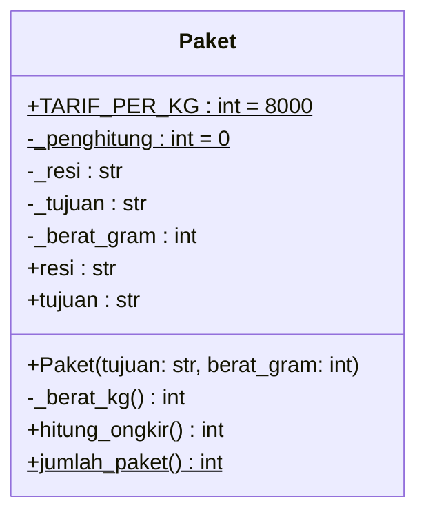
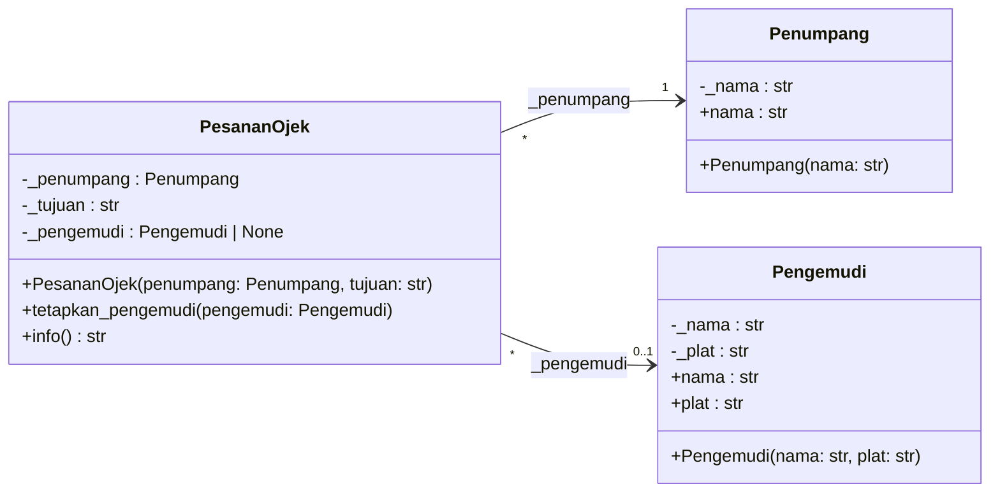
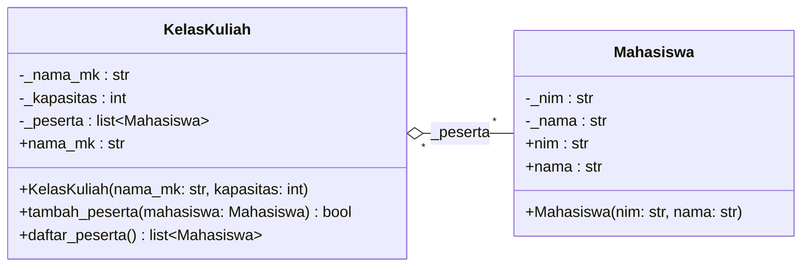
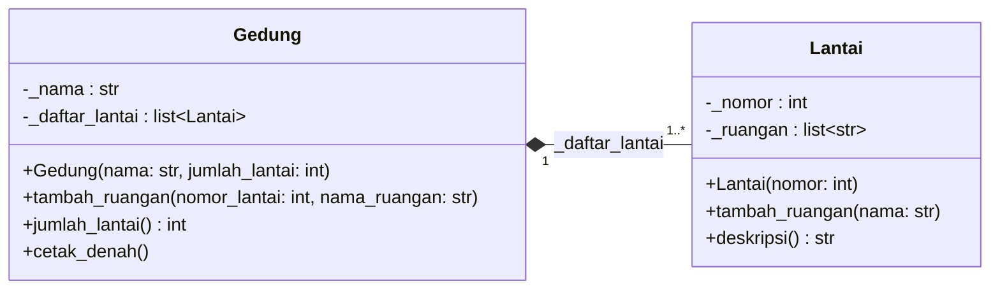
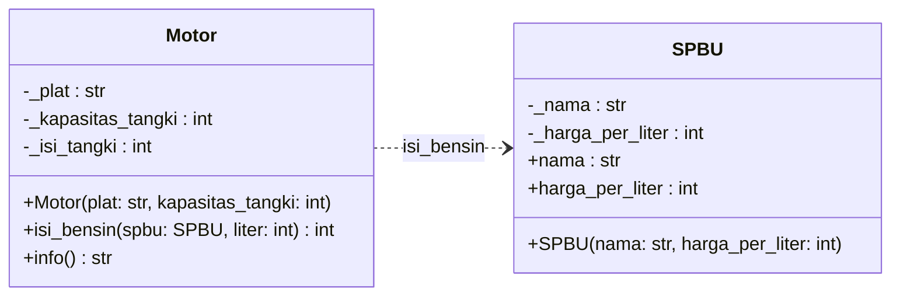
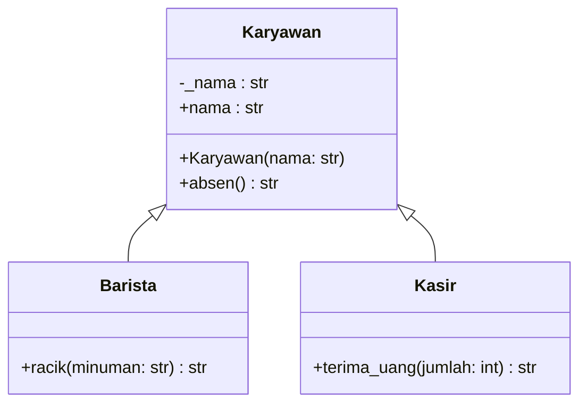
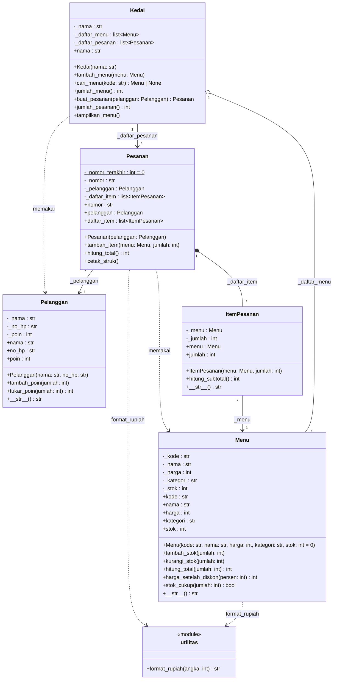

# 🐍 Praktik Python — Pertemuan 06: UML Class Diagram

[⬅️ Konsep](../README.md) · [☕ Praktik Java](../java/README.md) · [Jembatan Python ↔ Java ➡️](../jembatan-python-java.md)

> **Prasyarat:** sudah membaca [Konsep Pertemuan 06](../README.md). Semua kode di halaman ini ada di folder `contoh/` dan `studi-kasus/`, dan bisa langsung dijalankan.

## Daftar Isi

- [Persiapan](#persiapan)
1. [Kotak Kelas Lengkap: Visibilitas, Tipe, dan Static](#1-kotak-kelas-lengkap-visibilitas-tipe-dan-static)
2. [Asosiasi Berarah dan Multiplisitas](#2-asosiasi-berarah-dan-multiplisitas)
3. [Agregasi: Bagian Datang dari Luar](#3-agregasi-bagian-datang-dari-luar)
4. [Komposisi: Bagian Dibuat di Dalam](#4-komposisi-bagian-dibuat-di-dalam)
5. [Dependensi: Cukup Lewat Parameter](#5-dependensi-cukup-lewat-parameter)
6. [Generalisasi: Pratinjau Pewarisan](#6-generalisasi-pratinjau-pewarisan)
7. [Studi Kasus KedaiKita](#7-studi-kasus-kedaikita)
8. [Kesalahan Umum dan Cara Membaca Pesan Error](#8-kesalahan-umum-dan-cara-membaca-pesan-error)

## Persiapan

Struktur folder Python pertemuan ini:

```text
python/
├── contoh/          <- 6 contoh: setiap contoh = satu diagram kecil + kodenya
├── studi-kasus/     <- KedaiKita versi Pertemuan 06 (kodenya sama dengan Pertemuan 05)
└── solusi/          <- solusi latihan yang berupa kode
```

Cara menjalankan sebuah contoh:

```bash
cd Pertemuan-06-UML-Class-Diagram/python/contoh
python contoh01_kotak_kelas.py
```

> [!NOTE]
> Di macOS/Linux, gunakan `python3` sebagai ganti `python`. Untuk melihat diagram Mermaid di komputer sendiri, pasang ekstensi VS Code seperti *Markdown Preview Mermaid Support*, atau tempel teks diagramnya di <https://mermaid.live>.

Cara belajar halaman ini sedikit berbeda dari biasanya. Untuk setiap contoh, **baca diagramnya dulu**, tebak seperti apa kodenya, baru bandingkan dengan kode aslinya. Itulah latihan *forward engineering*.

### Aturan menulis diagram versi Python

Diagram di halaman ini ditulis dengan nama **persis** seperti di kode Python, agar setiap baris mudah dicocokkan:

| Di kode Python | Ditulis di diagram sebagai |
|---|---|
| `self._harga = harga` | `-_harga : int` (awalan `_` berarti privat) |
| `@property def harga(self) -> int` | `+harga : int` di bagian **atribut** |
| `def __init__(self, kode: str)` | `+Menu(kode: str)`: konstruktor ditulis dengan nama kelas, sesuai kebiasaan UML |
| `def hitung_total(self, jumlah: int) -> int` | `+hitung_total(jumlah: int) int` (tanpa `self`) |
| atribut kelas, `@classmethod`, `@staticmethod` | baris diakhiri `$` sehingga tampil bergaris bawah |
| `list[Menu]` | `list~Menu~` (tampil `list<Menu>`) |
| `Menu \| None` | `Menu \| None` (boleh kosong) |
| `def __str__(self) -> str` | `+__str__() str`, di sumber Mermaid ditulis `+\_\_str\_\_() str` |

Mengapa *property* ditulis di bagian atribut, bukan method? Karena dari luar, *property* dipakai **seperti atribut**: `paket.resi`, tanpa tanda kurung. Jika digambar sebagai method `resi()`, pembaca diagram bisa tergoda memanggilnya dengan kurung, dan itu menimbulkan error.

## 1. Kotak Kelas Lengkap: Visibilitas, Tipe, dan Static

File: [`contoh/contoh01_kotak_kelas.py`](contoh/contoh01_kotak_kelas.py)

Mulai dari satu kotak saja, tetapi lengkap: atribut objek, atribut kelas, *property*, konstruktor, method publik, method privat, dan method milik kelas.



Kodenya (komentar `[n]` menunjukkan baris diagram yang diwujudkan):

```python
class Paket:
    """Paket kiriman di sebuah jasa ekspedisi."""

    TARIF_PER_KG = 8000  # [1] +TARIF_PER_KG : int = 8000$ (publik, milik kelas)
    _penghitung = 0  # [2] -_penghitung : int = 0$ (privat, milik kelas)

    def __init__(self, tujuan: str, berat_gram: int):  # [3] +Paket(...)
        Paket._penghitung += 1
        self._resi = f"KRM{Paket._penghitung:03d}"  # [4] -_resi : str
        self._tujuan = tujuan
        self._berat_gram = berat_gram

    @property
    def resi(self) -> str:  # [5] +resi : str (property hanya-baca)
        return self._resi

    @property
    def tujuan(self) -> str:
        return self._tujuan

    def _berat_kg(self) -> int:  # [6] -_berat_kg() int (method privat)
        """Berat dibulatkan ke atas per kilogram: 1200 gram dihitung 2 kg."""
        return (self._berat_gram + 999) // 1000

    def hitung_ongkir(self) -> int:  # [7] +hitung_ongkir() int
        return self._berat_kg() * Paket.TARIF_PER_KG

    @classmethod
    def jumlah_paket(cls) -> int:  # [8] +jumlah_paket() int$ (milik kelas)
        return cls._penghitung
```

Program utamanya membuat tiga paket (ke Samarinda 1200 gram, Balikpapan 500 gram, dan Bontang 3000 gram), mencetak ongkirnya, lalu membaca data milik kelas:

```python
    print("=== DATA MILIK KELAS ===")
    print(f"Tarif per kg : Rp{Paket.TARIF_PER_KG}")  # [9] static dibaca lewat kelas
    print(f"Jumlah paket : {Paket.jumlah_paket()}")
```

**Output:**

```text
=== PAKET MASUK ===
KRM001 ke Samarinda: ongkir Rp16000
KRM002 ke Balikpapan: ongkir Rp8000
KRM003 ke Bontang: ongkir Rp24000

=== DATA MILIK KELAS ===
Tarif per kg : Rp8000
Jumlah paket : 3
```

Penjelasan:

- **[1]** `TARIF_PER_KG` ditulis langsung di badan kelas, bukan lewat `self`, sehingga **milik kelas**. Di diagram, barisnya diakhiri `$` (bergaris bawah) dan diberi nilai awal `= 8000`. Huruf kapital semua adalah kesepakatan untuk konstanta.
- **[2]** Atribut kelas yang diawali `_` adalah privat. Visibilitasnya `-`, dan namanya ditulis persis `_penghitung`.
- **[3]** Konstruktor `__init__` digambar sebagai `+Paket(tujuan: str, berat_gram: int)`. Parameter `self` tidak pernah ditulis di diagram.
- **[4]** Atribut objek lahir di dalam `__init__`. Tipenya `str`, sesuai nilai yang disimpan.
- **[5]** *Property* publik ditulis `+resi : str` di bagian atribut, karena dipakai seperti atribut: `paket.resi`.
- **[6]** Method berawalan `_` adalah method **privat** (pembantu internal). Tipe kembaliannya diambil dari petunjuk tipe `-> int`.
- **[7]** Method publik biasa: `+hitung_ongkir() int`.
- **[8]** `@classmethod` milik kelas, sehingga barisnya diakhiri `$`. Parameter `cls` juga tidak ditulis.
- **[9]** Anggota milik kelas dipanggil lewat **nama kelas**: `Paket.TARIF_PER_KG` dan `Paket.jumlah_paket()`.

> [!NOTE]
> Petunjuk tipe (`-> int`, `berat_gram: int`) **tidak diperiksa** Python saat program berjalan. Jadi diagram yang bertuliskan `int` adalah janji yang harus kamu tepati sendiri. Lihat Kesalahan 1 di bagian akhir halaman ini.

> [!TIP]
> **Coba sendiri:** biasakan *forward engineering*. Tambahkan dulu baris `-_layanan : str` dan `+layanan : str` di diagram, lalu wujudkan di kode: konstruktor menerima `layanan` (misalnya `"REG"` atau `"KILAT"`), dan output menampilkan layanannya.

## 2. Asosiasi Berarah dan Multiplisitas

File: [`contoh/contoh02_asosiasi.py`](contoh/contoh02_asosiasi.py)

Aplikasi ojek daring: setiap pesanan **wajib** punya penumpang, sedangkan pengemudinya baru ditetapkan setelah ditemukan.



Kelas `Penumpang` dan `Pengemudi` hanya menyimpan data dan *property*. Inti contoh ini ada di `PesananOjek`:

```python
class PesananOjek:
    """Satu pesanan ojek: penumpang wajib ada, pengemudi menyusul."""

    def __init__(self, penumpang: Penumpang, tujuan: str):
        self._penumpang = penumpang  # [1] multiplisitas 1: diisi saat objek lahir
        self._tujuan = tujuan
        self._pengemudi: Pengemudi | None = None  # [2] multiplisitas 0..1

    def tetapkan_pengemudi(self, pengemudi: Pengemudi):
        self._pengemudi = pengemudi  # [3] tautan ke pengemudi dibuat belakangan

    def info(self) -> str:
        if self._pengemudi is None:  # [4] 0..1 berarti harus siap menghadapi None
            teks_pengemudi = "belum ada"
        else:
            teks_pengemudi = f"{self._pengemudi.nama} ({self._pengemudi.plat})"
        return f"{self._penumpang.nama} -> {self._tujuan} | pengemudi: {teks_pengemudi}"
```

Program utamanya membuat penumpang Rina dan pengemudi Pak Joko, lalu dua pesanan atas nama Rina. Pengemudi hanya ditetapkan untuk pesanan pertama.

```python
    pesanan1 = PesananOjek(rina, "Kampus Unmul Gunung Kelua")
    pesanan2 = PesananOjek(rina, "Pasar Segiri")  # [5] satu penumpang, dua pesanan
```

**Output:**

```text
=== PESANAN BARU ===
Rina -> Kampus Unmul Gunung Kelua | pengemudi: belum ada
Rina -> Pasar Segiri | pengemudi: belum ada

=== SETELAH PENGEMUDI DITEMUKAN ===
Rina -> Kampus Unmul Gunung Kelua | pengemudi: Pak Joko (KT 4521 AB)
Rina -> Pasar Segiri | pengemudi: belum ada
```

Penjelasan:

- **[1]** Multiplisitas `1` di ujung `Penumpang` berarti wajib. Cara paling aman menjaminnya: minta objek penumpang **di konstruktor**.
- **[2]** Multiplisitas `0..1` di ujung `Pengemudi` berarti boleh kosong. Atributnya dimulai dengan `None`, dan petunjuk tipenya `Pengemudi | None`.
- **[3]** Tautan `0..1` boleh dibuat belakangan lewat method biasa.
- **[4]** Karena boleh `None`, setiap kode yang memakai `_pengemudi` wajib memeriksanya lebih dulu.
- **[5]** Multiplisitas `*` di ujung `PesananOjek`: satu penumpang (Rina) boleh dirujuk oleh banyak pesanan.

Perhatikan arah panahnya: `PesananOjek --> Penumpang`. Pesanan tahu penumpangnya, tetapi `Penumpang` tidak punya atribut apa pun tentang pesanan. Itulah **navigasi satu arah**.

## 3. Agregasi: Bagian Datang dari Luar

File: [`contoh/contoh03_agregasi.py`](contoh/contoh03_agregasi.py)



```python
class KelasKuliah:
    """Kelas kuliah yang menampung mahasiswa sampai kapasitas tertentu."""

    def __init__(self, nama_mk: str, kapasitas: int):
        self._nama_mk = nama_mk
        self._kapasitas = kapasitas
        self._peserta: list[Mahasiswa] = []  # [1] list berisi referensi Mahasiswa

    @property
    def nama_mk(self) -> str:
        return self._nama_mk

    def tambah_peserta(self, mahasiswa: Mahasiswa) -> bool:  # [2] bagian dari luar
        if len(self._peserta) >= self._kapasitas:
            return False
        self._peserta.append(mahasiswa)
        return True

    def daftar_peserta(self) -> list[Mahasiswa]:
        return list(self._peserta)  # [3] salinan list, isi asli tetap aman
```

Program utamanya membuat tiga mahasiswa **lebih dulu** (penanda `[4]` di awal `main()`), mendaftarkan ketiganya ke kelas PBO yang kapasitasnya hanya 2, lalu:

```python
    basis_data.tambah_peserta(ayu)  # [5] Ayu ikut dua kelas sekaligus
    basis_data.tambah_peserta(citra)

    print()
    print("=== PESERTA BASIS DATA ===")
    for mhs in basis_data.daftar_peserta():
        print(f"{mhs.nim} {mhs.nama}")
    if pbo.daftar_peserta()[0] is basis_data.daftar_peserta()[0]:
        print("Ayu di kelas PBO dan di kelas Basis Data adalah objek yang SAMA")

    print()
    print("=== KELAS PBO SELESAI ===")
    pbo = None  # [6] si keseluruhan dibubarkan
    print(f"{ayu.nama} tetap ada, NIM {ayu.nim}")
    print(f"Peserta Basis Data masih {len(basis_data.daftar_peserta())} orang")
```

**Output:**

```text
=== PENDAFTARAN KELAS PBO ===
Ayu Lestari masuk kelas Pemrograman Berorientasi Objek
Bima Saputra masuk kelas Pemrograman Berorientasi Objek
Citra Dewi gagal: kelas Pemrograman Berorientasi Objek penuh

=== PESERTA BASIS DATA ===
2409106001 Ayu Lestari
2409106003 Citra Dewi
Ayu di kelas PBO dan di kelas Basis Data adalah objek yang SAMA

=== KELAS PBO SELESAI ===
Ayu Lestari tetap ada, NIM 2409106001
Peserta Basis Data masih 2 orang
```

Penjelasan:

- **[1]** Multiplisitas `*` menjadi sebuah list. Isinya hanya **referensi** ke objek `Mahasiswa` yang sudah ada.
- **[2]** Bagian (mahasiswa) **datang dari luar** lewat parameter. Inilah ciri agregasi.
- **[3]** Method mengembalikan **salinan** list, seperti yang kamu pelajari di Pertemuan 05.
- **[4]** Objek mahasiswa dibuat di program utama, sebelum kelas kuliah mana pun ada.
- **[5]** Objek `ayu` yang **sama** tercatat di dua kelas kuliah. Itulah sebabnya multiplisitas di ujung `KelasKuliah` juga `*`, dan pemeriksaan `is` menghasilkan "SAMA".
- **[6]** Setelah variabel `pbo` dikosongkan, objek kelas kuliah PBO tidak dipakai lagi. Mahasiswanya tetap ada dan tetap tercatat di kelas Basis Data.

## 4. Komposisi: Bagian Dibuat di Dalam

File: [`contoh/contoh04_komposisi.py`](contoh/contoh04_komposisi.py)



Kelas `Lantai` hanya menyimpan nomor dan daftar nama ruangan. Perhatikan cara `Gedung` mengurus lantainya:

```python
class Gedung:
    """Gedung yang tersusun atas lantai-lantai."""

    def __init__(self, nama: str, jumlah_lantai: int):
        if jumlah_lantai < 1:  # [1] menjaga multiplisitas 1..*
            raise ValueError("Gedung minimal punya 1 lantai")
        self._nama = nama
        self._daftar_lantai: list[Lantai] = []
        for nomor in range(1, jumlah_lantai + 1):
            self._daftar_lantai.append(Lantai(nomor))  # [2] bagian dibuat OLEH gedung

    def tambah_ruangan(self, nomor_lantai: int, nama_ruangan: str):
        lantai = self._daftar_lantai[nomor_lantai - 1]
        lantai.tambah_ruangan(nama_ruangan)  # [3] gedung meneruskan perintah

    def jumlah_lantai(self) -> int:
        return len(self._daftar_lantai)

    def cetak_denah(self):
        print(f"=== DENAH {self._nama} ===")
        for lantai in self._daftar_lantai:
            print(lantai.deskripsi())
```

Program utamanya:

```python
    gedung = Gedung("Gedung Informatika", 3)  # [4] hanya data mentah yang dikirim
    gedung.tambah_ruangan(1, "Lobi")
    gedung.tambah_ruangan(1, "Ruang Dosen")
    gedung.tambah_ruangan(2, "Lab Pemrograman")
    gedung.tambah_ruangan(2, "Lab Jaringan")
    gedung.cetak_denah()
    print(f"Jumlah lantai: {gedung.jumlah_lantai()}")
```

**Output:**

```text
=== DENAH Gedung Informatika ===
Lantai 1: Lobi, Ruang Dosen
Lantai 2: Lab Pemrograman, Lab Jaringan
Lantai 3: (kosong)
Jumlah lantai: 3

=== MENCOBA GEDUNG TANPA LANTAI ===
Gagal membuat gedung: Gedung minimal punya 1 lantai
```

Penjelasan:

- **[1]** Multiplisitas `1..*` dijaga di konstruktor: gedung tanpa lantai ditolak dengan `ValueError`.
- **[2]** Objek `Lantai` dibuat **di dalam** `Gedung`. Inilah ciri utama komposisi.
- **[3]** Pihak luar tidak pernah memegang objek `Lantai`. Mereka cukup menyuruh gedung, lalu gedung meneruskan perintah ke lantai yang tepat.
- **[4]** Program utama hanya mengirim data mentah (nama dan jumlah lantai), bukan objek `Lantai`.

Bandingkan dengan agregasi di contoh 03:

| Pertanyaan | Agregasi (contoh 03) | Komposisi (contoh 04) |
|---|---|---|
| Objek bagian dibuat di mana? | program utama: `Mahasiswa(...)` | di dalam `Gedung.__init__`: `Lantai(nomor)` |
| Isi list datang dari mana? | parameter `tambah_peserta(mahasiswa)` | dibuat sendiri, bukan dari parameter |
| Bagian dipakai bersama? | ya, Ayu ada di dua kelas | tidak, setiap lantai milik satu gedung |

## 5. Dependensi: Cukup Lewat Parameter

File: [`contoh/contoh05_dependensi.py`](contoh/contoh05_dependensi.py)



Perhatikan: di kotak `Motor` tidak ada atribut bertipe `SPBU`. `SPBU` hanya muncul sebagai **parameter**.

```python
class Motor:
    """Motor dengan tangki bensin (dalam liter, bilangan bulat)."""

    def __init__(self, plat: str, kapasitas_tangki: int):
        self._plat = plat
        self._kapasitas_tangki = kapasitas_tangki
        self._isi_tangki = 0

    def isi_bensin(self, spbu: SPBU, liter: int) -> int:  # [1] SPBU hanya parameter
        ruang_kosong = self._kapasitas_tangki - self._isi_tangki
        liter_masuk = min(liter, ruang_kosong)  # tangki tidak bisa melebihi kapasitas
        self._isi_tangki += liter_masuk
        biaya = liter_masuk * spbu.harga_per_liter  # [2] memakai data milik SPBU
        print(f"{self._plat} isi {liter_masuk} liter di {spbu.nama}, bayar Rp{biaya}")
        return biaya  # [3] selesai: motor tidak menyimpan SPBU

    def info(self) -> str:
        return f"{self._plat}: tangki {self._isi_tangki}/{self._kapasitas_tangki} liter"
```

Program utamanya membuat dua SPBU (harga contoh Rp10000 dan Rp12500 per liter) serta sebuah motor bertangki 5 liter, lalu:

```python
    total += motor.isi_bensin(spbu_juanda, 3)  # [4] SPBU dikirim saat dibutuhkan
    total += motor.isi_bensin(spbu_pahlawan, 4)  # hanya muat 2 liter lagi
```

**Output:**

```text
=== ISI BENSIN ===
KT 3344 XY isi 3 liter di SPBU Jl. Juanda, bayar Rp30000
KT 3344 XY isi 2 liter di SPBU Jl. Pahlawan, bayar Rp25000
KT 3344 XY: tangki 5/5 liter
Total biaya: Rp55000
```

Penjelasan:

- **[1]** Objek `SPBU` masuk lewat parameter. Tidak ada `self._spbu = spbu`, sehingga relasinya **dependensi**, bukan asosiasi.
- **[2]** Selama method berjalan, motor boleh memakai data milik SPBU.
- **[3]** Begitu method selesai, parameter `spbu` hilang. Motor tidak "mengingat" SPBU mana pun.
- **[4]** Setiap kali mengisi bensin, motor boleh memakai SPBU yang berbeda.

> [!IMPORTANT]
> Tes paling cepat untuk membedakan asosiasi dan dependensi: **apakah objeknya disimpan di `self.`?** Jika ya, asosiasi (atau agregasi/komposisi). Jika hanya parameter atau variabel lokal, dependensi.

## 6. Generalisasi: Pratinjau Pewarisan

File: [`contoh/contoh06_generalisasi.py`](contoh/contoh06_generalisasi.py)



Kotak `Barista` dan `Kasir` hanya berisi method **baru**. Semua isi `Karyawan` (nama, absen) ikut diwariskan, sehingga tidak perlu ditulis ulang.

```python
class Karyawan:
    """Data dan perilaku yang dimiliki SEMUA karyawan kafe."""

    def __init__(self, nama: str):
        self._nama = nama

    @property
    def nama(self) -> str:
        return self._nama

    def absen(self) -> str:
        return f"{self._nama} sudah absen masuk"


class Barista(Karyawan):  # [1] Barista ADALAH Karyawan: panah menunjuk ke induk
    """Karyawan yang meracik minuman."""

    def racik(self, minuman: str) -> str:  # [2] anggota baru milik Barista
        return f"{self.nama} meracik {minuman}"


class Kasir(Karyawan):
    """Karyawan yang menerima pembayaran."""

    def terima_uang(self, jumlah: int) -> str:
        return f"{self.nama} menerima uang Rp{jumlah}"
```

Program utamanya:

```python
    print("=== SHIFT PAGI ===")
    print(dimas.absen())  # [3] method warisan dari Karyawan
    print(sari.absen())
    print(dimas.racik("Kopi Susu Gula Aren"))
    print(sari.terima_uang(50000))

    print()
    print("=== PANAH GENERALISASI DI DALAM PROGRAM ===")
    print(f"Induk Barista: {Barista.__bases__[0].__name__}")  # [4]
    print(f"Induk Kasir  : {Kasir.__bases__[0].__name__}")
```

**Output:**

```text
=== SHIFT PAGI ===
Dimas sudah absen masuk
Sari sudah absen masuk
Dimas meracik Kopi Susu Gula Aren
Sari menerima uang Rp50000

=== PANAH GENERALISASI DI DALAM PROGRAM ===
Induk Barista: Karyawan
Induk Kasir  : Karyawan
```

Penjelasan:

- **[1]** Menulis nama induk di dalam kurung, `class Barista(Karyawan):`, adalah wujud kode dari panah `Karyawan <|-- Barista`.
- **[2]** Hanya method baru yang ditulis di kelas anak, persis seperti isi kotak `Barista` di diagram.
- **[3]** `absen()` tidak ditulis di `Barista`, tetapi bisa dipanggil karena diwarisi dari `Karyawan`.
- **[4]** `__bases__` berisi daftar kelas induk. Hasilnya membuktikan bahwa panah di diagram benar-benar tercatat di program.

> [!NOTE]
> Contoh ini hanya pratinjau. Cara menambah atribut di kelas anak dengan `super().__init__()`, *override*, dan aturan lainnya kita pelajari tuntas di Pertemuan 07.

## 7. Studi Kasus KedaiKita

Folder: [`studi-kasus/`](studi-kasus/main.py) (6 file). Rancangannya sudah dibahas di [halaman konsep](../README.md#10-studi-kasus-kedaikita-diagram-kelas-lengkap).

**Apa yang berubah dibanding Pertemuan 05?** Kodenya **tidak berubah sama sekali**. Hanya *docstring* pembuka di [`studi-kasus/main.py`](studi-kasus/main.py) yang menjelaskan tugas baru kita:

```python
"""
KedaiKita - Pertemuan 06: UML Class Diagram

Kode di pertemuan ini SAMA PERSIS dengan Pertemuan 05. Tugas kita kali ini
adalah membaca kode ini lalu menggambarkannya sebagai class diagram UML,
dan sebaliknya: memastikan setiap kotak & garis di diagram ada wujudnya di kode.
```

Mari kita lakukan *reverse engineering* langkah demi langkah.

### Langkah 1: Inventaris kelas dan file

| File | Isi | Masuk diagram sebagai |
|---|---|---|
| [`utilitas.py`](studi-kasus/utilitas.py) | fungsi `format_rupiah()` | kotak `utilitas` bertanda `<<module>>` |
| [`menu.py`](studi-kasus/menu.py) | kelas `Menu` | kotak `Menu` |
| [`pelanggan.py`](studi-kasus/pelanggan.py) | kelas `Pelanggan` | kotak `Pelanggan` |
| [`pesanan.py`](studi-kasus/pesanan.py) | kelas `ItemPesanan`, kelas `Pesanan`, konstanta `LEBAR_STRUK` | dua kotak; konstanta modul tidak digambar |
| [`kedai.py`](studi-kasus/kedai.py) | kelas `Kedai` | kotak `Kedai` |
| [`main.py`](studi-kasus/main.py) | fungsi `siapkan_kedai()` dan `main()` | tidak digambar (hanya pemakai) |

Fungsi `format_rupiah()` bukan milik kelas mana pun. UML tidak punya simbol khusus untuk fungsi modul, sehingga kita menggambarnya sebagai kotak dengan stereotip buatan sendiri `<<module>>`. UML memang membolehkan kita membuat stereotip sendiri. Konstanta `LEBAR_STRUK` juga milik modul `pesanan.py`, bukan milik kelas, jadi tidak masuk kotak mana pun.

### Langkah 2: Isi setiap kotak

Ambil `menu.py` sebagai contoh. Setiap bagian kode menjadi satu baris diagram:

| Kode di `menu.py` | Baris diagram |
|---|---|
| `self._kode = kode` (dan empat atribut lainnya) | `-_kode : str` |
| `@property def kode(self) -> str` | `+kode : str` |
| `@property def harga` beserta `@harga.setter` | `+harga : int` (bisa dibaca **dan** diubah) |
| `def __init__(self, kode: str, ..., stok: int = 0)` | `+Menu(kode: str, ..., stok: int = 0)` |
| `def kurangi_stok(self, jumlah: int):` | `+kurangi_stok(jumlah: int)` |
| `def stok_cukup(self, jumlah: int) -> bool:` | `+stok_cukup(jumlah: int) bool` |
| `def __str__(self) -> str:` | `+__str__() str` |
| `_nomor_terakhir = 0` di badan kelas `Pesanan` | `-_nomor_terakhir : int = 0$` (milik kelas, bergaris bawah) |
| `self._daftar_item: list[ItemPesanan] = []` di `Pesanan` | `-_daftar_item : list~ItemPesanan~` |

### Langkah 3: Tarik garis dari atribut

Petunjuk tipe di kode sangat membantu. Setiap atribut yang tipenya kelas lain menjadi satu garis:

| Atribut | Di kelas | Siapa yang membuat objeknya? | Garis |
|---|---|---|---|
| `_daftar_menu: list[Menu]` | `Kedai` | `siapkan_kedai()` di `main.py`, lalu dikirim ke `tambah_menu()` | `Kedai "1" o-- "*" Menu` |
| `_daftar_pesanan: list[Pesanan]` | `Kedai` | `buat_pesanan()`, lalu objeknya **dikembalikan** ke pemanggil | `Kedai "1" --> "*" Pesanan` |
| `_pelanggan` | `Pesanan` | program utama, dikirim lewat konstruktor | `Pesanan "*" --> "1" Pelanggan` |
| `_daftar_item: list[ItemPesanan]` | `Pesanan` | `tambah_item()` milik pesanan itu sendiri | `Pesanan "1" *-- "*" ItemPesanan` |
| `_menu` | `ItemPesanan` | sudah ada di kedai, dikirim lewat konstruktor | `ItemPesanan "*" --> "1" Menu` |

Kode KedaiKita bahkan sudah mencatat relasi-relasi ini di *docstring* `pesanan.py` dan `kedai.py`, memakai simbol yang sama dengan Mermaid (`-->`, `*--`, `o--`). Bukalah kedua file itu dan cocokkan.

### Langkah 4: Cari dependensi dari parameter dan `import`

Di Python, baris `import` adalah petunjuk awal yang bagus: modul yang diimpor pasti dipakai dengan cara tertentu. Tugas kita memastikan **cara** pemakaiannya. Jika sebuah kelas hanya muncul sebagai parameter atau dipanggil sebentar, garisnya putus-putus:

| Dari | Ke | Bukti di kode |
|---|---|---|
| `Kedai` | `Pelanggan` | `buat_pesanan(self, pelanggan: Pelanggan)` hanya meneruskan pelanggan ke `Pesanan` |
| `Pesanan` | `Menu` | `tambah_item(self, menu: Menu, ...)` memanggil `menu.kurangi_stok()` |
| `Menu`, `Pesanan` | `utilitas` | `from utilitas import format_rupiah` lalu dipakai di `__str__` dan `cetak_struk` |

### Langkah 5: Diagram kelas lengkap versi Python

Gabungkan semuanya:



Catatan membaca diagram ini:

- Semua *property* di kotak di atas hanya bisa **dibaca**, kecuali `+harga : int` yang punya *setter* tervalidasi. Mermaid tidak bisa menuliskan `{readOnly}`, jadi aturan ini dicatat di teks.
- `+daftar_item : list~ItemPesanan~` mengembalikan **salinan** list, sehingga isi asli `_daftar_item` tetap aman.
- `cari_menu()` bertipe kembalian `Menu | None`: bisa saja tidak menemukan apa-apa.
- Di sumber Mermaid, `__str__` ditulis `\_\_str\_\_` agar tidak tampil sebagai huruf tebal.

Cara menjalankan (harus dari dalam folder `studi-kasus`, karena file-filenya saling `import`):

```bash
cd Pertemuan-06-UML-Class-Diagram/python/studi-kasus
python main.py
```

**Output:**

```text
=== MENU KedaiKita ===
[M01] Kopi Susu Gula Aren (Minuman) - Rp18.000 | stok 20
[M02] Es Teh Manis (Minuman) - Rp8.000 | stok 30
[M03] Nasi Goreng Kampung (Makanan) - Rp25.000 | stok 15
[M04] Mie Goreng Jawa (Makanan) - Rp23.000 | stok 10
[M05] Pisang Goreng Keju (Makanan) - Rp15.000 | stok 12
Jumlah menu: 5

========================================
KEDAIKITA - STRUK PESANAN
========================================
No. Pesanan : P001
Pelanggan   : Budi Santoso
----------------------------------------
2 x Kopi Susu Gula Aren         Rp36.000
1 x Nasi Goreng Kampung         Rp25.000
----------------------------------------
TOTAL                           Rp61.000
========================================

Gagal menambah item: Stok Mie Goreng Jawa tidak cukup (sisa 10)
========================================
KEDAIKITA - STRUK PESANAN
========================================
No. Pesanan : P002
Pelanggan   : Siti Aminah
----------------------------------------
2 x Es Teh Manis                Rp16.000
1 x Pisang Goreng Keju          Rp15.000
----------------------------------------
TOTAL                           Rp31.000
========================================

=== MENCARI MENU ===
Cari M02: [M02] Es Teh Manis (Minuman) - Rp8.000 | stok 28
Cari M99: tidak ditemukan

=== SETELAH TRANSAKSI ===
=== MENU KedaiKita ===
[M01] Kopi Susu Gula Aren (Minuman) - Rp18.000 | stok 18
[M02] Es Teh Manis (Minuman) - Rp8.000 | stok 28
[M03] Nasi Goreng Kampung (Makanan) - Rp25.000 | stok 14
[M04] Mie Goreng Jawa (Makanan) - Rp23.000 | stok 10
[M05] Pisang Goreng Keju (Makanan) - Rp15.000 | stok 11
Jumlah pesanan tercatat: 2
```

Sekarang output itu bisa kamu jelaskan dengan diagram:

| Yang terlihat di output | Bagian diagram yang menjelaskannya |
|---|---|
| Nomor P001 lalu P002 | atribut kelas `-_nomor_terakhir : int = 0$` di `Pesanan` |
| Stok Kopi Susu Gula Aren turun dari 20 menjadi 18 | `ItemPesanan --> Menu` menunjuk objek `Menu` yang **sama** dengan yang disimpan `Kedai o-- Menu` |
| "Cari M99: tidak ditemukan" | tipe kembalian `cari_menu(kode: str) Menu \| None` |
| Jumlah pesanan tercatat: 2 | `Kedai "1" --> "*" Pesanan : _daftar_pesanan` |

> [!TIP]
> **Coba sendiri:** tanpa membuka kode, gunakan diagram untuk menjawab: (1) mengapa tidak ada cara menanyakan "daftar pesanan milik Budi" lewat objek `Pelanggan`? (2) Jika lebar struk ingin diubah menjadi 48 karakter, di mana kamu mencarinya?

<details>
<summary>Lihat jawaban</summary>

1. Panah `Pesanan --> Pelanggan` hanya satu arah. `Pelanggan` tidak punya atribut yang menyimpan pesanan, jadi pelanggan tidak "mengenal" pesanannya.
2. Tidak ada di diagram, karena `LEBAR_STRUK` adalah konstanta modul `pesanan.py`, bukan anggota kelas. Ini contoh bahwa diagram kelas tidak menampilkan **segalanya**; kode tetap sumber kebenaran terakhir.

</details>

## 8. Kesalahan Umum dan Cara Membaca Pesan Error

Error berikut sering muncul saat diagram dan kode tidak selaras. Ingat, pesan error Python dibaca **dari bawah ke atas**.

### Kesalahan 1: Diagram menjanjikan `int`, kode lupa `return`

```python
class Paket:
    def __init__(self, berat_gram: int):
        self._berat_gram = berat_gram

    def hitung_ongkir(self) -> int:
        biaya = (self._berat_gram + 999) // 1000 * 8000  # lupa return


total = 0
total += Paket(1200).hitung_ongkir()
```

```text
Traceback (most recent call last):
  File "contoh.py", line 10, in <module>
    total += Paket(1200).hitung_ongkir()
TypeError: unsupported operand type(s) for +=: 'int' and 'NoneType'
```

**Artinya:** method tanpa `return` diam-diam mengembalikan `None`, lalu `None` tidak bisa dijumlahkan dengan `int`. Petunjuk `-> int` tidak menyelamatkanmu, karena Python tidak memeriksanya saat program berjalan. **Perbaikan:** `return biaya`. Biasakan mencocokkan setiap tipe kembalian di diagram dengan `return` di kode.

### Kesalahan 2: Multiplisitas `1` dilanggar dengan `None`

```python
rina = None
pesanan = PesananOjek(rina, "Pasar Segiri")
print(pesanan.info())
```

```text
Traceback (most recent call last):
  File "contoh.py", line 49, in <module>
    print(pesanan.info())
          ~~~~~~~~~~~~^^
  File "contoh.py", line 44, in info
    return f"{self._penumpang.nama} -> {self._tujuan} | pengemudi: {teks_pengemudi}"
              ^^^^^^^^^^^^^^^^^^^^
AttributeError: 'NoneType' object has no attribute 'nama'
```

**Artinya:** diagram berkata setiap pesanan punya **tepat satu** penumpang, tetapi objek dibuat dengan `None`. Error-nya baru meledak jauh kemudian, saat `info()` membaca `self._penumpang.nama`. **Perbaikan:** jaga multiplisitas di konstruktor, misalnya `if penumpang is None: raise ValueError("Pesanan wajib punya penumpang")`, agar kesalahan ketahuan sedini mungkin.

### Kesalahan 3: Bernavigasi melawan arah panah

```python
rina = Penumpang("Rina")
pesanan = PesananOjek(rina, "Pasar Segiri")
print(rina.daftar_pesanan)
```

```text
Traceback (most recent call last):
  File "contoh.py", line 49, in <module>
    print(rina.daftar_pesanan)
          ^^^^^^^^^^^^^^^^^^^
AttributeError: 'Penumpang' object has no attribute 'daftar_pesanan'
```

**Artinya:** panah `PesananOjek --> Penumpang` hanya satu arah. `Penumpang` memang tidak punya atribut tentang pesanan. **Perbaikan:** cari lewat pihak yang mengenal pesanan (misalnya sebuah objek pencatat seperti `Kedai`), atau ubah rancangan menjadi dua arah di diagram dulu, baru di kode.

### Kesalahan 4: Garis dua arah antarfile memicu impor melingkar

Misalkan kamu membuat asosiasi dua arah di dua file: `Penumpang` menyimpan daftar pesanannya, dan `PesananOjek` menyimpan penumpangnya. Akibatnya kedua file saling mengimpor:

```python
# di penumpang.py (Penumpang menyimpan list[PesananOjek])
from pesanan_ojek import PesananOjek

# di pesanan_ojek.py (PesananOjek menyimpan Penumpang)
from penumpang import Penumpang
```

Saat `main.py` menjalankan `from penumpang import Penumpang`, Python 3.10 sampai 3.12 menampilkan:

```text
Traceback (most recent call last):
  File "main.py", line 1, in <module>
    from penumpang import Penumpang
  File "penumpang.py", line 1, in <module>
    from pesanan_ojek import PesananOjek
  File "pesanan_ojek.py", line 1, in <module>
    from penumpang import Penumpang
ImportError: cannot import name 'Penumpang' from partially initialized module 'penumpang' (most likely due to a circular import) (penumpang.py)
```

Di Python 3.13, baris terakhirnya berbunyi lain dan malah kurang jelas:

```text
ImportError: cannot import name 'Penumpang' from 'penumpang' (consider renaming 'penumpang.py' if it has the same name as a library you intended to import)
```

**Artinya:** dua file saling menunggu. `penumpang.py` belum selesai dimuat ketika `pesanan_ojek.py` sudah meminta isinya (*circular import*, impor melingkar). **Perbaikan:** pertahankan navigasi **satu arah** jika memang cukup (itulah pilihan KedaiKita), atau letakkan kedua kelas yang saling mengenal dalam satu file, seperti `ItemPesanan` dan `Pesanan` di `pesanan.py`. Topik ini muncul lagi di Pertemuan 13.

> [!NOTE]
> Bunyi pesan error bisa sedikit berbeda antarversi Python, seperti terlihat di Kesalahan 4. Fokuslah pada **jenis error** (`TypeError`, `AttributeError`, `ImportError`) dan kata kunci di dalamnya.

## 📝 Ringkasan Sintaks

| Elemen diagram | Wujud di Python | Contoh |
|---|---|---|
| `-_nama : tipe` | atribut privat di `__init__` | `self._resi = ...` |
| `+nama : tipe` | *property* | `@property def resi(self) -> str:` |
| `nama : tipe = nilai$` | atribut kelas di badan kelas | `TARIF_PER_KG = 8000` |
| `+Kelas(p: tipe)` | konstruktor `__init__` | `def __init__(self, tujuan: str, berat_gram: int):` |
| `+method(p: tipe) tipe` | method dengan petunjuk tipe | `def hitung_ongkir(self) -> int:` |
| `-_method() tipe` | method berawalan `_` | `def _berat_kg(self) -> int:` |
| `+method() tipe$` | `@classmethod` atau `@staticmethod` | `def jumlah_paket(cls) -> int:` |
| `A --> "1" B` | atribut wajib dari konstruktor | `self._penumpang = penumpang` |
| `A --> "0..1" B` | atribut yang boleh `None` | `self._pengemudi: Pengemudi \| None = None` |
| `A o-- "*" B` | list, isinya diterima lewat parameter | `self._peserta.append(mahasiswa)` |
| `A *-- "1..*" B` | list, isinya dibuat di dalam | `self._daftar_lantai.append(Lantai(nomor))` |
| `A ..> B` | parameter atau variabel lokal saja | `def isi_bensin(self, spbu: SPBU, liter: int) -> int:` |
| `A <\|-- B` | kelas anak | `class Barista(Karyawan):` |
| `list~T~` | list bertipe | `list[Mahasiswa]` |

## ➡️ Langkah Berikutnya

- Bandingkan dengan Java: [Jembatan Python ↔ Java](../jembatan-python-java.md)
- Kerjakan [Latihan](../latihan.md), lalu uji pemahamanmu dengan [Kuis](../kuis.md).

---

[⬅️ Konsep](../README.md) · [☕ Praktik Java](../java/README.md) · [Jembatan Python ↔ Java ➡️](../jembatan-python-java.md)
