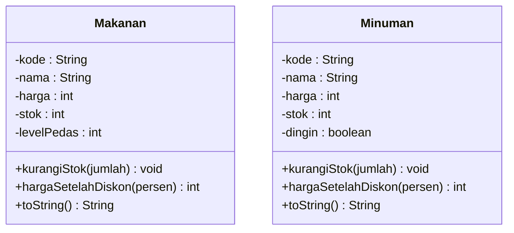
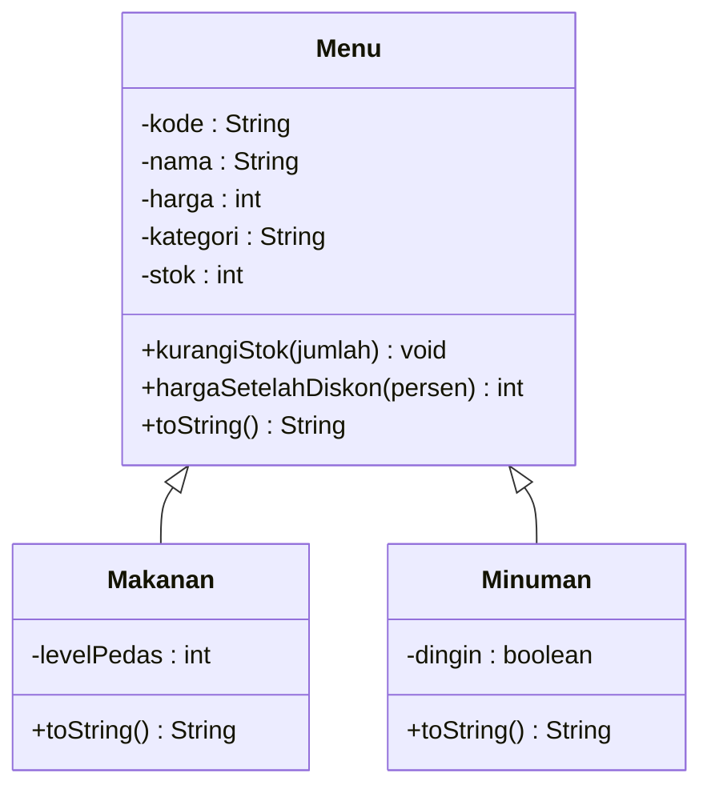
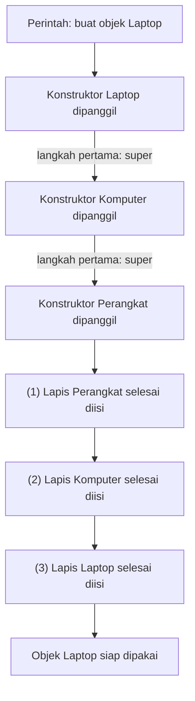
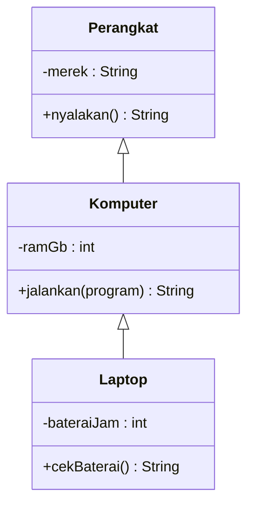
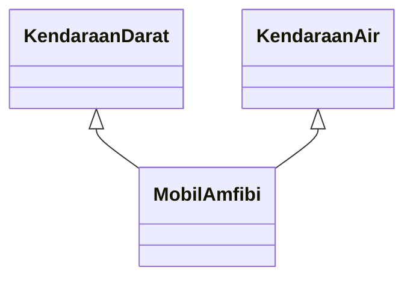
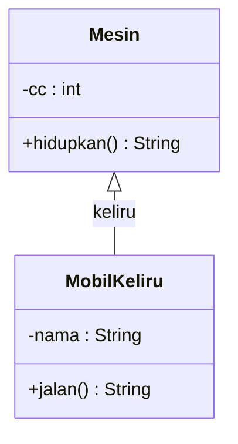
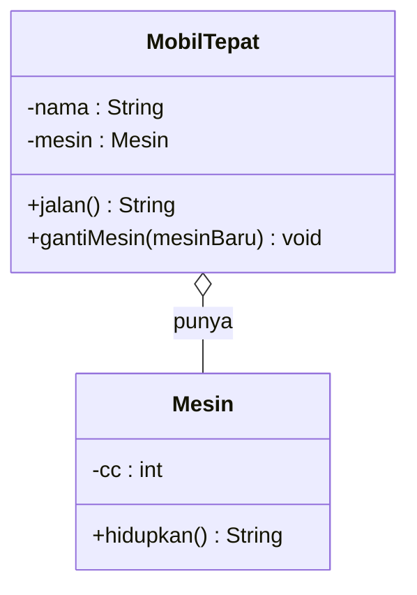
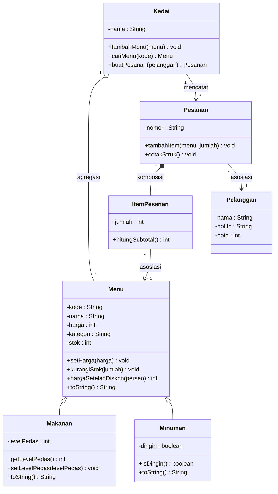

# Pertemuan 07: Pewarisan (*Inheritance*)

[⬅️ Pertemuan 06](../Pertemuan-06-UML-Class-Diagram/README.md) · [🏠 Beranda](../README.md) · [Pertemuan 08 ➡️](../Pertemuan-08-UTS/README.md)

> Hari ini kita mempelajari pilar kedua PBO: **pewarisan**. Dengan pewarisan, bagian yang sama dari beberapa kelas cukup ditulis **sekali** di sebuah kelas induk, lalu diturunkan ke kelas-kelas anaknya. Kode menjadi lebih ringkas dan lebih mudah dirawat, dan KedaiKita akhirnya bisa membedakan makanan dan minuman dengan rapi.

## 🎯 Tujuan Pembelajaran

Setelah pertemuan ini, kamu mampu:

1. Menjelaskan masalah duplikasi kode dan cara **generalisasi** menyelesaikannya.
2. Menentukan apakah hubungan dua kelas termasuk *is-a* (pewarisan) atau *has-a* (relasi biasa).
3. Membuat kelas anak yang memanggil konstruktor induk dengan `super`, lalu menambah atribut dan *method* baru.
4. Meng-*override* *method* induk sambil tetap memakai versi induknya.
5. Menjelaskan urutan berjalannya konstruktor pada pewarisan bertingkat.
6. Membedakan aturan pewarisan di Python dan Java: hak akses untuk kelas anak, kelas akar, pewarisan ganda, dan `final`.

## 🧭 Peta Belajar

| Langkah | Bagian | Perkiraan waktu |
|---|---|---|
| 1 | Konsep (halaman ini) | 45 menit |
| 2 | Praktik: [🐍 Python](python/README.md) **atau** [☕ Java](java/README.md) | 90 menit |
| 3 | [Jembatan Python ↔ Java](jembatan-python-java.md) | 15 menit |
| 4 | [Latihan](latihan.md) | 60 menit |
| 5 | [Kuis](kuis.md) | 15 menit |

## 🔁 Mengingat Kembali

- Di [Pertemuan 05](../Pertemuan-05-Relasi-Antarkelas/README.md), kita menghubungkan kelas lewat **asosiasi, agregasi, komposisi, dan dependensi**. Contohnya, `Kedai` menyimpan daftar `Menu` (agregasi) dan `Pesanan` menyusun `ItemPesanan` (komposisi). Semuanya adalah hubungan "**punya**" atau "**memakai**".
- Sejak Pertemuan 05 pula, KedaiKita terdiri atas beberapa *file* yang saling memakai.
- Di [Pertemuan 06](../Pertemuan-06-UML-Class-Diagram/README.md), kita mengenal notasi **generalisasi**: garis dengan **segitiga kosong** yang menunjuk ke kelas induk (di Mermaid ditulis `<|--`). Kita juga sudah menggambar rencana `Menu` dengan dua kelas anak, `Makanan` dan `Minuman`.
- Di [Pertemuan 03](../Pertemuan-03-Atribut-dan-Method/README.md), `__str__`/`toString()` disebut "menimpa *method* bawaan". Di [Pertemuan 04](../Pertemuan-04-Enkapsulasi/README.md), `protected` disebut sekilas. Hari ini keduanya dibahas tuntas.

Hari ini kita mempelajari jenis hubungan yang berbeda, yaitu hubungan "**adalah**".

## Daftar Isi

1. [Masalah: Makanan dan Minuman yang Kembar](#1-masalah-makanan-dan-minuman-yang-kembar)
2. [Generalisasi: Kelas Induk dan Kelas Anak](#2-generalisasi-kelas-induk-dan-kelas-anak)
3. [Relasi "Adalah" (*Is-a*)](#3-relasi-adalah-is-a)
4. [Apa Saja yang Diwariskan?](#4-apa-saja-yang-diwariskan)
5. [Konstruktor Anak dan `super`](#5-konstruktor-anak-dan-super)
6. [*Override*: Menimpa *Method* Induk](#6-override-menimpa-method-induk)
7. [Hak Akses untuk Kelas Anak](#7-hak-akses-untuk-kelas-anak)
8. [Pewarisan Bertingkat, Kelas Akar, dan Pewarisan Ganda](#8-pewarisan-bertingkat-kelas-akar-dan-pewarisan-ganda)
9. [Kapan TIDAK Memakai Pewarisan: *Is-a* vs *Has-a*](#9-kapan-tidak-memakai-pewarisan-is-a-vs-has-a)
10. [Studi Kasus KedaiKita: Makanan dan Minuman](#10-studi-kasus-kedaikita-makanan-dan-minuman)
11. [Miskonsepsi yang Sering Terjadi](#11-miskonsepsi-yang-sering-terjadi)

---

## 1. Masalah: Makanan dan Minuman yang Kembar

Sampai Pertemuan 06, semua menu KedaiKita dibuat dari satu kelas `Menu`. Jenisnya hanya dibedakan lewat teks kategori, `"Makanan"` atau `"Minuman"`.

Lalu pemilik KedaiKita datang dengan dua permintaan baru:

- Setiap **makanan** perlu keterangan **level pedas** (0 sampai 5).
- Setiap **minuman** perlu keterangan **dingin atau panas**.

Cara yang paling cepat terpikir: buat dua kelas terpisah, `Makanan` dan `Minuman`, lalu tulis keduanya selengkapnya.



Perhatikan kedua kotak itu. Hampir seluruh isinya **sama persis**. Hanya satu atribut yang berbeda di masing-masing kelas. Duplikasi seperti ini menimbulkan masalah nyata:

| Kejadian | Akibatnya jika kode ditulis kembar |
|---|---|
| Aturan harga berubah, misalnya harga minimal Rp1.000 | Harus diubah di **dua** tempat. Lupa satu, aturannya tidak konsisten |
| Ditemukan *bug* di cara mengurangi stok | Perbaikan harus dikerjakan dua kali |
| Pemilik ingin jenis baru, misalnya *snack* | Seluruh kode disalin untuk ketiga kalinya |
| Kedai ingin menyimpan semua menu dalam satu daftar | Bagi program, makanan dan minuman adalah dua jenis yang sama sekali tidak berhubungan |

> [!NOTE]
> Pemrogram punya semboyan untuk masalah ini: **DRY** (*Don't Repeat Yourself*), artinya "jangan mengulang dirimu sendiri". Setiap aturan sebaiknya ditulis di **satu** tempat saja.

## 2. Generalisasi: Kelas Induk dan Kelas Anak

Pikirkan kendaraan bermotor di jalanan Samarinda. Motor maupun mobil sama-sama punya merek, nomor polisi (misalnya KT 1234 AB), dan tahun pembuatan. Bedanya, mobil punya jumlah kursi, sedangkan motor punya jenis transmisi.

Kita tidak perlu menjelaskan "nomor polisi" dua kali. Cukup katakan: **motor dan mobil adalah kendaraan bermotor**. Semua yang dimiliki kendaraan bermotor otomatis dimiliki keduanya. Yang perlu dijelaskan hanya bagian khususnya.

Begitu pula KedaiKita. Bagian yang sama dari makanan dan minuman dikumpulkan ke satu kelas umum bernama `Menu`. Lalu `Makanan` dan `Minuman` cukup menulis bagian khususnya saja.

> **Pewarisan** (*inheritance*) adalah mekanisme ketika sebuah kelas **mewarisi** atribut dan *method* dari kelas lain, lalu boleh **menambah** atau **mengubah** sebagiannya.
>
> Kelas yang mewariskan disebut **kelas induk** (*superclass*). Kelas yang mewarisi disebut **kelas anak** (*subclass*).



Proses mengumpulkan bagian yang sama ke kelas induk disebut **generalisasi**. Arah sebaliknya, yaitu membuat kelas anak yang lebih khusus, disebut **spesialisasi**. Istilah lain yang sering kamu temui: *parent class* dan *child class*, atau *base class* dan *derived class*.

Sekilas, beginilah wujudnya di kedua bahasa (potongan kode, tidak untuk dijalankan sendiri). Detailnya ada di halaman praktik.

**Python:**

```python
class Makanan(Menu):        # Makanan mewarisi Menu
    ...
```

**Java:**

```java
class Makanan extends Menu {   // Makanan mewarisi Menu
    // ...
}
```

## 3. Relasi "Adalah" (*Is-a*)

Kapan sebuah kelas boleh menjadi anak kelas lain? Ujinya sederhana: ucapkan kalimat "**X adalah Y**". Jika kalimat itu benar untuk **setiap** X, pewarisan layak dipertimbangkan.

| Kalimat uji | Benar? | Kesimpulan |
|---|---|---|
| Makanan **adalah** Menu | ya | `Makanan` boleh menjadi anak `Menu` |
| Dosen **adalah** Pegawai | ya | `Dosen` boleh menjadi anak `Pegawai` |
| Laptop **adalah** Komputer | ya | `Laptop` boleh menjadi anak `Komputer` |
| Menu **adalah** Makanan | tidak | Arahnya terbalik: tidak semua menu adalah makanan |
| Mobil **adalah** Mesin | tidak | Mobil **punya** mesin (dibahas di bagian 9) |
| Pesanan **adalah** Pelanggan | tidak | Pesanan **milik** pelanggan (asosiasi, Pertemuan 05) |

Karena itulah pewarisan disebut relasi ***is-a*** ("adalah sebuah"). Hubungan ini membawa konsekuensi penting: **objek kelas anak juga terhitung sebagai objek kelas induk**. Segelas kopi susu adalah minuman, dan sekaligus adalah menu.

Program bisa menanyakannya secara langsung. Python memakai `isinstance(kopi, Menu)`, sedangkan Java memakai `kopi instanceof Menu`. Keduanya menjawab "ya" untuk objek kopi karena kopi adalah `Minuman`, dan `Minuman` adalah `Menu`.

Cara paling mudah membayangkannya: setiap kelas adalah sebuah **himpunan** objek. Himpunan kelas anak berada **di dalam** himpunan kelas induknya.

![Ilustrasi himpunan. Lingkaran besar Menu memuat dua lingkaran: Makanan, berisi objek nasi_goreng dan mie_goreng, serta Minuman, berisi objek kopi dan es_teh. Di sebelah kanan ada tanya jawab tentang objek kopi: kopi adalah Minuman? ya. Kopi adalah Menu? ya, karena Minuman ada di dalam Menu. Kopi adalah Makanan? tidak. Cara menanyakannya di kode: isinstance(kopi, Menu) di Python dan kopi instanceof Menu di Java. Catatan: arahnya hanya ke atas; setiap Minuman adalah Menu, tetapi tidak setiap Menu adalah Minuman.](gambar/himpunan-is-a.svg)

> [!WARNING]
> Di diagram kelas, segitiga kosong selalu menempel di sisi **kelas induk**. Panah pewarisan yang terbalik adalah kesalahan menggambar yang paling sering terjadi.

## 4. Apa Saja yang Diwariskan?

Bayangkan sebuah objek `Makanan` di memori. Objek itu **satu**, tetapi isinya terdiri atas dua lapis: lapis yang dirancang oleh `Menu` dan lapis tambahan milik `Makanan`.

```text
 Objek nasi (dibuat dari kelas Makanan)
 +------------------------------------------------------+
 | lapis Menu      kode       = "M03"                   |
 |                 nama       = "Nasi Goreng Kampung"   |
 |                 harga      = 25000                   |
 |                 kategori   = "Makanan"               |
 |                 stok       = 15                      |
 |------------------------------------------------------|
 | lapis Makanan   levelPedas = 2                       |
 +------------------------------------------------------+
```

Berikut rinciannya:

| Bagian milik induk | Diwariskan? | Catatan |
|---|---|---|
| Atribut | ya | Setiap objek anak ikut punya atribut induk. Atribut yang privat tetap **ada**, tetapi tidak bisa disentuh langsung oleh kelas anak (bagian 7) |
| *Method* | ya | Bisa dipakai apa adanya, atau ditimpa dengan versi baru (bagian 6) |
| Konstruktor | berbeda | Python: `__init__` milik induk ikut dipakai jika anak tidak menulis `__init__` sendiri. Java: konstruktor **tidak** diwariskan (bagian 5) |

Selain mewarisi, kelas anak boleh **menambah** apa saja: atribut baru (misalnya level pedas) dan *method* baru. Pewarisan tidak membatasi anak. Pewarisan hanya memberi anak "modal awal".

> [!TIP]
> **Coba sendiri:** daftar atribut dan *method* apa saja yang dimiliki objek `Minuman`. Jangan lupa menghitung milik `Menu`!

<details>
<summary>Lihat jawaban</summary>

Atribut: `kode`, `nama`, `harga`, `kategori`, `stok` (warisan `Menu`) ditambah `dingin` (milik sendiri). *Method*: semua *method* `Menu`, misalnya `kurangiStok` dan `hargaSetelahDiskon`, ditambah *method* baru untuk membaca `dingin`. *Method* teks objek (`toString`/`__str__`) ditimpa dengan versi milik `Minuman`.

</details>

## 5. Konstruktor Anak dan `super`

Lihat lagi gambar objek dua lapis di bagian 4. Siapa yang sebaiknya mengisi lapis `Menu`? Tentu saja `Menu` sendiri. Konstruktor `Menu` sudah tahu cara mengisi kode, nama, dan harga, termasuk memeriksa bahwa harga lebih dari 0. Kelas anak tidak perlu, dan sebaiknya tidak, mengulang pekerjaan itu.

Analoginya seperti membangun ruko dua lantai. Tukang lantai dua tidak mengecor fondasi sendiri. Ia menunggu lantai dasar selesai dikerjakan oleh tim yang ahli, baru membangun di atasnya.

> **`super`** adalah cara merujuk ke **kelas induk** dari dalam kelas anak. Konstruktor anak memakai `super` untuk meminta konstruktor induk mengisi lapis induk lebih dulu.

Di Java, `super` adalah kata kunci. Di Python, `super()` adalah fungsi bawaan, jadi selalu ditulis dengan tanda kurung. Berikut versi ringkas konstruktor `Makanan` dari studi kasus KedaiKita (potongan kode, tidak untuk dijalankan sendiri):

**Python:**

```python
class Makanan(Menu):
    def __init__(self, kode, nama, harga, stok, level_pedas):
        super().__init__(kode, nama, harga, "Makanan", stok)  # lapis Menu
        self.level_pedas = level_pedas                          # lapis Makanan
```

**Java:**

```java
class Makanan extends Menu {
    public Makanan(String kode, String nama, int harga, int stok, int levelPedas) {
        super(kode, nama, harga, "Makanan", stok);   // lapis Menu
        setLevelPedas(levelPedas);                    // lapis Makanan
    }
}
```

Perhatikan bahwa kategori `"Makanan"` diisi otomatis oleh konstruktor anak. Pemakai kelas `Makanan` tidak perlu, dan tidak bisa, salah menulis kategori.

### Urutan eksekusi: induk dulu, baru anak

Pada pewarisan bertingkat, misalnya `Perangkat` → `Komputer` → `Laptop`, urutannya terlihat seperti ini:



Yang **dipanggil** pertama memang konstruktor anak. Namun, yang **selesai** pertama adalah lapis paling atas, yaitu induk tertinggi. Di halaman praktik, kamu akan melihat buktinya lewat pesan yang dicetak setiap konstruktor.

> [!IMPORTANT]
> - **Java:** di Java 17 dan 21, `super(...)` wajib menjadi **pernyataan pertama** di konstruktor anak. Jika tidak ditulis, Java diam-diam memanggil `super()` tanpa argumen. Hal yang sama terjadi jika kelas anak tidak menulis konstruktor sama sekali: Java membuatkan konstruktor kosong yang isinya hanya `super()`. Akibatnya, kompilasi gagal jika induk tidak punya konstruktor tanpa parameter.
> - **Python:** tidak ada pemeriksaan otomatis. Jika `super().__init__(...)` lupa ditulis, atribut induk tidak pernah dibuat, dan program baru gagal saat atribut itu dipakai. Biasakan menulisnya di **baris pertama** `__init__`.

Java 25 sedikit melonggarkan aturan "pernyataan pertama" tadi (lihat [Jembatan](jembatan-python-java.md#2-super__init__-dan-super)). Agar berjalan di semua versi, materi ini tetap menulis `super(...)` di baris pertama.

## 6. *Override*: Menimpa *Method* Induk

Di sebuah kampus, aturan umumnya: semua pegawai pulang pukul 16.00. Satpam jaga malam punya aturan sendiri yang **menggantikan** aturan umum itu, khusus untuk dirinya. Aturan untuk pegawai lain tidak berubah.

Kelas anak juga bisa melakukannya terhadap *method* milik induk.

> ***Override*** (menimpa) adalah menulis ulang *method* milik kelas induk di kelas anak, dengan **nama dan parameter yang sama**, sehingga objek kelas anak memakai versi barunya.

Ada dua gaya *override*:

1. **Mengganti total.** Versi anak sama sekali tidak memakai versi induk.
2. **Memperluas.** Versi anak memanggil versi induk lewat `super`, lalu menambahkan sesuatu. Gaya ini paling sering dipakai karena aturan induk tidak perlu ditulis ulang.

KedaiKita memakai gaya kedua untuk teks menu:

```text
versi Menu    : [M03] Nasi Goreng Kampung (Makanan) - Rp25.000 | stok 15
versi Makanan : [M03] Nasi Goreng Kampung (Makanan) - Rp25.000 | stok 15 | pedas level 2
                \____________ hasil versi induk (lewat super) _________/ \__ tambahan _/
```

Aturan *override* di kedua bahasa:

| Aturan | Python | Java |
|---|---|---|
| Nama *method* | harus sama persis (beda nama = *method* baru) | harus sama persis |
| Parameter | sebaiknya sama (Python tidak memeriksa) | wajib sama jumlah, tipe, dan urutannya |
| Tipe kembalian | sebaiknya sama (tidak diperiksa) | sama dengan induk (untuk tipe objek, boleh kelas turunannya) |
| Penanda | tidak ada | anotasi `@Override` (selalu tulis!) |
| Hak akses | tidak berlaku | tidak boleh lebih sempit, misalnya `public` tetap `public` |
| Memanggil versi induk | `super().nama_method()` | `super.namaMethod()` |

Saat program mencetak sebuah objek `Makanan`, versi yang dipakai adalah milik `Makanan` karena objeknya memang makanan. Ini tetap berlaku walaupun objek itu disimpan di daftar menu kedai bersama minuman. Mekanisme "memilih versi milik objek sebenarnya" ini disebut **polimorfisme**, dan dibahas tuntas di Pertemuan 09.

> [!WARNING]
> Jangan tertukar antara ***override*** dan ***overload***. *Override* = nama **dan** parameter sama, berada di kelas anak, untuk **mengganti** versi induk. *Overload* (khusus Java, Pertemuan 03) = nama sama, tetapi parameter **berbeda**, untuk **menambah** variasi *method*.

## 7. Hak Akses untuk Kelas Anak

Di Pertemuan 04, kamu sudah melihat tabel empat tingkat akses Java. Kolom "kelas anak" di tabel itu sekarang mulai bermakna.

| *Access modifier* | Kelas itu sendiri | Kelas lain di paket yang sama | Kelas anak di paket lain | Kelas lain di paket lain |
|---|---|---|---|---|
| `public` | boleh | boleh | boleh | boleh |
| `protected` | boleh | boleh | boleh | tidak |
| *default* (tanpa kata kunci) | boleh | boleh | tidak | tidak |
| `private` | boleh | tidak | tidak | tidak |

Dua hal penting dari tabel ini:

- **`private` tidak terbuka untuk kelas anak.** Atributnya tetap ada di objek anak, tetapi kelas anak harus memakai *getter* atau *setter* induk. Ibarat brankas warisan orang tua: isinya milikmu, tetapi kuncinya tetap dipegang orang tua.
- **`protected` bukan hanya untuk kelas anak.** Semua kelas di paket yang sama juga boleh mengaksesnya. Jebakan ini sering terlupa.

Python tidak punya kata kunci hak akses. Pemrogram Python memakai kesepakatan nama:

| Penulisan | Arti di Python |
|---|---|
| `nama` | untuk umum |
| `_nama` | "internal": untuk kelas itu **dan kelas-kelas anaknya**. Kelas anak boleh memakainya langsung |
| `__nama` | memicu *name mangling*: namanya diubah menjadi `_Kelas__nama`. Akibatnya, kelas anak yang menulis `self.__nama` justru **gagal** menemukannya |

> [!TIP]
> Pilihan aman di kedua bahasa: buat atribut yang tertutup (`private` di Java, `_nama` + `@property` di Python), lalu sediakan *method* resmi yang juga dipakai kelas anak. Pakai `protected` (Java) atau sentuh langsung `_nama` milik induk (Python) hanya jika kelas anak benar-benar perlu. KedaiKita mengikuti pola ini: `Makanan` tidak pernah menyentuh atribut `Menu` secara langsung. Untuk membuat teks, `Makanan` cukup memanggil versi induk lewat `super`.

## 8. Pewarisan Bertingkat, Kelas Akar, dan Pewarisan Ganda

### Pewarisan bertingkat (*multilevel*)

Kelas anak bisa menjadi induk bagi kelas lain. Hasilnya adalah rantai pewarisan. `Laptop` mewarisi semua milik `Komputer`, termasuk apa yang `Komputer` warisi dari `Perangkat`.



Usahakan rantai pewarisan tetap pendek, cukup dua atau tiga tingkat. Rantai yang terlalu panjang membuat kita harus membuka banyak *file* hanya untuk memahami satu kelas.

### Kelas akar: `object` dan `Object`

Bagaimana dengan kelas yang tidak menulis induk sama sekali, seperti `Pelanggan`? Ternyata kelas itu tetap punya induk. Setiap kelas otomatis mewarisi sebuah **kelas akar**: `object` di Python dan `Object` di Java.

Dari kelas akar itulah setiap objek mendapat perilaku bawaan, misalnya:

- **Teks bawaan objek.** Wujudnya kurang ramah, seperti `<__main__.Gitar object at 0x7f3a...>` di Python atau `Gitar@1b6d3586` di Java. Jadi, saat menulis `__str__`/`toString()` sejak Pertemuan 03, sebenarnya kita sedang meng-*override* *method* milik kelas akar.
- **Pemeriksaan kesamaan bawaan.** Secara bawaan, dua objek dianggap sama hanya jika keduanya **objek yang sama persis**, bukan karena isinya sama. Cara mengubah aturan ini dibahas di Pertemuan 12.

### Pewarisan ganda (*multiple inheritance*)

Bolehkah satu kelas punya **dua induk**? Misalnya mobil amfibi, yang adalah kendaraan darat **sekaligus** kendaraan air.



- **Python mengizinkannya.** Jika kedua induk punya *method* bernama sama, Python mencari mengikuti urutan tertentu yang disebut **MRO** (*Method Resolution Order*). Secara sederhana: kelas itu sendiri diperiksa dulu, lalu induk yang ditulis paling kiri, lalu induk berikutnya. Urutannya bisa dilihat dengan `NamaKelas.__mro__`.
- **Java tidak mengizinkannya.** Sebuah kelas Java hanya boleh punya **satu** induk. Alasannya, untuk menghindari kebingungan saat dua induk punya *method* bernama sama. Untuk menggabungkan beberapa "kemampuan", Java memakai *interface*, yang dibahas di Pertemuan 10.

### `final` di Java (sekilas)

Java punya kata kunci `final` untuk **mengunci** pewarisan:

- `final class` tidak bisa diwarisi. Contoh terkenalnya adalah kelas `String` milik Java sendiri.
- *Method* `final` tidak bisa di-*override* oleh kelas anak.

KedaiKita versi Java memakai *method* `final` pada `Menu.setHarga()` dan `Makanan.setLevelPedas()`. Alasannya berkaitan dengan urutan konstruktor di bagian 5. Konstruktor `Menu` memanggil `setHarga()`. Andaikan suatu kelas anak meng-*override* `setHarga()`, versi anak itu akan berjalan **ketika lapis anak belum selesai diisi** sehingga bisa membaca data yang masih kosong.

Dengan `final`, *method* itu dijamin tidak diganti, jadi aman dipanggil dari konstruktor. *Compiler* Java versi baru (JDK 21 ke atas) bahkan memberi peringatan untuk situasi ini jika diminta memeriksa dengan teliti lewat opsi `-Xlint`. Contohnya ada di halaman praktik Java.

Python tidak punya kata kunci yang setara. Di Python, pembatasan seperti ini umumnya cukup lewat kesepakatan dan dokumentasi.

## 9. Kapan TIDAK Memakai Pewarisan: *Is-a* vs *Has-a*

Pewarisan memang menggoda. Begitu melihat kelas lain punya *method* yang kita butuhkan, rasanya ingin langsung mewarisinya. Inilah jebakan desain yang paling sering terjadi.

Misalnya, kelas `Mobil` butuh *method* `hidupkan()`, yang kebetulan sudah ada di kelas `Mesin`. Lalu ada yang menulis `MobilKeliru` sebagai anak `Mesin`.



Kodenya memang berjalan, tetapi rancangannya bermasalah:

- Kalimat "mobil **adalah** mesin" jelas salah. Program akan menjawab "ya" jika ditanya apakah mobil itu sebuah mesin.
- Mesin mobil tidak bisa diganti karena mesinnya adalah mobil itu sendiri.
- Semua *method* `Mesin` ikut menjadi *method* mobil, termasuk yang tidak masuk akal untuk mobil.

Rancangan yang tepat: mobil **punya** mesin. Mesin disimpan sebagai atribut, persis seperti relasi di Pertemuan 05.



| | *is-a* (pewarisan) | *has-a* (relasi Pertemuan 05) |
|---|---|---|
| Kalimat uji | "X **adalah** Y" | "X **punya** Y" |
| Contoh | Makanan adalah Menu | Pesanan punya ItemPesanan |
| Wujud di kode | kelas anak menyebut induknya | atribut berisi objek lain |
| Bisa berubah saat program berjalan? | tidak, tetap seumur hidup objek | bisa, misalnya mesin diganti |
| Simbol di diagram kelas | segitiga kosong | garis, panah, atau belah ketupat |

Para perancang perangkat lunak punya prinsip terkenal: ***composition over inheritance***, yaitu "utamakan komposisi daripada pewarisan". Maksudnya bukan "jangan pernah mewarisi", melainkan "warisi hanya jika hubungannya benar-benar *is-a*". Gagasan ini akan kamu temui lagi di Pertemuan 13 (kelas anak harus benar-benar bisa menggantikan induknya) dan Pertemuan 14 (pola *Strategy*, yang menyimpan bagian yang bisa ditukar sebagai atribut).

Sebelum menulis pewarisan, ajukan tiga pertanyaan berikut:

1. Apakah kalimat "X **adalah** Y" benar untuk **setiap** objek X?
2. Apakah **semua** *method* Y masuk akal dimiliki X?
3. Apakah X tetap menjadi Y selama program berjalan, tanpa perlu berganti?

Jika salah satu jawabannya "tidak", pilih *has-a*.

## 10. Studi Kasus KedaiKita: Makanan dan Minuman

Saatnya menerapkan semua itu ke KedaiKita. Berikut diagram kelas KedaiKita versi Pertemuan 07. Bagian yang baru hanya `Makanan`, `Minuman`, dan dua garis pewarisan.



> [!NOTE]
> Diagram ini diringkas dan memakai gaya nama Java (*camelCase*). Di Python, `setLevelPedas` berpadanan dengan *setter* `level_pedas`, `isDingin` dengan *property* `dingin`, dan `toString` dengan `__str__`.

**Yang berubah:**

- `Menu` kini menjadi **kelas induk** yang berisi semua data dan perilaku milik setiap menu.
- `Makanan` menambah **level pedas** 0 sampai 5. Nilai di luar rentang itu ditolak.
- `Minuman` menambah keterangan **dingin atau panas**.
- Kategori diisi otomatis oleh konstruktor anak, lalu teks menu di-*override* agar keterangan tambahannya ikut tampil.

**Yang TIDAK berubah:** `Pesanan`, `ItemPesanan`, `Kedai`, dan `Pelanggan` tidak disentuh sama sekali. Kelas-kelas itu bekerja dengan `Menu`. Karena makanan **adalah** menu dan minuman **adalah** menu, semuanya langsung bisa dipakai. Inilah keuntungan besar pewarisan.

**Skenario program:**

1. Kedai dibuka dengan lima menu: dua minuman dan tiga makanan.
2. Program memeriksa hubungan *is-a*: kopi termasuk `Minuman` dan termasuk `Menu`, tetapi nasi goreng bukan `Minuman`.
3. Kopi memakai `hargaSetelahDiskon()`, *method* warisan dari `Menu`.
4. Menu baru Kopi Tubruk (panas) ditambahkan. Seblak dengan level pedas 9 ditolak.
5. Budi dan Siti memesan, struk dicetak, dan stok berkurang seperti biasa.

**Hasil yang diharapkan** (potongan awal, sama persis untuk Python dan Java):

```text
=== MENU KedaiKita ===
[M01] Kopi Susu Gula Aren (Minuman) - Rp18.000 | stok 20 | dingin
[M02] Es Teh Manis (Minuman) - Rp8.000 | stok 30 | dingin
[M03] Nasi Goreng Kampung (Makanan) - Rp25.000 | stok 15 | pedas level 2
[M04] Mie Goreng Jawa (Makanan) - Rp23.000 | stok 10 | pedas level 1
[M05] Pisang Goreng Keju (Makanan) - Rp15.000 | stok 12 | pedas level 0

=== CEK PEWARISAN ===
Kopi Susu Gula Aren termasuk Minuman? ya
Kopi Susu Gula Aren termasuk Menu? ya
Nasi Goreng Kampung termasuk Minuman? tidak
Kategori Nasi Goreng Kampung: Makanan
Diskon 10% untuk Kopi Susu Gula Aren (method warisan Menu): Rp16.200

=== MENAMBAH MENU BARU ===
Ditambahkan: [M06] Kopi Tubruk (Minuman) - Rp12.000 | stok 25 | panas
Gagal menambah menu: Level pedas harus 0 sampai 5
```

Kode lengkap dan seluruh *output*-nya dibahas di halaman praktik: [🐍 Python](python/README.md#9-studi-kasus-kedaikita) atau [☕ Java](java/README.md#9-studi-kasus-kedaikita).

## 11. Miskonsepsi yang Sering Terjadi

Enam anggapan keliru berikut paling sering muncul saat pertama kali belajar pewarisan. Cocokkan dengan pemahamanmu sendiri.

1. **Keliru:** "Kalau dua kelas punya kode yang mirip, salah satunya harus mewarisi yang lain."

   **Yang benar:** pewarisan hanya tepat untuk hubungan *is-a*. Untuk hubungan "punya", pakai atribut (*has-a*). Kemiripan kode saja bukan alasan.

2. **Keliru:** "Kelas anak itu seperti anak manusia: keturunan dari induknya."

   **Yang benar:** istilah "induk" dan "anak" memang dipinjam dari keluarga, tetapi hubungannya berbeda. Seorang anak **bukan** jenis dari ayahnya. Sebaliknya, `Makanan` adalah **jenis dari** `Menu`. Pegang kalimat "anak **adalah** induk".

3. **Keliru:** "Kelas anak bisa langsung memakai semua atribut induk."

   **Yang benar:** hanya yang tidak privat. Atribut `private` (Java) tetap ada di objek anak, tetapi harus diakses lewat *method* induk. Di Python, `__nama` bahkan berganti nama sehingga tidak ditemukan dari kelas anak.

4. **Keliru:** "Konstruktor induk akan berjalan sendiri, jadi tidak perlu ditulis."

   **Yang benar:** di Java, yang berjalan otomatis hanya `super()` tanpa argumen, dan kompilasi gagal jika induk tidak punya konstruktor tanpa parameter. Di Python, konstruktor induk tidak berjalan sama sekali jika anak punya `__init__` sendiri tanpa `super().__init__(...)`.

5. **Keliru:** "Objek induk juga termasuk kelas anak."

   **Yang benar:** arahnya hanya ke atas. Setiap makanan adalah menu, tetapi tidak setiap menu adalah makanan.

6. **Keliru:** "*Override* dan *overload* itu sama saja."

   **Yang benar:** *override* mengganti *method* induk dengan nama dan parameter yang sama. *Overload* membuat variasi *method* dengan parameter berbeda.

## 📝 Ringkasan

- Pewarisan menghilangkan **duplikasi**: bagian yang sama ditulis sekali di **kelas induk** (generalisasi), lalu **kelas anak** hanya menulis bagian khususnya (spesialisasi).
- Pewarisan adalah relasi ***is-a***. Ujinya adalah kalimat "X adalah Y". Objek anak juga terhitung sebagai objek induk, dan bisa diperiksa dengan `isinstance`/`instanceof`.
- Kelas anak mewarisi atribut dan *method* induk, lalu boleh menambah yang baru. Atribut privat tetap ada, tetapi tidak bisa disentuh langsung.
- Konstruktor anak memanggil konstruktor induk dengan `super`. Lapis induk selalu **selesai lebih dulu**. Di Java 17 dan 21, `super(...)` wajib menjadi pernyataan pertama.
- ***Override*** menimpa *method* induk dengan nama dan parameter yang sama. Versi induk tetap bisa dipakai lewat `super`. Java memakai `@Override` dan melarang hak akses yang lebih sempit.
- Java `protected` terbuka untuk kelas anak **dan** satu paket. Python memakai kesepakatan `_nama` untuk "internal kelas dan anaknya".
- Pewarisan bisa bertingkat. Semua kelas berakar pada `object`/`Object`. Python mengizinkan pewarisan ganda (dengan MRO), Java hanya satu induk. Java punya `final` untuk mengunci kelas atau *method*.
- Untuk hubungan "punya", pakai ***has-a***. Prinsipnya: *composition over inheritance*.

## 📖 Istilah Penting

| Istilah | Arti singkat |
|---|---|
| Pewarisan (*inheritance*) | Mekanisme kelas mewarisi atribut dan *method* dari kelas lain |
| Kelas induk (*superclass*) | Kelas yang mewariskan, berisi bagian umum |
| Kelas anak (*subclass*) | Kelas yang mewarisi, berisi bagian khusus |
| Generalisasi / spesialisasi | Mengumpulkan bagian sama ke induk / membuat anak yang lebih khusus |
| *is-a* | Relasi "adalah", ciri pewarisan |
| *has-a* | Relasi "punya", diwujudkan dengan atribut |
| `super` | Cara merujuk ke kelas induk dari dalam kelas anak (Java: kata kunci; Python: fungsi bawaan `super()`) |
| *Override* | Menimpa *method* induk dengan nama dan parameter yang sama |
| `@Override` | Anotasi Java yang meminta *compiler* memeriksa *override* |
| `protected` | Hak akses Java: kelas itu, kelas anak, dan satu paket |
| Pewarisan bertingkat (*multilevel*) | Rantai induk, anak, cucu, dan seterusnya |
| Kelas akar | `object` (Python) / `Object` (Java), induk dari semua kelas |
| Pewarisan ganda (*multiple inheritance*) | Satu kelas punya lebih dari satu induk (Python boleh, Java tidak) |
| MRO | *Method Resolution Order*, urutan Python mencari *method* |
| `final` | Kata kunci Java untuk mengunci kelas atau *method* dari pewarisan |

## ➡️ Langkah Berikutnya

Pilih jalur praktikmu: [🐍 Praktik Python](python/README.md) atau [☕ Praktik Java](java/README.md).

---

[⬅️ Pertemuan 06](../Pertemuan-06-UML-Class-Diagram/README.md) · [🏠 Beranda](../README.md) · [Pertemuan 08 ➡️](../Pertemuan-08-UTS/README.md)
