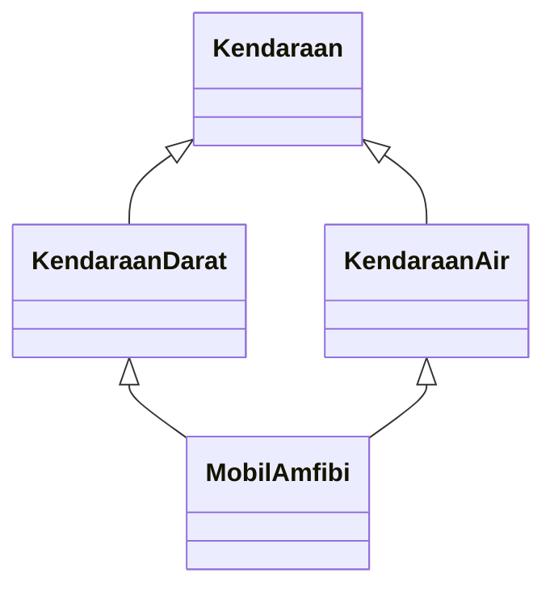

# 🌉 Jembatan Python ↔ Java Pertemuan 07: Pewarisan

[⬅️ Konsep](README.md) · [🐍 Python](python/README.md) · [☕ Java](java/README.md) · [Latihan ➡️](latihan.md)

Konsep pewarisan **sama** di Python dan Java: ada kelas induk dan kelas anak, ada `super`, ada *override*, dan semuanya berakar pada satu kelas akar. Yang berbeda adalah **cara menuliskannya** dan **seberapa ketat** bahasa itu memeriksa. Halaman ini membantumu membaca kode pewarisan di kedua bahasa, dan menjelaskan **mengapa** perbedaan itu ada.

Potongan kode di halaman ini hanya untuk dibandingkan, tidak untuk dijalankan sendiri. Versi lengkapnya ada di folder `contoh/` masing-masing bahasa.

## Tabel Perbandingan Cepat

| Konsep | Python | Java |
|---|---|---|
| Menulis kelas anak | `class Makanan(Menu):` | `class Makanan extends Menu { ... }` |
| Memanggil konstruktor induk | `super().__init__(...)` | `super(...);` |
| Posisi panggilan konstruktor induk | bebas, tetapi biasakan di baris pertama | wajib pernyataan pertama (Java 17 dan 21) |
| Jika lupa memanggil konstruktor induk | atribut induk tidak dibuat, `AttributeError` muncul belakangan | Java menyisipkan `super()`, kompilasi gagal jika induk tidak punya konstruktor tanpa parameter |
| Konstruktor ikut diwariskan? | ya, `__init__` adalah *method* biasa | tidak |
| Memanggil versi induk sebuah *method* | `super().info()` | `super.info()` |
| Penanda *override* | tidak ada | `@Override` |
| Salah ketik nama saat *override* | diam saja, menjadi *method* baru | *error* kompilasi (jika memakai `@Override`) |
| Hak akses saat *override* | tidak ada aturan | tidak boleh lebih sempit |
| Atribut yang boleh dipakai kelas anak | kesepakatan `_nama` | `protected` (juga terbuka untuk satu paket) |
| Atribut yang tertutup bagi kelas anak | `__nama` (*name mangling*) | `private` |
| Kelas akar | `object` | `Object` |
| Teks objek bawaan yang di-*override* | `__str__` | `toString()` |
| Cek objek termasuk sebuah kelas | `isinstance(kopi, Menu)` | `kopi instanceof Menu` |
| Cek kelas turunan | `issubclass(Gitar, AlatMusik)` | `AlatMusik.class.isAssignableFrom(Gitar.class)` (jarang dipakai) |
| Lebih dari satu induk | boleh, urutan pencarian mengikuti MRO | tidak boleh; satu induk + *interface* (Pertemuan 10) |
| Mengunci kelas atau *method* | tidak ada kata kunci | `final` |

## 1. Konstruktor: Diwariskan di Python, Tidak di Java

Kelas `Kendaraan` di kedua potongan ini sama seperti di contoh 02: konstruktornya menerima merek, plat nomor, dan tahun.

**Python:**

```python
class Truk(Kendaraan):
    pass


truk = Truk("Hino Dutro", "KT 9012 EF", 2015)  # berhasil: memakai __init__ milik Kendaraan
```

**Java:**

```java
class Truk extends Kendaraan {
}
// kompilasi gagal: constructor Kendaraan in class Kendaraan cannot be applied to given types
```

**Mengapa berbeda?** Di Python, `__init__` hanyalah *method* dengan nama khusus. Seperti *method* lain, ia dicari di kelas itu dulu, lalu di induknya. Di Java, konstruktor **bukan** anggota yang diwariskan. Setiap kelas wajib menentukan sendiri cara objeknya dibuat. Jika kelas tidak menulis konstruktor, Java memberinya konstruktor bawaan yang hanya memanggil `super()` tanpa argumen. Karena `Kendaraan` hanya punya konstruktor tiga parameter, panggilan itu gagal.

Akibatnya, kelas anak di Java sering punya konstruktor yang isinya hanya meneruskan data, misalnya `public Gitar(String nama) { super(nama); }`.

## 2. `super().__init__(...)` dan `super(...)`

**Python:**

```python
class Komputer(Perangkat):
    def __init__(self, merek: str, ram_gb: int):
        super().__init__(merek)
        self._ram_gb = ram_gb
```

**Java:**

```java
class Komputer extends Perangkat {
    private int ramGb;

    public Komputer(String merek, int ramGb) {
        super(merek);
        this.ramGb = ramGb;
    }
}
```

Bentuknya mirip, tetapi cara kerjanya berbeda:

| | Python | Java |
|---|---|---|
| Wujud `super` | dipanggil seperti fungsi, `super()`, dan menghasilkan "jembatan" ke kelas induk | kata kunci khusus |
| Memanggil konstruktor induk | `super().__init__(merek)` | `super(merek);` |
| Memanggil *method* induk | `super().info()`, selalu dengan kurung setelah `super` | `super.info()`, tanpa kurung setelah `super` |
| Boleh di tengah konstruktor? | boleh, tetapi berisiko | tidak (Java 17 dan 21) |

**Mengapa Java mewajibkan `super(...)` di baris pertama?** Agar lapis induk **dijamin** sudah siap sebelum kelas anak memakainya. Python menyerahkan tanggung jawab itu kepada pemrogram. Jika `super().__init__()` ditulis di akhir, baris-baris sebelumnya berjalan saat atribut induk belum ada.

> [!NOTE]
> Java 25 melonggarkan aturan ini. Pernyataan yang tidak memakai objek yang sedang dibuat, misalnya memeriksa nilai parameter atau mengisi *field* milik kelas itu sendiri, boleh ditulis sebelum `super(...)`. Namun, *method* milik objek itu tetap belum boleh dipanggil sebelum `super(...)`. Mata kuliah ini berpatokan pada Java 17, dan menulis `super(...)` di baris pertama tetap aman di semua versi.

## 3. *Override*: Dipercaya atau Diperiksa?

**Python:**

```python
class TiketVIP(Tiket):
    def info(self) -> str:
        return f"{super().info()} | VIP: {self._fasilitas}"
```

**Java:**

```java
class TiketVIP extends Tiket {
    @Override
    public String info() {
        return super.info() + " | VIP: " + fasilitas;
    }
}
```

Python **memercayai** pemrogram. *Method* bernama sama di kelas anak otomatis menimpa versi induk, tanpa pemeriksaan apa pun. Salah ketik satu huruf membuat *method* baru, dan versi induk diam-diam tetap berjalan.

Java **memeriksa**. Dengan `@Override`, *compiler* memastikan bahwa *method* itu benar-benar menimpa *method* induk, yaitu nama dan parameternya cocok. Aturan lain, yaitu tipe kembalian yang sama dan hak akses yang tidak lebih sempit, selalu diperiksa untuk setiap *override*, dengan atau tanpa `@Override`.

> [!NOTE]
> Sejak Python 3.12, modul `typing` punya dekorator `@override`. Namun, yang memeriksanya adalah alat pemeriksa tipe seperti mypy, bukan Python saat program berjalan. Kode mata kuliah ini harus tetap berjalan di Python 3.10, jadi kita tidak memakainya.

## 4. `protected` dan `_nama`

| | Python | Java |
|---|---|---|
| Untuk kelas anak | `self._saldo` (kesepakatan) | `protected int saldo;` (dijaga *compiler*) |
| Bisa dibaca kode lain di luar keluarga kelas? | bisa, tetapi melanggar kesepakatan | bisa jika satu paket |
| Tertutup bagi kelas anak | `self.__saldo`, namanya berubah menjadi `_RekeningBank__saldo` | `private int saldo;` |

Keduanya sama-sama **tidak benar-benar rahasia**. Python hanya mengandalkan kesepakatan nama. `protected` di Java memang dijaga *compiler*, tetapi terbuka untuk seluruh paket. Saran untuk kedua bahasa sama: buat atribut privat, lalu sediakan *method* resmi. Pakai `_nama`/`protected` hanya jika kelas anak benar-benar perlu akses langsung.

## 5. Satu Induk atau Banyak Induk?

**Python** mengizinkan `class MobilAmfibi(KendaraanDarat, KendaraanAir):`. Jika kedua induk punya *method* bernama sama, Python memakai **MRO**. Secara sederhana, urutannya adalah kelas itu sendiri, lalu induk dari kiri ke kanan, dan terakhir `object`. Daftar lengkapnya bisa dilihat dengan `MobilAmfibi.__mro__`.

**Java** menolak `class MobilAmfibi extends KendaraanDarat, KendaraanAir` dengan *error* `'{' expected`.

**Mengapa Java melarangnya?** Bayangkan dua induk sama-sama punya *method* `info()` dengan isi berbeda. Versi mana yang diwarisi? Kebingungan ini makin rumit jika kedua induk itu ternyata punya induk yang sama sehingga diagram kelasnya berbentuk belah ketupat. Karena itu, masalahnya terkenal dengan nama ***diamond problem***.



Di Python, belah ketupat seperti ini selalu ada karena kedua induk sama-sama berakar pada `object`. Python menjawabnya dengan aturan MRO tadi.

Para perancang Java memilih menghindarinya sama sekali. Sebagai gantinya, sebuah kelas Java boleh `extends` **satu** kelas sambil menerapkan **banyak** *interface* (Pertemuan 10). Pilihan lain di kedua bahasa adalah *has-a*.

## 6. `final`

| | Python | Java |
|---|---|---|
| Kelas tidak boleh diwarisi | tidak ada kata kunci | `final class ...` (contoh: `String`) |
| *Method* tidak boleh di-*override* | tidak ada kata kunci | `public final void setHarga(int harga)` |

KedaiKita versi Java memberi `final` pada `setHarga()` dan `setLevelPedas()`. Keduanya dipanggil dari konstruktor. Jika kelas anak boleh menimpanya, versi anak bisa berjalan saat lapis anak belum selesai diisi. JDK 21 ke atas memperingatkan hal ini (`[this-escape]`) jika diminta dengan `-Xlint`.

Python tidak punya peringatan semacam itu. Versi Python KedaiKita memakai *setter* yang sama di dalam `__init__`, dan cukup mengandalkan kesepakatan agar kelas anak tidak menimpanya sembarangan. (Python memang punya dekorator `typing.final`, tetapi sama seperti `@override`, yang memeriksanya hanya alat pemeriksa tipe, bukan Python saat program berjalan.)

## Yang Sama di Kedua Bahasa

- Pewarisan adalah relasi ***is-a***. Ujinya sama: "X adalah Y".
- Kelas anak mewarisi atribut dan *method* induk, lalu boleh menambah dan meng-*override*.
- Versi induk dipanggil lewat `super` sehingga aturan induk tidak perlu ditulis ulang.
- Jika konstruktor induk dipanggil di awal, lapis induk selalu selesai lebih dulu.
- Semua kelas berakar pada kelas akar (`object`/`Object`), sumber teks objek dan kesamaan bawaan.
- `isinstance` dan `instanceof` sama-sama memperhitungkan pewarisan: objek anak juga terhitung objek induk.
- Untuk hubungan "punya", keduanya memakai atribut (*has-a*), bukan pewarisan.
- *Output* studi kasus KedaiKita versi Python dan Java **identik**.

## Jebakan saat Pindah Bahasa

| Jika kamu terbiasa... | Lalu menulis di... | Jebakannya |
|---|---|---|
| Python | Java | Tidak menulis konstruktor di kelas anak, berharap `__init__` induk ikut diwariskan |
| Python | Java | Menulis `super().info()` (dengan kurung). Di Java cukup `super.info()` |
| Python | Java | Menulis kode sebelum `super(...)` di konstruktor (ditolak di Java 17 dan 21) |
| Python | Java | Menulis `class A extends B, C`, padahal Java hanya boleh satu induk |
| Python | Java | Menulis *method* *override* tanpa `public` sehingga hak aksesnya lebih sempit |
| Java | Python | Menulis `super.__init__(...)` tanpa kurung setelah `super` |
| Java | Python | Lupa `super().__init__(...)` karena di Java `super()` tanpa argumen disisipkan otomatis |
| Java | Python | Mengira `__saldo` setara `protected`, padahal justru tertutup bagi kelas anak |
| Java | Python | Mengira salah ketik nama *method* *override* pasti ketahuan. Python tidak punya `@Override` |

---

[⬅️ Konsep](README.md) · [🐍 Python](python/README.md) · [☕ Java](java/README.md) · [Latihan ➡️](latihan.md)
