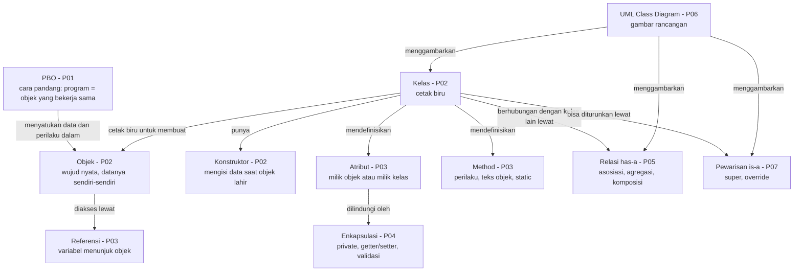
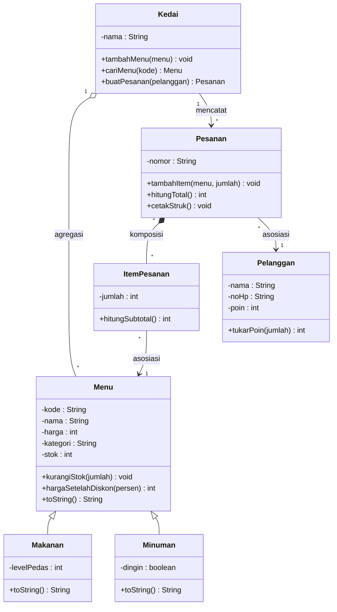
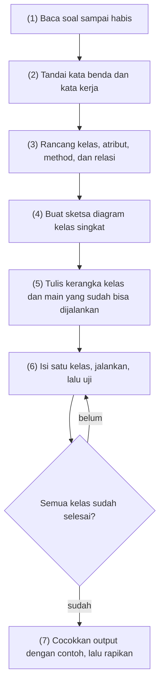

# Pertemuan 08: UTS (Ujian Tengah Semester)

[⬅️ Pertemuan 07](../Pertemuan-07-Pewarisan/README.md) · [🏠 Beranda](../README.md) · [Pertemuan 09 ➡️](../Pertemuan-09-Polimorfisme/README.md)

> Selamat, kamu sudah menempuh separuh perjalanan! Halaman ini adalah peta persiapan UTS: apa saja yang diujikan, seberapa dalam, dan bagaimana cara belajarnya. Di folder ini juga tersedia latihan soal lengkap dengan pembahasan dan solusi dalam dua bahasa.

> [!IMPORTANT]
> Repositori ini **publik**. Semua soal di folder ini adalah **latihan persiapan**, bukan soal UTS yang sebenarnya. Jadwal, durasi, bentuk, bobot, dan aturan ujian **mengikuti pengumuman dosen**.

## 🎯 Tujuan Pembelajaran

Setelah mempelajari halaman ini dan mengerjakan latihan soalnya, kamu mampu:

1. Menjelaskan kembali konsep inti Pertemuan 01—07 dengan kata-katamu sendiri.
2. Menelusuri (*tracing*) *output* program berorientasi objek sederhana, baik dalam Python maupun Java.
3. Menganalisis deskripsi masalah menjadi kelas, atribut, *method*, dan relasi, lalu menggambarkannya sebagai diagram kelas.
4. Membangun program kecil yang memadukan konstruktor, enkapsulasi dan validasi, relasi antarkelas, pewarisan, serta *list* objek.
5. Menilai kesiapanmu sendiri dengan *checklist* dan skor latihan soal.

## 🧭 Peta Belajar

| Langkah | Bagian | Perkiraan waktu |
|---|---|---|
| 1 | Informasi, kisi-kisi, dan ringkasan (halaman ini) | 60 menit |
| 2 | [Latihan Soal](latihan-soal.md) Bagian A dan B | 75 menit |
| 3 | [Latihan Soal](latihan-soal.md) Bagian C (praktik) | 2 × 75 menit |
| 4 | [Pembahasan](pembahasan.md) | 60 menit |
| 5 | Solusi praktik: [🐍 Python](python/README.md) **atau** [☕ Java](java/README.md) | 30 menit |

🖼️ ***Slide* pertemuan ini:** [lihat di PowerPoint Online](https://view.officeapps.live.com/op/view.aspx?src=https%3A%2F%2Fraw.githubusercontent.com%2Fantonprafanto%2FPBO2026%2Fmaster%2FSlide%2FPBO2026-P08-UTS.pptx) · [baca PDF](../Slide/PBO2026-P08-UTS.pdf) · [unduh PowerPoint](https://raw.githubusercontent.com/antonprafanto/PBO2026/master/Slide/PBO2026-P08-UTS.pptx) · [unduh PDF](https://raw.githubusercontent.com/antonprafanto/PBO2026/master/Slide/PBO2026-P08-UTS.pdf)

## 🔁 Mengingat Kembali

Tujuh pertemuan pertama sebenarnya membangun **satu cerita utuh**. Lihat bagaimana studi kasus KedaiKita tumbuh dari minggu ke minggu:

| Pertemuan | KedaiKita saat itu | Konsep yang dipakai |
|---|---|---|
| [01](../Pertemuan-01-Pengenalan-PBO/README.md) | Tiga *list* terpisah sehingga data tertukar saat diurutkan; versi objek diintip sekilas | Paradigma prosedural vs PBO |
| [02](../Pertemuan-02-Kelas-dan-Objek/README.md) | Kelas `Menu` pertama (nama, harga) | Kelas, objek, konstruktor, *method* |
| [03](../Pertemuan-03-Atribut-dan-Method/README.md) | Menu punya kode, kategori, stok; ada kelas `Pelanggan` | Atribut kelas, `__str__`/`toString`, referensi |
| [04](../Pertemuan-04-Enkapsulasi/README.md) | Data menu dilindungi dan divalidasi | Atribut privat, *getter*/*setter*, validasi |
| [05](../Pertemuan-05-Relasi-Antarkelas/README.md) | `ItemPesanan`, `Pesanan`, `Kedai`, dan struk; satu kelas per *file* | Asosiasi, agregasi, komposisi |
| [06](../Pertemuan-06-UML-Class-Diagram/README.md) | Kode sama, digambar sebagai diagram kelas lengkap | Notasi UML |
| [07](../Pertemuan-07-Pewarisan/README.md) | `Makanan` dan `Minuman` mewarisi `Menu` | Pewarisan, `super`, *override* |

Semua konsep itu akan diuji secara terpadu di UTS.

## Daftar Isi

1. [Informasi UTS](#1-informasi-uts)
2. [Kisi-Kisi](#2-kisi-kisi)
3. [Peta Konsep Pertemuan 01 sampai 07](#3-peta-konsep-pertemuan-01-sampai-07)
4. [Ringkasan Super Padat per Pertemuan](#4-ringkasan-super-padat-per-pertemuan)
5. [Tabel Sintaks Penting Python dan Java](#5-tabel-sintaks-penting-python-dan-java)
6. [Strategi Belajar](#6-strategi-belajar)
7. [*Checklist* Kesiapan](#7-checklist-kesiapan)
8. [*Tips* Mengerjakan Soal Praktik](#8-tips-mengerjakan-soal-praktik)
9. [Kesalahan yang Sering Mengurangi Nilai](#9-kesalahan-yang-sering-mengurangi-nilai)

---

## 1. Informasi UTS

**Cakupan materi:** Pertemuan 01 sampai 07, yaitu semua konsep sebelum polimorfisme.

**Bentuk ujian yang umum.** UTS mata kuliah pemrograman biasanya menggabungkan dua jenis soal:

- **Teori**: pilihan ganda dan esai/isian singkat. Contoh tugasnya adalah menjelaskan konsep, menelusuri *output* kode, membaca atau menggambar diagram kelas, dan menilai sebuah rancangan.
- **Praktik**: menulis program berorientasi objek dari sebuah deskripsi kebutuhan.

**Format pasti mengikuti pengumuman dosen.** Pastikan kamu mengetahui hal-hal berikut dari pengumuman resmi:

| Hal yang perlu dipastikan | Contoh pertanyaan |
|---|---|
| Jadwal dan durasi | Kapan, berapa menit, teori dan praktik terpisah atau tidak? |
| Bobot | Berapa persen teori dan berapa persen praktik? |
| Sifat ujian | Buku tertutup atau terbuka? Boleh membuka catatan, internet, atau alat bantu AI? |
| Bahasa pemrograman | Boleh memilih Python atau Java? |
| Alat dan pengumpulan | Memakai komputer lab atau laptop sendiri? Jawaban praktik dikumpulkan lewat apa? |

> [!TIP]
> Catat jawaban pertanyaan di atas begitu dosen mengumumkannya. Banyak mahasiswa kehilangan nilai bukan karena tidak paham materi, melainkan karena salah memahami aturan ujian.

**Isi folder ini:**

| *File* | Isi |
|---|---|
| `README.md` (halaman ini) | Informasi, kisi-kisi, peta konsep, ringkasan, strategi, dan *tips* |
| [`latihan-soal.md`](latihan-soal.md) | 15 soal pilihan ganda, 5 soal esai/isian, dan 2 soal praktik beserta rubriknya |
| [`pembahasan.md`](pembahasan.md) | Kunci, pembahasan, jawaban model, dan pembahasan desain soal praktik |
| [`python/`](python/README.md) | Solusi praktik Python: cara menjalankan, penjelasan kode, dan cara membandingkan *output*-mu |
| [`java/`](java/README.md) | Solusi praktik Java: cara menjalankan, penjelasan kode, dan cara membandingkan *output*-mu |

## 2. Kisi-Kisi

Kisi-kisi adalah daftar kemampuan yang diukur, beserta tingkat kedalamannya. Tabel di bawah dipakai untuk **latihan soal di folder ini**. Kisi-kisi UTS yang asli bisa berbeda.

Level kognitif mengikuti **Taksonomi Bloom revisi**:

| Level | Arti | Kata kerja yang sering muncul |
|---|---|---|
| C2 Memahami | Menjelaskan dengan kata-kata sendiri | menjelaskan, membedakan, memberi contoh |
| C3 Menerapkan | Memakai konsep pada kode atau situasi baru | menelusuri *output*, menulis kode, menerapkan |
| C4 Menganalisis | Memecah masalah menjadi bagian dan hubungannya | mengidentifikasi kelas, menentukan jenis relasi |
| C5 Mengevaluasi | Menilai sebuah pilihan beserta alasannya | menilai rancangan, memilih solusi terbaik |

| No | Kompetensi / indikator | Pertemuan | Level kognitif | Bentuk soal (nomor latihan) |
|---|---|---|---|---|
| 1 | Menjelaskan perbedaan paradigma prosedural dan berorientasi objek, termasuk masalah data yang tercerai-berai | 01 | C2 | PG (A1) |
| 2 | Menilai kapan PBO tepat dipakai dan kapan gaya prosedural sudah cukup | 01 | C5 | PG (A2) |
| 3 | Mengidentifikasi kelas, atribut, *method*, dan relasi dari deskripsi masalah, lalu menggambarkannya | 01, 02, 05, 06 | C4 | Esai (B1) |
| 4 | Menjelaskan peran konstruktor dan memakai `self`/`this` untuk mengisi atribut | 02 | C2—C3 | PG (A3), esai (B4) |
| 5 | Menelusuri *output* program yang memakai beberapa objek, referensi, dan *aliasing* | 02, 03 | C3 | PG kode (A4) |
| 6 | Membedakan atribut objek dan atribut kelas (`static`) | 03 | C3 | PG kode (A5) |
| 7 | Menerapkan representasi teks objek (`__str__`/`toString`) | 03 | C3 | PG (A6), praktik |
| 8 | Membedakan cara perlindungan atribut di Python dan Java | 04 | C2 | PG (A7) |
| 9 | Menerapkan enkapsulasi dengan *property* atau *getter*/*setter* yang memvalidasi data | 04 | C3 | PG kode (A8), isian (B2), praktik |
| 10 | Menganalisis jenis relasi (dependensi, asosiasi, agregasi, komposisi) beserta multiplisitasnya | 05 | C4 | PG (A9), esai (B3) |
| 11 | Menerapkan relasi di kode: *list* objek, salinan *list*, `None`/`null` | 05 | C3 | PG kode (A10), praktik |
| 12 | Membaca *class diagram* UML: visibilitas, tipe, relasi, multiplisitas | 06 | C3 | PG (A11) |
| 13 | Menerjemahkan *class diagram* menjadi kode | 06, 07 | C3 | PG (A12), esai (B4) |
| 14 | Menelusuri urutan konstruktor dan hasil *override* yang memakai `super` | 07 | C3 | PG kode (A13) |
| 15 | Menilai rancangan pewarisan: *is-a* vs *has-a* dan duplikasi kode | 07 | C5 | PG (A14), esai (B5) |
| 16 | Menjelaskan aturan pewarisan di Python dan Java | 07 | C2 | PG (A15) |
| 17 | Membangun program terpadu dari deskripsi kebutuhan, lalu mengujinya dengan contoh *output* | 02—07 | C3—C5 | Praktik (C1, C2) |

## 3. Peta Konsep Pertemuan 01 sampai 07

Peta konsep berikut menunjukkan bagaimana konsep-konsep tujuh pertemuan pertama saling terhubung. Baca setiap panah sebagai kalimat, misalnya "Kelas **adalah cetak biru untuk membuat** Objek".



Semua konsep itu terlihat sekaligus dalam diagram kelas KedaiKita versi Pertemuan 07. Jika kamu bisa menjelaskan **setiap kotak dan setiap garis** pada diagram ini, berarti kamu sudah memegang inti materi UTS.



> [!NOTE]
> Diagram ini diringkas: hanya *method* penting yang ditampilkan, dan namanya memakai gaya Java (*camelCase*). Di Python, `kurangiStok` ditulis `kurangi_stok`, dan `toString` berpadanan dengan `__str__`.

## 4. Ringkasan Super Padat per Pertemuan

Gunakan bagian ini untuk **mengulang**, bukan untuk belajar dari nol. Jika ada butir yang terasa asing, buka lagi halaman pertemuannya.

### Pertemuan 01: Pengenalan PBO

- Paradigma adalah cara pandang dalam menyusun program. **Prosedural** memisahkan data dan fungsi; **berorientasi objek** membungkus data dan perilaku ke dalam objek; **fungsional** hanya disebut sekilas.
- Program prosedural yang membesar rawan rusak: data global bisa diubah dari mana saja, dan data satu "benda" tercerai-berai. Contohnya KedaiKita prosedural yang harganya tertukar setelah *list* nama diurutkan.
- Cara pandang objek: dunia terdiri atas objek yang punya **atribut** (data) dan ***method*** (perilaku), lalu saling mengirim pesan.
- Empat pilar PBO: enkapsulasi (P04), pewarisan (P07), polimorfisme (P09), dan abstraksi (P10).
- PBO unggul untuk program besar yang dirawat lama. Untuk skrip kecil sekali pakai, gaya prosedural sering sudah cukup.
- Sejarah singkat: Simula 67, Smalltalk, C++, Python (1991), Java (1995).
- Konsepnya sama di Python dan Java; yang berbeda hanya cara menuliskannya.

### Pertemuan 02: Kelas dan Objek

- **Kelas** adalah cetak biru, sedangkan **objek** adalah wujud nyatanya (*instance*). Proses membuat objek disebut instansiasi.
- Atribut menyimpan data atau ciri, *method* adalah perilaku. Trik analisis: kata benda menjadi kelas atau atribut, kata kerja menjadi *method*.
- **Konstruktor** (`__init__` di Python, nama kelas tanpa tipe kembalian di Java) berjalan otomatis saat objek dibuat.
- `self`/`this` berarti "objek yang sedang menjalankan *method* ini". Python wajib menulis `self`; Java wajib menulis `this.` jika nama parameter sama dengan nama atribut.
- Notasi titik: `objek.method()` untuk menyuruh, `objek.atribut` untuk membaca.
- Setiap objek menyimpan datanya sendiri. Mengubah satu objek tidak mengubah objek lain.
- Bedakan `print` (mencetak) dan `return` (mengembalikan nilai yang bisa dipakai lagi).

### Pertemuan 03: Atribut dan *Method* Lebih Dalam

- **Atribut objek** dimiliki tiap objek. **Atribut kelas** (`static` di Java) hanya ada satu untuk semua objek, misalnya penghitung jumlah objek.
- Jebakan Python: `objek.x += 1` pada atribut kelas justru membuat atribut objek baru (bayangan). Ubahlah lewat nama kelasnya.
- *Method* milik kelas: Python `@staticmethod` dan `@classmethod` (misalnya konstruktor alternatif `dari_teks()`); Java *method* `static`, yang bisa dipanggil tanpa membuat objek. Itulah sebabnya `main` di Java bersifat `static`.
- Python memakai nilai bawaan (*default value*), misalnya `stok=0`, sedangkan Java memakai *overloading* konstruktor dan `this(...)`.
- Representasi teks objek: `__str__` (Python) atau `toString()` dengan `@Override` (Java). Keduanya harus **mengembalikan** teks.
- Variabel menyimpan **referensi**. `b = a` berarti dua nama untuk satu objek (*aliasing*). Untuk memeriksa "objek yang sama", Python memakai `is` dan Java memakai `==`. Untuk membandingkan isi teks, Python memakai `==` dan Java **wajib** memakai `.equals()`. (Kesamaan isi untuk kelas buatan sendiri dibahas di P12.) Nilai "kosong": `None`/`null`.
- Objek bisa dikirim sebagai parameter (*method* bisa mengubahnya) dan bisa dikembalikan sebagai nilai kembalian.

### Pertemuan 04: Enkapsulasi

- Enkapsulasi membungkus data dan menyembunyikan detailnya (*information hiding*). Data hanya boleh diubah lewat "pintu resmi".
- Java punya *access modifier* `public`, `private`, `protected`, dan *default* (*package-private*).
- Python memakai konvensi `_nama` untuk atribut internal. Awalan `__nama` memicu *name mangling* menjadi `_Kelas__nama`, tetapi itu **bukan** fitur keamanan.
- Java memakai *getter*/*setter* (`getX`, `setX`, `isX` untuk *boolean*). Python memakai `@property` dan `@x.setter` sehingga aksesnya tetap seperti atribut biasa.
- Validasi dilakukan di *setter* dan konstruktor dengan `raise ValueError(...)` atau `throw new IllegalArgumentException(...)`, lalu ditangkap dengan `try` (tuntas di P11).
- Atribut *read-only*: *property* tanpa *setter* atau *getter* tanpa *setter*.
- *Method* penjaga aturan (`tambah_stok`/`kurangi_stok`) lebih baik daripada *setter* stok. Jangan otomatis membuat *getter* dan *setter* untuk semua atribut.
- Atribut kelas yang privat dibaca lewat *method* kelas: `Menu.jumlah_menu()` atau `Menu.getJumlahMenu()`.

### Pertemuan 05: Relasi Antarkelas

- **Dependensi**: memakai sementara (hanya parameter). **Asosiasi**: mengenal (disimpan sebagai atribut). **Agregasi**: memiliki, tetapi bagiannya bisa hidup sendiri. **Komposisi**: memiliki, dan bagiannya dibuat di dalam serta ikut "mati".
- Multiplisitas: `1`, `0..1`, `*`, dan `1..*`.
- Wujud di kode: atribut berisi referensi objek lain, *list* objek, objek yang dibuat di dalam (komposisi), atau parameter saja (dependensi).
- *Getter* yang mengembalikan *list* sebaiknya memberikan **salinan**: `list(...)` atau `new ArrayList<>(...)`.
- Pencarian yang gagal mengembalikan `None`/`null`. Selalu periksa hasilnya sebelum dipakai.
- Program banyak *file*: Python memakai `import` antarmodul; Java memakai satu kelas per *file*, `javac *.java`, lalu `java Main`.
- Java `ArrayList`: `add`, `get`, `size`, dan perulangan *for-each*. `List<Menu>` dibaca "*list* berisi Menu" (detail *generics* di P12).

### Pertemuan 06: UML *Class Diagram*

- UML adalah bahasa pemodelan visual standar (diadopsi OMG pada 1997). *Class diagram* termasuk diagram struktur.
- Notasi atribut `visibilitas nama: Tipe`, notasi *method* `visibilitas nama(param: Tipe): Tipe`. Visibilitas: `+` *public*, `-` *private*, `#` *protected*, `~` *package*. Anggota *static* digarisbawahi.
- Jenis garis: asosiasi (garis/panah), agregasi (belah ketupat kosong di sisi keseluruhan), komposisi (belah ketupat penuh di sisi keseluruhan), generalisasi (segitiga kosong menunjuk induk), realisasi (garis putus-putus dengan segitiga, P10), dan dependensi (garis putus-putus dengan panah).
- Multiplisitas ditulis di ujung garis.
- *Forward engineering*: dari diagram ke kode. *Reverse engineering*: dari kode ke diagram.
- Diagram Mermaid `classDiagram` langsung ditampilkan sebagai gambar oleh GitHub. Sintaks pentingnya: `<|--`, `*--`, `o--`, `-->`, `..>`, `..|>`, dan `List~Menu~`.
- Kesalahan umum: panah pewarisan terbalik, serta salah memilih agregasi atau komposisi.

### Pertemuan 07: Pewarisan

- Pewarisan menghilangkan duplikasi lewat generalisasi. Hubungannya adalah "adalah" (*is-a*): makanan **adalah** menu.
- Python: `class Anak(Induk)` dan `super().__init__(...)`. Java: `extends` dan `super(...)` di baris pertama konstruktor.
- Kelas anak mewarisi atribut dan *method* induk, dan boleh menambah yang baru.
- *Override*: tanda tangan *method* sama. Java memakai `@Override` dan tidak boleh memperkecil hak akses. Versi induk dipanggil dengan `super().method()` atau `super.method()`.
- Urutan konstruktor: bagian induk disiapkan lebih dulu.
- Java `protected` (juga terbuka untuk satu paket) dibandingkan dengan konvensi `_` di Python. Pewarisan bisa bertingkat (*multilevel*).
- Python mendukung *multiple inheritance* dengan urutan pencarian MRO; Java hanya boleh satu induk. Kelas akar: `object`/`Object`. Pemeriksaan tipe: `isinstance`/`instanceof`. Kata kunci `final` di Java mencegah pewarisan atau *override*.
- *is-a* vs *has-a*: untuk hubungan "memiliki", pakai atribut (misalnya komposisi), bukan pewarisan.

## 5. Tabel Sintaks Penting Python dan Java

| Konsep | Python | Java |
|---|---|---|
| Kelas | `class Menu:` | `class Menu { ... }` |
| Konstruktor | `def __init__(self, nama, harga):` | `public Menu(String nama, int harga) { ... }` |
| Membuat objek | `kopi = Menu("Kopi", 18000)` | `Menu kopi = new Menu("Kopi", 18000);` |
| "Objek ini" | `self.harga` | `this.harga` |
| Atribut kelas | `jumlah = 0` di badan kelas, diakses `Menu.jumlah` | `static int jumlah = 0;`, diakses `Menu.jumlah` |
| *Method* milik kelas | `@classmethod` atau `@staticmethod` | `public static int jumlahMenu() { ... }` |
| Nilai bawaan / *overloading* | `def __init__(self, kode, nama, stok=0):` | dua konstruktor, salah satunya memanggil `this(kode, nama, 0);` |
| Teks objek | `def __str__(self):` lalu `return ...` | `@Override public String toString() { return ...; }` |
| Atribut tidak publik | `self._harga` | `private int harga;` |
| *Getter* | `@property` lalu `def harga(self):` | `public int getHarga() { ... }` |
| *Setter* | `@harga.setter` lalu `def harga(self, nilai):` | `public void setHarga(int nilai) { ... }` |
| Menolak data | `raise ValueError("...")` | `throw new IllegalArgumentException("...");` |
| Menangkap penolakan | `try:` ... `except ValueError as e:` | `try { ... } catch (IllegalArgumentException e) { ... }` |
| *List* objek | `self._daftar: list[Menu] = []` | `private List<Menu> daftar = new ArrayList<>();` |
| Menambah isi *list* | `self._daftar.append(menu)` | `daftar.add(menu);` |
| Banyaknya isi | `len(self._daftar)` | `daftar.size()` |
| Salinan *list* | `list(self._daftar)` | `new ArrayList<>(daftar)` |
| Tidak ditemukan | `return None`, cek `if x is None:` | `return null;`, cek `if (x == null)` |
| Pewarisan | `class Makanan(Menu):` | `class Makanan extends Menu { ... }` |
| Konstruktor induk | `super().__init__(kode, nama, ...)` | `super(kode, nama, ...);` di baris pertama |
| Versi induk sebuah *method* | `super().__str__()` | `super.toString()` |
| Cek tipe objek | `isinstance(x, Makanan)` | `x instanceof Makanan` |
| Membandingkan isi teks | `a == b` | `a.equals(b)` |
| Format Rupiah | `f"Rp{x:,}".replace(",", ".")` | `"Rp" + String.format(Locale.US, "%,d", x).replace(',', '.')` |

Di Java, `ArrayList`, `List`, dan `Locale` baru bisa dipakai setelah di-*import* di baris paling atas *file*: `import java.util.ArrayList;`, `import java.util.List;`, dan `import java.util.Locale;`. Lupa satu baris saja, kompilasinya gagal dengan pesan `cannot find symbol`.

## 6. Strategi Belajar

**Prinsip utama: belajar aktif, bukan membaca ulang.** Membaca ulang catatan terasa nyaman, tetapi hasilnya tipis. Yang benar-benar melatih otak adalah **mengingat tanpa melihat** dan **mengerjakan soal**.

Contoh rencana tujuh hari sebelum UTS:

| Hari | Kegiatan | Hasil yang diharapkan |
|---|---|---|
| H-7 | Baca ringkasan P01—P02, kerjakan ulang kuisnya tanpa melihat jawaban | Skor kuis minimal 8 |
| H-6 | P03: tebak dulu *output* contoh referensi dan atribut kelas, lalu jalankan untuk mencocokkan | Bisa menjelaskan *aliasing* |
| H-5 | P04: tulis ulang kelas `Menu` versi enkapsulasi tanpa menyontek | *Getter*, *setter*, dan validasi berjalan |
| H-4 | P05—P06: gambar diagram KedaiKita dari ingatan, lalu cocokkan | Tahu beda keempat jenis relasi |
| H-3 | P07: salin folder studi kasus KedaiKita ke folder latihanmu, lalu tambah satu kelas anak baru (misalnya `Snack`) | Bisa memakai `super` dan *override* |
| H-2 | [Latihan Soal](latihan-soal.md) Bagian A dan B dengan batas waktu, lalu cocokkan | Tahu topik yang masih lemah |
| H-1 | Soal C1 **atau** C2 dalam 75 menit, lalu ulangi topik yang lemah | Yakin bisa menyelesaikan satu soal praktik |
| Hari H | Istirahat cukup, datang lebih awal, cek perangkat | Tenang dan fokus |

Simpan semua kode yang kamu ketik saat berlatih di folder milikmu sendiri, misalnya `PBO-latihan-saya/uts/`, bukan di folder materi (lihat [aturan emasnya](../00-Persiapan/git-dan-github.md#5-menyimpan-latihanmu-sendiri)). Susunan folder dan cara membandingkan *output*-mu dengan solusi ada di bagian Persiapan halaman [🐍 Solusi Python](python/README.md#tempat-menyimpan-kodemu-sendiri) atau [☕ Solusi Java](java/README.md#tempat-menyimpan-kodemu-sendiri).

**Teknik yang terbukti membantu:**

- **Tebak dulu, baru jalankan.** Sebelum menjalankan sebuah contoh, tulis tebakan *output*-nya di kertas. Kesalahan tebakan menunjukkan bagian yang belum kamu pahami.
- **Telusuri di kertas.** Gambar kotak objek dan panah variabel seperti di [Pembahasan A4](pembahasan.md#pembahasan-a4). Cara ini sangat membantu untuk soal *aliasing* dan atribut kelas.
- **Ketik ulang KedaiKita dari ingatan.** Mulai dari kelas `Menu`, lalu tambahkan sedikit demi sedikit sampai versi Pertemuan 07.
- **Jelaskan ke teman.** Jika kamu bisa menjelaskan beda agregasi dan komposisi dengan contoh sendiri, berarti kamu benar-benar paham.
- **Latihan dengan batas waktu.** Ujian punya batas waktu, jadi latihanmu juga perlu batas waktu.

> [!WARNING]
> Jangan menghafal kode solusi. Soal ujian hampir pasti memakai cerita yang berbeda. Yang perlu kamu kuasai adalah **pola berpikirnya**: menemukan kelas, memilih relasi, melindungi data, dan memakai pewarisan dengan tepat.

## 7. *Checklist* Kesiapan

Centang di kertas (atau di salinan *file* ini) setiap butir yang sudah kamu kuasai **tanpa melihat catatan**.

**Kelas dan objek (P01—P02)**

- [ ] Saya bisa menjelaskan masalah program prosedural yang membesar, lengkap dengan contohnya.
- [ ] Saya bisa menjelaskan beda kelas dan objek dengan analogi buatan sendiri.
- [ ] Saya bisa menulis kelas dengan konstruktor, satu *method* yang mencetak, dan satu *method* yang mengembalikan nilai.

**Atribut dan *method* (P03)**

- [ ] Saya bisa membuat penghitung objek dengan atribut kelas atau `static`.
- [ ] Saya bisa menulis `__str__`/`toString()` yang mengembalikan teks.
- [ ] Saya bisa menebak dengan benar *output* kode yang memakai `b = a`.

**Enkapsulasi (P04)**

- [ ] Saya bisa membuat atribut privat beserta *property* atau *getter*/*setter* yang memvalidasi data.
- [ ] Saya bisa menjelaskan mengapa stok sebaiknya diubah lewat *method*, bukan lewat *setter*.
- [ ] Saya bisa menolak data dengan `raise`/`throw` lalu menangkapnya di program utama.

**Relasi dan UML (P05—P06)**

- [ ] Saya bisa menentukan dependensi, asosiasi, agregasi, atau komposisi dari sebuah deskripsi.
- [ ] Saya bisa menulis kelas yang menyimpan *list* objek dan mengembalikan salinannya.
- [ ] Saya bisa membaca simbol `+`, `-`, `#`, multiplisitas, dan semua jenis garis di diagram kelas.
- [ ] Saya bisa menggambar diagram kelas dari kode, dan menulis kode dari diagram kelas.

**Pewarisan (P07)**

- [ ] Saya bisa membuat kelas anak yang memanggil konstruktor induk dan menambah atribut baru.
- [ ] Saya bisa meng-*override* *method* sambil tetap memakai versi induknya.
- [ ] Saya bisa menjelaskan urutan berjalannya konstruktor induk dan anak.
- [ ] Saya bisa memutuskan apakah sebuah hubungan termasuk *is-a* atau *has-a*.

**Kesiapan ujian**

- [ ] Saya sudah mengerjakan latihan soal dengan batas waktu, dan skor saya minimal 70.
- [ ] Saya bisa menyelesaikan satu soal praktik dalam 75 menit.
- [ ] Perangkat sudah siap: Python atau JDK terpasang dan sudah dicoba menjalankan program.
- [ ] Saya sudah membaca pengumuman resmi tentang format UTS.

## 8. *Tips* Mengerjakan Soal Praktik

Kesalahan terbesar saat ujian praktik adalah **langsung mengetik** tanpa rancangan. Ikuti alur berikut:



Contoh pembagian waktu untuk satu soal praktik 75 menit:

| Menit | Kegiatan |
|---|---|
| 0—10 | Membaca, menandai, merancang, dan membuat sketsa diagram |
| 10—20 | Menulis kerangka semua kelas dan `main` yang sudah bisa dijalankan |
| 20—60 | Mengisi kelas satu per satu, mulai dari yang paling mandiri, sambil terus menjalankan program |
| 60—70 | Mencocokkan *output* dan pesan *error* dengan contoh di soal |
| 70—75 | Merapikan nama dan komentar, lalu menyimpan atau mengumpulkan |

Kerangka awal yang sudah bisa dijalankan sekitar menit ke-20 kira-kira seperti contoh berikut, yang memakai kelas `Alat` dari Soal C1. Saat berlatih, ketik kerangka itu di *file* baru di folder latihanmu: `jawaban_c1.py` (Python) atau `JawabanC1.java` (Java, nama *file* harus sama dengan nama kelas `public`-nya). Saat dijalankan, kerangka ini baru mencetak satu baris, `=== UJI AWAL ===`, dan itu sudah cukup sebagai titik awal.

**Python:**

```python
class Alat:
    def __init__(self, kode, nama):
        self._kode = kode
        self._nama = nama


def main():
    print("=== UJI AWAL ===")


if __name__ == "__main__":
    main()
```

**Java:**

```java
public class JawabanC1 {
    public static void main(String[] args) {
        System.out.println("=== UJI AWAL ===");
    }
}

class Alat {
    private String kode;
    private String nama;
}
```

**Saran lainnya:**

- **Mulai dari kelas yang paling mandiri**, yaitu kelas yang tidak bergantung pada kelas lain (misalnya `Mahasiswa` atau `Produk`). Kelas "pusat" seperti `Laboratorium` atau `TokoBuku` ditulis terakhir.
- **Jalankan program setiap selesai menulis 10—15 baris.** *Error* yang muncul segera jauh lebih mudah diperbaiki daripada 20 *error* yang menumpuk di akhir.
- **Salin teks pesan dan format *output* dari soal.** Perbedaan satu spasi atau satu huruf bisa membuat *output* tidak cocok.
- **Kerjakan yang pasti bisa lebih dulu.** Rubrik latihan di folder ini menilai per aspek, jadi program yang belum lengkap tetap bisa mendapat nilai pada bagian yang benar. Rubrik UTS yang asli mengikuti ketentuan dosen.
- **Jika buntu, tulis komentar rencana.** Misalnya `# TODO: hitung ongkir per kg, dibulatkan ke atas`. Penilai bisa melihat arah berpikirmu, dan kamu bisa kembali ke bagian itu nanti.
- **Sisakan waktu untuk menguji kasus gagal**, misalnya stok kurang, data negatif, atau kode yang tidak ditemukan.

## 9. Kesalahan yang Sering Mengurangi Nilai

| Kesalahan | Akibatnya | Cara menghindarinya |
|---|---|---|
| Lupa `self` sebagai parameter pertama *method* (Python) | `TypeError: ... takes 0 positional arguments but 1 was given` | Setiap *method* objek diawali `self` |
| Lupa memanggil konstruktor induk | Python: `AttributeError` saat atribut induk dipakai; Java: *error* kompilasi jika induk tidak punya konstruktor tanpa parameter | Tulis `super().__init__(...)`/`super(...)` di baris pertama konstruktor anak |
| *Setter* menyimpan dulu baru memeriksa | Data salah sempat masuk ke objek | Periksa dulu, lalu simpan |
| *Setter* Python menulis `self.harga = nilai` | `RecursionError` karena *setter* memanggil dirinya sendiri | Simpan ke `self._harga` |
| `__str__`/`toString()` mencetak alih-alih mengembalikan | Python: `TypeError`; Java: *error* kompilasi | Gunakan `return` |
| *Getter* mengembalikan *list* asli | Isi objek bisa dirusak dari luar | Kembalikan salinan |
| Membandingkan teks dengan `==` di Java | Hasil tidak terduga | Gunakan `.equals()` |
| Memakai bilangan pecahan untuk uang | Muncul pembulatan aneh | Gunakan bilangan bulat |
| `String.format("%,d", x)` tanpa `Locale.US` | Pemisah ribuan berbeda di komputer berbahasa Indonesia | Selalu tulis `Locale.US` |
| Mencetak *boolean* apa adanya | `True` (Python) dan `true` (Java) berbeda | Ubah menjadi teks, misalnya "ya"/"tidak" |
| Memakai pewarisan untuk hubungan "memiliki" | Rancangan salah dan nilai desain turun | Uji dengan kalimat "X **adalah** Y" |
| Menebak *output* tanpa menelusuri | Salah di soal membaca kode | Telusuri baris demi baris di kertas |

## 📝 Ringkasan

- UTS mencakup Pertemuan 01—07. Bentuk dan aturan pastinya mengikuti pengumuman dosen.
- Soal biasanya menguji pemahaman konsep (C2), penerapan dan penelusuran kode (C3), analisis kebutuhan dan relasi (C4), serta penilaian rancangan (C5).
- Inti materi terangkum dalam diagram kelas KedaiKita versi Pertemuan 07: kelas, enkapsulasi, relasi, dan pewarisan.
- Belajarlah secara aktif: tebak *output*, telusuri di kertas, ketik ulang dari ingatan, dan berlatih dengan batas waktu.
- Untuk soal praktik: rancang dulu, tulis kerangka yang bisa jalan, isi bertahap, lalu cocokkan *output*.

## ➡️ Langkah Berikutnya

Kerjakan [Latihan Soal](latihan-soal.md) dengan batas waktu, lalu cocokkan dengan [Pembahasan](pembahasan.md). Solusi praktiknya bisa kamu pelajari di [🐍 Solusi Python](python/README.md) atau [☕ Solusi Java](java/README.md).

Semoga sukses UTS-nya! Setelah itu, kita lanjut ke [Pertemuan 09: Polimorfisme](../Pertemuan-09-Polimorfisme/README.md).

---

[⬅️ Pertemuan 07](../Pertemuan-07-Pewarisan/README.md) · [🏠 Beranda](../README.md) · [Pertemuan 09 ➡️](../Pertemuan-09-Polimorfisme/README.md)
