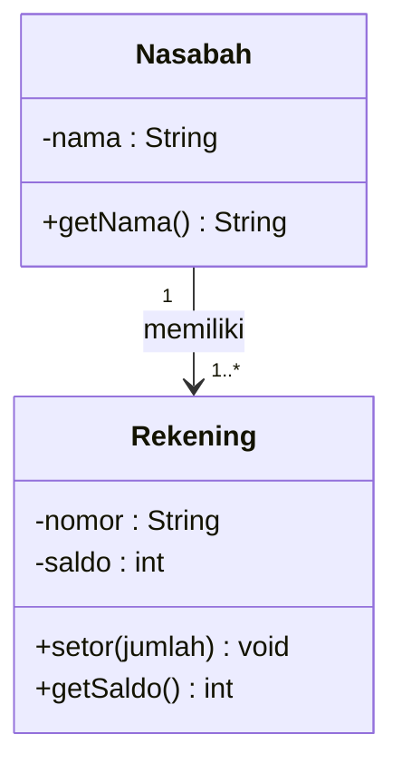
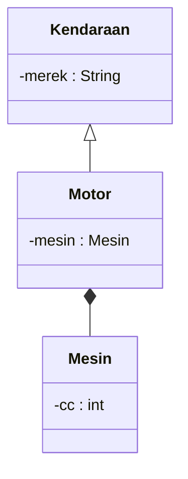
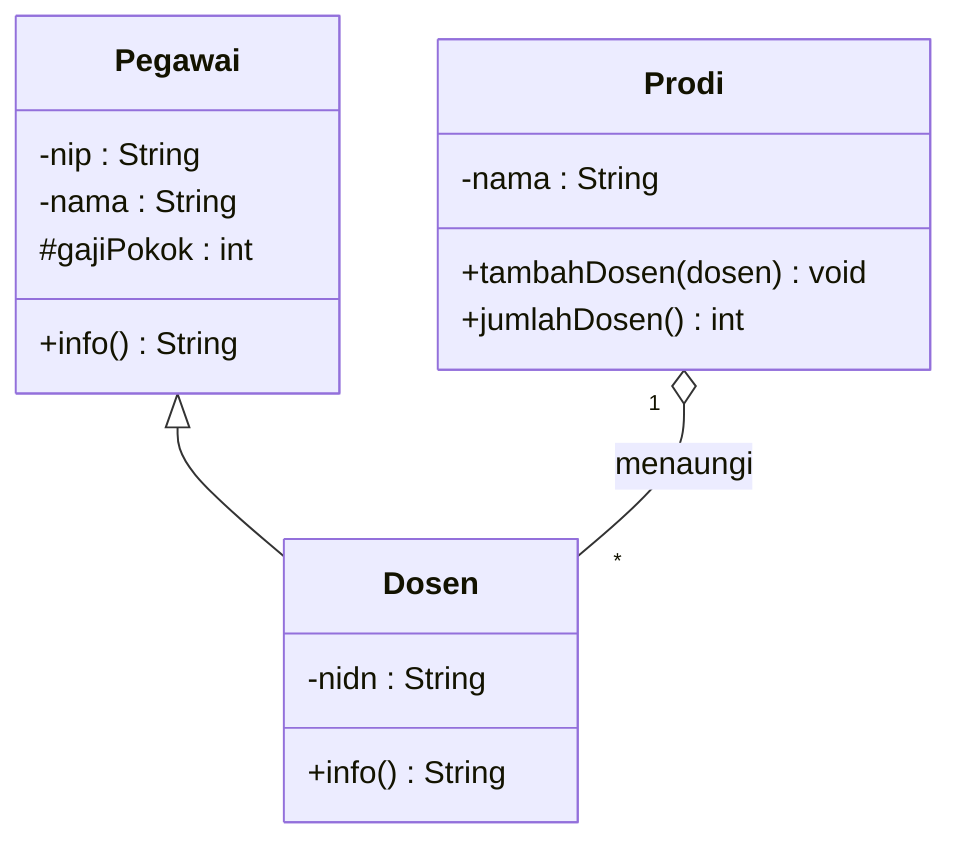

# Latihan Soal UTS — Pemrograman Berorientasi Objek

[⬅️ Informasi UTS](README.md) · [🏠 Beranda](../README.md) · [Pembahasan ➡️](pembahasan.md)

> [!IMPORTANT]
> Repositori ini **publik**, jadi semua soal di halaman ini adalah **latihan persiapan**, bukan soal UTS yang sebenarnya. Bentuk, jumlah soal, durasi, dan aturan ujian yang asli mengikuti pengumuman dosen.

**Petunjuk umum:**

1. Latihan ini terdiri atas tiga bagian: A (pilihan ganda), B (esai dan isian singkat), dan C (praktik mini-proyek).
2. Buat suasananya mirip ujian: siapkan pengatur waktu, tutup catatan, dan jangan membuka pembahasan sebelum selesai.
3. Soal yang memuat kode ditampilkan dalam **dua versi** (Python dan Java) dengan arti yang sama. Cukup baca versi bahasa pilihanmu.
4. Soal praktik boleh dikerjakan dengan Python **atau** Java.
5. Setelah selesai, cocokkan jawabanmu dengan [Pembahasan](pembahasan.md) dan hitung skormu.

| Bagian | Bentuk | Jumlah | Saran waktu | Skor simulasi |
|---|---|---|---|---|
| A | Pilihan ganda | 15 soal | 30 menit | 2 per soal (total 30) |
| B | Esai dan isian singkat | 5 soal | 45 menit | 6 per soal (total 30) |
| C | Praktik mini-proyek | 2 soal | 75 menit per soal | 20 per soal (total 40) |

> [!TIP]
> Tidak perlu menyelesaikan semuanya dalam sekali duduk. Misalnya, kerjakan Bagian A dan B hari ini, Soal C1 besok, dan Soal C2 lusa. Yang penting, setiap sesi dikerjakan dengan batas waktu.

## Daftar Isi

- [Bagian A: Pilihan Ganda](#bagian-a-pilihan-ganda)
- [Bagian B: Esai dan Isian Singkat](#bagian-b-esai-dan-isian-singkat)
- [Bagian C: Soal Praktik](#bagian-c-soal-praktik)
  - [Soal C1: Peminjaman Alat Laboratorium](#soal-c1-peminjaman-alat-laboratorium)
  - [Soal C2: Toko Buku Daring](#soal-c2-toko-buku-daring)
  - [Rubrik Penilaian Praktik](#rubrik-penilaian-praktik)

---

## Bagian A: Pilihan Ganda

Pilih **satu** jawaban yang paling tepat. Catat pilihanmu di kertas, lalu cocokkan di [Pembahasan](pembahasan.md#kunci-jawaban-bagian-a).

### Soal A1

Pada KedaiKita versi prosedural (Pertemuan 01), nama, harga, dan stok menu disimpan di **tiga list terpisah**. Indeks yang sama berarti menu yang sama. Apa yang terjadi jika pemilik kedai hanya mengurutkan list **nama** menu sesuai abjad?

- A. Program berhenti dengan pesan error, karena list berisi teks tidak dapat diurutkan
- B. Nama menu berpindah posisi, tetapi harga dan stok tetap di posisi lama, sehingga data antarmenu tertukar
- C. Harga dan stok ikut berpindah secara otomatis, karena indeksnya sama
- D. Semua data tetap benar; yang berubah hanya kecepatan program

### Soal A2

Rani diminta membuat skrip sekitar 15 baris untuk mengganti nama 50 file foto. Skrip itu hanya akan dipakai **sekali**. Temannya berkata, "Pokoknya harus PBO, minimal lima kelas!" Penilaian yang paling tepat terhadap saran itu adalah ...

- A. Tepat, karena setiap program yang baik wajib memiliki minimal lima kelas
- B. Tepat, karena program berorientasi objek selalu berjalan lebih cepat
- C. Kurang tepat, karena untuk skrip kecil sekali pakai, gaya prosedural sering sudah cukup dan lebih sederhana
- D. Kurang tepat, karena PBO hanya cocok untuk program yang memiliki tampilan grafis

### Soal A3

Mengapa nilai awal atribut sebaiknya diisi melalui **konstruktor**, bukan diisi satu per satu dari luar setelah objek dibuat?

- A. Agar setiap objek langsung "lahir" dengan data lengkap, sehingga tidak ada objek setengah jadi
- B. Karena atribut yang diisi dari luar kelas akan terhapus otomatis setelah method pertama dipanggil
- C. Karena konstruktor membuat program berjalan lebih cepat daripada method biasa
- D. Karena kelas yang tidak memiliki konstruktor tidak boleh memiliki method

### Soal A4

Perhatikan kode berikut.

**Python:**

```python
class Rekening:
    def __init__(self, saldo):
        self.saldo = saldo

    def setor(self, jumlah):
        self.saldo = self.saldo + jumlah


a = Rekening(100000)
b = a
c = Rekening(100000)
b.setor(50000)
c.setor(20000)
print(a.saldo, b.saldo, c.saldo)
```

**Java:**

```java
class Rekening {
    int saldo;

    Rekening(int saldo) {
        this.saldo = saldo;
    }

    void setor(int jumlah) {
        saldo = saldo + jumlah;
    }
}

// di dalam main:
Rekening a = new Rekening(100000);
Rekening b = a;
Rekening c = new Rekening(100000);
b.setor(50000);
c.setor(20000);
System.out.println(a.saldo + " " + b.saldo + " " + c.saldo);
```

Apa yang tercetak di layar?

- A. `100000 150000 120000`
- B. `150000 150000 150000`
- C. `100000 150000 100000`
- D. `150000 150000 120000`

### Soal A5

Perhatikan kode berikut.

**Python:**

```python
class Tiket:
    terjual = 0  # atribut kelas

    def __init__(self, pembeli):
        self.pembeli = pembeli
        Tiket.terjual += 1


t1 = Tiket("Ayu")
t2 = Tiket("Bima")
t3 = t1
t4 = Tiket("Citra")
print(Tiket.terjual)
```

**Java:**

```java
class Tiket {
    static int terjual = 0; // atribut kelas (static)
    String pembeli;

    Tiket(String pembeli) {
        this.pembeli = pembeli;
        terjual++;
    }
}

// di dalam main:
Tiket t1 = new Tiket("Ayu");
Tiket t2 = new Tiket("Bima");
Tiket t3 = t1;
Tiket t4 = new Tiket("Citra");
System.out.println(Tiket.terjual);
```

Apa yang tercetak di layar?

- A. `4`
- B. `3`
- C. `1`
- D. `0`

### Soal A6

Kelas `Buku` belum memiliki `__str__` (Python) atau `toString()` (Java). Saat objeknya dicetak, yang muncul adalah teks seperti `<__main__.Buku object at 0x7f3a...>` atau `Buku@1b6d3586`. Apa yang sebaiknya dilakukan agar yang tercetak adalah judul dan penulis buku?

- A. Menambahkan method `__str__` (Python) atau meng-*override* `toString()` (Java) yang **mengembalikan** teks berisi judul dan penulis
- B. Mengganti nama kelas `Buku` menjadi `BukuTeks`
- C. Menambahkan method `__str__`/`toString()` yang langsung **mencetak** judul dan penulis dengan `print`/`System.out.println`, tanpa mengembalikan apa pun
- D. Mengubah semua atribut `Buku` menjadi atribut kelas (`static`)

### Soal A7

Pernyataan yang paling tepat tentang perlindungan atribut di Python dan Java adalah ...

- A. Python dan Java sama-sama menolak akses ke atribut privat sejak tahap kompilasi
- B. Atribut Python yang diawali satu garis bawah, misalnya `_harga`, otomatis menjadi *read-only*
- C. Java memeriksa `private` saat kompilasi, sedangkan di Python awalan `_` hanyalah konvensi dan `__` hanya mengganti nama atribut (*name mangling*), bukan pengaman mutlak
- D. Atribut `private` di Java tetap bisa diakses langsung dari kelas lain, asalkan kedua kelas ditulis di file yang sama

### Soal A8

Perhatikan kode berikut.

**Python:**

```python
class Nilai:
    def __init__(self, angka):
        self.angka = angka  # lewat setter, jadi ikut divalidasi

    @property
    def angka(self):
        return self._angka

    @angka.setter
    def angka(self, nilai):
        if nilai < 0 or nilai > 100:
            raise ValueError("Nilai harus 0 sampai 100")
        self._angka = nilai


n = Nilai(80)
try:
    n.angka = 120
except ValueError as e:
    print(f"Ditolak: {e}")
print(n.angka)
```

**Java:**

```java
class Nilai {
    private int angka;

    public Nilai(int angka) {
        setAngka(angka); // lewat setter, jadi ikut divalidasi
    }

    public int getAngka() {
        return angka;
    }

    public void setAngka(int nilai) {
        if (nilai < 0 || nilai > 100) {
            throw new IllegalArgumentException("Nilai harus 0 sampai 100");
        }
        angka = nilai;
    }
}

// di dalam main:
Nilai n = new Nilai(80);
try {
    n.setAngka(120);
} catch (IllegalArgumentException e) {
    System.out.println("Ditolak: " + e.getMessage());
}
System.out.println(n.getAngka());
```

Apa output program tersebut?

- A. `Ditolak: Nilai harus 0 sampai 100`, lalu `80`
- B. `120` saja
- C. `Ditolak: Nilai harus 0 sampai 100`, lalu `120`
- D. Program berhenti dengan pesan error (*traceback*/*stack trace*) tanpa mencetak apa pun

### Soal A9

Perhatikan dua deskripsi berikut.

- Sebuah `Gedung` membuat objek-objek `Lantai` di dalam konstruktornya sendiri. Lantai tidak punya arti tanpa gedungnya. Jika gedung dihapus, lantainya ikut hilang.
- Sebuah `Ukm` (unit kegiatan mahasiswa) mencatat objek-objek `Mahasiswa` yang sudah ada sebelumnya. Jika UKM dibubarkan, mahasiswanya tetap ada dan boleh bergabung dengan UKM lain.

Jenis relasi `Gedung`–`Lantai` dan `Ukm`–`Mahasiswa` berturut-turut adalah ...

- A. agregasi dan komposisi
- B. asosiasi dan dependensi
- C. komposisi dan dependensi
- D. komposisi dan agregasi

### Soal A10

Perhatikan kode berikut.

**Python:**

```python
class Playlist:
    def __init__(self):
        self._daftar_lagu = []

    def tambah(self, judul):
        self._daftar_lagu.append(judul)

    @property
    def daftar_lagu(self):
        return list(self._daftar_lagu)  # mengembalikan salinan


p = Playlist()
p.tambah("Ampar-Ampar Pisang")
p.tambah("Bengawan Solo")
lagu = p.daftar_lagu
lagu.append("Lagu Titipan")
print(len(lagu), len(p.daftar_lagu))
```

**Java:**

```java
import java.util.ArrayList;
import java.util.List;

class Playlist {
    private List<String> daftarLagu = new ArrayList<>();

    public void tambah(String judul) {
        daftarLagu.add(judul);
    }

    public List<String> getDaftarLagu() {
        return new ArrayList<>(daftarLagu); // mengembalikan salinan
    }
}

// di dalam main:
Playlist p = new Playlist();
p.tambah("Ampar-Ampar Pisang");
p.tambah("Bengawan Solo");
List<String> lagu = p.getDaftarLagu();
lagu.add("Lagu Titipan");
System.out.println(lagu.size() + " " + p.getDaftarLagu().size());
```

Apa yang tercetak di layar?

- A. `3 3`
- B. `2 2`
- C. `3 2`
- D. `2 3`

### Soal A11

Perhatikan diagram kelas berikut.



Pernyataan yang benar berdasarkan diagram tersebut adalah ...

- A. Atribut `saldo` boleh diubah langsung dari kelas lain, karena bertanda `-`
- B. Setiap nasabah memiliki paling sedikit satu rekening, dan objek `Nasabah` mengenal rekening-rekeningnya
- C. `Rekening` adalah kelas anak dari `Nasabah`
- D. Method `setor` mengembalikan nilai bertipe `int`

### Soal A12

Perhatikan diagram kelas berikut.



Rancangan kode yang paling sesuai dengan diagram tersebut adalah ...

- A. `Kendaraan` mewarisi `Motor`, dan `Motor` hanya menerima objek `Mesin` sebagai parameter method tanpa menyimpannya
- B. `Motor` mewarisi `Mesin`, dan `Motor` menyimpan objek `Kendaraan` di atributnya
- C. `Motor` mewarisi `Kendaraan`, dan satu objek `Mesin` dibuat di luar lalu dipakai bersama oleh banyak motor
- D. `Motor` mewarisi `Kendaraan`, dan objek `Mesin` dibuat di dalam konstruktor `Motor` lalu disimpan di atribut `mesin`

### Soal A13

Perhatikan kode berikut.

**Python:**

```python
class Kendaraan:
    def __init__(self, merek):
        print("Kendaraan dibuat")
        self.merek = merek

    def info(self):
        return f"Kendaraan {self.merek}"


class Motor(Kendaraan):
    def __init__(self, merek, cc):
        super().__init__(merek)
        print("Motor dibuat")
        self.cc = cc

    def info(self):
        return f"{super().info()} {self.cc}cc"


m = Motor("Honda", 125)
print(m.info())
```

**Java:**

```java
class Kendaraan {
    protected String merek;

    Kendaraan(String merek) {
        System.out.println("Kendaraan dibuat");
        this.merek = merek;
    }

    String info() {
        return "Kendaraan " + merek;
    }
}

class Motor extends Kendaraan {
    private int cc;

    Motor(String merek, int cc) {
        super(merek);
        System.out.println("Motor dibuat");
        this.cc = cc;
    }

    @Override
    String info() {
        return super.info() + " " + cc + "cc";
    }
}

// di dalam main:
Motor m = new Motor("Honda", 125);
System.out.println(m.info());
```

Apa output program tersebut (baris demi baris)?

- A. `Kendaraan dibuat`, lalu `Motor dibuat`, lalu `Kendaraan Honda 125cc`
- B. `Motor dibuat`, lalu `Kendaraan dibuat`, lalu `Kendaraan Honda 125cc`
- C. `Kendaraan dibuat`, lalu `Motor dibuat`, lalu `Honda 125cc`
- D. `Motor dibuat`, lalu `Kendaraan Honda`

### Soal A14

Tim pengembang aplikasi bengkel ingin memakai ulang atribut `cc` dan method `nyalakan()` milik kelas `Mesin` di dalam kelas `Mobil`. Seorang anggota tim mengusulkan agar `Mobil` dijadikan **kelas anak** dari `Mesin`. Penilaian yang paling tepat adalah ...

- A. Tepat, karena pewarisan adalah satu-satunya cara memakai ulang kode
- B. Kurang tepat, karena mobil bukan sejenis mesin (bukan *is-a*); lebih tepat `Mobil` **memiliki** `Mesin` (*has-a*) lewat atribut, misalnya dengan komposisi
- C. Tepat, asalkan `Mobil` meng-*override* semua method milik `Mesin`
- D. Kurang tepat, karena kelas yang menjadi induk tidak boleh memiliki method

### Soal A15

Pernyataan yang **benar** tentang pewarisan di Python dan Java adalah ...

- A. Di Java, satu kelas boleh `extends` dua kelas induk sekaligus
- B. Kelas anak tidak boleh menambah atribut atau method baru; ia hanya boleh memakai milik induknya
- C. Kelas anak boleh meng-*override* method induk dan tetap dapat memanggil versi induk lewat `super`
- D. Objek kelas anak tidak dapat memanggil method publik yang didefinisikan di kelas induk

---

## Bagian B: Esai dan Isian Singkat

Jawab dengan kalimatmu sendiri. Jawaban yang baik itu **tepat, lengkap, dan disertai alasan**, bukan sekadar panjang. Jika diminta menulis kode, kamu boleh memakai Python atau Java.

### Soal B1

**Analisis kebutuhan: Bank Sampah Kampus** (Pertemuan 01, 02, 05, 06)

Unit bank sampah di kampus ingin membuat aplikasi sederhana. Bacalah deskripsi berikut.

> Setiap **nasabah** memiliki nomor anggota, nama, dan saldo poin. Nasabah dapat **menyetor sampah** dan **menukar poin** menjadi uang tunai. Setiap **jenis sampah** (misalnya plastik, kertas, atau logam) memiliki nama dan jumlah poin per kilogram. Setiap kali nasabah menyetor, petugas mencatat sebuah **setoran** berisi jenis sampah dan beratnya dalam gram, lalu poin nasabah bertambah sesuai perhitungan.

1. Tentukan minimal **tiga kelas** beserta atribut dan method-nya. Gunakan trik kata benda dan kata kerja.
2. Tentukan relasi antarkelas yang kamu temukan: jenis relasinya dan multiplisitasnya.
3. Gambarkan diagram kelasnya (boleh dengan Mermaid atau gambar tangan).
4. Atribut mana yang **tidak boleh** diubah sembarangan dari luar kelas? Jelaskan cara melindunginya.

### Soal B2

**Isian: enkapsulasi kelas `Suhu`** (Pertemuan 04)

Kelas `Suhu` menyimpan suhu dalam derajat Celsius (bilangan bulat) dan menolak suhu di bawah -273. (Nol mutlak sebenarnya -273,15 °C; di sini dibulatkan karena kita memakai bilangan bulat.) Lengkapi bagian yang kosong **(a)**, **(b)**, dan **(c)** pada versi bahasa pilihanmu, lalu jawab pertanyaan **(d)**.

**Python:**

```python
class Suhu:
    def __init__(self, celsius):
        self.celsius = celsius  # lewat setter

    ....(a)....
    def celsius(self):
        return self._celsius

    ....(b)....
    def celsius(self, nilai):
        if nilai < -273:
            ....(c).... ValueError("Suhu di bawah nol mutlak")
        self._celsius = nilai
```

**Java:**

```java
class Suhu {
    ....(a).... int celsius;

    public Suhu(int celsius) {
        setCelsius(celsius); // lewat setter
    }

    public int getCelsius() {
        return celsius;
    }

    public ....(b).... setCelsius(int nilai) {
        if (nilai < -273) {
            ....(c).... new IllegalArgumentException("Suhu di bawah nol mutlak");
        }
        celsius = nilai;
    }
}
```

**(d)** Mengapa konstruktor mengisi suhu **lewat setter**, bukan langsung ke `self._celsius` atau `this.celsius`? Apa yang terjadi jika program membuat objek `Suhu(-300)`?

### Soal B3

**Relasi antarkelas** (Pertemuan 05)

Untuk setiap pasangan berikut, tentukan (1) jenis relasinya: dependensi, asosiasi, agregasi, atau komposisi; (2) multiplisitasnya; dan (3) wujudnya di kode, misalnya atribut biasa, list objek, objek dibuat di dalam, atau hanya parameter method.

1. `Pesanan` dan `ItemPesanan` di KedaiKita.
2. `Kedai` dan `Menu` di KedaiKita.
3. `Mahasiswa` dan `DosenWali`: setiap mahasiswa punya tepat satu dosen wali, dan seorang dosen wali membimbing banyak mahasiswa.
4. Method `cetak_struk(printer)` / `cetakStruk(printer)` milik kelas `Kasir`, yang memakai objek `Printer` hanya selama method itu berjalan.

Terakhir, jelaskan mengapa getter `daftar_item` / `getDaftarItem()` di `Pesanan` mengembalikan **salinan** list, bukan list aslinya. Beri satu contoh kerusakan yang bisa terjadi jika list asli yang dikembalikan.

### Soal B4

**Dari diagram ke kode** (Pertemuan 06 dan 07)

Perhatikan diagram kelas berikut.



1. Jelaskan arti simbol `-`, `#`, `+`, `<|--`, dan `o--`, serta arti angka `"1"` dan `"*"` pada garis antara `Prodi` dan `Dosen`.
2. Tulis kode kelas `Pegawai` dan `Dosen` dalam bahasa pilihanmu, lengkap dengan konstruktor. Method `info()` milik `Pegawai` mengembalikan teks `<nip> - <nama>`. Method `info()` milik `Dosen` meng-*override* versi induk dengan menambahkan ` | NIDN <nidn>` di belakangnya, tanpa menyalin ulang isi method induk.

### Soal B5

**Evaluasi rancangan pewarisan: Rental Kendaraan Kampus** (Pertemuan 07)

Sebuah aplikasi rental kendaraan memiliki dua kelas yang ditulis dengan cara salin-tempel:

| | `MobilRental` | `MotorRental` |
|---|---|---|
| Atribut | `plat`, `merek`, `tarif_harian`, `jumlah_kursi` | `plat`, `merek`, `tarif_harian`, `jumlah_helm` |
| Method | `hitung_biaya(hari)`, `info()` | `hitung_biaya(hari)`, `info()` |

Isi method `hitung_biaya(hari)` di kedua kelas **sama persis** (`tarif_harian * hari`). Isi `info()` hampir sama; bedanya hanya bagian akhir (jumlah kursi atau jumlah helm).

1. Apa masalah rancangan ini? Apa akibatnya jika suatu saat aturan biaya berubah, misalnya ada potongan 10% untuk sewa minimal 7 hari?
2. Usulkan hierarki pewarisan yang lebih baik. Sebutkan atribut dan method yang diletakkan di kelas induk dan di setiap kelas anak, lalu gambarkan diagramnya.
3. Jelaskan cara `info()` di kelas anak memakai ulang `info()` milik kelas induk.
4. Seorang anggota tim mengusulkan: "Supaya `MobilRental` bisa memakai method `nyalakan()` milik kelas `Mesin`, jadikan saja `MobilRental` kelas anak dari `Mesin`." Nilailah usulan ini dan tawarkan alternatifnya.

---

## Bagian C: Soal Praktik

Kerjakan di komputer dengan Python **atau** Java. Untuk setiap soal:

- Ikuti nama kelas dan method di soal. Penulisan method menyesuaikan gaya bahasamu: `tambah_alat` (Python) atau `tambahAlat` (Java).
- Tolak data yang tidak valid dengan `raise ValueError("...")` (Python) atau `throw new IllegalArgumentException("...")` (Java), memakai **pesan yang sama persis** dengan soal. Tangkap dengan `try`/`except` atau `try`/`catch` di program utama.
- Tulis uang sebagai bilangan bulat dan tampilkan dengan format `Rp10.000`.
- Jalankan program, lalu bandingkan output-mu dengan **contoh output yang diharapkan**. Targetnya sama persis.

### Soal C1: Peminjaman Alat Laboratorium

**Latar belakang.** Laboratorium Pemrograman di kampus meminjamkan alat praktikum kepada mahasiswa. Selama ini peminjaman dicatat di buku tulis. Akibatnya, pernah ada alat yang "dipinjam dua kali", dan denda keterlambatan harus dihitung manual. Buatlah program berorientasi objek untuk membantu laboran.

**Kebutuhan:**

1. **Kelas `Mahasiswa`**: atribut `nim` dan `nama`, keduanya hanya bisa dibaca dari luar (*read-only*). Representasi teksnya (`__str__`/`toString()`) berbentuk `Ayu Lestari (2409106001)`.
2. **Kelas induk `Alat`**: atribut privat `kode`, `nama`, `denda_per_hari`, dan status ketersediaan. Alat baru selalu berstatus **tersedia**. Semua atribut *read-only* dari luar.
   - Konstruktor menolak `denda_per_hari` yang tidak lebih dari 0 dengan pesan `Denda per hari harus lebih dari 0`.
   - `pinjamkan()`: jika alat sedang dipinjam, tolak dengan pesan `<nama alat> sedang dipinjam`. Jika tidak, ubah status menjadi dipinjam.
   - `terima_kembali()` / `terimaKembali()`: ubah status menjadi tersedia lagi.
   - `hitung_denda(hari_terlambat)` / `hitungDenda(hariTerlambat)`: **mengembalikan** `hari_terlambat × denda_per_hari`.
   - Representasi teks: `[A01] Proyektor Portabel - tersedia` (atau `- dipinjam`).
3. **Kelas anak `AlatElektronik`**: tambahan atribut `daya_watt` yang harus lebih dari 0 (pesan `Daya harus lebih dari 0 watt`). Denda per harinya **Rp10.000** dan dikirim ke konstruktor induk. *Override* representasi teks: teks induk ditambah ` | 200 watt`.
4. **Kelas anak `KitPraktikum`**: tambahan atribut `jumlah_komponen` minimal 1 (pesan `Jumlah komponen minimal 1`). Denda per harinya **Rp5.000**. *Override* representasi teks: teks induk ditambah ` | 30 komponen`.
5. **Kelas `Peminjaman`**:
   - Nomor otomatis `PJ001`, `PJ002`, dan seterusnya, memakai atribut kelas (`static`) sebagai penghitung. Nomor **hanya bertambah jika data valid**.
   - Menyimpan peminjam (objek `Mahasiswa`), `lama_hari` (1 sampai 7; pesan `Lama pinjam harus 1 sampai 7 hari`), daftar alat (awalnya kosong), dan status selesai.
   - `tambah_alat(alat)`: memanggil `pinjamkan()` milik alat, lalu menyimpan alat itu ke daftar. Alat yang gagal dipinjam tidak boleh masuk daftar.
   - Getter daftar alat mengembalikan **salinan** list.
   - `kembalikan(hari_terlambat)`: tolak jika peminjaman sudah selesai (pesan `Peminjaman PJ001 sudah selesai`, dengan nomor yang sesuai) atau jika `hari_terlambat` negatif (pesan `Hari terlambat tidak boleh negatif`). Jika valid, semua alat diterima kembali, status menjadi selesai, dan method **mengembalikan** total denda semua alat.
   - `tambah_alat` juga ditolak jika peminjaman sudah selesai (pesannya sama).
   - `cetak_bukti()` / `cetakBukti()`: mencetak bukti peminjaman seperti contoh output. Lebar garis 40 karakter. Baris alat memakai kolom kiri 30 karakter (rata kiri) dan kolom kanan 10 karakter (rata kanan).
6. **Kelas `Laboratorium`**: nama lab, daftar alat (alat dibuat di luar lalu didaftarkan), dan catatan peminjaman.
   - `tambah_alat(alat)` dan `cari_alat(kode)`. Method `cari_alat` mengembalikan objek alat, atau `None`/`null` jika tidak ditemukan.
   - `buat_peminjaman(mahasiswa, lama_hari)`: membuat objek `Peminjaman`, mencatatnya, lalu mengembalikannya.
   - `jumlah_alat()`, `jumlah_alat_tersedia()`, dan `jumlah_peminjaman()`.
   - `tampilkan_alat()`: mencetak `=== ALAT <nama lab> ===`, lalu semua alat, satu per baris.

**Skenario program utama** (ikuti urutannya agar output bisa dibandingkan):

1. Buat lab `Lab Pemrograman` dengan empat alat: `AlatElektronik` A01 "Proyektor Portabel" (200 watt) dan A02 "Laptop Cadangan" (65 watt), serta `KitPraktikum` K01 "Kit Mikrokontroler" (30 komponen) dan K02 "Kit Sensor IoT" (12 komponen). Tampilkan semua alat.
2. Bagian `=== DATA TIDAK VALID DITOLAK ===`: coba buat `AlatElektronik` A03 "Solder Listrik" berdaya 0 watt. Buat mahasiswa Ayu Lestari (2409106001) dan Bima Saputra (2409106002). Coba buat peminjaman Ayu selama 10 hari. Cari alat berkode X99.
3. Bagian `=== PEMINJAMAN ===`: Ayu meminjam A01 dan K01 selama 3 hari, lalu cetak buktinya. Bima (2 hari) mencoba meminjam A01 (harus gagal), lalu meminjam A02, lalu cetak buktinya.
4. Bagian `=== SETELAH PEMINJAMAN ===`: tampilkan semua alat dan jumlah alat yang tersedia.
5. Bagian `=== PENGEMBALIAN ===`: peminjaman Ayu kembali terlambat 2 hari, peminjaman Bima kembali tepat waktu (0 hari), lalu coba kembalikan peminjaman Ayu sekali lagi.
6. Bagian `=== STATUS AKHIR ===`: tampilkan semua alat, jumlah alat tersedia, dan jumlah peminjaman yang tercatat.

**Contoh output yang diharapkan:**

```text
=== ALAT Lab Pemrograman ===
[A01] Proyektor Portabel - tersedia | 200 watt
[A02] Laptop Cadangan - tersedia | 65 watt
[K01] Kit Mikrokontroler - tersedia | 30 komponen
[K02] Kit Sensor IoT - tersedia | 12 komponen

=== DATA TIDAK VALID DITOLAK ===
Gagal menambah alat: Daya harus lebih dari 0 watt
Gagal membuat peminjaman: Lama pinjam harus 1 sampai 7 hari
Cari X99: alat tidak ditemukan

=== PEMINJAMAN ===
========================================
BUKTI PEMINJAMAN PJ001
========================================
Peminjam : Ayu Lestari (2409106001)
Lama     : 3 hari
----------------------------------------
Alat                          Denda/hari
[A01] Proyektor Portabel        Rp10.000
[K01] Kit Mikrokontroler         Rp5.000
----------------------------------------
Jumlah alat: 2
========================================
Gagal meminjam: Proyektor Portabel sedang dipinjam
========================================
BUKTI PEMINJAMAN PJ002
========================================
Peminjam : Bima Saputra (2409106002)
Lama     : 2 hari
----------------------------------------
Alat                          Denda/hari
[A02] Laptop Cadangan           Rp10.000
----------------------------------------
Jumlah alat: 1
========================================

=== SETELAH PEMINJAMAN ===
=== ALAT Lab Pemrograman ===
[A01] Proyektor Portabel - dipinjam | 200 watt
[A02] Laptop Cadangan - dipinjam | 65 watt
[K01] Kit Mikrokontroler - dipinjam | 30 komponen
[K02] Kit Sensor IoT - tersedia | 12 komponen
Alat tersedia: 1 dari 4

=== PENGEMBALIAN ===
PJ001 kembali terlambat 2 hari, denda Rp30.000
PJ002 kembali tepat waktu, denda Rp0
Gagal mengembalikan: Peminjaman PJ001 sudah selesai

=== STATUS AKHIR ===
=== ALAT Lab Pemrograman ===
[A01] Proyektor Portabel - tersedia | 200 watt
[A02] Laptop Cadangan - tersedia | 65 watt
[K01] Kit Mikrokontroler - tersedia | 30 komponen
[K02] Kit Sensor IoT - tersedia | 12 komponen
Alat tersedia: 4 dari 4
Peminjaman tercatat: 2
```

<details>
<summary>💡 Petunjuk</summary>

- Mulailah dari kelas yang paling mandiri, yaitu `Mahasiswa` dan `Alat`. Uji dulu keduanya sebelum menulis kelas lain.
- Denda per hari cukup **dikirim** kelas anak ke konstruktor induk, mirip `Makanan` yang mengirim kategori `"Makanan"` ke konstruktor `Menu` di KedaiKita Pertemuan 07. Dengan begitu, `hitung_denda` cukup ditulis sekali di kelas induk.
- Nomor otomatis mirip nomor `Pesanan` di KedaiKita Pertemuan 05. Bedanya, periksa `lama_hari` **dulu**, baru tambahkan penghitungnya.
- Di `tambah_alat`, panggil `alat.pinjamkan()` **sebelum** menyimpan alat ke list. Jika `pinjamkan()` gagal, baris penyimpanan tidak akan pernah dijalankan.
- Format kolom: Python `f"{teks:<30}{nilai:>10}"`, Java `String.format("%-30s%10s", teks, nilai)`.
- Baris pengembalian dicetak oleh program utama berdasarkan nilai kembalian `kembalikan()`. Jika terlambat 0 hari, tulis `tepat waktu`.

</details>

**Pembahasan dan solusi:** [Pembahasan C1](pembahasan.md#pembahasan-c1-peminjaman-alat-laboratorium) (buka setelah mencoba sendiri!)

### Soal C2: Toko Buku Daring

**Latar belakang.** Toko buku kecil "PustakaKita" mulai berjualan secara daring. Selain buku, toko itu juga menjual alat tulis. Pelanggan memesan beberapa produk sekaligus, lalu toko menghitung subtotal, ongkos kirim, dan total bayar. Buatlah program berorientasi objek untuk toko ini.

**Kebutuhan:**

1. **Kelas `Pelanggan`**: atribut `nama` dan `email` (*read-only*). Representasi teksnya `Siti Aminah (siti@contoh.id)`.
2. **Kelas induk `Produk`**: atribut privat `kode`, `nama`, `harga`, `stok`, dan `berat_gram`.
   - `harga` punya getter **dan** setter. Setter menolak harga yang tidak lebih dari 0 (pesan `Harga harus lebih dari 0`). Konstruktor juga mengisi harga **lewat setter**.
   - Konstruktor menolak stok negatif (pesan `Stok tidak boleh negatif`) dan berat yang tidak lebih dari 0 (pesan `Berat harus lebih dari 0 gram`).
   - Stok *read-only* dari luar. Stok hanya berkurang lewat `kurangi_stok(jumlah)`, yang menolak jumlah tidak lebih dari 0 (pesan `Jumlah harus lebih dari 0`) dan jumlah yang melebihi stok (pesan `Stok <nama> tidak cukup (sisa <stok>)`).
   - `stok_cukup(jumlah)` / `stokCukup(jumlah)` mengembalikan benar/salah.
   - Representasi teks: `[B01] Laskar Pelangi - Rp95.000 | stok 5`.
3. **Kelas anak `Buku`**: tambahan atribut `penulis`. *Override* representasi teks: teks induk ditambah ` | penulis Andrea Hirata`.
4. **Kelas anak `AlatTulis`**: tambahan atribut `warna`. *Override* representasi teks: teks induk ditambah ` | warna hitam`.
5. **Kelas `ItemPesanan`**: menyimpan produk dan jumlah (harus lebih dari 0; pesan `Jumlah harus lebih dari 0`). Method `hitung_subtotal()` dan `hitung_berat()`. Representasi teks `2 x Laskar Pelangi`.
6. **Kelas `Pesanan`**:
   - Nomor otomatis `INV001`, `INV002`, dan seterusnya. Menyimpan pelanggan dan daftar item.
   - `tambah_item(produk, jumlah)`: membuat objek `ItemPesanan` **di dalam** method ini, mengurangi stok produk, lalu menyimpan item. Jika salah satu langkah gagal, item tidak tersimpan dan stok tidak berubah.
   - Getter daftar item mengembalikan **salinan** list.
   - `hitung_subtotal()`, `hitung_berat_kg()`, `hitung_ongkir()`, dan `hitung_total()`. Total berat dibulatkan **ke atas** ke kilogram terdekat (720 gram menjadi 1 kg, 1080 gram menjadi 2 kg). Ongkir Rp10.000 per kg, tetapi **gratis** jika subtotal minimal Rp200.000.
   - `cetak_invoice()` / `cetakInvoice()`: mencetak invoice seperti contoh output. Jika ongkir bernilai 0, tampilkan teks `GRATIS`.
7. **Kelas `TokoBuku`**: nama toko, katalog produk (produk dibuat di luar lalu didaftarkan), dan catatan pesanan.
   - `tambah_produk(produk)`, `cari_produk(kode)` (mengembalikan objek atau `None`/`null`), `buat_pesanan(pelanggan)`, `jumlah_pesanan()`, dan `total_penjualan()` (jumlah total bayar semua pesanan).
   - `tampilkan_katalog()`: mencetak `=== KATALOG <nama toko> ===`, lalu semua produk, satu per baris.

**Data produk awal:**

| Kode | Jenis | Nama | Harga | Stok | Berat | Tambahan |
|---|---|---|---|---|---|---|
| B01 | Buku | Laskar Pelangi | 95000 | 5 | 350 g | penulis Andrea Hirata |
| B02 | Buku | Bumi Manusia | 120000 | 3 | 600 g | penulis Pramoedya Ananta Toer |
| B03 | Buku | Negeri 5 Menara | 89000 | 2 | 450 g | penulis Ahmad Fuadi |
| T01 | AlatTulis | Pulpen Gel | 8000 | 50 | 10 g | warna hitam |
| T02 | AlatTulis | Map Plastik | 5000 | 40 | 60 g | warna biru |

**Skenario program utama:**

1. Buat toko `PustakaKita` dengan lima produk di atas, lalu tampilkan katalognya.
2. Bagian `=== DATA TIDAK VALID DITOLAK ===`: coba tambahkan `Buku` B09 "Buku Tanpa Harga" berharga 0 (stok 5, 300 gram, penulis "Anonim"). Coba ubah harga B02 menjadi -5000, lalu tunjukkan bahwa harganya tetap. Cari produk berkode B99.
3. Bagian `=== PESANAN ===`: Siti Aminah (`siti@contoh.id`) memesan 2 B01 dan 2 T01, lalu cetak invoice. Budi Santoso (`budi@contoh.id`) mencoba memesan 3 B03 (harus gagal) dan 0 T02 (harus gagal), lalu memesan 2 B03 dan 3 T02, lalu cetak invoice.
4. Bagian `=== RINGKASAN ===`: tampilkan katalog, jumlah pesanan, dan total penjualan.

**Contoh output yang diharapkan:**

```text
=== KATALOG PustakaKita ===
[B01] Laskar Pelangi - Rp95.000 | stok 5 | penulis Andrea Hirata
[B02] Bumi Manusia - Rp120.000 | stok 3 | penulis Pramoedya Ananta Toer
[B03] Negeri 5 Menara - Rp89.000 | stok 2 | penulis Ahmad Fuadi
[T01] Pulpen Gel - Rp8.000 | stok 50 | warna hitam
[T02] Map Plastik - Rp5.000 | stok 40 | warna biru

=== DATA TIDAK VALID DITOLAK ===
Gagal menambah produk: Harga harus lebih dari 0
Gagal mengubah harga: Harga harus lebih dari 0
Harga Bumi Manusia tetap Rp120.000
Cari B99: produk tidak ditemukan

=== PESANAN ===
========================================
INVOICE INV001
========================================
Pelanggan : Siti Aminah (siti@contoh.id)
----------------------------------------
2 x Laskar Pelangi             Rp190.000
2 x Pulpen Gel                  Rp16.000
----------------------------------------
Subtotal                       Rp206.000
Ongkir (1 kg)                     GRATIS
TOTAL                          Rp206.000
========================================
Gagal menambah item: Stok Negeri 5 Menara tidak cukup (sisa 2)
Gagal menambah item: Jumlah harus lebih dari 0
========================================
INVOICE INV002
========================================
Pelanggan : Budi Santoso (budi@contoh.id)
----------------------------------------
2 x Negeri 5 Menara            Rp178.000
3 x Map Plastik                 Rp15.000
----------------------------------------
Subtotal                       Rp193.000
Ongkir (2 kg)                   Rp20.000
TOTAL                          Rp213.000
========================================

=== RINGKASAN ===
=== KATALOG PustakaKita ===
[B01] Laskar Pelangi - Rp95.000 | stok 3 | penulis Andrea Hirata
[B02] Bumi Manusia - Rp120.000 | stok 3 | penulis Pramoedya Ananta Toer
[B03] Negeri 5 Menara - Rp89.000 | stok 0 | penulis Ahmad Fuadi
[T01] Pulpen Gel - Rp8.000 | stok 48 | warna hitam
[T02] Map Plastik - Rp5.000 | stok 37 | warna biru
Jumlah pesanan : 2
Total penjualan: Rp419.000
```

<details>
<summary>💡 Petunjuk</summary>

- Kelas `Produk` sangat mirip `Menu` di KedaiKita. Kelas `Buku` dan `AlatTulis` mirip `Makanan` dan `Minuman` di Pertemuan 07.
- Urutan di `tambah_item` penting: buat `ItemPesanan` dulu (memeriksa jumlah), kurangi stok (memeriksa stok), baru simpan item ke list.
- Pembulatan ke atas tanpa bilangan pecahan: Python `(gram + 999) // 1000`, Java `(gram + 999) / 1000`.
- Subtotal Siti Rp206.000 sudah mencapai Rp200.000, jadi ongkirnya gratis. Subtotal Budi Rp193.000 belum mencapai batas, jadi ia membayar ongkir 2 kg.
- Format kolom invoice sama seperti struk KedaiKita: kolom kiri 30 karakter, kolom kanan 10 karakter rata kanan.

</details>

**Pembahasan dan solusi:** [Pembahasan C2](pembahasan.md#pembahasan-c2-toko-buku-daring) (buka setelah mencoba sendiri!)

### Rubrik Penilaian Praktik

Rubrik ini dipakai untuk menilai Soal C1 maupun C2. Skor setiap soal praktik adalah 100, lalu dikalikan 0,2 agar menjadi skor simulasi (maksimal 20 per soal).

| No | Aspek | Bobot | Yang diperiksa pada C1 | Yang diperiksa pada C2 |
|---|---|---|---|---|
| 1 | Kelas dan konstruktor | 15 | Enam kelas sesuai kebutuhan; semua atribut diisi lewat konstruktor | Tujuh kelas sesuai kebutuhan; semua atribut diisi lewat konstruktor |
| 2 | Enkapsulasi dan validasi | 20 | Atribut privat dengan getter *read-only*; status alat hanya berubah lewat `pinjamkan`/`terima_kembali`; semua aturan validasi memakai pesan yang tepat | Harga lewat setter yang memvalidasi (juga di konstruktor); stok hanya berubah lewat `kurangi_stok`; validasi stok, berat, dan jumlah |
| 3 | Relasi antarkelas | 20 | `Laboratorium` dan `Peminjaman` menyimpan alat yang dibuat di luar (agregasi); `Peminjaman` mengenal `Mahasiswa` (asosiasi); getter list mengembalikan salinan; `cari_alat` mengembalikan `None`/`null` | `ItemPesanan` dibuat di dalam `Pesanan` (komposisi); `TokoBuku` menyimpan produk dari luar (agregasi); `Pesanan` mengenal `Pelanggan`; salinan list; `None`/`null` |
| 4 | Pewarisan dan *override* | 20 | `AlatElektronik` dan `KitPraktikum` memanggil konstruktor induk, menambah atribut, dan meng-*override* representasi teks dengan memakai versi induk | `Buku` dan `AlatTulis` memanggil konstruktor induk, menambah atribut, dan meng-*override* representasi teks dengan memakai versi induk |
| 5 | List objek dan logika | 15 | Perulangan atas list objek; total denda, jumlah alat tersedia, dan nomor otomatis benar | Subtotal, berat (pembulatan ke atas), ongkir dan gratis ongkir, serta total penjualan benar |
| 6 | Output dan kerapian | 10 | Program berjalan tanpa error; output sama dengan contoh; nama jelas; komentar seperlunya | Sama dengan C1 |

Skor setiap aspek ditentukan dengan skala berikut.

| Capaian pada aspek tersebut | Skor yang didapat |
|---|---|
| Semua indikator terpenuhi | 100% dari bobot |
| Ada 1–2 kekurangan kecil | 75% dari bobot |
| Baru sekitar separuh yang benar | 50% dari bobot |
| Ada usaha, tetapi belum berjalan dengan benar | 25% dari bobot |
| Tidak dikerjakan | 0 |

> [!NOTE]
> Program yang belum selesai tetap bisa mendapat nilai pada aspek yang sudah benar. Karena itu, saat ujian, utamakan bagian yang bisa kamu kerjakan dengan baik. Rubrik UTS yang asli dapat berbeda; ikuti ketentuan dosenmu.

---

[⬅️ Informasi UTS](README.md) · [🏠 Beranda](../README.md) · [Pembahasan ➡️](pembahasan.md)
