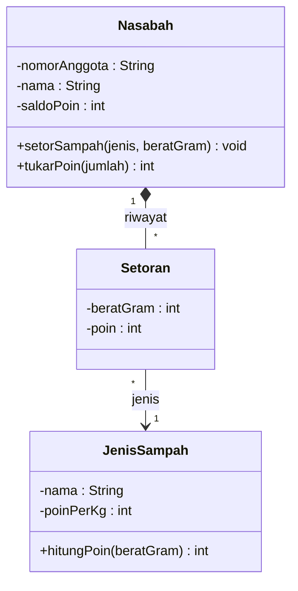
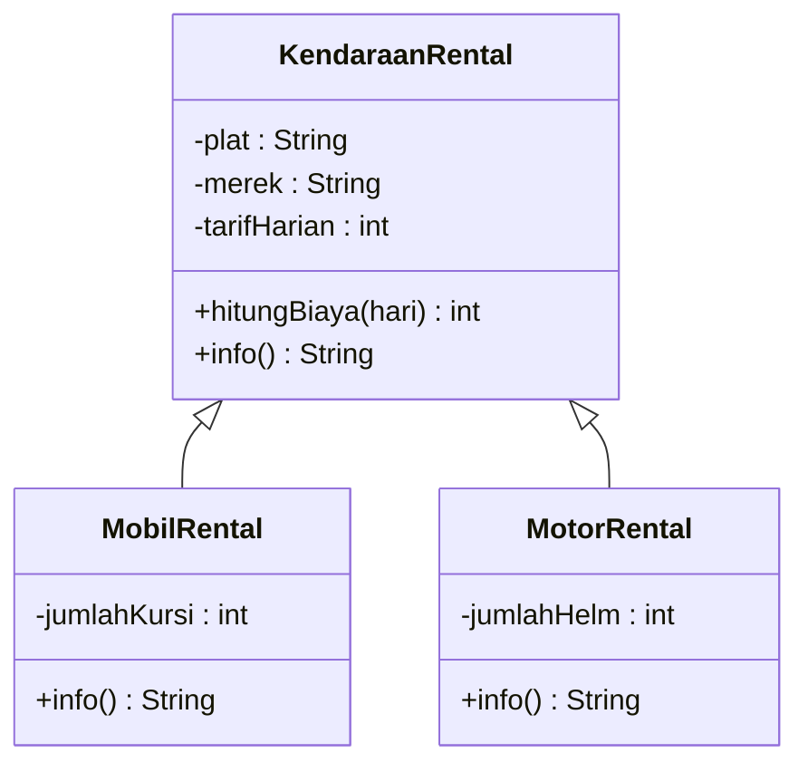
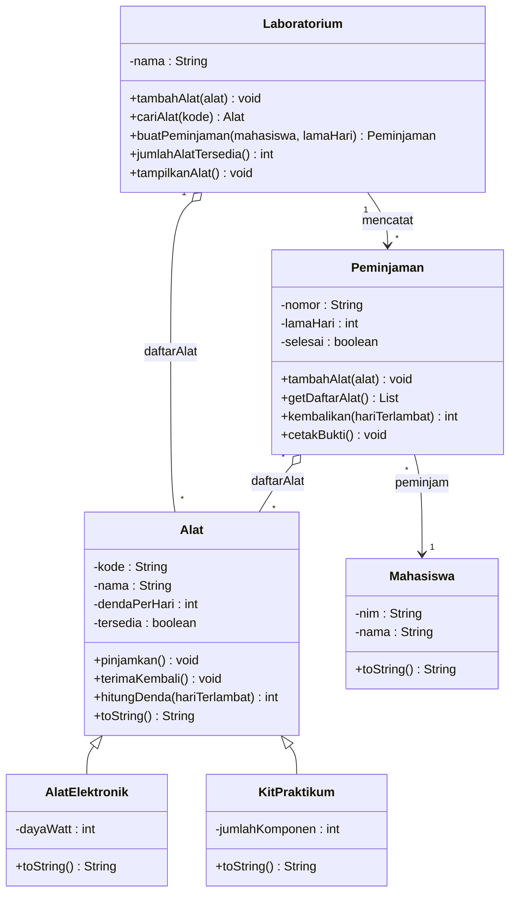
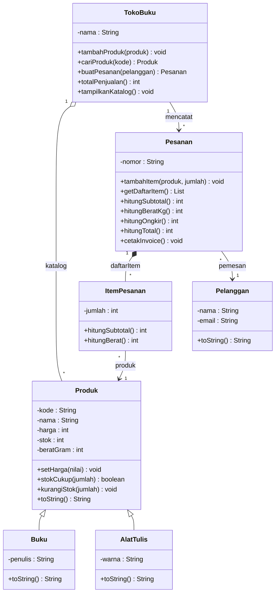

# Pembahasan Latihan Soal UTS

[⬅️ Latihan Soal](latihan-soal.md) · [🏠 Beranda](../README.md) · [Pertemuan 09 ➡️](../Pertemuan-09-Polimorfisme/README.md)

> [!WARNING]
> Baca halaman ini **setelah** kamu mencoba semua soal di [Latihan Soal](latihan-soal.md). Membaca pembahasan sebelum mencoba memang terasa cepat, tetapi otak hanya "mengenali" jawaban, bukan benar-benar mampu menemukannya. Saat ujian, yang dibutuhkan adalah kemampuan menemukan jawaban.

Setiap pembahasan menjelaskan **mengapa jawaban benar itu benar** dan **mengapa pilihan lain yang menggoda itu salah**. Jika jawabanmu salah, buka lagi materi pertemuan yang disebutkan.

## Daftar Isi

- [Kunci Jawaban Bagian A](#kunci-jawaban-bagian-a)
- [Pembahasan Bagian A](#pembahasan-bagian-a)
- [Jawaban Model Bagian B](#jawaban-model-bagian-b)
- [Pembahasan Bagian C](#pembahasan-bagian-c)
  - [Pembahasan C1: Peminjaman Alat Laboratorium](#pembahasan-c1-peminjaman-alat-laboratorium)
  - [Pembahasan C2: Toko Buku Daring](#pembahasan-c2-toko-buku-daring)
- [Hitung Skor Simulasi](#hitung-skor-simulasi)

---

## Kunci Jawaban Bagian A

| Soal | Jawaban | Materi | Pertemuan |
|---|---|---|---|
| A1 | B | Masalah data terpisah pada program prosedural | 01 |
| A2 | C | Kapan PBO tepat dipakai | 01 |
| A3 | A | Peran konstruktor | 02 |
| A4 | D | Objek mandiri dan *aliasing* | 02–03 |
| A5 | B | Atribut kelas (`static`) | 03 |
| A6 | A | `__str__` / `toString()` | 03 |
| A7 | C | Perlindungan atribut di Python dan Java | 04 |
| A8 | A | Validasi di setter | 04 |
| A9 | D | Komposisi dan agregasi | 05 |
| A10 | C | Mengembalikan salinan list | 05 |
| A11 | B | Membaca diagram kelas | 06 |
| A12 | D | Dari diagram ke kode | 06 |
| A13 | A | Urutan konstruktor dan *override* | 07 |
| A14 | B | *is-a* dan *has-a* | 07 |
| A15 | C | Aturan pewarisan | 07 |

## Pembahasan Bagian A

### Pembahasan A1

**Jawaban: B** · [Lihat soal](latihan-soal.md#soal-a1)

Ketiga list itu **tidak saling terhubung**. "Indeks yang sama berarti menu yang sama" hanyalah kesepakatan di kepala programmer, dan komputer tidak tahu kesepakatan itu. Perintah pengurutan hanya menggeser isi list nama, sedangkan list harga dan stok diam di tempat. Akibatnya, seperti yang kita lihat di Pertemuan 01, Es Teh Manis tiba-tiba berharga Rp18000.

- **A** salah: list berisi teks bisa diurutkan sesuai abjad tanpa error.
- **C** adalah miskonsepsi yang paling sering muncul. List tidak "tahu" bahwa ia berpasangan dengan list lain.
- **D** salah: justru datanya rusak, padahal tidak ada pesan error. Inilah yang membuat *bug* ini berbahaya.

PBO menyelesaikannya dengan membungkus nama, harga, dan stok ke dalam **satu objek**. Saat objek diurutkan, seluruh datanya ikut berpindah.

### Pembahasan A2

**Jawaban: C** · [Lihat soal](latihan-soal.md#soal-a2)

PBO paling terasa manfaatnya untuk program yang besar, memiliki banyak "benda" yang saling berinteraksi, dan perlu dirawat dalam waktu lama. Untuk skrip pendek sekali pakai, gaya prosedural sering sudah cukup dan lebih cepat ditulis. Pandangan seimbang ini dibahas di Pertemuan 01.

- **A** salah: tidak ada aturan jumlah kelas minimal. Kelas dibuat karena dibutuhkan, bukan untuk memenuhi kuota.
- **B** salah: PBO tidak otomatis membuat program lebih cepat. Keunggulannya ada pada keteraturan dan kemudahan perawatan.
- **D** salah: PBO dipakai di semua jenis program, termasuk program berbasis teks seperti KedaiKita.

> [!NOTE]
> Di Java, program sekecil apa pun tetap ditulis di dalam sebuah kelas karena memang begitu aturan bahasanya. Namun, itu tidak berarti programnya dirancang secara berorientasi objek.

### Pembahasan A3

**Jawaban: A** · [Lihat soal](latihan-soal.md#soal-a3)

Konstruktor berjalan otomatis tepat saat objek dibuat dan memaksa kita memberikan data yang dibutuhkan. Hasilnya, tidak ada objek "setengah jadi". Di Pertemuan 02 kita melihat akibat objek setengah jadi: `AttributeError` di Python, atau nilai `null`/`0` yang diam-diam masuk di Java. Mulai Pertemuan 04, konstruktor juga menjadi tempat **memvalidasi** data awal.

- **B** salah: atribut yang diisi dari luar tidak terhapus dengan sendirinya. Masalahnya adalah atribut itu bisa **lupa** diisi.
- **C** salah: alasan memakai konstruktor adalah kelengkapan dan kebenaran data, bukan kecepatan.
- **D** salah: kelas tanpa konstruktor tetap boleh punya method. Python memakai `__init__` bawaan, dan Java menyediakan konstruktor bawaan tanpa parameter.

### Pembahasan A4

**Jawaban: D** · [Lihat soal](latihan-soal.md#soal-a4)

Kuncinya ada di baris `b = a`. Baris itu **tidak** membuat objek baru. Variabel `b` hanya ikut menunjuk objek yang sama dengan `a` (*aliasing*, Pertemuan 03). Objek baru hanya lahir saat konstruktor dipanggil, yaitu dua kali.

```text
 a ---+
      +--->  [Rekening]  saldo: 100000 -> 150000   (diubah lewat b)
 b ---+

 c ------->  [Rekening]  saldo: 100000 -> 120000   (objek lain)
```

Jadi `a.saldo` dan `b.saldo` sama-sama 150000, sedangkan `c.saldo` 120000.

- **A** adalah jebakan utama: mengira `b` adalah salinan `a`.
- **B** salah: `c` adalah objek terpisah, setorannya hanya 20000.
- **C** salah: perubahan lewat `b` terlihat juga lewat `a`, karena objeknya satu.

### Pembahasan A5

**Jawaban: B** · [Lihat soal](latihan-soal.md#soal-a5)

`terjual` adalah **atribut kelas** (Java: `static`). Hanya ada satu nilai yang dipakai bersama semua objek `Tiket`. Nilainya bertambah setiap kali konstruktor berjalan, dan konstruktor hanya berjalan tiga kali: untuk Ayu, Bima, dan Citra. Baris `t3 = t1` tidak menjalankan konstruktor, karena tidak ada objek baru.

- **A** (`4`) adalah jebakan *aliasing* yang sama seperti soal A4.
- **C** (`1`) muncul jika kamu mengira setiap objek punya penghitung sendiri, seperti atribut objek.
- **D** (`0`) muncul jika kamu mengira atribut kelas tidak bisa diubah dari dalam konstruktor.

> [!WARNING]
> Jebakan khusus Python (Pertemuan 03): jika di konstruktor tertulis `self.terjual += 1`, Python **membuat atribut objek baru** bernama `terjual` yang "membayangi" atribut kelas. Akibatnya `Tiket.terjual` tetap 0. Hasil percobaan dengan dua objek: `Tiket.terjual` bernilai `0`, sedangkan `t1.terjual` dan `t2.terjual` masing-masing `1`. Selalu ubah atribut kelas lewat **nama kelasnya**: `Tiket.terjual += 1`.

### Pembahasan A6

**Jawaban: A** · [Lihat soal](latihan-soal.md#soal-a6)

`__str__` dan `toString()` bertugas **mengembalikan** teks. Pemanggil seperti `print()` atau `System.out.println()` yang kemudian mencetak teks itu. Di Java, `toString()` sebenarnya sudah diwarisi dari kelas `Object`, sehingga kita meng-*override*-nya dan menuliskan `@Override`.

- **C** adalah jebakan paling licin. Method yang mencetak lalu tidak mengembalikan apa-apa justru membuat error. Di Python, teksnya sempat tercetak, lalu program berhenti:

  ```text
  Buku: Laskar Pelangi
  Traceback (most recent call last):
    File "contoh.py", line 10, in <module>
      print(buku)
  TypeError: __str__ returned non-string (type NoneType)
  ```

  Di Java, programnya bahkan tidak bisa dikompilasi. Pesan error utamanya:

  ```text
  E5.java:15: error: toString() in Buku cannot override toString() in Object
      public void toString() {
                  ^
    return type void is not compatible with String
  ```

- **B** salah: nama kelas tidak memengaruhi cara objek dicetak.
- **D** salah besar: atribut kelas dimiliki bersama, sehingga semua buku akan punya judul yang sama.

### Pembahasan A7

**Jawaban: C** · [Lihat soal](latihan-soal.md#soal-a7)

Di Java, *compiler* menolak kode yang mengakses atribut `private` dari luar kelasnya (pesan error `... has private access in ...`). Di Python tidak ada pemeriksaan semacam itu. Awalan `_harga` hanyalah tanda "urusan internal, jangan disentuh dari luar". Awalan `__harga` membuat Python mengganti namanya menjadi `_NamaKelas__harga` (*name mangling*). Atribut itu masih bisa diakses oleh orang yang sengaja menulis nama barunya. Jadi, itu bukan fitur keamanan.

- **A** salah untuk Python.
- **B** salah: atribut *read-only* di Python dibuat dengan `@property` **tanpa setter**, bukan dengan garis bawah.
- **D** salah: `private` hanya bisa diakses dari dalam kelas yang mendeklarasikannya. Dua kelas terpisah tetap tidak bisa saling mengakses atribut `private` walaupun ditulis di file yang sama.

### Pembahasan A8

**Jawaban: A** · [Lihat soal](latihan-soal.md#soal-a8)

Telusuri langkah demi langkah:

1. `Nilai(80)`: setter memeriksa 80, lolos, lalu menyimpannya.
2. Mengisi 120: setter memeriksa **lebih dulu**, lalu menolak dengan `ValueError`/`IllegalArgumentException`. Baris penyimpanan tidak pernah dijalankan, sehingga nilai lama (80) tetap aman.
3. *Exception* itu ditangkap oleh `try`/`except` (`try`/`catch`), sehingga tercetak `Ditolak: Nilai harus 0 sampai 100` dan program **berlanjut**.
4. Baris terakhir mencetak `80`.

- **C** muncul jika kamu mengira nilai sudah tersimpan sebelum ditolak. Urutan "periksa dulu, baru simpan" adalah inti setter yang baik.
- **B** mengabaikan validasi sama sekali.
- **D** salah karena *exception*-nya ditangkap. Cara menangkap *exception* dibahas tuntas di Pertemuan 11.

### Pembahasan A9

**Jawaban: D** · [Lihat soal](latihan-soal.md#soal-a9)

| Pasangan | Petunjuk di soal | Relasi |
|---|---|---|
| `Gedung`–`Lantai` | lantai dibuat **di dalam** gedung dan ikut hilang bersama gedungnya | komposisi (belah ketupat penuh) |
| `Ukm`–`Mahasiswa` | mahasiswa **sudah ada** sebelumnya dan tetap ada setelah UKM bubar | agregasi (belah ketupat kosong) |

- **A** terbalik.
- **B** dan **C** salah karena dependensi berarti objek lain hanya **dipakai sementara**, misalnya sebagai parameter method, dan tidak disimpan sebagai atribut. Kedua hubungan di soal adalah hubungan "memiliki" yang disimpan dalam waktu lama.

Pertanyaan pembeda yang praktis: "Jika objek induknya hilang, apakah bagiannya masih bermakna?" Jika tidak, berarti komposisi. Jika masih, berarti agregasi.

### Pembahasan A10

**Jawaban: C** · [Lihat soal](latihan-soal.md#soal-a10)

Getter `daftar_lagu` / `getDaftarLagu()` mengembalikan **salinan** list. Variabel `lagu` menunjuk salinan itu, sehingga penambahan "Lagu Titipan" hanya mengubah salinan (3 elemen). List asli di dalam `Playlist` tetap berisi 2 elemen. Getter dipanggil lagi di akhir dan menghasilkan salinan baru dari list asli, jadi hasilnya `3 2`.

- **A** (`3 3`) adalah yang terjadi jika getter mengembalikan list **asli**. Kode di luar kelas bisa mengubah isi playlist tanpa lewat method `tambah`. Itulah yang dicegah di Pertemuan 05.
- **B** salah: menambah elemen ke salinan tetap berhasil.
- **D** terbalik.

### Pembahasan A11

**Jawaban: B** · [Lihat soal](latihan-soal.md#soal-a11)

- Angka `"1"` di sisi `Nasabah` dan `"1..*"` di sisi `Rekening` dibaca: **satu** nasabah memiliki **minimal satu** rekening (boleh banyak).
- Garis berpanah dari `Nasabah` ke `Rekening` menunjukkan arah navigasi: objek `Nasabah` menyimpan referensi ke rekening-rekeningnya, sehingga ia "mengenal" rekening tersebut.

Pilihan lain:

- **A** salah: `-` berarti `private`, justru **tidak boleh** diakses langsung dari kelas lain.
- **C** salah: pewarisan digambar dengan **segitiga kosong** (`<|--`), bukan panah biasa.
- **D** salah: `setor` bertipe `void`. Yang mengembalikan `int` adalah `getSaldo`.

### Pembahasan A12

**Jawaban: D** · [Lihat soal](latihan-soal.md#soal-a12)

- `Kendaraan <|-- Motor`: segitiga berada di sisi `Kendaraan`, jadi `Kendaraan` adalah kelas induk dan `Motor` kelas anaknya.
- `Motor *-- Mesin`: belah ketupat **penuh** berada di sisi `Motor`, jadi `Motor` memiliki `Mesin` secara **komposisi**. Mesin dibuat di dalam motor dan ikut "mati" bersamanya.

Wujudnya di kode kira-kira seperti ini (kelas `Mesin` dianggap sudah ada):

**Python:**

```python
class Motor(Kendaraan):
    def __init__(self, merek, cc):
        super().__init__(merek)
        self._mesin = Mesin(cc)  # komposisi: mesin dibuat di dalam
```

**Java:**

```java
class Motor extends Kendaraan {
    private Mesin mesin;

    Motor(String merek, int cc) {
        super(merek);
        this.mesin = new Mesin(cc); // komposisi: mesin dibuat di dalam
    }
}
```

- **A** membalik arah pewarisan dan mengubah komposisi menjadi dependensi.
- **B** salah pada kedua relasinya.
- **C** menggambarkan mesin yang dibuat di luar dan dipakai bersama. Itu ciri agregasi, bukan komposisi.

### Pembahasan A13

**Jawaban: A** · [Lihat soal](latihan-soal.md#soal-a13)

Telusuri urutan eksekusinya:

```text
Motor("Honda", 125)
  -> konstruktor Motor mulai
       -> baris pertama: konstruktor induk dipanggil (super)
            -> cetak "Kendaraan dibuat", isi merek
       <- kembali ke konstruktor Motor
       -> cetak "Motor dibuat", isi cc
m.info()
  -> yang berjalan info() milik Motor (versi override)
       -> memanggil info() milik induk: "Kendaraan Honda"
  <- "Kendaraan Honda" + " 125cc"
```

- **B** membalik urutan. Konstruktor induk dipanggil di baris pertama konstruktor anak, jadi pesannya muncul lebih dulu.
- **C** lupa bahwa versi *override* **memakai** hasil versi induk lewat `super`.
- **D** mengira konstruktor induk tidak berjalan dan *override* tidak berpengaruh.

> [!NOTE]
> Di Java 17, `super(...)` **wajib** menjadi pernyataan pertama di konstruktor, sehingga konstruktor induk selalu selesai lebih dulu. Di Python, `super().__init__(...)` sebaiknya juga ditulis di awal. Jika diletakkan di tengah, perintah sebelum baris itu akan berjalan lebih dulu.

### Pembahasan A14

**Jawaban: B** · [Lihat soal](latihan-soal.md#soal-a14)

Uji dengan kalimat. "Mobil **adalah** sebuah mesin" terdengar janggal, jadi ini bukan hubungan *is-a*. "Mobil **memiliki** mesin" terdengar wajar, jadi ini hubungan *has-a*. Wujudnya adalah atribut, misalnya dengan komposisi. Mobil tetap bisa "memakai ulang" kemampuan mesin dengan **meneruskan** tugas ke objek mesinnya:

**Python:**

```python
class Mobil:
    def __init__(self, merek: str, cc: int):
        self._merek = merek
        self._mesin = Mesin(cc)  # Mobil MEMILIKI Mesin (komposisi)

    def nyalakan(self):
        print(f"{self._merek} siap jalan.")
        self._mesin.nyalakan()  # tugas diteruskan ke objek Mesin
```

**Java:**

```java
class Mobil {
    private String merek;
    private Mesin mesin;

    public Mobil(String merek, int cc) {
        this.merek = merek;
        this.mesin = new Mesin(cc); // Mobil MEMILIKI Mesin (komposisi)
    }

    public void nyalakan() {
        System.out.println(merek + " siap jalan.");
        mesin.nyalakan(); // tugas diteruskan ke objek Mesin
    }
}
```

- **A** salah: komposisi seperti di atas juga merupakan cara memakai ulang kode.
- **C** salah: meng-*override* semua method tidak memperbaiki hubungan yang keliru sejak awal.
- **D** salah: kelas induk tentu boleh punya method, karena method itulah yang diwariskan.

### Pembahasan A15

**Jawaban: C** · [Lihat soal](latihan-soal.md#soal-a15)

Kelas anak boleh meng-*override* method induk, lalu memanggil versi induk dengan `super().nama_method()` (Python) atau `super.namaMethod()` (Java). Contohnya `__str__`/`toString()` milik `Makanan` di KedaiKita Pertemuan 07.

- **A** salah: di Java, sebuah kelas hanya boleh `extends` **satu** kelas induk. Python memang mendukung *multiple inheritance* (dengan aturan urutan pencarian method, yaitu MRO), tetapi pernyataan A berbicara tentang Java.
- **B** salah: kelas anak boleh menambah atribut dan method baru. Contohnya `Makanan` menambah `level_pedas`.
- **D** salah: method publik milik induk diwarisi dan bisa dipanggil lewat objek anak. Contohnya `Makanan` memakai `harga_setelah_diskon()` milik `Menu`.

---

## Jawaban Model Bagian B

Jawaban esai tidak harus sama kata per kata. Yang dinilai adalah **ketepatan konsep** dan **alasannya**. Nama kelas atau atribut yang berbeda tetap benar asalkan tanggung jawabnya tepat.

### Pembahasan B1

[Lihat soal](latihan-soal.md#soal-b1)

**1. Kelas, atribut, dan method** (hasil trik kata benda dan kata kerja):

| Kelas | Atribut | Method |
|---|---|---|
| `Nasabah` | `nomor_anggota`, `nama`, `saldo_poin` | `setor_sampah(jenis, berat_gram)`, `tukar_poin(jumlah)` |
| `JenisSampah` | `nama`, `poin_per_kg` | `hitung_poin(berat_gram)` |
| `Setoran` | `jenis` (objek `JenisSampah`), `berat_gram`, `poin` | (cukup menyimpan data; poin dihitung saat dibuat) |

Kelas `BankSampah` yang menyimpan daftar nasabah dan daftar jenis sampah juga boleh ditambahkan. Poin dihitung dengan bilangan bulat, misalnya `berat_gram * poin_per_kg // 1000` (Python) atau `/ 1000` (Java).

**2. Relasi dan multiplisitas:**

- `Nasabah` "1" — "*" `Setoran`: **komposisi**. Setoran dibuat di dalam method `setor_sampah` dan merupakan riwayat milik nasabah itu. Tanpa nasabahnya, setoran tidak bermakna.
- `Setoran` "*" — "1" `JenisSampah`: **asosiasi**. Banyak setoran merujuk satu jenis sampah. Jenis sampah tetap ada walaupun setorannya dihapus.
- (Jika ada `BankSampah`) `BankSampah` "1" — "*" `Nasabah` dan `JenisSampah`: **agregasi**.

Jawaban yang menyebut `Nasabah`–`Setoran` sebagai asosiasi masih bisa diterima **jika alasannya jelas**, misalnya setoran juga dicatat oleh petugas di tempat lain.

**3. Diagram kelas:**



**4. Atribut yang perlu dilindungi:** yang paling penting adalah `saldo_poin`. Atribut ini harus *read-only* dari luar (Python: `_saldo_poin` + `@property` tanpa setter; Java: `private` + getter tanpa setter). Nilainya hanya boleh berubah lewat "pintu resmi":

- `setor_sampah(...)` **menambah** poin sesuai perhitungan,
- `tukar_poin(jumlah)` **mengurangi** poin, dan menolak dengan `ValueError`/`IllegalArgumentException` jika poinnya tidak cukup.

Dengan begitu, tidak ada kode luar yang bisa menulis `saldo_poin = 999999`. Validasi lain yang masuk akal: `berat_gram` dan `poin_per_kg` harus lebih dari 0.

### Pembahasan B2

[Lihat soal](latihan-soal.md#soal-b2)

| Bagian | Python | Java |
|---|---|---|
| (a) | `@property` | `private` |
| (b) | `@celsius.setter` | `void` |
| (c) | `raise` | `throw` |

**(d)** Konstruktor memakai setter agar **aturan validasi hanya ditulis di satu tempat** dan berlaku juga saat objek dibuat. Jika konstruktor langsung mengisi `self._celsius`/`this.celsius`, objek bisa lahir dengan suhu -300 tanpa ketahuan. Dengan kode di atas, `Suhu(-300)` langsung ditolak dengan pesan `Suhu di bawah nol mutlak`, sehingga program tidak pernah memegang objek yang datanya salah. Hasil percobaan:

```text
30
Gagal: Suhu di bawah nol mutlak
```

(Baris pertama berasal dari `Suhu(30)` yang dicetak suhunya. Baris kedua berasal dari percobaan `Suhu(-300)` yang ditangkap dengan `try`.)

### Pembahasan B3

[Lihat soal](latihan-soal.md#soal-b3)

| Pasangan | Relasi | Multiplisitas | Wujud di kode |
|---|---|---|---|
| `Pesanan`–`ItemPesanan` | komposisi | 1 pesanan memiliki 0..* item; setiap item milik tepat 1 pesanan | list `_daftar_item`; item **dibuat di dalam** `tambah_item` |
| `Kedai`–`Menu` | agregasi | 1 kedai menyimpan 0..* menu | list `_daftar_menu`; menu dibuat di luar lalu dikirim lewat `tambah_menu(menu)` |
| `Mahasiswa`–`DosenWali` | asosiasi | banyak (*) mahasiswa menunjuk 1 dosen wali | atribut biasa, misalnya `_dosen_wali`, berisi referensi objek dosen wali |
| `Kasir`–`Printer` | dependensi | tidak disimpan, jadi tidak ada multiplisitas yang tetap | **hanya parameter** method `cetak_struk(printer)` dan tidak disimpan sebagai atribut |

**Mengapa mengembalikan salinan list?** Agar isi pesanan hanya bisa berubah lewat "pintu resmi" `tambah_item`, yang memeriksa jumlah dan mengurangi stok. Jika list aslinya yang dikembalikan, kode di luar kelas bisa menulis `pesanan.daftar_item.append(ItemPesanan(kopi, 100))`. Total pesanan langsung bertambah 100 kopi, padahal stok kopi tidak berkurang dan validasinya terlewati. Contoh lain, `pesanan.daftar_item.clear()` menghapus seluruh isi pesanan tanpa jejak.

### Pembahasan B4

[Lihat soal](latihan-soal.md#soal-b4)

**1. Arti simbol:**

| Simbol | Arti |
|---|---|
| `-` | `private`: hanya bisa diakses dari dalam kelas itu sendiri |
| `#` | `protected`: bisa diakses kelas itu dan kelas anaknya (di Java juga oleh kelas lain dalam paket yang sama). Di Python cukup ditandai dengan konvensi `_` |
| `+` | `public`: bisa diakses dari mana saja |
| `<\|--` | generalisasi/pewarisan; segitiga menunjuk kelas induk. `Dosen` mewarisi `Pegawai` |
| `o--` | agregasi; belah ketupat kosong di sisi "wadah". `Prodi` menaungi `Dosen`, tetapi dosen tetap ada walaupun pindah prodi |
| `"1"` dan `"*"` | satu prodi menaungi nol atau lebih dosen, dan setiap dosen dinaungi oleh satu prodi |

**2. Kode** (cukup salah satu bahasa):

**Python:**

```python
class Pegawai:
    def __init__(self, nip: str, nama: str, gaji_pokok: int):
        self._nip = nip
        self._nama = nama
        self._gaji_pokok = gaji_pokok  # "protected": cukup konvensi _ di Python

    def info(self) -> str:
        return f"{self._nip} - {self._nama}"


class Dosen(Pegawai):
    def __init__(self, nip: str, nama: str, gaji_pokok: int, nidn: str):
        super().__init__(nip, nama, gaji_pokok)
        self._nidn = nidn

    def info(self) -> str:
        return f"{super().info()} | NIDN {self._nidn}"
```

**Java:**

```java
class Pegawai {
    private String nip;
    private String nama;
    protected int gajiPokok;

    public Pegawai(String nip, String nama, int gajiPokok) {
        this.nip = nip;
        this.nama = nama;
        this.gajiPokok = gajiPokok;
    }

    public String info() {
        return nip + " - " + nama;
    }
}

class Dosen extends Pegawai {
    private String nidn;

    public Dosen(String nip, String nama, int gajiPokok, String nidn) {
        super(nip, nama, gajiPokok);
        this.nidn = nidn;
    }

    @Override
    public String info() {
        return super.info() + " | NIDN " + nidn;
    }
}
```

Jika dicoba dengan `Dosen("198001012005011001", "Rina Wati", 5000000, "0011223344")`, method `info()` menghasilkan:

```text
198001012005011001 - Rina Wati | NIDN 0011223344
```

Poin penilaian: konstruktor `Dosen` memanggil konstruktor induk; `info()` milik `Dosen` memakai `super` alih-alih menyalin ulang isi method induk; *access modifier* sesuai diagram; Java memakai `@Override`.

### Pembahasan B5

[Lihat soal](latihan-soal.md#soal-b5)

**1. Masalahnya: duplikasi kode (salin-tempel).** Atribut dan method yang sama ditulis dua kali. Jika aturan biaya berubah, misalnya ada potongan 10% untuk sewa minimal 7 hari, perubahannya harus dilakukan di **dua tempat**. Satu tempat mudah terlupa, sehingga mobil mendapat potongan tetapi motor tidak, dan *bug* seperti ini sulit ditemukan. Jika kelak ada `SepedaRental`, kodenya akan disalin untuk ketiga kalinya. (Prinsip "jangan mengulang diri sendiri" atau DRY dibahas lagi di Pertemuan 13.)

**2. Hierarki yang lebih baik:**



Atribut dan method yang sama dipindahkan ke induk `KendaraanRental`. Kelas anak hanya berisi yang berbeda (`jumlah_kursi` atau `jumlah_helm`) dan versi `info()`-nya sendiri. Aturan potongan cukup ditulis **sekali** di `hitung_biaya` milik induk.

**3. Memakai ulang `info()` milik induk** dengan `super`:

**Python:**

```python
    def info(self) -> str:
        return f"{super().info()} | {self._jumlah_kursi} kursi"
```

**Java:**

```java
    @Override
    public String info() {
        return super.info() + " | " + jumlahKursi + " kursi";
    }
```

Contoh hasil percobaan: mobil `KT 1234 AB Avanza` (tarif Rp350.000, 7 kursi) disewa 7 hari menghasilkan `info()` berupa `KT 1234 AB Avanza | 7 kursi` dan biaya 2205000, yaitu 2450000 dipotong 10%.

**4. Usulan "`MobilRental` mewarisi `Mesin`" tidak tepat.** Kalimat "mobil rental **adalah** sebuah mesin" tidak benar, jadi ini bukan hubungan *is-a*. Di Java, `MobilRental` juga sudah memakai jatah satu-satunya untuk `extends KendaraanRental`. Python memang mengizinkan banyak induk, tetapi rancangannya tetap salah makna. Alternatifnya adalah **komposisi**: `MobilRental` memiliki atribut `mesin` (objek `Mesin` dibuat di konstruktornya). Method `nyalakan()` milik mobil lalu meneruskan tugas ke `mesin.nyalakan()`, seperti contoh di [Pembahasan A14](#pembahasan-a14). Prinsip ini sering diringkas sebagai *composition over inheritance*.

---

## Pembahasan Bagian C

Kedua solusi tersedia dalam Python dan Java dengan output yang **identik**, dan output-nya sama persis dengan contoh output di soal. Cara menjalankan dan penjelasan baris demi baris ada di halaman [🐍 Solusi Python](python/README.md) dan [☕ Solusi Java](java/README.md). Bagian ini fokus pada **rancangan**: bagaimana sampai pada kelas-kelas itu, dan mengapa relasinya dipilih seperti itu.

### Pembahasan C1: Peminjaman Alat Laboratorium

[Lihat soal](latihan-soal.md#soal-c1-peminjaman-alat-laboratorium) · Solusi: [🐍 Python](python/solusi/soal_c1_peminjaman_alat.py) · [☕ Java](java/solusi/SoalC1PeminjamanAlat.java)

#### Langkah 1: Analisis Kebutuhan

| Dari soal | Menjadi |
|---|---|
| mahasiswa, alat, alat elektronik, kit praktikum, peminjaman, laboratorium | enam kelas |
| "alat elektronik **adalah** alat", "kit praktikum **adalah** alat" | pewarisan: `Alat` sebagai induk |
| "lab **memiliki** daftar alat", "peminjaman **berisi** alat", "peminjaman **milik** mahasiswa" | relasi *has-a* (agregasi dan asosiasi) |
| meminjamkan, menerima kembali, menghitung denda, mengembalikan, mencetak bukti | method |

#### Langkah 2: Diagram Kelas



> [!NOTE]
> Diagram ini memakai gaya penamaan Java (camelCase, `String`, `boolean`). Di Python, nama method ditulis snake_case (`terima_kembali`), `String` menjadi `str`, dan `boolean` menjadi `bool`. Getter sederhana tidak digambar agar diagram tetap mudah dibaca.

#### Langkah 3: Keputusan Desain dan Alasannya

1. **Denda per hari dikirim lewat konstruktor induk.** Antara alat elektronik dan kit, yang berbeda hanyalah **angkanya**, bukan cara menghitungnya. Karena itu, kelas anak cukup mengirim angka tetap ke `super`, dan `hitung_denda` ditulis sekali di `Alat`. Polanya sama dengan `Makanan` yang mengirim kategori `"Makanan"` ke `Menu` di Pertemuan 07.

   **Python:**

   ```python
       def __init__(self, kode: str, nama: str, daya_watt: int):
           super().__init__(kode, nama, DENDA_ELEKTRONIK)  # [3] konstruktor induk
           if daya_watt <= 0:
               raise ValueError("Daya harus lebih dari 0 watt")
           self._daya_watt = daya_watt
   ```

   **Java:**

   ```java
       public AlatElektronik(String kode, String nama, int dayaWatt) {
           super(kode, nama, DENDA_PER_HARI); // [3] konstruktor induk, WAJIB baris pertama
           if (dayaWatt <= 0) {
               throw new IllegalArgumentException("Daya harus lebih dari 0 watt");
           }
           this.dayaWatt = dayaWatt;
       }
   ```

2. **`Peminjaman`–`Alat` adalah agregasi, bukan komposisi.** Alat dibuat oleh pihak lain (didaftarkan ke lab), tetap ada setelah peminjaman selesai, dan bisa dipinjam lagi dalam peminjaman lain. Bandingkan dengan `ItemPesanan` di Soal C2 yang memang lahir dan "mati" bersama pesanannya.
3. **Status `tersedia` tidak punya setter.** Status hanya berubah lewat dua "pintu resmi", yaitu `pinjamkan()` dan `terima_kembali()`. Pintu `pinjamkan()` menolak alat yang sedang dipinjam. Polanya sama dengan stok di KedaiKita yang hanya berubah lewat `tambah_stok`/`kurangi_stok` (Pertemuan 04).
4. **`pinjamkan()` dipanggil sebelum alat disimpan.** Jika alat sedang dipinjam, *exception* dilempar dan baris penyimpanan tidak pernah dijalankan. Daftar alat tetap bersih tanpa perlu kode tambahan:

   **Python:**

   ```python
       def tambah_alat(self, alat: Alat):
           if self._selesai:
               raise ValueError(f"Peminjaman {self._nomor} sudah selesai")
           alat.pinjamkan()  # [9] gagal (ValueError) jika alat sedang dipinjam
           self._daftar_alat.append(alat)
   ```

   **Java:**

   ```java
       public void tambahAlat(Alat alat) {
           if (selesai) {
               throw new IllegalArgumentException("Peminjaman " + nomor + " sudah selesai");
           }
           alat.pinjamkan(); // [9] gagal (exception) jika alat sedang dipinjam
           daftarAlat.add(alat);
       }
   ```

5. **Nomor bertambah setelah validasi.** Peminjaman 10 hari ditolak **sebelum** penghitung bertambah. Karena itu, peminjaman sah pertama tetap bernomor `PJ001`, tanpa nomor yang "terbuang".
6. **`kembalikan()` mengembalikan angka, bukan mencetak.** Program utama yang memutuskan cara menampilkannya ("tepat waktu" atau "terlambat 2 hari"). Pembedaan antara *return* dan *print* ini sudah kita bahas sejak Pertemuan 02.

> [!NOTE]
> Java sebenarnya punya `IllegalStateException` yang lebih pas untuk situasi "keadaan objek tidak mengizinkan", misalnya alat yang sedang dipinjam. Jenis-jenis *exception* dibahas di Pertemuan 11. Untuk UTS, `IllegalArgumentException` yang sudah kita pelajari sudah cukup.

#### Kesalahan yang Sering Terjadi

- Menyimpan alat ke list **sebelum** memanggil `pinjamkan()`. Akibatnya, alat yang gagal dipinjam tetap tercatat di bukti Bima.
- Menulis ulang `hitung_denda` di setiap kelas anak, padahal yang berbeda hanya angkanya.
- Lupa memanggil konstruktor induk. Di Python, akibatnya `AttributeError: ... has no attribute '_kode'`. Di Java, akibatnya error kompilasi `constructor Alat in class Alat cannot be applied to given types`.
- Memakai `==` untuk membandingkan kode alat di Java. Gunakan `.equals()`.
- Mencetak `True`/`true` apa adanya. Ubah dulu menjadi teks "tersedia"/"dipinjam".

### Pembahasan C2: Toko Buku Daring

[Lihat soal](latihan-soal.md#soal-c2-toko-buku-daring) · Solusi: [🐍 Python](python/solusi/soal_c2_toko_buku.py) · [☕ Java](java/solusi/SoalC2TokoBuku.java)

#### Langkah 1: Analisis Kebutuhan

| Dari soal | Menjadi |
|---|---|
| pelanggan, produk, buku, alat tulis, item pesanan, pesanan, toko | tujuh kelas |
| "buku **adalah** produk", "alat tulis **adalah** produk" | pewarisan: `Produk` sebagai induk |
| "pesanan **terdiri atas** item", "toko **memiliki** katalog", "pesanan **milik** pelanggan" | komposisi, agregasi, asosiasi |
| mengurangi stok, menambah item, menghitung subtotal/berat/ongkir/total, mencetak invoice | method |

#### Langkah 2: Diagram Kelas



#### Langkah 3: Keputusan Desain dan Alasannya

1. **Generalisasi `Produk`.** Buku dan alat tulis sama-sama punya kode, nama, harga, stok, dan berat. Semua itu ditaruh di induk, sehingga kelas anak hanya menambah `penulis` atau `warna`. Menjadikan `AlatTulis` anak dari `Buku` akan salah, karena pulpen bukan sejenis buku.
2. **Komposisi `Pesanan`–`ItemPesanan`.** Objek `ItemPesanan` hanya dibuat di dalam `tambah_item`. Tidak ada kode luar yang membuatnya, dan item tidak bermakna tanpa pesanannya. Sebaliknya, `Produk` dibuat di luar lalu didaftarkan ke toko (agregasi).
3. **Urutan langkah di `tambah_item` itu disengaja:**

   **Python:**

   ```python
       def tambah_item(self, produk: Produk, jumlah: int):
           item = ItemPesanan(produk, jumlah)  # [5] item dibuat OLEH pesanan
           produk.kurangi_stok(jumlah)  # [6] gagal (ValueError) jika stok kurang
           self._daftar_item.append(item)  # [7] hanya disimpan jika semua lolos
   ```

   **Java:**

   ```java
       public void tambahItem(Produk produk, int jumlah) {
           ItemPesanan item = new ItemPesanan(produk, jumlah); // [5] item dibuat OLEH pesanan
           produk.kurangiStok(jumlah); // [6] gagal (exception) jika stok kurang
           daftarItem.add(item); // [7] hanya disimpan jika semua lolos
       }
   ```

   Jika jumlahnya 0, pembuatan item gagal **sebelum** stok tersentuh. Jika stok kurang, item tidak pernah masuk list. Seandainya urutannya dibalik (simpan dulu, baru kurangi stok), pesanan Budi akan berisi "3 x Negeri 5 Menara" walaupun stoknya hanya 2.
4. **Harga diisi lewat setter, bahkan di konstruktor.** Aturan "harga harus lebih dari 0" hanya ditulis sekali, dan berlaku saat produk dibuat maupun saat harga diubah. Karena setter memeriksa **sebelum** menyimpan, harga Bumi Manusia tetap Rp120.000 setelah percobaan mengisi -5000.
5. **Pembulatan ke atas tanpa bilangan pecahan.** Rumus `(gram + 999) // 1000` (Python) atau `(gram + 999) / 1000` (Java) menghasilkan 1 untuk 720 gram dan 2 untuk 1080 gram. Uang dan berat tetap bilangan bulat, sehingga tidak ada masalah pembulatan *float*.
6. **"GRATIS" adalah urusan tampilan.** `hitung_ongkir()` cukup mengembalikan 0. Method `cetak_invoice()` yang memutuskan menampilkan 0 sebagai `GRATIS`.

> [!TIP]
> **Untuk dipikirkan (level C5):** `ItemPesanan` menyimpan **referensi** ke `Produk` dan menghitung subtotal dari harga produk *saat ini*. Jika harga produk naik setelah pesanan dibuat, subtotal pesanan lama ikut berubah. Untuk soal ini hal itu tidak menjadi masalah. Namun, toko sungguhan biasanya menyimpan **harga saat membeli** di dalam item. Bagaimana kamu mengubah `ItemPesanan` agar subtotalnya tidak ikut berubah?

<details>
<summary>Lihat salah satu jawaban</summary>

Tambahkan atribut `harga_satuan` di `ItemPesanan` yang diisi **sekali** di konstruktor dengan `produk.harga`, lalu hitung subtotal dari `harga_satuan * jumlah`. Dengan begitu, perubahan harga produk di kemudian hari tidak memengaruhi pesanan yang sudah dibuat.

</details>

#### Kesalahan yang Sering Terjadi

- Mengurangi stok langsung dari luar kelas (misalnya `produk._stok -= 2`) alih-alih memanggil `kurangi_stok`. Cara ini melanggar enkapsulasi dan melewati validasi.
- Memakai pembagian biasa `/` di Python untuk kilogram. Hasilnya *float* (`1.08`), bukan bilangan bulat yang dibulatkan ke atas.
- Mengembalikan list asli dari `daftar_item`.
- Lupa bahwa total penjualan adalah jumlah **total bayar** (termasuk ongkir), bukan jumlah subtotal.
- Di Java, menulis `String.format("%,d", angka)` tanpa `Locale.US`. Di komputer berbahasa Indonesia, pemisah ribuannya bisa berbeda.

---

## Hitung Skor Simulasi

| Bagian | Cara menghitung | Maksimal |
|---|---|---|
| A | jumlah jawaban benar × 2 | 30 |
| B | setiap soal 0–6: **6** lengkap dan beralasan, **4** benar tetapi kurang lengkap, **2** baru sebagian kecil, **0** kosong atau salah konsep | 30 |
| C | (skor rubrik ÷ 100) × 20 untuk setiap soal | 40 |
| **Total** | | **100** |

| Skor total | Artinya | Saran |
|---|---|---|
| 85–100 | Siap menghadapi UTS | Ulangi soal yang salah, lalu coba kerjakan ulang Soal C dengan bahasa satunya sebagai bonus |
| 70–84 | Hampir siap | Pelajari lagi pertemuan yang soalnya salah, lalu kerjakan ulang kuis pertemuan tersebut |
| 50–69 | Sudah paham sebagian | Ikuti rencana belajar di [halaman Informasi UTS](README.md), terutama bagian ringkasan dan checklist |
| 0–49 | Perlu belajar ulang secara terjadwal | Mulai dari Pertemuan 02, jalankan lagi semua contoh, lalu kerjakan latihan tiap pertemuan sebelum mencoba latihan soal ini lagi |

## ➡️ Langkah Berikutnya

- Pelajari solusi lengkapnya baris demi baris: [🐍 Solusi Python](python/README.md) atau [☕ Solusi Java](java/README.md).
- Setelah UTS, perjalanan berlanjut ke [Pertemuan 09: Polimorfisme](../Pertemuan-09-Polimorfisme/README.md). Di sana kamu akan melihat mengapa *override* yang kita pakai di soal praktik ternyata jauh lebih kuat daripada yang terlihat sekarang.

---

[⬅️ Latihan Soal](latihan-soal.md) · [🏠 Beranda](../README.md) · [Pertemuan 09 ➡️](../Pertemuan-09-Polimorfisme/README.md)
