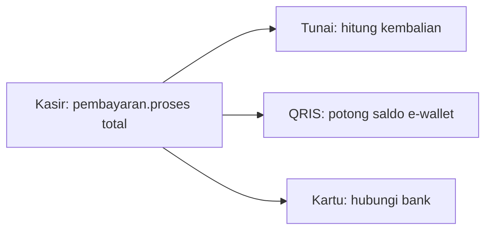
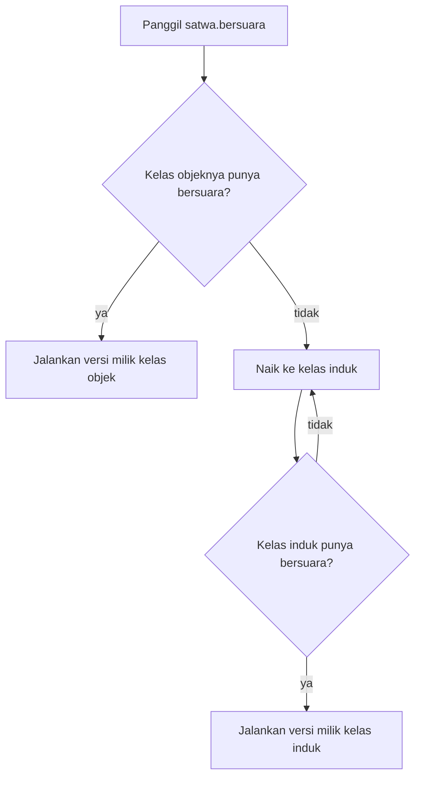
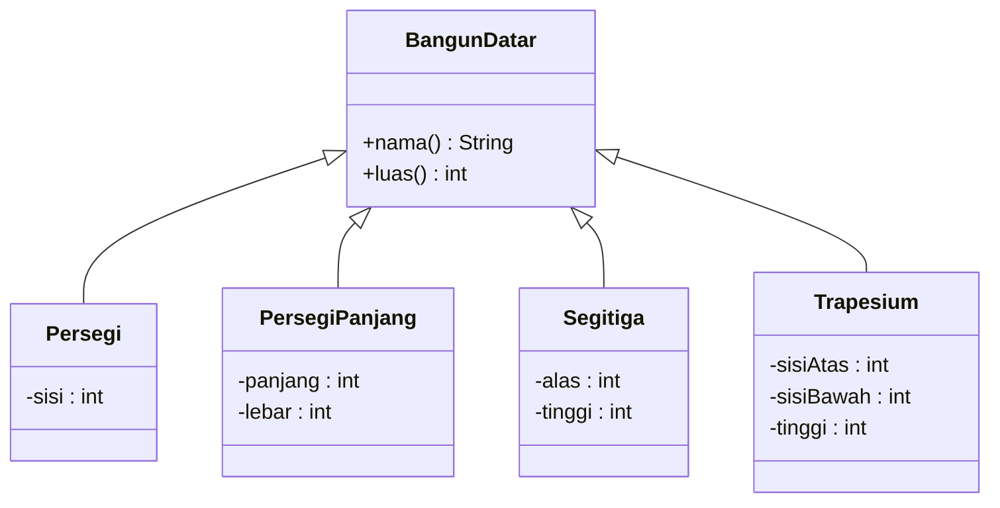
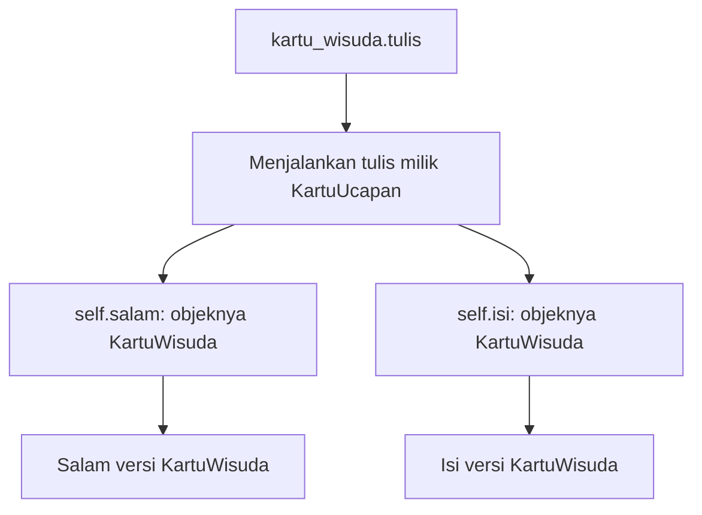
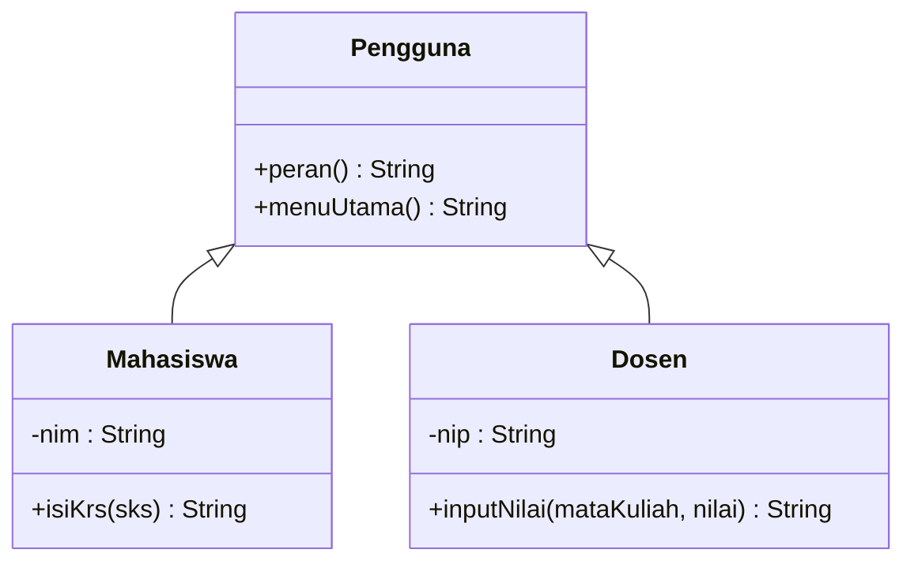
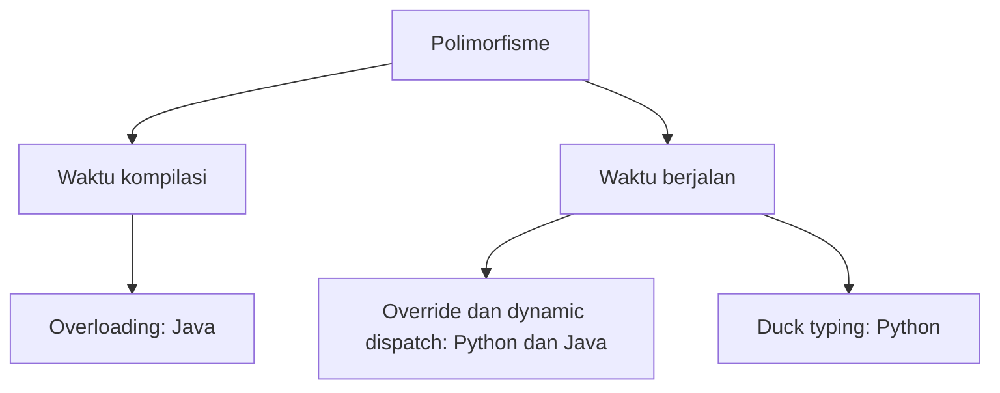
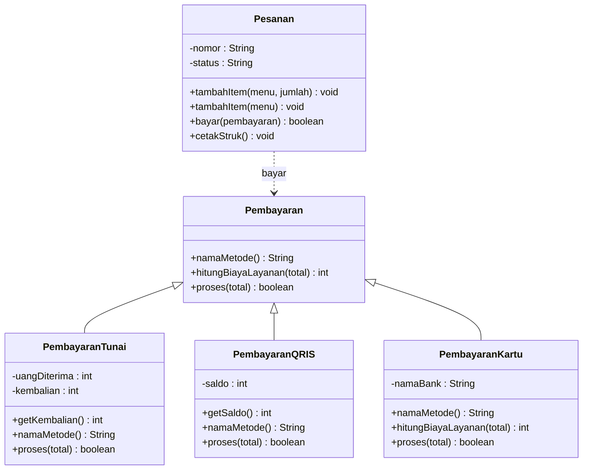
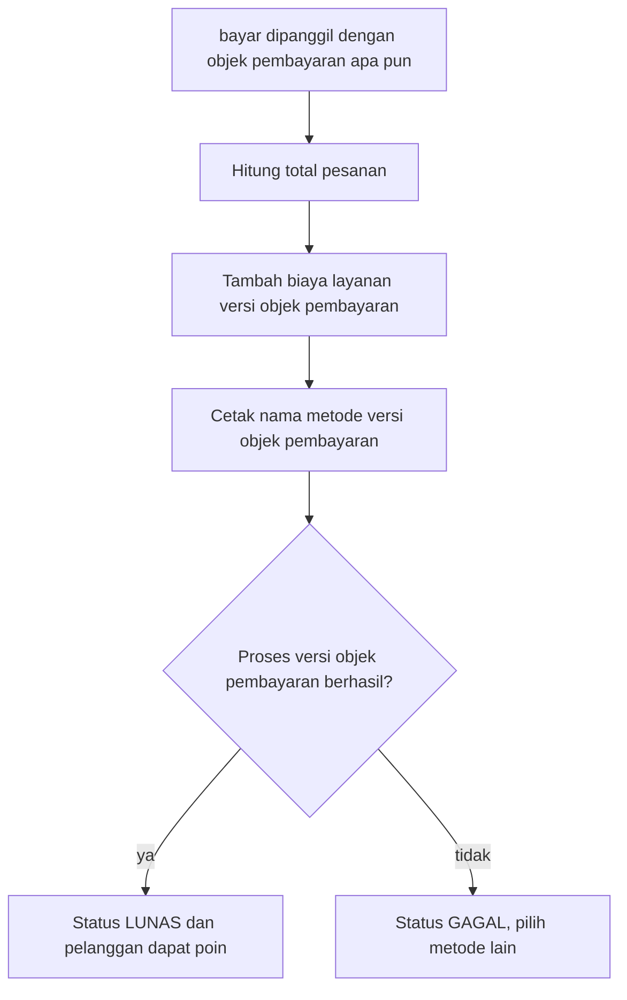

# Pertemuan 09 — Polimorfisme

[⬅️ Pertemuan 08](../Pertemuan-08-UTS/README.md) · [🏠 Beranda](../README.md) · [Pertemuan 10 ➡️](../Pertemuan-10-Abstract-Class-dan-Interface/README.md)

> Selamat datang kembali setelah UTS! Hari ini kita mempelajari pilar ketiga PBO: **polimorfisme**. Dengan polimorfisme, satu perintah yang sama bisa dijalankan dengan cara yang berbeda-beda oleh objek yang berbeda. Hasilnya, kode pemanggil tetap pendek dan rapi, dan jenis baru bisa ditambahkan tanpa membongkar kode lama. KedaiKita akan memakainya untuk menerima pembayaran tunai, QRIS, dan kartu kredit lewat **satu** method yang sama.

## 🎯 Tujuan Pembelajaran

Setelah pertemuan ini, kamu mampu:

1. Menjelaskan arti **polimorfisme** dengan analogi sehari-hari dan mengenali wujudnya di dalam kode.
2. Menjelaskan cara kerja polimorfisme saat program berjalan: *override* ditambah ***dynamic dispatch***, termasuk beda **tipe variabel** dan **tipe objek**.
3. Merancang **koleksi polimorfik** sehingga jenis baru bisa ditambahkan tanpa mengubah kode pemanggil.
4. Membedakan ***upcasting*** dan ***downcasting***, serta menentukan kapan jenis objek perlu diperiksa dengan `isinstance`/`instanceof`.
5. Membedakan *overriding* dan *overloading*, serta menjelaskan padanannya di Python (nilai bawaan, `*args`) dan ***duck typing***.
6. Menjelaskan rancangan pembayaran KedaiKita yang polimorfik.

## 🧭 Peta Belajar

| Langkah | Bagian | Perkiraan waktu |
|---|---|---|
| 1 | Konsep (halaman ini) | 45 menit |
| 2 | Praktik: [🐍 Python](python/README.md) **atau** [☕ Java](java/README.md) | 90 menit |
| 3 | [Jembatan Python ↔ Java](jembatan-python-java.md) | 15 menit |
| 4 | [Latihan](latihan.md) | 60 menit |
| 5 | [Kuis](kuis.md) | 15 menit |

## 🔁 Mengingat Kembali

Pertemuan 08 adalah UTS. Materi terakhir sebelum UTS ada di [Pertemuan 07](../Pertemuan-07-Pewarisan/README.md):

- **Pewarisan** membuat kelas anak mewarisi atribut dan method kelas induk. Hubungannya *is-a*: `Makanan` **adalah** `Menu`.
- Kelas anak boleh meng-***override*** method induk, yaitu menulis ulang method dengan nama dan parameter yang sama.
- Objek anak juga terhitung objek induk. Program bisa memeriksanya dengan `isinstance` (Python) atau `instanceof` (Java).
- Di studi kasus Pertemuan 07, method yang menampilkan menu kedai hanya mencetak `menu` tanpa tahu jenisnya, tetapi makanan tampil dengan level pedas dan minuman tampil dengan suhu. Saat itu penjelasannya kita tunda ke pertemuan ini. Jawabannya adalah polimorfisme.
- Di [Pertemuan 03](../Pertemuan-03-Atribut-dan-Method/README.md), kita juga sudah mengenal konstruktor yang luwes: **nilai bawaan** di Python dan ***overloading*** di Java. Di [Pertemuan 06](../Pertemuan-06-UML-Class-Diagram/README.md), kita sempat mengintip diagram `Pembayaran` dengan tiga kelas anak. Hari ini keduanya dibahas tuntas.

## Daftar Isi

1. [Masalah: Kasir dengan Banyak Cara Bayar](#1-masalah-kasir-dengan-banyak-cara-bayar)
2. [Polimorfisme: Satu Perintah, Banyak Bentuk](#2-polimorfisme-satu-perintah-banyak-bentuk)
3. [Cara Kerjanya: Override dan Dynamic Dispatch](#3-cara-kerjanya-override-dan-dynamic-dispatch)
4. [Koleksi Polimorfik dan Menambah Jenis Baru](#4-koleksi-polimorfik-dan-menambah-jenis-baru)
5. [Polimorfisme dari Dalam Kelas](#5-polimorfisme-dari-dalam-kelas)
6. [Upcasting, Downcasting, dan Memeriksa Jenis Objek](#6-upcasting-downcasting-dan-memeriksa-jenis-objek)
7. [Duck Typing: Yang Penting Bisa, Bukan Siapa](#7-duck-typing-yang-penting-bisa-bukan-siapa)
8. [Overloading: Satu Nama, Daftar Parameter Berbeda](#8-overloading-satu-nama-daftar-parameter-berbeda)
9. [Aturan Override yang Perlu Diingat](#9-aturan-override-yang-perlu-diingat)
10. [Studi Kasus KedaiKita: Banyak Cara Bayar](#10-studi-kasus-kedaikita-banyak-cara-bayar)
11. [Miskonsepsi yang Sering Terjadi](#11-miskonsepsi-yang-sering-terjadi)

---

## 1. Masalah: Kasir dengan Banyak Cara Bayar

Sejak Pertemuan 05, KedaiKita sudah bisa mencatat pesanan dan mencetak struk. Namun pesanan belum bisa **dibayar**. Pemilik kedai ingin menerima tiga cara bayar:

| Cara bayar | Aturannya |
|---|---|
| Tunai | Uang yang diterima harus cukup. Kasir menghitung kembalian |
| QRIS | Saldo e-wallet pelanggan dipotong. Gagal jika saldo kurang |
| Kartu kredit | Selalu disetujui, tetapi pelanggan dikenai biaya layanan 2% |

Cara yang paling cepat terpikir: buat satu fungsi `bayar` dengan percabangan berdasarkan **jenis** pembayaran.

```text
fungsi bayar(pesanan, jenis, data):
    jika jenis == "tunai":
        periksa uang cukup, hitung kembalian
    jika tidak, jika jenis == "qris":
        periksa saldo cukup, potong saldo
    jika tidak, jika jenis == "kartu":
        tambah biaya 2%, hubungi bank
    jika tidak:
        tampilkan "jenis tidak dikenal"
```

Kodenya memang berjalan. Masalahnya baru terasa ketika program tumbuh:

| Kejadian | Akibatnya pada kode berpercabangan |
|---|---|
| Kedai ingin menerima voucher | Fungsi `bayar` harus **dibongkar** untuk menambah satu cabang lagi |
| Struk, laporan harian, dan biaya layanan juga butuh tahu jenis pembayaran | Percabangan yang sama **tersebar** di banyak tempat. Lupa mengubah satu tempat, hasilnya tidak konsisten |
| Ada yang menulis `"Tunai"` dengan huruf T besar | Tidak ada cabang yang cocok. Kesalahan baru ketahuan saat program berjalan |
| Aturan QRIS diubah | Kita harus menyentuh fungsi yang juga berisi aturan tunai dan kartu. Risiko merusak bagian lain |

Akar masalahnya: **pemanggil** dipaksa tahu semua jenis pembayaran dan cara kerjanya masing-masing. Seharusnya pemanggil cukup berkata "bayar!", lalu setiap jenis pembayaran mengurus dirinya sendiri.

## 2. Polimorfisme: Satu Perintah, Banyak Bentuk

Pikirkan tombol **"Bayar"** di aplikasi pesan antar makanan. Kamu selalu menekan tombol yang sama. Namun yang terjadi di baliknya berbeda-beda:

- Jika metodenya **tunai**, aplikasi memberi tahu driver untuk menerima uang.
- Jika metodenya **e-wallet**, saldo di dompet digitalmu langsung terpotong.
- Jika metodenya **kartu kredit**, aplikasi menghubungi bank.

Tombolnya satu, perilakunya banyak. Contoh lain: tombol ▶ di ponselmu. Tombol yang sama bisa memutar lagu, video, atau podcast. Setiap jenis media tahu sendiri cara memutar dirinya.

Kata **polimorfisme** berasal dari bahasa Yunani: *poly* berarti "banyak" dan *morph* berarti "bentuk". Jadi, polimorfisme berarti "banyak bentuk".

> **Polimorfisme** (*polymorphism*) adalah kemampuan objek-objek dari kelas yang berbeda untuk menanggapi **pemanggilan method yang sama** dengan **cara masing-masing**. Pemanggil cukup tahu *apa* yang diminta, tanpa perlu tahu *bagaimana* setiap objek mengerjakannya.



Bandingkan dengan masalah di bagian 1. Kasir tidak lagi bertanya "kamu jenis apa?". Kasir cukup mengirim pesan yang sama, `proses(total)`, ke objek pembayaran apa pun yang diberikan pelanggan.

### Polimorfisme yang sudah lama kamu pakai

Tanpa sadar, kamu sudah bertemu polimorfisme sejak kuliah pemrograman dasar:

| Ekspresi | Hasil | Artinya |
|---|---|---|
| `2 + 3` | `5` | Untuk angka, `+` berarti **menjumlahkan** |
| `"Kopi" + "Susu"` | `"KopiSusu"` | Untuk teks, `+` berarti **menyambung** |
| mencetak objek `Makanan` (Pertemuan 07) | `... \| pedas level 2` | Teks objek memakai versi milik `Makanan` |
| mencetak objek `Minuman` (Pertemuan 07) | `... \| dingin` | Teks objek memakai versi milik `Minuman` |

Satu simbol atau satu perintah, perilakunya menyesuaikan siapa yang menerimanya. Itulah polimorfisme.

## 3. Cara Kerjanya: *Override* dan *Dynamic Dispatch*

Polimorfisme yang paling sering dipakai di PBO berdiri di atas dua bahan:

1. **Kelas anak meng-*override* method induk.** Ini sudah kamu pelajari di Pertemuan 07. `Kucing`, `Anjing`, dan `Bebek` masing-masing menulis ulang method `bersuara()` milik `Hewan`.
2. **Saat program berjalan, pemanggilan method memilih versi milik objek yang sebenarnya.** Mekanisme ini disebut ***dynamic dispatch*** (pemilihan method secara dinamis), atau juga *late binding*.

### Tipe variabel dan tipe objek

Bayangkan sebuah kardus berlabel **"Hewan"**. Isinya ternyata seekor kucing. Ketika kardus itu "disuruh bersuara", yang terdengar tentu "Meong!", bukan suara hewan umum. Label kardus tidak mengubah isinya.

Di kode, label kardus adalah **tipe variabel**, sedangkan isinya adalah **tipe objek**.

```text
 Variabel (label)            Objek di memori (isi)
 -----------------           ------------------------------
 hewan : Hewan   ------->    [Kucing] nama = "Oyen"
                                      bersuara() -> "Meong!"
```

- **Tipe variabel** adalah jenis yang ditulis saat variabel dideklarasikan. Di Java, misalnya `Hewan hewan = ...`. Python tidak menulis tipe variabel, tetapi idenya sama: variabel hanyalah label yang menunjuk objek.
- **Tipe objek** adalah kelas yang dipakai saat objek dibuat, misalnya `Kucing`. Tipe objek melekat seumur hidup objek dan tidak pernah berubah.

> [!IMPORTANT]
> Untuk method yang di-*override*, yang menentukan versi mana yang berjalan adalah **tipe objek**, bukan tipe variabel. Variabel bertipe `Hewan` yang menunjuk objek `Kucing` akan menjalankan `bersuara()` milik `Kucing`.

Sekilas wujudnya di kedua bahasa (detailnya di halaman praktik):

**Python:**

```python
hewan = Kucing("Oyen")
print(hewan.bersuara())   # Meong!
hewan = Anjing("Bruno")
print(hewan.bersuara())   # Guk guk!
```

**Java:**

```java
Hewan hewan = new Kucing("Oyen");
System.out.println(hewan.bersuara());   // Meong!
hewan = new Anjing("Bruno");
System.out.println(hewan.bersuara());   // Guk guk!
```

Baris `hewan.bersuara()` ditulis persis sama dua kali, tetapi hasilnya berbeda, karena objek yang ditunjuk berbeda.

### Bagaimana program mencari method?

Saat sebuah method dipanggil, program mencarinya mulai dari **kelas objek itu sendiri**. Jika tidak ditemukan, pencarian naik ke kelas induk, lalu ke induknya lagi, sampai ketemu.



Contohnya, kelas `Ikan` tidak meng-*override* `bersuara()`. Saat objek ikan disuruh bersuara, pencarian naik ke `Hewan` dan menemukan versi umum: `(diam saja)`. Jadi polimorfisme tidak mewajibkan semua anak meng-*override*. Anak yang tidak meng-*override* otomatis memakai versi induk.

## 4. Koleksi Polimorfik dan Menambah Jenis Baru

Kekuatan polimorfisme paling terasa ketika objek-objek berbeda jenis disimpan dalam **satu koleksi** (list atau array), lalu diproses dengan **satu perulangan**.

> **Koleksi polimorfik** adalah koleksi yang dideklarasikan untuk tipe induk, tetapi isinya objek dari berbagai kelas anak.

Misalnya, sebuah toko bahan bangunan menghitung luas berbagai potongan keramik: persegi, persegi panjang, dan segitiga.



Fungsi pencetak laporan cukup berbunyi seperti ini:

```text
untuk setiap bangun di daftar:
    cetak bangun.nama() dan bangun.luas()
    tambahkan luasnya ke total
```

Fungsi itu **tidak menyebut satu pun** kelas anak. Ia hanya mengenal `BangunDatar`. Suatu hari, toko mulai menjual potongan berbentuk trapesium. Apa yang harus diubah?

| | Tanpa polimorfisme (percabangan) | Dengan polimorfisme |
|---|---|---|
| Menambah jenis trapesium | Tambah cabang baru di **setiap** fungsi yang memeriksa jenis | Tulis kelas `Trapesium` saja |
| Fungsi pencetak laporan | Ikut diubah | **Tidak disentuh sama sekali** |
| Risiko merusak kode lama | Besar | Kecil, karena kode lama tidak diubah |
| Rumus luas trapesium tersimpan di | Fungsi pencetak (bercampur dengan rumus lain) | Kelas `Trapesium` sendiri |

Prinsip ini punya nama: kode sebaiknya **terbuka untuk penambahan, tetapi tertutup untuk perubahan**. Programmer menyebutnya *Open/Closed Principle*, dan kita akan membahasnya lagi di Pertemuan 13 (Prinsip SOLID).

> [!NOTE]
> Di contoh praktik, `BangunDatar` "umum" mengembalikan luas 0. Rasanya janggal, bukan? Bangun datar tanpa bentuk memang tidak masuk akal untuk dibuat objeknya. Di Pertemuan 10, kita belajar cara melarangnya dengan **kelas abstrak**.

## 5. Polimorfisme dari Dalam Kelas

Sejauh ini, method dipanggil dari **luar** objek. Polimorfisme juga bekerja ketika sebuah method milik induk memanggil method lain milik objek yang sama.

Bayangkan percetakan kartu ucapan di dekat kampus. Semua kartu dicetak dengan **kerangka** yang sama: baris salam, baris isi, lalu nama pengirim. Kartu ulang tahun dan kartu wisuda hanya berbeda **isinya**.

Kerangka itu cukup ditulis sekali di kelas induk `KartuUcapan`, dalam method `tulis()`:

```text
tulis():
    cetak salam()      <- versi milik objek yang sebenarnya
    cetak isi()        <- versi milik objek yang sebenarnya
    cetak nama pengirim
```

Ketika objek `KartuWisuda` menjalankan `tulis()`, method `tulis()` yang berjalan memang milik induk. Namun di dalamnya, `salam()` dan `isi()` dipanggil lewat `self`/`this`, yaitu objek kartu wisuda itu sendiri. Akibatnya, versi milik `KartuWisuda` yang dipakai.



> [!IMPORTANT]
> `self` (Python) dan `this` (Java) **selalu** menunjuk objek yang sebenarnya, bahkan ketika kode yang sedang berjalan ditulis di kelas induk.

Pola "kerangka di induk, isian di anak" sangat berguna. Di Pertemuan 10, pola ini diresmikan dengan nama *template method*.

## 6. *Upcasting*, *Downcasting*, dan Memeriksa Jenis Objek

Bayangkan Sistem Informasi Akademik (SIA) kampus. Pemakainya ada mahasiswa dan dosen. Keduanya **adalah** pengguna SIA, jadi keduanya bisa login dan membuka profil. Namun hanya mahasiswa yang bisa **mengisi KRS**, dan hanya dosen yang bisa **menginput nilai**.



### *Upcasting*: memandang anak sebagai induk

Ketika objek `Mahasiswa` disimpan dalam variabel atau list bertipe `Pengguna`, kita sedang memandang objek itu sebagai "pengguna secara umum".

> ***Upcasting*** adalah memperlakukan objek kelas anak sebagai objek kelas induknya. Upcasting selalu **aman** dan terjadi **otomatis**, karena setiap mahasiswa pasti seorang pengguna.

Lewat "kacamata" `Pengguna`, kita hanya boleh meminta hal yang bisa dilakukan **semua** pengguna, seperti `peran()` dan `menuUtama()`. Hasilnya tetap versi milik objek sebenarnya (polimorfisme).

### *Downcasting*: memandang induk sebagai anak tertentu

Bagaimana jika kita perlu memanggil `isiKrs()`, yang hanya dimiliki mahasiswa? Kita harus memandang objek itu kembali sebagai `Mahasiswa`.

> ***Downcasting*** adalah memperlakukan objek yang sedang dipandang sebagai kelas induk menjadi kelas anak tertentu. Downcasting **tidak selalu aman**, karena belum tentu setiap pengguna adalah mahasiswa.

Analogi: seorang petugas parkir melihat "kendaraan" yang masuk. Sebelum meminta pengemudinya menunjukkan SIM C, petugas harus **yakin dulu** bahwa kendaraan itu motor. Meminta SIM C dari pengemudi truk tentu keliru.

```text
          upcasting (otomatis, selalu aman)
   Mahasiswa  ---------------------------->  Pengguna
              <----------------------------
          downcasting (harus diperiksa dulu)
```

### Perbedaan di Python dan Java

| | Python | Java |
|---|---|---|
| Upcasting | Tidak ada istilah khusus. Variabel tidak bertipe | Otomatis: `Pengguna p = new Mahasiswa(...)` |
| Memanggil method khusus anak | Langsung bisa dipanggil. Jika objeknya tidak punya method itu, muncul `AttributeError` saat **program berjalan** | Ditolak *compiler* jika tipe variabelnya induk. Harus di-*cast* dulu: `(Mahasiswa) p` |
| Memeriksa jenis objek | `isinstance(p, Mahasiswa)` | `p instanceof Mahasiswa` |
| Salah menebak jenis | `AttributeError` | `ClassCastException` saat program berjalan |

Java juga punya bentuk singkat sejak Java 16: `p instanceof Mahasiswa m` memeriksa jenis **sekaligus** menyiapkan variabel `m` yang sudah bertipe `Mahasiswa`. Halaman praktik Java menunjukkan kedua bentuknya.

> [!WARNING]
> Memeriksa jenis objek itu ibarat obat, bukan makanan sehari-hari. Jika kodemu penuh `isinstance`/`instanceof` untuk memilih perilaku, itu tanda rancangannya belum memanfaatkan polimorfisme. Pindahkan perilaku itu ke dalam kelas masing-masing sebagai method yang di-*override*. Pemeriksaan jenis pantas dipakai hanya untuk fitur yang memang **khusus** dimiliki satu jenis, seperti kembalian pada pembayaran tunai.

## 7. *Duck Typing*: Yang Penting Bisa, Bukan Siapa

Ada pepatah dari dunia pemrograman: *"Jika sesuatu berjalan seperti bebek dan berbunyi seperti bebek, anggap saja ia bebek."*

Bayangkan pagi hari di asrama mahasiswa. Yang membangunkan penghuni bisa ayam jago tetangga, alarm ponsel, atau kentongan pos ronda. Ketiganya sama sekali tidak bersaudara. Namun kamu tidak peduli **siapa** mereka. Yang penting, ketiganya **bisa berbunyi**.

> ***Duck typing*** adalah gaya polimorfisme yang tidak memeriksa kelas sebuah objek. Objek dianggap cocok selama ia **punya method yang dibutuhkan**, walaupun tidak mewarisi kelas induk yang sama.

| | Python | Java |
|---|---|---|
| Objek tanpa induk bersama, tetapi sama-sama punya `bunyikan()` | Bisa diproses dengan satu perulangan | Ditolak *compiler*. Objek-objek itu butuh **tipe bersama** |
| Jika ternyata ada objek yang tidak punya `bunyikan()` | `AttributeError` saat program berjalan | Sudah ketahuan saat kompilasi |
| Kelebihan | Luwes dan ringkas | Kesalahan tertangkap lebih awal |

Python menganut *duck typing* secara alami. Java mewajibkan tipe bersama. Untuk sekarang, tipe bersama itu berupa kelas induk. Namun "ayam jago **adalah** sumber bunyi" terdengar dipaksakan, bukan? Untuk kemampuan bersama seperti "bisa berbunyi", Java punya alat yang lebih tepat bernama ***interface***, yang kita pelajari di Pertemuan 10.

## 8. *Overloading*: Satu Nama, Daftar Parameter Berbeda

Polimorfisme yang dibahas sejauh ini terjadi saat program **berjalan**. Ada satu bentuk lagi yang terjadi saat program **dikompilasi**, dan bentuk ini khusus Java.

Bayangkan katalog perpustakaan kampus. Ada satu menu bernama "Cari". Kamu boleh mencari dengan judul saja, dengan tahun terbit saja, atau dengan keduanya. Nama menunya tetap satu, tetapi isian yang kamu berikan berbeda-beda.

> ***Overloading*** adalah menulis beberapa method (atau konstruktor) dengan **nama yang sama** di kelas yang sama, tetapi **daftar parameternya berbeda**: jumlahnya, tipenya, atau urutan tipenya.

```text
cari(String kataKunci)              <- cari judul saja
cari(int tahun)                     <- cari tahun saja (tipe parameter berbeda)
cari(String kataKunci, int tahun)   <- cari keduanya (jumlah parameter berbeda)
```

*Compiler* Java memilih versi yang cocok dengan argumen **saat kompilasi**, berdasarkan tipe argumen yang tertulis di kode. Karena itu overloading disebut **polimorfisme waktu kompilasi** (*compile-time polymorphism*). Sebaliknya, *override* + *dynamic dispatch* disebut **polimorfisme waktu berjalan** (*run-time polymorphism*).

Kamu sebenarnya sudah lama memakai overloading. `System.out.println` di Java punya banyak versi: untuk `int`, `String`, `boolean`, dan lainnya. Konstruktor dengan `this(...)` di Pertemuan 03 juga overloading.

> [!WARNING]
> Tipe kembalian saja **tidak cukup** untuk membedakan dua versi. `int hitung(int x)` dan `String hitung(int x)` ditolak *compiler*, karena saat memanggil `hitung(5)`, *compiler* tidak bisa menebak versi mana yang dimaksud.

### Bagaimana dengan Python?

Python **tidak punya** overloading. Jika sebuah kelas menulis dua `def` dengan nama yang sama, `def` kedua diam-diam **menimpa** `def` pertama. Tidak ada pesan error saat kelas ditulis. Error baru muncul ketika seseorang memanggil "versi pertama" yang ternyata sudah hilang.

Python menyediakan cara lain agar satu method bisa dipanggil dengan banyak cara:

| Kebutuhan | Java | Python |
|---|---|---|
| Parameter boleh tidak diisi | Tulis versi overload yang lebih pendek | **Nilai bawaan**: `def cari(self, kata_kunci="", tahun=0)` |
| Memilih parameter yang diisi | Versi overload terpisah | **Argumen kata kunci**: `cari(tahun=1980)` |
| Jumlah argumen bebas | *Varargs*: `tambahBuku(Buku... daftar)` | `*args`: `def tambah_buku(self, *daftar_buku)` |

### Dua jenis polimorfisme



| | *Overriding* | *Overloading* |
|---|---|---|
| Letak | Di kelas **anak**, menimpa method induk | Di kelas yang **sama** (atau ditambah di kelas anak) |
| Nama method | Sama | Sama |
| Daftar parameter | **Sama** | **Berbeda** |
| Versi dipilih | Saat program berjalan, berdasarkan **tipe objek** | Saat kompilasi, berdasarkan **tipe argumen** |
| Tujuan | Mengganti perilaku untuk jenis yang lebih khusus | Menyediakan beberapa cara memanggil satu kemampuan |
| Python | Ada | Tidak ada (pakai nilai bawaan atau `*args`) |

## 9. Aturan *Override* yang Perlu Diingat

Polimorfisme hanya bekerja jika versi anak benar-benar **menimpa** versi induk. Berikut aturan yang perlu dijaga:

| Aturan | Python | Java |
|---|---|---|
| Nama method sama persis | Wajib. Salah ketik berarti method baru, dan versi induk diam-diam tetap dipakai | Wajib |
| Daftar parameter sama | Tidak diperiksa. Jika berbeda, pemanggilan polimorfik gagal saat berjalan (`TypeError`) | Wajib. Jika berbeda, yang terjadi justru **overloading**, bukan override |
| Tipe kembalian | Tidak diperiksa, tetapi sebaiknya sejenis. Jangan sampai versi induk mengembalikan teks, sedangkan versi anak hanya mencetak | Sama dengan induk (atau kelas anak dari tipe itu) |
| Hak akses | Tidak berlaku | Tidak boleh lebih sempit dari versi induk |
| Penanda | Tidak ada | `@Override`. Selalu tulis! *Compiler* menolak jika ternyata tidak ada yang ditimpa |
| Tidak bisa di-override | Tidak ada pembatasan | Method `final`, `private`, dan `static` |

Satu prinsip menyatukan semua aturan itu: **objek anak harus bisa dipakai di mana pun objek induk diharapkan**, tanpa membuat pemanggil kaget. Jika `BangunDatar.luas()` dijanjikan mengembalikan angka tanpa butuh argumen, setiap kelas anak harus menepati janji itu. Prinsip ini akan muncul lagi di Pertemuan 13 dengan nama *Liskov Substitution Principle*.

## 10. Studi Kasus KedaiKita: Banyak Cara Bayar

Saatnya menyelesaikan masalah di bagian 1. Diagram berikut menunjukkan bagian KedaiKita yang baru di Pertemuan 09. Kelas lain (`Menu`, `Makanan`, `Minuman`, `ItemPesanan`, `Kedai`, `Pelanggan`) sama seperti Pertemuan 07.



> [!NOTE]
> Diagram ini memakai gaya nama Java. Di Python, `tambahItem(menu)` tidak ada sebagai method terpisah. Python memakai **satu** method `tambah_item(menu, jumlah=1)` dengan nilai bawaan.

**Yang baru:**

- `Pembayaran` menjadi **kelas induk** dengan tiga method: nama metode, biaya layanan (bawaannya 0), dan proses pembayaran.
- `PembayaranTunai`, `PembayaranQRIS`, dan `PembayaranKartu` meng-*override* method yang perlu saja. Hanya kartu kredit yang meng-*override* biaya layanan (2%).
- `Pesanan.bayar(pembayaran)` menerima pembayaran **jenis apa pun**. Di dalamnya, tiga panggilan bersifat polimorfik: `hitungBiayaLayanan()`, `namaMetode()`, dan `proses()`.
- Pesanan kini punya **status**: `BARU`, lalu menjadi `LUNAS` setelah pembayaran berhasil. Pelanggan mendapat 1 poin untuk setiap Rp10.000.
- `tambahItem(menu)` boleh dipanggil tanpa jumlah (berarti 1 porsi). Java memakai overloading, Python memakai nilai bawaan.
- Program utama memeriksa jenis pembayaran dengan `isinstance`/`instanceof` hanya untuk satu fitur khusus: **kembalian**, yang hanya dimiliki pembayaran tunai.

Alur method `bayar()`:



Perhatikan bahwa `bayar()` **tidak punya satu pun percabangan** berdasarkan jenis pembayaran. Jika besok kedai menerima voucher, cukup tulis kelas `PembayaranVoucher` (kamu akan mencobanya di [Latihan 5](latihan.md)). Method `bayar()` tidak perlu diubah.

> [!NOTE]
> Ada yang terasa janggal? Kelas `Pembayaran` "umum" bisa dibuat objeknya, dan nama metodenya hanya `"Pembayaran umum"`. Di dunia nyata, tidak ada pelanggan yang membayar dengan "pembayaran umum". Kelas ini sebenarnya hanya **kerangka** bagi kelas-kelas anaknya. Di Pertemuan 10, kita memperbaikinya dengan menjadikan `Pembayaran` **kelas abstrak**, sehingga objeknya tidak bisa dibuat lagi.

**Skenario program:**

1. Kedai dibuka dengan lima menu seperti Pertemuan 07.
2. Tiga objek pembayaran berbeda ditanya biaya layanannya untuk Rp100.000 lewat **satu perulangan**.
3. Budi memesan 2 kopi dan 1 nasi goreng, lalu membayar tunai Rp100.000.
4. Siti memesan 2 es teh dan 1 pisang goreng. Bayar QRIS gagal karena saldonya kurang, lalu ia beralih ke kartu kredit.
5. Program memeriksa jenis pembayaran untuk menampilkan kembalian, lalu mencetak status akhir dan poin pelanggan.

**Hasil yang diharapkan** (potongan, sama persis untuk Python dan Java):

```text
=== SATU PANGGILAN, BANYAK BENTUK ===
Tunai                biaya layanan untuk Rp100.000: Rp0
QRIS                 biaya layanan untuk Rp100.000: Rp0
Kartu Kredit BNI     biaya layanan untuk Rp100.000: Rp2.000
```

```text
Pembayaran pesanan P002 (Siti Aminah)
  Metode       : QRIS
  Total bayar  : Rp31.000
  Saldo e-wallet tidak cukup (saldo Rp20.000)
  Status       : GAGAL, silakan pilih metode lain

Pembayaran pesanan P002 (Siti Aminah)
  Metode       : Kartu Kredit BNI
  Biaya layanan: Rp620
  Total bayar  : Rp31.620
  Transaksi kartu BNI disetujui sebesar Rp31.620
  Status       : LUNAS (+3 poin)
```

Satu method `bayar()`, dua jenis pembayaran, dua perilaku berbeda. Kode lengkap dan seluruh output-nya dibahas di halaman praktik: [🐍 Python](python/README.md#8-studi-kasus-kedaikita) atau [☕ Java](java/README.md#8-studi-kasus-kedaikita).

## 11. Miskonsepsi yang Sering Terjadi

> [!WARNING]
> **"Polimorfisme butuh if-else untuk memilih versi method yang tepat."**
> Justru sebaliknya. Polimorfisme **menggantikan** percabangan berdasarkan jenis. Pemilihan versi dikerjakan otomatis oleh *dynamic dispatch*.

> [!WARNING]
> **"Tipe variabel menentukan method mana yang dijalankan."**
> Untuk method yang di-*override*, yang menentukan adalah **tipe objek**. Tipe variabel (di Java) hanya menentukan method apa saja yang **boleh dipanggil**.

> [!WARNING]
> **"Casting mengubah objek menjadi kelas lain."**
> Tidak. Casting hanya mengubah cara kita **memandang** objek. Objek `Dosen` tetap objek `Dosen` selamanya. Karena itu, memaksanya dipandang sebagai `Mahasiswa` berakhir dengan `ClassCastException`.

> [!WARNING]
> **"Python tidak punya polimorfisme, karena tidak punya overloading."**
> Keliru. Overloading hanyalah satu bentuk polimorfisme. Python punya polimorfisme waktu berjalan (*override* + *dynamic dispatch*) dan bahkan lebih luwes lewat *duck typing*.

> [!WARNING]
> **"Makin sering memeriksa jenis objek, makin aman programnya."**
> Pemeriksaan jenis yang berlebihan membuat kode kembali seperti percabangan di bagian 1. Setiap ada jenis baru, semua pemeriksaan itu harus diubah.

> [!WARNING]
> **"Dua method boleh bernama sama asalkan tipe kembaliannya berbeda."**
> Tidak. Overloading dibedakan oleh **daftar parameter**, bukan tipe kembalian.

## 📝 Ringkasan

- **Polimorfisme** berarti "banyak bentuk": pemanggilan method yang sama ditanggapi dengan cara berbeda oleh objek yang berbeda.
- Polimorfisme waktu berjalan = ***override*** + ***dynamic dispatch***. Versi yang dijalankan ditentukan oleh **tipe objek**, bukan tipe variabel. Jika kelas objek tidak punya method itu, pencarian naik ke kelas induk.
- **Koleksi polimorfik** memungkinkan satu perulangan memproses banyak jenis objek. Jenis baru cukup ditambahkan sebagai kelas baru tanpa mengubah pemanggil (terbuka untuk penambahan, tertutup untuk perubahan).
- Method induk yang memanggil method lain lewat `self`/`this` juga polimorfik, karena `self`/`this` selalu menunjuk objek sebenarnya.
- ***Upcasting*** (anak dipandang sebagai induk) selalu aman. ***Downcasting*** (induk dipandang sebagai anak) harus didahului pemeriksaan `isinstance`/`instanceof`. Salah cast di Java menghasilkan `ClassCastException`.
- ***Duck typing*** (Python): objek cukup punya method yang dibutuhkan, tanpa induk bersama. Java butuh tipe bersama (kelas induk sekarang, *interface* di Pertemuan 10).
- ***Overloading*** (Java): nama sama, daftar parameter berbeda, dipilih saat kompilasi. Python tidak punya overloading. `def` kedua menimpa `def` pertama, jadi Python memakai nilai bawaan, argumen kata kunci, dan `*args`.
- KedaiKita: `Pesanan.bayar()` menerima pembayaran jenis apa pun tanpa percabangan. `Pembayaran` "umum" yang janggal akan diperbaiki di Pertemuan 10.

## 📖 Istilah Penting

| Istilah | Arti singkat |
|---|---|
| Polimorfisme (*polymorphism*) | Kemampuan objek berbeda menanggapi pemanggilan method yang sama dengan cara masing-masing |
| *Dynamic dispatch* / *late binding* | Pemilihan versi method saat program berjalan, berdasarkan tipe objek |
| Tipe variabel | Jenis yang tertulis pada deklarasi variabel (Java), menentukan method yang boleh dipanggil |
| Tipe objek | Kelas yang dipakai saat objek dibuat, tidak pernah berubah |
| Koleksi polimorfik | List/array bertipe induk yang berisi objek berbagai kelas anak |
| *Upcasting* | Memandang objek anak sebagai induknya. Otomatis dan aman |
| *Downcasting* | Memandang objek kembali sebagai kelas anak tertentu. Butuh cast eksplisit (Java) dan pemeriksaan jenis |
| `ClassCastException` | Error Java saat program berjalan karena downcasting ke kelas yang salah |
| *Duck typing* | Gaya Python: objek cocok jika punya method yang dibutuhkan, apa pun kelasnya |
| *Overloading* | Beberapa method/konstruktor bernama sama dengan daftar parameter berbeda (Java) |
| Polimorfisme waktu kompilasi | Overloading: versi dipilih *compiler* berdasarkan tipe argumen |
| Polimorfisme waktu berjalan | Override + dynamic dispatch: versi dipilih berdasarkan tipe objek |
| *Varargs* / `*args` | Parameter yang menerima argumen dalam jumlah bebas (Java / Python) |

## ➡️ Langkah Berikutnya

Pilih jalur praktikmu: [🐍 Praktik Python](python/README.md) atau [☕ Praktik Java](java/README.md).

---

[⬅️ Pertemuan 08](../Pertemuan-08-UTS/README.md) · [🏠 Beranda](../README.md) · [Pertemuan 10 ➡️](../Pertemuan-10-Abstract-Class-dan-Interface/README.md)
