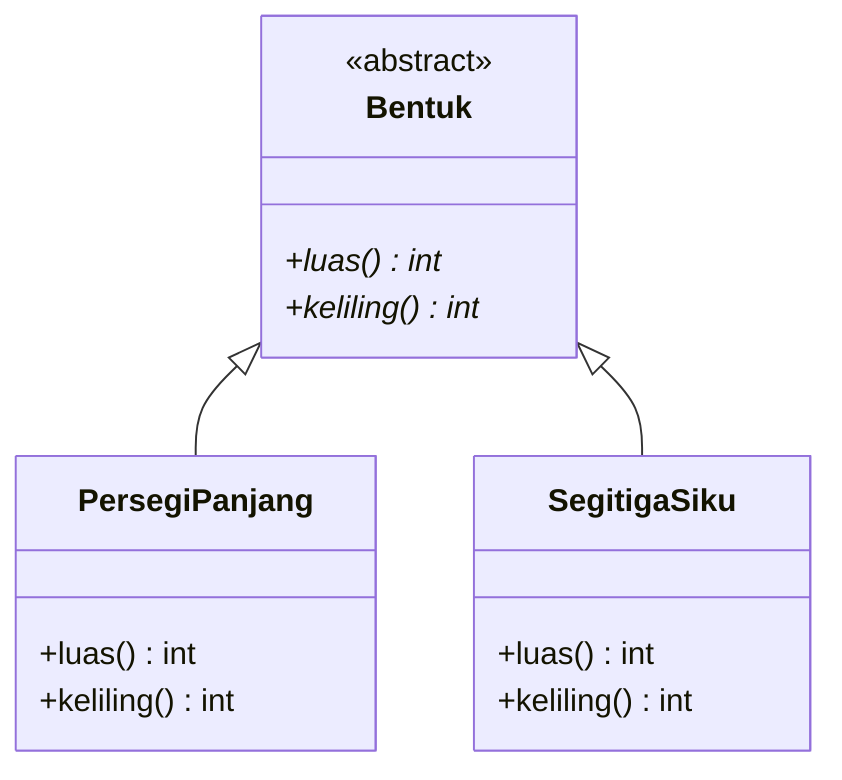
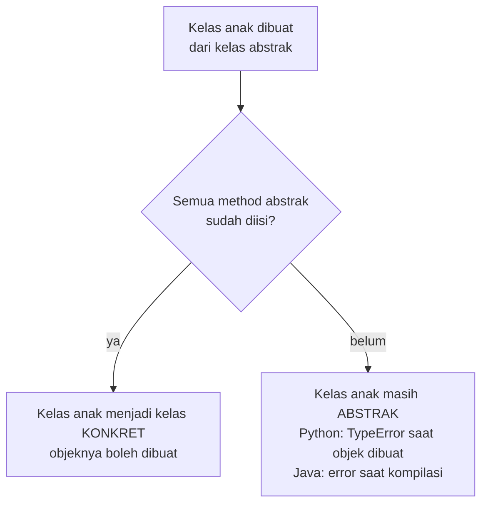
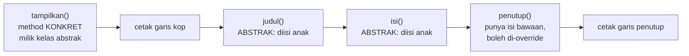
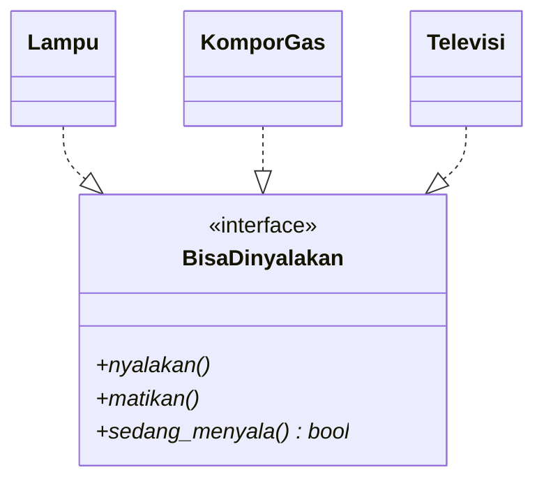
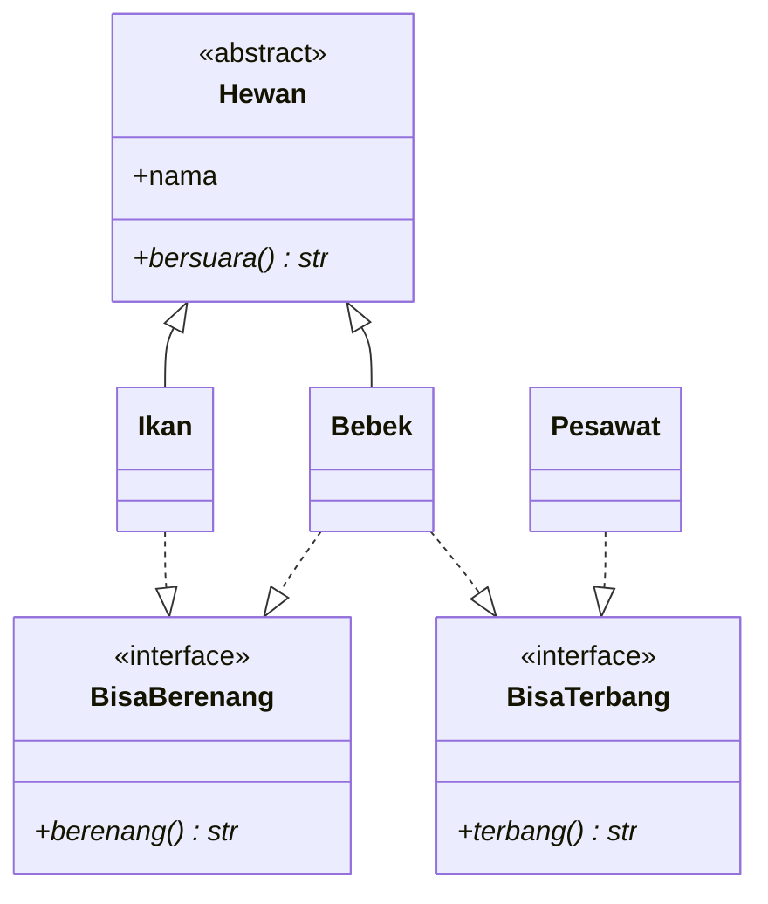
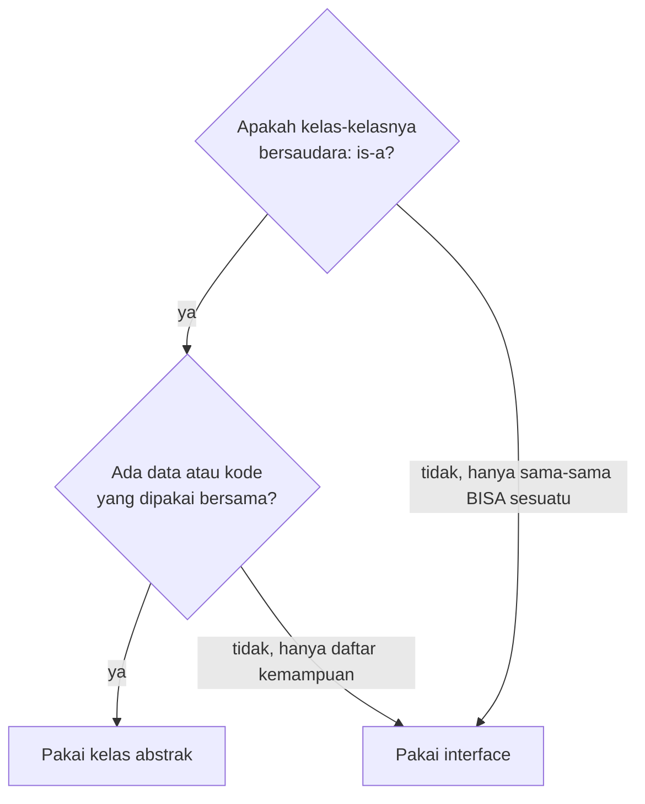
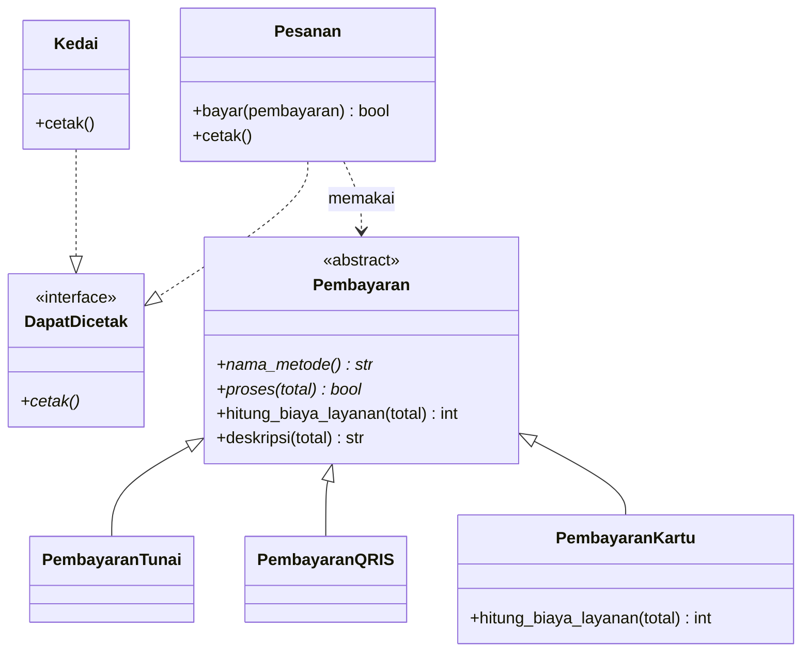

# Pertemuan 10: *Abstract Class* dan *Interface*

[⬅️ Pertemuan 09](../Pertemuan-09-Polimorfisme/README.md) · [🏠 Beranda](../README.md) · [Pertemuan 11 ➡️](../Pertemuan-11-Exception-Handling/README.md)

> Hari ini kita belajar **abstraksi**, pilar keempat PBO. Kita akan membuat **kelas abstrak** (cetak biru yang sengaja belum lengkap) dan ***interface*** (kontrak kemampuan). Keduanya membuat program lebih aman: kesalahan desain ketahuan lebih awal, dan kelas-kelas yang tidak bersaudara pun bisa diperlakukan dengan cara yang sama.

## 🎯 Tujuan Pembelajaran

Setelah pertemuan ini, kamu mampu:

1. Menjelaskan arti **abstraksi** dengan analogi sehari-hari.
2. Menjelaskan ciri **kelas abstrak** dan ***method* abstrak**, termasuk kapan pelanggarannya ketahuan di Python dan di Java.
3. Menjelaskan pola ***template method***: *method* konkret yang memanggil *method* abstrak.
4. Menjelaskan ***interface*** sebagai kontrak kemampuan, dan mengapa satu kelas boleh memenuhi banyak *interface*.
5. Memilih antara kelas abstrak dan *interface* untuk sebuah kasus, lengkap dengan alasannya.
6. Membaca dan menggambar kelas abstrak, *interface*, dan relasi realisasi pada diagram kelas UML.

## 🧭 Peta Belajar

| Langkah | Bagian | Perkiraan waktu |
|---|---|---|
| 1 | Konsep (halaman ini) | 45 menit |
| 2 | Praktik: [🐍 Python](python/README.md) **atau** [☕ Java](java/README.md) | 90 menit |
| 3 | [Jembatan Python ↔ Java](jembatan-python-java.md) | 15 menit |
| 4 | [Latihan](latihan.md) | 60 menit |
| 5 | [Kuis](kuis.md) | 15 menit |

## 🔁 Mengingat Kembali

Di [Pertemuan 09](../Pertemuan-09-Polimorfisme/README.md) kita sudah belajar bahwa:

- **Polimorfisme** berarti satu panggilan *method* bisa menghasilkan perilaku berbeda, tergantung objek sebenarnya. Kuncinya adalah *override*.
- Variabel atau parameter bertipe **kelas induk** boleh menunjuk objek **kelas anak**. Karena itu, `Pesanan.bayar(pembayaran)` bisa menerima `PembayaranTunai`, `PembayaranQRIS`, maupun `PembayaranKartu`.
- Di Python ada *duck typing*: asal objek punya *method* yang dibutuhkan, ia bisa dipakai. Java lebih ketat: objek-objek itu harus punya **tipe bersama**.
- Ada satu hal yang janggal: kelas `Pembayaran` sendiri bisa dibuat objeknya, dan namanya "Pembayaran umum".

Hari ini kita memperbaiki kejanggalan itu, lalu belajar membuat "kontrak" yang bisa dipatuhi oleh kelas-kelas yang tidak bersaudara.

> [!NOTE]
> Nama *method* di halaman ini ditulis dengan gaya Python (*snake_case*), misalnya `nama_metode()` dan `cetak_semua()`. Di Java, nama yang sama ditulis dengan gaya *camelCase*: `namaMetode()` dan `cetakSemua()`. Maknanya sama persis.

## Daftar Isi

1. [Cerita Pembuka: "Pembayaran Umum" yang Janggal](#1-cerita-pembuka-pembayaran-umum-yang-janggal)
2. [Abstraksi: Menonjolkan yang Penting](#2-abstraksi-menonjolkan-yang-penting)
3. [Kelas Abstrak: Cetak Biru yang Sengaja Belum Lengkap](#3-kelas-abstrak-cetak-biru-yang-sengaja-belum-lengkap)
4. [*Method* Abstrak: Janji yang Wajib Ditepati](#4-method-abstrak-janji-yang-wajib-ditepati)
5. [Kelas Abstrak Tetap Boleh Punya Isi](#5-kelas-abstrak-tetap-boleh-punya-isi)
6. [*Template Method*: Kerangka Tetap, Detail Menyusul](#6-template-method-kerangka-tetap-detail-menyusul)
7. [*Interface*: Kontrak Kemampuan](#7-interface-kontrak-kemampuan)
8. [Satu Kelas, Banyak *Interface*](#8-satu-kelas-banyak-interface)
9. [Kelas Abstrak atau *Interface*?](#9-kelas-abstrak-atau-interface)
10. [Abstraksi di Diagram Kelas UML](#10-abstraksi-di-diagram-kelas-uml)
11. [Studi Kasus KedaiKita: Pembayaran Abstrak dan Kontrak DapatDicetak](#11-studi-kasus-kedaikita-pembayaran-abstrak-dan-kontrak-dapatdicetak)
12. [Miskonsepsi yang Sering Terjadi](#12-miskonsepsi-yang-sering-terjadi)

---

## 1. Cerita Pembuka: "Pembayaran Umum" yang Janggal

Ingat kelas `Pembayaran` di KedaiKita versi Pertemuan 09? Kelas induk itu masih kelas biasa. Ringkasan isinya (bukan kode sungguhan):

```text
Kelas Pembayaran (kelas induk biasa)
  nama_metode()               -> "Pembayaran umum"
  hitung_biaya_layanan(total) -> 0
  proses(total)               -> cetak "Memproses pembayaran ...", lalu laporkan BERHASIL
```

Coba bayangkan kamu kasir KedaiKita. Seorang pelanggan berkata, *"Saya bayar pakai pembayaran umum, ya."* Kamu pasti bingung. Pembayaran umum itu apa? Uang tunai? QRIS? Kartu? Di dunia nyata, **tidak ada** pembayaran yang "umum saja". Yang ada selalu jenis tertentu.

Kejanggalan ini menimbulkan dua masalah nyata:

| Masalah | Akibatnya, di kasir |
|---|---|
| Objek `Pembayaran` "umum" bisa dibuat | Pesanan bisa dibayar dengan metode yang tidak jelas wujudnya |
| Kelas anak baru (misalnya `PembayaranEWallet`) **lupa** meng-*override* `proses()` | Ia diam-diam memakai `proses()` milik induk yang selalu "berhasil". Pesanan tercatat **LUNAS** padahal tidak ada uang yang masuk! |

Masalah kedua paling berbahaya karena program tidak protes sama sekali. Kita baru sadar setelah uang di laci kasir tidak cocok dengan laporan.

Kita butuh cara untuk berkata kepada bahasa pemrograman:

1. *"Kelas `Pembayaran` ini hanya kerangka. Jangan izinkan siapa pun membuat objeknya."*
2. *"Setiap kelas anak **wajib** menulis `nama_metode()` dan `proses()` versinya sendiri. Kalau lupa, tolong protes."*

Itulah yang dilakukan **kelas abstrak**. Sebelum ke sana, kita kenali dulu ide besarnya: **abstraksi**.

## 2. Abstraksi: Menonjolkan yang Penting

Saat menyetir mobil, kamu memakai setir, pedal gas, pedal rem, dan tuas persneling. Kamu tidak perlu tahu bagaimana bensin disemprotkan ke mesin atau bagaimana rem cakram mencengkeram roda. Semua detail rumit itu **disembunyikan**. Yang **ditonjolkan** hanya hal yang penting bagi pengemudi.

Contoh lain adalah **colokan listrik standar**. *Rice cooker*, *charger* ponsel, dan kipas angin bisa dicolokkan ke stopkontak yang sama. Stopkontak tidak peduli alat apa yang dicolokkan. Yang penting, colokannya sesuai **standar**.

> **Abstraksi** (*abstraction*) adalah cara berpikir yang **menonjolkan hal yang penting** (apa yang bisa dilakukan) dan **menyembunyikan detail** yang tidak perlu diketahui pemakai (bagaimana cara melakukannya).

| Dunia nyata | Yang ditonjolkan | Yang disembunyikan |
|---|---|---|
| Menyetir mobil | setir, gas, rem | cara kerja mesin dan rem |
| Stopkontak | bentuk colokan standar | alat apa yang dicolokkan |
| Mesin ATM | tombol tarik tunai, cek saldo | proses ke server bank |
| Kasir KedaiKita | "proses pembayaran ini" | tunai, QRIS, atau kartu |

Dalam PBO, ada dua alat utama untuk menerapkan abstraksi:

- **Kelas abstrak**: kerangka bersama untuk kelas-kelas yang **bersaudara** (hubungan "adalah").
- ***Interface***: kontrak kemampuan untuk kelas-kelas yang **belum tentu bersaudara** (hubungan "bisa").

> [!NOTE]
> Abstraksi mirip enkapsulasi (Pertemuan 04), tetapi fokusnya berbeda. Secara sederhana, **enkapsulasi** melindungi data di dalam objek agar tidak dirusak dari luar. **Abstraksi** memilih "wajah" apa yang ditunjukkan objek kepada pemakainya. Keduanya sering bekerja bersama.

## 3. Kelas Abstrak: Cetak Biru yang Sengaja Belum Lengkap

Pergilah ke dealer kendaraan dan katakan, *"Saya mau beli satu kendaraan."* Penjualnya pasti bertanya, *"Kendaraan yang mana? Motor atau mobil?"* Kamu tidak mungkin pulang membawa "kendaraan" saja. "Kendaraan" adalah **konsep umum**. Benda nyatanya selalu jenis tertentu.

Hal yang sama berlaku untuk "bangun datar". Kamu bisa menghitung luas persegi panjang atau segitiga, tetapi tidak bisa menghitung luas "bangun datar" saja.

> **Kelas abstrak** (*abstract class*) adalah kelas yang **tidak bisa dibuat objeknya secara langsung**. Kelas ini menjadi kerangka bersama bagi kelas-kelas anak. Lawannya adalah **kelas konkret**: kelas biasa yang boleh dibuat objeknya.



| Pertanyaan | Jawaban |
|---|---|
| Bolehkah membuat objek `Bentuk`? | **Tidak**. `Bentuk` adalah kelas abstrak |
| Bolehkah membuat objek `PersegiPanjang`? | **Boleh**. `PersegiPanjang` adalah kelas konkret |
| Apakah objek `PersegiPanjang` termasuk `Bentuk`? | **Ya**. Kelas anak tetap "adalah" kelas induknya |
| Bolehkah variabel atau *list* bertipe `Bentuk`? | **Boleh**, dan justru sangat berguna untuk polimorfisme |

Poin terakhir sering membuat bingung. Kita memang tidak bisa membuat objek `Bentuk`, tetapi kita **boleh** punya daftar bertipe `Bentuk` yang isinya objek `PersegiPanjang` dan `SegitigaSiku`. Ini persis seperti parameter `pembayaran` di `Pesanan.bayar(pembayaran)` pada Pertemuan 09.

### Apa yang terjadi jika kita tetap mencoba?

Kedua bahasa sama-sama menolak, tetapi **waktunya** berbeda. Lihat dua potongan kode berikut sebagai ilustrasi saja; kamu tidak perlu mengetiknya. Versi lengkap yang bisa dijalankan ada di contoh 02 halaman praktik.

**Python:**

```python
from abc import ABC, abstractmethod

class Bentuk(ABC):
    @abstractmethod
    def luas(self) -> int: ...

bentuk = Bentuk()   # TypeError saat baris ini DIJALANKAN
```

**Java:**

```java
abstract class Bentuk {
    public abstract int luas();
}

// di dalam main:
Bentuk bentuk = new Bentuk(); // ditolak saat KOMPILASI
```

| | Python | Java |
|---|---|---|
| Cara menandai kelas abstrak | mewarisi `ABC` | kata kunci `abstract` |
| Cara menandai *method* abstrak | dekorator `@abstractmethod` | kata kunci `abstract`, tanpa isi |
| Kapan pelanggaran ketahuan? | saat program **berjalan**, tepat ketika objek dibuat (`TypeError`) | saat **kompilasi**, sebelum program sempat berjalan |

Satu catatan kecil: Python hanya menolak jika kelas itu **masih punya** *method* abstrak. Kelas yang mewarisi `ABC` tanpa satu pun *method* abstrak tetap bisa dibuat objeknya. Di Java, kelas bertanda `abstract` selalu ditolak. Pesan *error* aslinya kita bedah di halaman praktik.

## 4. *Method* Abstrak: Janji yang Wajib Ditepati

Pernah mengisi formulir pendaftaran beasiswa? Beberapa kolom diberi tanda bintang merah (\*) yang artinya **wajib diisi**. Formulir yang kolom wajibnya masih kosong tidak akan diterima panitia.

*Method* abstrak bekerja seperti kolom wajib itu.

> ***Method* abstrak** (*abstract method*) adalah *method* yang hanya punya "kepala" (nama, parameter, dan tipe nilai kembalian) **tanpa isi**. Setiap kelas anak yang konkret **wajib** meng-*override* *method* abstrak itu dengan isi miliknya sendiri.

Dengan *method* abstrak, masalah kedua di bagian 1 langsung teratasi:



Aturan-aturan penting:

- *Method* abstrak hanya bisa diletakkan di kelas abstrak (atau di *interface*, bagian 7).
- Kelas anak yang baru mengisi **sebagian** *method* abstrak masih dianggap abstrak. Di Java, kelas seperti itu wajib ditandai `abstract` juga.
- Karena kelas anak dipaksa mengisi, kita tidak perlu lagi menulis isi "pura-pura" seperti `"Pembayaran umum"` di kelas induk.

> [!IMPORTANT]
> Bandingkan dengan Pertemuan 09. *Override* biasa itu **boleh** (kelas anak bebas memilih). *Override* *method* abstrak itu **wajib** (kelas anak tidak punya pilihan). Kelas abstrak mengubah "sebaiknya" menjadi "harus".

## 5. Kelas Abstrak Tetap Boleh Punya Isi

Kata "abstrak" sering disangka "kosong". Padahal, kelas abstrak boleh berisi banyak hal, sama seperti kelas biasa.

| Isi kelas abstrak | Boleh? | Contoh pada kelas abstrak `Kendaraan` |
|---|---|---|
| Atribut | Boleh | `plat`, `bensin` |
| Konstruktor | Boleh | mengisi `plat` dan `bensin` saat objek anak dibuat |
| *Method* konkret (sudah berisi) | Boleh | `isi_bensin(liter)`, `jarak_tempuh()`, `info()` |
| *Method* abstrak (tanpa isi) | Boleh | `km_per_liter()` karena motor dan mobil berbeda |

Tunggu dulu, kalau objek kelas abstrak tidak bisa dibuat, untuk apa ia punya konstruktor? Jawabannya: konstruktor itu dipanggil **oleh kelas anak**. Saat objek `Motor` dibuat, konstruktor `Kendaraan` ikut berjalan untuk mengisi bagian yang diwarisi, persis seperti urutan konstruktor di Pertemuan 07.

```text
Membuat objek Motor("KT 1234 AB", 3)
  1. Pembuatan objek Motor dimulai
  2. Konstruktor Kendaraan (kelas abstrak) dijalankan -> mengisi plat dan bensin
       Java  : dipanggil oleh konstruktor Motor lewat super(...)
       Python: Motor tidak menulis __init__, jadi __init__ milik Kendaraan langsung dipakai
  3. Objek Motor siap dipakai: punya plat, bensin, dan km_per_liter() = 40
```

Jadi, kelas abstrak adalah tempat yang tepat untuk menaruh **data dan kode yang dipakai bersama** oleh semua anaknya. Kode cukup ditulis sekali, lalu diwarisi semua kelas anak.

## 6. *Template Method*: Kerangka Tetap, Detail Menyusul

Hal paling menarik dari kelas abstrak adalah ***method* konkret yang memanggil *method* abstrak**.

Bayangkan format laporan resmi di kampus. Setiap laporan selalu punya urutan yang sama: garis kop, judul, isi, lalu penutup. Laporan kehadiran dan laporan perpustakaan hanya berbeda di **judul** dan **isi**-nya. Urutannya tidak pernah berubah.



> ***Template method*** adalah *method* konkret di kelas abstrak yang menetapkan **urutan langkah** sebuah proses. Langkah-langkah yang berbeda untuk setiap kelas anak diserahkan ke *method* abstrak.

Ada tiga jenis langkah dalam pola ini:

| Jenis langkah | Isinya ditulis di | Contoh |
|---|---|---|
| Langkah tetap | kelas abstrak | mencetak garis kop |
| Langkah wajib | kelas anak (*method* abstrak) | `judul()`, `isi()` |
| Langkah opsional (*hook*) | kelas abstrak, boleh di-*override* anak | `penutup()` |

Pola ini sangat umum, sampai-sampai diberi nama khusus. *Template method* termasuk salah satu *design pattern* (pola desain) yang akan kita kenal lebih banyak di Pertemuan 14. KedaiKita hari ini juga memakainya: *method* `deskripsi()` di kelas `Pembayaran` (lihat bagian 11).

> [!TIP]
> **Coba sendiri:** pikirkan proses "membuat minuman" di KedaiKita: terima pesanan, siapkan gelas, racik minuman, sajikan. Langkah mana yang tetap, dan langkah mana yang sebaiknya menjadi *method* abstrak?

<details>
<summary>Lihat jawaban</summary>

"Terima pesanan", "siapkan gelas", dan "sajikan" bisa menjadi langkah tetap di kelas abstrak. "Racik minuman" sebaiknya menjadi *method* abstrak karena cara meracik kopi susu gula aren jelas berbeda dengan cara meracik es teh manis.

</details>

## 7. *Interface*: Kontrak Kemampuan

Sekarang lihat masalah yang berbeda. Di KedaiKita ada kelas `Kedai` (mencetak daftar menu) dan kelas `Pesanan` (mencetak struk). Keduanya sama-sama **bisa dicetak**. Namun, `Kedai` jelas bukan sejenis `Pesanan`, dan `Pesanan` bukan sejenis `Kedai`. Mereka tidak bersaudara.

Bagaimana caranya membuat satu fungsi `cetak_semua()` yang bisa mencetak keduanya? Kita tidak bisa memakai kelas induk bersama karena hubungan "adalah" tidak cocok di sini.

Pikirkan **SIM C**. Untuk mendapatkannya, kamu tidak ditanya anak siapa atau dari keluarga mana. Kamu hanya perlu **membuktikan bahwa kamu bisa** mengendarai motor. Siapa pun yang punya SIM C, mahasiswa, dosen, atau pedagang, boleh mengendarai motor di jalan raya. SIM adalah tanda **kemampuan**, bukan tanda **keturunan**.

> ***Interface*** (antarmuka) adalah kontrak yang berisi daftar kemampuan (*method*) yang **wajib** dimiliki oleh kelas yang menyatakan diri memenuhinya. *Interface* tidak peduli kelas itu keturunan siapa. Hubungannya disebut **"bisa"** (*can-do*), bukan "adalah" (*is-a*).



`Lampu`, `KomporGas`, dan `Televisi` tidak punya kelas induk bersama. Kompor gas bahkan bukan alat listrik. Namun, ketiganya memenuhi kontrak `BisaDinyalakan`. Akibatnya, sebuah fungsi `matikan_semua()` bisa menerima daftar campuran ketiganya, lalu mematikan semuanya sebelum kamu berangkat kuliah.

Ciri-ciri *interface*:

- *Interface* **tidak bisa dibuat objeknya**, sama seperti kelas abstrak.
- Isinya terutama ***method* tanpa isi**. *Interface* tidak menyimpan data objek (tidak punya atribut biasa).
- Nama *interface* biasanya menggambarkan kemampuan: `BisaTerbang`, `BisaDinyalakan`, `DapatDicetak`. Di dunia Java berbahasa Inggris, akhiran *-able* sering dipakai, misalnya `Printable` dan `Comparable`.
- Kelas yang memenuhi *interface* dikatakan **mengimplementasikan** (*implements*) *interface* itu.

| | Python | Java |
|---|---|---|
| Kata kunci khusus | tidak ada | `interface` |
| Cara yang lazim | kelas `ABC` yang **semua** *method*-nya abstrak, lalu diwarisi | `class Lampu implements BisaDinyalakan` |
| Alternatif | `typing.Protocol`: kelas cukup punya *method* yang cocok, tanpa mewarisi | tidak ada |

## 8. Satu Kelas, Banyak *Interface*

Seekor bebek **adalah** hewan. Bebek juga **bisa** terbang dan **bisa** berenang. Ikan adalah hewan yang bisa berenang, tetapi tidak bisa terbang. Pesawat bisa terbang, tetapi jelas bukan hewan.



Diagram ini menunjukkan kekuatan *interface*:

- `Bebek` punya **satu** kelas induk (`Hewan`) dan memenuhi **dua** *interface* sekaligus.
- `Pesawat` tidak punya hubungan apa pun dengan `Hewan`, tetapi tetap bisa masuk ke daftar "yang bisa terbang" bersama `Bebek`.

Ingat Pertemuan 07? Di sana kita belajar bahwa Java **hanya** mengizinkan satu kelas induk. *Interface* adalah jalan keluarnya: satu kelas boleh `extends` satu kelas, tetapi boleh `implements` banyak *interface*. Python memang mengizinkan banyak kelas induk, tetapi memisahkan "jenis" (kelas abstrak) dari "kemampuan" (*interface*) tetap membuat desain lebih jelas.

### Fitur khusus tiap bahasa

Ada beberapa fitur yang hanya dimiliki salah satu bahasa. Ide dasarnya sama, detailnya ada di halaman praktik.

| Fitur | Bahasa | Arti singkat |
|---|---|---|
| *Default method* | Java (sejak Java 8) | *method* **berisi** di dalam *interface*. Kelas yang mengimplementasikan *interface* itu otomatis mendapatkannya, tetapi boleh meng-*override*-nya |
| *Method* `static` dan `private` di *interface* | Java (sejak Java 8 dan 9) | *method* pembantu milik *interface* itu sendiri; tidak diwariskan ke kelas yang mengimplementasikannya |
| Konstanta di *interface* | Java | nilai tetap yang menempel pada *interface*, misalnya `BINTANG_MAKS = 5` |
| `typing.Protocol` | Python | kontrak **struktural**: kelas tidak perlu mewarisi apa pun, cukup punya *method* yang cocok. Ini seperti *duck typing* yang diresmikan. Kecocokannya diperiksa alat pemeriksa tipe di editor, bukan oleh Python saat program berjalan |

## 9. Kelas Abstrak atau *Interface*?

Keduanya sama-sama tidak bisa dibuat objeknya dan sama-sama bisa memaksa kelas lain mengisi *method*. Lalu kapan memakai yang mana?

| Aspek | Kelas abstrak | *Interface* |
|---|---|---|
| Pertanyaan kunci | "X **adalah** sejenis Y?" (*is-a*) | "X **bisa** melakukan Y?" (*can-do*) |
| Hubungan antarkelas | kelas-kelas yang bersaudara | kelas apa saja, tidak harus bersaudara |
| Bisa dibuat objeknya? | tidak | tidak |
| Atribut (data objek) | boleh | tidak (Java hanya boleh konstanta) |
| Konstruktor | boleh | tidak |
| *Method* berisi | boleh | Java: lewat *default method* (sejak Java 8); Python: boleh, tetapi sebaiknya hemat |
| Satu kelas boleh memakai berapa? | Java: satu (`extends`); Python: boleh lebih | banyak (`implements A, B`) |
| Contoh di KedaiKita | `Pembayaran` | `DapatDicetak` |

Panduan memilih:



Satu kelas boleh memakai **keduanya** sekaligus, seperti `Bebek` yang mewarisi kelas abstrak `Hewan` sekaligus memenuhi *interface* `BisaTerbang` dan `BisaBerenang`.

> [!TIP]
> **Coba sendiri:** tentukan pilihan yang paling cocok, kelas abstrak atau *interface*, untuk tiga kasus berikut.
> 1. `Mahasiswa`, `Dosen`, dan `Tendik` sama-sama punya nama, nomor induk, dan *email* kampus.
> 2. `StrukPesanan`, `Sertifikat`, dan `TiketKonser` sama-sama bisa dicetak ke PDF.
> 3. `Kucing` dan `RobotMainan` sama-sama bisa bersuara.

<details>
<summary>Lihat jawaban</summary>

1. **Kelas abstrak**, misalnya `SivitasAkademika`. Ketiganya bersaudara (sama-sama warga kampus) dan berbagi data yang sama.
2. ***Interface***, misalnya `BisaDieksporPdf`. Ketiganya tidak bersaudara, hanya punya kemampuan yang sama.
3. ***Interface***, misalnya `BisaBersuara`. Kucing adalah hewan, robot mainan adalah benda. Mereka hanya sama-sama **bisa** bersuara.

</details>

## 10. Abstraksi di Diagram Kelas UML

Di Pertemuan 06 kita sudah mengenal diagram kelas, termasuk sekilas tentang stereotip `<<interface>>` dan relasi realisasi. Kini semuanya kita pakai sungguhan:

| Elemen | Notasi UML (di kertas) | Di Mermaid |
|---|---|---|
| Kelas abstrak | nama kelas ditulis *miring*, atau diberi label `<<abstract>>` | label `<<abstract>>` |
| *Method* abstrak | nama *method* ditulis *miring* | tanda `*` di akhir *method*, misalnya `+luas() int*`; Mermaid menampilkannya miring |
| *Interface* | label `<<interface>>` di atas nama | label `<<interface>>` |
| Pewarisan (*extends*) | garis **lurus** + segitiga kosong menunjuk induk | `Induk <\|-- Anak` |
| Realisasi (*implements*) | garis **putus-putus** + segitiga kosong menunjuk *interface* | `Kelas ..\|> Interface` (atau `Interface <\|.. Kelas`, seperti di Pertemuan 06) |

```text
  Pewarisan:     Bebek  ------------|>  Hewan          ("Bebek ADALAH Hewan")
  Realisasi:     Bebek  - - - - - - |>  BisaTerbang    ("Bebek BISA terbang")
```

Relasi dari kelas ke *interface* disebut **realisasi** (*realization*): kelas itu "mewujudkan" janji yang tertulis di *interface*.

> [!NOTE]
> Mermaid tidak bisa memiringkan nama kelas. Karena itu, di materi ini kelas abstrak ditandai dengan label `<<abstract>>`. Saat menggambar di kertas atau di alat UML lain, biasakan menulis nama kelas abstrak dan *method* abstrak dengan huruf *miring*.

## 11. Studi Kasus KedaiKita: Pembayaran Abstrak dan Kontrak DapatDicetak

Hari ini KedaiKita mendapat dua perbaikan besar.

**Perbaikan 1: `Pembayaran` menjadi kelas abstrak.**

- Objek `Pembayaran` "umum" tidak bisa dibuat lagi.
- `nama_metode()` dan `proses()` menjadi *method* abstrak. Isi pura-pura `"Pembayaran umum"` dihapus.
- `hitung_biaya_layanan()` tetap *method* konkret dengan nilai bawaan 0 (sebuah *hook*).
- *Method* konkret baru `deskripsi(total)` memanggil `nama_metode()` dan `hitung_biaya_layanan()`. Ini *template method* kecil.
- `PembayaranTunai`, `PembayaranQRIS`, dan `PembayaranKartu` **tidak berubah sama sekali** karena sejak Pertemuan 09 mereka memang sudah mengisi kedua *method* itu.

**Perbaikan 2: *interface* baru `DapatDicetak` dengan satu *method*, `cetak()`.**

- `Kedai` dan `Pesanan` sama-sama memenuhi kontrak `DapatDicetak`.
- Karena kontrak menuntut nama **`cetak()`**, dua *method* lama berganti nama. Isinya tetap sama.

| Kelas | Nama lama (Pertemuan 09) | Nama baru (Pertemuan 10) | Isinya |
|---|---|---|---|
| `Pesanan` | `cetak_struk()` | `cetak()` | mencetak struk pesanan |
| `Kedai` | `tampilkan_menu()` | `cetak()` | mencetak daftar menu |

Mengapa harus berganti nama? Kontrak itu seperti kolom wajib di formulir: namanya sudah ditentukan. Jika `Pesanan` menyatakan diri `DapatDicetak` tetapi hanya punya `cetak_struk()`, kontraknya **tidak terpenuhi**. Python akan menolak membuat objek `Pesanan`, dan Java akan menolak mengompilasi kelasnya. Justru karena semuanya memakai nama yang sama, fungsi baru `cetak_semua()` bisa memanggil `dokumen.cetak()` tanpa peduli apakah dokumennya kedai atau pesanan.

**Rancangan:**



**Skenario program:**

1. Menampilkan deskripsi ketiga metode pembayaran lewat `deskripsi(100000)`.
2. Budi memesan 2 Kopi Susu Gula Aren dan 1 Nasi Goreng Kampung, lalu membayar tunai.
3. Siti memesan 2 Es Teh Manis dan 1 Pisang Goreng Keju. Bayar dengan QRIS gagal karena saldo kurang, lalu berhasil dengan kartu kredit.
4. `cetak_semua()` mencetak tiga "dokumen" sekaligus: daftar menu kedai, struk Budi, dan struk Siti.
5. Menampilkan poin kedua pelanggan.

**Potongan hasil yang diharapkan** (sama persis untuk versi Python maupun Java):

```text
=== MENGENAL METODE PEMBAYARAN ===
Tunai (biaya layanan Rp0)
QRIS (biaya layanan Rp0)
Kartu Kredit BNI (biaya layanan Rp2.000)

...

=== CETAK SEMUA DOKUMEN ===
--- Dokumen 1 dari 3 ---
=== MENU KedaiKita ===
[M01] Kopi Susu Gula Aren (Minuman) - Rp18.000 | stok 18 | dingin
...

--- Dokumen 2 dari 3 ---
========================================
KEDAIKITA - STRUK PESANAN
========================================
No. Pesanan : P001
...
```

Perhatikan bagian "CETAK SEMUA DOKUMEN". Daftar menu dan struk pesanan dicetak oleh satu perulangan yang sama. Inilah polimorfisme lewat *interface*.

Kode lengkapnya dibahas di halaman praktik: [🐍 Python](python/README.md#8-studi-kasus-kedaikita) atau [☕ Java](java/README.md#8-studi-kasus-kedaikita).

## 12. Miskonsepsi yang Sering Terjadi

Enam anggapan keliru berikut paling sering muncul saat pertama kali belajar kelas abstrak dan *interface*. Cocokkan dengan pemahamanmu sendiri.

1. **Keliru:** "Kelas abstrak tidak boleh punya atribut dan konstruktor."

   **Yang benar:** boleh. Kelas abstrak justru tempat yang tepat untuk menaruh data dan kode yang dipakai bersama. Konstruktornya dipanggil saat objek kelas anak dibuat.

2. **Keliru:** "Semua *method* di kelas abstrak harus abstrak."

   **Yang benar:** kelas abstrak boleh mencampur *method* abstrak dan *method* konkret. `Pembayaran` punya dua *method* abstrak dan dua *method* konkret.

3. **Keliru:** "Kelas abstrak tidak bisa dibuat objeknya, jadi tidak bisa dipakai sebagai tipe."

   **Yang benar:** variabel, parameter, dan *list* bertipe kelas abstrak atau *interface* sangat umum, misalnya parameter `pembayaran` di `Pesanan.bayar()` dan daftar dokumen di `cetak_semua()`. Isinya selalu objek kelas konkret.

4. **Keliru:** "Kelas anak bebas mengisi sebagian *method* abstrak saja, lalu objeknya tetap bisa dibuat."

   **Yang benar:** kelas anak yang baru mengisi sebagian *method* abstrak **ikut menjadi abstrak**, jadi objeknya tidak bisa dibuat. Untuk menjadi kelas konkret, semua *method* abstrak harus diisi.

5. **Keliru:** "*Interface* sama saja dengan kelas abstrak, hanya beda nama."

   **Yang benar:** tujuannya berbeda. Kelas abstrak menyatukan kelas-kelas yang **bersaudara** beserta data bersamanya. *Interface* menyatukan kelas-kelas yang **belum tentu bersaudara** berdasarkan kemampuannya. Di Java, aturan keduanya pun berbeda (satu `extends`, banyak `implements`).

6. **Keliru:** "Abstrak artinya kodenya belum selesai ditulis."

   **Yang benar:** kelas abstrak adalah keputusan desain yang disengaja: "kelas ini memang hanya kerangka". Ia sudah selesai, hanya saja tugasnya adalah menjadi induk, bukan dibuat objeknya.

## 📝 Ringkasan

- **Abstraksi** berarti menonjolkan hal yang penting dan menyembunyikan detail yang tidak perlu.
- **Kelas abstrak** tidak bisa dibuat objeknya. Ia menjadi kerangka bersama bagi kelas-kelas anak yang bersaudara (*is-a*).
- ***Method* abstrak** hanya punya kepala tanpa isi. Kelas anak yang konkret **wajib** meng-*override*-nya.
- Kelas abstrak tetap boleh punya atribut, konstruktor, dan *method* konkret.
- Pelanggaran ketahuan di waktu yang berbeda: Python saat objek dibuat (`TypeError`), Java saat kompilasi.
- ***Template method*** adalah *method* konkret yang menetapkan urutan langkah dan memanggil *method* abstrak untuk langkah yang berbeda-beda.
- ***Interface*** adalah kontrak kemampuan (*can-do*) untuk kelas yang belum tentu bersaudara. Satu kelas boleh memenuhi banyak *interface*.
- Java memakai `abstract class` dan `interface`/`implements`. Python memakai `ABC` + `@abstractmethod`, dan untuk kontrak struktural bisa memakai `typing.Protocol`.
- Di UML, kelas dan *method* abstrak ditulis miring, *interface* diberi label `<<interface>>`, dan realisasi digambar dengan garis putus-putus bersegitiga kosong.
- KedaiKita: `Pembayaran` kini abstrak dan punya `deskripsi()`, sedangkan `Kedai` dan `Pesanan` sama-sama `DapatDicetak` dengan *method* `cetak()`.

## 📖 Istilah Penting

| Istilah | Arti singkat |
|---|---|
| Abstraksi (*abstraction*) | Menonjolkan yang penting, menyembunyikan detail |
| Kelas abstrak (*abstract class*) | Kelas yang tidak bisa dibuat objeknya; kerangka bagi kelas anak |
| Kelas konkret | Kelas biasa yang boleh dibuat objeknya |
| *Method* abstrak (*abstract method*) | *Method* tanpa isi yang wajib di-*override* kelas anak konkret |
| *Method* konkret | *Method* yang sudah punya isi |
| *Template method* | *Method* konkret yang menetapkan urutan langkah dan memanggil *method* abstrak |
| *Hook* | *Method* berisi bawaan yang boleh di-*override*, misalnya `hitung_biaya_layanan()` |
| *Interface* (antarmuka) | Kontrak daftar kemampuan yang wajib dimiliki kelas yang memenuhinya |
| Mengimplementasikan (*implements*) | Menyatakan dan memenuhi isi sebuah *interface* |
| Realisasi (*realization*) | Relasi UML dari kelas ke *interface* yang dipenuhinya |
| *Default method* | *Method* berisi di dalam *interface* (khusus Java, sejak Java 8) |
| `Protocol` | Kontrak struktural di Python: cukup punya *method* yang cocok, tanpa mewarisi; diperiksa alat pemeriksa tipe, bukan saat program berjalan |

## ➡️ Langkah Berikutnya

Pilih jalur praktikmu: [🐍 Praktik Python](python/README.md) atau [☕ Praktik Java](java/README.md).

---

[⬅️ Pertemuan 09](../Pertemuan-09-Polimorfisme/README.md) · [🏠 Beranda](../README.md) · [Pertemuan 11 ➡️](../Pertemuan-11-Exception-Handling/README.md)
