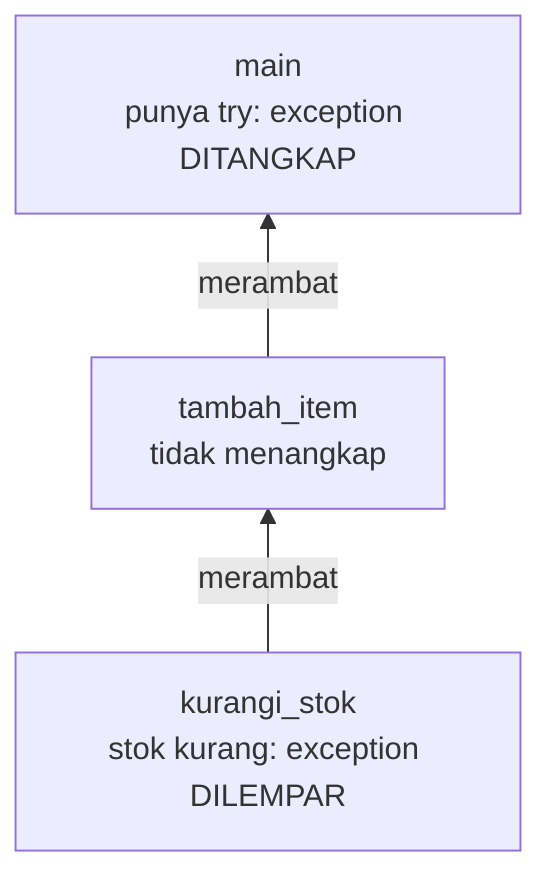
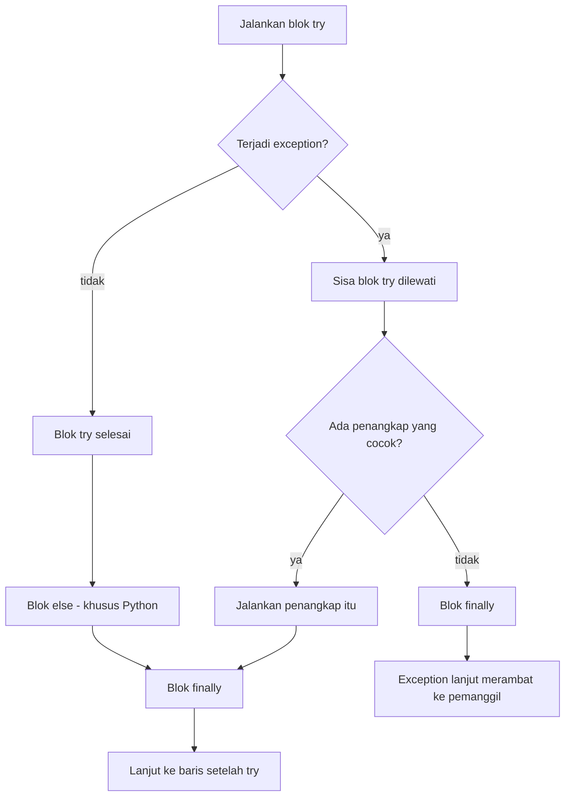
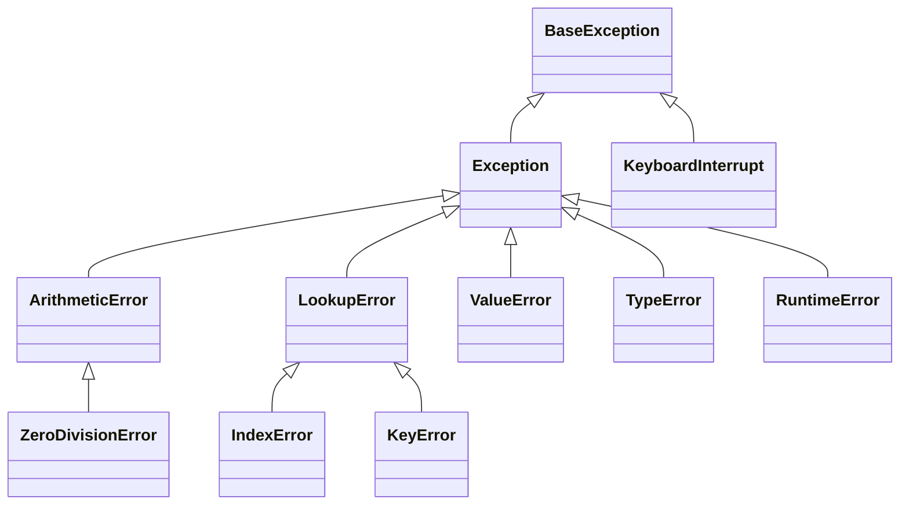
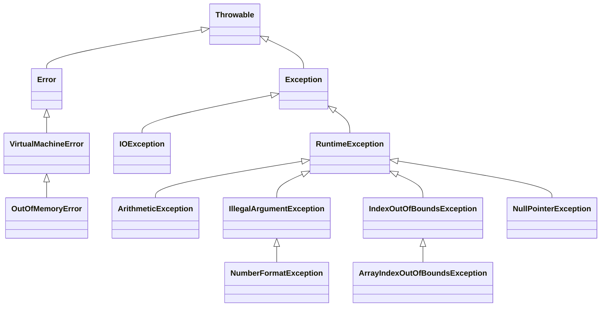
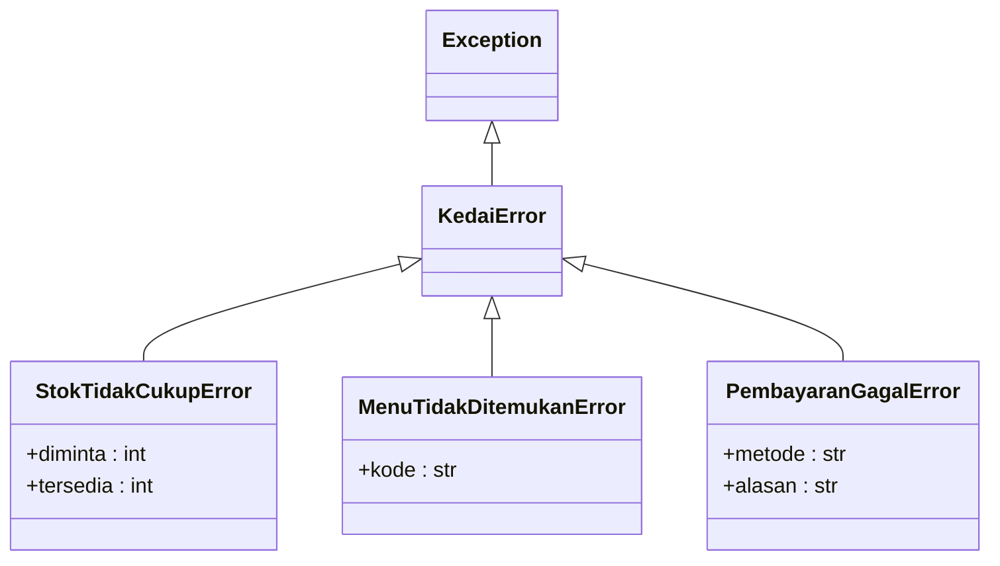
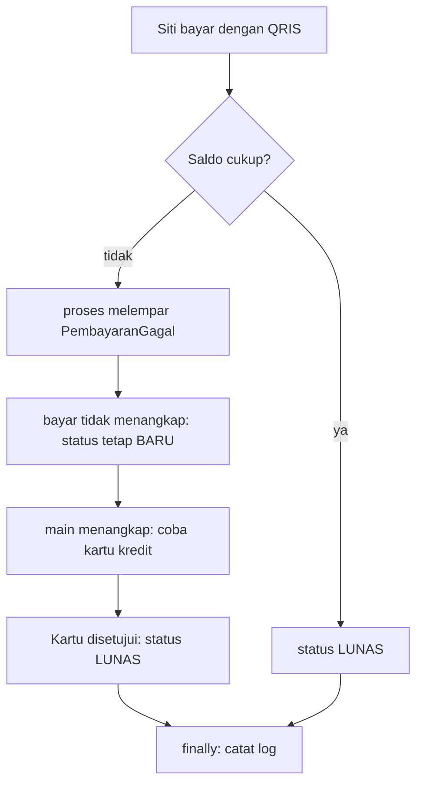

# Pertemuan 11: *Exception Handling*

[⬅️ Pertemuan 10](../Pertemuan-10-Abstract-Class-dan-Interface/README.md) · [🏠 Beranda](../README.md) · [Pertemuan 12 ➡️](../Pertemuan-12-Koleksi-dan-Generics/README.md)

> Program yang baik bukan program yang tidak pernah bertemu masalah, melainkan program yang tahu harus berbuat apa saat masalah datang. Hari ini kita belajar ***exception handling***: melaporkan kesalahan dengan jelas, menangkapnya di tempat yang tepat, dan tetap membereskan semuanya. KedaiKita pun berhenti memakai `None`/`null` dan `False`/`false` sebagai tanda gagal.

## 🎯 Tujuan Pembelajaran

Setelah pertemuan ini, kamu mampu:

1. Membedakan tiga jenis kesalahan program: sintaks/kompilasi, *runtime*, dan logika.
2. Membaca *traceback* (Python) dan *stack trace* (Java) untuk menemukan jenis, pesan, dan lokasi kesalahan.
3. Menangkap *exception* dengan `try`, beberapa penangkap dalam urutan yang benar, `else` (Python), dan `finally`.
4. Melempar *exception* untuk validasi, melempar ulang, dan menyimpan penyebab aslinya (*exception chaining*).
5. Membuat hierarki *exception* buatan sendiri yang membawa data tambahan.
6. Menjelaskan *checked* dan *unchecked exception* di Java beserta klausa `throws`, dan mengapa Python tidak memilikinya.

## 🧭 Peta Belajar

| Langkah | Bagian | Perkiraan waktu |
|---|---|---|
| 1 | Konsep (halaman ini) | 45 menit |
| 2 | Praktik: [🐍 Python](python/README.md) **atau** [☕ Java](java/README.md) | 100 menit |
| 3 | [Jembatan Python ↔ Java](jembatan-python-java.md) | 15 menit |
| 4 | [Latihan](latihan.md) | 60 menit |
| 5 | [Kuis](kuis.md) | 15 menit |

## 🔁 Mengingat Kembali

- Di [Pertemuan 04](../Pertemuan-04-Enkapsulasi/README.md), *setter* dan konstruktor **menolak** data yang tidak valid dengan `raise ValueError(...)` / `throw new IllegalArgumentException(...)`. Cara menangkapnya baru kita intip sekilas.
- Di [Pertemuan 05](../Pertemuan-05-Relasi-Antarkelas/README.md), `cari_menu()`/`cariMenu()` mengembalikan `None`/`null` jika kodenya tidak terdaftar.
- Di [Pertemuan 07](../Pertemuan-07-Pewarisan/README.md), kita belajar pewarisan dan relasi *is-a*. Hari ini pewarisan dipakai lagi: setiap jenis *exception* adalah kelas, dan *exception* buatan sendiri dibuat dengan mewarisi kelas *exception* yang sudah ada.
- Di [Pertemuan 10](../Pertemuan-10-Abstract-Class-dan-Interface/README.md), `Pembayaran` menjadi kelas abstrak. *Method* `proses()` mengembalikan benar/salah, lalu `bayar()` meneruskan nilai itu sehingga pemanggil harus rajin memeriksa sendiri: "kalau gagal, coba metode lain".

Hari ini kita mengganti semua "tanda gagal" itu dengan cara yang lebih tegas.

## Daftar Isi

1. [Cerita Pembuka: Kasir yang Bertemu Masalah](#1-cerita-pembuka-kasir-yang-bertemu-masalah)
2. [Tiga Jenis Kesalahan Program](#2-tiga-jenis-kesalahan-program)
3. [*Exception*: Sinyal yang Dilempar dan Ditangkap](#3-exception-sinyal-yang-dilempar-dan-ditangkap)
4. [Jika Tidak Ada yang Menangkap: *Traceback* dan *Stack Trace*](#4-jika-tidak-ada-yang-menangkap-traceback-dan-stack-trace)
5. [Menangkap *Exception* dengan `try`](#5-menangkap-exception-dengan-try)
6. [Banyak Penangkap dan Urutannya](#6-banyak-penangkap-dan-urutannya)
7. [Melempar, Melempar Ulang, dan *Chaining*](#7-melempar-melempar-ulang-dan-chaining)
8. [Hierarki *Exception*](#8-hierarki-exception)
9. [*Checked* dan *Unchecked Exception* (Khusus Java)](#9-checked-dan-unchecked-exception-khusus-java)
10. [*Exception* Buatan Sendiri](#10-exception-buatan-sendiri)
11. [Praktik Baik Menangani *Exception*](#11-praktik-baik-menangani-exception)
12. [Studi Kasus KedaiKita: Kesalahan yang Jelas dan Bisa Ditangkap](#12-studi-kasus-kedaikita-kesalahan-yang-jelas-dan-bisa-ditangkap)
13. [Miskonsepsi yang Sering Terjadi](#13-miskonsepsi-yang-sering-terjadi)

---

## 1. Cerita Pembuka: Kasir yang Bertemu Masalah

Sore hari di KedaiKita, antrean sedang panjang. Dalam lima menit, kasir bertemu tiga masalah:

- Budi memesan menu berkode **M99**, padahal kode itu tidak ada.
- Budi juga ingin **50 porsi** Mie Goreng Jawa, padahal stoknya tinggal 10.
- Siti membayar dengan QRIS, tetapi **saldo *e-wallet*-nya kurang**.

Kasir manusia tahu harus berbuat apa: memberi tahu pelanggan, menawarkan pilihan lain, lalu melayani orang berikutnya. Bagaimana dengan program kita?

Sampai Pertemuan 10, KedaiKita melaporkan kegagalan dengan **nilai khusus**: `None`/`null` dari `cari_menu()`/`cariMenu()`, atau nilai `False`/`false` dari `bayar()`. Cara ini punya tiga kelemahan.

1. **Mudah lupa dicek.** Jika `None`/`null` langsung dipakai, program baru meledak di tempat lain, dengan pesan yang menyesatkan. Inilah baris terakhir laporan kesalahan KedaiKita versi Pertemuan 10 jika kode M99 dipesan tanpa pengecekan:

   ```text
   Python: AttributeError: 'NoneType' object has no attribute 'kurangi_stok'
   Java  : java.lang.NullPointerException: Cannot invoke "Menu.kurangiStok(int)" because "<parameter1>" is null
   ```

   Kedua pesan menunjuk ke dalam *method* `tambah_item()`/`tambahItem()`, bukan ke penyebab aslinya: kode M99 yang tidak terdaftar. (`<parameter1>` adalah parameter pertama *method* itu, yaitu `menu`. Nama aslinya tidak tercetak karena `javac` biasa tidak menyimpan nama parameter.)
2. **Tidak menjelaskan alasan.** Nilai salah hanya berkata "gagal". Apakah uangnya kurang, saldonya kurang, atau kartunya ditolak?
3. **Kode utama tertimbun pengecekan.** Setiap pemanggilan harus diikuti `if` untuk memeriksa hasilnya.

Bayangkan wasit sepak bola. Saat terjadi pelanggaran, wasit **meniup peluit**. Permainan langsung berhenti, dan tidak ada pemain yang bisa pura-pura tidak mendengar. Pelanggaran ditangani dulu, misalnya dengan tendangan bebas, baru permainan berlanjut. Bandingkan dengan wasit yang hanya menulis catatan kecil di sakunya, sementara pertandingan jalan terus seolah tidak terjadi apa-apa.

***Exception*** adalah peluit wasit di dalam program. Hari ini kita belajar meniupnya (melempar) dan menanganinya (menangkap).

## 2. Tiga Jenis Kesalahan Program

Tidak semua kesalahan sama. Ada tiga jenis yang perlu kamu bedakan:

| Jenis kesalahan | Kapan ketahuan | Contoh | Akibat |
|---|---|---|---|
| **Sintaks / kompilasi** | Sebelum program berjalan | lupa titik dua (Python), lupa `;` (Java) | Program sama sekali tidak bisa dijalankan |
| **Saat berjalan** (*runtime error*) | Saat program sedang berjalan | membagi dengan nol, mengubah teks `"dua"` menjadi angka, indeks di luar batas | Program berhenti mendadak, **kecuali** kesalahannya ditangani |
| **Logika** | Tidak ketahuan dengan sendirinya | rumus diskon salah, `>` tertukar dengan `>=` | Program berjalan lancar, tetapi hasilnya salah |

*Exception handling* mengurus jenis kedua. Kesalahan sintaks diperbaiki dengan membaca pesan dari *interpreter* atau *compiler*. Kesalahan logika hanya bisa ditemukan lewat pengujian (kita mencoba *unit test* di Pertemuan 15).

> [!NOTE]
> *Compiler* Java memeriksa lebih banyak hal sebelum program berjalan, misalnya kecocokan tipe data. Di bagian 9, kamu juga akan melihat bahwa Java menolak mengompilasi program yang **lupa menangani** jenis *exception* tertentu.

## 3. *Exception*: Sinyal yang Dilempar dan Ditangkap

> ***Exception*** (pengecualian) adalah **objek** yang mewakili kejadian tidak normal saat program berjalan. Saat masalah terjadi, *exception* **dilempar** (Python: `raise`, Java: `throw`). Alur normal langsung berhenti, lalu *exception* mencari **penangkap** (*handler*) yang mau menanganinya (Python: `except`, Java: `catch`).

Karena *exception* adalah objek, ia punya **kelas** (jenis kesalahannya), **pesan**, dan boleh membawa **data tambahan**. Itulah sebabnya topik ini ada di mata kuliah PBO.

Ke mana *exception* mencari penangkap? Bayangkan dapur KedaiKita. Juru masak mendapati stok mie habis. Ia tidak berhak memutuskan sendiri, jadi ia melapor ke kasir. Kasir juga tidak berwenang mengganti pesanan, jadi ia melapor ke manajer. Manajer memutuskan: tawarkan Nasi Goreng sebagai gantinya. Laporan **naik** dari satu orang ke atasannya, sampai ada yang **bisa menangani**.

*Exception* bergerak dengan cara yang sama. Ia lahir di sebuah *method*, lalu **merambat** (*propagate*) ke *method* pemanggilnya, terus ke atas, sampai ada yang menangkap. Baris-baris yang tersisa di *method* yang dilewati **tidak dijalankan**.



Jika sampai *method* paling atas (`main`) pun tidak ada yang menangkap, program berhenti dan mencetak laporan kesalahan. Laporan itu kita bahas berikutnya.

## 4. Jika Tidak Ada yang Menangkap: *Traceback* dan *Stack Trace*

Misalkan sebuah program menghitung patungan makan: `main` memanggil `hitung_patungan(120000, 0)` (di Java: `hitungPatungan`), yang membagi tagihan dengan jumlah orang. Karena jumlah orangnya 0, terjadilah pembagian dengan nol, dan tidak ada yang menangkapnya. Inilah laporan aslinya. Kode lengkap dan cara mencobanya sendiri ada di bagian 1 halaman praktik ([🐍 Python](python/README.md#1-exception-pertama-pembagian-dengan-nol) atau [☕ Java](java/README.md#1-exception-pertama-pembagian-dengan-nol)).

**Python** menyebutnya *traceback* (contoh dari Python 3.13):

```text
Menghitung patungan...
Traceback (most recent call last):
  File "patungan.py", line 11, in <module>
    main()
    ~~~~^^
  File "patungan.py", line 7, in main
    hasil = hitung_patungan(120000, 0)
  File "patungan.py", line 2, in hitung_patungan
    return total // jumlah_orang
           ~~~~~~^^~~~~~~~~~~~~~
ZeroDivisionError: integer division or modulo by zero
```

Garis `~` dan `^` menandai bagian kode yang sedang dikerjakan; Python 3.10 tidak menampilkannya. Mulai Python 3.14, baris terakhirnya berbunyi `ZeroDivisionError: division by zero`.

**Java** menyebutnya *stack trace*:

```text
Menghitung patungan...
Exception in thread "main" java.lang.ArithmeticException: / by zero
	at Patungan.hitungPatungan(Patungan.java:3)
	at Patungan.main(Patungan.java:8)
```

Isinya sama: **jenis** *exception*, **pesan**, dan **jejak panggilan** (urutan *method* yang sedang berjalan saat *exception* terjadi). Yang berbeda adalah arah membacanya.

![Ilustrasi arah membaca laporan error. Atas: traceback Python dari patungan.py dibaca dari bawah ke atas, dengan penanda 1 pada baris ZeroDivisionError (jenis dan pesan), 2 pada blok File patungan.py line 2 di hitung_patungan (tempat exception lahir), dan 3 pada blok File patungan.py line 11 (titik awal program). Bawah: stack trace Java dibaca dari atas ke bawah, dengan penanda 1 pada baris Exception in thread main java.lang.ArithmeticException, 2 pada baris at Patungan.hitungPatungan(Patungan.java:3), dan 3 pada baris at Patungan.main(Patungan.java:8). Kiat: mulai dari nomor 1, lalu cari baris pertama yang menyebut file milikmu (nomor 2), dan buka file itu pada nomor baris yang disebutkan.](gambar/arah-baca-traceback.svg)

| Yang dicari | Python (*traceback*) | Java (*stack trace*) |
|---|---|---|
| Jenis dan pesan | baris **paling bawah** | baris **paling atas** |
| Tempat *exception* lahir | blok `File ...` **paling bawah** | baris `at ...` **paling atas** |
| Titik awal program | blok `File ...` paling atas | baris `at ...` paling bawah |

> [!TIP]
> Python menulis *most recent call last*: panggilan terbaru ada di bawah. Java kebalikannya. Di kedua bahasa, telusuri laporan sesuai arah bacanya (Python dari bawah, Java dari atas) sampai bertemu baris pertama yang menyebut ***file* milikmu**, lalu buka nomor barisnya. Baris yang menyebut *file* bawaan bahasa (misalnya `java.base/...`) biasanya bukan tempat kesalahanmu.

Satu hal lagi: baris `Menghitung patungan...` tetap tercetak. Program berjalan normal sampai *exception* terjadi, lalu berhenti **mendadak**. Baris-baris sesudahnya tidak pernah dijalankan.

## 5. Menangkap *Exception* dengan `try`

Bayangkan kamu meminjam kunci laboratorium di bagian tata usaha untuk praktikum:

- **Coba** jalankan praktikum sesuai rencana (`try`).
- **Jika** komputer mati, pindah ke komputer cadangan (`except`/`catch`).
- **Jika lancar**, kumpulkan laporan praktikum (`else`, khusus Python).
- **Apa pun yang terjadi**, kunci dikembalikan ke tata usaha (`finally`).

Struktur `try` di program persis seperti itu.

> **Blok `try`** berisi kode yang mungkin melempar *exception*. Blok **`except`** (Python) atau **`catch`** (Java) berisi penanganannya. Blok **`finally`** berisi kode yang **selalu** dijalankan. Khusus Python, blok **`else`** berisi kode yang hanya dijalankan jika blok `try` selesai tanpa *exception*.



Sekilas wujudnya di kedua bahasa. Ini potongan kode untuk dibaca saja, tidak untuk dijalankan sendiri (variabel `teks` belum dibuat). Contoh lengkap yang bisa dijalankan ada di halaman praktik.

**Python:**

```python
try:
    porsi = int(teks)
except ValueError:
    print("bukan angka")
else:
    print(f"berhasil: {porsi}")
finally:
    print("selesai")
```

**Java:**

```java
try {
    int porsi = Integer.parseInt(teks);
    System.out.println("berhasil: " + porsi);
} catch (NumberFormatException e) {
    System.out.println("bukan angka");
} finally {
    System.out.println("selesai");
}
```

| Blok | Wajib? | Kapan dijalankan |
|---|---|---|
| `try` | ya | selalu dimulai |
| `except` / `catch` | minimal satu, kecuali ada `finally` | hanya jika terjadi *exception* yang **jenisnya cocok** |
| `else` (khusus Python) | tidak; hanya boleh ada jika ada `except` | hanya jika blok `try` selesai **tanpa** *exception* |
| `finally` | tidak | **selalu**, berhasil maupun gagal, bahkan saat *exception* lanjut merambat |

Java tidak punya `else`. Kode yang hanya boleh berjalan jika semuanya berhasil cukup ditulis di **akhir** blok `try`, seperti contoh Java di atas.

> [!IMPORTANT]
> Setelah *exception* ditangkap, program **tidak** kembali ke baris yang gagal. Program melanjutkan ke baris **setelah** seluruh struktur `try`. Jika ingin mencoba lagi, kamu harus menulisnya sendiri, misalnya dengan perulangan.

## 6. Banyak Penangkap dan Urutannya

Satu blok `try` boleh punya beberapa penangkap, masing-masing untuk jenis *exception* yang berbeda. Aturannya sederhana: penangkap diperiksa **dari atas ke bawah**, dan hanya penangkap **pertama yang cocok** yang dijalankan.

Yang dimaksud "cocok" adalah jenisnya **sama**, atau jenis *exception* itu **turunan** dari jenis yang ditulis di penangkap. Ingat relasi *is-a* di Pertemuan 07: *exception* pembagian dengan nol (`ZeroDivisionError`/`ArithmeticException`) **adalah** sebuah `Exception`, jadi penangkap `Exception` cocok untuknya.

Bayangkan pos layanan di kampus. Ada loket khusus kehilangan barang, loket khusus kartu mahasiswa, dan meja informasi umum. Jika meja informasi umum ditaruh paling depan dan melayani semua orang, loket khusus tidak akan pernah kebagian tamu. Karena itu:

> Penangkap yang paling **spesifik** ditulis paling **atas**. Penangkap yang paling **umum** (`Exception`) ditulis paling **bawah**, sebagai jaring pengaman terakhir.

Jika urutannya terbalik, kedua bahasa bereaksi berbeda:

| | Python | Java |
|---|---|---|
| Penangkap umum ditulis di atas penangkap spesifik | diterima tanpa protes, tetapi penangkap spesifik **tidak pernah** dijalankan (*bug* diam-diam) | **gagal dikompilasi**: `exception ... has already been caught` |

Satu penangkap juga boleh menangani **beberapa jenis sekaligus** jika penanganannya sama: Python menulis `except (ValueError, IndexError):`, Java menulis `catch (NumberFormatException | ArrayIndexOutOfBoundsException e)`.

## 7. Melempar, Melempar Ulang, dan *Chaining*

### Melempar *exception* sendiri

*Exception* tidak hanya datang dari bahasa (misalnya pembagian dengan nol). Kita juga boleh **melempar** *exception* sendiri, seperti saat *setter* menolak harga negatif di Pertemuan 04. Prinsipnya disebut **validasi lebih awal** (*fail fast*): tolak data yang salah **secepat mungkin**, sebelum objek sempat berubah. Dengan begitu, data lama tetap utuh.

### Melempar ulang

Kadang sebuah *method* ingin **mencatat** kesalahan, tetapi tidak berhak memutuskan penanganannya. Polanya: tangkap, catat, lalu **lempar ulang** *exception* yang sama ke pemanggil. Python cukup menulis `raise` di dalam `except`. Java menulis `throw e;` di dalam `catch`.

### *Exception chaining*

Kadang *exception* teknis perlu "dibungkus" menjadi *exception* yang lebih bermakna. Misalnya, saldo yang kurang saat transfer dilaporkan sebagai "transfer gagal". Namun, penyebab aslinya jangan dibuang.

Pikirkan surat rujukan dokter. Puskesmas merujuk pasien ke rumah sakit dengan surat baru, dan surat itu **melampirkan** diagnosis awal. Dokter di rumah sakit tetap bisa membaca penyebab aslinya.

> ***Exception chaining*** adalah melempar *exception* baru sambil menyimpan *exception* lama sebagai **penyebab**-nya (*cause*).

| Kebutuhan | Python | Java |
|---|---|---|
| Melempar *exception* baru | `raise ValueError("pesan")` | `throw new IllegalArgumentException("pesan");` |
| Melempar ulang yang sedang ditangani | `raise` | `throw e;` |
| Melempar baru + menyimpan penyebab | `raise TransferGagalError("pesan") from e` | `throw new TransferGagalException("pesan", e);` |
| Membaca penyebab | `e.__cause__` | `e.getCause()` |

Saat *exception* bersambung seperti ini tidak tertangkap, laporannya memuat **keduanya**: Python menulis *The above exception was the direct cause of the following exception*, sedangkan Java menambahkan bagian `Caused by:`.

## 8. Hierarki *Exception*

Setiap jenis *exception* adalah **kelas**, dan kelas-kelas itu tersusun dalam pohon pewarisan. Berikut sebagian kecil pohonnya.

**Python:**



**Java:**



Beberapa hal penting dari pohon ini:

- Menangkap kelas induk berarti ikut menangkap **semua turunannya**. Penangkap `Exception` menangkap hampir semua kesalahan yang wajar ditangani program.
- **Jangan** menangkap puncak pohon (`BaseException` di Python, `Throwable` di Java). Di Python, `except:` tanpa nama jenis sama saja dengan menangkap `BaseException`. Di puncak pohon ada kejadian yang bukan urusan programmu, misalnya pengguna menekan Ctrl+C (`KeyboardInterrupt`) atau memori komputer habis (`OutOfMemoryError`).
- Di Java, `NumberFormatException` adalah turunan `IllegalArgumentException`. Di Python, `int("dua")` cukup melempar `ValueError`, jenis yang sama dengan validasi kita sendiri.

Padanan *exception* yang paling sering kamu temui:

| Situasi | Python | Java |
|---|---|---|
| Pembagian bilangan bulat dengan nol | `ZeroDivisionError` | `ArithmeticException` |
| Teks bukan angka | `ValueError` | `NumberFormatException` |
| Indeks di luar batas | `IndexError` | `IndexOutOfBoundsException` (`ArrayIndexOutOfBoundsException` untuk *array*) |
| Data atau argumen tidak valid | `ValueError` | `IllegalArgumentException` |
| Keadaan objek tidak mengizinkan | `RuntimeError` (umum) | `IllegalStateException` |
| Memakai sesuatu yang kosong | `AttributeError` pada `None` | `NullPointerException` |

## 9. *Checked* dan *Unchecked Exception* (Khusus Java)

Java membagi *exception* menjadi dua kelompok. Python **tidak** punya pembagian ini.

> ***Checked exception*** adalah *exception* yang **wajib** ditangani: *compiler* Java menolak program yang tidak menangkapnya atau tidak mengumumkannya dengan klausa `throws`. ***Unchecked exception*** tidak wajib ditangani.

| | *Checked* | *Unchecked* |
|---|---|---|
| Kelas | turunan `Exception`, **bukan** turunan `RuntimeException` | turunan `RuntimeException` (dan `Error`) |
| Contoh | `IOException`, `KedaiException` di KedaiKita | `ArithmeticException`, `IllegalArgumentException`, `NullPointerException` |
| Diperiksa *compiler*? | ya: "tangkap atau umumkan" | tidak |
| Cocok untuk | situasi wajar yang **bisa dan harus** diantisipasi pemanggil: *file* tidak ada, stok habis, pembayaran gagal | kesalahan pemrograman: argumen tidak masuk akal, indeks salah, variabel `null` |

"Umumkan" artinya menulis `throws` di kepala *method*, misalnya `void tarik(int jumlah) throws SaldoTidakCukupException`. Klausa itu adalah janji tertulis: "*method* ini bisa melempar *exception* tersebut, dan **pemanggilnya** yang harus mengurus".

Pembagian ini memang sering diperdebatkan. Ada yang menganggapnya pengaman yang berguna, ada juga yang menganggapnya merepotkan. Bahasa lain seperti Python, Kotlin, dan C# memilih tidak memakainya. Di Python, kewajiban itu digantikan oleh kedisiplinan: dokumentasikan *exception* yang bisa dilempar sebuah *method* di *docstring*-nya.

## 10. *Exception* Buatan Sendiri

*Exception* bawaan seperti `ValueError` bersifat umum. Pesan "nilai tidak valid" tidak menjelaskan **apa** yang salah di dunia KedaiKita. Kita bisa membuat jenis *exception* sendiri karena *exception* hanyalah **kelas**: cukup buat kelas baru yang **mewarisi** kelas *exception* yang sudah ada.

Manfaatnya:

- **Nama yang bercerita.** `StokTidakCukupError` jauh lebih jelas daripada `ValueError`.
- **Bisa ditangkap per kelompok.** Jika semua *error* KedaiKita mewarisi satu induk, penangkap cukup menulis induknya untuk menangkap semuanya.
- **Membawa data tambahan.** *Exception* stok bisa membawa jumlah yang tersedia sehingga penangkap bisa menyarankan "pesan paling banyak 10 porsi".

| | Python | Java |
|---|---|---|
| Kelas induk | `Exception` | `Exception` (*checked*) atau `RuntimeException` (*unchecked*) |
| Akhiran nama (kebiasaan) | `...Error` | `...Exception` |
| Pesan diteruskan ke induk | `super().__init__(pesan)` | `super(pesan);` |

## 11. Praktik Baik Menangani *Exception*

1. **Jangan menelan *exception* diam-diam.** Penangkap kosong (`pass` di Python, `{ }` di Java) membuat kesalahan hilang tanpa jejak. Program terlihat lancar, tetapi hasilnya salah.
2. **Tangkap sespesifik mungkin.** Penangkap `Exception` hanya untuk jaring pengaman terakhir, dan kesalahannya tetap harus dilaporkan.
3. **Tangkap di tempat yang tahu harus berbuat apa.** *Method* yang tidak bisa menanganinya sebaiknya membiarkan *exception* merambat, atau mencatatnya lalu melempar ulang.
4. **Validasi lebih awal.** Tolak data yang salah sebelum objek berubah supaya data lama tetap utuh.
5. **Tulis pesan yang jelas.** Sebutkan apa yang salah, nilainya berapa, dan bila perlu sarannya: `Stok Mie Goreng Jawa tidak cukup: diminta 50, tersedia 10`.
6. **Bersih-bersih di `finally`.** Mengembalikan atau menutup sumber daya (*file*, koneksi, alat) harus terjadi apa pun hasilnya.
7. **Jangan memakai *exception* untuk alur yang normal.** *Exception* untuk kejadian yang benar-benar "pengecualian", bukan pengganti `if` biasa.

> [!NOTE]
> **Pratinjau Pertemuan 15:** untuk *file*, kedua bahasa punya cara bersih-bersih otomatis yang lebih ringkas daripada `finally`. Python memakai pernyataan `with`, Java memakai *try-with-resources*. *File* dijamin tertutup walaupun terjadi *exception*. Kita memakainya saat KedaiKita mulai membaca dan menulis *file* CSV.

## 12. Studi Kasus KedaiKita: Kesalahan yang Jelas dan Bisa Ditangkap

Hari ini KedaiKita mendapat *file* baru berisi ***exception* khusus KedaiKita**, dan semua "tanda gagal" lama diganti dengan *exception*.

| Situasi | Sebelumnya (Pertemuan 10) | Sekarang (Pertemuan 11) |
|---|---|---|
| Kode menu tidak terdaftar | `cari_menu()`/`cariMenu()` mengembalikan `None`/`null` | melempar `MenuTidakDitemukanError` / `MenuTidakDitemukanException` |
| Stok kurang | *exception* umum (`ValueError` / `IllegalArgumentException`) | melempar `StokTidakCukupError` / `StokTidakCukupException`, membawa jumlah yang tersedia |
| Pembayaran gagal | `proses()` dan `bayar()` mengembalikan nilai salah | melempar `PembayaranGagalError` / `PembayaranGagalException`, membawa metode dan alasan |
| Pesanan LUNAS diubah atau dibayar lagi | tidak dicegah | melempar *exception* induk `KedaiError` / `KedaiException` |

Hierarki *exception* KedaiKita (nama versi Python; versi Java berakhiran `Exception`, misalnya `KedaiException` dan `StokTidakCukupException`):



> [!IMPORTANT]
> **Khusus Java:** `KedaiException` sengaja dibuat ***checked*** (turunan `Exception`). Stok habis, menu tidak ada, dan pembayaran gagal adalah kejadian **wajar** di kasir, bukan kesalahan pemrograman. Setiap pemanggil harus siap menghadapinya, dan *compiler* memastikan tidak ada yang lupa. Akibatnya, *method* seperti `cariMenu()`, `kurangiStok()`, `tambahItem()`, `bayar()`, dan `proses()` menulis `throws`, dan `Main` wajib memakai `try`/`catch`.

**Skenario program:**

1. **Pesanan Budi:** lima permintaan diproses satu per satu. Yang berhasil dicatat, yang gagal dilaporkan dengan alasannya masing-masing, lalu permintaan berikutnya tetap diproses.
2. **Pesanan Siti:** pembayaran QRIS gagal karena saldo kurang. Penangkap mencoba kartu kredit sebagai cadangan. Blok `finally` mencatat log, berhasil maupun gagal.
3. **Satu penangkap untuk semua:** penangkap induk (`KedaiError`/`KedaiException`) menangkap semua jenis *error* KedaiKita, termasuk membayar ulang dan mengubah pesanan yang sudah LUNAS.



**Hasil yang diharapkan** (sama persis untuk versi Python maupun Java):

```text
=== PESANAN BUDI: MENAMBAH ITEM ===
  [OK] 2 x Kopi Susu Gula Aren
  [OK] 1 x Nasi Goreng Kampung
  [GAGAL] Menu dengan kode M99 tidak ditemukan
  [GAGAL] Stok Mie Goreng Jawa tidak cukup: diminta 50, tersedia 10
          Saran: pesan paling banyak 10 porsi
  [GAGAL] M02: Jumlah harus lebih dari 0

Pembayaran pesanan P001 (Budi Santoso)
  Metode       : Tunai
  Total bayar  : Rp61.000
  Uang diterima Rp100.000, kembalian Rp39.000
  Status       : LUNAS (+6 poin)

=== PESANAN SITI: BAYAR GAGAL, LALU COBA LAGI ===
Pembayaran pesanan P002 (Siti Aminah)
  Metode       : QRIS
  Total bayar  : Rp31.000
  [GAGAL] Pembayaran QRIS gagal: saldo e-wallet tidak cukup (saldo Rp20.000)
  Mencoba kartu kredit...
Pembayaran pesanan P002 (Siti Aminah)
  Metode       : Kartu Kredit BNI
  Biaya layanan: Rp620
  Total bayar  : Rp31.620
  Transaksi kartu BNI disetujui sebesar Rp31.620
  Status       : LUNAS (+3 poin)
  [log] proses pesanan Siti selesai

=== SATU PENANGKAP UNTUK SEMUA ERROR KEDAI ===
  Ditolak: Menu dengan kode M77 tidak ditemukan
  Ditolak: Stok Mie Goreng Jawa tidak cukup: diminta 99, tersedia 10
  Ditolak: Pesanan P001 sudah lunas
  Ditolak: Pesanan P001 sudah lunas, tidak bisa diubah

=== RINGKASAN ===
P001 (Budi Santoso): LUNAS
P002 (Siti Aminah): LUNAS
P003 (Rina Marlina): BARU, 0 item
=== MENU KedaiKita ===
[M01] Kopi Susu Gula Aren (Minuman) - Rp18.000 | stok 18 | dingin
[M02] Es Teh Manis (Minuman) - Rp8.000 | stok 28 | dingin
[M03] Nasi Goreng Kampung (Makanan) - Rp25.000 | stok 14 | pedas level 2
[M04] Mie Goreng Jawa (Makanan) - Rp23.000 | stok 10 | pedas level 1
[M05] Pisang Goreng Keju (Makanan) - Rp15.000 | stok 11 | pedas level 0
```

Perhatikan dua hal. Pertama, stok Mie Goreng Jawa tetap 10 karena permintaan 50 dan 99 porsi ditolak **sebelum** stok diubah. Kedua, setiap kegagalan kini membawa alasan yang jelas, dan program tetap berjalan sampai akhir.

Kode lengkapnya dibahas di halaman praktik: [🐍 Python](python/README.md#9-studi-kasus-kedaikita) atau [☕ Java](java/README.md#9-studi-kasus-kedaikita).

## 13. Miskonsepsi yang Sering Terjadi

Enam anggapan keliru berikut paling sering muncul saat pertama kali belajar *exception*. Cocokkan dengan pemahamanmu sendiri.

1. **Keliru:** "*Exception* itu sama dengan *bug*."

   **Yang benar:** tidak selalu. *Exception* bisa menandai situasi bisnis yang wajar, seperti stok habis atau saldo kurang. *Bug* adalah kesalahan pemrogram, dan kesalahan logika malah sering tidak memunculkan *exception* sama sekali.

2. **Keliru:** "Makin banyak `try`, makin aman programnya."

   **Yang benar:** menangkap semua hal tanpa penanganan yang jelas justru menyembunyikan *bug*. Tangkap hanya yang kamu tahu cara menanganinya.

3. **Keliru:** "Setelah *exception* ditangkap, program mengulang baris yang gagal."

   **Yang benar:** program melanjutkan ke baris setelah struktur `try`. Mencoba ulang harus ditulis sendiri, seperti pembayaran Siti yang dicoba lagi dengan kartu kredit.

4. **Keliru:** "`finally` hanya berjalan jika terjadi *error*."

   **Yang benar:** `finally` **selalu** berjalan: saat berhasil, saat *exception* ditangkap, dan saat *exception* lanjut merambat ke pemanggil.

5. **Keliru:** "Penangkap `Exception` sebaiknya ditaruh paling atas supaya semua tertangkap."

   **Yang benar:** justru sebaliknya. Penangkap umum di atas membuat penangkap spesifik di bawahnya tidak pernah terpakai. Java bahkan menolak mengompilasinya.

6. **Keliru:** "Python juga mewajibkan *exception* ditangkap atau diumumkan."

   **Yang benar:** konsep *checked exception* dan klausa `throws` hanya ada di Java. Python tidak pernah memaksa, jadi kitalah yang harus disiplin.

## 📝 Ringkasan

- Ada tiga jenis kesalahan: sintaks/kompilasi, *runtime*, dan logika. *Exception handling* mengurus kesalahan *runtime*.
- ***Exception*** adalah objek yang dilempar saat terjadi kejadian tidak normal. Ia merambat ke pemanggil sampai ada yang menangkap. Jika tidak ada, program berhenti dan mencetak *traceback*/*stack trace*.
- *Traceback* Python dibaca dari bawah (jenis dan tempat kejadian ada di bawah). *Stack trace* Java dibaca dari atas.
- `try` berisi kode berisiko, `except`/`catch` menanganinya, `finally` selalu berjalan, dan `else` (khusus Python) berjalan jika tidak ada *exception*.
- Penangkap diperiksa dari atas ke bawah. Tulis yang spesifik di atas dan yang umum di bawah.
- `raise`/`throw` melempar *exception*. `raise` saja atau `throw e;` melempar ulang. *Exception chaining* menyimpan penyebab asli.
- *Exception* tersusun dalam hierarki kelas. Menangkap induk berarti menangkap semua turunannya.
- Java membedakan *checked* (wajib ditangkap atau diumumkan dengan `throws`) dan *unchecked*. Python tidak.
- *Exception* buatan sendiri dibuat lewat pewarisan, boleh membawa data tambahan, dan membuat kode lebih mudah dibaca.

## 📖 Istilah Penting

| Istilah | Arti singkat |
|---|---|
| *Exception* (pengecualian) | Objek yang mewakili kejadian tidak normal saat program berjalan |
| Melempar (*raise* / *throw*) | Memulai sebuah *exception*; alur normal langsung berhenti |
| Menangkap (*except* / *catch*) | Menangani *exception* di sebuah blok penangkap |
| Merambat (*propagate*) | *Exception* naik dari *method* ke pemanggilnya sampai ada yang menangkap |
| *Traceback* / *stack trace* | Laporan *exception* yang tidak tertangkap: jenis, pesan, dan jejak panggilan |
| `finally` | Blok yang selalu dijalankan, cocok untuk bersih-bersih |
| Melempar ulang (*re-raise* / *rethrow*) | Meneruskan *exception* yang sedang ditangani ke pemanggil |
| *Exception chaining* | Melempar *exception* baru sambil menyimpan *exception* lama sebagai penyebab |
| *Checked exception* | (Khusus Java) *Exception* yang wajib ditangkap atau diumumkan dengan `throws` |
| *Unchecked exception* | (Khusus Java) Turunan `RuntimeException` (atau `Error`); tidak wajib ditangani |
| `throws` | (Khusus Java) Klausa di kepala *method* yang mengumumkan *exception* yang bisa dilempar |
| Validasi lebih awal (*fail fast*) | Menolak data salah secepat mungkin, sebelum objek berubah |

## ➡️ Langkah Berikutnya

Pilih jalur praktikmu: [🐍 Praktik Python](python/README.md) atau [☕ Praktik Java](java/README.md).

---

[⬅️ Pertemuan 10](../Pertemuan-10-Abstract-Class-dan-Interface/README.md) · [🏠 Beranda](../README.md) · [Pertemuan 12 ➡️](../Pertemuan-12-Koleksi-dan-Generics/README.md)
