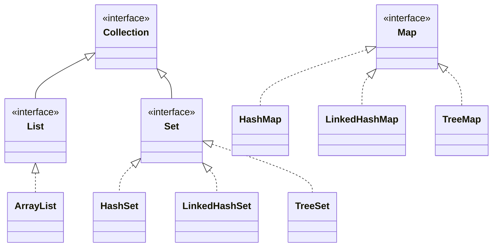
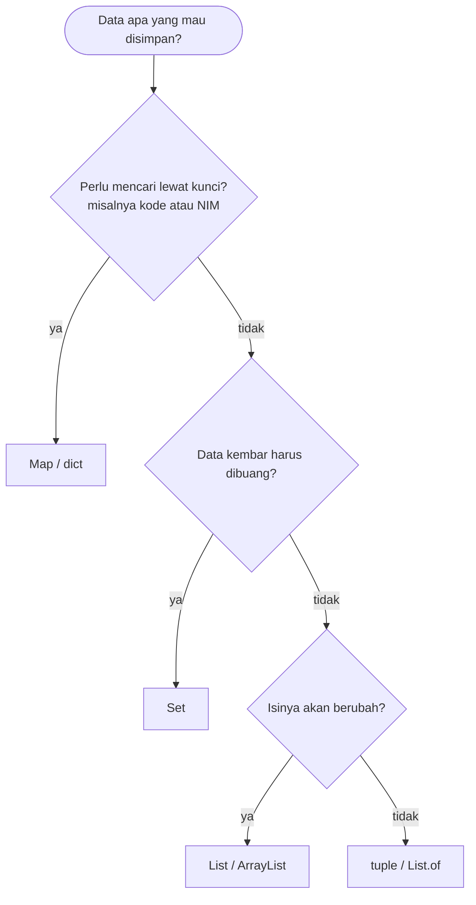
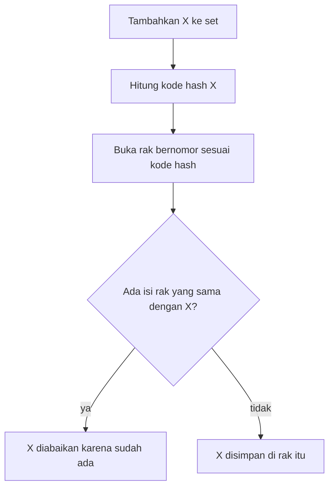
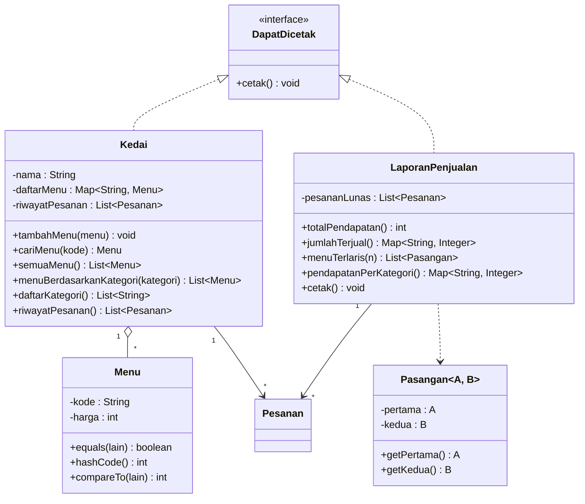

# Pertemuan 12: Koleksi dan *Generics*

[⬅️ Pertemuan 11](../Pertemuan-11-Exception-Handling/README.md) · [🏠 Beranda](../README.md) · [Pertemuan 13 ➡️](../Pertemuan-13-Prinsip-SOLID/README.md)

> Program nyata hampir selalu mengelola **banyak** objek sekaligus: puluhan menu, ratusan pesanan, ribuan mahasiswa. Hari ini kita belajar memilih **wadah** (koleksi) yang tepat untuk menyimpan, mencari, menyaring, dan mengurutkan objek. Kita juga belajar membuat wadah yang "berlabel" agar tidak salah isi, yaitu *generics*.

## 🎯 Tujuan Pembelajaran

Setelah pertemuan ini, kamu mampu:

1. Menjelaskan ciri empat jenis koleksi utama (*list*, *tuple*, set, dan map/dict) lalu memilih yang tepat untuk sebuah kebutuhan.
2. Membedakan *interface* koleksi dengan wujudnya (implementasi), dan menjelaskan mengapa urutan isi `HashSet`/`HashMap` tidak boleh diandalkan.
3. Mengurutkan objek dengan **urutan alami** maupun **urutan khusus**, termasuk memakai *lambda*.
4. Menjelaskan aturan kesamaan objek di dalam koleksi dan alasan `__eq__`/`equals` harus berpasangan dengan `__hash__`/`hashCode`.
5. Membuat dan memakai kelas generik seperti `Pasangan[A, B]` / `Pasangan<A, B>`, serta membandingkan pemeriksaan tipe di Python dan Java.

## 🧭 Peta Belajar

| Langkah | Bagian | Perkiraan waktu |
|---|---|---|
| 1 | Konsep (halaman ini) | 45 menit |
| 2 | Praktik: [🐍 Python](python/README.md) **atau** [☕ Java](java/README.md) | 100 menit |
| 3 | [Jembatan Python ↔ Java](jembatan-python-java.md) | 15 menit |
| 4 | [Latihan](latihan.md) | 75 menit |
| 5 | [Kuis](kuis.md) | 15 menit |

🖼️ ***Slide* pertemuan ini:** [lihat di PowerPoint Online](https://view.officeapps.live.com/op/view.aspx?src=https%3A%2F%2Fraw.githubusercontent.com%2Fantonprafanto%2FPBO2026%2Fmaster%2FSlide%2FPBO2026-P12-Koleksi-dan-Generics.pptx) · [baca PDF](../Slide/PBO2026-P12-Koleksi-dan-Generics.pdf) · [unduh PowerPoint](https://raw.githubusercontent.com/antonprafanto/PBO2026/master/Slide/PBO2026-P12-Koleksi-dan-Generics.pptx) · [unduh PDF](https://raw.githubusercontent.com/antonprafanto/PBO2026/master/Slide/PBO2026-P12-Koleksi-dan-Generics.pdf)

## 🔁 Mengingat Kembali

- Di Pertemuan 05 kita sudah memakai ***list* berisi objek**: `list` di Python dan `ArrayList` di Java. Saat itu `List<Menu>` cukup dibaca "*list* berisi `Menu`". Hari ini kita membahas arti tanda `< >` itu.
- Di Pertemuan 07 kita melihat bahwa secara bawaan, dua objek dianggap sama **hanya jika keduanya objek yang sama persis**. Hari ini kita belajar mengubah aturan itu.
- Di Pertemuan 10 kita mengenal *interface* sebagai **kontrak**. Di Java, `List`, `Set`, dan `Map` ternyata juga *interface*.
- Di [Pertemuan 11](../Pertemuan-11-Exception-Handling/README.md), `cari_menu()`/`cariMenu()` melempar `MenuTidakDitemukanError`/`MenuTidakDitemukanException` jika kode tidak terdaftar. Untuk itu, ia memeriksa menu **satu per satu** dari depan. Hari ini pencarian itu menjadi langsung lewat kode.

## Daftar Isi

1. [Cerita Pembuka: Kasir yang Kewalahan](#1-cerita-pembuka-kasir-yang-kewalahan)
2. [Empat Wadah Utama](#2-empat-wadah-utama)
3. [Kontrak dan Wujud: *Interface* Koleksi](#3-kontrak-dan-wujud-interface-koleksi)
4. [Urutan Isi: Jangan Mengandalkan Kebetulan](#4-urutan-isi-jangan-mengandalkan-kebetulan)
5. [Memilih Koleksi yang Tepat](#5-memilih-koleksi-yang-tepat)
6. [Mengurutkan Objek: Urutan Alami dan Urutan Khusus](#6-mengurutkan-objek-urutan-alami-dan-urutan-khusus)
7. [Kapan Dua Objek Dianggap Sama?](#7-kapan-dua-objek-dianggap-sama)
8. [*Generics*: Wadah Berlabel](#8-generics-wadah-berlabel)
9. [Studi Kasus KedaiKita: Apa yang Kita Bangun Hari Ini](#9-studi-kasus-kedaikita-apa-yang-kita-bangun-hari-ini)
10. [Miskonsepsi yang Sering Terjadi](#10-miskonsepsi-yang-sering-terjadi)

---

## 1. Cerita Pembuka: Kasir yang Kewalahan

Sore itu KedaiKita penuh mahasiswa yang baru selesai kuliah. Mbak Sari, kasirnya, dihujani pertanyaan:

- "Mbak, menu **M04** harganya berapa?" Mbak Sari membuka daftar menu dari atas, lalu membaca baris demi baris sampai menemukannya.
- "Tolong tampilkan menu dari yang **termurah**, dong."
- "Kategorinya ada apa saja?" Daftarnya berisi "Minuman, Minuman, Makanan, Makanan, Makanan". Ada yang kembar.
- Pemilik kedai menemukan kode **M01** dipakai oleh **dua** menu berbeda. Kacau!
- Malamnya pemilik bertanya, "Menu apa yang paling **laris** hari ini?"

Semua pertanyaan itu sebenarnya tentang **mengelola sekumpulan objek**. Sejak Pertemuan 05, kita hanya punya satu jenis wadah, yaitu *list*. *List* memang serba bisa, tetapi tidak selalu paling cocok.

| Pertanyaan | Kebutuhan sebenarnya | Wadah yang cocok (dibahas hari ini) |
|---|---|---|
| Harga M04 berapa? | mencari lewat **kunci** (kode) | map / dict |
| Kode M01 dipakai dua kali | menolak kunci **kembar** | map / dict, set |
| Kategori apa saja? | data **unik** tanpa kembar | set |
| Urutkan dari termurah | **mengurutkan** objek | *list* + aturan urutan |
| Menu paling laris? | **menghitung** per menu, lalu mengurutkan | map / dict + *list* |

> **Koleksi** (*collection*) adalah objek yang tugasnya menyimpan dan mengelola sekumpulan objek lain. Setiap jenis koleksi punya "kepribadian" sendiri: ada yang menjaga urutan, ada yang menolak data kembar, ada yang mencari lewat kunci.

## 2. Empat Wadah Utama

Bayangkan empat wadah yang sering kamu temui di kampus:

| Wadah | Analogi sehari-hari | Ciri utama |
|---|---|---|
| ***List*** | daftar belanja atau antrean bernomor | berurutan, boleh ada data kembar, isinya bisa diubah, diakses lewat nomor urut (indeks) |
| ***Tuple*** (Java: *list* tetap) | data yang sudah tercetak di KTP | berurutan, tetapi isinya **tidak bisa diubah** (*immutable*) |
| **Set** | daftar peserta unik sebuah lokakarya | **tanpa data kembar**, cepat menjawab "ada atau tidak?", urutan isi **tidak dijamin** |
| **Map** (Python: dict) | buku telepon atau loker berkunci | pasangan **kunci → nilai**, kunci tidak boleh kembar, dicari lewat kunci |

Sketsa isinya kira-kira seperti ini:

```text
LIST   [0] beras  [1] telur  [2] minyak  [3] telur     <- berurutan, boleh kembar
TUPLE  ("Senin", "Rabu")                               <- berurutan, isinya tetap
SET    { Ayu, Bima, Citra }                            <- tanpa kembar, urutan tidak pasti
MAP    "2409106001" -> Ayu    "2409106002" -> Bima     <- kunci unik -> nilai
```

Lirikan singkat cara membuatnya di kedua bahasa (potongan kode, tidak untuk dijalankan sendiri; versi lengkapnya ada di contoh 01—04 halaman praktik):

**Python:**

```python
belanja = ["beras", "telur", "minyak"]         # list
hari_kuliah = ("Senin", "Rabu")                # tuple
peserta = {"Ayu", "Bima", "Citra"}             # set
data = {"2409106001": "Ayu Lestari"}           # dict
```

**Java:**

```java
List<String> belanja = new ArrayList<>(List.of("beras", "telur", "minyak"));
List<String> hariKuliah = List.of("Senin", "Rabu");             // list tetap
Set<String> peserta = new HashSet<>(List.of("Ayu", "Bima", "Citra"));
Map<String, String> data = new HashMap<>();
data.put("2409106001", "Ayu Lestari");
```

> [!NOTE]
> Java tidak punya *tuple*. Padanan terdekatnya adalah *list* tetap buatan `List.of(...)`: urutannya ada, tetapi isinya tidak bisa ditambah, dihapus, atau diganti. Untuk mengelompokkan beberapa data yang tipenya berbeda, misalnya kode menu dan jumlah porsi, Java biasanya memakai kelas kecil seperti `Pasangan` di bagian 8.

## 3. Kontrak dan Wujud: *Interface* Koleksi

Di Pertemuan 10 kita belajar bahwa *interface* adalah **kontrak**. Koleksi Java dirancang persis seperti itu. `List`, `Set`, dan `Map` adalah *interface*, sedangkan `ArrayList`, `HashSet`, `TreeMap`, dan kawan-kawannya adalah **wujud** (implementasi) yang memenuhi kontrak tersebut.

Analoginya seperti lowongan "dibutuhkan seorang kasir". Pemilik kedai hanya peduli bahwa orang itu **bisa** menerima pembayaran dan mencetak struk. Siapa orangnya, Mbak Sari atau Mas Andi, bisa diganti kapan saja tanpa mengubah cara kerja kedai.



Diagram di atas sudah **disederhanakan**. Perhatikan bahwa `Map` berdiri sendiri dan bukan turunan `Collection` karena isinya berupa pasangan kunci dan nilai.

Karena itulah kode Java ditulis dengan pola "tipe kontrak di kiri, wujud di kanan":

```text
List<Menu>          daftar = new ArrayList<>();
^^^^^^^^^^                   ^^^^^^^^^^^^^^^
tipe = kontrak               wujud = kelas yang bekerja
```

Keuntungannya, kode lain hanya bergantung pada kontrak `List`. Jika suatu saat wujudnya diganti, cukup satu baris yang berubah.

> [!NOTE]
> Di Python, `list`, `tuple`, `set`, dan `dict` adalah kelas yang langsung kita pakai. Python juga punya "kontrak" untuk koleksi di modul `collections.abc` (misalnya `Sequence` dan `Mapping`), tetapi untuk mata kuliah ini cukup tahu bahwa konsepnya ada.

## 4. Urutan Isi: Jangan Mengandalkan Kebetulan

Ini jebakan yang sering memakan korban. Perhatikan dua program kecil berikut. Isinya hanya mencetak sebuah set berisi nama hari.

**Python** (*file* `hari.py`):

```python
hari = {"Senin", "Selasa", "Rabu", "Kamis", "Jumat"}
print(hari)
```

**Java** (*file* `Hari.java`):

```java
import java.util.Set;

public class Hari {
    public static void main(String[] args) {
        Set<String> hari = Set.of("Senin", "Selasa", "Rabu", "Kamis", "Jumat");
        System.out.println(hari);
    }
}
```

Kami menjalankan **program yang sama** tiga kali tanpa mengubah apa pun. Hasil versi Python:

```text
{'Selasa', 'Senin', 'Kamis', 'Rabu', 'Jumat'}
{'Kamis', 'Senin', 'Selasa', 'Jumat', 'Rabu'}
{'Senin', 'Jumat', 'Rabu', 'Selasa', 'Kamis'}
```

Hasil versi Java:

```text
[Selasa, Senin, Kamis, Jumat, Rabu]
[Jumat, Rabu, Selasa, Senin, Kamis]
[Selasa, Rabu, Jumat, Kamis, Senin]
```

Urutannya berubah-ubah! Set dan map berbasis *hash* menyusun isinya menurut **kode *hash*** (dibahas di bagian 7), bukan menurut urutan kita memasukkan data. Secara sederhana, Python mengacak kode *hash* teks setiap kali program dijalankan. Java `Set.of` bahkan sengaja dibuat berubah-ubah agar pemrogram tidak bergantung pada urutannya. Di komputermu, urutannya bisa berbeda lagi.

`HashSet` dan `HashMap` biasa di Java memang sering tampak sama dari satu kali jalan ke kali berikutnya. Namun, urutan itu tetap tidak dijamin: urutannya bisa berubah saat isinya bertambah atau saat versi Java-nya berbeda.

> [!TIP]
> **Coba sendiri:** buat *file* `hari.py` (atau `Hari.java`) di folder latihanmu, `PBO-latihan-saya/pertemuan-12/`, lalu salin kode di atas. Jalankan tiga kali dari folder itu dengan `python hari.py` (macOS/Linux: `python3 hari.py`) atau `java Hari.java`. Kemungkinan besar urutan nama hari yang tercetak berubah-ubah dan berbeda dari contoh di atas. Folder latihan ini dijelaskan di [Git dan GitHub bagian 5](../00-Persiapan/git-dan-github.md#5-menyimpan-latihanmu-sendiri), sedangkan cara membuka terminal di folder yang tepat ada di halaman praktik bagian Persiapan.

| Wadah | Urutan saat isinya dijelajahi |
|---|---|
| Python `list` / `tuple`, Java `ArrayList` / `List.of` | sesuai indeks (urutan dimasukkan) |
| Python `dict` | sesuai urutan kunci **pertama kali dimasukkan** (dijamin sejak Python 3.7) |
| Python `set` | **tidak dijamin** |
| Java `HashSet` / `HashMap` / `Set.of` / `Map.of` | **tidak dijamin** |
| Java `LinkedHashSet` / `LinkedHashMap` | sesuai urutan dimasukkan |
| Java `TreeSet` / `TreeMap` | selalu **urut** (abjad, angka, atau aturan yang kita berikan) |

> [!IMPORTANT]
> Jika urutan penting (misalnya untuk ditampilkan atau dicetak di struk), lakukan salah satu: pilih wadah yang **menjamin** urutan (`dict`, `LinkedHashMap`, `TreeMap`), atau **urutkan dulu** sebelum ditampilkan (`sorted(...)`, `TreeSet`, `Collections.sort`). Program yang "kebetulan urut" di laptopmu bisa berantakan di laptop dosen.

## 5. Memilih Koleksi yang Tepat

Saat ragu, jawab tiga pertanyaan ini secara berurutan:



Setelah jenisnya terpilih, tentukan kebutuhan urutannya (bagian 4). Berikut contoh pilihan nyata di KedaiKita versi hari ini:

| Kebutuhan | Pilihan | Di KedaiKita |
|---|---|---|
| Item pesanan sesuai urutan dipesan | *list* | daftar item di `Pesanan` |
| Cari menu lewat kode, tolak kode ganda | dict / `LinkedHashMap` | daftar menu di `Kedai` |
| Kategori unik, ditampilkan urut abjad | set, lalu diurutkan | `daftar_kategori()` / `daftarKategori()` |
| Menghitung porsi terjual per menu | dict / `LinkedHashMap` (nama → angka) | `jumlah_terjual()` / `jumlahTerjual()` |
| Pendapatan per kategori, urut abjad | dict yang diurutkan / `TreeMap` | `pendapatan_per_kategori()` / `pendapatanPerKategori()` |

Mengapa mencari lewat kunci lebih cepat? Mencari di *list* ibarat mencari nama di daftar hadir: dibaca dari atas sampai ditemukan. Makin panjang daftarnya, makin lama. Set dan map memakai kode *hash* untuk langsung menuju "rak" tempat data disimpan. Secara sederhana, lama pencarian hampir tidak bertambah walaupun datanya makin banyak.

> [!TIP]
> **Coba sendiri:** pilih wadah yang paling cocok untuk setiap kebutuhan berikut. Cukup dijawab di kertas, tanpa kode. (a) Nomor plat kendaraan yang masuk parkiran kampus hari ini, setiap kendaraan dihitung sekali. (b) Antrean pesanan sesuai urutan datang. (c) Stok barang berdasarkan nama barang. (d) Nama tujuh hari dalam seminggu.

<details>
<summary>Lihat jawaban</summary>

(a) **set** karena kendaraan yang keluar-masuk dua kali tetap dihitung sekali. (b) ***list*** karena urutan datang penting dan isinya terus bertambah. (c) **map/dict**, dengan kunci nama barang dan nilai jumlahnya. (d) ***tuple*** / `List.of` karena isinya tetap dan tidak boleh diubah.

</details>

## 6. Mengurutkan Objek: Urutan Alami dan Urutan Khusus

Mengurutkan angka atau teks itu mudah karena komputer tahu bahwa 8000 lebih kecil dari 18000 dan "Ayu" lebih dulu dari "Bima". Namun, bagaimana mengurutkan objek `Menu`? Berdasarkan harga? Nama? Stok? Komputer tidak bisa menebak. Kita harus **memberi tahu aturannya**.

Bayangkan antrean di kantor bank. Setiap nasabah memegang nomor antrean, dan itulah **urutan baku** mereka. Namun, saat pembagian hadiah undian, panitia membacakan pemenang menurut abjad nama. Data nasabahnya sama, aturan urutnya yang berbeda.

> **Urutan alami** (*natural ordering*) adalah satu aturan urutan baku yang ditulis **di dalam kelas** itu sendiri.
>
> **Urutan khusus** (*custom ordering*) adalah aturan urutan yang diberikan **dari luar** saat mengurutkan. Jumlahnya boleh sebanyak yang kita butuhkan.

| | Urutan alami | Urutan khusus |
|---|---|---|
| Jumlahnya per kelas | satu | sebanyak yang dibutuhkan |
| Ditulis di | dalam kelas itu sendiri | di luar kelas, saat mengurutkan |
| Python | *method* `__lt__` ("kurang dari") | argumen `key=` berisi fungsi atau *lambda* |
| Java | `implements Comparable<T>` + *method* `compareTo()` | objek `Comparator` (*lambda*, `Comparator.comparing`) |
| Contoh di KedaiKita | menu: harga termurah dulu | menu: nama A-Z |

### *Lambda*: fungsi kecil tanpa nama

Untuk urutan khusus, kita perlu mengirim "aturan" sebagai argumen. Menulis fungsi lengkap untuk aturan sesingkat "ambil harganya" terasa berlebihan. Di sinilah ***lambda*** berguna.

> ***Lambda*** adalah fungsi kecil **tanpa nama** yang ditulis langsung di tempat ia dibutuhkan.

Bedanya seperti SOP resmi dan catatan tempel. Fungsi biasa ibarat SOP: punya judul dan bisa dipakai di mana saja. *Lambda* ibarat catatan tempel bertuliskan "urutkan menurut harga" yang ditempel langsung di tempat kerja.

Berikut lirikan singkatnya (potongan kode, tidak untuk dijalankan sendiri; `daftar_menu`/`daftarMenu` adalah *list* berisi objek `Menu`):

**Python:**

```python
daftar_menu.sort(key=lambda m: m.harga)               # mengurutkan list itu sendiri
termurah = sorted(daftar_menu, key=lambda m: m.harga)  # membuat list baru yang urut
```

**Java:**

```java
daftarMenu.sort(Comparator.comparing(m -> m.getHarga()));  // lambda
daftarMenu.sort(Comparator.comparing(Menu::getHarga));     // method reference
```

`lambda m: m.harga` dan `m -> m.getHarga()` sama-sama berarti "diberi sebuah menu `m`, kembalikan harganya". Bentuk `Menu::getHarga` di Java disebut *method reference*, yaitu singkatan dari *lambda* yang hanya memanggil satu *method*.

### Kriteria kedua saat seri

Bagaimana jika dua menu harganya sama? Kita butuh **kriteria kedua**, seperti peringkat kelas: jika nilai sama, yang namanya lebih dulu menurut abjad ditulis di atas. KedaiKita memakai aturan "harga termurah dulu; jika harganya sama, urut kode". Pada urutan khusus, kriteria kedua ditulis sebagai *tuple* di Python (`key=lambda m: (m.harga, m.kode)`) atau dengan `.thenComparing(...)` di Java. Detailnya ada di halaman praktik bagian 5.

Di Java, aturan urutan alami dikembalikan oleh `compareTo()` dalam bentuk angka:

| Hasil `a.compareTo(b)` | Artinya |
|---|---|
| negatif | `a` diletakkan **sebelum** `b` |
| nol | `a` dan `b` setara dalam urutan |
| positif | `a` diletakkan **sesudah** `b` |

Di Python, `__lt__(self, lain)` cukup mengembalikan `True` jika `self` harus diletakkan sebelum `lain`, dan `False` jika tidak.

## 7. Kapan Dua Objek Dianggap Sama?

Petugas pemilu memeriksa daftar pemilih dan menemukan dua baris: "Budi Santoso" dan "Budi Santosa". NIK keduanya sama persis. Jelas ini **orang yang sama** yang datanya tercatat dua kali, dan salah satunya salah ketik.

Ada dua pertanyaan berbeda di sini:

| Pertanyaan | Disebut | Python | Java |
|---|---|---|---|
| Apakah ini **objek yang sama persis**? (satu kartu fisik yang sama) | identitas | `a is b` | `a == b` |
| Apakah keduanya **dianggap sama**? (NIK-nya sama) | kesamaan | `a == b` (memanggil `__eq__`) | `a.equals(b)` |

Secara bawaan, "dianggap sama" berarti "objek yang sama persis" (Pertemuan 07). Kita bisa mengubahnya dengan menulis *method* `__eq__` (Python) atau meng-*override* `equals()` (Java), misalnya "sama jika NIK-nya sama".

### Mengapa harus berpasangan dengan *hash*?

Set dan map tidak membandingkan objek baru dengan **semua** isinya satu per satu karena cara itu lambat. Mereka bekerja seperti perpustakaan dengan rak bernomor. Setiap objek punya **kode *hash***, yaitu angka yang menentukan rak tempat ia disimpan.



Sekarang bayangkan dua objek Budi yang **dianggap sama**, tetapi kode *hash*-nya **berbeda**. Keduanya diantar ke rak yang berbeda. Pemeriksaan kesamaan tidak pernah terjadi sehingga set berisi dua Budi. Data ganda lolos!

![Ilustrasi set sebagai deretan rak bernomor 0 sampai 5. Kiri, versi benar: kesamaan dan kode hash sama-sama dihitung dari NIK, jadi Budi Santoso dan Budi Santosa dengan NIK 6472010000000001 masuk ke rak 3, dibandingkan di sana, dan dianggap sama; hasilnya set berisi 1 Budi. Kanan, versi salah di Java karena hanya equals() yang ditulis: kode hash bawaannya berbeda, jadi keduanya masuk ke rak 1 dan rak 4, tidak pernah dibandingkan; hasilnya set berisi 2 Budi atau data ganda. Aturan wajib: objek yang dianggap sama harus punya kode hash yang sama.](gambar/rak-hash.svg)

> [!IMPORTANT]
> **Aturan wajib:** dua objek yang dianggap sama **harus** punya kode *hash* yang sama. Karena itu, `__eq__` selalu ditulis bersama `__hash__`, dan `equals()` selalu di-*override* bersama `hashCode()`. Keduanya dihitung dari data yang sama, misalnya NIK atau kode menu. Sebaliknya, dua objek berbeda **boleh** kebetulan punya kode *hash* sama karena isi satu rak tetap diperiksa satu per satu.

Apa yang terjadi jika aturan itu dilanggar?

| Yang ditulis | Python | Java |
|---|---|---|
| Tidak keduanya | aman, tetapi kesamaan = identitas | aman, tetapi kesamaan = identitas |
| Hanya `__eq__` / `equals()` | objeknya tidak bisa masuk set/dict (`TypeError: unhashable type`) | **diam-diam salah**: set bisa berisi data kembar |
| Keduanya, dari data yang sama | benar | benar |

> [!WARNING]
> Pilih data yang **tidak berubah** untuk kesamaan dan *hash*, misalnya kode menu atau NIK. Jika data itu berubah saat objek sudah berada di dalam set, objek tersebut "tersesat" di rak yang salah dan tidak bisa ditemukan lagi.

## 8. *Generics*: Wadah Berlabel

Di dapur KedaiKita ada deretan toples. Toples berlabel "GULA" hanya boleh diisi gula. Hasilnya, saat mengambil isinya, kita **yakin** itu gula, tanpa perlu mencicipinya dulu. Toples tanpa label lebih fleksibel, tetapi berbahaya: isinya bisa saja garam, dan kita baru tahu setelah kopinya terasa asin.

> ***Generics*** adalah cara menulis kelas atau fungsi dengan **parameter tipe** (biasanya ditulis `T`) sehingga tipe isinya baru ditentukan saat dipakai.

Kamu sebenarnya sudah memakai *generics* sejak Pertemuan 05:

| Tulisan | Dibaca |
|---|---|
| `list[Menu]` / `List<Menu>` | *list* berisi `Menu` |
| `dict[str, Menu]` / `Map<String, Menu>` | map dengan kunci teks dan nilai `Menu` |
| `Kotak[int]` / `Kotak<Integer>` | kotak berisi angka |
| `Pasangan[str, int]` / `Pasangan<String, Integer>` | pasangan berisi (teks, angka) |

Kita juga bisa membuat kelas generik sendiri. Berikut kelas `Pasangan` dari studi kasus hari ini, dipersingkat dari *file* `pasangan.py` dan `Pasangan.java` (potongan kode, tidak untuk dijalankan sendiri):

**Python:**

```python
A = TypeVar("A")
B = TypeVar("B")


class Pasangan(Generic[A, B]):
    def __init__(self, pertama: A, kedua: B):
        self._pertama = pertama
        self._kedua = kedua
```

**Java:**

```java
public class Pasangan<A, B> {
    private A pertama;
    private B kedua;

    public Pasangan(A pertama, B kedua) {
        this.pertama = pertama;
        this.kedua = kedua;
    }
```

Satu kelas, banyak kegunaan: `Pasangan("M01", 2)` berisi (kode menu, jumlah porsi), sedangkan `Pasangan("Es Teh Manis", 4)` berisi (nama menu, porsi terjual).

### Python dan Java berbeda dalam memeriksa label

| | Python | Java |
|---|---|---|
| Kapan tipe diperiksa | **tidak** diperiksa saat program berjalan; yang memeriksa adalah alat bantu seperti VS Code atau mypy | diperiksa oleh *compiler* saat kompilasi |
| Jika isinya salah tipe | program tetap berjalan; masalah muncul belakangan (atau tidak sama sekali) | ditolak sebelum program sempat berjalan |
| Isi berupa angka | langsung `int` | harus kelas pembungkus `Integer`, bukan `int` |

Artinya, di Python label *generics* adalah **petunjuk** (*type hint*) untuk manusia dan alat bantu. Di Java, label itu adalah **aturan** yang ditegakkan *compiler*. Keuntungannya bagi Java: isi wadah bisa langsung dipakai tanpa *cast* (mengubah paksa tipe sebuah objek, misalnya dari `Object` menjadi `String`), dan salah isi tertangkap sebelum program sampai ke tangan pengguna.

> [!NOTE]
> Khusus Java: *generics* hanya menerima **kelas** sehingga angka `int` disimpan sebagai objek `Integer`. Java membungkus dan membukanya secara otomatis (*autoboxing* dan *unboxing*). Ada jebakan terkenal di sini: membandingkan dua `Integer` dengan `==`. Detailnya di [halaman praktik Java bagian 8](java/README.md#8-generics-dan-kelas-pembungkus-integer).

## 9. Studi Kasus KedaiKita: Apa yang Kita Bangun Hari Ini

KedaiKita versi Pertemuan 12 menjawab pertanyaan-pertanyaan Mbak Sari di bagian 1.



Diagram ini hanya menampilkan bagian yang baru atau berubah. Nama di diagram memakai gaya Java. Di Python, padanannya ditulis *snake_case* (`daftar_menu`, `cari_menu`), sedangkan `equals`/`hashCode`/`compareTo` menjadi `__eq__`/`__hash__`/`__lt__`.

**Yang berubah dibanding Pertemuan 11:**

- **`Kedai`** menyimpan menu di **map** (kode → `Menu`), bukan *list*. Pencarian lewat kode menjadi langsung, dan kode ganda **ditolak**. Versi Java memakai `LinkedHashMap` agar urutan menu tetap sesuai urutan ditambahkan, sama seperti `dict` Python.
- **`Kedai`** punya *method* baru: `semua_menu()` (salinan daftar menu), `menu_berdasarkan_kategori()` (menyaring), `daftar_kategori()` (memakai **set**, lalu diurutkan), dan `riwayat_pesanan()`.
- **`Menu`** punya aturan kesamaan (sama jika **kodenya** sama) dan urutan alami (**harga termurah** dulu; jika sama, urut kode).
- **`Pasangan`** adalah kelas generik baru. Dipakai untuk pasangan (kode, jumlah) saat bertransaksi dan (nama menu, porsi) di laporan.
- **`LaporanPenjualan`** adalah kelas baru yang merangkum pesanan **lunas**: total pendapatan, tiga menu terlaris, dan pendapatan per kategori. Kelas ini juga memenuhi kontrak `DapatDicetak` dari Pertemuan 10.
- Khusus Java: `Minuman` mendapat konstruktor *overload* empat parameter (tanpa `dingin`) karena versi Python memakai nilai bawaan `dingin=True`.
- `Pesanan`, `ItemPesanan`, `Pelanggan`, kelas-kelas pembayaran, dan *exception* **tidak berubah**.

**Skenario program:**

1. Menyiapkan kedai dengan lima menu, lalu mencetaknya.
2. Menampilkan kategori unik, menyaring minuman, mengurutkan menu menurut harga (urutan alami) dan nama (urutan khusus).
3. Mencoba menambah menu berkode M01 lagi (ditolak), lalu membuktikan bahwa dua objek menu berkode sama dianggap sama.
4. Menjalankan lima transaksi, satu di antaranya gagal bayar, lalu mencetak laporan penjualan.

**Hasil yang diharapkan**, mulai dari bagian KATEGORI UNIK (sama persis untuk versi Python maupun Java). Daftar menu di awal tidak ditampilkan, dan baris `...` menandai bagian yang dilewati (kesamaan objek, lima transaksi, dan jumlah pesanan tercatat):

```text
=== KATEGORI UNIK ===
Makanan, Minuman

=== FILTER: MINUMAN SAJA ===
[M01] Kopi Susu Gula Aren (Minuman) - Rp18.000 | stok 20 | dingin
[M02] Es Teh Manis (Minuman) - Rp8.000 | stok 30 | dingin

=== URUT HARGA TERMURAH (urutan alami) ===
   Rp8.000  Es Teh Manis
  Rp15.000  Pisang Goreng Keju
  Rp18.000  Kopi Susu Gula Aren
  Rp23.000  Mie Goreng Jawa
  Rp25.000  Nasi Goreng Kampung

=== URUT NAMA A-Z (kunci pengurutan) ===
M02  Es Teh Manis
M01  Kopi Susu Gula Aren
M04  Mie Goreng Jawa
M03  Nasi Goreng Kampung
M05  Pisang Goreng Keju

=== KODE GANDA DITOLAK ===
Ditolak: Kode M01 sudah dipakai
Jumlah menu tetap 5
...
========================================
LAPORAN PENJUALAN KEDAIKITA
========================================
Pesanan lunas                          4
Total pendapatan               Rp167.000
----------------------------------------
Menu terlaris:
1. Es Teh Manis (4 porsi)
2. Kopi Susu Gula Aren (4 porsi)
3. Mie Goreng Jawa (1 porsi)
----------------------------------------
Pendapatan per kategori:
Makanan                         Rp63.000
Minuman                        Rp104.000
========================================
```

Perhatikan "Menu terlaris". Es Teh Manis dan Kopi Susu Gula Aren sama-sama terjual 4 porsi sehingga kriteria kedua (nama A-Z) menentukan urutannya. Mie Goreng Jawa menempati posisi ketiga karena seri 1 porsi dengan dua menu lain, dan namanya paling awal menurut abjad.

Kode lengkapnya dibahas di halaman praktik: [🐍 Python](python/README.md#9-studi-kasus-kedaikita) atau [☕ Java](java/README.md#9-studi-kasus-kedaikita).

## 10. Miskonsepsi yang Sering Terjadi

Enam anggapan keliru berikut paling sering muncul saat belajar koleksi dan *generics*. Cocokkan dengan pemahamanmu sendiri.

1. **Keliru:** "Semua koleksi menyimpan isi sesuai urutan saya memasukkannya."

   **Yang benar:** `list` dan `dict` Python menjaga urutan masuk, tetapi `set` tidak. Di Java, `HashSet` dan `HashMap` tidak menjamin urutan sama sekali. Pakai `LinkedHashMap`/`TreeMap`, atau urutkan dulu sebelum dicetak.

2. **Keliru:** "Cukup menulis `__eq__`/`equals()` agar set membuang data kembar."

   **Yang benar:** belum cukup. Tanpa `__hash__`/`hashCode()` yang dihitung dari data yang sama, Python menolak objeknya masuk set, sedangkan Java diam-diam membiarkan data kembar.

3. **Keliru:** "Map hanyalah *list* berisi pasangan."

   **Yang benar:** kunci map **unik** dan dipakai untuk mencari langsung. Menyimpan kunci yang sudah ada akan **menimpa** nilai lamanya, bukan menambah baris baru.

4. **Keliru:** "*Type hint* `list[int]` membuat Python menolak teks."

   **Yang benar:** Python tidak memeriksa *type hint* saat program berjalan. Yang membaca petunjuk itu adalah manusia dan alat bantu seperti VS Code atau mypy. Java berbeda karena *compiler*-nya benar-benar menolak isi yang salah tipe.

5. **Keliru:** "*Lambda* adalah fitur rumit yang harus dihafal."

   **Yang benar:** *lambda* hanyalah fungsi kecil tanpa nama. `lambda m: m.harga` sama artinya dengan fungsi biasa yang menerima `m` lalu mengembalikan `m.harga`.

6. **Keliru:** "Satu kelas hanya bisa diurutkan dengan satu cara."

   **Yang benar:** urutan alami memang hanya satu, tetapi urutan khusus (`key=` di Python, `Comparator` di Java) bisa sebanyak yang kamu butuhkan: termurah, terlaris, nama A-Z, dan seterusnya.

## 📝 Ringkasan

- **Koleksi** adalah objek yang menyimpan dan mengelola sekumpulan objek lain.
- ***List*** berurutan dan boleh kembar. ***Tuple***/`List.of` berurutan tetapi tetap. **Set** membuang data kembar. **Map/dict** menyimpan pasangan kunci → nilai dengan kunci unik.
- Di Java, `List`, `Set`, dan `Map` adalah *interface* (kontrak), sedangkan `ArrayList`, `HashSet`, `HashMap`, dan lainnya adalah wujudnya. Tulis tipe kontrak di kiri, wujud di kanan.
- Urutan isi `set`, `HashSet`, dan `HashMap` **tidak dijamin**. Jika urutan penting, pakai `dict`, `LinkedHashMap`, `TreeMap`, atau urutkan dulu.
- **Urutan alami** ditulis di dalam kelas (`__lt__` / `Comparable`). **Urutan khusus** diberikan dari luar (`key=` / `Comparator`), sering dengan ***lambda***.
- ***Lambda*** adalah fungsi kecil tanpa nama: `lambda m: m.harga` / `m -> m.getHarga()`.
- Kesamaan objek diatur dengan `__eq__`/`equals()`, dan **wajib** berpasangan dengan `__hash__`/`hashCode()` yang dihitung dari data yang sama.
- ***Generics*** memberi "label tipe" pada wadah: `list[Menu]`, `List<Menu>`, `Pasangan<A, B>`. Java memeriksanya saat kompilasi, Python hanya menjadikannya petunjuk.

## 📖 Istilah Penting

| Istilah | Arti singkat |
|---|---|
| Koleksi (*collection*) | Objek yang menyimpan dan mengelola sekumpulan objek lain |
| *List* | Koleksi berurutan, boleh berisi data kembar, diakses lewat indeks |
| *Tuple* | Koleksi berurutan yang isinya tidak bisa diubah (Python) |
| Set | Koleksi tanpa data kembar; urutan isi tidak dijamin |
| Map / dict | Koleksi pasangan kunci → nilai dengan kunci unik |
| *Immutable* | Tidak bisa diubah setelah dibuat |
| Implementasi (wujud) | Kelas nyata yang memenuhi kontrak *interface*, misalnya `ArrayList` untuk `List` |
| Urutan alami (*natural ordering*) | Aturan urutan baku yang ditulis di dalam kelas (`__lt__` / `compareTo`) |
| Urutan khusus (*custom ordering*) | Aturan urutan dari luar kelas (`key=` / `Comparator`) |
| *Lambda* | Fungsi kecil tanpa nama yang ditulis langsung di tempat dipakai |
| *Method reference* | Singkatan *lambda* di Java, misalnya `Menu::getNama` |
| Kode *hash* (*hash code*) | Angka dari isi objek yang menentukan "rak" penyimpanannya di set/map |
| *Generics* | Kelas atau fungsi dengan parameter tipe (`T`) yang ditentukan saat dipakai |
| *Type hint* | Petunjuk tipe di Python, tidak diperiksa saat program berjalan |
| *Autoboxing* | Java mengubah `int` menjadi `Integer` (dan sebaliknya) secara otomatis |

## ➡️ Langkah Berikutnya

Pilih jalur praktikmu: [🐍 Praktik Python](python/README.md) atau [☕ Praktik Java](java/README.md).

---

[⬅️ Pertemuan 11](../Pertemuan-11-Exception-Handling/README.md) · [🏠 Beranda](../README.md) · [Pertemuan 13 ➡️](../Pertemuan-13-Prinsip-SOLID/README.md)
