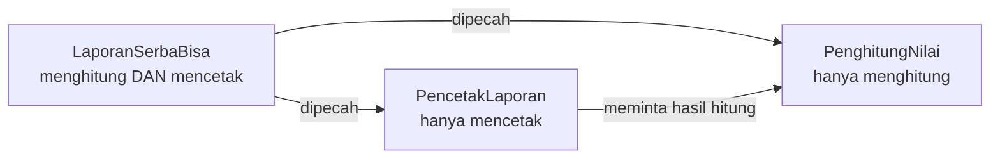
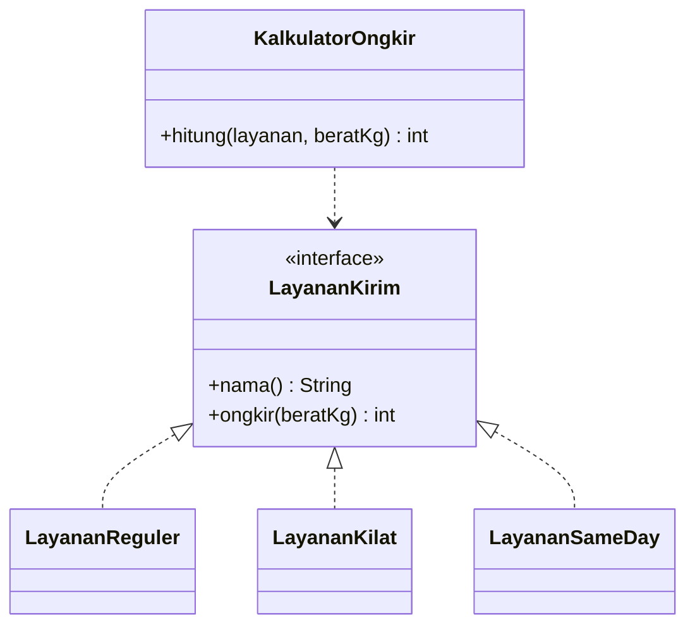
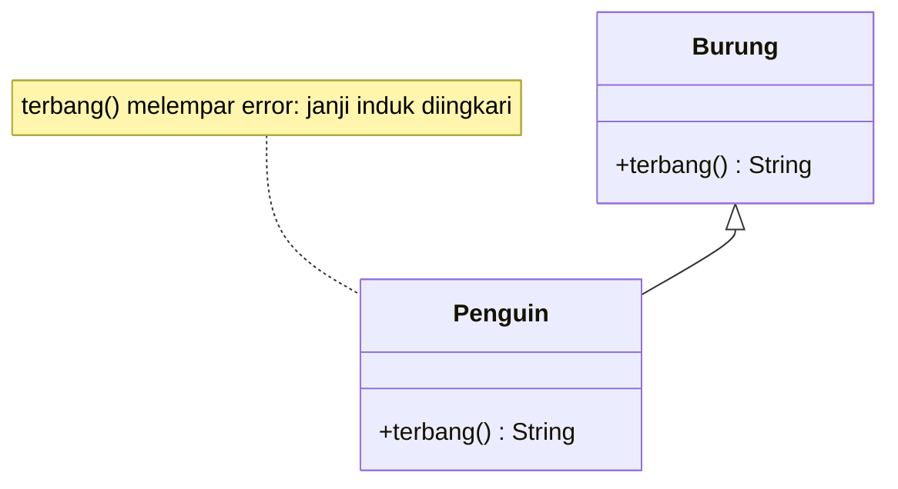
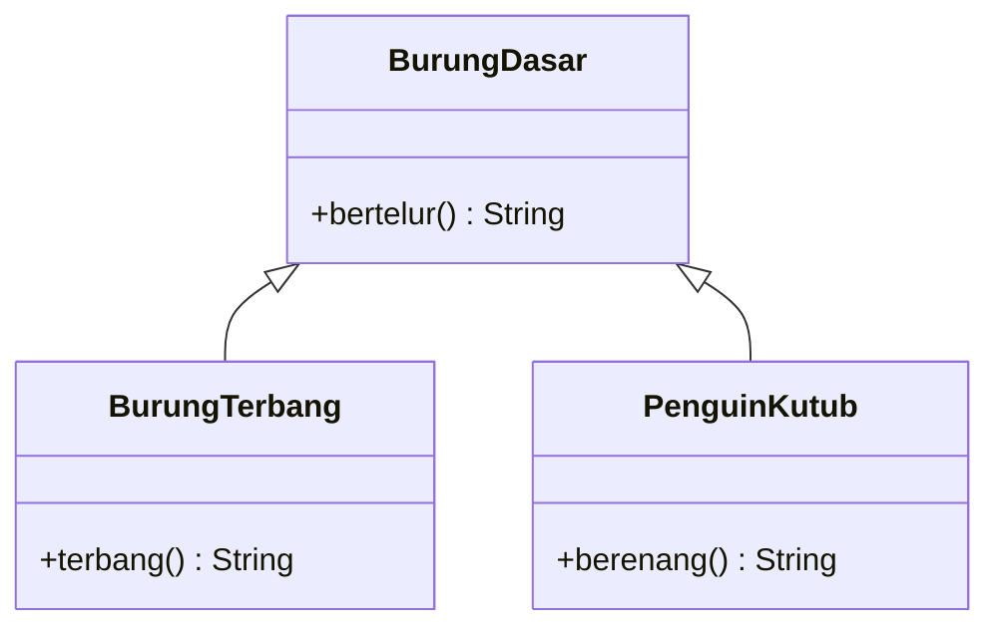
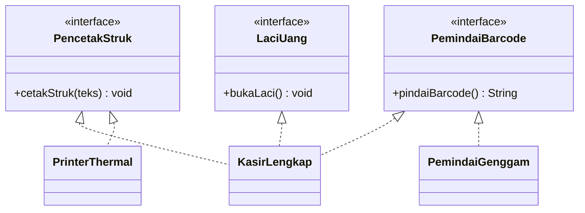
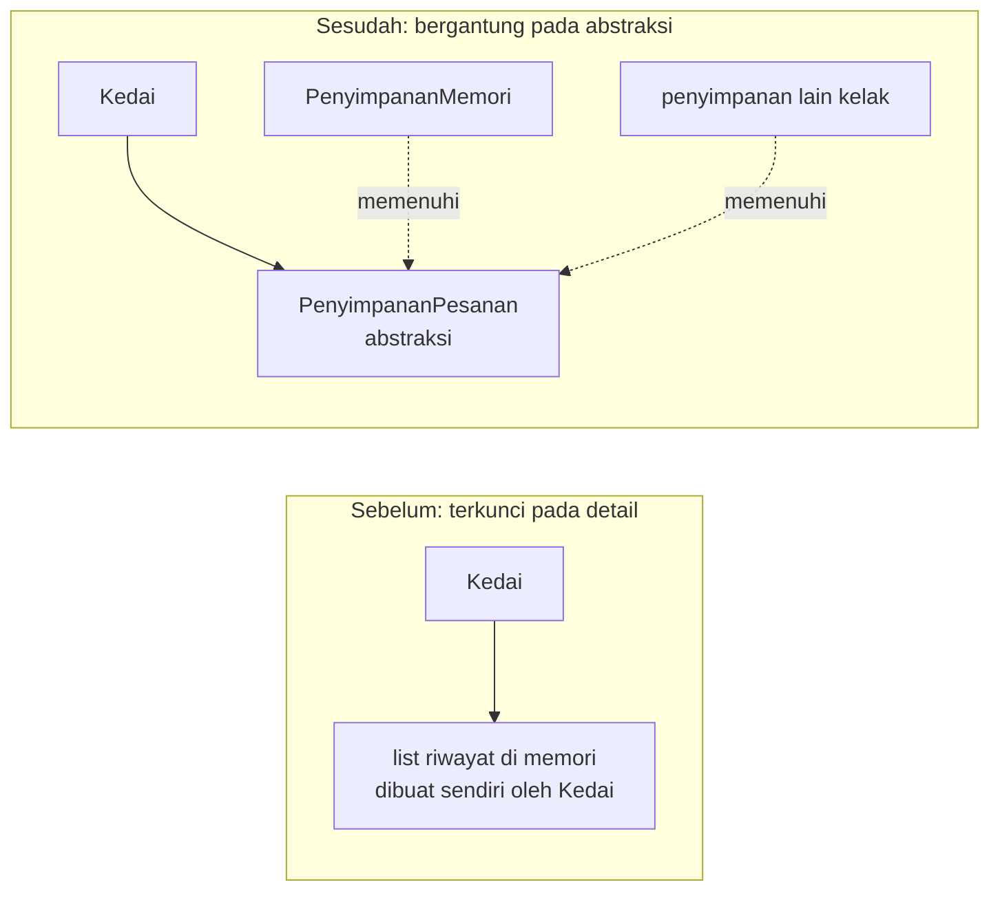
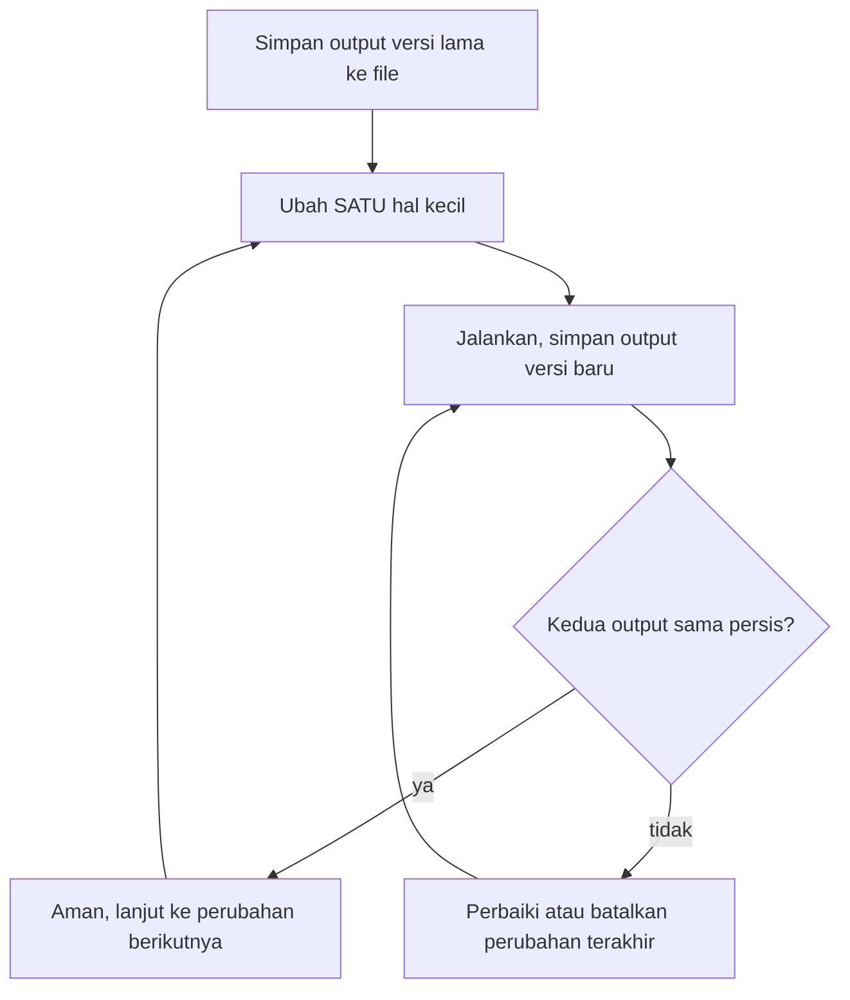
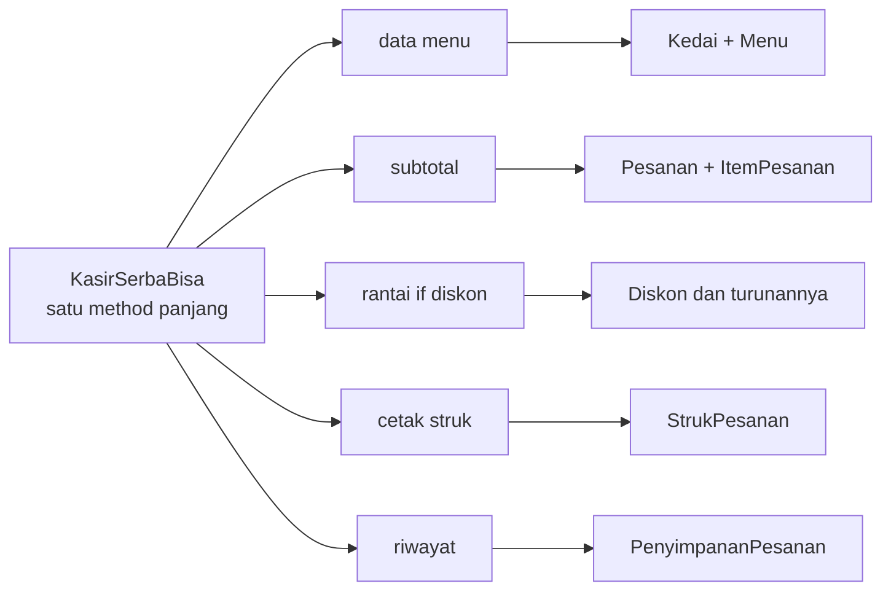
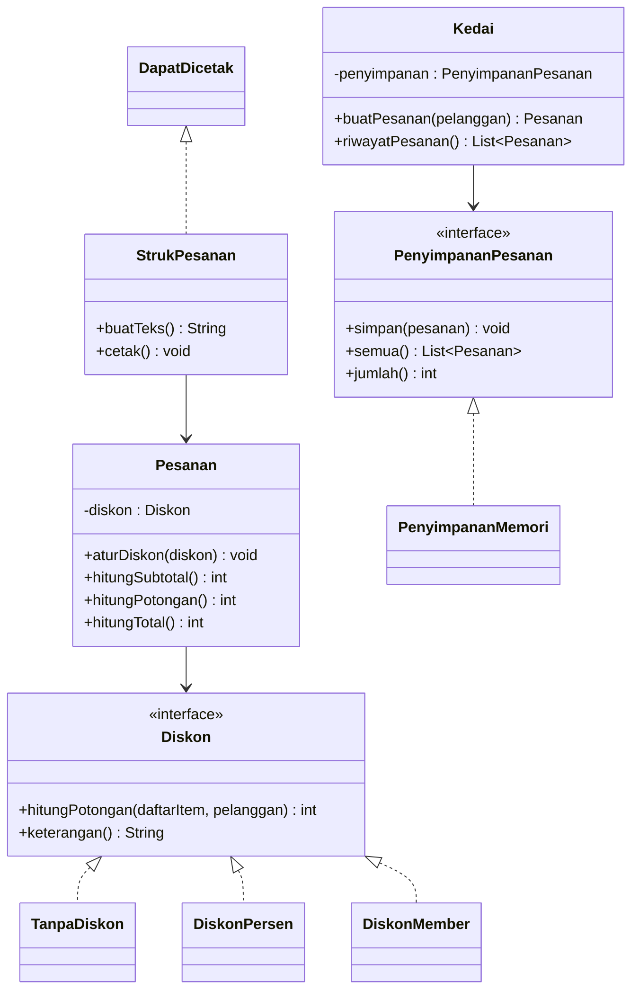

# Pertemuan 13: Prinsip SOLID

[⬅️ Pertemuan 12](../Pertemuan-12-Koleksi-dan-Generics/README.md) · [🏠 Beranda](../README.md) · [Pertemuan 14 ➡️](../Pertemuan-14-Design-Pattern/README.md)

> Program yang **berjalan benar** belum tentu **mudah diubah**. Hari ini kita belajar lima prinsip desain bernama SOLID untuk menilai dan merapikan susunan kelas. Lalu kita membongkar kelas kasir "serba bisa" milik KedaiKita menjadi beberapa kelas kecil, tanpa mengubah satu karakter pun pada *output*-nya.

## 🎯 Tujuan Pembelajaran

Setelah pertemuan ini, kamu mampu:

1. Mengenali tanda-tanda kode yang sulit diubah (*code smell*), misalnya kelas serba bisa dan rantai percabangan yang panjang.
2. Menjelaskan kelima prinsip SOLID (SRP, OCP, LSP, ISP, DIP) dengan analogi sehari-hari dan contoh kode.
3. Menemukan pelanggaran prinsip SOLID pada sebuah rancangan lalu mengusulkan perbaikannya.
4. Menerapkan *dependency injection* lewat konstruktor agar sebuah kelas bergantung pada abstraksi.
5. Melakukan *refactoring* dan membuktikan bahwa perilaku program tidak berubah dengan membandingkan *output* memakai `diff` atau `fc`.
6. Menimbang kapan prinsip desain perlu diterapkan, termasuk prinsip pendamping DRY, KISS, dan YAGNI.

## 🧭 Peta Belajar

| Langkah | Bagian | Perkiraan waktu |
|---|---|---|
| 1 | Konsep (halaman ini) | 50 menit |
| 2 | Praktik: [🐍 Python](python/README.md) **atau** [☕ Java](java/README.md) | 100 menit |
| 3 | [Jembatan Python ↔ Java](jembatan-python-java.md) | 15 menit |
| 4 | [Latihan](latihan.md) | 90 menit |
| 5 | [Kuis](kuis.md) | 15 menit |

🖼️ ***Slide* pertemuan ini:** [lihat di PowerPoint Online](https://view.officeapps.live.com/op/view.aspx?src=https%3A%2F%2Fraw.githubusercontent.com%2Fantonprafanto%2FPBO2026%2Fmaster%2FSlide%2FPBO2026-P13-Prinsip-SOLID.pptx) · [baca PDF](../Slide/PBO2026-P13-Prinsip-SOLID.pdf) · [unduh PowerPoint](https://raw.githubusercontent.com/antonprafanto/PBO2026/master/Slide/PBO2026-P13-Prinsip-SOLID.pptx) · [unduh PDF](https://raw.githubusercontent.com/antonprafanto/PBO2026/master/Slide/PBO2026-P13-Prinsip-SOLID.pdf)

## 🔁 Mengingat Kembali

- Di [Pertemuan 09](../Pertemuan-09-Polimorfisme/README.md), polimorfisme membuat kita bisa menambah jenis bangun datar baru **tanpa mengubah** fungsi pencetak laporan. Saat itu kita menyebut nama *Open/Closed Principle* dan berjanji membahasnya lagi. Hari ini janji itu ditepati.
- Masih di Pertemuan 09, ada aturan "objek anak harus bisa dipakai di mana pun objek induk diharapkan, tanpa membuat pemanggil kaget". Aturan itu bernama *Liskov Substitution Principle*.
- Di [Pertemuan 10](../Pertemuan-10-Abstract-Class-dan-Interface/README.md), kelas abstrak dan *interface* kita pakai sebagai **kontrak**. Kontrak adalah alat utama dalam SOLID.
- Di [Pertemuan 12](../Pertemuan-12-Koleksi-dan-Generics/README.md), jalur Java menulis `List<Menu> daftar = new ArrayList<>()`: tipe kontrak (`List`) di kiri, wujudnya (`ArrayList`) di kanan. Kebiasaan "bergantung pada kontrak, bukan pada wujud" itu akan kita pakai lagi hari ini, di kedua bahasa.

## Daftar Isi

1. [Cerita Pembuka: Kasir yang Takut Diubah](#1-cerita-pembuka-kasir-yang-takut-diubah)
2. [*Code Smell*: Tanda Kode Mulai Bermasalah](#2-code-smell-tanda-kode-mulai-bermasalah)
3. [SOLID dalam Satu Tabel](#3-solid-dalam-satu-tabel)
4. [S: Satu Kelas, Satu Alasan untuk Berubah](#4-s-satu-kelas-satu-alasan-untuk-berubah)
5. [O: Terbuka untuk Ditambah, Tertutup untuk Diubah](#5-o-terbuka-untuk-ditambah-tertutup-untuk-diubah)
6. [L: Kelas Anak Tidak Boleh Mengejutkan](#6-l-kelas-anak-tidak-boleh-mengejutkan)
7. [I: *Interface* Kecil yang Fokus](#7-i-interface-kecil-yang-fokus)
8. [D: Bergantung pada Abstraksi](#8-d-bergantung-pada-abstraksi)
9. [*Refactoring*: Ubah Struktur, Jaga Perilaku](#9-refactoring-ubah-struktur-jaga-perilaku)
10. [Prinsip Pendamping: DRY, KISS, YAGNI](#10-prinsip-pendamping-dry-kiss-yagni)
11. [SOLID Itu Panduan, Bukan Aturan Mati](#11-solid-itu-panduan-bukan-aturan-mati)
12. [Studi Kasus KedaiKita: Membongkar KasirSerbaBisa](#12-studi-kasus-kedaikita-membongkar-kasirserbabisa)
13. [Miskonsepsi yang Sering Terjadi](#13-miskonsepsi-yang-sering-terjadi)

---

## 1. Cerita Pembuka: Kasir yang Takut Diubah

Andi, mahasiswa Informatika Unmul, magang di KedaiKita. Program kasir lama di sana bekerja dengan baik. Struknya rapi, totalnya benar, dan riwayat penjualannya tercatat. Semua itu dikerjakan oleh **satu kelas** bernama `KasirSerbaBisa`, dengan satu *method* panjang bernama "proses pesanan".

Suatu pagi, pemilik kedai datang membawa tiga permintaan:

| Permintaan pemilik | Bagian kode yang harus dibongkar Andi |
|---|---|
| "Tambahkan promo ulang tahun." | *method* proses pesanan (rantai `if` diskon) |
| "Struk diberi nomor WhatsApp kedai." | *method* proses pesanan (bagian mencetak) |
| "Riwayat disimpan ke *file* supaya tidak hilang." | *method* proses pesanan (bagian menyimpan) |

Ketiga permintaan itu berbeda urusan, tetapi semuanya memaksa Andi membuka ***method* yang sama**. Saat menambah promo, ia tidak sengaja menggeser satu baris, dan format struk ikut rusak. Lama-lama Andi **takut menyentuh** kode itu.

Perhatikan baik-baik: program lama itu **tidak salah**. *Output*-nya benar. Masalahnya ada pada **desain**, yaitu cara kode disusun, sehingga perubahan kecil terasa berisiko.

> **Prinsip desain** adalah pedoman menyusun kelas dan hubungan antarkelas agar program mudah dipahami, mudah diubah, dan mudah dikembangkan tanpa merusak bagian lain.

Program nyata selalu berubah: promo baru, aturan pajak baru, laporan baru. Karena itu, kemampuan **membuat kode yang tahan perubahan** sama pentingnya dengan kemampuan membuat kode yang benar.

## 2. *Code Smell*: Tanda Kode Mulai Bermasalah

Pernahkah kamu membuka kulkas lalu mencium bau aneh? Belum tentu ada makanan basi, tetapi bau itu tanda bahwa isinya **perlu diperiksa**. Pemrogram punya istilah yang mirip.

> ***Code smell*** adalah tanda-tanda pada kode yang **belum tentu salah**, tetapi sering menjadi sumber masalah ketika program diubah atau dikembangkan.

Berikut beberapa *code smell* yang paling sering muncul pada kode berorientasi objek:

| *Code smell* | Cirinya | Prinsip yang biasanya dilanggar |
|---|---|---|
| Kelas serba bisa (*god class*) | satu kelas mengurus banyak hal berbeda, *method*-nya sangat panjang | SRP |
| Rantai percabangan "jenis" | `if jenis == "a" ... elif jenis == "b" ...` yang bertambah setiap ada jenis baru | OCP |
| *Override* yang menolak | *method* kelas anak hanya berisi "maaf, tidak bisa" (melempar *exception*) | LSP, ISP |
| *Interface* gemuk | kelas dipaksa menulis *method* yang tidak ia butuhkan | ISP |
| Membuat alat sendiri | kelas menciptakan sendiri objek konkret yang dipakainya sehingga sulit diganti atau diuji | DIP |
| Kode kembar | rumus yang sama disalin ke beberapa tempat | DRY |

Dua kata sifat juga sering dipakai untuk kode yang bermasalah:

- **Kaku** (*rigid*): satu perubahan kecil memaksa banyak bagian lain ikut diubah.
- **Rapuh** (*fragile*): mengubah satu tempat malah merusak tempat lain yang tampaknya tidak berhubungan, seperti struk yang rusak saat Andi menambah promo.

> [!TIP]
> **Coba sendiri:** buka tugas pemrograman yang pernah kamu kerjakan. Adakah *method* yang panjangnya lebih dari satu layar, atau rumus yang kamu salin di dua tempat? Itu *code smell* pertamamu. Tenang, hampir semua pemrogram pernah menulisnya.

## 3. SOLID dalam Satu Tabel

**SOLID** adalah singkatan dari lima prinsip desain berorientasi objek. Kelima prinsip ini dirangkum dan dipopulerkan oleh Robert C. Martin, seorang pemrogram dan penulis buku pemrograman yang terkenal.

| Huruf | Nama prinsip | Arti singkat | Pertanyaan untuk menguji kodemu |
|---|---|---|---|
| **S** | *Single Responsibility Principle* (SRP) | satu kelas, satu alasan untuk berubah | Adakah lebih dari satu pihak atau aturan yang bisa memaksa kelas ini berubah? |
| **O** | *Open/Closed Principle* (OCP) | terbuka untuk ditambah, tertutup untuk diubah | Bisakah fitur baru ditambahkan tanpa membongkar kelas lama? |
| **L** | *Liskov Substitution Principle* (LSP) | kelas anak bisa menggantikan induknya tanpa kejutan | Apakah kelas anak menepati semua janji kelas induknya? |
| **I** | *Interface Segregation Principle* (ISP) | *interface* kecil yang fokus | Adakah kelas yang dipaksa menulis *method* yang tidak ia butuhkan? |
| **D** | *Dependency Inversion Principle* (DIP) | bergantung pada abstraksi, bukan pada kelas konkret | Apakah kelas pengatur ini terikat langsung pada kelas konkret, misalnya menciptakan sendiri alat yang dipakainya? |

Kelima prinsip ini saling mendukung. Kamu akan melihat bahwa satu perbaikan sering memenuhi dua prinsip sekaligus. Mari kita bahas satu per satu.

## 4. S: Satu Kelas, Satu Alasan untuk Berubah

Di warung makan yang ramai, ada koki yang memasak, kasir yang menerima uang, dan pelayan yang mengantar pesanan. Jika resep berubah, hanya koki yang perlu belajar lagi. Jika harga naik, hanya kasir yang perlu tahu. Bayangkan jika satu orang mengerjakan semuanya: setiap perubahan aturan akan selalu mengganggu orang itu.

> **SRP** (*Single Responsibility Principle*): sebuah kelas sebaiknya hanya punya **satu alasan untuk berubah**. Artinya, kelas itu hanya mengurus satu urusan, yaitu urusan yang perubahannya datang dari satu sumber yang sama.

"Alasan untuk berubah" lebih mudah dipahami jika kamu bertanya: **siapa yang akan meminta perubahan?** Lihat kelas `LaporanSerbaBisa` dari contoh praktik hari ini. Ia menghitung rata-rata nilai, menentukan predikat, **dan** mencetak laporan.

| Permintaan perubahan | Datang dari | Bagian yang terdampak |
|---|---|---|
| "Batas predikat A naik menjadi 85." | aturan akademik | rumus predikat |
| "Laporan ditampilkan dalam bentuk tabel bergaris." | bagian administrasi | format cetak |

Dua sumber perubahan yang berbeda berarti dua alasan untuk berubah. Solusinya, pisahkan menjadi dua kelas:



Hasil laporannya tetap sama. Bonusnya, hitungan kini bisa **dipakai ulang**. Contohnya, daftar mahasiswa yang perlu remedial bisa dibuat langsung dari `PenghitungNilai`, tanpa ikut mencetak seluruh laporan.

> [!TIP]
> Trik cepat mendeteksi pelanggaran SRP: jelaskan tugas kelasmu dalam **satu kalimat**. Jika kalimatnya penuh kata "dan" ("menghitung nilai **dan** mencetak laporan **dan** menyimpan arsip"), kemungkinan besar kelas itu memikul terlalu banyak tugas.

> [!WARNING]
> SRP **bukan** berarti "satu kelas hanya boleh punya satu *method*". Kelas `PenghitungNilai` punya dua *method* (`rata_rata`/`rataRata` dan `predikat`), tetapi keduanya melayani satu urusan yang sama: aturan penilaian. Perubahan keduanya pun datang dari sumber yang sama, yaitu aturan akademik.

## 5. O: Terbuka untuk Ditambah, Tertutup untuk Diubah

Saat ingin fitur baru di ponsel, kamu cukup memasang aplikasi baru. Kamu tidak perlu membongkar *casing* ponsel lalu menyolder ulang mesinnya. Ponsel itu **terbuka** untuk ditambah kemampuan, tetapi **tertutup** dari pembongkaran.

> **OCP** (*Open/Closed Principle*): sebuah modul sebaiknya **terbuka untuk ditambah** (*open for extension*), tetapi **tertutup untuk diubah** (*closed for modification*). Perilaku baru ditambahkan dengan menulis kode **baru**, bukan dengan membongkar kode lama yang sudah teruji.

Contoh pelanggarannya adalah kalkulator ongkos kirim yang memilih rumus dengan rantai percabangan. Berikut gambarannya dalam **kode semu** (*pseudocode*), yaitu langkah program yang ditulis dengan bahasa sehari-hari, bukan kode Python atau Java yang bisa dijalankan:

```text
hitung(layanan, berat):
    jika layanan == "reguler" -> 9000 x berat
    jika layanan == "kilat"   -> 15000 x berat
    selain itu                -> 0      <- layanan baru dianggap gratis!
```

Setiap kali ada layanan baru, *method* `hitung` yang sudah berjalan harus dibongkar. Desain yang mengikuti OCP menjadikan setiap layanan sebagai kelas yang memenuhi satu kontrak:



| Menambah layanan "Same Day" | Rantai percabangan | Sesuai OCP |
|---|---|---|
| Yang ditulis | cabang baru di dalam *method* lama | satu kelas baru `LayananSameDay` |
| Kode lama yang disentuh | *method* `hitung` | tidak ada |
| Risiko merusak layanan lama | ada | sangat kecil |

Kuncinya adalah **abstraksi** (kelas abstrak atau *interface*) ditambah **polimorfisme**. Pemanggil hanya mengenal kontrak `LayananKirim` sehingga ia tidak perlu tahu ada berapa jenis layanan.

> [!NOTE]
> "Tertutup untuk diubah" tidak berarti kode lama haram disentuh selamanya. Memperbaiki *bug* tetap boleh. Yang dihindari adalah **membongkar** kode yang sudah teruji setiap kali ada **tambahan** perilaku. Tempat yang memang harus berubah biasanya hanya satu, yaitu bagian program yang memilih objek mana yang dipakai.

## 6. L: Kelas Anak Tidak Boleh Mengejutkan

Saat dosen PBO berhalangan, datanglah dosen pengganti. Mahasiswa berharap kuliah tetap dimulai pada jam yang sama dan membahas materi yang sama. Dosen pengganti yang baik **menepati harapan itu**. Jika ia malah membubarkan kelas atau mengajar mata kuliah lain, mahasiswa akan terkejut walaupun ia memang seorang dosen.

> **LSP** (*Liskov Substitution Principle*): objek kelas anak harus bisa dipakai di mana pun objek kelas induk diharapkan, **tanpa mengubah kebenaran program** dan tanpa membuat pemanggil terkejut. Nama prinsip ini diambil dari Barbara Liskov, ilmuwan komputer yang merumuskannya.

Cara berpikir yang paling mudah: kelas induk adalah **janji**, kelas anak wajib **menepatinya**. Contoh klasiknya adalah burung dan penguin:



Kelas `Burung` berjanji "aku bisa terbang". Penguin memang burung, tetapi ia tidak bisa terbang sehingga *method* `terbang()` miliknya melempar *exception*. Fungsi yang melepas semua burung ke udara pun gagal di tengah jalan.

Perbaikannya: janji dipecah sesuai kenyataan. `BurungDasar` hanya berisi janji yang ditepati **semua** burung (misalnya bertelur). Janji "bisa terbang" dipindah ke `BurungTerbang`. Penguin cukup mewarisi `BurungDasar`.



Kejutan yang melanggar LSP tidak selalu berupa *error*. Berikut bentuk-bentuknya:

| Bentuk kejutan | Contoh |
|---|---|
| Melempar *exception* yang tidak dijanjikan | `Penguin.terbang()` melempar *error* |
| Mengembalikan nilai di luar janji | sebuah kelas diskon mengembalikan potongan **negatif** sehingga total malah naik |
| Meminta syarat lebih ketat dari induk | induk menerima jumlah porsi berapa pun, kelas anak hanya mau jumlah genap |
| Mengubah keadaan secara diam-diam | `Persegi` turunan `PersegiPanjang`: mengubah lebar ikut mengubah tinggi |

Para ahli merangkum aturan LSP dengan dua istilah:

- **Prasyarat** (*precondition*) adalah syarat yang harus dipenuhi pemanggil **sebelum** memanggil sebuah *method*, misalnya "jumlah porsi minimal 1". Kelas anak **tidak boleh memperketat** prasyarat induknya (baris ketiga tabel).
- **Jaminan hasil** (*postcondition*) adalah janji tentang hasil dan akibat *method* **sesudah** dipanggil, misalnya "potongan tidak pernah negatif" atau "mengubah lebar tidak mengubah tinggi". Kelas anak **tidak boleh memperlemah** jaminan hasil induknya (baris pertama, kedua, dan keempat tabel).

Singkatnya, kelas anak boleh meminta **lebih sedikit** dan memberi **lebih banyak** daripada induknya, tetapi tidak boleh sebaliknya.

Contoh terakhir di tabel termasuk jebakan terkenal. Secara matematika persegi adalah persegi panjang, tetapi lihat apa yang terjadi pada sebuah fungsi pemanggil (kode semu):

```text
uji(bentuk):  ubah lebar menjadi 10, ubah tinggi menjadi 5, lalu harapkan luas = 50
PersegiPanjang -> luas 50   (sesuai harapan)
Persegi        -> luas 25   (mengubah tinggi ikut mengubah lebar)  <- KEJUTAN
```

Di KedaiKita, janji kontrak `Diskon` adalah **"potongan tidak pernah negatif"**. Karena itu, `TanpaDiskon`, `DiskonPersen`, `DiskonMember`, dan diskon baru apa pun yang menepati janji itu bisa saling menggantikan tanpa membuat total pesanan menjadi aneh.

> [!IMPORTANT]
> Lolos kompilasi atau bisa dijalankan **belum** berarti memenuhi LSP. LSP adalah soal **perilaku**: apakah kelas anak menepati janji yang diberikan kelas induknya kepada pemanggil.

## 7. I: *Interface* Kecil yang Fokus

Remote kipas angin cukup punya tombol nyala, kecepatan, dan ayun. Bayangkan pabrik mewajibkan semua remote punya 40 tombol, termasuk "ganti saluran TV" dan "atur suhu". Pada remote kipas, puluhan tombol itu tidak berfungsi dan hanya membingungkan pemakainya.

> **ISP** (*Interface Segregation Principle*): jangan memaksa sebuah kelas bergantung pada *method* yang tidak ia butuhkan, baik kelas yang **memakai** *interface* itu maupun kelas yang **mengisinya**. Lebih baik beberapa *interface* kecil yang fokus daripada satu *interface* gemuk.

Contoh pelanggarannya adalah kontrak `PerangkatKasir` yang mewajibkan tiga kemampuan sekaligus: mencetak struk, memindai *barcode*, dan membuka laci uang. Printer Bluetooth yang hanya bisa mencetak terpaksa menulis dua *method* palsu yang melempar *error*. Perhatikan bahwa *method* palsu seperti itu juga melanggar LSP.

Perbaikannya, pecah kontrak gemuk itu menjadi tiga kontrak kecil:



Sekarang setiap perangkat hanya berjanji sebanyak kemampuannya. Mesin kasir lengkap memenuhi ketiga kontrak sekaligus, sedangkan printer termal cukup satu. Pemanggil juga diuntungkan: fungsi yang hanya perlu mencetak cukup meminta `PencetakStruk`, bukan perangkat lengkap.

Di KedaiKita, kontrak-kontraknya memang sengaja kecil. `DapatDicetak` hanya berisi `cetak()`, sedangkan `PenyimpananPesanan` hanya mewajibkan `simpan()` dan `semua()`.

## 8. D: Bergantung pada Abstraksi

Rumahmu tidak disolder langsung ke kipas angin merek tertentu. Rumah menyediakan **stopkontak** berstandar. Kipas angin, *rice cooker*, atau *charger* apa pun bisa dipakai, selama stekernya mengikuti standar itu. Rumah dan alat sama-sama bergantung pada **standar**, bukan pada satu sama lain.

> **DIP** (*Dependency Inversion Principle*): modul tingkat tinggi (pengatur alur kerja) tidak boleh bergantung pada modul tingkat rendah (detail teknis). **Keduanya bergantung pada abstraksi.** Abstraksi tidak bergantung pada detail, tetapi detail yang mengikuti abstraksi.

Di KedaiKita, `Kedai` adalah modul tingkat tinggi: ia mengatur pembuatan pesanan. Tempat menyimpan pesanan (*list* di memori, *file*, atau *database*) adalah detail teknis. Bandingkan arah ketergantungannya:



Lihat panah dari `PenyimpananMemori`. Dulu detail berada di ujung panah, kini detail yang **menunjuk ke abstraksi**. Itulah arti kata *inversion* (pembalikan) pada nama prinsip ini. Isi kontraknya pun ditentukan oleh kebutuhan `Kedai` (cukup bisa menyimpan pesanan dan memberikan semuanya kembali), bukan oleh kemampuan satu alat penyimpanan tertentu.

Cara yang paling umum untuk menerapkan DIP adalah ***dependency injection*** (injeksi dependensi): objek yang dibutuhkan sebuah kelas **diberikan dari luar**, biasanya lewat konstruktor, bukan diciptakan sendiri oleh kelas itu. Lirikan singkat di kedua bahasa (potongan kode studi kasus, tidak untuk dijalankan sendiri):

**Python** (potongan [`python/studi-kasus/sesudah/kedai.py`](python/studi-kasus/sesudah/kedai.py)):

```python
class Kedai(DapatDicetak):
    """Kedai yang punya daftar menu dan catatan pesanan."""

    def __init__(self, nama: str, penyimpanan: PenyimpananPesanan):
        self._nama = nama
        self._daftar_menu: dict[str, Menu] = {}  # kode -> objek Menu
        self._penyimpanan = penyimpanan  # bergantung pada ABSTRAKSI
```

**Java** (potongan [`java/studi-kasus/sesudah/Kedai.java`](java/studi-kasus/sesudah/Kedai.java)):

```java
    public Kedai(String nama, PenyimpananPesanan penyimpanan) {
        this.nama = nama;
        this.daftarMenu = new LinkedHashMap<>();
        this.penyimpanan = penyimpanan;
    }
```

Objek penyimpanan yang sebenarnya dipilih di program utama: `Kedai("KedaiKita", PenyimpananMemori())` di Python, atau `new Kedai("KedaiKita", new PenyimpananMemori())` di Java. Program utama ibarat **tukang rakit**: hanya di sanalah kelas-kelas konkret dipilih dan disambungkan.

| Keuntungan | Penjelasan |
|---|---|
| Mudah diganti | penyimpanan *file* atau *database* kelak cukup dibuat sebagai kelas baru, `Kedai` tidak diubah |
| Mudah diuji | saat menguji, kita bisa menyuntikkan objek **tiruan** yang hanya mencatat, bukan alat sungguhan |
| Kebutuhan terlihat jelas | dari konstruktornya saja, kita tahu `Kedai` membutuhkan sebuah penyimpanan |

> [!NOTE]
> DIP adalah **prinsip** (arah ketergantungan), sedangkan *dependency injection* adalah **teknik** untuk mewujudkannya. Keduanya tidak sama. Menerima objek lewat konstruktor belum otomatis memenuhi DIP: jika tipe parameternya kelas konkret (misalnya `PenyimpananMemori`), `Kedai` tetap terikat pada detail. Yang membuat DIP terpenuhi adalah tipe **abstrak** `PenyimpananPesanan`. Program yang mengikuti DIP juga tetap memakai `new` atau memanggil konstruktor kelas konkret. Bedanya, pemanggilan itu dikumpulkan di satu tempat perakitan, yaitu program utama.

## 9. *Refactoring*: Ubah Struktur, Jaga Perilaku

Merapikan kamar kos berarti memindahkan baju ke lemari dan buku ke rak. Tidak ada barang yang dibuang atau ditambah, hanya letaknya yang berubah. Setelah rapi, mencari barang jauh lebih mudah.

> ***Refactoring*** adalah mengubah **struktur** kode **tanpa mengubah perilakunya**. *Output*, hasil perhitungan, dan reaksi program terhadap kesalahan harus tetap sama persis.

Kata kuncinya adalah **membuktikan**, bukan merasa yakin. Caranya, simpan *output* program sebelum diubah, lakukan perubahan kecil, jalankan lagi, lalu bandingkan.



Membandingkan dua *file* teks tidak perlu dilakukan dengan mata. Sistem operasi sudah menyediakan alatnya:

| Sistem | Perintah | Jika kedua *file* sama |
|---|---|---|
| Windows (Command Prompt) | `fc hasil_sebelum.txt hasil_sesudah.txt` | muncul pesan `FC: no differences encountered` |
| Windows (PowerShell) | `fc.exe hasil_sebelum.txt hasil_sesudah.txt` | sama seperti di atas |
| macOS / Linux | `diff hasil_sebelum.txt hasil_sesudah.txt` | tidak mencetak apa pun |

*Output* program disimpan ke *file* dengan tanda `>`, misalnya `python main.py > hasil_sesudah.txt` atau `java Main > hasil_sesudah.txt`. Langkah lengkapnya ada di halaman praktik.

Aturan emas *refactoring*:

1. **Langkah kecil.** Satu perubahan, satu kali uji.
2. **Jangan dicampur.** *Refactoring* tidak menambah fitur dan tidak memperbaiki *bug*. Jika ingin keduanya, lakukan terpisah agar jelas perubahan mana yang mengubah perilaku.
3. **Uji banyak kasus.** Membandingkan *output* hanya membuktikan skenario yang dijalankan. Semakin banyak kasus yang dicoba, semakin kuat buktinya. Cara menguji yang lebih otomatis (*unit test*) akan kita pelajari di Pertemuan 15.

## 10. Prinsip Pendamping: DRY, KISS, YAGNI

Selain SOLID, ada tiga prinsip pendek yang sering disebut pemrogram:

| Prinsip | Kepanjangan | Artinya | Contoh pelanggaran |
|---|---|---|---|
| **DRY** | *Don't Repeat Yourself* | satu aturan cukup ditulis di **satu tempat** | rumus denda perpustakaan disalin tiga kali untuk tiga jenis pustaka |
| **KISS** | *Keep It Simple, Stupid* | pilih solusi **paling sederhana** yang benar | lima kelas dan tiga *interface* untuk menghitung luas satu persegi |
| **YAGNI** | *You Aren't Gonna Need It* | jangan membuat sesuatu untuk kebutuhan yang **belum ada** | membuat penyimpanan *database*, *cloud*, dan *blockchain* padahal kedai baru butuh *list* di memori |

Mengapa DRY penting? Jika rumus denda tertulis di tiga tempat lalu tarifnya naik, kamu harus ingat mengubah ketiganya. Lupa satu saja, program memberi denda berbeda untuk kasus yang sama.

> [!WARNING]
> Prinsip-prinsip ini kadang tarik-menarik. Menghapus duplikasi (DRY) terlalu dini bisa melahirkan abstraksi rumit yang melanggar KISS. Banyak pemrogram memakai patokan sederhana: biarkan kode yang mirip muncul dua kali. Saat ia muncul **ketiga kalinya**, barulah satukan.

## 11. SOLID Itu Panduan, Bukan Aturan Mati

Setelah mengenal SOLID, ada godaan untuk memecah **semua** kode menjadi puluhan kelas kecil dan *interface*. Hati-hati, itu juga masalah. Namanya ***over-engineering***: membuat rancangan yang jauh lebih rumit daripada kebutuhannya.

Prinsip desain adalah **alat untuk mengelola perubahan**. Jika sebuah bagian program hampir tidak pernah berubah, manfaat memecahnya kecil, sedangkan biayanya (lebih banyak *file* dan lebih sulit dibaca) tetap ada.

| Situasi | Saran |
|---|---|
| Skrip 30 baris untuk tugas sekali pakai | tulis sederhana saja, cukup fungsi yang rapi |
| Aturan yang **sudah** sering berubah, misalnya promo kedai tiap bulan | layak dibuat abstraksi (OCP) |
| Bagian yang sulit diuji karena terkunci pada alat sungguhan | layak disuntikkan dari luar (DIP) |
| *Interface* dengan satu wujud dan belum ada rencana wujud kedua | tunda dulu (YAGNI) |
| Satu kelas yang terus membesar dan sering bentrok saat diubah | saatnya dipecah (SRP) |

KedaiKita sendiri memberi contohnya. Diskon dibuat sebagai abstraksi karena promo memang sering berganti. Sebaliknya, `StrukPesanan` dibiarkan sebagai satu kelas konkret biasa karena sejauh ini format struk hanya satu. Jika kelak dibutuhkan struk versi WhatsApp, barulah abstraksinya dipertimbangkan.

> [!TIP]
> Pegangan praktis: tulis kode yang sederhana dan benar lebih dulu. Ketika perubahan mulai terasa menyakitkan, itulah sinyal untuk menerapkan prinsip yang sesuai lewat *refactoring*.

## 12. Studi Kasus KedaiKita: Membongkar KasirSerbaBisa

Pertemuan ini punya **dua** versi studi kasus dengan *output* yang **sama persis**:

- `studi-kasus/sebelum/`: satu *file* berisi `KasirSerbaBisa`, kelas serba bisa dari cerita pembuka.
- `studi-kasus/sesudah/`: hasil *refactoring* `KasirSerbaBisa` dengan prinsip SOLID. Kelas-kelasnya diambil dari KedaiKita versi Pertemuan 12, lalu dirapikan dan ditambah beberapa kelas baru.

Keduanya menjalankan skenario yang sama: tiga pesanan, lalu riwayat penjualan.

1. Budi Santoso memesan 2 Kopi Susu Gula Aren dan 1 Nasi Goreng Kampung, **tanpa diskon**.
2. Siti Aminah (pelanggan lama dengan 12 poin) memesan 2 Es Teh Manis dan 1 Pisang Goreng Keju dengan **diskon member** 10%.
3. Rina Marlina memesan 1 Kopi Susu Gula Aren dan 1 Mie Goreng Jawa dengan **promo** 15%.

### Ke mana perginya setiap tugas?

`KasirSerbaBisa` memikul empat tugas di dalam satu *method*. Setelah *refactoring*, setiap tugas punya "rumah" sendiri:

| Tugas di `KasirSerbaBisa` | Sekarang dikerjakan oleh | Prinsip |
|---|---|---|
| 1. Menyimpan data menu (kode → nama dan harga) | `Kedai` bersama `Menu`, `Makanan`, `Minuman` | SRP |
| 2a. Menghitung subtotal | `Pesanan` dan `ItemPesanan` | SRP |
| 2b. Memilih dan menghitung diskon (rantai `if`) | `Diskon`: `TanpaDiskon`, `DiskonPersen`, `DiskonMember` | OCP, LSP |
| 3. Menyusun dan mencetak struk | `StrukPesanan` | SRP |
| 4. Menyimpan riwayat pesanan | `PenyimpananPesanan` (wujudnya `PenyimpananMemori`), disuntikkan ke `Kedai` | DIP, ISP |
| Membuat nomor pesanan P001, P002, ... | `Pesanan` (atribut milik kelas) | SRP |
| Nama dan poin pelanggan (dikirim sebagai parameter lepas) | objek `Pelanggan` | enkapsulasi |



### Rancangan versi sesudah

Diagram berikut hanya menampilkan kelas yang baru atau berubah, ditambah kontrak `DapatDicetak` yang sudah ada sejak Pertemuan 10. Nama *method* memakai gaya Java; di Python ditulis dengan huruf kecil dan garis bawah (*snake_case*), misalnya `hitung_potongan` dan `atur_diskon`.



**Yang berubah dibanding Pertemuan 12:**

- **`Diskon`** adalah kontrak baru dengan tiga wujud. Promo baru cukup ditulis sebagai kelas baru (OCP). Semua wujudnya berjanji mengembalikan potongan yang tidak negatif (LSP).
- **`Pesanan`** tidak lagi mencetak struk dan tidak lagi memenuhi kontrak `DapatDicetak`. Ia hanya mengurus item dan perhitungan, ditambah *method* baru `atur_diskon()`/`aturDiskon()` dan `hitung_potongan()`/`hitungPotongan()`.
- **`StrukPesanan`** adalah kelas baru yang khusus menyusun dan mencetak struk (SRP). Struk kini menampilkan baris Subtotal dan Diskon.
- **`Kedai`** tidak lagi membuat *list* riwayat sendiri. Penyimpanannya disuntikkan lewat konstruktor dan bertipe abstrak `PenyimpananPesanan` (DIP). Kontrak penyimpanannya kecil (ISP).
- **`LaporanPenjualan`** hanya berganti judul bagian menjadi "Penjualan per kategori (sebelum diskon)" karena setelah ada diskon, jumlah per kategori tidak lagi sama dengan pendapatan. Laporan ini tidak dicetak di skenario hari ini.
- Khusus Python: `ItemPesanan` dipindah ke *file* sendiri untuk menghindari **impor melingkar**, yaitu dua *file* yang saling meng-*import*. Penjelasannya ada di [halaman praktik Python](python/README.md#mengapa-itempesanan-pindah-ke-file-sendiri).
- `Menu`, `Pelanggan`, kelas-kelas pembayaran, dan *exception* **tidak berubah**.

**Hasil yang diharapkan** (sama persis untuk versi sebelum dan sesudah, Python maupun Java; dipotong di bagian tengah):

```text
========================================
KEDAIKITA - STRUK PESANAN
========================================
No. Pesanan : P002
Pelanggan   : Siti Aminah
Status      : BARU
----------------------------------------
2 x Es Teh Manis                Rp16.000
1 x Pisang Goreng Keju          Rp15.000
----------------------------------------
Subtotal                        Rp31.000
Diskon Member 10%               -Rp3.100
TOTAL                           Rp27.900
========================================
...
=== RIWAYAT PESANAN ===
P001  Budi Santoso            Rp61.000
P002  Siti Aminah             Rp27.900
P003  Rina Marlina            Rp34.850
Total pendapatan: Rp123.750
```

Perhatikan bahwa struk Budi tidak punya baris Diskon karena potongannya nol. Aturan "baris Diskon hanya muncul jika potongan lebih dari nol" ikut dipertahankan saat *refactoring*. Inilah arti **perilaku tidak berubah**: bukan hanya totalnya, tetapi setiap karakter *output*-nya.

Cara menjalankan kedua versi, pembahasan kodenya, dan cara membuktikan kesamaan *output* dengan `diff`/`fc` ada di halaman praktik: [🐍 Python](python/README.md#7-studi-kasus-kedaikita) atau [☕ Java](java/README.md#7-studi-kasus-kedaikita).

## 13. Miskonsepsi yang Sering Terjadi

Delapan anggapan keliru berikut paling sering muncul saat pertama kali belajar SOLID. Cocokkan dengan pemahamanmu sendiri.

1. **Keliru:** "Kode yang melanggar SOLID pasti salah."

   **Yang benar:** belum tentu. `KasirSerbaBisa` menghasilkan *output* yang benar. SOLID menilai **kemudahan diubah**, bukan kebenaran hasil hari ini.

2. **Keliru:** "SRP berarti satu kelas hanya boleh punya satu *method*."

   **Yang benar:** SRP berarti satu **alasan untuk berubah**, yaitu satu urusan yang perubahannya datang dari satu sumber. Satu urusan bisa membutuhkan beberapa *method*, seperti `PenghitungNilai` yang punya dua *method* untuk aturan penilaian.

3. **Keliru:** "OCP berarti kode lama tidak boleh disentuh sama sekali."

   **Yang benar:** memperbaiki *bug* tetap boleh. OCP mengajak kita menambah **perilaku baru** dengan kode baru, bukan dengan membongkar kode lama yang sudah teruji.

4. **Keliru:** "Asalkan kelas anak bisa dikompilasi dan dijalankan, LSP pasti terpenuhi."

   **Yang benar:** LSP adalah soal **perilaku**, bukan sekadar soal tipe. `Penguin` lolos kompilasi, tetapi tetap melanggar LSP karena mengingkari janji `terbang()` milik induknya.

5. **Keliru:** "Makin banyak *interface*, makin SOLID."

   **Yang benar:** ISP meminta *interface* yang **pas** dengan kebutuhan pemakainya, bukan sebanyak mungkin. *Interface* yang tidak dibutuhkan melanggar YAGNI dan KISS.

6. **Keliru:** "DIP sama saja dengan *dependency injection*."

   **Yang benar:** DIP adalah prinsip tentang arah ketergantungan: kelas pengatur dan detail teknis sama-sama bergantung pada abstraksi. *Dependency injection* hanyalah salah satu teknik untuk mewujudkannya. Menyuntikkan objek lewat parameter bertipe kelas konkret tetap termasuk *dependency injection*, tetapi belum memenuhi DIP.

7. **Keliru:** "Mengikuti DIP berarti tidak boleh ada `new` atau pemanggilan konstruktor kelas konkret."

   **Yang benar:** objek tetap harus diciptakan di suatu tempat. Yang dihindari adalah kelas pengatur yang menciptakan sendiri detail yang dipakainya. Penciptaan objek konkret cukup dikumpulkan di tempat perakitan, yaitu program utama.

8. **Keliru:** "*Refactoring* sama dengan menulis ulang program dari nol sambil memperbaiki *bug*."

   **Yang benar:** *refactoring* dilakukan bertahap dan **tidak mengubah perilaku**, termasuk tidak memperbaiki *bug*. Perbaikan *bug* adalah langkah tersendiri.

## 📝 Ringkasan

- Program yang benar belum tentu mudah diubah. **Prinsip desain** membantu kita menyusun kelas yang tahan perubahan.
- ***Code smell*** adalah tanda kode yang berpotensi bermasalah: kelas serba bisa, rantai percabangan jenis, *override* yang menolak, *interface* gemuk, dan kode kembar.
- **SRP**: satu kelas, satu alasan untuk berubah (bukan satu *method*).
- **OCP**: perilaku baru ditambahkan dengan kelas baru, bukan dengan membongkar kode lama. Kuncinya abstraksi dan polimorfisme.
- **LSP**: kelas anak harus menepati semua janji kelas induknya: tidak memperketat prasyarat dan tidak memperlemah jaminan hasil. Di KedaiKita, semua `Diskon` mengembalikan potongan yang tidak negatif.
- **ISP**: beberapa *interface* kecil yang fokus lebih baik daripada satu *interface* gemuk.
- **DIP**: modul pengatur dan detail teknis sama-sama bergantung pada abstraksi. Cara yang paling umum: ***dependency injection*** lewat konstruktor dengan parameter bertipe abstrak, dan program utama sebagai tempat perakitan.
- ***Refactoring*** mengubah struktur tanpa mengubah perilaku. Buktikan dengan membandingkan *output* memakai `diff` (macOS/Linux) atau `fc` (Windows).
- **DRY**, **KISS**, dan **YAGNI** melengkapi SOLID. Semuanya panduan, bukan aturan mati, jadi hindari *over-engineering* pada program kecil.

## 📖 Istilah Penting

| Istilah | Arti singkat |
|---|---|
| Prinsip desain | Pedoman menyusun kelas agar program mudah dipahami dan diubah |
| *Code smell* | Tanda kode yang belum tentu salah, tetapi sering memicu masalah saat diubah |
| Kelas serba bisa (*god class*) | Kelas yang mengerjakan terlalu banyak urusan sekaligus |
| SOLID | Lima prinsip desain berorientasi objek: SRP, OCP, LSP, ISP, DIP |
| SRP | *Single Responsibility Principle*: satu kelas, satu alasan untuk berubah |
| OCP | *Open/Closed Principle*: terbuka untuk ditambah, tertutup untuk diubah |
| LSP | *Liskov Substitution Principle*: kelas anak bisa menggantikan induknya tanpa kejutan |
| Prasyarat (*precondition*) | Syarat yang harus dipenuhi pemanggil sebelum memanggil *method* |
| Jaminan hasil (*postcondition*) | Janji tentang hasil dan akibat *method* setelah dipanggil |
| ISP | *Interface Segregation Principle*: *interface* kecil yang fokus |
| DIP | *Dependency Inversion Principle*: bergantung pada abstraksi, bukan pada kelas konkret |
| Dependensi | Objek lain yang dibutuhkan sebuah kelas untuk bekerja |
| *Dependency injection* | Teknik memberikan dependensi dari luar, biasanya lewat konstruktor (salah satu cara mewujudkan DIP) |
| *Refactoring* | Mengubah struktur kode tanpa mengubah perilakunya |
| `diff` / `fc` | Perintah pembanding dua *file* teks (macOS/Linux / Windows) |
| DRY | *Don't Repeat Yourself*: satu aturan ditulis di satu tempat |
| KISS | *Keep It Simple, Stupid*: pilih solusi paling sederhana yang benar |
| YAGNI | *You Aren't Gonna Need It*: jangan membuat yang belum dibutuhkan |
| *Over-engineering* | Rancangan yang jauh lebih rumit daripada kebutuhannya |

## ➡️ Langkah Berikutnya

Pilih jalur praktikmu: [🐍 Praktik Python](python/README.md) atau [☕ Praktik Java](java/README.md).

---

[⬅️ Pertemuan 12](../Pertemuan-12-Koleksi-dan-Generics/README.md) · [🏠 Beranda](../README.md) · [Pertemuan 14 ➡️](../Pertemuan-14-Design-Pattern/README.md)
