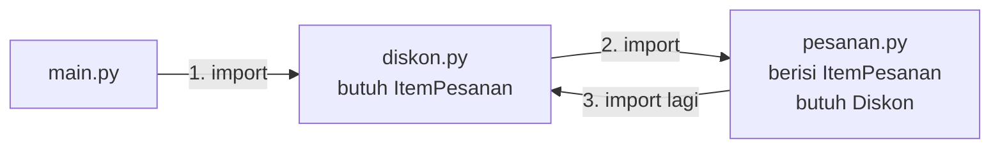

# 🐍 Praktik Python — Pertemuan 13: Prinsip SOLID

[⬅️ Konsep](../README.md) · [☕ Praktik Java](../java/README.md) · [Jembatan Python ↔ Java ➡️](../jembatan-python-java.md)

> **Prasyarat:** sudah membaca [Konsep Pertemuan 13](../README.md). Semua kode di halaman ini ada di folder `contoh/` dan `studi-kasus/`, dan bisa langsung dijalankan.

## Daftar Isi

- [Persiapan](#persiapan)
1. [SRP: Memisahkan Hitung dan Cetak](#1-srp-memisahkan-hitung-dan-cetak)
2. [OCP: Layanan Baru Cukup Kelas Baru](#2-ocp-layanan-baru-cukup-kelas-baru)
3. [LSP: Menepati Janji Kelas Induk](#3-lsp-menepati-janji-kelas-induk)
4. [ISP: Beberapa ABC Kecil Sekaligus](#4-isp-beberapa-abc-kecil-sekaligus)
5. [DIP: Menyuntikkan Dependensi lewat Konstruktor](#5-dip-menyuntikkan-dependensi-lewat-konstruktor)
6. [Refactoring Aman: Bandingkan Hasil Lama dan Baru](#6-refactoring-aman-bandingkan-hasil-lama-dan-baru)
7. [Studi Kasus KedaiKita](#7-studi-kasus-kedaikita)
8. [Kesalahan Umum dan Cara Membaca Pesan Error](#8-kesalahan-umum-dan-cara-membaca-pesan-error)

## Persiapan

Struktur folder Python pertemuan ini:

```text
python/
├── contoh/              <- 6 contoh: satu per prinsip, ditambah refactoring
├── studi-kasus/
│   ├── sebelum/         <- KasirSerbaBisa (1 file)
│   └── sesudah/         <- KedaiKita hasil refactoring (15 file)
└── solusi/              <- solusi latihan (buka setelah mencoba sendiri!)
```

Jalankan contoh dari folder `contoh`. Kedua versi studi kasus dijalankan dari foldernya masing-masing:

```bash
cd Pertemuan-13-Prinsip-SOLID/python/contoh
python contoh01_srp.py

cd ../studi-kasus/sebelum
python kasir_serba_bisa.py

cd ../sesudah
python main.py
```

> [!NOTE]
> Di macOS/Linux, gunakan `python3` sebagai ganti `python`. Di VS Code, kamu juga bisa menekan tombol ▶ (*Run Python File*). Semua kode memerlukan **Python 3.10** atau lebih baru. Panduan instalasi ada di [00-Persiapan](../../00-Persiapan/README.md).

Setiap file contoh berisi **dua desain** yang dipisahkan baris komentar `MELANGGAR` dan `SESUAI`. Baca bagian yang melanggar lebih dulu dan cari *code smell*-nya, baru bandingkan dengan perbaikannya.

## 1. SRP: Memisahkan Hitung dan Cetak

File: [`contoh/contoh01_srp.py`](contoh/contoh01_srp.py)

Desain yang **melanggar** SRP: satu method menghitung rata-rata, menentukan predikat, dan mencetak.

```python
class LaporanSerbaBisa:
    """Menghitung DAN mencetak sekaligus (dua alasan untuk berubah)."""

    def __init__(self, data_nilai: dict[str, list[int]]):
        self._data_nilai = data_nilai  # nama -> daftar nilai

    def cetak_laporan(self):
        print("LAPORAN NILAI KELAS PBO")
        for nama, daftar in self._data_nilai.items():
            rata = sum(daftar) // len(daftar)  # [1] aturan hitung...
            if rata >= 80:
                predikat = "A"
            elif rata >= 70:
                predikat = "B"
            elif rata >= 60:
                predikat = "C"
            else:
                predikat = "D"
            print(f"  {nama:<8}{rata:>4}  {predikat}")  # [2] ...bercampur format
```

Desain yang **sesuai** SRP: dua kelas, masing-masing satu urusan.

```python
class PenghitungNilai:
    """Hanya menghitung. Tidak pernah mencetak apa pun."""

    def rata_rata(self, daftar: list[int]) -> int:
        return sum(daftar) // len(daftar)

    def predikat(self, rata: int) -> str:  # [3] satu-satunya tempat aturan predikat
        if rata >= 80:
            return "A"
        if rata >= 70:
            return "B"
        if rata >= 60:
            return "C"
        return "D"


class PencetakLaporan:
    """Hanya menyusun dan mencetak laporan."""

    def __init__(self, penghitung: PenghitungNilai):
        self._penghitung = penghitung  # [4] hitungan diminta dari ahlinya

    def cetak(self, data_nilai: dict[str, list[int]]):
        print("LAPORAN NILAI KELAS PBO")
        for nama, daftar in data_nilai.items():
            rata = self._penghitung.rata_rata(daftar)
            predikat = self._penghitung.predikat(rata)
            print(f"  {nama:<8}{rata:>4}  {predikat}")
```

Di `main()`, kedua desain mencetak laporan dari data nilai Ayu, Bima, dan Citra. Bagian terakhirnya memakai ulang hasil hitungan:

```python
    print("=== BONUS SRP: HITUNGAN DIPAKAI ULANG ===")
    for nama, daftar in data_nilai.items():
        rata = penghitung.rata_rata(daftar)  # [5] tanpa ikut mencetak laporan
        if penghitung.predikat(rata) == "D":
            print(f"{nama} perlu remedial (rata-rata {rata})")
```

**Output:**

```text
=== VERSI MELANGGAR SRP ===
LAPORAN NILAI KELAS PBO
  Ayu       84  A
  Bima      71  B
  Citra     57  D

=== VERSI SESUAI SRP ===
LAPORAN NILAI KELAS PBO
  Ayu       84  A
  Bima      71  B
  Citra     57  D

=== BONUS SRP: HITUNGAN DIPAKAI ULANG ===
Citra perlu remedial (rata-rata 57)
```

Penjelasan:

- **[1]** dan **[2]** Aturan hitung dan format cetak bercampur di satu method. Hasil hitungan hanya hidup di dalam perulangan, lalu hilang setelah dicetak.
- **[3]** Aturan predikat kini hanya tertulis di **satu tempat**. Method-nya **mengembalikan** nilai (`return`), bukan mencetak.
- **[4]** `PencetakLaporan` tidak menghitung sendiri. Ia menerima objek `PenghitungNilai` lewat konstruktor dan meminta hasil hitungan darinya.
- **[5]** Karena hitungan terpisah dari cetak, daftar remedial bisa dibuat tanpa ikut mencetak seluruh laporan. Dengan `LaporanSerbaBisa`, kita terpaksa **menyalin** rumus rata-rata dan predikat. Itu awal dari kode kembar.

> [!TIP]
> **Coba sendiri:** naikkan batas predikat A menjadi 85 di `PenghitungNilai.predikat()`. Hanya satu baris yang berubah, tetapi laporan **dan** daftar remedial langsung mengikuti. Pada versi sesuai SRP, Ayu (rata-rata 84) kini mendapat B.

## 2. OCP: Layanan Baru Cukup Kelas Baru

File: [`contoh/contoh02_ocp.py`](contoh/contoh02_ocp.py)

Desain yang **melanggar** OCP: rumus dipilih dengan rantai `if`/`elif`.

```python
class KalkulatorOngkirKaku:
    """Setiap layanan baru memaksa method hitung() dibongkar."""

    def hitung(self, layanan: str, berat_kg: int) -> int:
        if layanan == "reguler":
            return 9000 * berat_kg
        elif layanan == "kilat":
            return 15000 * berat_kg
        return 0  # [1] layanan lain belum dikenal: diam-diam dianggap gratis!
```

Desain yang **sesuai** OCP diawali kontrak `LayananKirim(ABC)` dengan dua method abstrak: `nama()` dan `ongkir(berat_kg)`. `LayananReguler` dan `LayananKilat` mewarisi kontrak itu dengan rumus masing-masing. Lalu datang layanan baru:

```python
class LayananSameDay(LayananKirim):  # [2] layanan BARU = kelas baru, kode lama aman
    def nama(self) -> str:
        return "Same Day"

    def ongkir(self, berat_kg: int) -> int:
        return 25000 + 5000 * berat_kg


class KalkulatorOngkir:
    """Tidak pernah menyebut nama layanan apa pun, jadi tidak perlu diubah."""

    def hitung(self, layanan: LayananKirim, berat_kg: int) -> int:
        if berat_kg < 1:  # aturan umum: berat dihitung minimal 1 kg
            berat_kg = 1
        return layanan.ongkir(berat_kg)  # [3] polimorfisme bekerja di sini
```

**Output:**

```text
=== VERSI MELANGGAR OCP (rantai percabangan) ===
reguler  3 kg: Rp27.000
kilat    3 kg: Rp45.000
sameday  3 kg: Rp0
Layanan baru dianggap gratis! Method hitung() harus dibongkar dulu.

=== VERSI SESUAI OCP (satu kelas per layanan) ===
Reguler  3 kg: Rp27.000
Kilat    3 kg: Rp45.000
Same Day 3 kg: Rp40.000
Layanan Same Day cukup ditambahkan sebagai kelas baru.
```

Penjelasan:

- **[1]** Selain kaku, rantai percabangan juga rawan *bug* diam-diam. Layanan yang belum terdaftar tidak memicu error, tetapi malah dianggap gratis.
- **[2]** Menambah layanan berarti **menulis kelas baru**. `LayananReguler`, `LayananKilat`, dan `KalkulatorOngkir` tidak disentuh.
- **[3]** `KalkulatorOngkir` hanya mengenal kontrak `LayananKirim`. Python memanggil `ongkir()` milik objek yang sebenarnya, entah itu reguler, kilat, atau *same day* (polimorfisme, Pertemuan 09).

> [!TIP]
> **Coba sendiri:** tambahkan kelas `LayananHemat` dengan tarif Rp6.000 per kg, lalu masukkan `LayananHemat()` ke `daftar_layanan` di `main()`. Kelas apa saja yang perlu kamu ubah? Baris apa yang muncul di output?

<details>
<summary>Lihat jawaban</summary>

Tidak ada kelas lama yang diubah. Kamu hanya menulis satu kelas baru dan menambah satu objek ke list. Baris barunya: `Hemat    3 kg: Rp18.000`.

</details>

## 3. LSP: Menepati Janji Kelas Induk

File: [`contoh/contoh03_lsp.py`](contoh/contoh03_lsp.py)

Desain yang **melanggar** LSP: kelas `Burung` menyimpan `nama` dan berjanji bisa terbang lewat `terbang()`, yang mengembalikan teks "... terbang tinggi". Lalu `Penguin` mengingkarinya:

```python
class Penguin(Burung):
    def terbang(self) -> str:  # [1] meng-override hanya untuk menolak
        raise NotImplementedError(f"{self.nama} tidak bisa terbang")


def lepas_ke_udara(daftar: list[Burung]):
    """Pemanggil yang percaya pada janji kelas Burung."""
    for burung in daftar:
        try:
            print(f"  {burung.terbang()}")
        except NotImplementedError as e:  # [2] pemanggil terpaksa berjaga-jaga
            print(f"  [KEJUTAN] {e}")
```

Desain yang **sesuai** LSP: `BurungDasar` hanya berisi `nama` dan `bertelur()`, yaitu janji yang ditepati semua burung. Janji terbang dipindah ke kelas anak khusus.

```python
class BurungTerbang(BurungDasar):
    """Janji tambahan: burung jenis ini benar-benar bisa terbang."""

    def terbang(self) -> str:
        return f"{self.nama} terbang tinggi"


class PenguinKutub(BurungDasar):  # [3] tidak mewarisi janji terbang
    def berenang(self) -> str:
        return f"{self.nama} berenang di air dingin"
```

Di `main()`, setiap daftar diberi petunjuk tipe sesuai janji yang dibutuhkan:

```python
    print("Janji BurungDasar: bisa bertelur")
    semua_burung: list[BurungDasar] = [merpati, elang, penguin]  # [4]
    for burung in semua_burung:
        print(f"  {burung.bertelur()}")

    print("Janji BurungTerbang: bisa terbang")
    penerbang: list[BurungTerbang] = [merpati, elang]  # [5]
    for burung in penerbang:
        print(f"  {burung.terbang()}")
```

**Output:**

```text
=== VERSI MELANGGAR LSP ===
Melepas semua Burung ke udara:
  Merpati terbang tinggi
  Elang terbang tinggi
  [KEJUTAN] Penguin tidak bisa terbang

=== VERSI SESUAI LSP ===
Janji BurungDasar: bisa bertelur
  Merpati bertelur
  Elang bertelur
  Penguin bertelur
Janji BurungTerbang: bisa terbang
  Merpati terbang tinggi
  Elang terbang tinggi
Kemampuan khusus penguin:
  Penguin berenang di air dingin
Tidak ada kejutan: setiap kelas anak menepati janji induknya.
```

Penjelasan:

- **[1]** `Penguin` meng-*override* `terbang()` hanya untuk menolak. Ini *code smell* "*override* yang menolak".
- **[2]** Akibatnya, pemanggil yang jujur percaya pada janji `Burung` terpaksa memasang `try`/`except`. Bayangkan jika kelak muncul burung lain yang juga menolak dengan cara berbeda.
- **[3]** `PenguinKutub` tidak pernah berjanji bisa terbang, jadi ia tidak perlu mengingkari apa pun. Kemampuan khususnya (`berenang`) ditambahkan sebagai method baru.
- **[4]** Ketiga burung boleh masuk ke `list[BurungDasar]`, karena semuanya menepati janji bertelur.
- **[5]** Hanya burung yang benar-benar bisa terbang yang masuk ke `list[BurungTerbang]`.

> [!TIP]
> **Coba sendiri:** tambahkan `penguin` ke list `penerbang` pada baris **[5]**, lalu jalankan. VS Code (Pylance) atau mypy akan memberi peringatan sebelum program dijalankan. Python sendiri tetap menjalankannya, lalu berhenti dengan `AttributeError: 'PenguinKutub' object has no attribute 'terbang'. Did you mean: 'berenang'?`. Petunjuk tipe adalah **petunjuk**, bukan aturan yang dipaksakan saat program berjalan (Pertemuan 12).

## 4. ISP: Beberapa ABC Kecil Sekaligus

File: [`contoh/contoh04_isp.py`](contoh/contoh04_isp.py)

Desain yang **melanggar** ISP memakai kontrak gemuk `PerangkatKasir` berisi `cetak_struk()`, `pindai_barcode()`, dan `buka_laci()`. Printer bluetooth yang hanya bisa mencetak dipaksa memenuhi semuanya:

```python
class PrinterBluetooth(PerangkatKasir):
    def cetak_struk(self, teks: str):
        print(f"[Printer Bluetooth] mencetak: {teks}")

    def pindai_barcode(self) -> str:  # [1] method palsu: dipaksa ada
        raise NotImplementedError("Printer Bluetooth tidak punya pemindai barcode")

    def buka_laci(self):  # method palsu kedua
        raise NotImplementedError("Printer Bluetooth tidak punya laci uang")
```

Desain yang **sesuai** ISP memecah kontrak itu menjadi tiga ABC kecil:

```python
class PencetakStruk(ABC):  # [2] tiga kontrak kecil, masing-masing satu kemampuan
    @abstractmethod
    def cetak_struk(self, teks: str):
        """Mencetak teks struk."""


class PemindaiBarcode(ABC):
    @abstractmethod
    def pindai_barcode(self) -> str:
        """Membaca kode barcode barang."""


class LaciUang(ABC):
    @abstractmethod
    def buka_laci(self):
        """Membuka laci uang."""


class KasirLengkap(PencetakStruk, PemindaiBarcode, LaciUang):  # [3]
    def cetak_struk(self, teks: str):
        print(f"[Mesin Kasir] mencetak: {teks}")

    def pindai_barcode(self) -> str:
        return "8991234567890"

    def buka_laci(self):
        print("[Mesin Kasir] laci terbuka")


class PrinterThermal(PencetakStruk):  # [4] cukup satu kontrak, tanpa method palsu
    def cetak_struk(self, teks: str):
        print(f"[Printer Thermal] mencetak: {teks}")
```

Di `main()`, perangkat dikelompokkan menurut kemampuan yang dibutuhkan:

```python
    kasir = KasirLengkap()
    pencetak: list[PencetakStruk] = [kasir, PrinterThermal()]  # [5]
    pemindai: list[PemindaiBarcode] = [kasir, PemindaiGenggam()]
```

**Output:**

```text
=== VERSI MELANGGAR ISP (interface gemuk) ===
[Mesin Kasir] mencetak: Terima kasih!
Hasil pindai: 8991234567890
[Printer Bluetooth] mencetak: Terima kasih!
[KEJUTAN] Printer Bluetooth tidak punya pemindai barcode

=== VERSI SESUAI ISP (interface kecil) ===
-- semua PencetakStruk --
[Mesin Kasir] mencetak: Terima kasih!
[Printer Thermal] mencetak: Terima kasih!
-- semua PemindaiBarcode --
Hasil pindai: 8991234567890
Hasil pindai: 8997654321098
Setiap perangkat hanya berjanji sebanyak kemampuannya.
```

Penjelasan:

- **[1]** Dua method palsu ini ada hanya karena kontraknya memaksa. Selain melanggar ISP, keduanya juga melanggar LSP: pemanggil `PerangkatKasir` mendapat *error* yang tidak dijanjikan.
- **[2]** Setiap ABC kecil hanya berisi satu kemampuan.
- **[3]** Kelas Python boleh mewarisi **beberapa** ABC sekaligus (Pertemuan 10). Inilah cara Python memenuhi beberapa kontrak kecil.
- **[4]** `PrinterThermal` cukup memenuhi satu kontrak. Tidak ada lagi method yang hanya berisi penolakan.
- **[5]** Objek `kasir` yang sama masuk ke dua daftar, karena ia memenuhi kedua kontrak itu.

## 5. DIP: Menyuntikkan Dependensi lewat Konstruktor

File: [`contoh/contoh05_dip.py`](contoh/contoh05_dip.py)

Desain yang **melanggar** DIP: kelas pengingat menciptakan sendiri alat kirimnya.

```python
class PengingatKaku:
    def __init__(self):
        self._sms = SmsGateway()  # [1] membuat sendiri kelas konkret: terkunci

    def ingatkan(self, nomor: str, matkul: str, jam: str):
        self._sms.kirim_sms(nomor, f"Besok kuliah {matkul} jam {jam}")
```

Desain yang **sesuai** DIP diawali sebuah abstraksi:

```python
class Pengirim(ABC):
    """Abstraksi: apa pun yang bisa mengirim pesan."""

    @abstractmethod
    def kirim(self, tujuan: str, pesan: str):
        """Mengirim satu pesan ke tujuan."""
```

`PengirimSms` dan `PengirimWhatsApp` mewarisi `Pengirim` dan mencetak pesannya. Ada juga `PengirimTiruan`, pengirim pura-pura untuk pengujian: method `kirim()` miliknya tidak mencetak apa pun, hanya menambahkan `"tujuan: pesan"` ke list `_catatan` yang bisa dibaca lewat *property* `catatan`. Lalu kelas pengingat yang hanya mengenal abstraksi:

```python
class PengingatJadwal:
    def __init__(self, pengirim: Pengirim):  # [2] disuntikkan dari luar
        self._pengirim = pengirim  # [3] tipenya abstraksi, bukan kelas konkret

    def ingatkan(self, nomor: str, matkul: str, jam: str):
        self._pengirim.kirim(nomor, f"Besok kuliah {matkul} jam {jam}")
```

Potongan `main()`:

```python
    print("Disuntik PengirimSms:")
    PengingatJadwal(PengirimSms()).ingatkan("081234567890", "PBO", "08.00")  # [4]
    print("Disuntik PengirimWhatsApp:")
    PengingatJadwal(PengirimWhatsApp()).ingatkan("081234567890", "PBO", "08.00")

    print("Disuntik PengirimTiruan (untuk pengujian):")
    tiruan = PengirimTiruan()
    pengingat = PengingatJadwal(tiruan)
    pengingat.ingatkan("081234567890", "PBO", "08.00")
    pengingat.ingatkan("082198765432", "Basis Data", "10.00")
    catatan = tiruan.catatan  # [5] memeriksa hasil tanpa mengirim pesan sungguhan
```

**Output:**

```text
=== VERSI MELANGGAR DIP ===
  [SMS ke 081234567890] Besok kuliah PBO jam 08.00
Mau pindah ke WhatsApp? Kelas PengingatKaku harus dibongkar.

=== VERSI SESUAI DIP ===
Disuntik PengirimSms:
  [SMS ke 081234567890] Besok kuliah PBO jam 08.00
Disuntik PengirimWhatsApp:
  [WA ke 081234567890] Besok kuliah PBO jam 08.00
Disuntik PengirimTiruan (untuk pengujian):
  Pesan tercatat: 2
  Pesan kedua   : 082198765432: Besok kuliah Basis Data jam 10.00
  Sesuai harapan? ya
```

Penjelasan:

- **[1]** `PengingatKaku` memanggil konstruktor `SmsGateway()` di dalam dirinya. Untuk pindah ke WhatsApp, atau sekadar menguji tanpa mengirim SMS sungguhan, kelas ini harus dibongkar.
- **[2]** Objek pengirim kini **diterima** lewat konstruktor. Inilah *dependency injection*.
- **[3]** Petunjuk tipenya adalah abstraksi `Pengirim`, sehingga objek turunan `Pengirim` apa pun bisa disuntikkan.
- **[4]** Kelas `PengingatJadwal` yang **sama** dipakai dengan pengirim berbeda. Pilihan pengirim dibuat di `main()`, tempat merakit program.
- **[5]** `PengirimTiruan` mencatat pesan alih-alih mengirimnya. Kita bisa memeriksa apakah pengingat bekerja benar tanpa menghabiskan pulsa. Teknik ini sangat berguna saat pengujian otomatis (Pertemuan 15).

## 6. Refactoring Aman: Bandingkan Hasil Lama dan Baru

File: [`contoh/contoh06_refactor_aman.py`](contoh/contoh06_refactor_aman.py)

Kelas `DendaLama` menghitung denda keterlambatan perpustakaan. Hasilnya benar, tetapi rumus yang sama ditulis tiga kali (melanggar DRY):

```python
class DendaLama:
    def hitung(self, jenis: str, hari_terlambat: int) -> int:
        if jenis == "buku":
            if hari_terlambat <= 0:
                return 0
            denda = hari_terlambat * 1000
            if denda > 20000:
                denda = 20000
            return denda
        elif jenis == "majalah":  # [1] pola yang sama ditulis ulang...
            if hari_terlambat <= 0:
                return 0
            denda = hari_terlambat * 500
            if denda > 10000:
                denda = 10000
            return denda
```

Cabang `referensi` (tarif Rp5.000, maksimal Rp50.000) ditulis dengan pola yang persis sama, lalu jenis lain menghasilkan 0. Hasil *refactoring*-nya:

```python
class AturanDenda:
    """Satu rumus denda untuk semua jenis pustaka."""

    def __init__(self, tarif_per_hari: int, denda_maksimal: int):
        self._tarif_per_hari = tarif_per_hari
        self._denda_maksimal = denda_maksimal

    def hitung(self, hari_terlambat: int) -> int:  # [2] rumus ditulis SEKALI
        if hari_terlambat <= 0:
            return 0
        return min(hari_terlambat * self._tarif_per_hari, self._denda_maksimal)


class DendaBaru:
    def __init__(self):
        self._aturan = {  # [3] jenis baru cukup ditambah satu baris
            "buku": AturanDenda(1000, 20000),
            "majalah": AturanDenda(500, 10000),
            "referensi": AturanDenda(5000, 50000),
        }

    def hitung(self, jenis: str, hari_terlambat: int) -> int:
        if jenis not in self._aturan:
            return 0  # [4] perilaku lama dipertahankan, termasuk yang ini
        return self._aturan[jenis].hitung(hari_terlambat)
```

Bagaimana kita **tahu** keduanya berperilaku sama? `main()` menyiapkan list `kasus` berisi pasangan (jenis, hari terlambat), ditandai `# [5]` di file. Lalu kedua versi dijalankan dan hasilnya dibandingkan:

```python
    for jenis, hari in kasus:
        hasil_lama = lama.hitung(jenis, hari)
        hasil_baru = baru.hitung(jenis, hari)
        if hasil_lama == hasil_baru:  # [6] bukti: hasil harus sama persis
            jumlah_sama += 1
            status = "sama"
        else:
            status = "BEDA"
```

**Output:**

```text
=== MEMBANDINGKAN SEBELUM DAN SESUDAH REFACTOR ===
jenis     hari      lama      baru   hasil
buku         0       Rp0       Rp0   sama
buku         3   Rp3.000   Rp3.000   sama
buku        25  Rp20.000  Rp20.000   sama
majalah      4   Rp2.000   Rp2.000   sama
majalah     30  Rp10.000  Rp10.000   sama
referensi    2  Rp10.000  Rp10.000   sama
referensi   12  Rp50.000  Rp50.000   sama
komik        5       Rp0       Rp0   sama
Kasus diuji: 8, sama: 8, beda: 0
Kesimpulan: refactor aman, perilaku tidak berubah.
```

Penjelasan:

- **[1]** Tiga cabang dengan pola identik, hanya angkanya yang berbeda. Jika aturan "denda maksimal" berubah, tiga tempat harus diubah.
- **[2]** Rumusnya kini tertulis sekali. `min()` mengambil nilai terkecil, sehingga denda tidak melewati batas maksimal.
- **[3]** Perbedaan antarjenis disimpan sebagai **data** di dict, bukan sebagai cabang `if`.
- **[4]** Jenis yang tidak dikenal (misalnya "komik") tetap menghasilkan 0, persis seperti versi lama. *Refactoring* mempertahankan **semua** perilaku, termasuk yang mungkin terasa janggal. Jika perilaku itu ingin diubah, lakukan sebagai langkah terpisah.
- **[5]** Daftar `kasus` sengaja mencakup nilai tepi: terlambat 0 hari, denda yang menyentuh batas maksimal, dan jenis yang tidak dikenal.
- **[6]** Setiap pasang hasil dibandingkan. Satu saja yang berbeda, kesimpulannya langsung berubah.

## 7. Studi Kasus KedaiKita

Folder: [`studi-kasus/sebelum/`](studi-kasus/sebelum/kasir_serba_bisa.py) dan [`studi-kasus/sesudah/`](studi-kasus/sesudah/main.py)

Rancangan dan pemetaan tugasnya sudah dibahas di [halaman konsep](../README.md#12-studi-kasus-kedaikita-membongkar-kasirserbabisa). Di sini kita membedah kodenya.

**Apa yang berubah dibanding Pertemuan 12?**

- File **baru**: `diskon.py` (ABC `Diskon` dan tiga turunannya), `struk.py` (`StrukPesanan`), `penyimpanan.py` (ABC `PenyimpananPesanan` dan `PenyimpananMemori`), dan `item_pesanan.py` (`ItemPesanan`, dipindah dari `pesanan.py`).
- File **berubah**: `pesanan.py` (tidak lagi mencetak, mendapat `atur_diskon()` dan `hitung_potongan()`), `kedai.py` (menerima penyimpanan lewat konstruktor), `laporan.py` (judul bagian menjadi "Penjualan per kategori (sebelum diskon)"), dan `main.py` (skenario yang sama dengan `sebelum/`).
- File lainnya sama dengan Pertemuan 12.

### Sebelum: `kasir_serba_bisa.py`

Seluruh pekerjaan ada di satu method `proses_pesanan()`. Komentar "Tugas 1" sampai "Tugas 4" di dalam file menandai urusan-urusan yang bercampur. Setelah membuat nomor pesanan dan menghitung subtotal, bagian diskonnya berbunyi:

```python
        # Tugas 2 (lanjutan): diskon memakai rantai if/elif.
        # Setiap ada jenis promo baru, method ini HARUS dibongkar (melanggar OCP).
        if jenis_diskon == "member":
            if poin_pelanggan >= 10:
                potongan = subtotal * 10 // 100
                keterangan = "Member 10%"
            else:
                potongan = 0
                keterangan = "Member (poin belum cukup)"
        elif jenis_diskon == "promo":
            potongan = subtotal * 15 // 100
            keterangan = "Promo 15%"
        else:
            potongan = 0
            keterangan = "Tanpa diskon"
        total = subtotal - potongan
```

Setelah itu, method yang sama masih mencetak belasan baris struk (Tugas 3) dan menambah riwayat ke list (Tugas 4). Perhatikan juga parameternya: data pelanggan dikirim sebagai nilai lepas (`nama_pelanggan`, `poin_pelanggan`), dan jenis diskon berupa teks seperti `"member"`. Salah ketik `"membr"` tidak memicu error, tetapi diam-diam dianggap tanpa diskon.

### `diskon.py`: kontrak Diskon (OCP dan LSP)

```python
class Diskon(ABC):
    """Kontrak semua aturan diskon."""

    @abstractmethod
    def hitung_potongan(self, daftar_item: list[ItemPesanan],
                        pelanggan: Pelanggan) -> int:
        """Besar potongan dalam rupiah (tidak pernah negatif)."""

    @abstractmethod
    def keterangan(self) -> str:
        """Nama singkat diskon untuk ditampilkan di struk."""

    @staticmethod
    def subtotal_dari(daftar_item: list[ItemPesanan]) -> int:
        total = 0
        for item in daftar_item:
            total += item.hitung_subtotal()
        return total
```

- **Dua method abstrak** adalah isi kontraknya. Docstring "tidak pernah negatif" adalah **janji** yang wajib ditepati semua turunan (LSP).
- **`subtotal_dari()`** adalah method bantu `@staticmethod` milik kontrak. Ia tidak membutuhkan `self`, dan dipakai bersama oleh beberapa turunan agar rumus subtotal tidak disalin (DRY).
- Cabang-cabang `if` di versi lama kini menjadi tiga kelas. Contohnya `DiskonMember`:

```python
class DiskonMember(Diskon):
    """Diskon 10% untuk pelanggan yang sudah punya minimal 10 poin."""

    PERSEN = 10
    MINIMAL_POIN = 10

    def hitung_potongan(self, daftar_item: list[ItemPesanan],
                        pelanggan: Pelanggan) -> int:
        if pelanggan.poin < DiskonMember.MINIMAL_POIN:
            return 0
        return Diskon.subtotal_dari(daftar_item) * DiskonMember.PERSEN // 100

    def keterangan(self) -> str:
        return "Member 10%"
```

`TanpaDiskon` selalu mengembalikan 0. `DiskonPersen(persen)` menolak persen di luar 1 sampai 100 dengan `ValueError`, sehingga potongannya tidak pernah melebihi subtotal.

> [!NOTE]
> Versi lama punya keterangan "Member (poin belum cukup)", tetapi teks itu **tidak pernah tercetak**, karena baris diskon hanya muncul jika potongan lebih dari nol. Karena itu `DiskonMember` boleh membuangnya tanpa mengubah perilaku. Saat *refactoring*, yang dijaga adalah perilaku yang **terlihat**, bukan setiap baris kode lama.

### `pesanan.py` dan `struk.py`: memisahkan hitung dan cetak (SRP)

Di konstruktor `Pesanan` ada atribut baru `self._diskon: Diskon = TanpaDiskon()`, sehingga pesanan tanpa diskon tetap punya objek diskon yang sah. Method `atur_diskon(diskon)` menggantinya, kecuali pesanan sudah LUNAS (melempar `KedaiError`, seperti `tambah_item()`). Perhitungannya:

```python
    def hitung_potongan(self) -> int:
        return self._diskon.hitung_potongan(list(self._daftar_item),
                                            self._pelanggan)

    def hitung_total(self) -> int:
        return self.hitung_subtotal() - self.hitung_potongan()
```

`hitung_potongan()` tidak tahu diskon jenis apa yang sedang dipakai. Ia hanya meminta objek diskonnya menghitung. Itulah sebabnya promo baru tidak pernah mengubah kelas `Pesanan`.

Method `cetak()` sudah tidak ada di `Pesanan`. Tugas itu pindah ke `StrukPesanan`, yang hanya **membaca** data pesanan. Method `buat_teks()` menyusun baris-baris struk ke dalam list `baris`. Bagian akhirnya:

```python
        potongan = p.hitung_potongan()
        if potongan > 0:
            baris.append(self._baris_rapi(f"Diskon {p.diskon.keterangan()}",
                                          "-" + format_rupiah(potongan)))
        baris.append(self._baris_rapi("TOTAL", format_rupiah(p.hitung_total())))
        baris.append(garis)
        return "\n".join(baris)

    def cetak(self):
        print(self.buat_teks())
```

`buat_teks()` **mengembalikan** teks struk sebagai string. `cetak()` tinggal mencetaknya. Dengan begitu, teks struk yang sama kelak bisa disimpan ke file atau dikirim lewat pesan, tanpa mengubah cara menyusunnya. `StrukPesanan` juga memenuhi kontrak `DapatDicetak` dari Pertemuan 10.

### `penyimpanan.py` dan `kedai.py`: menyuntikkan penyimpanan (DIP dan ISP)

```python
class PenyimpananPesanan(ABC):
    """Kontrak penyimpanan pesanan."""

    @abstractmethod
    def simpan(self, pesanan: Pesanan):
        """Menyimpan satu pesanan."""

    @abstractmethod
    def semua(self) -> list[Pesanan]:
        """Semua pesanan yang tersimpan, urut sesuai waktu disimpan."""

    def jumlah(self) -> int:
        return len(self.semua())
```

Kontraknya kecil (ISP): turunan hanya **wajib** menulis `simpan()` dan `semua()`. Method `jumlah()` sudah berisi, sehingga turunan seperti `PenyimpananMemori` cukup mewarisinya. `PenyimpananMemori` sendiri menyimpan pesanan di list `self._data`, dan `semua()` mengembalikan salinannya.

Konstruktor `Kedai` menerima penyimpanan dari luar (sudah kita lihat di halaman konsep). Method-method yang memakainya:

```python
    def buat_pesanan(self, pelanggan: Pelanggan) -> Pesanan:
        pesanan = Pesanan(pelanggan)
        self._penyimpanan.simpan(pesanan)
        return pesanan

    def riwayat_pesanan(self) -> list[Pesanan]:
        return self._penyimpanan.semua()

    def jumlah_pesanan(self) -> int:
        return self._penyimpanan.jumlah()
```

Tidak satu pun baris di `Kedai` menyebut `PenyimpananMemori` atau list. `Kedai` hanya tahu bahwa penyimpanannya bisa `simpan()`, `semua()`, dan `jumlah()`.

### `main.py`: tempat merakit

```python
def proses_pesanan(kedai: Kedai, pelanggan: Pelanggan,
                   daftar_beli: list[Pasangan[str, int]], diskon: Diskon):
    pesanan = kedai.buat_pesanan(pelanggan)
    for beli in daftar_beli:
        pesanan.tambah_item(kedai.cari_menu(beli.pertama), beli.kedua)
    pesanan.atur_diskon(diskon)
    StrukPesanan(pesanan).cetak()


def main():
    # DIP: jenis penyimpanan ditentukan DI SINI, bukan di dalam Kedai.
    penyimpanan = PenyimpananMemori()
    kedai = siapkan_kedai(penyimpanan)
```

Setelah menyiapkan Budi, Siti (`siti.tambah_poin(12)`), dan Rina, program memanggil `proses_pesanan()` tiga kali, masing-masing dengan `TanpaDiskon()`, `DiskonMember()`, dan `DiskonPersen(15)`. Diskon kini berupa **objek**, bukan teks. Salah ketik nama kelas langsung memicu `NameError`, tidak lagi diam-diam dianggap tanpa diskon. Bagian akhir `main()` mencetak riwayat dari `kedai.riwayat_pesanan()`.

Jalankan `python main.py` dari dalam folder `sesudah`. Program mencetak tiga struk. Struk Budi (P001) tidak punya baris Diskon karena potongannya nol, sedangkan struk Siti (P002) sudah kamu lihat di halaman konsep. Bagian akhirnya:

**Output:**

```text
========================================
KEDAIKITA - STRUK PESANAN
========================================
No. Pesanan : P003
Pelanggan   : Rina Marlina
Status      : BARU
----------------------------------------
1 x Kopi Susu Gula Aren         Rp18.000
1 x Mie Goreng Jawa             Rp23.000
----------------------------------------
Subtotal                        Rp41.000
Diskon Promo 15%                -Rp6.150
TOTAL                           Rp34.850
========================================

=== RIWAYAT PESANAN ===
P001  Budi Santoso            Rp61.000
P002  Siti Aminah             Rp27.900
P003  Rina Marlina            Rp34.850
Total pendapatan: Rp123.750
```

Potongan Siti adalah 10% x 31.000 = 3.100, dan potongan Rina adalah 15% x 41.000 = 6.150. Menjalankan `python kasir_serba_bisa.py` di folder `sebelum` menghasilkan output yang persis sama.

### Membuktikan Output Sama dengan `fc` dan `diff`

"Persis sama" jangan dibuktikan dengan mata. Simpan output kedua versi ke file memakai tanda `>`, lalu bandingkan. Mulailah dari folder `python/studi-kasus`.

Di **Windows** (Command Prompt):

```bash
cd sebelum
python kasir_serba_bisa.py > ..\hasil_sebelum.txt
cd ..\sesudah
python main.py > ..\hasil_sesudah.txt
cd ..
fc hasil_sebelum.txt hasil_sesudah.txt
```

Hasilnya:

```text
Comparing files hasil_sebelum.txt and HASIL_SESUDAH.TXT
FC: no differences encountered
```

Di **macOS/Linux**:

```bash
cd sebelum
python3 kasir_serba_bisa.py > ../hasil_sebelum.txt
cd ../sesudah
python3 main.py > ../hasil_sesudah.txt
cd ..
diff hasil_sebelum.txt hasil_sesudah.txt
```

`diff` **tidak mencetak apa pun** jika kedua file sama. Jika ingin pesan yang tegas, tambahkan pilihan `-s` (`diff -s hasil_sebelum.txt hasil_sesudah.txt`). Hasilnya:

```text
Files hasil_sebelum.txt and hasil_sesudah.txt are identical
```

> [!WARNING]
> Di **PowerShell** (terminal bawaan VS Code di Windows), `fc` adalah singkatan perintah lain milik PowerShell. Tulis `fc.exe hasil_sebelum.txt hasil_sesudah.txt` agar yang dijalankan benar-benar program pembanding file. Pesan dari `fc` bisa sedikit berbeda tergantung versi dan bahasa Windows.

Seperti apa jika *refactoring*-nya keliru? Kami sengaja mengganti satu karakter di `DiskonPersen`, yaitu `// 100` menjadi `/ 100`, lalu menjalankan ulang langkah di atas. Hasil `diff`:

```text
41,42c41,42
< Diskon Promo 15%                -Rp6.150
< TOTAL                           Rp34.850
---
> Diskon Promo 15%              -Rp6.150.0
> TOTAL                         Rp34.850.0
48,49c48,49
< P003  Rina Marlina            Rp34.850
< Total pendapatan: Rp123.750
---
> P003  Rina Marlina          Rp34.850.0
> Total pendapatan: Rp123.750.0
```

Cara membacanya: `41,42c41,42` berarti baris 41 sampai 42 di file pertama **berubah** (*change*) menjadi baris 41 sampai 42 di file kedua. Baris bertanda `<` berasal dari file pertama, sedangkan `>` dari file kedua. Operator `/` menghasilkan bilangan pecahan (`float`), sehingga muncul `.0` di belakang angka. Kesalahan sekecil ini langsung tertangkap.

### Mengapa `ItemPesanan` Pindah ke File Sendiri?

Di Pertemuan 12, `ItemPesanan` tinggal di `pesanan.py`. Sekarang `diskon.py` membutuhkan `ItemPesanan` (untuk petunjuk tipe dan `subtotal_dari`), sedangkan `pesanan.py` membutuhkan `Diskon`. Jika `ItemPesanan` tetap di `pesanan.py`, kedua file akan **saling meng-import**.



Kami mencobanya di folder sementara: `ItemPesanan` dikembalikan ke `pesanan.py`, dan `diskon.py` diubah menjadi `from pesanan import ItemPesanan`. Pesan error-nya di Python 3.10 sampai 3.12:

```text
Traceback (most recent call last):
  File "main.py", line 19, in <module>
    from diskon import Diskon, DiskonMember, DiskonPersen, TanpaDiskon
  File "diskon.py", line 13, in <module>
    from pesanan import ItemPesanan
  File "pesanan.py", line 19, in <module>
    from diskon import Diskon, TanpaDiskon
ImportError: cannot import name 'Diskon' from partially initialized module 'diskon' (most likely due to a circular import) (diskon.py)
```

Bacalah dari bawah ke atas. Saat sebuah file di-import **pertama kali**, Python menjalankan isinya dari atas ke bawah. Urutannya begini:

1. `main.py` meng-import `diskon`. Python mulai menjalankan `diskon.py`.
2. Di baris 13, `diskon.py` meng-import `pesanan`. Python berhenti sejenak di `diskon.py` dan mulai menjalankan `pesanan.py`.
3. Di baris 19, `pesanan.py` meminta `Diskon` dari `diskon`. Padahal `diskon.py` baru berjalan sampai baris 13, sehingga kelas `Diskon` **belum sempat dibuat**. Modul itu masih "setengah jadi" (*partially initialized*).

Python 3.13 menulis baris terakhirnya dengan petunjuk yang kurang tepat untuk kasus ini:

```text
ImportError: cannot import name 'Diskon' from 'diskon' (consider renaming 'diskon.py' if it has the same name as a library you intended to import)
```

Mengganti nama file tidak akan menolong. Petunjuk sebenarnya ada di tumpukan *traceback*: `diskon.py` → `pesanan.py` → `diskon.py` lagi. Itulah lingkaran impornya.

**Perbaikannya:** pindahkan kelas yang dibutuhkan bersama ke file tersendiri. Kini `diskon.py` dan `pesanan.py` sama-sama meng-import `item_pesanan.py`, dan `item_pesanan.py` tidak meng-import keduanya, sehingga lingkarannya putus. Pemisahan ini juga sejalan dengan SRP: satu file, satu urusan.

> [!NOTE]
> Masalah impor melingkar khas Python, karena Python menjalankan isi file saat meng-import. Java tidak mengalaminya, karena compiler membaca semua file `.java` sekaligus sebelum program berjalan (lihat [Jembatan](../jembatan-python-java.md)).

## 8. Kesalahan Umum dan Cara Membaca Pesan Error

Ingat, pesan error Python dibaca **dari bawah ke atas**. Baris paling bawah menyebut jenis error dan penyebabnya. Contoh di bawah dijalankan dari dalam folder `studi-kasus/sesudah`.

### Kesalahan 1: Diskon baru lupa menulis salah satu method abstrak

```python
from diskon import Diskon


class DiskonUlangTahun(Diskon):
    def hitung_potongan(self, daftar_item, pelanggan):
        return 0


diskon = DiskonUlangTahun()
```

```text
Traceback (most recent call last):
  File "salah1.py", line 9, in <module>
    diskon = DiskonUlangTahun()
TypeError: Can't instantiate abstract class DiskonUlangTahun without an implementation for abstract method 'keterangan'
```

**Artinya:** kontrak `Diskon` mewajibkan dua method, tetapi `keterangan()` belum ditulis. Python menolak membuat objeknya. Ini kabar baik: janji kontrak ditagih sebelum struk sempat dicetak. **Perbaikan:** tulis `def keterangan(self) -> str:` yang mengembalikan teks, misalnya `"Ulang Tahun"`.

### Kesalahan 2: Lupa menyuntikkan penyimpanan

```python
kedai = Kedai("KedaiKita")
```

```text
TypeError: Kedai.__init__() missing 1 required positional argument: 'penyimpanan'
```

**Artinya:** sejak pertemuan ini, `Kedai` **meminta** penyimpanannya lewat konstruktor. Ia tidak lagi membuat list riwayat sendiri. **Perbaikan:** `Kedai("KedaiKita", PenyimpananMemori())`.

### Kesalahan 3: Menyuntikkan kelas, bukan objek

```python
kedai = Kedai("KedaiKita", PenyimpananMemori)
kedai.buat_pesanan(Pelanggan("Budi Santoso", "081234567890"))
```

```text
Traceback (most recent call last):
  File "salah3.py", line 6, in <module>
    kedai.buat_pesanan(Pelanggan("Budi Santoso", "081234567890"))
    ~~~~~~~~~~~~~~~~~~^^^^^^^^^^^^^^^^^^^^^^^^^^^^^^^^^^^^^^^^^^^
  File "kedai.py", line 65, in buat_pesanan
    self._penyimpanan.simpan(pesanan)
    ~~~~~~~~~~~~~~~~~~~~~~~~^^^^^^^^^
TypeError: PenyimpananMemori.simpan() missing 1 required positional argument: 'pesanan'
```

**Artinya:** tanpa tanda kurung, yang disuntikkan adalah **kelas** `PenyimpananMemori`, bukan objeknya. Saat `simpan(pesanan)` dipanggil lewat kelas, tidak ada objek yang mengisi `self`, sehingga argumen `pesanan` dianggap sebagai `self` dan Python mengeluh `pesanan` hilang. Perhatikan juga bahwa error-nya baru muncul saat `buat_pesanan()`, bukan saat `Kedai` dibuat. **Perbaikan:** `PenyimpananMemori()` dengan tanda kurung.

> [!NOTE]
> Pesan di atas berasal dari Python 3.13. Tanda `~~~^^^` hanya muncul di Python 3.11 ke atas. Di Python 3.10 dan 3.11, kesalahan 1 berbunyi `Can't instantiate abstract class DiskonUlangTahun with abstract method keterangan`. Fokuslah pada **jenis error** dan kata kuncinya.

## 📝 Ringkasan Sintaks

| Konsep | Sintaks Python | Contoh |
|---|---|---|
| Kontrak (abstraksi) | `class K(ABC):` + `@abstractmethod` | `class Diskon(ABC):` |
| Memenuhi beberapa kontrak kecil | `class K(A, B, C):` | `class KasirLengkap(PencetakStruk, PemindaiBarcode, LaciUang):` |
| Method bantu milik kontrak | `@staticmethod` di dalam ABC | `Diskon.subtotal_dari(daftar_item)` |
| Method berisi di dalam kontrak | method biasa di dalam ABC | `def jumlah(self) -> int:` |
| *Dependency injection* | parameter konstruktor bertipe abstraksi | `def __init__(self, nama: str, penyimpanan: PenyimpananPesanan):` |
| Merakit objek | di `main()` | `Kedai("KedaiKita", PenyimpananMemori())` |
| Objek tiruan untuk pengujian | kelas kecil yang mencatat | `PengirimTiruan()` |
| Simpan output ke file | `perintah > file` | `python main.py > ..\hasil_sesudah.txt` |
| Bandingkan dua file | `fc` (Windows) / `diff` (macOS/Linux) | `diff hasil_sebelum.txt hasil_sesudah.txt` |

## ➡️ Langkah Berikutnya

- Bandingkan dengan Java: [Jembatan Python ↔ Java](../jembatan-python-java.md)
- Kerjakan [Latihan](../latihan.md), lalu uji pemahamanmu dengan [Kuis](../kuis.md).

---

[⬅️ Konsep](../README.md) · [☕ Praktik Java](../java/README.md) · [Jembatan Python ↔ Java ➡️](../jembatan-python-java.md)
