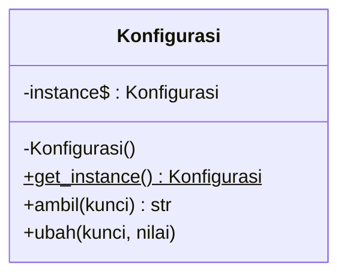
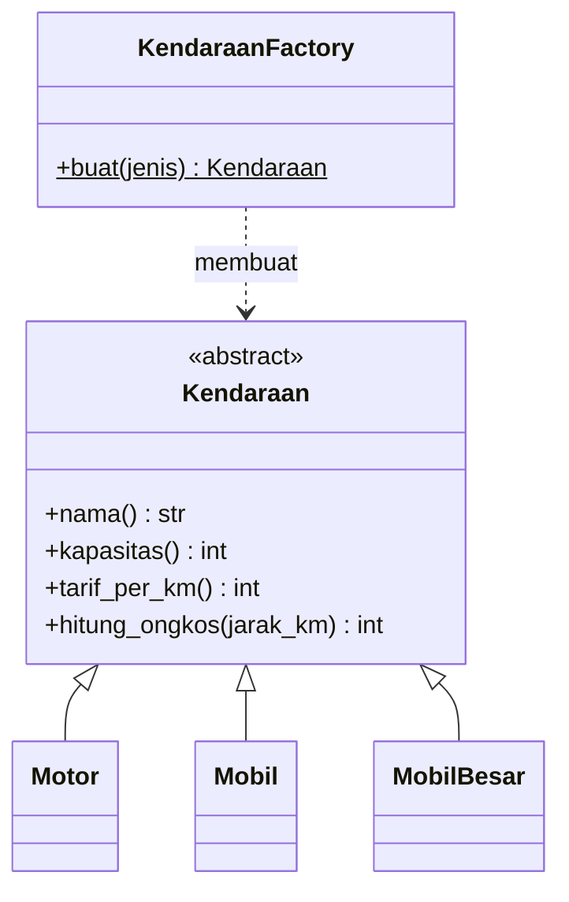
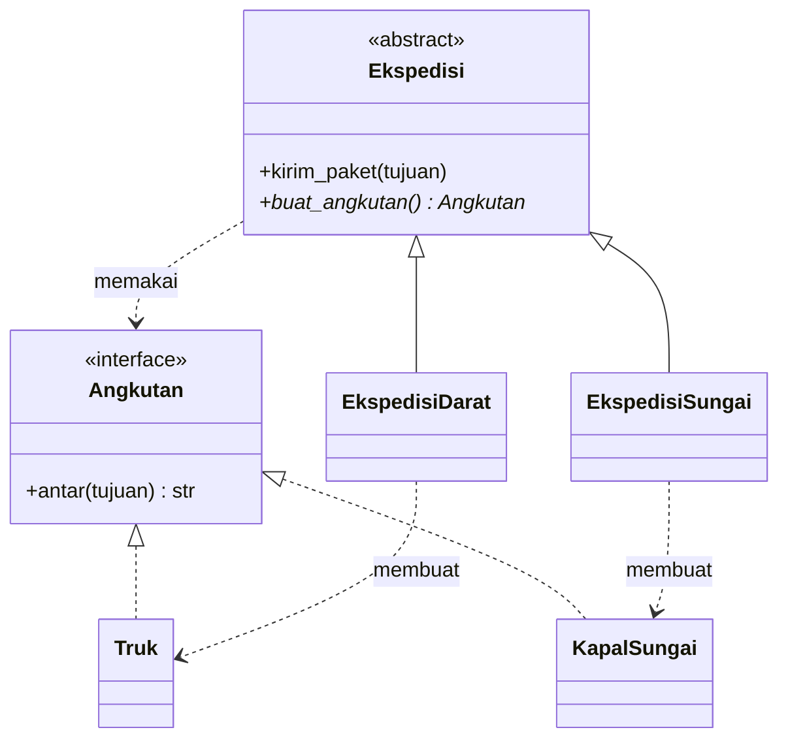
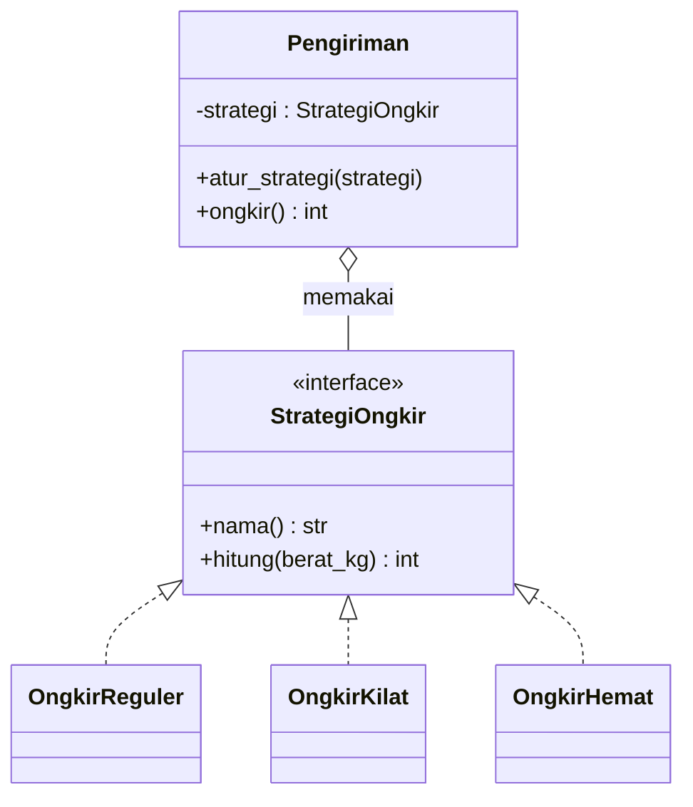
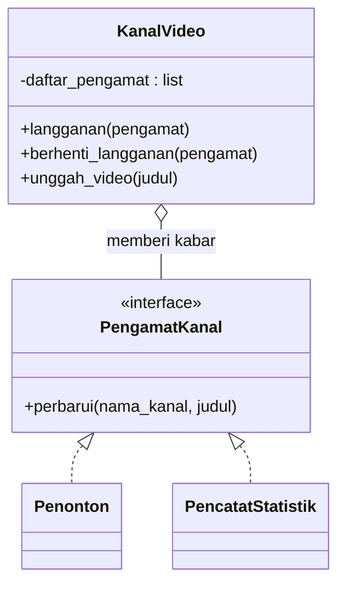
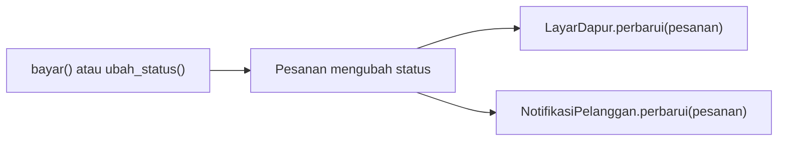
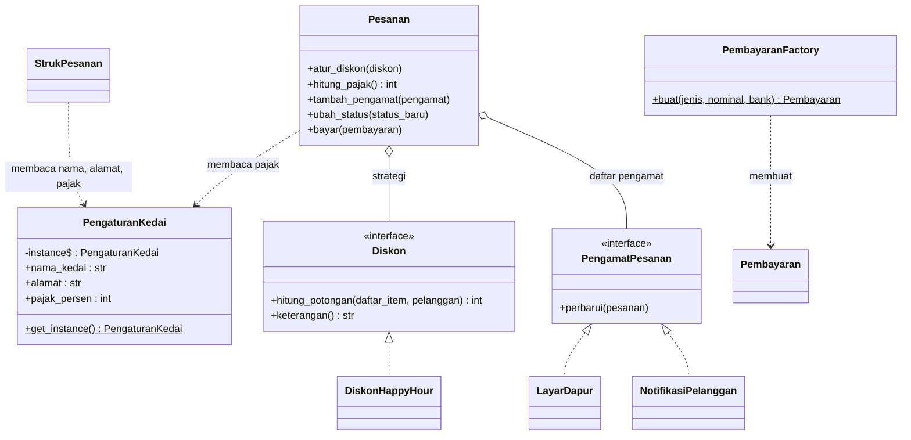

# Pertemuan 14: *Design Pattern* Dasar

[⬅️ Pertemuan 13](../Pertemuan-13-Prinsip-SOLID/README.md) · [🏠 Beranda](../README.md) · [Pertemuan 15 ➡️](../Pertemuan-15-Proyek-Terintegrasi/README.md)

> Di Pertemuan 13 kita belajar **prinsip** kode yang baik. Hari ini kita belajar **resep** yang sudah teruji untuk masalah yang terus muncul: ***design pattern*** (pola desain). Kita bedah empat pola yang paling sering kamu temui (*Singleton*, *Factory*, *Strategy*, dan *Observer*), lalu memasang keempatnya di KedaiKita.

## 🎯 Tujuan Pembelajaran

Setelah pertemuan ini, kamu mampu:

1. Menjelaskan apa itu ***design pattern***, asal-usulnya (buku GoF), dan tiga kategorinya.
2. Menjelaskan masalah, tujuan, dan struktur kelas dari pola ***Singleton***, ***Factory***, ***Strategy***, dan ***Observer***.
3. Membedakan *Simple Factory* dengan *Factory Method*, serta gaya *push* dengan *pull* pada *Observer*.
4. Menerapkan keempat pola tersebut pada program kecil dan pada studi kasus KedaiKita.
5. Menilai kapan sebuah pola tepat dipakai dan kapan justru membuat program rumit, termasuk kekurangan *Singleton*.

## 🧭 Peta Belajar

| Langkah | Bagian | Perkiraan waktu |
|---|---|---|
| 1 | Konsep (halaman ini) | 50 menit |
| 2 | Praktik: [🐍 Python](python/README.md) **atau** [☕ Java](java/README.md) | 100 menit |
| 3 | [Jembatan Python ↔ Java](jembatan-python-java.md) | 15 menit |
| 4 | [Latihan](latihan.md) | 75 menit |
| 5 | [Kuis](kuis.md) | 15 menit |

🖼️ ***Slide* pertemuan ini:** [lihat di PowerPoint Online](https://view.officeapps.live.com/op/view.aspx?src=https%3A%2F%2Fraw.githubusercontent.com%2Fantonprafanto%2FPBO2026%2Fmaster%2FSlide%2FPBO2026-P14-Design-Pattern.pptx) · [baca PDF](../Slide/PBO2026-P14-Design-Pattern.pdf) · [unduh PowerPoint](https://raw.githubusercontent.com/antonprafanto/PBO2026/master/Slide/PBO2026-P14-Design-Pattern.pptx) · [unduh PDF](https://raw.githubusercontent.com/antonprafanto/PBO2026/master/Slide/PBO2026-P14-Design-Pattern.pdf)

## 🔁 Mengingat Kembali

Di [Pertemuan 13](../Pertemuan-13-Prinsip-SOLID/README.md) kita membongkar kelas raksasa `KasirSerbaBisa` menjadi kelas-kelas kecil:

- **SRP**: `StrukPesanan` hanya mengurus format struk. Aturan hitung harga tetap di `Pesanan`.
- **OCP**: setiap aturan diskon menjadi kelas turunan `Diskon`. Promo baru cukup ditambah sebagai kelas baru, `Pesanan` tidak disentuh.
- **DIP**: `Kedai` menerima `PenyimpananPesanan` lewat konstruktor (*dependency injection*), bukan membuatnya sendiri.
- ***Refactoring***: struktur kode berubah, tetapi perilakunya (*output*) tetap sama.

Prinsip SOLID menjawab pertanyaan *"kode yang baik itu seperti apa?"*. *Design pattern* menjawab pertanyaan lanjutannya: *"untuk masalah yang ini, susunan kelas seperti apa yang sudah terbukti berhasil?"*

## Daftar Isi

1. [Cerita Pembuka: Pola Jahit di Penjahit Langganan](#1-cerita-pembuka-pola-jahit-di-penjahit-langganan)
2. [Apa Itu *Design Pattern*?](#2-apa-itu-design-pattern)
3. [*Singleton*: Hanya Boleh Ada Satu](#3-singleton-hanya-boleh-ada-satu)
4. [*Factory*: Serahkan Urusan Membuat Objek](#4-factory-serahkan-urusan-membuat-objek)
5. [*Strategy*: Algoritma yang Bisa Ditukar](#5-strategy-algoritma-yang-bisa-ditukar)
6. [*Observer*: Kabari Semua yang Berlangganan](#6-observer-kabari-semua-yang-berlangganan)
7. [Mengenal Pola Lain Secara Singkat](#7-mengenal-pola-lain-secara-singkat)
8. [Memakai Pola dengan Bijak](#8-memakai-pola-dengan-bijak)
9. [Studi Kasus KedaiKita: Apa yang Kita Bangun Hari Ini](#9-studi-kasus-kedaikita-apa-yang-kita-bangun-hari-ini)
10. [Miskonsepsi yang Sering Terjadi](#10-miskonsepsi-yang-sering-terjadi)

---

## 1. Cerita Pembuka: Pola Jahit di Penjahit Langganan

Mampirlah ke penjahit langganan di dekat kampus. Di dinding kiosnya tergantung lembaran kertas cokelat bergambar potongan kain: lengan, kerah, badan kemeja. Itulah **pola jahit**.

Perhatikan cara penjahit memakainya:

- Pola kemeja **bukan kemeja**. Kamu tidak bisa memakai kertas itu ke kampus.
- Pola yang sama dipakai untuk banyak pelanggan, tetapi **ukurannya disesuaikan**: Budi berbadan tinggi, Siti lebih mungil.
- Pola itu lahir dari **pengalaman bertahun-tahun**. Penjahit tidak perlu menemukan ulang cara memotong kerah setiap kali ada pesanan.
- Sesama penjahit cukup berkata *"pakai pola kemeja lengan panjang"*, dan semua langsung paham.

Pemrogram juga punya "pola jahit". Masalah-masalah desain tertentu muncul berulang kali di banyak program: *"bagaimana memastikan pengaturan hanya ada satu?"*, *"bagaimana memberi kabar ke banyak pihak saat sesuatu berubah?"*. Solusi terbaiknya sudah dirumuskan dan diberi nama. Itulah ***design pattern***.

## 2. Apa Itu *Design Pattern*?

> ***Design pattern*** (pola desain) adalah solusi umum yang sudah teruji untuk masalah desain yang sering muncul berulang kali. Pola bukan kode jadi, melainkan gambaran susunan kelas dan objek yang kamu sesuaikan dengan programmu.

Setiap pola biasanya dijelaskan dengan empat unsur:

| Unsur | Isinya | Contoh untuk *Singleton* |
|---|---|---|
| Nama | Sebutan singkat agar mudah dibicarakan | "*Singleton*" |
| Masalah | Kapan pola ini dibutuhkan | Pengaturan harus sama di seluruh program |
| Solusi | Susunan kelas dan peran masing-masing | Konstruktor ditutup, satu pintu `get_instance()` |
| Konsekuensi | Untung dan rugi bila dipakai | Praktis, tetapi menjadi *state* global yang sulit diuji (bagian 3.6) |

### 2.1 Buku *Gang of Four*

Istilah *design pattern* di dunia perangkat lunak dipopulerkan oleh buku *Design Patterns: Elements of Reusable Object-Oriented Software* (1994). Penulisnya empat orang, yaitu Erich Gamma, Richard Helm, Ralph Johnson, dan John Vlissides, yang kemudian dijuluki ***Gang of Four*** (GoF). Gagasan "bahasa pola" sendiri mereka pinjam dari dunia arsitektur bangunan, terutama dari arsitek Christopher Alexander.

Buku itu mengumpulkan **23 pola** dan membaginya menjadi **3 kategori**:

| Kategori | Pertanyaan yang dijawab | Jumlah pola | Contoh |
|---|---|---|---|
| *Creational* (pembuatan) | Bagaimana objek dibuat? | 5 | *Singleton*, *Factory Method*, *Builder* |
| *Structural* (struktur) | Bagaimana kelas dan objek dirangkai menjadi struktur yang lebih besar? | 7 | *Adapter*, *Decorator*, *Facade* |
| *Behavioral* (perilaku) | Bagaimana objek berbagi tugas dan saling berkomunikasi? | 11 | *Strategy*, *Observer*, *Template Method*, *Iterator* |

Hari ini kita mempelajari dua pola *creational*, yaitu *Singleton* dan *Factory* (tepatnya *Factory Method*, ditambah saudaranya yang lebih sederhana, *Simple Factory*), serta dua pola *behavioral*, yaitu *Strategy* dan *Observer*.

> [!IMPORTANT]
> Pola **bukan** kode siap salin. Pola yang sama bisa ditulis berbeda di Python dan Java, bahkan berbeda di antara dua program Java. Yang sama adalah **gagasannya**: masalah apa yang dipecahkan dan peran apa saja yang terlibat.

> [!NOTE]
> Jangan khawatir menghafal ke-23 pola. Pemrogram berpengalaman pun mempelajarinya sedikit demi sedikit, sesuai masalah yang mereka temui. Yang penting hari ini: memahami cara berpikir di balik pola.

## 3. *Singleton*: Hanya Boleh Ada Satu

### 3.1 Masalah

KedaiKita kini memungut pajak 10%. Angka itu dipakai di dua tempat: `Pesanan` memakainya untuk **menghitung** pajak, sedangkan `StrukPesanan` mencetak labelnya (`Pajak 10%`) beserta nama dan alamat kedai.

Bayangkan setiap kelas membuat objek pengaturannya sendiri. Suatu hari pemilik mengubah pajak menjadi 11%, tetapi perubahan itu hanya sampai ke salah satu objek. Akibatnya, struk tertulis `Pajak 10%`, padahal angka yang dihitung memakai 11%. Pelanggan protes, kasir bingung.

### 3.2 Analogi dan Tujuan

Ingat **mesin nomor antrean** di kantor pelayanan. Kalau Pintu Utara dan Pintu Selatan punya mesin sendiri-sendiri, bisa ada dua orang memegang nomor A005. Kacau! Solusinya: semua tombol terhubung ke **satu mesin yang sama**.

> ***Singleton*** adalah pola yang menjamin sebuah kelas **hanya punya satu objek**, dan menyediakan **satu pintu akses** ke objek itu dari mana saja di program.

### 3.3 Struktur



Tiga bagian penting *Singleton*:

| Bagian | Tugasnya |
|---|---|
| Atribut milik kelas (`instance`, ditandai `$` di diagram) | Menyimpan satu-satunya objek. Awalnya kosong. |
| Konstruktor yang "ditutup" (tanda `-` berarti privat) | Mencegah kode lain membuat objek baru sembarangan. |
| *Method* milik kelas `get_instance()` | Satu-satunya pintu. Jika objek belum ada, buat dulu. Jika sudah ada, kembalikan yang lama. |

Sekilas kodenya di kedua bahasa. Ini potongan kode untuk dibaca saja, bukan untuk dijalankan sendiri. Versi lengkap yang bisa dijalankan ada di contoh 01 halaman praktik.

**Python:**

```python
class Konfigurasi:
    _instance = None

    @classmethod
    def get_instance(cls):
        if cls._instance is None:
            cls._instance = cls()
        return cls._instance
```

**Java:**

```java
class Konfigurasi {
    private static Konfigurasi instance = null;
    private Konfigurasi() { }
    public static Konfigurasi getInstance() {
        if (instance == null) {
            instance = new Konfigurasi();
        }
        return instance;
    }
}
```

Java benar-benar bisa **menutup** konstruktor dengan `private`. Python tidak punya akses privat sungguhan (ingat Pertemuan 04), jadi kita memasang **penjaga** di `__init__` yang menolak objek kedua. Penjaga ini punya celah kecil yang dibahas di halaman praktik Python.

### 3.4 *Lazy* atau *Eager*?

| | *Lazy* (malas) | *Eager* (bersemangat) |
|---|---|---|
| Kapan objek dibuat | saat **pertama kali diminta** | **di awal**, sebelum ada yang meminta |
| Kelebihan | tidak membuang sumber daya jika ternyata tidak pernah dipakai | kodenya sederhana, tidak perlu pemeriksaan `None`/`null` |
| Bentuknya | `get_instance()` memeriksa objek sudah ada atau belum | Python: objek di tingkat modul; Java: *field* `static final` |

> [!NOTE]
> **Catatan *thread-safety* (keamanan saat ada banyak *thread*).** Program yang memakai beberapa *thread* (alur kerja yang berjalan bersamaan) bisa mengalami ini: dua *thread* memeriksa `instance` pada saat yang sama, keduanya melihat masih kosong, lalu keduanya membuat objek. Hasilnya dua objek! Java biasanya mengatasinya dengan kata kunci `synchronized` atau dengan versi *eager* (contoh 02 halaman praktik Java). Python bisa memakai kunci (*lock*) dari modul `threading`. Program kita hanya punya satu alur, jadi aman. Topik *thread* sendiri berada di luar cakupan mata kuliah ini.

### 3.5 Contoh dan Penerapan di KedaiKita

- **Contoh kecil:** `Konfigurasi` berisi bahasa dan tema aplikasi. Halaman Beranda, Profil, dan Pengaturan memanggil `get_instance()`. Saat halaman Pengaturan mengubah tema menjadi gelap, halaman lain langsung ikut gelap karena objeknya memang satu.
- **Di KedaiKita:** kelas `PengaturanKedai` menyimpan nama kedai, alamat, dan persentase pajak (10%). `Pesanan.hitung_pajak()` membaca persentase itu untuk **menghitung** pajak. `StrukPesanan` membaca nama, alamat, dan persentase yang sama untuk **mencetak** kepala struk dan label `Pajak 10%`. Keduanya memanggil `PengaturanKedai.get_instance()` sehingga label dan hitungan pajak tidak mungkin berbeda.

> [!NOTE]
> Pajak 10% di KedaiKita adalah **nilai simulasi** untuk latihan, terinspirasi dari pajak restoran yang di daerah dikenal sebagai PBJT (Pajak Barang dan Jasa Tertentu). Tarif sebenarnya mengikuti peraturan yang berlaku, jadi jangan jadikan program latihan ini acuan perpajakan.

### 3.6 Kelebihan, Kekurangan, dan Kapan Tidak Dipakai

| Kelebihan | Kekurangan |
|---|---|
| Satu sumber kebenaran: semua bagian membaca data yang sama | Isinya ***state* global** (data yang bisa dibaca dan diubah dari mana saja): perubahan di satu tempat diam-diam memengaruhi tempat lain |
| Objek bisa dibuat hanya saat dibutuhkan (*lazy*) | Ketergantungannya **tersembunyi**: tidak terlihat dari parameter *method* |
| Mudah diakses tanpa mengoper objek ke mana-mana | **Sulit diuji**: uji yang satu bisa mengubah hasil uji berikutnya |

Kekurangan ketiga itu kita buktikan sendiri di contoh 03 halaman praktik: sebuah uji yang tadinya **LULUS** menjadi **GAGAL** hanya karena uji lain mengubah pengaturan dan lupa mengembalikannya.

> [!WARNING]
> Jangan memakai *Singleton* hanya karena *"malas mengirim parameter"*. Jika sebuah kelas cukup menerima nilai lewat konstruktor (ingat *dependency injection* di Pertemuan 13), cara itu lebih mudah diuji. *Singleton* cocok untuk sesuatu yang **memang** hanya boleh satu, misalnya pengaturan aplikasi atau pencatat log.

## 4. *Factory*: Serahkan Urusan Membuat Objek

### 4.1 Masalah

Di layar kasir ada tiga tombol: Tunai, QRIS, Kartu. Pilihan kasir sampai ke program berupa **teks**. Tanpa pola apa pun, kode pembuatannya kira-kira seperti ini (ditulis sebagai pseudokode, yaitu langkah-langkah dalam bahasa sehari-hari, bukan kode Python atau Java):

```text
jika pilihan == "tunai" -> buat PembayaranTunai(uang diterima)
jika pilihan == "qris"  -> buat PembayaranQRIS(saldo e-wallet)
jika pilihan == "kartu" -> buat PembayaranKartu(nama bank)
```

Masalahnya, potongan `if` ini cenderung **tersalin** ke banyak tempat: layar kasir, aplikasi pesan-antar, fitur uji coba. Saat KedaiKita menambah metode "transfer bank", semua salinan itu harus dicari dan diubah satu per satu.

### 4.2 Analogi dan Tujuan

Saat memesan di warung, kamu cukup berkata *"nasi goreng satu"*. Kamu tidak masuk ke dapur, tidak perlu tahu bumbunya, dan tidak peduli siapa yang memasak. Dapur yang mengurus semuanya, lalu menyerahkan piring yang sudah jadi.

> ***Factory*** adalah pola yang memusatkan urusan **membuat objek** di satu tempat. Pemanggil cukup menyebutkan *apa* yang diinginkan; *factory* yang memutuskan *kelas mana* yang dibuat dan *bagaimana* membuatnya.

### 4.3 Struktur *Simple Factory*



| Peran | Di contoh | Tugasnya |
|---|---|---|
| Produk abstrak | `Kendaraan` | Kontrak bersama yang dikenal pemanggil |
| Produk konkret | `Motor`, `Mobil`, `MobilBesar` | Wujud nyata yang dibuat |
| *Factory* | `KendaraanFactory.buat(jenis)` | Satu-satunya tempat yang memilih kelas konkret |

Pemanggil cukup menulis *"buatkan kendaraan jenis `motor`"*. Ia menerima objek bertipe `Kendaraan`, tanpa pernah menyebut nama kelas `Motor`.

### 4.4 *Simple Factory* dan *Factory Method* Itu Berbeda

Nama "*factory*" dipakai untuk beberapa hal yang mirip tetapi tidak sama. Dua yang paling sering kamu temui:



Diagram di atas adalah ***Factory Method*** versi GoF. Kelas induk `Ekspedisi` punya langkah kerja tetap (`kirim_paket`), tetapi angkutannya dibuat lewat *method* abstrak `buat_angkutan()` (tanda `*` di diagram berarti abstrak). Setiap kelas anak memutuskan sendiri produknya: `EkspedisiDarat` membuat `Truk`, sedangkan `EkspedisiSungai` membuat `KapalSungai` yang menyusuri Mahakam.

Label `<<interface>>` pada `Angkutan` (dan pada diagram-diagram berikutnya) berarti "kontrak". Di Java, kontrak ini ditulis dengan `interface`. Di Python, ditulis sebagai kelas abstrak turunan `ABC` (Pertemuan 10).

| | *Simple Factory* | *Factory Method* (GoF) |
|---|---|---|
| Bentuk | Satu *method*, biasanya *static*, berisi `if`/`elif` | *Method* di kelas induk (biasanya abstrak) yang di-*override* kelas anak |
| Siapa yang memilih kelas produk | *Factory*, berdasarkan parameter | Kelas anak, lewat *overriding* (tanpa `if`) |
| Menambah produk baru | Ubah *factory*: tambah satu cabang `if` | Tambah kelas anak baru; kode lama tidak diubah |
| Termasuk 23 pola GoF? | Tidak, ini idiom yang populer | Ya, kategori *creational* |
| Di materi ini | contoh 04 dan `PembayaranFactory` | contoh 05 |

### 4.5 Di KedaiKita

`PembayaranFactory.buat(jenis, nominal, bank)` membuat objek pembayaran dari teks pilihan kasir:

| Pilihan | Objek yang dibuat | Arti `nominal` / `bank` |
|---|---|---|
| `"tunai"` | `PembayaranTunai(nominal)` | `nominal` = uang yang diterima |
| `"qris"` | `PembayaranQRIS(nominal)` | `nominal` = saldo *e-wallet* (dompet digital) |
| `"kartu"` | `PembayaranKartu(bank)` | `bank` = nama bank kartu kredit |
| lainnya, misalnya `"bitcoin"` | ditolak dengan *exception* | pesan: `Metode pembayaran tidak dikenal: bitcoin` |

Huruf besar dan kecil diabaikan, jadi `"QRIS"` dan `"qris"` dianggap sama. Validasinya juga terpusat: hanya ada satu tempat yang menolak pilihan aneh.

### 4.6 Kelebihan, Kekurangan, dan Kapan Tidak Dipakai

| Kelebihan | Kekurangan |
|---|---|
| Logika pembuatan objek berada di satu tempat | Menambah satu kelas lagi di program |
| Pemanggil cukup mengenal abstraksi (`Pembayaran`, `Kendaraan`) | *Simple Factory* tetap harus diubah saat ada jenis baru |
| Validasi pilihan terpusat | Parameternya bisa "campur aduk": `bank` hanya dipakai kartu, `nominal` hanya dipakai tunai dan QRIS |

Jika sebuah objek hanya dibuat di satu tempat dan jenisnya tidak pernah bertambah, buat saja langsung. *Factory* baru terasa manfaatnya ketika pilihan datang dari luar (teks, menu, *file*) dan jenisnya bisa bertambah.

## 5. *Strategy*: Algoritma yang Bisa Ditukar

### 5.1 Masalah

Ingat `KasirSerbaBisa` di Pertemuan 13? Rumus diskonnya ditulis dengan `if`/`elif` panjang: jika promo persen begini, jika member begitu. Setiap promo baru berarti membongkar *method* yang sama, dan risiko merusak promo lama selalu ada.

Di Pertemuan 13 kita sudah memperbaikinya: setiap aturan diskon menjadi kelas sendiri yang memenuhi kontrak `Diskon`, lalu `Pesanan` cukup memanggil `hitung_potongan()`. Kabar baiknya, **kamu sudah memakai sebuah *design pattern* tanpa sadar**. Susunan itu bernama *Strategy*.

### 5.2 Analogi dan Tujuan

Aplikasi peta di ponselmu bisa menghitung rute **tercepat**, **terpendek**, atau **menghindari tol**. Tujuannya sama, cara menghitungnya berbeda, dan kamu bisa menggantinya kapan saja, bahkan di tengah perjalanan. Aplikasinya tidak perlu diinstal ulang untuk itu.

> ***Strategy*** adalah pola yang membungkus setiap varian algoritma ke dalam kelasnya sendiri dengan *interface* yang sama sehingga algoritma bisa dipilih dan **ditukar saat program berjalan** tanpa mengubah kode yang memakainya.

### 5.3 Struktur



| Peran | Di contoh ongkir | Di KedaiKita |
|---|---|---|
| *Context* (yang memakai strategi) | `Pengiriman` | `Pesanan` |
| *Strategy* (kontrak) | `StrategiOngkir` | `Diskon` |
| Strategi konkret | `OngkirReguler`, `OngkirKilat`, `OngkirHemat` | `TanpaDiskon`, `DiskonPersen`, `DiskonMember`, `DiskonHappyHour` |
| Cara menukar | `atur_strategi()` | `atur_diskon()` |

*Context* **menyimpan** satu objek strategi, lalu **mendelegasikan** pekerjaan kepadanya. *Context* tidak tahu rumus apa yang ada di dalam strategi itu.

### 5.4 Di KedaiKita: Satu Pesanan, Tiga Strategi

Hari ini KedaiKita mendapat strategi baru, `DiskonHappyHour`: potongan 20% khusus untuk item **minuman**. Untuk membuktikan strategi bisa ditukar saat program berjalan, pesanan Rina (2 Kopi Susu Gula Aren + 1 Mie Goreng Jawa, subtotal Rp59.000) dihitung dengan tiga strategi bergantian:

| Strategi | Potongan | Pajak 10% | Total |
|---|---|---|---|
| Tanpa diskon | Rp0 | Rp5.900 | Rp64.900 |
| Promo 15% | Rp8.850 | Rp5.015 | Rp55.165 |
| *Happy Hour* (minuman) | Rp7.200 | Rp5.180 | Rp56.980 |

Pajak dihitung dari subtotal **setelah** dipotong diskon, dengan persentase (10%) yang dibaca dari `PengaturanKedai`. Contohnya, untuk Promo 15%: pajak = (Rp59.000 − Rp8.850) × 10% = Rp5.015.

Perhatikan juga: menambah `DiskonHappyHour` sama sekali tidak mengubah kelas `Pesanan`. Inilah **OCP** dari Pertemuan 13 yang diwujudkan oleh pola *Strategy*.

### 5.5 Kelebihan, Kekurangan, dan Kapan Tidak Dipakai

| Kelebihan | Kekurangan |
|---|---|
| `if`/`elif` panjang hilang, setiap rumus punya kelas sendiri | Jumlah kelas bertambah |
| Algoritma bisa ditukar saat program berjalan | Pemanggil harus tahu strategi mana yang cocok dipilih |
| Setiap strategi mudah diuji secara terpisah | Berlebihan jika hanya ada satu rumus yang tidak pernah berubah |

> [!TIP]
> *Strategy* tidak selalu harus berupa kelas. Di Python, fungsi biasa bisa dikirim sebagai strategi. Di Java, *lambda* (Pertemuan 12) bisa menjadi strategi jika *interface*-nya hanya punya satu *method* abstrak. Bahkan `key=` pada `sorted()` dan `Comparator` pada `sort()` sebenarnya adalah strategi kecil! Lihat [Jembatan Python ↔ Java](jembatan-python-java.md).

## 6. *Observer*: Kabari Semua yang Berlangganan

### 6.1 Masalah

Setelah Budi membayar, banyak pihak perlu tahu: **dapur** harus mulai memasak, dan **Budi** ingin dikabari lewat SMS saat pesanannya siap. Bulan depan mungkin ada layar antrean, lalu pencatat laporan.

Jika `Pesanan` memanggil semua pihak itu secara langsung, `Pesanan` harus mengenal setiap kelas penerima, dan harus diubah setiap kali ada penerima baru. Kelas yang tadinya rapi kembali menjadi "serba bisa".

### 6.2 Analogi dan Tujuan

Pikirkan kanal video yang kamu ikuti. Kamu menekan tombol **langganan**. Setiap kali kanal itu mengunggah video baru, ponselmu menerima notifikasi. Kanal itu menyimpan daftar pelanggannya, lalu mengabari mereka semua secara otomatis. Pemilik kanal tidak perlu mengirim pesan sendiri satu per satu, dan tidak perlu tahu siapa saja pelanggannya. Kamu juga bebas berhenti berlangganan kapan saja.

Aplikasi ojek *online* bekerja serupa. Saat status pesanan berubah ("pengemudi menuju lokasi", "pengemudi sudah tiba"), semua yang berkepentingan otomatis mendapat kabar.

> ***Observer*** adalah pola yang membuat sebuah objek (***subject***, yang diamati) menyimpan daftar objek lain yang berlangganan (***observer***, pengamat), lalu otomatis memberi tahu mereka semua setiap kali keadaannya berubah. *Subject* tidak perlu tahu kelas konkret para pengamatnya.

### 6.3 Struktur



| Peran | Di contoh kanal video | Di KedaiKita |
|---|---|---|
| *Subject* | `KanalVideo` | `Pesanan` |
| *Observer* (kontrak) | `PengamatKanal` | `PengamatPesanan` |
| *Observer* konkret | `Penonton`, `PencatatStatistik` | `LayarDapur`, `NotifikasiPelanggan` |
| Mendaftar | `langganan()` | `tambah_pengamat()` |
| Kejadian yang memicu kabar | `unggah_video()` | `ubah_status()` |

Alur di KedaiKita saat status pesanan berubah:



`Pesanan` cukup menyusuri daftar pengamatnya dan memanggil `perbarui()` milik masing-masing. Ia tidak tahu dan tidak peduli apakah pengamatnya layar dapur, SMS, atau sesuatu yang baru ditambahkan besok.

### 6.4 *Push* atau *Pull*?

Ada dua gaya mengirim kabar:

| | *Push* (didorong) | *Pull* (ditarik) |
|---|---|---|
| Yang dikirim *subject* | data kejadiannya, misalnya judul video | **objek *subject* itu sendiri** |
| Pengamat | menerima data yang sudah jadi | mengambil sendiri data yang ia butuhkan |
| Kelebihan | pengamat tidak perlu mengenal kelas *subject* | fleksibel: pengamat baru yang butuh data lain tidak membuat parameter berubah |
| Kekurangan | *subject* harus menebak data apa yang dibutuhkan semua pengamat | pengamat bergantung pada *method-method* milik *subject* |
| Di materi ini | contoh 07, `perbarui(nama_kanal, judul)` | KedaiKita, `perbarui(pesanan)` |

KedaiKita memakai gaya ***pull***. `Pesanan` mengirim dirinya sendiri, lalu `LayarDapur` menarik nomor dan daftar item, sedangkan `NotifikasiPelanggan` menarik nama dan nomor HP pelanggan. Dua pengamat, kebutuhan berbeda, satu parameter yang sama.

### 6.5 Kelebihan, Kekurangan, dan Kapan Tidak Dipakai

| Kelebihan | Kekurangan |
|---|---|
| *Subject* tidak bergantung pada kelas konkret pengamat | Alurnya "tersembunyi": dari kode `ubah_status()` saja, kamu tidak tahu siapa yang bereaksi |
| Pengamat baru bisa ditambah tanpa mengubah *subject* | Urutan kabar ditentukan urutan pendaftaran; pengamat yang bergantung pada urutan itu mudah rusak |
| Satu kejadian bisa memicu banyak reaksi | Pengamat yang lupa berhenti berlangganan terus dikabari dan tetap tersimpan di memori |

Jika penerima kabarnya hanya satu dan pasti tidak bertambah, panggil saja *method*-nya secara langsung. *Observer* bersinar ketika jumlah dan jenis penerima bisa berubah-ubah.

## 7. Mengenal Pola Lain Secara Singkat

Masih ada 19 pola GoF lain. Berikut lima yang paling sering disebut, sekadar sebagai wawasan:

| Pola | Kategori | Inti gagasan | Analogi | Pernah kita temui? |
|---|---|---|---|---|
| *Adapter* | *Structural* | Menjembatani dua *interface* yang tidak cocok | Colokan adaptor saat steker pengisi daya tidak pas dengan stopkontak | Belum |
| *Decorator* | *Structural* | Menambah kemampuan objek dengan "membungkusnya" lapis demi lapis | Kopi + *extra shot* + susu oat; setiap lapisan menambah harga | Belum |
| *Builder* | *Creational* | Merakit objek rumit langkah demi langkah | Memesan burger: pilih roti, isi, saus, satu per satu | Belum |
| *Template Method* | *Behavioral* | Kelas induk menyusun kerangka langkah, kelas anak mengisi langkah tertentu | Resep dasar kue yang variasinya diserahkan ke pembuat | `Pembayaran.deskripsi()` memanggil `nama_metode()` milik kelas anak; `Ekspedisi.kirim_paket()` di contoh 05 |
| *Iterator* | *Behavioral* | Menjelajahi isi koleksi tanpa tahu struktur di dalamnya | Tombol "kanal berikutnya" di remote TV | Perulangan `for` pada *list* (Pertemuan 12) |

## 8. Memakai Pola dengan Bijak

Pola adalah alat, bukan tujuan. Mulailah dari **masalah** yang kamu rasakan, baru cari pola yang cocok. Tabel ini membantu mengenali gejalanya:

| Gejala di kodemu | Pola yang mungkin cocok |
|---|---|
| Banyak bagian program butuh **satu** objek bersama yang harus konsisten | *Singleton* (atau cukup kirim objeknya lewat parameter) |
| Potongan `if jenis == ...: buat X` muncul di banyak tempat | *Factory* |
| `if`/`elif` panjang berisi rumus yang sering bertambah | *Strategy* |
| Satu kejadian harus memicu banyak reaksi yang jumlahnya bisa berubah | *Observer* |

> [!WARNING]
> Memaksakan pola pada program kecil sama buruknya dengan tidak memakai pola sama sekali. Program 30 baris tidak butuh *Factory*, *Strategy*, dan *Observer* sekaligus. Ingat **KISS** (*Keep It Simple, Stupid*) dan **YAGNI** (*You Aren't Gonna Need It*) dari Pertemuan 13.

Manfaat lain yang sering terlupakan: nama pola adalah **kosakata bersama**. Cukup katakan "status pesanan pakai *Observer* saja", dan seluruh tim langsung paham rancangannya tanpa perlu menggambar ulang.

## 9. Studi Kasus KedaiKita: Apa yang Kita Bangun Hari Ini

Hari ini KedaiKita memakai keempat pola sekaligus. Kode Pertemuan 13 tetap menjadi dasarnya.

| Pola | Kelas di KedaiKita | Perannya |
|---|---|---|
| *Singleton* | `PengaturanKedai` | Satu sumber nama kedai, alamat, dan pajak 10% |
| *Factory* | `PembayaranFactory` | Membuat objek pembayaran dari teks pilihan kasir |
| *Strategy* | `Diskon` beserta kelas-kelas diskonnya, kini ditambah `DiskonHappyHour` | Aturan diskon yang bisa ditukar |
| *Observer* | `PengamatPesanan`, `LayarDapur`, `NotifikasiPelanggan` | Kabar otomatis setiap status pesanan berubah |

**Rancangan bagian yang baru:**



> [!NOTE]
> Nama *method* di diagram memakai gaya Python (`get_instance`, `hitung_pajak`). Di Java, namanya ditulis *camelCase*: `getInstance`, `hitungPajak`. Seperti di bagian 4.4, `Diskon` dan `PengamatPesanan` berupa `interface` di Java dan kelas abstrak turunan `ABC` di Python. Konsepnya sama persis.

**Yang berubah pada aturan pesanan:**

- Status pesanan kini bisa `BARU`, `LUNAS`, `DIPROSES`, `SIAP`, atau `SELESAI`. Setiap perubahan lewat `ubah_status()` otomatis memberi kabar ke semua pengamat. Membayar juga memakai jalur yang sama sehingga pengamat ikut tahu saat pesanan menjadi `LUNAS`.
- Total kini memuat pajak: **total = subtotal − potongan + pajak**, dengan **pajak = (subtotal − potongan) × 10%** (dibulatkan ke bawah). Angka 10% itu tidak ditulis di `Pesanan`, tetapi dibaca dari `PengaturanKedai`.
- Kepala struk tidak lagi bertuliskan `KEDAIKITA - STRUK PESANAN`, tetapi nama dan alamat dari `PengaturanKedai`. Ada baris baru `Pajak 10%`, yang angka persennya juga dibaca dari `PengaturanKedai`.

**Skenario program** (empat bagian, satu bagian per pola):

1. ***Singleton***: meminta `PengaturanKedai` dua kali dan membuktikan keduanya objek yang sama.
2. ***Factory***: membuat pembayaran dari pilihan `"tunai"`, `"QRIS"`, `"kartu"`, lalu menolak `"bitcoin"`.
3. ***Strategy***: menghitung pesanan Rina dengan tiga strategi diskon bergantian.
4. ***Observer***: Budi memesan 2 Kopi Susu Gula Aren dan 1 Nasi Goreng Kampung, lalu membayar tunai Rp100.000 sehingga statusnya menjadi `LUNAS`. Setelah itu, statusnya berubah menjadi `DIPROSES`, `SIAP`, dan `SELESAI`. Dapur dan Budi dikabari di setiap langkah, termasuk saat `LUNAS`. Terakhir, struk dicetak.

**Hasil yang diharapkan** (potongan bagian akhir, sama persis untuk versi Python maupun Java):

```text
Status diubah menjadi SIAP:
  [DAPUR] P002 -> SIAP
  [SMS ke 081234567890] Halo Budi Santoso, status pesanan P002: SIAP
Status diubah menjadi SELESAI:
  [DAPUR] P002 -> SELESAI
  [SMS ke 081234567890] Halo Budi Santoso, status pesanan P002: SELESAI

========================================
KedaiKita
Jl. Pramuka No. 10, Samarinda
========================================
No. Pesanan : P002
Pelanggan   : Budi Santoso
Status      : SELESAI
----------------------------------------
2 x Kopi Susu Gula Aren         Rp36.000
1 x Nasi Goreng Kampung         Rp25.000
----------------------------------------
Subtotal                        Rp61.000
Pajak 10%                        Rp6.100
TOTAL                           Rp67.100
========================================
```

Pesanan Budi bernomor P002 karena P001 sudah dipakai pesanan Rina di bagian *Strategy*. Kode lengkap beserta *output* utuhnya dibahas di halaman praktik: [🐍 Python](python/README.md#8-studi-kasus-kedaikita) atau [☕ Java](java/README.md#8-studi-kasus-kedaikita).

## 10. Miskonsepsi yang Sering Terjadi

Enam anggapan keliru berikut paling sering muncul saat pertama kali belajar *design pattern*. Cocokkan dengan pemahamanmu sendiri.

1. **Keliru:** "*Design pattern* adalah kode siap salin."

   **Yang benar:** pola adalah gagasan susunan kelas, bukan kode jadi. *Singleton* di Python dan di Java saja sudah ditulis berbeda, padahal polanya sama.

2. **Keliru:** "Semakin banyak pola yang dipakai, semakin bagus programnya."

   **Yang benar:** pola yang tidak dibutuhkan hanya menambah kelas dan membuat kode sulit diikuti. Pakai pola ketika masalahnya benar-benar ada.

3. **Keliru:** "*Singleton* aman dipakai di mana saja karena hanya ada satu objek."

   **Yang benar:** justru karena hanya satu, objek itu menjadi *state* global. Perubahan dari satu bagian program memengaruhi semua bagian lain, dan pengujian menjadi saling mengganggu (buktinya ada di contoh 03 halaman praktik).

4. **Keliru:** "*Simple Factory* adalah salah satu dari 23 pola GoF."

   **Yang benar:** pola *creational* GoF yang berkaitan dengan *factory* adalah *Factory Method* dan *Abstract Factory* (pembuat sekeluarga objek yang saling terkait; tidak dibahas di sini). *Simple Factory* adalah idiom populer yang lebih sederhana.

5. **Keliru:** "*Strategy* sama saja dengan polimorfisme."

   **Yang benar:** *Strategy* **memanfaatkan** polimorfisme, tetapi tidak identik. Polimorfisme adalah kemampuan bahasa. *Strategy* adalah cara menyusun kelas untuk satu tujuan khusus: algoritma yang bisa dipilih dan ditukar oleh sebuah *context*.

6. **Keliru:** "Pada *Observer*, *subject* harus mengenal kelas setiap pengamatnya."

   **Yang benar:** *subject* memang menyimpan daftar pengamat, tetapi ia hanya tahu bahwa setiap pengamat punya *method* `perbarui()`. Ia tidak tahu kelas konkretnya (`LayarDapur`, `NotifikasiPelanggan`, dan seterusnya), dan memang tidak perlu tahu.

## 📝 Ringkasan

- ***Design pattern*** adalah solusi teruji untuk masalah desain yang berulang. Pola bukan kode jadi, dan jangan dipaksakan.
- Buku **GoF** (1994) memuat **23 pola** dalam **3 kategori**: *creational*, *structural*, dan *behavioral*.
- ***Singleton*** menjamin hanya ada satu objek dengan satu pintu akses (`get_instance()`). Bisa *lazy* atau *eager*. Kekurangannya: *state* global yang sulit diuji.
- ***Factory*** memusatkan pembuatan objek. *Simple Factory* memilih kelas lewat `if`; *Factory Method* menyerahkan pilihan ke kelas anak lewat *overriding*.
- ***Strategy*** membungkus setiap algoritma dalam kelas sendiri agar bisa ditukar saat program berjalan. Hierarki `Diskon` dari Pertemuan 13 ternyata adalah *Strategy*.
- ***Observer*** membuat *subject* memberi kabar ke semua pengamat yang terdaftar. Gaya ***push*** mengirim data, gaya ***pull*** mengirim objek *subject*; KedaiKita memakai *pull*.
- KedaiKita kini punya `PengaturanKedai` (sumber tunggal pajak 10% untuk hitungan dan label struk), `PembayaranFactory`, `DiskonHappyHour`, serta `LayarDapur` dan `NotifikasiPelanggan` yang dikabari lewat `ubah_status()`.

## 📖 Istilah Penting

| Istilah | Arti singkat |
|---|---|
| *Design pattern* (pola desain) | Solusi umum yang teruji untuk masalah desain yang berulang |
| GoF (*Gang of Four*) | Empat penulis buku *Design Patterns* (1994) berisi 23 pola |
| *Creational* / *Structural* / *Behavioral* | Tiga kategori pola: pembuatan objek, susunan struktur, dan perilaku antarobjek |
| *Singleton* | Pola yang menjamin sebuah kelas hanya punya satu objek |
| *Lazy* / *Eager* | Objek dibuat saat pertama diminta / disiapkan sejak awal |
| *Thread-safe* | Tetap benar walaupun dipakai beberapa *thread* (alur kerja) sekaligus |
| *State* global | Data yang bisa dibaca dan diubah dari bagian mana pun di program |
| *Simple Factory* | Satu *method* yang memilih dan membuat objek berdasarkan parameter |
| *Factory Method* | *Method* di kelas induk (biasanya abstrak) yang di-*override* kelas anak untuk membuat produk |
| *Strategy* | Pola yang membuat algoritma bisa dipilih dan ditukar saat program berjalan |
| *Context* | Objek yang memakai strategi, misalnya `Pesanan` |
| *Observer* | Pola langganan: *subject* memberi kabar ke semua pengamat |
| *Subject* / Pengamat (*observer*) | Objek yang diamati / objek yang ingin diberi kabar |
| *Push* / *Pull* | Mengirim data kejadian / mengirim objek *subject* agar pengamat menarik datanya sendiri |

Istilah lain bisa kamu cari di [Glosarium](../Lampiran/glosarium.md).

## ➡️ Langkah Berikutnya

Pilih jalur praktikmu: [🐍 Praktik Python](python/README.md) atau [☕ Praktik Java](java/README.md).

---

[⬅️ Pertemuan 13](../Pertemuan-13-Prinsip-SOLID/README.md) · [🏠 Beranda](../README.md) · [Pertemuan 15 ➡️](../Pertemuan-15-Proyek-Terintegrasi/README.md)
