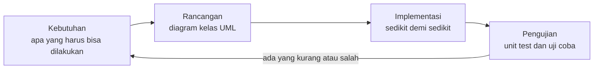
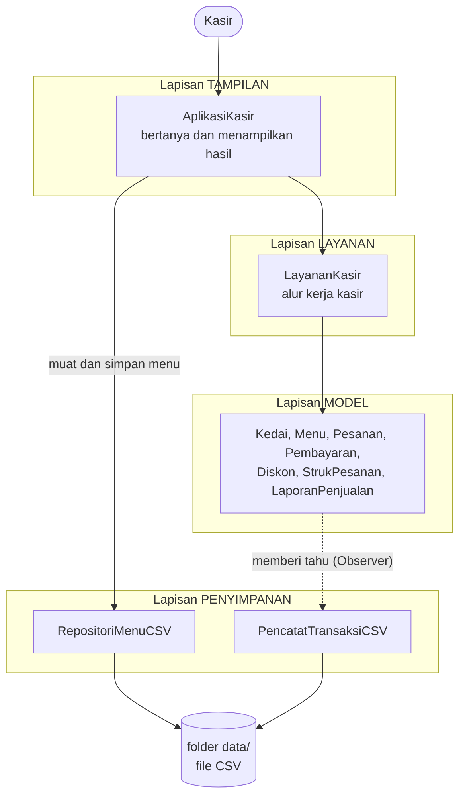
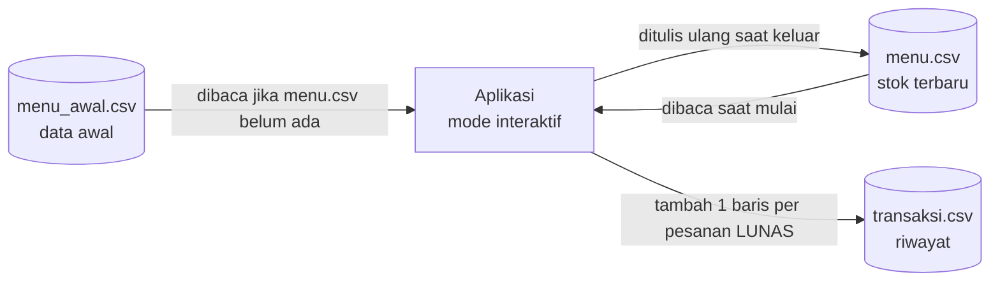
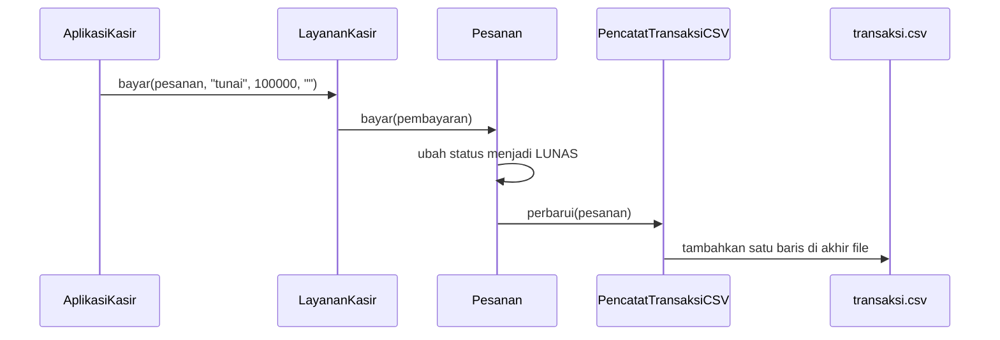
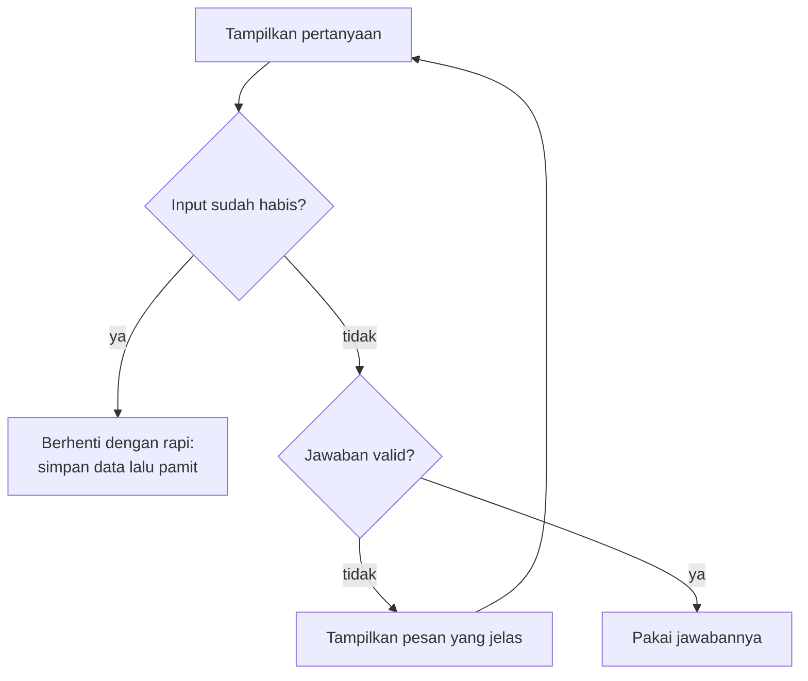
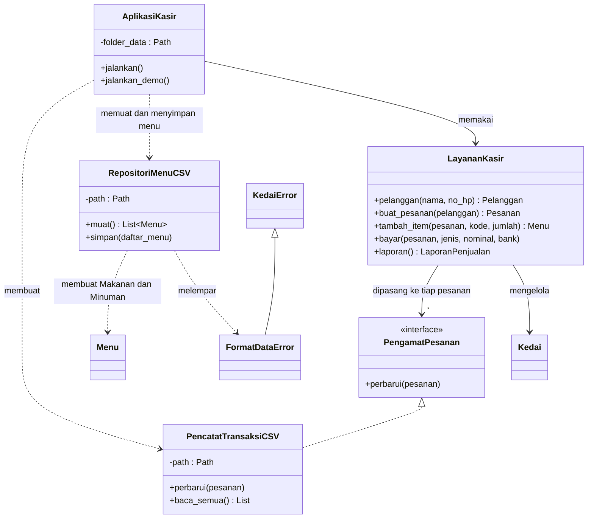

# Pertemuan 15: Proyek Terintegrasi

[⬅️ Pertemuan 14](../Pertemuan-14-Design-Pattern/README.md) · [🏠 Beranda](../README.md) · [Pertemuan 16 ➡️](../Pertemuan-16-UAS/README.md)

> Selama empat belas pertemuan, kita membangun KedaiKita sepotong demi sepotong. Hari ini semua potongan itu dirakit menjadi **aplikasi kasir sungguhan**: kasir bisa mengetik pesanan, data tersimpan di *file* dan masih ada saat aplikasi dibuka lagi, kode tersusun rapi dalam lapisan dan *package*, dan kebenarannya diperiksa otomatis oleh *unit test*. Pertemuan ini juga menjadi titik awal **proyek akhirmu**.

## 🎯 Tujuan Pembelajaran

Setelah pertemuan ini, kamu mampu:

1. Menjelaskan alur membangun aplikasi: **kebutuhan → rancangan UML → implementasi → pengujian**.
2. Menjelaskan **arsitektur berlapis** (tampilan, layanan, model, penyimpanan) beserta manfaatnya.
3. Mengelompokkan kelas ke dalam **modul dan *package***.
4. Menyimpan dan memuat data objek dengan ***file* CSV**, termasuk menolak isi *file* yang rusak dengan pesan yang jelas.
5. Membaca masukan pengguna dengan aman: **validasi, tanya ulang, dan tangani akhir *input***.
6. Menulis ***unit test*** sederhana dan menjelaskan mengapa pengujian otomatis penting.
7. Menunjukkan di mana konsep Pertemuan 02—14 dipakai dalam aplikasi final, lalu memakai pola yang sama untuk proyek akhir.

## 🧭 Peta Belajar

| Langkah | Bagian | Perkiraan waktu |
|---|---|---|
| 1 | Konsep (halaman ini) | 50 menit |
| 2 | Praktik: [🐍 Python](python/README.md) **atau** [☕ Java](java/README.md) | 120 menit |
| 3 | [Jembatan Python ↔ Java](jembatan-python-java.md) | 15 menit |
| 4 | [Latihan](latihan.md) | 90 menit |
| 5 | [Kuis](kuis.md) | 15 menit |
| 6 | [Spesifikasi Proyek Akhir](proyek-akhir.md) | 30 menit |

🖼️ ***Slide* pertemuan ini:** [baca PDF](../Slide/PBO2026-P15-Proyek-Terintegrasi.pdf) · [unduh PowerPoint](../Slide/PBO2026-P15-Proyek-Terintegrasi.pptx)

## 🔁 Mengingat Kembali

- Di [Pertemuan 14](../Pertemuan-14-Design-Pattern/README.md), KedaiKita mendapat empat pola desain: ***Singleton*** (`PengaturanKedai`), ***Factory*** (`PembayaranFactory`), ***Strategy*** (kelas-kelas `Diskon`), dan ***Observer*** (`LayarDapur` dan `NotifikasiPelanggan` diberi tahu saat status pesanan berubah).
- Di [Pertemuan 13](../Pertemuan-13-Prinsip-SOLID/README.md), kita memisahkan tanggung jawab (SRP) dan menyuntikkan `PenyimpananPesanan` ke `Kedai` (DIP). Hari ini kita memetik hasilnya: menambah *file* dan menu teks hampir tidak mengubah kelas lama.
- Di [Pertemuan 11](../Pertemuan-11-Exception-Handling/README.md), kita mengintip `with` (Python) dan *try-with-resources* (Java) untuk *file*. Hari ini keduanya benar-benar dipakai.
- Di [Pertemuan 06](../Pertemuan-06-UML-Class-Diagram/README.md), kita belajar menggambar diagram kelas. Diagram itulah langkah kedua dalam membangun aplikasi.

Masalahnya, KedaiKita versi Pertemuan 14 masih "program latihan". Semua data ditulis langsung di dalam kode, dan semuanya hilang begitu program ditutup.

## Daftar Isi

1. [Dari Latihan ke Aplikasi Nyata](#1-dari-latihan-ke-aplikasi-nyata)
2. [Arsitektur Berlapis](#2-arsitektur-berlapis)
3. [*Package* dan Modul: Merapikan Banyak *File*](#3-package-dan-modul-merapikan-banyak-file)
4. [Menyimpan Data ke *File*](#4-menyimpan-data-ke-file)
5. [*Observer* Dipakai Ulang: Mencatat Transaksi](#5-observer-dipakai-ulang-mencatat-transaksi)
6. [Menangani *Input* Pengguna dengan Aman](#6-menangani-input-pengguna-dengan-aman)
7. [*Unit Test*: Membiarkan Komputer Memeriksa](#7-unit-test-membiarkan-komputer-memeriksa)
8. [Peta Konsep P02—P14 dalam Aplikasi Final](#8-peta-konsep-p02p14-dalam-aplikasi-final)
9. [Studi Kasus KedaiKita: Apa yang Kita Bangun Hari Ini](#9-studi-kasus-kedaikita-apa-yang-kita-bangun-hari-ini)
10. [Miskonsepsi yang Sering Terjadi](#10-miskonsepsi-yang-sering-terjadi)

---

## 1. Dari Latihan ke Aplikasi Nyata

Bayangkan kamu menyerahkan KedaiKita versi Pertemuan 14 kepada pemilik kedai. Ia akan segera bertanya:

- "Menu baru ditambahkan **di mana**? Saya tidak bisa mengubah kode program."
- "Kenapa stok kembali penuh setiap kali aplikasi dibuka?"
- "Kasir saya mengetik pesanannya **di mana**?"
- "Kalau programnya diubah, bagaimana saya tahu hitungan pajaknya masih benar?"

Semua pertanyaan itu wajar. Program latihan hanya perlu membuktikan sebuah konsep, sedangkan aplikasi nyata harus **dipakai orang setiap hari**.

| Program latihan | Aplikasi nyata |
|---|---|
| Data ditulis langsung di kode | Data dibaca dari *file*, dan perubahan disimpan kembali |
| Dijalankan sekali lalu selesai | Dipakai berulang kali; data hari ini masih ada besok |
| Masukan sudah "pasti benar" | Pengguna bisa salah ketik kapan saja |
| Diperiksa dengan mata: "kelihatannya benar" | Diperiksa otomatis oleh *unit test* setiap kali kode berubah |
| Satu-dua *file* | Puluhan *file* yang perlu ditata |

### Alur membangun aplikasi

Pemrogram tidak langsung mengetik kode. Mereka mengikuti alur yang berulang seperti ini:



1. **Kebutuhan** (*requirements*): daftar hal yang harus bisa dilakukan aplikasi, ditulis dengan bahasa pengguna.
2. **Rancangan**: diagram kelas UML yang menjawab "kelas apa saja, isinya apa, dan saling berhubungan bagaimana".
3. **Implementasi**: menulis kode **sedikit demi sedikit**, setiap potongan langsung dicoba.
4. **Pengujian**: memeriksa bahwa kode memenuhi kebutuhan. Temuan dari pengujian sering memunculkan kebutuhan baru sehingga alurnya berputar lagi.

Kebutuhan KedaiKita versi hari ini:

| Kode | Kebutuhan | Jenis |
|---|---|---|
| F1 | Daftar menu dibaca dari *file*, bukan ditulis di kode | fungsional |
| F2 | Kasir bisa membuat pesanan, memilih diskon, dan membayar lewat menu teks | fungsional |
| F3 | Stok terbaru disimpan saat aplikasi ditutup dan dimuat lagi saat dibuka | fungsional |
| F4 | Setiap pesanan LUNAS tercatat di *file* riwayat transaksi | fungsional |
| F5 | Ada laporan penjualan dan riwayat transaksi | fungsional |
| N1 | Salah ketik tidak membuat aplikasi berhenti mendadak | nonfungsional |
| N2 | *File* data yang rusak dilaporkan dengan pesan yang jelas, lengkap dengan nomor barisnya | nonfungsional |
| N3 | Perhitungan penting diperiksa otomatis oleh *unit test* | nonfungsional |
| N4 | Ada mode demo yang berjalan tanpa diketik, dengan hasil yang selalu sama | nonfungsional |

> [!NOTE]
> Kebutuhan **fungsional** menjawab "aplikasi bisa melakukan apa". Kebutuhan **nonfungsional** menjawab "seberapa baik aplikasi melakukannya": aman, tahan salah ketik, mudah diuji, dan sebagainya.

> [!TIP]
> Proyek akhirmu memakai alur yang persis sama. Spesifikasinya ada di [proyek-akhir.md](proyek-akhir.md).

## 2. Arsitektur Berlapis

Coba perhatikan restoran yang ramai di dekat kampus. **Pelayan** mencatat pesanan dan mengantar makanan, tetapi tidak memasak. **Kepala dapur** mengatur urutan masakan, tetapi tidak menerima tamu. **Juru masak** mengolah bahan sesuai resep. **Gudang dan buku catatan** menyimpan bahan dan riwayat penjualan.

Jika pelayan diganti, dapur tetap bekerja seperti biasa. Jika resep berubah, pelayan tidak perlu belajar ulang. Setiap bagian punya tugas yang jelas dan tidak saling mencampuri.

> **Arsitektur berlapis** (*layered architecture*) adalah cara menyusun aplikasi menjadi beberapa lapisan. Setiap lapisan punya satu jenis tugas, dan ketergantungan antarlapisan dibuat **searah**.

KedaiKita versi hari ini punya empat lapisan:



| Lapisan | Kelas di KedaiKita | Tugasnya | Yang **tidak** boleh ia lakukan |
|---|---|---|---|
| Tampilan (*presentation*) | `AplikasiKasir` | menampilkan menu pilihan, membaca ketikan kasir, mencetak hasil | menghitung pajak atau diskon sendiri |
| Layanan (*service*) | `LayananKasir` | menjalankan alur kerja: daftar pelanggan, buat pesanan, tambah item, bayar, buat laporan | membaca *keyboard* atau mencetak menu pilihan |
| Model (*domain*) | `Kedai`, `Menu`, `Pesanan`, `Pembayaran`, `Diskon`, dan lainnya | menyimpan data dan menjaga aturan bisnis: harga > 0, stok cukup, pajak 10% | tahu bahwa ada *keyboard* atau *file* CSV |
| Penyimpanan (*persistence*) | `RepositoriMenuCSV`, `PencatatTransaksiCSV` | membaca dan menulis *file* | memutuskan aturan bisnis |

Aturan emasnya: **lapisan atas boleh memakai lapisan di bawahnya, tetapi tidak sebaliknya.** Kelas `Menu` tidak pernah memanggil `AplikasiKasir`. Ia bahkan tidak tahu kelas itu ada.

Lapisan penyimpanan sedikit istimewa. Walaupun digambar paling bawah, ia **mengenal** kelas model karena tugasnya menerjemahkan baris CSV menjadi objek `Makanan`/`Minuman` dan sebaliknya. Yang dijaga adalah arah kebalikannya: kelas model tidak pernah meng-*import* kelas penyimpanan. Saat `Pesanan` memberi tahu `PencatatTransaksiCSV` (garis putus-putus di diagram), `Pesanan` hanya mengenal *interface* `PengamatPesanan`, tanpa tahu bahwa pengamatnya menulis *file* (bagian 5). Jadi, inti aturannya: **kelas model tidak bergantung pada tampilan maupun penyimpanan**.

Manfaatnya terasa nyata:

- **Tampilan bisa diganti.** Jika kelak KedaiKita dibuat versi web atau Android, cukup lapisan tampilan yang ditulis ulang. `LayananKasir` dan semua kelas model tetap dipakai apa adanya.
- **Mudah diuji.** *Unit test* bisa langsung memanggil `Pesanan` atau `LayananKasir` tanpa perlu ada orang yang mengetik di *keyboard*.
- **Mudah dicari.** Ada salah hitung pajak? Lihat lapisan model. Tampilan menu pilihan berantakan? Lihat lapisan tampilan.
- **Mudah dibagi dalam tim.** Satu orang mengerjakan tampilan, yang lain mengerjakan penyimpanan.

> [!NOTE]
> Di KedaiKita, `AplikasiKasir` juga yang menyiapkan penyimpanan: memuat menu saat aplikasi dibuka dan menyimpannya saat ditutup. Untuk aplikasi sekecil ini, cara tersebut masih wajar. Pada aplikasi yang lebih besar, tugas itu biasanya dipindah ke lapisan layanan agar lapisan tampilan benar-benar hanya mengurus tanya jawab.

> [!WARNING]
> Jangan berlebihan. Program latihan 50 baris tidak perlu empat lapisan. Arsitektur berlapis mulai terasa manfaatnya ketika aplikasi punya banyak kelas, dipakai berulang kali, atau dikerjakan beberapa orang.

## 3. *Package* dan Modul: Merapikan Banyak *File*

KedaiKita kini terdiri atas lebih dari 20 *file*. Jika semuanya ditumpuk dalam satu folder bersama `main.py`, data, dan *file* pengujian, kita akan kesulitan menemukan apa pun. Masalah lain: bagaimana jika suatu hari kita memakai pustaka orang lain yang juga punya kelas bernama `Menu`?

Bayangkan dua mahasiswa bernama Budi di satu kelas. Dosen membedakannya dengan nama lengkap: "Budi Santoso" dan "Budi Prasetyo". Alamat surat juga begitu: "Jl. Pramuka No. 10, Samarinda" tidak akan tertukar dengan "Jl. Pramuka No. 10" di kota lain.

> **Modul** adalah satu *file* kode yang berisi kelas, fungsi, atau konstanta yang saling berkaitan. ***Package*** adalah folder yang mengelompokkan beberapa modul atau kelas, sekaligus memberi mereka "nama keluarga" bersama.

Dengan *package*, kelas `Menu` milik KedaiKita punya nama lengkap `kedaikita.Menu` (Java) atau `kedaikita.menu.Menu` (Python: *package* `kedaikita`, modul `menu`, kelas `Menu`).

Sekilas bentuknya di kedua bahasa (potongan kode, tidak untuk dijalankan sendiri; versi lengkapnya ada di halaman praktik):

**Python:**

```python
# folder kedaikita/ berisi __init__.py
# maka kedaikita adalah sebuah package
from kedaikita.menu import Menu
from kedaikita.pesanan import Pesanan
```

**Java:**

```java
// baris pertama file src/kedaikita/Menu.java
package kedaikita;

// kelas di luar package memakainya dengan:
import kedaikita.Menu;
```

Struktur folder studi kasus hari ini (disederhanakan):

```text
python/studi-kasus/                 java/studi-kasus/
├── main.py                         ├── jalankan.sh, jalankan.bat
├── kedaikita/      <- package      ├── uji.sh, uji.bat
│   ├── __init__.py                 ├── src/
│   ├── menu.py                     │   └── kedaikita/      <- package
│   ├── pesanan.py                  │       ├── Main.java
│   ├── repositori.py               │       ├── Menu.java
│   └── ... (total 21 file)         │       └── ... (total 39 file)
├── data/                           └── data/
│   └── menu_awal.csv                   └── menu_awal.csv
└── tests/
    └── test_kedaikita.py
```

| | Python | Java |
|---|---|---|
| Penanda *package* | folder berisi *file* `__init__.py` | baris `package kedaikita;` di **setiap** *file*, dan *file* berada di folder bernama sama |
| Satu *file* berisi | satu modul (boleh beberapa kelas) | satu kelas `public` |
| Nama lengkap kelas | `kedaikita.menu.Menu` | `kedaikita.Menu` |
| Cara memakai | `from kedaikita.menu import Menu` | `import kedaikita.Menu;` (tidak perlu jika sesama *package*) |

> [!NOTE]
> Di Pertemuan 04, kamu belajar *access modifier* Java tanpa kata kunci (*package-private*): hanya bisa diakses dari *package* yang sama. Hari ini *package* itu benar-benar punya nama, yaitu `kedaikita`.

## 4. Menyimpan Data ke *File*

### 4.1 Mengapa perlu *file*?

Objek tinggal di **memori kerja** (RAM). Memori kerja seperti papan tulis di kelas: cepat ditulis, tetapi dihapus setiap kali kuliah selesai. *File* di disk seperti buku catatan: isinya tetap ada walaupun kamu pulang dan baru membukanya besok.

> **Persistensi** (*persistence*) adalah kemampuan aplikasi menyimpan data agar tetap ada setelah program ditutup.

Dua pekerjaan utamanya:

- **Menyimpan** (*save*, *serialize*): mengubah objek di memori menjadi teks di *file*.
- **Memuat** (*load*, *deserialize*): membaca teks di *file* lalu menghidupkannya kembali menjadi objek.

### 4.2 Memilih format *file*

| Format | Contoh isi | Cocok untuk |
|---|---|---|
| Teks biasa (`.txt`) | `Kopi Susu Gula Aren - Rp18.000` | catatan, log, laporan untuk dibaca manusia |
| CSV (`.csv`) | `Minuman;M01;Kopi Susu Gula Aren;18000;20;dingin` | data berbentuk tabel; bisa dibuka di Excel |
| JSON (`.json`) | `{"kode": "M01", "harga": 18000}` | data bersarang; umum di aplikasi web |
| Basis data | tabel SQL | data besar, banyak pengguna sekaligus (mata kuliah Basis Data) |

KedaiKita memakai **CSV** (*comma-separated values*): satu baris untuk satu data, kolom-kolomnya dipisahkan tanda tertentu, dan baris pertama berisi judul kolom. Formatnya sederhana, mudah diperiksa dengan mata, dan bisa dibuka di Excel atau Google Sheets.

### 4.3 Format CSV KedaiKita

*File* menu (`data/menu_awal.csv`):

```text
jenis;kode;nama;harga;stok;ekstra
Minuman;M01;Kopi Susu Gula Aren;18000;20;dingin
Minuman;M02;Es Teh Manis;8000;30;dingin
Makanan;M03;Nasi Goreng Kampung;25000;15;2
Makanan;M04;Mie Goreng Jawa;23000;10;1
Makanan;M05;Pisang Goreng Keju;15000;12;0
Minuman;M06;Kopi Tubruk;12000;25;panas
```

| Kolom | Isi | Catatan |
|---|---|---|
| `jenis` | `Makanan` atau `Minuman` | menentukan objek kelas mana yang dibuat (pewarisan!) |
| `kode`, `nama` | teks | kode harus unik |
| `harga`, `stok` | bilangan bulat | uang selalu bilangan bulat rupiah |
| `ekstra` | level pedas (Makanan) atau `dingin`/`panas` (Minuman) | satu kolom, arti berbeda menurut jenisnya |

*File* riwayat transaksi (`data/transaksi.csv`) ditambah satu baris setiap ada pesanan LUNAS:

```text
nomor;pelanggan;no_hp;jumlah_porsi;total
P001;Budi Santoso;081234567890;3;67100
```

### 4.4 Mengapa titik koma, bukan koma?

Namanya memang *comma-separated*, tetapi KedaiKita memakai **titik koma** (`;`). Alasannya:

- Isi kolom sering mengandung koma, misalnya alamat `Samarinda, Kalimantan Timur` atau catatan `pedas, tanpa sayur`. Jika pemisahnya koma, satu kolom akan terbelah menjadi dua.
- Di komputer dengan pengaturan wilayah Indonesia, koma dipakai sebagai pemisah desimal. Karena itu, Excel umumnya memakai titik koma sebagai pemisah kolom saat membuka dan menyimpan CSV.
- Titik koma jarang muncul di nama menu atau nama orang.

> [!WARNING]
> Titik koma pun bukan kebal masalah. Versi Java KedaiKita memecah baris dengan cara sederhana sehingga nama menu **tidak boleh** mengandung titik koma. Modul `csv` Python sebenarnya bisa menangani isi kolom yang mengandung pemisah: saat menyimpan, kolom itu dibungkus tanda petik ganda (`"Teh; Manis"`). Namun, *file* seperti itu tidak lagi terbaca dengan benar oleh versi Java. Karena itu, anggap aturannya sama untuk kedua bahasa: hindari titik koma dan tanda petik ganda (`"`) di dalam isi kolom.

### 4.5 Siklus hidup *file* data



| *File* | Dibuat oleh | Isinya | Ikut disimpan di Git? |
|---|---|---|---|
| `menu_awal.csv` | kita (pemrogram) | menu dan stok awal | **ya**, ini data awal |
| `menu.csv` | aplikasi, saat keluar dari mode interaktif | stok terbaru | tidak (diabaikan `.gitignore`) |
| `transaksi.csv` | aplikasi, setiap ada pesanan LUNAS | riwayat penjualan | tidak |
| `demo-menu.csv`, `demo-transaksi.csv` | mode demo | hasil mode demo, selalu dibuat ulang dari awal | tidak |

Mengapa mode demo memakai *file* sendiri? Agar data hasil sesi interaktifmu tidak tertimpa, dan agar *output* mode demo **selalu sama** setiap kali dijalankan.

### 4.6 Jangan percaya isi *file*

*File* bisa saja rusak: diedit manual lalu salah ketik, terpotong, atau disimpan dengan format lain. Aplikasi yang baik tidak berhenti dengan pesan *error* yang membingungkan. Ia melaporkan masalahnya dengan bahasa manusia, **lengkap dengan nomor barisnya**.

KedaiKita punya *exception* baru untuk keperluan ini: `FormatDataError` (Python) atau `FormatDataException` (Java), turunan `KedaiError`/`KedaiException`. Berikut pesan yang benar-benar muncul ketika *file* menu berisi baris yang rusak:

| Isi baris yang rusak | Pesan yang ditampilkan |
|---|---|
| `Minuman;M02;Es Teh Manis;8rb;30;dingin` (di baris 3) | `Baris 3: harga, stok, dan level pedas harus berupa angka` |
| `Minuman;M01;Kopi Susu Gula Aren;18000;20` | `Baris 2: harus ada 6 kolom` |
| `Snack;M07;Keripik Pisang;10000;5;0` | `Baris 2: jenis 'Snack' tidak dikenal` |
| kode `M01` muncul dua kali (di baris 2 dan 3) | `Baris 3: kode M01 sudah dipakai` |
| `Minuman;M01;Kopi;0;20;dingin` | `Baris 2: Harga harus lebih dari 0` |

Perhatikan baris terakhir. Aturan "harga harus lebih dari 0" tidak ditulis ulang di bagian penyimpanan. Aturan itu milik kelas `Menu` (Pertemuan 04). Bagian penyimpanan cukup membuat objek `Menu` dan meneruskan penolakannya dengan tambahan nomor baris.

### 4.7 Membuka dan menutup *file* dengan aman

*File* yang dibuka wajib ditutup lagi. *File* yang lupa ditutup bisa membuat isinya tidak tersimpan sempurna atau terkunci sehingga tidak bisa dipakai program lain. Masalahnya, jika terjadi *exception* di tengah jalan, perintah "tutup" bisa terlewat.

Di Pertemuan 11 kita sudah mengintip solusinya: Python punya pernyataan `with`, Java punya *try-with-resources*. Keduanya menjamin *file* **pasti ditutup** begitu bloknya selesai, baik lancar maupun gagal. Selain itu, selalu sebutkan *encoding* **UTF-8** saat membaca dan menulis teks agar *file* yang sama terbaca sama persis di Windows, macOS, dan Linux.

## 5. *Observer* Dipakai Ulang: Mencatat Transaksi

Kebutuhan F4 berbunyi: "setiap pesanan LUNAS tercatat di *file* riwayat transaksi". Di mana sebaiknya kode pencatatan ini diletakkan?

Cara yang terlintas pertama: tambahkan saja perintah "tulis ke *file*" di dalam *method* `bayar()` milik `Pesanan`. Namun, dengan begitu, `Pesanan` harus tahu soal *file* CSV. Kelas model jadi bercampur dengan urusan penyimpanan, dan setiap *unit test* untuk `Pesanan` akan ikut menulis *file*.

Ingat pola ***Observer*** dari Pertemuan 14. `Pesanan` adalah **subjek** yang memberi tahu semua **pengamatnya** setiap kali statusnya berubah. Pengamat lama kita adalah `LayarDapur` dan `NotifikasiPelanggan`. Hari ini kita menambah satu pengamat baru: `PencatatTransaksiCSV`.



- `LayananKasir` memasang pencatat ke **setiap** pesanan baru.
- Saat status berubah, `Pesanan` memanggil `perbarui()` milik semua pengamatnya. `Pesanan` tidak tahu bahwa salah satu pengamatnya menulis *file*.
- `PencatatTransaksiCSV` hanya peduli pada status LUNAS. Status lain diabaikan.

Hasilnya: **kelas `Pesanan` tidak diubah satu baris pun.** Inilah *Open/Closed Principle* (Pertemuan 13) dalam praktik: perilaku baru ditambahkan dengan kelas baru, bukan dengan membongkar kelas lama.

> [!TIP]
> **Coba sendiri:** pikirkan pengamat lain yang bisa ditambahkan dengan cara yang sama, misalnya `PengirimStrukEmail` atau `PencatatLogAudit`. Kelas mana saja yang perlu diubah?

<details>
<summary>Lihat jawaban</summary>

Cukup membuat kelas pengamat baru, lalu memasangnya di tempat `LayananKasir` dibuat. Kelas `Pesanan`, `Menu`, dan kelas model lainnya tidak perlu disentuh.

</details>

## 6. Menangani *Input* Pengguna dengan Aman

Bayangkan petugas loket pendaftaran wisuda di kampus. Jika formulirmu salah isi, ia tidak merobek formulir lalu menutup loket. Ia menunjuk bagian yang salah, menjelaskan kesalahannya, lalu memintamu memperbaiki. Jika kamu pergi di tengah jalan, ia merapikan berkas yang sudah ada lalu menutup loket dengan tertib.

Aplikasi juga harus bersikap seperti petugas yang sabar itu. Aturan emasnya: **anggap setiap *input* bisa salah.**

| Kebiasaan | Artinya | Contoh di KedaiKita |
|---|---|---|
| **Validasi** | periksa jawaban sebelum dipakai: kosong? angka? dalam batas? pilihan dikenal? | jumlah porsi harus angka bulat; kode menu harus terdaftar |
| **Tanya ulang** | jika tidak valid, beri pesan yang jelas lalu tanyakan lagi | `Harap isi dengan angka bulat, misalnya 2 atau 50000.` |
| **Tangani akhir *input*** | *input* bisa **habis** (EOF, *end of file*), misalnya *input* dibaca dari *file* atau pengguna menekan Ctrl+D (macOS/Linux) atau Ctrl+Z lalu Enter (Windows) | aplikasi mencetak `Input berakhir.`, menyimpan stok, lalu pamit |



Reaksi KedaiKita terhadap berbagai masukan (pesan aslinya):

| Kasir mengetik | Reaksi aplikasi |
|---|---|
| `dua` saat ditanya jumlah | `Harap isi dengan angka bulat, misalnya 2 atau 50000.` lalu bertanya lagi |
| `m01` (huruf kecil) | diterima karena kode diubah ke huruf besar dulu |
| `M99` | `[GAGAL] Menu dengan kode M99 tidak ditemukan`, lalu lanjut ke kode berikutnya |
| `5` saat memilih diskon (pilihan hanya 1—3) | `Pilihan tidak dikenal, coba lagi.` |
| uang tunai `50000` untuk tagihan Rp56.100 | `[GAGAL] Pembayaran Tunai gagal: uang kurang Rp6.100`, lalu kembali ke pilihan pembayaran |

Perhatikan pembagian tugasnya. Lapisan **tampilan** memeriksa **bentuk** jawaban ("apakah ini angka?"). Lapisan **model** menjaga **aturan bisnis** ("apakah stoknya cukup?", "apakah harganya lebih dari 0?"). Dua lapis pemeriksaan ini saling melengkapi.

> [!IMPORTANT]
> Pesan *error* untuk pengguna harus menjelaskan **apa yang salah** dan **apa yang harus dilakukan**. Bandingkan `ValueError: invalid literal for int() with base 10: 'dua'` dengan `Harap isi dengan angka bulat, misalnya 2 atau 50000.` Kasir kedai tidak perlu tahu apa itu `ValueError`.

## 7. *Unit Test*: Membiarkan Komputer Memeriksa

Setiap kali kode diubah, bagaimana kamu tahu bagian lain tidak ikut rusak? Menjalankan aplikasi lalu mencoba semua menu satu per satu terasa melelahkan, dan lama-lama pasti ada yang terlewat. Kesalahan lama yang muncul kembali setelah kode diubah disebut **regresi** (*regression*).

Pabrik motor tidak menunggu pembeli mengeluh soal rem blong. Setiap motor diuji di jalur pemeriksaan sebelum keluar pabrik, dengan daftar periksa yang sama dan dilakukan berulang kali. Pemrogram melakukan hal serupa dengan *unit test*.

> ***Unit test*** adalah kode kecil yang memeriksa satu bagian kecil program (satu *method* atau satu kelas) secara **otomatis**. Pemeriksaannya disebut ***assertion***: pernyataan "nilai ini **seharusnya** sama dengan itu". Jika pernyataannya tidak terpenuhi, *test* **gagal** dan kita langsung tahu ada yang salah.

Setiap *test* biasanya terdiri atas tiga langkah:

```text
SIAPKAN   : buat pesanan berisi 2 Kopi Susu Gula Aren (Rp18.000) dan 1 Nasi Goreng (Rp25.000)
JALANKAN  : hitung total pesanan
PERIKSA   : totalnya harus Rp67.100 (subtotal Rp61.000 + pajak 10% Rp6.100)
```

Berikut satu *test* KedaiKita di kedua bahasa (potongan, tidak untuk dijalankan sendiri; langkah SIAPKAN dikerjakan oleh `setUp()`/`siapkanPesanan()`, dan cara menjalankan semua *test* ada di halaman praktik).

**Python** (`unittest`, bawaan Python; potongan dari `tests/test_kedaikita.py`):

```python
def test_total_sudah_termasuk_pajak_10_persen(self):
    self.assertEqual(self.pesanan.hitung_total(), 67100)
```

**Java** (*runner* mini buatan kita karena pustaka JUnit tidak ikut di JDK; potongan dari `UjiKedaiKita.java`). *Runner* adalah program yang menjalankan *test* satu per satu lalu melaporkan hasilnya:

```java
private static boolean ujiTotalSudahTermasukPajak10Persen() throws KedaiException {
    siapkanPesanan();
    return pesanan.hitungTotal() == 67100;
}
```

### Kasus uji yang baik

*Test* yang baik tidak hanya mencoba jalan yang mulus. KedaiKita punya 16 *test* yang mencakup tiga jenis kasus:

| Jenis kasus | Pertanyaannya | Contoh *test* KedaiKita |
|---|---|---|
| **Normal** | apakah hasilnya benar saat semuanya wajar? | subtotal Rp61.000; total dengan pajak Rp67.100; stok kopi berkurang menjadi 8 |
| **Gagal** | apakah kesalahan ditolak dengan benar? | harga 0 ditolak; bayar tunai kurang ditolak dan status tetap BARU; *file* CSV rusak ditolak |
| **Batas** (*boundary*) | apakah tepat di batas aturan juga benar? | level pedas 6 ditolak (maksimal 5); diskon member baru berlaku tepat di 10 poin |

Kasus **batas** paling sering menyembunyikan *bug*. Aturan "gratis ongkir untuk belanja **minimal** Rp100.000" mudah keliru ditulis sebagai "lebih dari 100000". *Test* dengan belanja tepat Rp100.000 akan langsung menangkapnya (kita membuktikannya di contoh 05 halaman praktik).

> [!NOTE]
> *Test* yang lulus semua tidak membuktikan program bebas *bug*. *Test* hanya membuktikan bahwa kasus-kasus yang diuji berjalan benar. Karena itu, pilih kasus uji dengan cermat: normal, gagal, dan batas.

> [!TIP]
> Kebiasaan yang baik: setiap kali menemukan *bug*, tulis dulu *test* yang gagal karena *bug* itu, baru perbaiki kodenya. *Bug* yang sama tidak akan diam-diam kembali.

## 8. Peta Konsep P02—P14 dalam Aplikasi Final

Aplikasi final ini memakai hampir semua yang sudah kamu pelajari. Gunakan tabel ini sebagai bahan belajar UAS dan sebagai contoh "peta kebutuhan" untuk README proyek akhirmu.

| Pertemuan | Konsep | Di mana dipakai dalam KedaiKita |
|---|---|---|
| 02 | Kelas dan objek | setiap baris CSV dihidupkan menjadi satu objek `Makanan` atau `Minuman` |
| 03 | Atribut kelas, *method*, representasi teks | nomor pesanan otomatis P001, P002, ... dari atribut milik kelas; `__str__`/`toString()` pada `Menu` |
| 04 | Enkapsulasi | harga hanya berubah lewat *setter* yang menolak harga ≤ 0; stok hanya lewat `tambah_stok`/`kurangi_stok` |
| 05 | Relasi antarkelas | komposisi: `Pesanan` membuat dan memiliki `ItemPesanan`; agregasi: `Kedai` menampung `Menu` dari luar; `LayananKasir` memakai `Kedai` |
| 06 | UML | diagram kelas di halaman ini dan di README proyek akhir |
| 07 | Pewarisan | `Menu` → `Makanan`, `Minuman`; `KedaiError` → `FormatDataError` |
| 09 | Polimorfisme | `pesanan.bayar(pembayaran)` bekerja untuk Tunai, QRIS, dan Kartu; mencetak menu memanggil versi `Makanan` atau `Minuman` |
| 10 | Kelas abstrak dan *interface* | `Pembayaran`, `Diskon`, `PengamatPesanan`, `PenyimpananPesanan`, `DapatDicetak` |
| 11 | *Exception* | `StokTidakCukupError`, `MenuTidakDitemukanError`, `PembayaranGagalError`, dan yang baru: `FormatDataError` |
| 12 | Koleksi dan *generics* | `dict`/`Map` kode → `Menu` dan no HP → `Pelanggan`; `set`/`Set` untuk mendeteksi kode ganda di CSV; `Pasangan` di laporan |
| 13 | SOLID | `StrukPesanan` dan `RepositoriMenuCSV` punya satu tugas (SRP); pengamat baru tanpa mengubah `Pesanan` (OCP); penyimpanan dan pengamat disuntikkan (DIP) |
| 14 | *Design pattern* | *Singleton* `PengaturanKedai` (pajak), *Factory* `PembayaranFactory` (pilihan pembayaran), *Strategy* `Diskon` (pilihan diskon), *Observer* `PencatatTransaksiCSV` |
| 15 | Hari ini | arsitektur berlapis, *package*, *file* CSV, *input* yang aman, *unit test* |

## 9. Studi Kasus KedaiKita: Apa yang Kita Bangun Hari Ini

**Yang baru dibanding Pertemuan 14:**

- Semua kelas pindah ke *package* `kedaikita`. Kelas-kelas lama (`Menu`, `Pesanan`, `Pembayaran`, dan lainnya) **tidak berubah perilakunya**. Perubahannya praktis hanya baris `import` (Python) atau tambahan baris `package` (Java).
- Daftar menu tidak lagi ditulis di kode, tetapi dibaca dari `data/menu_awal.csv`. Menunya bertambah satu: **M06 Kopi Tubruk** (Rp12.000, disajikan panas).
- Lima kelas baru, satu untuk setiap lapisan atau kebutuhan baru:



> [!NOTE]
> Nama *method* di diagram memakai gaya Python (`jalankan_demo`, `baca_semua`). Di Java namanya ditulis *camelCase*: `jalankanDemo`, `bacaSemua`. Di Java, `KedaiError` dan `FormatDataError` bernama `KedaiException` dan `FormatDataException`. Garis `RepositoriMenuCSV ..> Menu` adalah ketergantungan lapisan penyimpanan pada model yang dibahas di bagian 2.

- **Dua cara menjalankan:** mode **interaktif** (kasir mengetik pilihan dari menu teks) dan mode **demo** (`--demo`, berjalan sendiri tanpa diketik).
- **16 *unit test*** untuk `Menu`, `Pesanan`, `PembayaranFactory`, dan `RepositoriMenuCSV`.

**Skenario mode demo:**

1. Memuat 6 menu dari `data/menu_awal.csv`, lalu menampilkannya.
2. Transaksi 1: Budi memesan 2 kopi dan 1 nasi goreng, tanpa diskon, bayar tunai Rp100.000.
3. Transaksi 2: Siti memakai diskon *Happy Hour*. Pembayaran QRIS gagal karena saldo kurang, lalu ia membayar dengan kartu kredit.
4. Transaksi 3: Rina salah memasukkan kode menu dan meminta porsi melebihi stok. Kesalahan ditolak dengan rapi, dan pesanan yang benar tetap diproses.
5. Laporan penjualan sesi ini, riwayat dari *file* transaksi, lalu stok terbaru disimpan ke *file*.

**Cuplikan akhir mode demo** (sama persis untuk versi Python maupun Java):

```text
=== RIWAYAT DARI FILE data/demo-transaksi.csv ===
P001 | Budi Santoso | 081234567890 | 3 | 67100
P002 | Siti Aminah | 082198765432 | 3 | 30580
P003 | Rina Marlina | 085312345678 | 2 | 26400

Stok terbaru disimpan ke data/demo-menu.csv. Isinya:
jenis;kode;nama;harga;stok;ekstra
Minuman;M01;Kopi Susu Gula Aren;18000;18;dingin
Minuman;M02;Es Teh Manis;8000;28;dingin
Makanan;M03;Nasi Goreng Kampung;25000;14;2
Makanan;M04;Mie Goreng Jawa;23000;10;1
Makanan;M05;Pisang Goreng Keju;15000;11;0
Minuman;M06;Kopi Tubruk;12000;23;panas
```

Riwayat itu ditulis oleh pengamat `PencatatTransaksiCSV` dan dibaca kembali dari *file*. Bandingkan stoknya dengan `menu_awal.csv` di bagian 4.3: Kopi Susu Gula Aren dan Nasi Goreng Kampung berkurang karena pesanan Budi, Es Teh Manis dan Pisang Goreng Keju karena pesanan Siti, serta Kopi Tubruk karena pesanan Rina. Stok Mie Goreng Jawa tetap 10 karena permintaan 100 porsi ditolak.

Kode lengkap, *output* penuh, contoh sesi interaktif, dan cara menjalankan *unit test* dibahas di halaman praktik: [🐍 Python](python/README.md#7-studi-kasus-kedaikita) atau [☕ Java](java/README.md#7-studi-kasus-kedaikita).

## 10. Miskonsepsi yang Sering Terjadi

Enam anggapan keliru berikut sering muncul saat pertama kali membangun aplikasi utuh. Cocokkan dengan pemahamanmu sendiri.

1. **Keliru:** "Kalau programnya jalan di laptopku, berarti sudah benar."

   **Yang benar:** belum tentu. Coba jalankan dengan masukan yang salah, *file* data yang rusak, atau dari folder yang bersih (hasil *clone* ulang). Lalu biarkan *unit test* memeriksa perhitungan penting setiap kali kode berubah.

2. **Keliru:** "Arsitektur berlapis artinya *file*-nya dipisah-pisah saja."

   **Yang benar:** bukan soal jumlah *file*. Intinya adalah **arah ketergantungan**: tampilan memakai layanan, layanan memakai model, dan model tidak tahu apa-apa soal *keyboard* atau *file*.

3. **Keliru:** "Data di *file* pasti benar karena kita sendiri yang menulisnya."

   **Yang benar:** *file* bisa diedit tangan, terpotong, atau disimpan dalam format lain oleh Excel. Selalu validasi isi *file* dan laporkan kesalahannya dengan nomor baris.

4. **Keliru:** "Validasi cukup di tampilan saja."

   **Yang benar:** tampilan memeriksa bentuk jawaban, tetapi aturan bisnis (harga > 0, stok cukup) harus tetap dijaga oleh kelas model. Data juga bisa masuk lewat jalur lain, misalnya dari *file* atau dari *unit test*.

5. **Keliru:** "*Unit test* hanya membuang waktu, lebih cepat dicoba manual."

   **Yang benar:** untuk sekali coba, mungkin. Namun, *test* otomatis bisa dijalankan ratusan kali tanpa lelah, dalam hitungan detik, dan langsung menunjuk bagian yang rusak setelah kode diubah.

6. **Keliru:** "Semua *test* lulus berarti programnya bebas *bug*."

   **Yang benar:** *test* hanya memeriksa kasus yang ditulis. Kasus batas yang tidak diuji tetap bisa menyimpan *bug*.

## 📝 Ringkasan

- Aplikasi dibangun dengan alur yang berulang: **kebutuhan → rancangan UML → implementasi → pengujian**.
- **Arsitektur berlapis** memisahkan tampilan, layanan, model, dan penyimpanan. Lapisan atas memakai lapisan bawah, tidak sebaliknya. Hasilnya: mudah diganti, diuji, dan dicari.
- **Modul** adalah satu *file* kode; ***package*** adalah folder yang mengelompokkan modul atau kelas dan memberi nama lengkap seperti `kedaikita.Menu`.
- **Persistensi**: objek disimpan ke *file* dan dimuat kembali. KedaiKita memakai **CSV** dengan pemisah **titik koma**, *encoding* UTF-8, dan baris judul kolom.
- Isi *file* harus divalidasi. *File* yang rusak dilaporkan sebagai `FormatDataError`/`FormatDataException` lengkap dengan nomor baris.
- `with` (Python) dan *try-with-resources* (Java) menjamin *file* selalu ditutup.
- Pola ***Observer*** dipakai ulang: `PencatatTransaksiCSV` mencatat pesanan LUNAS tanpa mengubah kelas `Pesanan`.
- *Input* pengguna ditangani dengan **validasi, tanya ulang, dan penanganan akhir *input* (EOF)**.
- ***Unit test*** memeriksa kode secara otomatis dengan *assertion*. Uji kasus **normal, gagal, dan batas**.

## 📖 Istilah Penting

| Istilah | Arti singkat |
|---|---|
| Kebutuhan (*requirements*) | Daftar hal yang harus bisa dilakukan aplikasi (fungsional) dan seberapa baik (nonfungsional) |
| Arsitektur berlapis (*layered architecture*) | Susunan aplikasi dalam lapisan: tampilan, layanan, model, penyimpanan |
| Lapisan layanan (*service layer*) | Lapisan yang menjalankan alur kerja aplikasi, misalnya `LayananKasir` |
| Modul | Satu *file* kode berisi kelas, fungsi, atau konstanta yang saling berkaitan |
| *Package* | Folder yang mengelompokkan modul/kelas dan memberi nama lengkap |
| Persistensi (*persistence*) | Kemampuan menyimpan data agar tetap ada setelah program ditutup |
| CSV | Format *file* teks berbentuk tabel; kolom dipisahkan tanda tertentu |
| *Encoding* UTF-8 | Aturan mengubah huruf menjadi *byte*; dikenali semua sistem operasi sehingga aman untuk berbagi *file* |
| Repositori (*repository*) | Kelas yang menjembatani objek dengan tempat penyimpanan, misalnya `RepositoriMenuCSV` |
| EOF (*end of file*) | Keadaan ketika *input* sudah habis dan tidak ada lagi yang bisa dibaca |
| Validasi *input* | Memeriksa masukan sebelum dipakai |
| *Unit test* | Kode yang memeriksa satu bagian kecil program secara otomatis |
| *Assertion* | Pernyataan dalam *test*: "nilai ini seharusnya sama dengan itu" |
| Kasus batas (*boundary case*) | Kasus uji tepat di batas sebuah aturan |
| Regresi (*regression*) | *Bug* lama yang muncul kembali setelah kode diubah |

## ➡️ Langkah Berikutnya

Pilih jalur praktikmu: [🐍 Praktik Python](python/README.md) atau [☕ Praktik Java](java/README.md).

Setelah itu, baca [Spesifikasi Proyek Akhir](proyek-akhir.md) dan mulailah dari langkah pertama: menulis kebutuhan aplikasimu sendiri.

---

[⬅️ Pertemuan 14](../Pertemuan-14-Design-Pattern/README.md) · [🏠 Beranda](../README.md) · [Pertemuan 16 ➡️](../Pertemuan-16-UAS/README.md)
