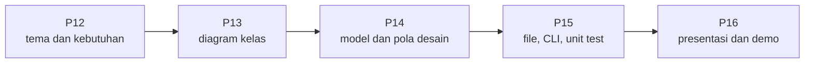

# Proyek Akhir: Spesifikasi dan Panduan

[⬅️ Kuis](kuis.md) · [🏠 Beranda](../README.md) · [Pertemuan 16 ➡️](../Pertemuan-16-UAS/README.md)

> Sepanjang semester kamu membangun KedaiKita bersama-sama. Di proyek akhir, giliranmu membangun aplikasi berorientasi objek **sendiri**: tema pilihanmu, rancanganmu, kodemu. Alurnya sama persis dengan Pertemuan 15: kebutuhan → rancangan UML → implementasi → pengujian → presentasi.

> [!IMPORTANT]
> Dokumen ini adalah spesifikasi umum beserta saran. Ketentuan resmi, seperti individu atau kelompok, tenggat, bobot nilai, dan cara pengumpulan, **mengikuti pengumuman dosen pengampu**. Dokumen ini ditempatkan di Pertemuan 15 karena di sinilah semua konsep terkumpul, tetapi sebaiknya sudah kamu baca sejak Pertemuan 12.

## Daftar Isi

1. [Tujuan](#1-tujuan)
2. [Pilihan Tema](#2-pilihan-tema)
3. [Kebutuhan Minimum](#3-kebutuhan-minimum)
4. [Aturan Teknis](#4-aturan-teknis)
5. [Tahapan dan Jadwal Mingguan](#5-tahapan-dan-jadwal-mingguan)
6. [Yang Dikumpulkan](#6-yang-dikumpulkan)
7. [Rubrik Penilaian](#7-rubrik-penilaian)
8. [Presentasi dan Demo](#8-presentasi-dan-demo)
9. [Kejujuran Akademik dan Penggunaan AI](#9-kejujuran-akademik-dan-penggunaan-ai)
10. [Pertanyaan yang Sering Diajukan](#10-pertanyaan-yang-sering-diajukan)

## 1. Tujuan

Melalui proyek akhir, kamu membuktikan bahwa kamu mampu:

1. Menerjemahkan masalah nyata menjadi **kebutuhan** dan **diagram kelas UML**.
2. Menerapkan empat pilar PBO (enkapsulasi, pewarisan, polimorfisme, abstraksi) secara **beralasan**, bukan sekadar tempelan.
3. Membangun aplikasi yang **tahan salah**: *input* keliru dan *file* rusak tidak membuatnya berhenti mendadak.
4. Menyimpan data ke *file* dan memuatnya kembali, serta memeriksa kode dengan ***unit test***.
5. Mempresentasikan aplikasi dan **menjelaskan setiap baris kodemu sendiri**.

## 2. Pilihan Tema

Tema bebas, asalkan **bukan kafe**, kedai, atau restoran. Tujuannya agar proyekmu tidak sekadar menyalin KedaiKita. Berikut sepuluh tema yang ukurannya pas untuk satu semester:

| Tema | Gambaran aplikasi | Ide hierarki pewarisan | Ide *design pattern* | Data yang disimpan |
|---|---|---|---|---|
| Perpustakaan | peminjaman, pengembalian, denda terlambat | `Koleksi` → `Buku`, `Majalah`, `Skripsi` | *Strategy* aturan denda | anggota, koleksi, peminjaman |
| Rental kendaraan | sewa motor dan mobil per hari | `Kendaraan` → `Motor`, `Mobil` | *Factory* kendaraan | armada, penyewa, transaksi sewa |
| Bengkel | antrean servis dan suku cadang | `Layanan` → `GantiOli`, `ServisRingan`, `TuneUp` | *Observer* "servis selesai" | pelanggan, antrean, stok suku cadang |
| Apotek | penjualan obat dan stok | `Obat` → `ObatBebas`, `ObatResep` | *Observer* stok menipis | obat, transaksi |
| Bioskop | jadwal tayang dan pemesanan kursi | `Tiket` → `TiketReguler`, `TiketVIP` | *Factory* tiket | film, jadwal, pemesanan |
| Kos-kosan | kamar, penghuni, tagihan bulanan | `Kamar` → `KamarAC`, `KamarNonAC` | *Strategy* perhitungan tagihan | kamar, penghuni, pembayaran |
| *Laundry* | cucian kiloan/satuan dan statusnya | `Layanan` → `Kiloan`, `Satuan`, `Ekspres` | *Strategy* promo, *Observer* status | pelanggan, cucian, transaksi |
| Klinik hewan | pendaftaran pasien dan rekam medis | `Hewan` → `Kucing`, `Anjing`, `Burung` | *Factory* hewan | pemilik, hewan, rekam medis |
| *Event* kampus | pendaftaran peserta seminar atau lomba | `Peserta` → `PesertaMahasiswa`, `PesertaUmum` | *Strategy* harga tiket | acara, peserta, pendaftaran |
| Bank sampah | setoran sampah ditukar menjadi saldo | `Sampah` → `Plastik`, `Kertas`, `Logam` | *Singleton* pengaturan harga | nasabah, setoran, saldo |

> [!TIP]
> Tema lain boleh dipakai dengan persetujuan dosen. Pilih tema yang kamu pahami alurnya, misalnya usaha keluarga atau kegiatan organisasimu. Jangan memilih tema yang terlalu besar; aplikasi kecil yang rapi dan lengkap jauh lebih baik daripada aplikasi besar yang setengah jadi.

## 3. Kebutuhan Minimum

Setiap kebutuhan di bawah harus bisa kamu **tunjukkan buktinya** saat presentasi. Salin tabel ini ke README proyekmu sebagai "peta kebutuhan", lalu isi kolom terakhir dengan nama kelas atau *file* milikmu.

| No | Kebutuhan | Bukti yang diharapkan | Pertemuan | Contoh di KedaiKita |
|---|---|---|---|---|
| 1 | Minimal **6 kelas** buatan sendiri (tidak termasuk kelas *exception* dan kelas pengujian) | diagram kelas dan daftar *file* | 02, 05 | `Menu`, `Pesanan`, `Kedai`, `Pelanggan`, ... |
| 2 | **Enkapsulasi** | atribut tidak publik, validasi di konstruktor/*setter*, koleksi dikembalikan sebagai salinan | 04 | harga harus lebih dari 0 |
| 3 | Minimal **1 hierarki pewarisan** | kelas induk dengan minimal 2 kelas anak yang meng-*override* *method* | 07 | `Menu` → `Makanan`, `Minuman` |
| 4 | **Polimorfisme** | satu pemanggilan *method* yang bekerja untuk banyak jenis objek | 09 | `pesanan.bayar(pembayaran)` |
| 5 | Minimal **1 kelas abstrak atau *interface*** | kontrak yang diisi minimal 2 kelas | 10 | `Pembayaran`, `Diskon`, `PengamatPesanan` |
| 6 | ***Exception* buatan sendiri** | kelas *exception* yang dilempar di model dan ditangkap dengan pesan ramah | 11 | `StokTidakCukupError` |
| 7 | **Koleksi** | `list`/`dict`/`set` (Java: `List`/`Map`/`Set`) yang pilihannya bisa kamu jelaskan | 12 | `dict`/`Map` kode → `Menu` |
| 8 | **Simpan dan muat *file*** | data tetap ada setelah aplikasi ditutup; *file* rusak ditangani | 15 | `RepositoriMenuCSV` |
| 9 | Minimal **1 *design pattern*** | pola yang menyelesaikan masalah nyata di aplikasimu | 14 | *Observer* `PencatatTransaksiCSV` |
| 10 | Minimal **5 *unit test*** | *test* dijalankan di depan penguji dan lulus; ada kasus normal, gagal, dan batas | 15 | 16 *test* KedaiKita |
| 11 | **Diagram kelas UML** | diagram Mermaid di README yang sesuai dengan kode **terbaru** | 06 | diagram di halaman konsep Pertemuan 15 |
| 12 | **README cara menjalankan** | perintah yang benar-benar berhasil dari folder hasil *clone* yang bersih | 15 | bagian "Cara menjalankan" |

**Nilai tambah** (sangat dianjurkan): arsitektur berlapis (tampilan, layanan, model, penyimpanan), mode demo `--demo` yang berjalan tanpa diketik, validasi *input* lengkap dengan penanganan akhir *input*, dan desain yang mengikuti prinsip SOLID.

> [!WARNING]
> Memenuhi daftar minimum **belum tentu** mendapat nilai maksimal. Penguji menilai apakah setiap konsep dipakai **tepat dan beralasan**. Pola desain yang dipaksakan atau pewarisan yang seharusnya komposisi justru menunjukkan pemahaman yang lemah.

## 4. Aturan Teknis

- **Bahasa:** Python 3.10 ke atas **atau** Java 17 ke atas. Boleh berbeda dengan jalur praktik yang kamu pilih selama semester.
- **Pustaka:** hanya pustaka standar, kecuali dosen mengizinkan yang lain. *Unit test* Python memakai `unittest`; Java boleh memakai *runner* sederhana seperti `UjiKedaiKita` atau JUnit jika diizinkan.
- **Tampilan:** aplikasi teks (CLI) sudah cukup. GUI boleh sebagai nilai tambah, asalkan lapisan model tetap terpisah dari kode tampilan.
- **Data:** simpan di folder `data/` dengan format CSV (atau format teks lain yang kamu jelaskan di README) dan *encoding* UTF-8. Sertakan *file* data awal agar aplikasi langsung bisa dicoba.
- **Angka:** uang dan berat disimpan sebagai bilangan bulat (rupiah, gram), bukan bilangan pecahan.
- **Ketahanan:** salah ketik, kode yang tidak terdaftar, *file* rusak, dan akhir *input* tidak boleh membuat aplikasi berhenti dengan *traceback*/*stack trace*.
- **Git:** simpan proyekmu di repositori Git dan lakukan *commit* secara rutin, minimal sekali seminggu (lihat [Git dan GitHub](../00-Persiapan/git-dan-github.md)). Riwayat *commit* adalah bukti proses kerjamu. Simpan folder proyek di **luar** folder materi, misalnya `Documents/PBO-latihan-saya/proyek-akhir`.

<details>
<summary>Belum pernah membuat repositori Git sendiri?</summary>

Cara termudah adalah memakai **GitHub Desktop** ([desktop.github.com](https://desktop.github.com/)): pilih **File → New repository**, isi nama proyekmu, pilih folder induknya (misalnya `Documents/PBO-latihan-saya`), lalu klik **Create repository**. Setiap kali selesai bekerja, tulis ringkasan perubahan di kotak **Summary**, lalu klik tombol **Commit to main**.

Lewat terminal, buka terminal di folder proyekmu, lalu ketik:

```bash
git init
git add .
git commit -m "Tahap 1: kebutuhan dan rancangan"
```

`git init` cukup sekali di awal. Setiap kali selesai satu langkah, ulangi dua perintah terakhir dengan pesan yang menjelaskan perubahanmu. Jika Git menolak dengan pesan `Please tell me who you are`, jalankan sekali `git config --global user.name "Nama Kamu"` dan `git config --global user.email "email@kamu"`, lalu ulangi `git commit`.

</details>

Struktur folder yang disarankan, meniru KedaiKita:

```text
Python                                  Java
proyek-laundry/                         proyek-laundry/
├── README.md                           ├── README.md
├── RANCANGAN.md                        ├── RANCANGAN.md
├── main.py                             ├── jalankan.sh, jalankan.bat
├── laundry/          <- package        ├── uji.sh, uji.bat
│   ├── __init__.py                     ├── src/laundry/      <- package
│   └── ... (modul-modul)               │   └── ... (kelas-kelas)
├── data/                               └── data/
│   └── data_awal.csv                       └── data_awal.csv
└── tests/
    └── test_laundry.py
```

## 5. Tahapan dan Jadwal Mingguan



| Minggu | Tahap | Target | Bukti |
|---|---|---|---|
| Pertemuan 12 | Kebutuhan | pilih tema, tulis kebutuhan fungsional dan nonfungsional, daftar calon kelas, buat repositori Git | `RANCANGAN.md` versi 1 |
| Pertemuan 13 | Rancangan | diagram kelas UML, peta lapisan, format *file* data, rencana kasus uji; periksa dengan prinsip SOLID | `RANCANGAN.md` versi 2, masukan dari teman |
| Pertemuan 14 | Implementasi model | kelas model, pewarisan, polimorfisme, kelas abstrak/*interface*, *exception*, koleksi, *design pattern* | kode model + program uji coba sederhana |
| Pertemuan 15 | Aplikasi utuh | simpan dan muat *file*, tampilan CLI dengan validasi *input*, mode demo, minimal 5 *unit test*, README | aplikasi berjalan dari awal sampai akhir |
| Pertemuan 16 | Penyelesaian | rapikan kode, perbarui diagram, latihan presentasi, kumpulkan | presentasi dan demo |

> [!NOTE]
> Jika kelasmu baru memulai proyek di Pertemuan 15, padatkan tahap kebutuhan dan rancangan menjadi beberapa hari pertama, sesuai arahan dosen. Tahap pertama bisa langsung kamu kerjakan sebagai [Tugas Mandiri Pertemuan 15](latihan.md).

## 6. Yang Dikumpulkan

1. **Kode sumber** lengkap (folder proyek atau tautan repositori), termasuk *file* data awal dan folder pengujian.
2. **`RANCANGAN.md`**: kebutuhan, diagram kelas, peta lapisan, format *file* data, dan rencana kasus uji (hasil tahap 1—2).
3. **`README.md`** dengan bagian-bagian berikut:

```text
# Nama Aplikasi
Deskripsi singkat: siapa penggunanya, masalah apa yang diselesaikan.
## Fitur
## Cara Menjalankan        (perintah lengkap, termasuk mode demo jika ada)
## Cara Menjalankan Test
## Diagram Kelas           (Mermaid, sesuai kode terbaru)
## Peta Kebutuhan Minimum  (tabel dari bagian 3, kolom terakhir berisi kelas/file milikmu)
## Struktur Folder
## Bantuan yang Dipakai    (lihat bagian 9)
```

4. **Bahan presentasi** (opsional, sesuai arahan dosen): beberapa *slide* atau cukup README dan diagram yang ditampilkan di layar.

> [!IMPORTANT]
> Sebelum mengumpulkan, *clone* ulang repositorimu ke folder baru, lalu jalankan aplikasi dan *test* **hanya** dengan perintah yang tertulis di README. Jika gagal di folder bersih, kemungkinan besar gagal juga di laptop penguji.

## 7. Rubrik Penilaian

| Aspek | Bobot saran | Sangat baik | Cukup | Kurang |
|---|---|---|---|---|
| Fungsionalitas dan ketahanan | 20% | semua fitur utama berjalan; *input* keliru dan *file* rusak ditangani dengan rapi | fitur utama berjalan, tetapi beberapa kesalahan *input* membuat aplikasi berhenti | sering berhenti mendadak, atau tidak bisa dijalankan dengan perintah di README |
| Desain berorientasi objek | 25% | semua kebutuhan minimum terpenuhi dengan tepat dan beralasan; tanggung jawab tiap kelas jelas | kebutuhan terpenuhi, tetapi ada yang dipaksakan atau tanggung jawabnya bercampur | beberapa kebutuhan minimum tidak terpenuhi |
| Kualitas kode | 15% | nama jelas, rapi, minim duplikasi, komentar secukupnya | cukup rapi, ada duplikasi atau nama yang membingungkan | sulit dibaca dan diikuti |
| Pengujian | 10% | minimal 5 *test* lulus dan mencakup kasus normal, gagal, dan batas | minimal 5 *test*, kebanyakan kasus normal | kurang dari 5 *test* atau *test* gagal |
| Dokumentasi | 10% | README lengkap, diagram sesuai kode, peta kebutuhan terisi, bantuan dicantumkan | README ada, tetapi sebagian bagian kosong atau diagram usang | README minim atau tidak ada |
| Presentasi dan pemahaman | 20% | demo lancar, desain dijelaskan dengan alasan, pertanyaan tentang kode sendiri dijawab dengan yakin | demo berjalan, tetapi ragu saat menjelaskan sebagian kode | tidak mampu menjelaskan kode sendiri |

> [!NOTE]
> Bobot di atas adalah saran. Bobot yang berlaku mengikuti ketentuan dosen. Dalam skema saran, proyek akhir menyumbang 30% nilai mata kuliah (lihat [Rencana Pembelajaran](../RENCANA-PEMBELAJARAN.md)).

## 8. Presentasi dan Demo

Presentasi dilakukan di Pertemuan 16. Penguji ingin melihat tiga hal: **aplikasinya berjalan**, **desainnya masuk akal**, dan **kamu memahami kodemu sendiri**. Untuk slot 10—15 menit, alur yang disarankan:

1. **Pembukaan** (1 menit): tema dan masalah yang diselesaikan, dalam satu kalimat.
2. **Rancangan** (2 menit): diagram kelas, terutama hierarki pewarisan, kelas abstrak/*interface*, dan relasinya.
3. **Demo** (5 menit): alur utama dari awal sampai akhir, satu-dua skenario gagal yang ditangani dengan rapi, lalu buktikan data tersimpan dengan menutup dan membuka aplikasi lagi.
4. **Tur kode** (3 menit): tunjukkan bukti setiap kebutuhan minimum memakai tabel peta kebutuhan di README.
5. ***Unit test*** (2 menit): jalankan semua *test* di depan penguji, lalu jelaskan satu *test*.
6. **Refleksi** (2 menit): kesulitan terbesar, keputusan desain, rencana pengembangan, dan bantuan yang dipakai.

Panduan lengkapnya, termasuk daftar pertanyaan yang sering diajukan penguji dan *checklist* sebelum presentasi, ada di bagian 8 (Presentasi Proyek Akhir) halaman [Pertemuan 16](../Pertemuan-16-UAS/README.md).

> [!TIP]
> Mode demo (`--demo`) seperti di KedaiKita sangat membantu saat presentasi: satu perintah langsung memperlihatkan semua fitur, dan hasilnya selalu sama. Siapkan juga data contoh dan latih skenario demonya dengan *timer*.

## 9. Kejujuran Akademik dan Penggunaan AI

Tujuan proyek ini adalah **kemampuanmu sendiri**. Aturan lengkapnya ada di [Rencana Pembelajaran](../RENCANA-PEMBELAJARAN.md), bagian 10 (Kejujuran Akademik dan Penggunaan AI). Ringkasnya:

- Tulis kodemu sendiri. Berdiskusi tentang konsep itu baik, tetapi menyalin kode teman, kakak tingkat, atau internet lalu mengakuinya sebagai karya sendiri adalah **plagiarisme**.
- Boleh meniru **struktur** KedaiKita (lapisan, cara menyimpan *file*, pola pengujian), tetapi kelas-kelas modelmu harus dirancang sendiri untuk temamu.
- Asisten AI boleh dipakai **sesuai kebijakan dosen**, misalnya untuk meminta penjelasan konsep, memahami pesan *error*, atau meminta umpan balik atas kode yang sudah kamu tulis.
- Kamu harus bisa menjelaskan dan mengubah **setiap baris** kode yang kamu kumpulkan. Jika tidak bisa menjelaskan sebuah baris, jangan kumpulkan baris itu.
- **Cantumkan semua bantuan** di bagian "Bantuan yang Dipakai" pada README, misalnya dengan tabel seperti ini:

| Bagian proyek | Bantuan yang dipakai | Yang saya lakukan sendiri |
|---|---|---|
| Validasi nomor HP | penjelasan dari AI tentang cara memeriksa digit | menulis ulang kodenya dan menambah 3 *test* batas |
| Format CSV | contoh `RepositoriMenuCSV` dari KedaiKita | menyesuaikan kolom dan pesan *error* untuk tema *laundry* |
| *Bug* urutan menu | diskusi dengan teman sekelas (nama teman) | memperbaiki kode dan menambah *test* regresi |

> [!WARNING]
> Bantuan yang dicantumkan dengan jujur dan dipahami dengan baik **tidak** mengurangi nilai, dan jauh lebih aman daripada kode "sempurna" yang tidak bisa kamu jelaskan. Bantuan yang disembunyikan, atau kode yang tidak kamu pahami, ditangani sesuai aturan akademik yang berlaku di Universitas Mulawarman.

## 10. Pertanyaan yang Sering Diajukan

**Apakah proyek ini individu atau kelompok?**
Mengikuti ketentuan dosen. Jika berkelompok, setiap anggota tetap harus bisa menjelaskan **seluruh** bagian proyek, dan riwayat *commit* sebaiknya menunjukkan kontribusi semua anggota.

**Bolehkah memakai basis data, aplikasi web, atau GUI?**
Boleh sebagai nilai tambah jika dosen mengizinkan, asalkan semua kebutuhan minimum tetap terpenuhi, terutama simpan/muat *file* dan *unit test*. Jangan sampai waktumu habis untuk tampilan sementara desain kelasnya terbengkalai.

**Bolehkah memakai tema yang sama dengan teman?**
Boleh, tetapi rancangan dan kodenya harus dibuat masing-masing. Dua proyek dengan tema sama biasanya tetap berbeda jauh jika dikerjakan sendiri-sendiri.

**Bagaimana jika ada fitur yang belum selesai?**
Utamakan inti aplikasi yang berjalan dengan baik dan memenuhi kebutuhan minimum. Tuliskan fitur yang belum selesai secara jujur di README sebagai rencana pengembangan.

**Bagaimana memilih *design pattern* yang cocok?**
Mulai dari masalahnya, bukan dari nama polanya. Ada aturan yang sering berganti? Pertimbangkan *Strategy*. Ada pihak yang perlu diberi tahu saat sesuatu berubah? Pertimbangkan *Observer*. Pembuatan objek bergantung pada pilihan pengguna? Pertimbangkan *Factory*.

## ➡️ Langkah Berikutnya

- Kerjakan tahap pertama proyekmu lewat [Tugas Mandiri Pertemuan 15](latihan.md).
- Lanjut ke [Pertemuan 16](../Pertemuan-16-UAS/README.md) untuk persiapan UAS dan panduan presentasi proyek akhir.

---

[⬅️ Kuis](kuis.md) · [🏠 Beranda](../README.md) · [Pertemuan 16 ➡️](../Pertemuan-16-UAS/README.md)
