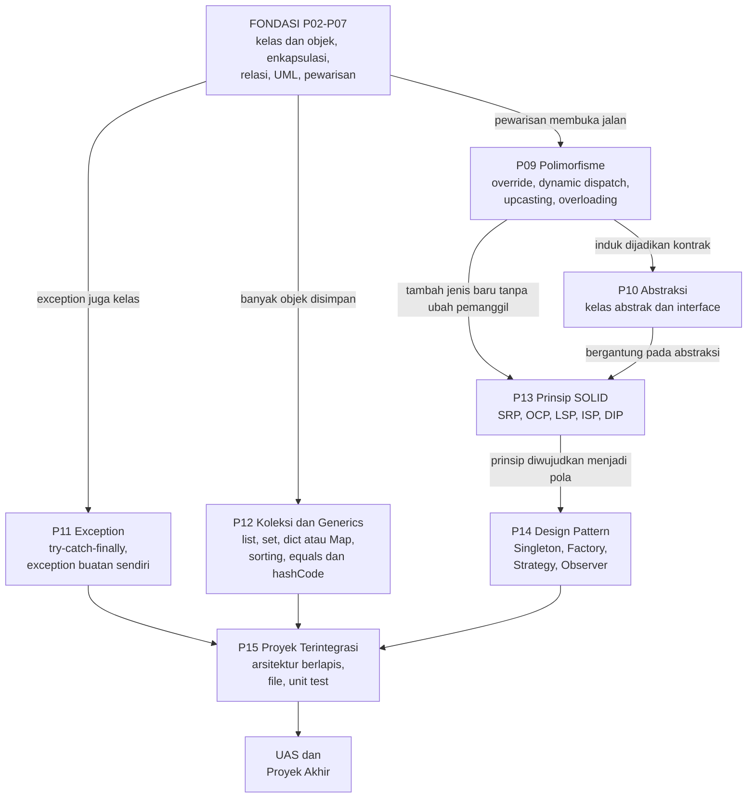

# Pertemuan 16: UAS (Ujian Akhir Semester)

[⬅️ Pertemuan 15](../Pertemuan-15-Proyek-Terintegrasi/README.md) · [🏠 Beranda](../README.md) · [Selesai ➡️](../README.md)

> Kita sampai di garis akhir semester. Halaman ini membantumu bersiap menghadapi UAS dan presentasi proyek akhir: apa saja cakupannya, ringkasan padat materi Pertemuan 09—15, latihan soal lengkap dengan pembahasan, dan panduan presentasi. Di bagian penutup, kita menengok perjalanan satu semester dan jalur belajar berikutnya.

> [!IMPORTANT]
> Repositori ini **publik**. Semua soal di folder ini adalah **latihan persiapan**, bukan soal UAS yang sebenarnya. Bentuk ujian, jumlah soal, bobot, durasi, dan aturan (buku terbuka atau tertutup, boleh memakai laptop/internet/AI atau tidak) **mengikuti pengumuman dosen**.

## 🎯 Tujuan Pembelajaran

Setelah mempelajari halaman ini dan mengerjakan latihannya, kamu mampu:

1. Memetakan materi Pertemuan 09—15 beserta hubungannya dengan fondasi Pertemuan 02—07.
2. Memprediksi *output* kode yang memakai polimorfisme, kelas abstrak, *exception*, dan koleksi, baik di Python maupun Java.
3. Menganalisis sebuah desain dengan prinsip SOLID lalu memilih *design pattern* yang tepat.
4. Merancang dan membuat program PBO lengkap: kelas abstrak, polimorfisme, *exception* buatan sendiri, dan koleksi.
5. Melakukan *refactoring* pada kode yang berantakan tanpa mengubah perilakunya, lalu membuktikannya.
6. Mempresentasikan proyek akhir secara runtut dan menjawab pertanyaan penguji dengan yakin.

## 🧭 Peta Belajar

| Langkah | Bagian | Perkiraan waktu |
|---|---|---|
| 1 | Ringkasan, kisi-kisi, dan strategi (halaman ini, bagian 1—7) | 60 menit |
| 2 | [Latihan Soal](latihan-soal.md) Bagian A dan B (simulasi tanpa membuka catatan) | 90 menit |
| 3 | [Latihan Soal](latihan-soal.md) Bagian C (praktik di komputer) | 150 menit |
| 4 | [Pembahasan](pembahasan.md) | 60 menit |
| 5 | Solusi kode: [🐍 Python](python/README.md) **atau** [☕ Java](java/README.md) | 45 menit |
| 6 | [Presentasi Proyek Akhir](#8-presentasi-proyek-akhir) dan [Refleksi](#9-refleksi-dan-langkah-selanjutnya) | sesuai kebutuhan |

🖼️ ***Slide* pertemuan ini:** [baca PDF](../Slide/PBO2026-P16-UAS.pdf) · [unduh PowerPoint](../Slide/PBO2026-P16-UAS.pptx)

## 🔁 Mengingat Kembali

- Di [Pertemuan 08 (UTS)](../Pertemuan-08-UTS/README.md), fondasi PBO sudah diuji: kelas, objek, enkapsulasi, relasi, UML, dan pewarisan. Fondasi itu tetap dipakai di setiap soal UAS.
- Di [Pertemuan 15](../Pertemuan-15-Proyek-Terintegrasi/README.md), semua konsep digabung menjadi aplikasi kasir KedaiKita yang utuh: berlapis, menyimpan data ke *file*, dan punya *unit test*.
- UAS menguji apakah kamu bisa memakai konsep-konsep itu **bersama-sama**, bukan satu per satu.

## Daftar Isi

1. [Informasi UAS](#1-informasi-uas)
2. [Kisi-Kisi](#2-kisi-kisi)
3. [Peta Konsep](#3-peta-konsep)
4. [Ringkasan Super Padat P09—P15](#4-ringkasan-super-padat-p09p15)
5. [Tabel Sintaks Python vs Java](#5-tabel-sintaks-python-vs-java)
6. [Strategi Belajar dan *Checklist* Kesiapan](#6-strategi-belajar-dan-checklist-kesiapan)
7. [*Tips* Mengerjakan Soal](#7-tips-mengerjakan-soal)
8. [Presentasi Proyek Akhir](#8-presentasi-proyek-akhir)
9. [Refleksi dan Langkah Selanjutnya](#9-refleksi-dan-langkah-selanjutnya)

---

## 1. Informasi UAS

**Cakupan utama:** Pertemuan 09—15.

| Pertemuan | Topik |
|---|---|
| 09 | Polimorfisme |
| 10 | *Abstract Class* dan *Interface* |
| 11 | *Exception Handling* |
| 12 | Koleksi dan *Generics* |
| 13 | Prinsip SOLID |
| 14 | *Design Pattern* Dasar |
| 15 | Proyek Terintegrasi (arsitektur berlapis, *file*, *unit test*) |

**Fondasi yang tetap dipakai:** Pertemuan 02—07 (kelas dan objek, atribut dan *method*, enkapsulasi, relasi antarkelas, UML, pewarisan). Soal UAS jarang menanyakan fondasi secara langsung, tetapi hampir semua soal **membutuhkannya**. Misalnya, kamu tidak bisa menjawab soal polimorfisme kalau belum paham *override*.

**Bentuk ujian yang umum dipakai** (format resminya mengikuti pengumuman dosen):

| Bentuk | Yang biasanya diuji |
|---|---|
| Teori: pilihan ganda | Konsep dan membaca kode (menebak *output*, mencari letak kesalahan) |
| Teori: esai / analisis desain | Menjelaskan konsep, membandingkan, menganalisis kode dengan SOLID, memilih *design pattern* |
| Praktik | Membuat program PBO dari deskripsi kebutuhan, atau melakukan *refactoring* pada kode yang sudah ada |

Di Pertemuan 16 juga ada **presentasi proyek akhir**: demo aplikasi, penjelasan desain, dan tanya jawab (lihat [bagian 8](#8-presentasi-proyek-akhir)). Dalam skema penilaian yang disarankan di [Rencana Pembelajaran](../RENCANA-PEMBELAJARAN.md), proyek akhir adalah komponen tersendiri, terpisah dari UAS. Bobot yang berlaku tetap mengikuti ketentuan dosen.

> [!NOTE]
> Sepanjang semester, kuis selalu menampilkan kode dalam **dua bahasa**. Latihan soal di folder ini mengikuti kebiasaan itu. Untuk soal praktik, gunakan jalur yang kamu pilih (Python **atau** Java), kecuali dosen menentukan lain.

## 2. Kisi-Kisi

Kisi-kisi adalah "peta" kemampuan yang diuji. Kolom terakhir menunjukkan nomor soal di [Latihan Soal](latihan-soal.md) yang melatih kemampuan tersebut.

Level kognitif: **C2** memahami · **C3** menerapkan · **C4** menganalisis · **C5** mengevaluasi · **C6** mencipta.

| No | Kompetensi / indikator | Pertemuan | Level | Bentuk soal | Latihan |
|---|---|---|---|---|---|
| 1 | Memprediksi hasil pemanggilan *method* yang di-*override* lewat variabel/*list* bertipe induk, termasuk pemanggilan `super` | 09 | C3 | PG membaca kode | A1 |
| 2 | Membedakan *overloading* dan *overriding* serta dukungannya di Python dan Java | 09 | C2 | PG | A2 |
| 3 | Menjelaskan aturan kelas abstrak (tidak bisa dibuat objeknya, boleh punya konstruktor dan *method* konkret) dan perbedaan waktu *error* di Python vs Java | 10 | C2 | PG membaca kode | A3 |
| 4 | Memilih kelas abstrak atau *interface* sesuai kebutuhan desain | 10 | C4 | PG, esai | A4, B2 |
| 5 | Menelusuri alur `try/except/else/finally` dan `try/catch/finally` | 11 | C3 | PG membaca kode | A5 |
| 6 | Menerapkan urutan penanganan *exception* (spesifik dulu, umum belakangan) | 11 | C3 | PG, praktik | A6, C1 |
| 7 | Membedakan *checked* dan *unchecked exception* (Java) serta merancang *exception* buatan sendiri | 11 | C2, C4 | PG, esai, praktik | A7, B3, C1 |
| 8 | Mengurutkan objek dengan beberapa kriteria (`key` / `Comparator`) | 12 | C3 | PG membaca kode, praktik | A8, C1 |
| 9 | Memprediksi isi koleksi berdasarkan aturan kesamaan objek (`__eq__`/`__hash__`, `equals`/`hashCode`) | 12 | C3 | PG membaca kode | A9 |
| 10 | Memilih koleksi yang tepat (*list*/set/dict, `List`/`Set`/`Map`) termasuk jaminan urutannya | 12 | C3 | PG, praktik | A10, C1 |
| 11 | Mengidentifikasi pelanggaran prinsip SOLID pada kode dan mengusulkan perbaikan | 13 | C4, C5 | PG, esai | A11, A12, B4 |
| 12 | Menjelaskan cara kerja dan memilih *design pattern* (*Singleton*, *Factory*, *Strategy*, *Observer*) untuk sebuah masalah | 14 | C3—C5 | PG, esai | A13, A14, B5 |
| 13 | Menempatkan aturan bisnis pada lapisan yang tepat dalam arsitektur berlapis | 15 | C4 | PG | A15 |
| 14 | Menjelaskan empat pilar PBO serta perbedaan *has-a* dan *is-a* dengan contoh nyata | 04—10 | C2, C4 | Esai | B1 |
| 15 | Merancang dan membuat program PBO lengkap: kelas abstrak, polimorfisme, *exception* buatan sendiri, koleksi | 02—12 | C6 | Praktik | C1 |
| 16 | Melakukan *refactoring* pada *god class* dengan SOLID dan *design pattern* tanpa mengubah perilaku | 13—14 | C5, C6 | Praktik | C2 |

## 3. Peta Konsep

Materi PBO saling menopang seperti lantai-lantai gedung. Panah berarti "menjadi dasar bagi".

Cara membaca peta ini untuk belajar: kalau kamu kesulitan di satu kotak, mundurlah ke kotak yang menunjuk ke sana. Misalnya, bingung dengan *Strategy* (P14)? Ulangi OCP (P13) dan polimorfisme (P09) dulu.

## 4. Ringkasan Super Padat P09—P15

Bagian ini sengaja padat. Gunakan sebagai daftar periksa: setiap butir yang belum bisa kamu jelaskan dengan kata-katamu sendiri adalah tanda untuk membuka lagi materi pertemuan tersebut.

### Fondasi P02—P07 (selalu dipakai)

- **Kelas** adalah cetak biru, **objek** adalah wujud nyatanya. Konstruktor mengisi data awal; `self`/`this` berarti "objek ini".
- **Enkapsulasi**: atribut disembunyikan (`_harga` + `@property` di Python, `private` + *getter*/*setter* di Java), perubahan lewat *method* yang **menjaga aturan** (validasi).
- **Relasi**: asosiasi (mengenal), agregasi (punya, bagian bisa hidup sendiri), komposisi (punya, bagian ikut "mati"), dependensi (memakai sementara).
- **Diagram kelas UML**: `+ - #` untuk visibilitas, segitiga kosong untuk pewarisan, belah ketupat kosong untuk agregasi, belah ketupat penuh untuk komposisi.
- **Pewarisan** (*is-a*): kelas anak mewarisi atribut dan *method* induk, boleh menambah dan meng-*override*. Jika hubungannya *has-a*, pakai komposisi.

### P09: Polimorfisme

- Polimorfisme = **satu panggilan, banyak bentuk**. *Method* yang sama dipanggil, perilakunya mengikuti **objek sebenarnya**.
- **Polimorfisme waktu berjalan**: *override* + *dynamic dispatch*. Variabel bertipe induk boleh menunjuk objek anak (*upcasting* otomatis).
- *Method* induk yang memanggil *method* yang di-*override* juga ikut polimorfik: `self.suara()`/`suara()` di dalam induk menjalankan versi milik anak.
- Java: *downcasting* harus eksplisit `(TiketVIP) t` dan aman jika dicek dulu dengan `instanceof` (sejak Java 16 bisa sekaligus: `if (t instanceof TiketVIP v)`). Salah *cast* menghasilkan `ClassCastException`. Python cukup `isinstance()` tanpa *cast*.
- Python punya ***duck typing***: objek cukup punya *method* yang dipanggil, tidak harus satu keluarga.
- Java punya ***overloading*** (nama sama, parameter berbeda, dipilih saat kompilasi). Python **tidak**: `def` kedua dengan nama sama menimpa yang pertama. Penggantinya nilai bawaan atau `*args`.
- Aturan *override* di Java: nama dan daftar parameter sama, hak akses tidak boleh dipersempit, dan selalu tulis `@Override`.
- **Di KedaiKita:** `Pesanan.bayar(pembayaran)` bekerja untuk Tunai, QRIS, dan Kartu tanpa `if` jenis pembayaran.

### P10: *Abstract Class* dan *Interface*

- **Abstraksi**: menonjolkan yang penting, menyembunyikan detail (seperti menyetir mobil tanpa tahu isi mesin).
- **Kelas abstrak** tidak bisa dibuat objeknya. Ia boleh punya atribut, konstruktor, *method* konkret, dan ***method* abstrak** yang wajib diisi kelas anak.
- Python: `ABC` + `@abstractmethod`, *error* `TypeError` muncul **saat membuat objek** (program sudah berjalan). Java: `abstract class`, *error* muncul **saat kompilasi**.
- ***Interface*** adalah kontrak kemampuan ("bisa apa"). Java: `interface` + `implements`, satu kelas boleh mengimplementasikan banyak *interface*, ada `default` *method* (sejak Java 8).
- Python tidak punya kata kunci `interface`: pakai ABC yang hanya berisi *method* abstrak (nominal, harus mewarisi) atau `typing.Protocol` (struktural, seperti *duck typing* yang diresmikan).
- Pilih **kelas abstrak** untuk hubungan *is-a* yang berbagi kode. Pilih ***interface*** untuk kemampuan yang bisa dimiliki kelas-kelas yang tidak berkerabat.
- *Method* konkret yang memanggil *method* abstrak adalah bentuk sederhana pola *Template Method*.
- **Di KedaiKita:** `Pembayaran` menjadi kelas abstrak; `DapatDicetak` menjadi kontrak `cetak()`.

### P11: *Exception Handling*

- Tiga jenis kesalahan: sintaks/kompilasi, *runtime* (*exception*), dan logika (program jalan, hasil salah).
- Python `try/except/else/finally`; Java `try/catch/finally` (tanpa `else`). Blok `finally` **selalu** dijalankan, bahkan ketika blok `try` atau `except`/`catch` sudah menjalankan `return`: nilai kembaliannya baru diserahkan setelah `finally` selesai (dilatih di Soal A5).
- Urutan `except`/`catch`: **spesifik dulu, umum belakangan**. Di Java, urutan terbalik adalah *error* kompilasi. Di Python, urutan terbalik diam-diam membuat blok spesifik tidak pernah dijalankan.
- Menangkap beberapa jenis sekaligus: `except (A, B) as e` / `catch (A | B e)`. Melempar: `raise` / `throw`. Merantai (*exception chaining*): `raise X(...) from e` / `throw new X(pesan, e)`.
- Hierarki: Python `BaseException` → `Exception`; Java `Throwable` → `Error` / `Exception` → `RuntimeException`.
- ***Checked* vs *unchecked*** hanya ada di Java. *Checked* (turunan `Exception` yang bukan turunan `RuntimeException`) wajib ditangkap atau dideklarasikan dengan `throws`.
- *Exception* buatan sendiri dibuat lewat pewarisan dan boleh membawa data tambahan (misalnya `tersedia`).
- Praktik baik: jangan menelan *error* diam-diam, tangkap di tempat yang bisa menanganinya, validasi sedini mungkin.
- **Di KedaiKita:** `KedaiError`/`KedaiException` dan turunannya; `cari_menu()` melempar alih-alih mengembalikan `None`.

### P12: Koleksi dan *Generics*

- Python `list`/`tuple`/`set`/`dict`; Java `List`/`Set`/`Map` dengan implementasi `ArrayList`, `HashSet`/`TreeSet`, `HashMap`/`LinkedHashMap`/`TreeMap`.
- Tulis tipe sebagai *interface*: `List<Menu> daftar = new ArrayList<>();`.
- **Urutan:** `HashSet`/`HashMap` tidak menjamin urutan. `LinkedHashMap` menjaga urutan masuk, `TreeMap` mengurutkan kunci. Python `dict` menjaga urutan masuk, `set` tidak.
- *Generics* Java memberi keamanan tipe (`List<Tiket>`, kelas generik `Pasangan<A, B>`). Jebakan: `Integer == Integer` bisa bernilai salah untuk angka di luar -128 sampai 127, jadi bandingkan dengan `.equals()`.
- Python *type hint* (`list[Menu]`, `TypeVar`/`Generic`) hanya untuk pembaca dan alat bantu, tidak diperiksa saat program berjalan.
- Mengurutkan: `sorted(xs, key=lambda m: (-m.harga, m.nama))` vs `Comparator.comparing(...).reversed().thenComparing(...)`. Urutan alami: `__lt__` vs `Comparable.compareTo`.
- Kesamaan objek di set/dict: `__eq__` **dan** `__hash__` (Python), `equals` **dan** `hashCode` (Java). Keduanya harus berpasangan.
- **Di KedaiKita:** `Kedai` menyimpan menu di dict/Map (kode → Menu) dan `LaporanPenjualan` mengurutkan menu terlaris.

### P13: Prinsip SOLID

- Tanda desain bermasalah (*code smell*): *god class*, rantai `if-elif` panjang, duplikasi, kode kaku.
- **SRP**: satu kelas, satu alasan untuk berubah.
- **OCP**: terbuka untuk ditambah, tertutup untuk diubah. Fitur baru = kelas baru, bukan mengedit kelas lama.
- **LSP**: objek kelas anak harus bisa menggantikan induknya tanpa mengejutkan pemanggil.
- **ISP**: *interface* kecil dan fokus, jangan memaksa kelas mengisi *method* yang tidak dibutuhkannya.
- **DIP**: bergantung pada abstraksi; objek pendukung "disuntikkan" lewat konstruktor (*dependency injection*).
- ***Refactoring*** = mengubah struktur tanpa mengubah perilaku. Buktikan bahwa *output* sebelum dan sesudah sama persis dengan `diff` (macOS/Linux) atau `fc` (Windows).
- Prinsip pendamping: DRY, KISS, YAGNI. SOLID bukan aturan mati; jangan berlebihan untuk program kecil.
- **Di KedaiKita:** `KasirSerbaBisa` dipecah menjadi `Diskon`, `StrukPesanan`, dan `PenyimpananPesanan`.

### P14: *Design Pattern* Dasar

- *Design pattern* = solusi teruji untuk masalah desain yang berulang. Buku GoF (1994) memuat 23 pola dalam tiga kategori: *creational*, *structural*, *behavioral*. Pola bukan kode jadi.
- ***Singleton***: hanya satu objek (`get_instance()` / konstruktor `private` + `getInstance()`). Kekurangannya: *state* global dan sulit diuji.
- ***Factory***: membuat objek dari pilihan (misalnya teks `"tunai"`) tanpa pemanggil tahu kelas konkretnya.
- ***Strategy***: algoritma yang bisa ditukar saat program berjalan. Erat dengan OCP.
- ***Observer***: subjek memberi tahu banyak pengamat setiap kali berubah. Pengamat bisa ditambah tanpa mengubah subjek.
- Pola lain untuk wawasan: *Adapter*, *Decorator*, *Builder*, *Template Method*, *Iterator*.
- **Di KedaiKita:** `PengaturanKedai` (*Singleton*), `PembayaranFactory` (*Factory*), kelas-kelas `Diskon` (*Strategy*), `LayarDapur` dan `NotifikasiPelanggan` (*Observer*).

### P15: Proyek Terintegrasi

- Alur kerja: kebutuhan → rancangan UML → implementasi → pengujian.
- **Arsitektur berlapis**: tampilan (CLI, yaitu menu teks di terminal), layanan, model, penyimpanan. Lapisan atas boleh memakai lapisan di bawahnya, tetapi tidak sebaliknya. Karena itu, lapisan tampilan bisa diganti tanpa membongkar lapisan lain.
- Paket dan modul: Python folder + `__init__.py` dan impor absolut `from kedaikita.menu import Menu`; Java `package kedaikita;` dan kompilasi `javac -d out ...`.
- *File*: CSV dengan pemisah titik koma, selalu UTF-8. Python `with open(...)` + modul `csv`; Java `Files`/`Path` dan *try-with-resources*.
- Masukan pengguna ditangani dengan aman: validasi, ulangi pertanyaan, tangani akhir *input* (EOF).
- ***Unit test***: kode kecil yang memeriksa kode lain secara otomatis (`unittest` dengan `assertEqual`/`assertRaises`; Java: *runner* mini `UjiKedaiKita`, atau JUnit di industri). Kasus uji yang baik mencakup kasus normal, gagal, dan batas.
- **Di KedaiKita:** `RepositoriMenuCSV`, `PencatatTransaksiCSV` (*Observer* yang menulis *file*), `LayananKasir`, `AplikasiKasir`.

### Jebakan Favorit Soal Ujian

| Jebakan | Yang benar |
|---|---|
| "Tipe variabelnya induk, jadi yang jalan *method* induk" | Yang jalan versi milik **objek sebenarnya** (*dynamic dispatch*) |
| "Python bisa *overloading*" | Tidak. `def` kedua dengan nama sama **menimpa** yang pertama |
| "Kelas abstrak tidak boleh punya konstruktor" | Boleh, dan dipanggil lewat `super()` dari kelas anak |
| "`finally` tidak jalan kalau sudah `return`" | `finally` **tetap** jalan |
| "*Checked exception* ada di Python" | Konsep *checked*/*unchecked* hanya ada di Java |
| "`HashMap` mencetak sesuai urutan masuk" | Tidak dijamin. Pakai `LinkedHashMap` atau `TreeMap` |
| "Cukup *override* `equals` saja" | `equals` dan `hashCode` (atau `__eq__` dan `__hash__`) harus berpasangan |
| "Semua prinsip SOLID pasti dilanggar oleh kode jelek" | Sebutkan yang **benar-benar** terlihat, beserta buktinya di kode |
| "*Singleton* selalu desain yang baik" | *Singleton* membuat *state* global; pakai seperlunya |

> [!TIP]
> **Coba sendiri:** tanpa membuka catatan, jelaskan dalam satu kalimat masing-masing: (1) beda kelas abstrak dan *interface*, (2) beda *checked* dan *unchecked exception*, (3) beda *Strategy* dan *Observer*.

Lihat contoh jawaban

1. Kelas abstrak adalah induk bersama untuk kelas-kelas yang berkerabat (*is-a*) dan boleh berbagi kode; *interface* adalah kontrak kemampuan yang bisa dimiliki kelas mana pun, bahkan yang tidak berkerabat.
2. *Checked exception* wajib ditangkap atau dideklarasikan dengan `throws` (diperiksa *compiler* Java); *unchecked* (turunan `RuntimeException`) tidak wajib.
3. *Strategy* menukar **cara menghitung/mengerjakan** sesuatu; *Observer* **memberi tahu** banyak pihak ketika sesuatu berubah.

## 5. Tabel Sintaks Python vs Java

Tabel ini merangkum sintaks yang paling sering muncul di P09—P15. Konsepnya sama; yang berbeda hanya cara menulisnya.

| Konsep | Python | Java |
|---|---|---|
| Meng-*override* *method* | tulis ulang `def jenis(self):` di kelas anak | `@Override public String jenis() { ... }` |
| Memanggil versi induk | `super().perkenalan()` | `super.perkenalan()` |
| Cek jenis objek | `isinstance(t, TiketVIP)` | `t instanceof TiketVIP` |
| *Downcasting* | tidak perlu | `TiketVIP v = (TiketVIP) t;` |
| *Overloading* | tidak ada; pakai nilai bawaan `def f(a, b=1)` | `int f(int a)` dan `int f(int a, int b)` |
| Kelas abstrak | `class Tiket(ABC):` + `@abstractmethod` | `abstract class Tiket` + `abstract int hitungHarga();` |
| *Interface* | ABC berisi *method* abstrak saja, atau `typing.Protocol` | `interface Promo { int hitungPotongan(...); }` + `implements` |
| *Method* bawaan di kontrak | *method* biasa di ABC | `default int jumlah() { ... }` |
| Melempar *exception* | `raise ValueError("pesan")` | `throw new IllegalArgumentException("pesan");` |
| Menangkap | `try:` / `except X as e:` / `else:` / `finally:` | `try { } catch (X e) { } finally { }` |
| Beberapa jenis sekaligus | `except (A, B) as e:` | `catch (A \| B e)` |
| *Exception* buatan sendiri | `class BioskopError(Exception):` | `class BioskopException extends Exception` |
| Deklarasi lemparan | tidak ada | `Tiket pesan(...) throws BioskopException` |
| Merantai *exception* | `raise KedaiError("...") from e` | `throw new KedaiException("...", e);` |
| *List* | `xs = []`, `xs.append(t)` | `List<Tiket> xs = new ArrayList<>();`, `xs.add(t)` |
| Dict / Map | `d[k] = v`, `k in d`, `d.get(k, 0)` | `d.put(k, v)`, `d.containsKey(k)`, `d.getOrDefault(k, 0)` |
| Set | `s = set()`, `s.add(x)` | `Set<String> s = new HashSet<>();`, `s.add(x)` |
| Urut dengan kunci | `sorted(xs, key=lambda j: (-j.pendapatan(), j.judul))` | `xs.sort(Comparator.comparing(Jadwal::pendapatan).reversed().thenComparing(Jadwal::getJudul));` |
| Urutan alami | `def __lt__(self, lain):` | `implements Comparable<Menu>` + `compareTo` |
| Kesamaan objek | `__eq__` + `__hash__` | `equals` + `hashCode` |
| Kelas generik | `class Pasangan(Generic[A, B]):` | `class Pasangan<A, B>` |
| *Singleton* | `_instance = None` + `@classmethod get_instance(cls)` | konstruktor `private` + `static getInstance()` |
| Membaca *file* | `with open(path, encoding="utf-8") as f:` | `Files.readAllLines(path, StandardCharsets.UTF_8)` |
| Paket / impor | `from kedaikita.menu import Menu` | `package kedaikita;` + `import kedaikita.Menu;` |
| *Unit test* | `self.assertEqual(hasil, harapan)`, `with self.assertRaises(X):` | *runner* mini P15: *method* `ujiXxx()` yang mengembalikan `true` jika lulus; di industri: JUnit `assertEquals(harapan, hasil)` |

> [!NOTE]
> Tabel lengkap untuk seluruh semester ada di [*Cheat Sheet* Python ↔ Java](../Lampiran/cheatsheet-python-java.md), dan istilah-istilahnya di [Glosarium](../Lampiran/glosarium.md).

## 6. Strategi Belajar dan *Checklist* Kesiapan

### Rencana tujuh hari

Tenang, kamu tidak perlu belajar semuanya dalam satu malam. Bagi menjadi potongan kecil seperti ini:

| Hari | Fokus | Kegiatan |
|---|---|---|
| H-7 | P09—P10 | Baca ringkasan, jalankan ulang studi kasus KedaiKita P09 dan P10, tebak *output* sebelum menjalankan |
| H-6 | P11 | Salin contoh `try/except` P11 ke folder latihanmu, ubah-ubah, lalu tebak alurnya; buat satu *exception* buatan sendiri |
| H-5 | P12 | Latih `sorted(key=...)` / `Comparator` dengan dua kriteria; pahami kapan memakai dict/Map |
| H-4 | P13—P14 | Gambar ulang diagram KedaiKita "sebelum" dan "sesudah" *refactor* dari ingatan |
| H-3 | Simulasi teori | Kerjakan [Latihan Soal](latihan-soal.md) Bagian A dan B dengan *timer*, lalu cocokkan |
| H-2 | Simulasi praktik | Kerjakan Bagian C **tanpa** melihat solusi, lalu bandingkan dengan solusinya |
| H-1 | Pemantapan | Ulangi soal yang salah, isi *checklist* di bawah, siapkan proyek akhir, dan **tidur cukup** |

### Teknik belajar yang terbukti membantu

- **Tebak dulu, jalankan kemudian.** Sebelum menjalankan kode, tulis tebakan *output*-mu. Selisih antara tebakan dan hasil nyata adalah bahan belajar paling berharga.
- **Jelaskan ke orang lain.** Ceritakan polimorfisme ke teman (atau ke boneka di meja). Kalau tersendat, di situlah bagian yang belum kamu kuasai.
- **Tulis ulang dari nol.** Tutup solusi, lalu tulis ulang `Pembayaran` dan kelas-kelas anaknya dari ingatan di folder latihanmu sendiri (misalnya `PBO-latihan-saya/uas`).
- **Baca kode bahasa satunya.** Soal membaca kode sering menampilkan Python dan Java. Kamu tidak harus bisa menulis keduanya, tetapi sebaiknya bisa **membaca** keduanya.

### *Checklist* kesiapan

Centang jika kamu bisa melakukannya **tanpa** membuka catatan.

- [ ] Menjelaskan *dynamic dispatch* dan memprediksi *output list* objek polimorfik.
- [ ] Menjelaskan mengapa Python tidak punya *overloading* dan apa penggantinya.
- [ ] Membuat kelas abstrak dengan *method* abstrak dan *method* konkret, lalu kelas anaknya.
- [ ] Memilih kelas abstrak atau *interface* untuk sebuah kasus, beserta alasannya.
- [ ] Menelusuri `try/except/else/finally` (atau `try/catch/finally`) yang berisi `return`.
- [ ] Membuat hierarki *exception* sendiri yang membawa data tambahan.
- [ ] Menjelaskan *checked* vs *unchecked* (Java) dan arti `throws`.
- [ ] Memilih *list*/set/dict (atau `List`/`Set`/`Map`) dan tahu kapan urutan dijamin.
- [ ] Mengurutkan objek dengan dua kriteria (menurun lalu naik).
- [ ] Menyebut lima prinsip SOLID dan menunjuk pelanggarannya pada kode.
- [ ] Menjelaskan *Singleton*, *Factory*, *Strategy*, *Observer* beserta satu contoh dan satu kekurangan masing-masing.
- [ ] Melakukan *refactoring* lalu membuktikan *output*-nya tetap sama dengan `diff`/`fc`.
- [ ] Menjalankan aplikasi dan *unit test* proyek akhirmu dari folder yang bersih.

## 7. *Tips* Mengerjakan Soal

**Pilihan ganda membaca kode**

1. Baca kode **dua kali**: pertama untuk struktur (kelas apa mewarisi apa), kedua untuk alur.
2. Telusuri dengan tabel kecil di kertas: nama variabel, objek yang ditunjuk, dan nilai atributnya.
3. Waspadai pilihan yang "hampir benar". Biasanya pembedanya ada pada satu baris: `super`, `finally`, urutan `except`, atau kunci pengurutan kedua.

**Esai dan analisis desain**

1. Pakai pola **definisi → contoh → alasan**. Satu contoh kode kecil sering lebih meyakinkan daripada satu paragraf panjang.
2. Saat menganalisis SOLID, tunjuk **bukti** di kode ("*method* `cetak_laporan` punya `if format == ...`, jadi menambah format baru berarti mengubah *method* ini: melanggar OCP").
3. Jika diminta memilih pola, sebutkan juga **kekurangannya**. Itu tanda kamu benar-benar paham.

**Praktik**

1. **Rancang dulu** 5—10 menit: daftar kelas, atribut, *method*, dan relasinya. Gambar diagram kasar.
2. Tulis kode **bertahap**: kelas data dulu, lalu aturan, lalu program utama. Jalankan setiap selesai satu tahap.
3. Baca pesan *error* dari **bawah ke atas** (Python) atau dari **baris pertama** (Java), lalu perbaiki satu per satu.
4. Simpan pekerjaanmu secara berkala. Sisakan 10 menit terakhir untuk merapikan nama dan komentar.

## 8. Presentasi Proyek Akhir

Presentasi bukan sekadar "pamer aplikasi". Penguji ingin melihat tiga hal: **aplikasinya berjalan**, **desainnya masuk akal**, dan **kamu memahami kodemu sendiri**. Kebutuhan minimum, jadwal, dan rubrik proyek ada di dokumen [Spesifikasi Proyek Akhir](../Pertemuan-15-Proyek-Terintegrasi/proyek-akhir.md) (Pertemuan 15). Bagian ini membantumu menyiapkan penampilannya.

> [!NOTE]
> Durasi, urutan, dan bobot presentasi yang pasti mengikuti ketentuan proyek akhir dan pengumuman dosen. Alur di bawah adalah saran untuk slot 10—15 menit.

### 8.1 Alur Demo 10—15 Menit

| Menit | Bagian | Yang ditunjukkan | *Tips* |
|---|---|---|---|
| 0—1 | Pembukaan | Nama, tema, dan masalah yang diselesaikan aplikasimu (satu kalimat) | "Aplikasi ini membantu *laundry* kos mencatat cucian dan promo." |
| 1—3 | Rancangan | Diagram kelas UML: hierarki pewarisan, kelas abstrak/*interface*, relasi | Tunjuk dengan kursor; jangan membaca semua atribut |
| 3—8 | Demo aplikasi | Alur utama dari awal sampai akhir, lalu 1—2 skenario gagal yang ditangani dengan rapi | Siapkan data contoh; tunjukkan data tersimpan, tutup aplikasi, buka lagi |
| 8—11 | Tur kode | Bagian kode yang memenuhi tiap kebutuhan minimum (lihat tabel 8.2) | Siapkan "daftar lompat": nama *file* dan baris yang akan dibuka |
| 11—13 | *Unit test* | Jalankan semua *test* (minimal 5) di depan penguji | Jelaskan satu *test*: apa yang diuji dan mengapa penting |
| 13—15 | Refleksi | Kesulitan terbesar, keputusan desain, rencana pengembangan, dan bantuan yang dipakai | Jujur dan spesifik lebih dihargai daripada "semuanya lancar" |

### 8.2 Peta Kebutuhan Minimum ke Bukti

Daftar lengkap kebutuhan minimum ada di [Spesifikasi Proyek Akhir](../Pertemuan-15-Proyek-Terintegrasi/proyek-akhir.md) bagian 3. Tabel itulah yang kamu salin ke README proyekmu sebagai "peta kebutuhan". Tabel di bawah menambahkan kolom **yang ditunjukkan saat presentasi**. Dengan peta seperti ini, penguji sangat terbantu, dan kamu pun tidak panik mencari kode saat ditanya.

| Kebutuhan minimum | Yang ditunjukkan saat presentasi | Contoh di KedaiKita |
|---|---|---|
| Minimal 6 kelas buatan sendiri (di luar kelas *exception* dan kelas pengujian) | Diagram kelas dan daftar *file* | `Menu`, `Pesanan`, `Pembayaran`, `Kedai`, dan lainnya |
| Enkapsulasi | Atribut tidak publik, validasi di konstruktor/*setter*, koleksi dikembalikan sebagai salinan | Harga menu harus lebih dari 0 |
| Minimal 1 hierarki pewarisan | Kelas induk dengan minimal 2 kelas anak yang meng-*override* *method* | `Menu` → `Makanan`, `Minuman` |
| Polimorfisme | Satu panggilan yang bekerja untuk banyak jenis | `pesanan.bayar(pembayaran)` |
| Minimal 1 kelas abstrak/*interface* | Kontrak yang diisi minimal 2 kelas | `Pembayaran`, `Diskon`, `PengamatPesanan` |
| *Exception* buatan sendiri | Kelas *exception*, tempat ia dilempar (di model), dan tempat ia ditangkap dengan pesan ramah | `StokTidakCukupError` membawa data `tersedia` |
| Koleksi | Pilihan *list*/dict/set dan alasannya | Dict kode → Menu |
| Simpan dan muat *file* | Data tetap ada setelah aplikasi ditutup; *file* rusak ditangani | `RepositoriMenuCSV` |
| Minimal 1 *design pattern* | Masalah yang diselesaikan pola itu | *Observer* `PencatatTransaksiCSV` |
| Minimal 5 *unit test* | *Test* dijalankan dan lulus; ada kasus normal, gagal, dan batas | `python -m unittest discover -s tests -v`, atau skrip `uji.sh`/`uji.bat` di versi Java |
| Diagram kelas UML | Diagram sesuai kode **terbaru** | Mermaid di README |
| README cara menjalankan | Perintah yang benar-benar berhasil dari folder hasil *clone* yang bersih | Bagian "Cara menjalankan" |

### 8.3 Pertanyaan yang Sering Diajukan Penguji

| Pertanyaan | Yang sebenarnya ingin diketahui | *Tips* menjawab |
|---|---|---|
| "Tunjukkan enkapsulasi di kodemu. Mengapa atribut ini tidak dibuat publik?" | Paham fungsi enkapsulasi, bukan sekadar menulis `_` atau `private` | Tunjuk aturan yang dijaga: "harga negatif ditolak di sini" |
| "Kalau saya menambah jenis X baru, kelas mana yang berubah?" | OCP dan polimorfisme | Idealnya: "cukup membuat kelas baru; pemanggil tidak berubah" |
| "Mengapa memakai kelas abstrak, bukan *interface* (atau sebaliknya)?" | Kemampuan memilih abstraksi | Pakai alasan *is-a* + kode bersama vs kemampuan lintas keluarga |
| "*Exception* apa yang kamu buat sendiri? Mengapa tidak pakai `ValueError`/`Exception` saja?" | Paham manfaat *exception* khusus | Bisa ditangkap secara spesifik dan membawa data tambahan |
| "(Java) *Exception*-mu *checked* atau *unchecked*? Mengapa?" | Paham konsekuensi `throws` | Sebutkan keuntungan dan konsekuensinya bagi pemanggil |
| "Mengapa dict/Map di sini, bukan *list*?" | Pemilihan koleksi | Pencarian berdasarkan kunci, kunci unik, urutan yang dibutuhkan |
| "Pola desain apa yang kamu pakai? Apa kekurangannya?" | Paham pola, bukan hanya menyebut nama | Jelaskan masalahnya dulu, baru polanya, lalu kekurangannya |
| "Bagaimana data disimpan? Apa yang terjadi jika *file*-nya rusak atau tidak ada?" | Ketahanan program | Tunjukkan validasi dan *exception* format data |
| "Jalankan *unit test*-nya. Mengapa memilih kasus uji ini?" | Kebiasaan menguji | Sebutkan kasus normal **dan** kasus gagal yang diuji |
| "Jelaskan baris ini." (penguji menunjuk kode acak) | Keaslian pekerjaan | Kuasai setiap baris; jika lupa, telusuri dengan tenang sambil berpikir keras |
| "Ubah sedikit: tambahkan validasi Y." | Kemampuan memodifikasi kode sendiri | Latih perubahan kecil sebelum hari-H |
| "Bantuan apa saja yang kamu pakai, termasuk AI?" | Integritas akademik | Jawab jujur, sesuai yang tercantum di README proyekmu |

Contoh perbedaan jawaban untuk pertanyaan "Mengapa memakai *Strategy*?":

- **Lemah:** "Karena *Strategy* termasuk *design pattern* yang diajarkan."
- **Kuat:** "Aturan promo *laundry* sering berganti. Dengan *Strategy*, setiap promo adalah kelas sendiri yang mengisi `hitung_potongan()`. Menambah promo baru cukup membuat kelas baru tanpa mengubah `PesananLaundry`. Kekurangannya, jumlah kelas bertambah, jadi untuk aturan yang tidak pernah berubah saya cukup memakai *method* biasa."

> [!IMPORTANT]
> Kamu harus bisa menjelaskan **setiap baris** kode di proyekmu. Cantumkan semua bantuan yang kamu pakai (teman, tutorial, AI) di README sesuai ketentuan [spesifikasi proyek akhir](../Pertemuan-15-Proyek-Terintegrasi/proyek-akhir.md). Bantuan yang dicantumkan dengan jujur dan dipahami dengan baik jauh lebih aman daripada kode "sempurna" yang tidak bisa kamu jelaskan.

### 8.4 *Checklist* Sebelum Presentasi

**Sehari sebelumnya:**

- [ ] *Clone* ulang repositorimu ke folder baru, lalu jalankan aplikasi **hanya** dengan perintah yang tertulis di README.
- [ ] Semua *unit test* lulus (minimal 5).
- [ ] Diagram kelas sesuai dengan kode terbaru (nama kelas dan *method* sama).
- [ ] Data contoh tersedia, dan skenario demo (termasuk skenario gagal) sudah dilatih dengan *timer*.
- [ ] README berisi: deskripsi, fitur, cara menjalankan, cara menjalankan *test*, diagram kelas, peta kebutuhan, struktur folder, dan bantuan yang dipakai.
- [ ] Semua yang dikumpulkan sudah lengkap: kode sumber beserta data awal dan folder pengujian, `RANCANGAN.md`, dan `README.md` (lihat [Spesifikasi Proyek Akhir](../Pertemuan-15-Proyek-Terintegrasi/proyek-akhir.md) bagian 6).
- [ ] Siapkan cadangan: tangkapan layar atau rekaman singkat demo, untuk berjaga-jaga jika laptop bermasalah.
- [ ] *Commit* dan *push* terakhir sudah masuk sebelum batas waktu.

**Tiga puluh menit sebelumnya:**

- [ ] Laptop terisi penuh, dan pengisi daya (*charger*) dibawa.
- [ ] Notifikasi dimatikan; jendela yang tidak perlu ditutup.
- [ ] Ukuran huruf terminal dan editor diperbesar agar terbaca dari belakang ruangan.
- [ ] Terminal sudah terbuka di folder proyek; data demo dikembalikan ke kondisi awal.

> [!TIP]
> Jika demo tiba-tiba *error*, **jangan panik**. Baca pesan *error*-nya dengan suara keras dan jelaskan dugaan penyebabnya. Penguji sering lebih terkesan pada mahasiswa yang bisa membaca *error*-nya sendiri daripada pada demo yang mulus tetapi tidak bisa dijelaskan.

## 9. Refleksi dan Langkah Selanjutnya

### 9.1 Perjalanan Satu Semester

Ingat KedaiKita di Pertemuan 01? Datanya tercerai-berai di tiga *list* dan bisa tertukar saat diurutkan. Lihat sejauh mana ia tumbuh:

| Pertemuan | KedaiKita mendapat... | Konsep yang kamu kuasai |
|---|---|---|
| 01 | Versi prosedural yang rapuh | Mengapa PBO dibutuhkan |
| 02—03 | Kelas `Menu`, `Pelanggan`, `__str__`/`toString` | Kelas, objek, atribut, *method* |
| 04 | Harga tervalidasi, stok lewat *method* resmi | Enkapsulasi |
| 05—06 | `Pesanan`, `ItemPesanan`, `Kedai` + diagram kelas | Relasi dan UML |
| 07 | `Makanan` dan `Minuman` | Pewarisan |
| 09 | Tunai, QRIS, Kartu | Polimorfisme |
| 10 | `Pembayaran` abstrak, kontrak `DapatDicetak` | Abstraksi |
| 11 | `StokTidakCukupError` dan kawan-kawan | *Exception handling* |
| 12 | Dict menu, laporan terlaris | Koleksi dan *generics* |
| 13 | `KasirSerbaBisa` dipecah | SOLID dan *refactoring* |
| 14 | *Singleton*, *Factory*, *Strategy*, *Observer* | *Design pattern* |
| 15 | Aplikasi kasir berlapis, *file* CSV, *unit test* | Rekayasa aplikasi utuh |

Selamat! Kamu sudah berpindah dari "menulis kode yang jalan" menjadi "merancang kode yang mudah dipahami, diuji, dan dikembangkan". Itu lompatan besar.

### 9.2 Pertanyaan Refleksi

Luangkan sepuluh menit untuk menjawab pertanyaan ini secara tertulis. Tidak ada jawaban benar atau salah.

1. Konsep apa yang paling sulit di awal, tetapi sekarang terasa masuk akal? Apa yang membuatnya "klik"?
2. Jika menulis ulang proyek akhirmu dari nol, keputusan desain apa yang akan kamu ubah?
3. Kapan terakhir kali kamu berhasil memperbaiki *bug* dengan membaca pesan *error* sendiri?
4. Jalur Python atau Java yang kamu pilih: apa satu hal yang kamu sukai dari bahasa satunya?

### 9.3 Jalur Belajar Berikutnya

Konsep PBO yang kamu pelajari dipakai di hampir semua jalur di bawah ini. Pilih **satu** yang paling membuatmu penasaran, lalu buat proyek kecil.

| Jalur | Python | Java / JVM | Proyek pertama yang disarankan |
|---|---|---|---|
| Aplikasi desktop (GUI) | Tkinter (biasanya sudah ikut terpasang bersama Python) | JavaFX | Jendela kasir KedaiKita dengan tombol menu |
| Web | Flask (ringan), Django (lengkap, termasuk ORM dan halaman admin) | Spring Boot | Halaman daftar menu dan formulir pesanan |
| Aplikasi seluler (*mobile*) | Ada (misalnya Kivy, BeeWare), tetapi jalur utama Android adalah Kotlin | Kotlin untuk Android (bahasa yang direkomendasikan Google untuk Android; bisa dipakai berdampingan dengan kode Java) | Aplikasi catatan pesanan sederhana |
| Basis data dan ORM | `sqlite3` (bawaan), SQLAlchemy, Django ORM | JDBC, JPA/Hibernate | Ganti `RepositoriMenuCSV` dengan versi SQLite |
| Pengujian | pytest | JUnit | Tulis ulang *test* KedaiKita dengan pytest atau JUnit |
| Kolaborasi Git | *branch*, *pull request*, *code review* di GitHub | sama | Kerjakan fitur proyek dalam *branch*, lalu minta teman me-*review* |
| *Design pattern* lanjutan | *Adapter*, *Decorator*, *Builder*, *Command*, *State*, *Repository*, MVC | sama | Tambahkan *Decorator* untuk "kemasan bungkus" pada pesanan |
| *Open source* | Cari isu berlabel `good first issue` | sama | Mulai dari memperbaiki dokumentasi atau menerjemahkan |

> [!TIP]
> Perhatikan pola yang berulang: memindahkan KedaiKita ke web atau basis data **tidak** mengubah kelas `Menu` dan `Pesanan`. Kamu cukup mengganti lapisan tampilan atau penyimpanan. Itulah hadiah dari arsitektur berlapis dan DIP yang kamu pelajari.

Rujukan bacaan lanjutan dikumpulkan di halaman [Referensi](../Lampiran/referensi.md) (Lampiran). Jika ada pertanyaan yang sering muncul, cek juga [FAQ](../Lampiran/faq.md).

## 📖 Istilah Penting

| Istilah | Arti singkat |
|---|---|
| Polimorfisme | Satu panggilan *method* menghasilkan perilaku berbeda sesuai objek sebenarnya |
| *Dynamic dispatch* | Pemilihan versi *method* yang di-*override* saat program berjalan |
| *Overloading* | Beberapa *method* bernama sama dengan parameter berbeda (Java) |
| Kelas abstrak | Kelas yang tidak bisa dibuat objeknya; boleh berisi *method* abstrak dan konkret |
| *Interface* | Kontrak kemampuan yang harus dipenuhi kelas yang mengimplementasikannya |
| *Checked exception* | *Exception* Java yang wajib ditangkap atau dideklarasikan dengan `throws` |
| Koleksi | Wadah banyak objek: *list*, set, dict/Map |
| *Generics* | Penanda tipe isi wadah, misalnya `List<Tiket>` |
| SOLID | Lima prinsip desain: SRP, OCP, LSP, ISP, DIP |
| *Refactoring* | Mengubah struktur kode tanpa mengubah perilakunya |
| *Dependency injection* | Memberikan objek pendukung dari luar, biasanya lewat konstruktor |
| *Design pattern* | Solusi teruji untuk masalah desain yang berulang |
| Arsitektur berlapis | Pembagian aplikasi menjadi lapisan tampilan, layanan, model, dan penyimpanan |
| *Unit test* | Kode kecil yang memeriksa bagian program lain secara otomatis |

## ➡️ Langkah Berikutnya

- Mulai simulasi: [Latihan Soal](latihan-soal.md), lalu cocokkan di [Pembahasan](pembahasan.md).
- Pelajari solusi praktik di jalurmu: [🐍 Solusi Python](python/README.md) atau [☕ Solusi Java](java/README.md).
- Siapkan presentasi proyek akhir dengan [*checklist*](#8-presentasi-proyek-akhir) di atas.

Terima kasih sudah belajar bersama sepanjang semester. Semoga sukses UAS-nya, dan teruslah membangun sesuatu!

---

[⬅️ Pertemuan 15](../Pertemuan-15-Proyek-Terintegrasi/README.md) · [🏠 Beranda](../README.md) · [Selesai ➡️](../README.md)
