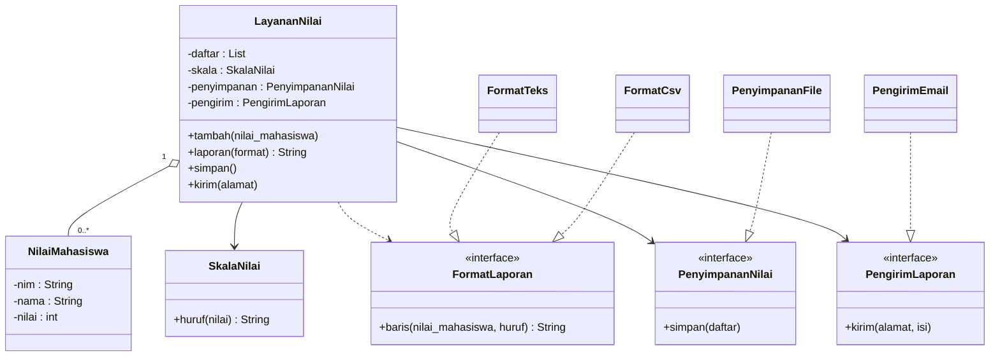
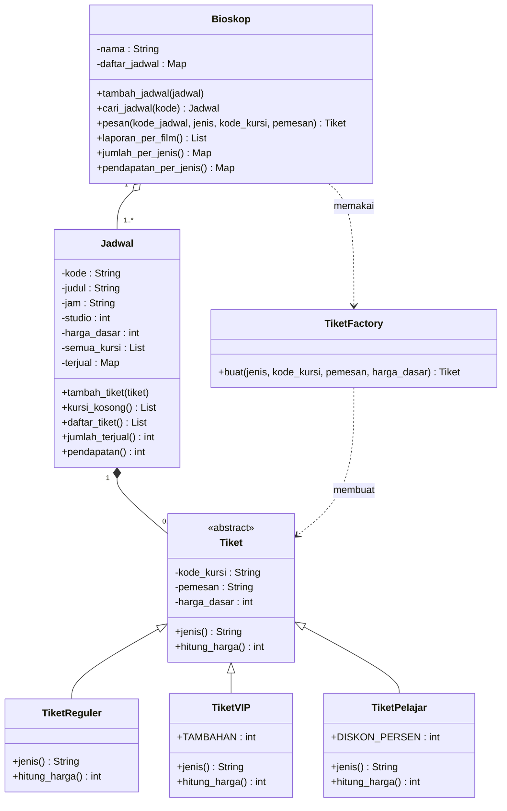
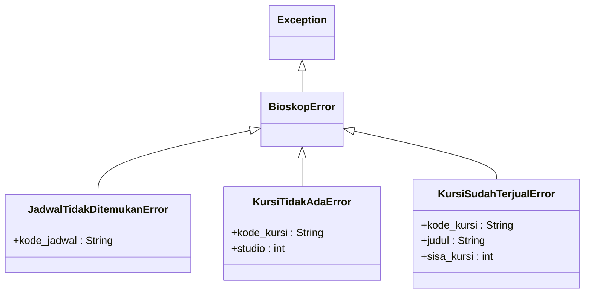
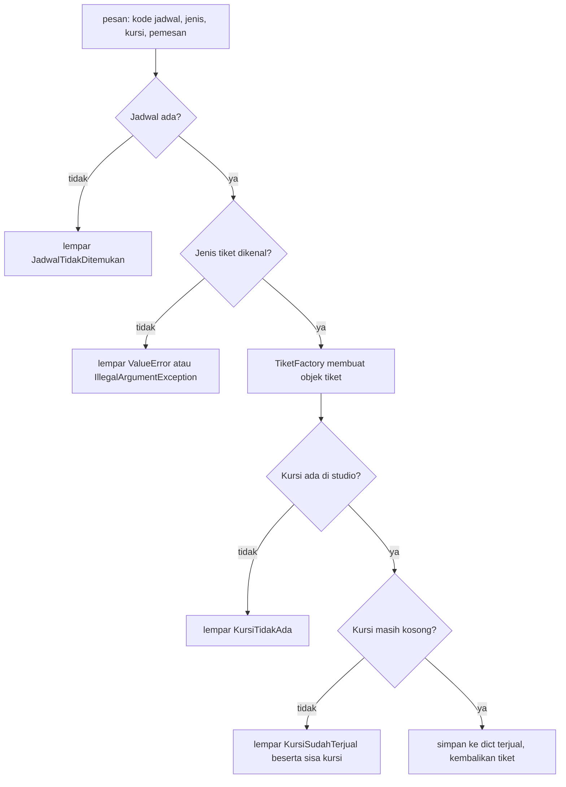
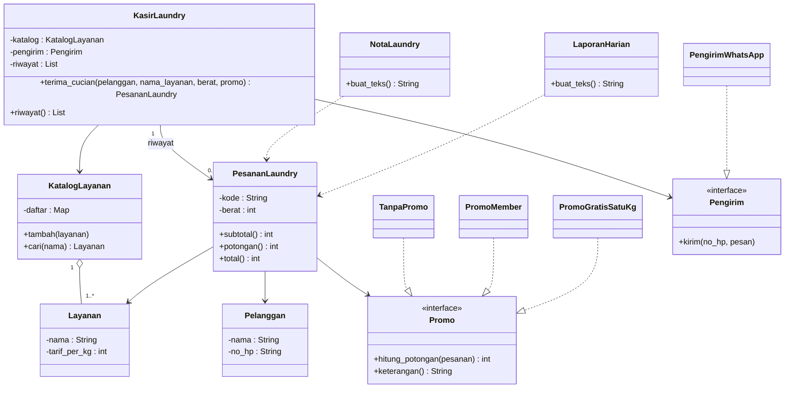

# Pembahasan Latihan Soal UAS

[⬅️ Latihan Soal](latihan-soal.md) · [🐍 Solusi Python](python/README.md) · [☕ Solusi Java](java/README.md) · [🏠 Beranda](../README.md)

Halaman ini berisi kunci jawaban, alasan di balik setiap jawaban, jawaban model esai, dan pembahasan desain soal praktik. Bacalah pembahasan **semua** soal, termasuk yang kamu jawab benar. Kadang jawabanmu benar karena alasan yang keliru, dan itu berbahaya saat soalnya sedikit diubah.

> [!NOTE]
> Semua program di soal membaca kode sudah dijalankan dalam kedua bahasa. Jawaban di sini adalah hasil nyata, bukan tebakan.

## Daftar Isi

- [Kunci Jawaban Cepat](#kunci-jawaban-cepat)
- [Bagian A: Pilihan Ganda](#bagian-a-pilihan-ganda)
- [Bagian B: Esai dan Analisis Desain](#bagian-b-esai-dan-analisis-desain)
- [Bagian C: Soal Praktik](#bagian-c-soal-praktik)
- [Hitung Skormu](#hitung-skormu)

## Kunci Jawaban Cepat

<details>
<summary>Lihat kunci Bagian A</summary>

| Soal | A1 | A2 | A3 | A4 | A5 | A6 | A7 | A8 | A9 | A10 | A11 | A12 | A13 | A14 | A15 |
|---|---|---|---|---|---|---|---|---|---|---|---|---|---|---|---|
| Jawaban | A | C | B | D | B | A | D | C | A | B | C | D | C | A | B |

</details>

---

## Bagian A: Pilihan Ganda

Setiap soal bernilai 2 poin.

### Soal A1

**Jawaban: A** (`Aku bilang meong`, `Aku bilang hmm!`, `Aku bilang hmm`)

Pembahasan: kuncinya adalah *dynamic dispatch*. Pemanggilan `self.suara()` (Python) atau `suara()` (Java) di dalam method milik `Hewan` tetap memilih versi milik **objek sebenarnya**. Telusuri satu per satu:

| Objek | `perkenalan()` yang jalan | `suara()` yang jalan | Hasil |
|---|---|---|---|
| `Kucing` | milik `Hewan` (diwarisi) | milik `Kucing` | `Aku bilang meong` |
| `Anjing` | milik `Anjing`, lalu `super` ke `Hewan` | milik `Hewan` (Anjing tidak meng-*override* `suara`) | `Aku bilang hmm!` |
| `Hewan` | milik `Hewan` | milik `Hewan` | `Aku bilang hmm` |

- **B** adalah miskonsepsi paling umum: mengira method induk selalu memanggil method induk. Padahal `self`/`this` tetap menunjuk objek `Kucing`.
- **C** keliru karena `Anjing` tidak meng-*override* `suara()`, jadi suaranya tetap `hmm`.
- **D** melupakan bahwa `Anjing` meng-*override* `perkenalan()` dan menambahkan `!`.

### Soal A2

**Jawaban: C**

Pembahasan: di Java, *compiler* memilih versi *overload* berdasarkan daftar parameter (jumlah dan tipe argumen) saat kompilasi. Sebaliknya, versi *override* dipilih saat program berjalan berdasarkan kelas objek sebenarnya.

- **A** terbalik. *Overloading* lazimnya terjadi di kelas yang sama; *overriding* justru membutuhkan pewarisan.
- **B** keliru. Python tidak punya *overloading*: `def` kedua dengan nama sama **menimpa** `def` pertama. Penggantinya adalah nilai bawaan (`def hitung(self, jumlah=1)`) atau `*args`.
- **D** keliru. Java menolak *override* yang mempersempit akses. Pesan *compiler*-nya kira-kira `attempting to assign weaker access privileges; was public`.

### Soal A3

**Jawaban: B**

Pembahasan: kedua bahasa sama-sama melarang membuat objek dari kelas abstrak, tetapi **waktunya** berbeda.

- **Python** memeriksa saat baris itu **dijalankan**. Baris (1) berjalan normal dan mencetak `Persegi: 16`. Baris (2) memunculkan `TypeError: Can't instantiate abstract class Bentuk ...`, dan program berhenti.
- **Java** memeriksa saat **kompilasi**. *Compiler* menolak dengan pesan `Bentuk is abstract; cannot be instantiated`, sehingga program tidak pernah berjalan dan tidak ada yang tercetak.

Pilihan lain:

- **A** keliru karena program tidak pernah sampai ke baris (3).
- **C** keliru karena objek `Bentuk` memang tidak bisa dibuat, berapa pun isinya.
- **D** keliru. Kelas abstrak **boleh** punya konstruktor, dan konstruktor itu dipanggil oleh `Persegi` lewat `super().__init__("Persegi")` / `super("Persegi")`. Baris (1) justru berhasil.

### Soal A4

**Jawaban: D**

Pembahasan: kemampuan "bisa diekspor ke CSV" dibutuhkan oleh kelas-kelas yang **tidak berkerabat** (mahasiswa, dosen, ruangan, mata kuliah). Ini kemampuan (*can-do*), bukan hubungan *is-a*, jadi yang tepat adalah *interface*. Di Java, `Mahasiswa` dan `Dosen` sudah mewarisi `Orang`, dan Java hanya mengizinkan **satu** kelas induk, tetapi boleh mengimplementasikan **banyak** *interface*.

- **A** mustahil di Java (sudah mewarisi `Orang`) dan memaksakan hubungan "Ruangan adalah DataKampus" yang tidak alami.
- **B** membuat satu kelas penuh `if isinstance`/`instanceof`. Setiap kelas baru berarti mengubah kelas `Ekspor` (melanggar OCP).
- **C** salah secara makna: ruangan bukan dosen. Pewarisan seperti ini juga melanggar LSP.

### Soal A5

**Jawaban: B** (`ACBC` lalu `-1 2`)

Pembahasan: blok `finally` **selalu** dijalankan, termasuk ketika blok sebelumnya sudah menjalankan `return`. Nilai kembaliannya "ditahan" dulu, `finally` dijalankan, baru nilai itu dikembalikan.

| Panggilan | Yang terjadi | Tercetak | Nilai kembali |
|---|---|---|---|
| `bagi(10, 0)` | pembagian dengan nol → blok `except`/`catch` | `A`, lalu `C` dari `finally` | `-1` |
| `bagi(10, 5)` | tidak ada error → blok `else` (Python) / sisa blok `try` (Java) | `B`, lalu `C` dari `finally` | `2` |

Catatan: Java tidak punya blok `else` pada `try`. Kode yang di Python ditaruh di `else` ditulis di akhir blok `try` pada Java, sehingga perilakunya sama.

- **A** melupakan `finally`.
- **C** mengira `finally` hanya jalan saat terjadi error.
- **D** keliru karena error-nya **ditangkap**, sehingga program berjalan terus.

### Soal A6

**Jawaban: A**

Pembahasan: Python dan Java memeriksa blok `except`/`catch` dari atas ke bawah, lalu menjalankan blok **pertama** yang cocok. Objek `StokTidakCukupError` juga merupakan `KedaiError` (pewarisan), jadi blok induk yang ditulis lebih dulu akan "menyerobot" semuanya. Di Python, blok anak di bawahnya diam-diam tidak pernah jalan. Di Java, *compiler* langsung menolak dengan pesan `exception ... has already been caught`.

- **B** tidak berhubungan dengan kecepatan.
- **C** justru kebalikannya: blok induk **bisa** menangkap *exception* anak. Karena itulah urutannya penting.
- **D** tidak ada aturan urutan abjad.

### Soal A7

**Jawaban: D**

Pembahasan: *checked exception* (turunan `Exception` yang bukan turunan `RuntimeException`) **diperiksa *compiler***: setiap pemanggilan method yang bisa melemparnya harus dibungkus `try-catch` atau method pemanggilnya mendeklarasikan `throws`.

- **A** terbalik. Turunan `RuntimeException`, seperti `IllegalArgumentException` dan `NullPointerException`, adalah ***unchecked***.
- **B** keliru. *Exception* tetap terjadi saat program berjalan (misalnya file tidak ditemukan). Yang terjadi saat kompilasi hanyalah **pemeriksaan** apakah kode sudah menanganinya.
- **C** keliru. Python tidak punya *checked exception* dan tidak punya kata kunci `throws`.

### Soal A8

**Jawaban: C** (`Ayu, Citra, Dimas, Bima`)

Pembahasan: kunci `(-p.skor, p.nama)` berarti "skor dari besar ke kecil; jika skor sama, nama A–Z". Versi Java melakukan hal yang sama dengan `comparing(...).reversed().thenComparing(...)`. Ayu (92) di depan, lalu dua peserta dengan skor 80 diurutkan menurut nama (Citra sebelum Dimas), dan Bima (75) di belakang.

- **A** adalah hasil jika kriteria kedua **dilupakan**. Pengurutan di Python dan Java bersifat stabil, jadi Dimas tetap di depan Citra sesuai urutan awal.
- **B** adalah urutan skor **naik** (tanda minus atau `reversed()` dilupakan).
- **D** adalah urutan menurut nama saja.

### Soal A9

**Jawaban: A** (`2`)

Pembahasan: `set`/`HashSet` memakai `__hash__`/`hashCode` untuk mencari "laci" penyimpanan, lalu `__eq__`/`equals` untuk memastikan kesamaan. Dua buku berkode `B01` dianggap sama, jadi buku ketiga tidak ditambahkan.

- **B** (`3`) adalah hasil jika kesamaan **tidak** didefinisikan: kedua bahasa lalu membandingkan identitas objek, dan tiga objek berbeda dianggap tiga isi berbeda. Jebakan tambahan: di Python, jika hanya `__eq__` yang ditulis tanpa `__hash__`, objeknya malah tidak bisa dimasukkan ke set (`TypeError: unhashable type`). Di Java, jika hanya `equals` tanpa `hashCode`, set bisa berisi duplikat. Karena itu keduanya harus selalu berpasangan.
- **C** (`1`) keliru karena `B02` jelas berbeda.
- **D** keliru. Set boleh berisi objek buatan sendiri selama kesamaannya didefinisikan dengan benar.

### Soal A10

**Jawaban: B** (`LinkedHashMap`)

Pembahasan: `LinkedHashMap` menjaga urutan kunci sesuai urutan dimasukkan, sama seperti `dict` di Python.

- **A** keliru. Urutan `HashMap` bergantung pada nilai *hash*, **tidak dijamin**. Kadang terlihat urut pada data kecil, dan itulah yang membuatnya menjebak.
- **C** keliru. `TreeMap` mengurutkan berdasarkan **nilai kunci** (misalnya abjad), bukan urutan dimasukkan.
- **D** keliru. `HashSet` bukan `Map` (tidak ada pasangan kunci-nilai) dan urutannya juga tidak dijamin.

### Soal A11

**Jawaban: C** (SRP)

Pembahasan: `LaporanNilai` punya empat alasan untuk berubah: aturan perhitungan, format tabel, cara pengiriman email, dan cara penyimpanan file. Itu tanda paling jelas pelanggaran *Single Responsibility Principle*.

- **A** keliru. LSP membahas kelas anak yang menggantikan induknya; di sini tidak ada pewarisan.
- **B** keliru. ISP membahas *interface* gemuk yang memaksa klien bergantung pada method yang tidak dipakainya. "Tidak mengimplementasikan *interface*" bukan pelanggaran.
- **D** alasannya keliru. DIP tidak mewajibkan setiap kelas mengimplementasikan *interface*. (Pengiriman email yang ditulis langsung memang bisa menjadi masalah DIP, tetapi yang **paling jelas** adalah SRP.)

### Soal A12

**Jawaban: D** (LSP)

Pembahasan: kode lama berasumsi "setiap `Burung` bisa terbang". `Penguin` mewarisi `Burung` tetapi melanggar janji itu, sehingga objek `Penguin` tidak bisa menggantikan `Burung` tanpa mengejutkan pemanggil. Itulah pelanggaran *Liskov Substitution Principle*. Perbaikannya adalah membenahi hierarki: `Burung` tidak lagi menjanjikan `terbang()`, dan kemampuan terbang dipindah ke *interface*/kelas tersendiri yang hanya dimiliki burung yang memang bisa terbang.

- **A** dan **B** tidak menyentuh akar masalah (hierarki yang salah).
- **C** adalah **gejala** pelanggaran LSP, bukan perbaikannya. Menyebar pemeriksaan jenis di semua pemanggil justru menambah pelanggaran OCP.

### Soal A13

**Jawaban: C** (`4 2`)

Pembahasan: telusuri isi daftar pelanggan setiap kali video diunggah.

| Langkah | Isi daftar pelanggan | Notifikasi Ayu | Notifikasi Bima |
|---|---|---|---|
| langganan(ayu), unggah Video 1 | [ayu] | 1 | 0 |
| langganan(bima), unggah Video 2 | [ayu, bima] | 2 | 1 |
| langganan(ayu), unggah Video 3 | [ayu, bima, ayu] | 4 | 2 |

List mengizinkan isi ganda, dan `langganan()` tidak memeriksanya. Akibatnya, Ayu terdaftar dua kali dan menerima dua notifikasi untuk Video 3. Pelajaran desainnya: subjek dalam pola Observer sebaiknya menolak pendaftaran ganda, misalnya dengan pemeriksaan `if penonton not in self._pelanggan` / `if (!pelanggan.contains(penonton))`.

- **B** (`3 2`) adalah jebakan utama: mengira pendaftaran kedua diabaikan.
- **A** (`3 3`) mengira Bima ikut menerima Video 1, padahal ia baru berlangganan setelahnya.
- **D** (`2 2`) mengira hanya video yang diunggah setelah keduanya berlangganan yang dihitung, sehingga Video 1 milik Ayu dan pendaftaran gandanya terlewat.

### Soal A14

**Jawaban: A** (Strategy)

Pembahasan: kebutuhannya adalah **menukar aturan perhitungan** saat program berjalan dan menambah aturan baru tanpa mengubah `Perjalanan`. Itu definisi Strategy: setiap aturan tarif menjadi satu kelas yang mengimplementasikan *interface* yang sama, misalnya `AturanTarif.hitung(jarak)`.

- **B** Singleton menjamin satu objek, tidak ada hubungannya dengan menukar aturan.
- **C** Observer untuk memberi tahu banyak pihak saat sesuatu berubah.
- **D** Factory membantu **membuat** objek aturan dari pilihan teks. Ia bisa melengkapi Strategy, tetapi bukan jawaban atas kebutuhan "menukar cara menghitung".

### Soal A15

**Jawaban: B** (lapisan model)

Pembahasan: aturan bisnis yang menjaga keabsahan data (*invariant*) paling aman ditaruh di kelas model itu sendiri, di konstruktor dan *setter*/*property*. Dengan begitu, aturan tetap berlaku dari jalur mana pun objek dibuat: input kasir, data yang dimuat dari CSV, *unit test*, bahkan tampilan web di masa depan. Ini juga inti enkapsulasi.

- **A** Validasi di tampilan boleh **ditambahkan** agar pesan ke pengguna lebih ramah, tetapi tidak cukup. Data dari file CSV, misalnya, tidak melewati tampilan.
- **C** Terlambat. Objek yang tidak sah sudah sempat dipakai untuk menghitung sebelum disimpan.
- **D** *Unit test* **memeriksa** bahwa aturan bekerja, tetapi tidak **menegakkan** aturan saat program dipakai.

---

## Bagian B: Esai dan Analisis Desain

Jawaban di bawah adalah **contoh** jawaban yang lengkap. Jawabanmu tidak harus sama kata per kata; yang dinilai adalah ketepatan konsep, contoh, dan alasannya. Setiap soal bernilai 6 poin.

### Soal B1: Empat Pilar PBO di KedaiKita

**Jawaban model bagian 1:**

| Pilar | Penjelasan singkat | Contoh di KedaiKita |
|---|---|---|
| Enkapsulasi | Data dibungkus bersama method yang mengolahnya; data internal disembunyikan dan hanya boleh diubah lewat method yang menjaga aturan | `Menu` menyimpan harga di `_harga`/`private`; *setter* menolak harga yang tidak positif; stok hanya berubah lewat `kurangi_stok()` yang melempar `StokTidakCukupError` |
| Pewarisan | Kelas anak mewarisi atribut dan method kelas induk (*is-a*), lalu boleh menambah atau meng-*override* | `Makanan` dan `Minuman` mewarisi `Menu`; `StokTidakCukupError` mewarisi `KedaiError` |
| Polimorfisme | Satu panggilan method, perilakunya mengikuti objek sebenarnya | `pesanan.bayar(pembayaran)` memanggil `pembayaran.proses(...)` untuk Tunai, QRIS, dan Kartu tanpa `if` |
| Abstraksi | Menonjolkan "apa" yang dilakukan dan menyembunyikan "bagaimana"; diwujudkan dengan kelas abstrak dan *interface* | `Pembayaran` (kelas abstrak), `Diskon`, `PenyimpananPesanan`, `PengamatPesanan` (kontrak) |

**Jawaban model bagian 2:** `class Pesanan(ItemPesanan)` gagal uji "*is-a*": pesanan **bukan** sebuah item, melainkan **punya** banyak item (*has-a*, multiplisitas `1..*`). Dengan pewarisan, satu pesanan hanya "menjadi" satu item (satu menu dan satu jumlah). Method seperti `hitung_subtotal()` milik item juga ikut terwariskan dan membingungkan. Yang tepat adalah **komposisi**: `Pesanan` menyimpan list `ItemPesanan`, item dibuat di dalam pesanan, dan ikut "mati" bersama pesanannya.

**Pedoman penilaian:** bagian 1 bernilai 1 poin per pilar (0,5 penjelasan + 0,5 contoh yang tepat). Bagian 2 bernilai 1 poin untuk alasan *is-a* vs *has-a* dan 1 poin untuk menyebut komposisi/list item.

### Soal B2: Kelas Abstrak atau Interface?

**Jawaban model bagian 1:**

| Aspek | Kelas abstrak | *Interface* |
|---|---|---|
| Bisa dibuat objeknya? | Tidak | Tidak |
| Menyimpan atribut (*state*) | Boleh, seperti kelas biasa | Java: hanya konstanta (`public static final`). Python: ABC yang dipakai sebagai *interface* sebaiknya tanpa atribut |
| Konstruktor | Boleh | Java: tidak boleh |
| Method berisi | Boleh, berdampingan dengan method abstrak | Java 8+: boleh `default` dan `static` method (Java 9+: juga `private`); method lainnya abstrak |
| Jumlah per kelas | Java: hanya **satu** kelas induk | Satu kelas boleh mengimplementasikan **banyak** *interface* |
| Makna | *is-a*: induk bersama satu keluarga kelas | *can-do*: kemampuan yang bisa dimiliki kelas mana pun |

Catatan Python: Python mengizinkan pewarisan ganda, jadi satu kelas boleh mewarisi beberapa ABC sekaligus.

**Jawaban model bagian 2:**

- **Kendaraan rental → kelas abstrak `Kendaraan`.** Ada atribut bersama (nomor polisi, tarif per hari) dan method `info()` yang sama persis, jadi ada kode yang bisa dibagi. Hubungannya *is-a* (mobil **adalah** kendaraan). Method `hitung_denda()` dibuat abstrak karena caranya berbeda per jenis.
- **Cetak PDF → *interface* `BisaDicetakPdf`.** `Struk`, `LaporanBulanan`, dan `KartuAnggota` tidak berkerabat. Yang mereka bagi hanyalah **kemampuan**, bukan identitas. Di Java, mereka mungkin sudah punya kelas induk masing-masing, dan *interface* tetap bisa ditambahkan.

**Jawaban model bagian 3:** ABC bersifat **nominal**: kelas harus mewarisi ABC secara eksplisit, dan Python menolak membuat objeknya (`TypeError`) jika ada method abstrak yang belum diisi. `typing.Protocol` bersifat **struktural**: kelas cukup memiliki method dengan nama dan tanda tangan yang cocok, tanpa mewarisi apa pun (seperti *duck typing* yang diresmikan). Kecocokannya diperiksa alat bantu seperti mypy atau editor, bukan dipaksa saat program berjalan.

**Pedoman penilaian:** bagian 1: 0,75 poin per aspek yang benar (maksimal 3). Bagian 2: 1 poin per kasus (0,5 pilihan + 0,5 alasan). Bagian 3: 1 poin.

### Soal B3: Checked dan Unchecked Exception

**Jawaban model:**

1. ***Checked exception*** adalah turunan `Exception` yang **bukan** turunan `RuntimeException`. *Compiler* mewajibkan penanganannya: ditangkap dengan `try-catch` atau dideklarasikan dengan `throws`. Biasanya mewakili kegagalan wajar dari luar program yang bisa diantisipasi, contohnya `IOException`. ***Unchecked exception*** adalah turunan `RuntimeException` (dan `Error`); tidak wajib ditangkap atau dideklarasikan. Biasanya menandakan kesalahan pemrograman atau pelanggaran syarat pemanggilan, contohnya `IllegalArgumentException`, `NullPointerException`, `ArithmeticException`.
2. Python tidak memeriksa tipe dan penanganan *exception* sebelum program berjalan, sehingga semua *exception* di Python berperilaku seperti *unchecked*. Sebagai gantinya, programmer Python perlu mendokumentasikan *exception* yang mungkin dilempar (di *docstring*), menulis *unit test* (`assertRaises`), dan menangkapnya di lapisan yang tepat.
3. **Keuntungan:** pemanggil `cariMenu()` tidak mungkin lupa menangani kode menu yang tidak ditemukan, karena *compiler* menolak kode yang belum menanganinya. Kontraknya juga terlihat jelas di tanda tangan method. **Konsekuensi:** setiap method perantara harus menulis `throws KedaiException` atau `try-catch`, sehingga kode lebih panjang dan perubahan jenis *exception* menjalar ke banyak tanda tangan method.
4. *Unchecked* dipilih untuk kesalahan yang seharusnya **dicegah oleh pemanggil**, bukan ditangani setiap saat. Contoh: `setHarga(-5000)` melempar `IllegalArgumentException`. Memaksa semua pemanggil menulis `try-catch` untuk hal yang mestinya tidak pernah terjadi hanya menambah kebisingan kode.

**Pedoman penilaian:** bagian 1: 2 poin (definisi + contoh masing-masing). Bagian 2: 1 poin. Bagian 3: 2 poin (1 keuntungan + 1 konsekuensi). Bagian 4: 1 poin.

### Soal B4: Analisis SOLID pada Pengelola Nilai

**Jawaban model bagian 1:**

| Prinsip | Bukti di kode | Akibat jika kebutuhan berubah |
|---|---|---|
| **SRP** | Satu kelas mengurus lima hal: menyimpan data, aturan huruf mutu (`huruf`), format laporan (`cetak_laporan`), file (`simpan`), dan email (`kirim_email`) | Mengganti skala nilai, format laporan, lokasi file, atau server email semuanya mengubah kelas yang sama, sehingga risiko merusak bagian lain tinggi |
| **OCP** | `cetak_laporan` memakai `if format_laporan == "teks" ... elif "csv"` | Format baru (HTML, PDF) berarti mengedit method lama. Lebih buruk lagi, format yang tidak dikenal (`"html"`) diam-diam tidak mencetak apa pun |
| **DIP** | Logika pengelolaan nilai langsung bergantung pada detail: file `nilai.txt` dan "server email kampus" | Tidak bisa beralih ke basis data atau WhatsApp tanpa membongkar kelas; tidak bisa diuji tanpa benar-benar menulis file dan mengirim email |
| **ISP** (potensi) | Jika kelas ini dijadikan satu *interface* besar (tambah, cetak, simpan, kirim) | Klien yang hanya ingin mencetak terpaksa bergantung pada method email dan file |

LSP **tidak relevan** di sini karena tidak ada pewarisan. Menyebutkan ini justru menunjukkan analisis yang jujur. Masalah tambahan di luar SOLID: data disimpan sebagai *tuple*/array `String` (di Java, angka disimpan sebagai teks lalu di-*parse* ulang), sehingga mudah salah indeks.

**Jawaban model bagian 2:**



- `NilaiMahasiswa` menggantikan *tuple*; `SkalaNilai` memegang aturan huruf mutu (SRP).
- `FormatLaporan` dengan `FormatTeks` dan `FormatCsv` adalah pola Strategy: format baru cukup kelas baru (OCP). Format yang tidak dikenal tidak mungkin lagi "diam-diam" terjadi.
- `PenyimpananNilai` dan `PengirimLaporan` adalah abstraksi kecil (ISP) yang disuntikkan lewat konstruktor `LayananNilai` (DIP). Untuk pengujian, cukup suntikkan versi palsu yang tidak menulis file atau mengirim email.

**Jawaban model bagian 3 (contoh):** `SkalaNilai` cukup berupa kelas biasa, tidak perlu dijadikan *interface* dengan banyak implementasi, selama kampus hanya memakai satu skala nilai (YAGNI). Abstraksi baru layak ditambahkan ketika skala kedua benar-benar dibutuhkan.

**Pedoman penilaian:** bagian 1: 1 poin per pelanggaran yang lengkap (prinsip + bukti + akibat), maksimal 3. Bagian 2: 2 poin (pemisahan tanggung jawab yang masuk akal + abstraksi yang disuntikkan). Bagian 3: 1 poin.

### Soal B5: Memilih Design Pattern untuk Bank Sampah

**Jawaban model:**

| Kebutuhan | Pola | Alasan | Kelas/*interface* utama | Kekurangan atau risiko |
|---|---|---|---|---|
| 1. Banyak pihak diberi tahu setiap setoran | **Observer** | Subjek tidak perlu tahu siapa saja yang diberi tahu; pihak baru (dasbor admin) cukup didaftarkan | `PengamatSetoran` dengan `perbarui(setoran)`; `LayarSaldo`, `NotifikasiWhatsApp`, `PencatatLog`; subjek `BankSampah` dengan `tambah_pengamat()` | Alur program lebih sulit dilacak; satu pengamat yang error bisa mengganggu pengamat lain; pendaftaran ganda (lihat Soal A13) |
| 2. Aturan bonus yang bisa ditukar | **Strategy** | Setiap aturan bonus menjadi satu kelas yang bisa ditukar saat berjalan; aturan baru tidak mengubah kode lama (OCP) | `AturanBonus` dengan `hitung_bonus(nilai)`; `TanpaBonus`, `BonusAkhirBulan`, `BonusHariBumi` | Jumlah kelas bertambah; pemanggil tetap harus memilih strategi yang tepat |
| 3. Satu pengaturan bersama | **Singleton** | Menjamin hanya ada satu objek pengaturan sehingga semua bagian membaca nilai yang sama | `PengaturanBankSampah.get_instance()` / `getInstance()` | *State* global, ketergantungan tersembunyi, sulit diuji. Alternatif: buat satu objek pengaturan lalu suntikkan (DIP) |
| 4. Membuat objek dari teks | **Factory** | Logika "teks → kelas" terkumpul di satu tempat; pemanggil tidak perlu tahu kelas konkret | `SampahFactory.buat(jenis, berat)` → `SampahPlastik`, `SampahKertas`, `SampahLogam` | Factory harus diubah setiap ada jenis baru; jika tidak dijaga, ia bisa membengkak |

**Pedoman penilaian:** per kebutuhan 1,5 poin: pola yang tepat 0,5 · alasan 0,5 · kelas utama dan kekurangan 0,5.

---

## Bagian C: Soal Praktik

Setiap soal bernilai 20 poin dan dinilai dengan rubrik di [Latihan Soal](latihan-soal.md#bagian-c-soal-praktik). Pembahasan di bawah memakai nama gaya Python (`hitung_harga`); di Java namanya ditulis camelCase (`hitungHarga`).

### Soal C1: Sistem Pemesanan Tiket Bioskop

#### Dari kebutuhan ke kelas

| Kata kunci di soal | Menjadi | Alasan |
|---|---|---|
| "jenis tiket" dengan aturan harga berbeda | kelas abstrak `Tiket` + tiga kelas anak | Data sama (kursi, pemesan, harga dasar), perilaku berbeda (`hitung_harga`): *is-a* + polimorfisme |
| "membuat tiket dari teks jenis" | `TiketFactory` | Rantai `if` jenis tiket terkumpul di satu tempat (pola Factory) |
| "jadwal tayang" dengan kursi terjual | `Jadwal` + dict kursi → `Tiket` | Kode kursi unik, pencarian cepat, mencegah kursi terjual dua kali |
| "bioskop" dengan banyak jadwal | `Bioskop` + dict kode → `Jadwal` | Pencarian berdasarkan kode, menolak kode ganda |
| tiga jenis kegagalan | `BioskopError` + tiga turunan | Bisa ditangkap secara spesifik atau sekaligus |

#### Diagram kelas



`Tiket` juga punya method konkret `__str__` / `toString()` yang memanggil `jenis()` dan `hitung_harga()`. Inilah bentuk sederhana pola *Template Method* dari Pertemuan 10.

Hierarki *exception*-nya (di Java, akhiran `Error` menjadi `Exception`, dan `BioskopException` mewarisi `Exception` sehingga *checked*):



#### Alur method `pesan()`

Urutan pemeriksaan menentukan pesan error mana yang muncul. Itulah sebabnya permintaan nomor 8 (`J01`, jenis `premium`) gagal karena jenisnya, bukan karena kursinya.



#### Keputusan desain penting

1. **Kelas abstrak, bukan *interface*.** Semua tiket berbagi atribut dan method `__str__` yang sama persis. Hubungannya *is-a* (tiket VIP **adalah** tiket). Kelas abstrak memungkinkan kode bersama itu ditulis sekali.
2. **Polimorfisme di `pendapatan()`.** Method ini cukup menjumlahkan `tiket.hitung_harga()`. Jika kelak ada `TiketKeluarga`, cukup tambahkan kelas anak baru dan satu cabang di `TiketFactory`; `Jadwal` dan `Bioskop` tidak berubah sama sekali.
3. **Dict untuk kursi terjual.** Kode kursi otomatis unik sebagai kunci. Pemeriksaan "sudah terjual?" cukup `kursi in self._terjual` / `terjual.containsKey(kursi)`. Di Java dipakai `TreeMap` agar tiket otomatis urut kode kursi; di Python dict diurutkan dengan `sorted()`.
4. ***Exception* membawa data.** `KursiSudahTerjualError` menyimpan `sisa_kursi`, sehingga penangkap error bisa memberi saran tanpa harus menghitung ulang. Karena butuh data itu, blok penangkapnya ditulis **sebelum** blok `BioskopError`.
5. **Jenis tiket tak dikenal memakai `ValueError`/`IllegalArgumentException`**, sesuai permintaan soal. Membuat `JenisTiketTidakDikenalError` sebagai turunan `BioskopError` juga desain yang sah, asalkan konsisten.
6. **Dua kriteria pengurutan.** Data dirancang agar dua film berpendapatan sama (Rp115.000) dan urutan masuknya (J01 sebelum J03) **berbeda** dari urutan judul. Tanpa kriteria kedua, Rindu di Tepian akan muncul di atas Detektif Kampus, dan itu salah.

#### Kesalahan yang sering terjadi

- Menghitung harga dengan `if isinstance(tiket, TiketVIP)` / `instanceof` di `Jadwal`. Itu menghapus manfaat polimorfisme.
- Menangkap `Exception` secara umum di program utama. *Bug* sungguhan (misalnya `TypeError` karena method abstrak lupa diisi) ikut tertelan diam-diam.
- Mencetak pesan error **di dalam** `Jadwal`/`Bioskop`. Kelas model sebaiknya melempar *exception*; program utama (lapisan tampilan) yang memutuskan cara menampilkannya.
- Lupa bahwa `"VIP"` dan `"vip"` harus dianggap sama.

#### Kode solusi

- 🐍 Python: [`python/solusi/soal_c1_tiket_bioskop.py`](python/solusi/soal_c1_tiket_bioskop.py), dibahas di [Solusi Python](python/README.md#1-soal-c1-sistem-pemesanan-tiket-bioskop)
- ☕ Java: [`java/solusi/SoalC1TiketBioskop.java`](java/solusi/SoalC1TiketBioskop.java), dibahas di [Solusi Java](java/README.md#1-soal-c1-sistem-pemesanan-tiket-bioskop)

Output kedua program **identik**.

### Soal C2: Refactor Kasir Laundry yang Berantakan

#### Masalah pada kode awal (jawaban tugas 1)

| No | Masalah | Bukti di kode | Prinsip |
|---|---|---|---|
| 1 | *God class*: satu kelas mengurus tarif, promo, nota, WhatsApp, riwayat, dan laporan | `LaundrySerbaBisa` | SRP |
| 2 | Menambah layanan atau promo berarti mengedit method yang sama | rantai `if layanan == ...` dan `if promo == ...` | OCP |
| 3 | Pengiriman WhatsApp ditulis langsung di tengah logika | `print(f"[WA ke ...")` di dalam `terima_cucian` | DIP |
| 4 | Format rupiah ditulis ulang enam kali | `f"Rp{...:,}".replace(...)` / `String.format(Locale.US, ...)` | DRY |
| 5 | Angka ajaib tersebar | `6000`, `8000`, `10`, `5` di tengah method | keterbacaan |
| 6 | Riwayat disimpan sebagai *tuple*/array `String` | `(kode, nama, berat, total)`; versi Java bahkan mengubah angka menjadi teks lalu di-*parse* ulang | kohesi data |
| 7 | Promo dikenali lewat teks; salah ketik (`"gratis 1kg"`) membuat promo diam-diam tidak berlaku | parameter `promo` bertipe teks | kekokohan |
| 8 | Penolakan layanan hanya `print` lalu `return`; pemanggil tidak tahu ada kegagalan | cabang `else` pertama | *exception* lebih tepat |

#### Peta tugas: dari *god class* ke kelas-kelas kecil

| Tugas di `LaundrySerbaBisa` | Kelas setelah refactor | Prinsip / pola |
|---|---|---|
| Tarif per layanan (rantai `if`) | `KatalogLayanan` + `Layanan` (dict nama → layanan) | OCP: layanan baru = **data** baru |
| Menolak layanan yang tidak ada | `LayananTidakTersediaError` dilempar katalog, ditangkap di lapisan tampilan (`terima()` di program utama) | Logika dipisah dari tampilan |
| Nomor order dan alur kerja | `KasirLaundry` | SRP (koordinator) |
| Subtotal, potongan, total | `PesananLaundry` | SRP |
| Promo (rantai `if`) | `Promo` + `TanpaPromo`, `PromoMember`, `PromoGratisSatuKg` | **Strategy**, OCP, LSP |
| Mencetak nota | `NotaLaundry` | SRP |
| Mengirim WhatsApp | `Pengirim` + `PengirimWhatsApp`, disuntikkan ke `KasirLaundry` | DIP, ISP |
| Laporan harian | `LaporanHarian` | SRP |
| Format rupiah berulang | `format_rupiah()` / `RupiahLaundry.format()` | DRY |

#### Diagram kelas sesudah refactor

Sebelum refactor, diagramnya hanya satu kotak besar `LaundrySerbaBisa`. Sesudahnya:



Di Python, `Promo` dan `Pengirim` ditulis sebagai ABC yang hanya berisi method abstrak; di Java sebagai `interface`.

#### Mengapa Strategy?

Rantai `if promo == "member" ... elif promo == "gratis1kg"` adalah gejala klasik: **satu keputusan yang sama** ("berapa potongannya?") dengan **beberapa cara menghitung**. Strategy menjadikan setiap cara sebagai objek dengan *interface* yang sama, sehingga `PesananLaundry` cukup memanggil `self._promo.hitung_potongan(self)` tanpa tahu promo apa yang dipakai. Semua promo selalu mengembalikan potongan yang tidak negatif, jadi setiap promo bisa menggantikan promo lain (LSP).

> [!NOTE]
> Pola lain juga masuk akal untuk dikembangkan, asalkan alasannya jelas. Misalnya, **Observer** cocok jika kelak ada beberapa pihak yang perlu diberi tahu setiap order masuk (WhatsApp, layar kasir, log). **Factory** cocok jika promo dipilih dari teks yang diketik kasir. Untuk soal ini, satu pola yang tepat sudah cukup. Menambah pola tanpa kebutuhan nyata justru melanggar KISS dan YAGNI.

#### Membuktikan output tidak berubah

Refactoring yang benar **tidak mengubah perilaku**. Cara membuktikannya: simpan output kedua versi ke file, lalu bandingkan.

```bash
python soal_c2_sebelum.py > sebelum.txt
python soal_c2_sesudah.py > sesudah.txt
diff sebelum.txt sesudah.txt
```

Di macOS/Linux, `diff` **tidak menampilkan apa pun** jika kedua file sama. Di Windows (Command Prompt), pakai `fc sebelum.txt sesudah.txt`; jika sama, ia menulis `FC: no differences encountered`. Di PowerShell, tulis `fc.exe` karena `fc` di sana adalah perintah lain. Untuk Java, ganti dua baris pertama dengan `java SoalC2Sebelum.java > sebelum.txt` dan `java SoalC2Sesudah.java > sesudah.txt`.

Keempat program (sebelum dan sesudah, Python dan Java) menghasilkan output yang **identik byte demi byte**.

#### Jawaban pertanyaan lanjutan (tugas 4)

**(a) Promo "Pelajar 15%":** cukup **menambah satu kelas**. Tidak ada kelas lama yang diubah.

**Python:**

```python
class PromoPelajar(Promo):
    """Promo baru: cukup MENAMBAH kelas ini (OCP)."""

    PERSEN = 15

    def hitung_potongan(self, pesanan: "PesananLaundry") -> int:
        return pesanan.subtotal() * PromoPelajar.PERSEN // 100

    def keterangan(self) -> str:
        return f"Pelajar {PromoPelajar.PERSEN}%"
```

**Java:**

```java
class PromoPelajar implements Promo {
    static final int PERSEN = 15;

    @Override
    public int hitungPotongan(PesananLaundry pesanan) {
        return pesanan.subtotal() * PERSEN / 100;
    }

    @Override
    public String keterangan() {
        return "Pelajar " + PERSEN + "%";
    }
}
```

**(b) Layanan "cuci bed cover" Rp12.000/kg:** **tidak ada kelas yang ditambah atau diubah.** Cukup satu baris pendaftaran data di fungsi penyiap katalog: `katalog.tambah(Layanan("cuci bed cover", 12000))` (Java: `katalog.tambah(new Layanan("cuci bed cover", 12000));`).

Bandingkan dengan kode awal: kedua kebutuhan itu sama-sama memaksa kita membongkar method `terima_cucian`. Kedua perubahan di atas sudah diuji dengan menambahkan satu order untuk Eko Prasetyo (3 kg, cuci bed cover, promo pelajar) di program utama. Nota yang dihasilkan sama di kedua bahasa:

```text
====================================
LAUNDRY BERSIH KILAT
====================================
No. Order : L005
Pelanggan : Eko Prasetyo
Layanan   : cuci bed cover
Berat     : 3 kg x Rp12.000
------------------------------------
Subtotal                    Rp36.000
Promo Pelajar 15%           -Rp5.400
TOTAL                       Rp30.600
====================================
```

#### Kode solusi

- 🐍 Python: [`python/solusi/soal_c2_sebelum.py`](python/solusi/soal_c2_sebelum.py) dan [`python/solusi/soal_c2_sesudah.py`](python/solusi/soal_c2_sesudah.py), dibahas di [Solusi Python](python/README.md#2-soal-c2-refactor-kasir-laundry)
- ☕ Java: [`java/solusi/SoalC2Sebelum.java`](java/solusi/SoalC2Sebelum.java) dan [`java/solusi/SoalC2Sesudah.java`](java/solusi/SoalC2Sesudah.java), dibahas di [Solusi Java](java/README.md#2-soal-c2-refactor-kasir-laundry)

---

## Hitung Skormu

Skor latihan: Bagian A (maksimal 30) + Bagian B (maksimal 30) + Bagian C (maksimal 40) = **100**.

| Skor total | Artinya | Saran |
|---|---|---|
| 85 – 100 | Siap | Ulangi soal yang salah, lalu fokus pada [presentasi proyek akhir](README.md#8-presentasi-proyek-akhir) |
| 70 – 84 | Hampir siap | Cari nomor soal yang salah di [kisi-kisi](README.md#2-kisi-kisi), baca ulang materi pertemuannya, lalu kerjakan ulang Bagian C tanpa melihat solusi |
| 50 – 69 | Perlu penguatan | Baca ulang [ringkasan](README.md#4-ringkasan-super-padat-p09-p15) dan jalankan lagi studi kasus KedaiKita P09–P14 sambil menebak output-nya |
| 0 – 49 | Perlu mengulang | Ikuti [rencana tujuh hari](README.md#6-strategi-belajar-dan-checklist-kesiapan) dan mulai dari fondasi; jangan ragu bertanya ke dosen atau asisten |

Apa pun skormu hari ini, ingat: latihan ini dibuat untuk menemukan bagian yang belum kuat **sebelum** ujian, bukan untuk menghakimimu. Semangat!

---

[⬅️ Latihan Soal](latihan-soal.md) · [🐍 Solusi Python](python/README.md) · [☕ Solusi Java](java/README.md) · [🏠 Beranda](../README.md)
