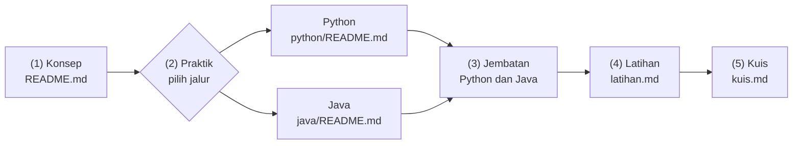
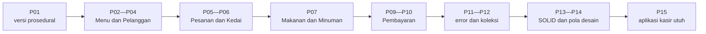
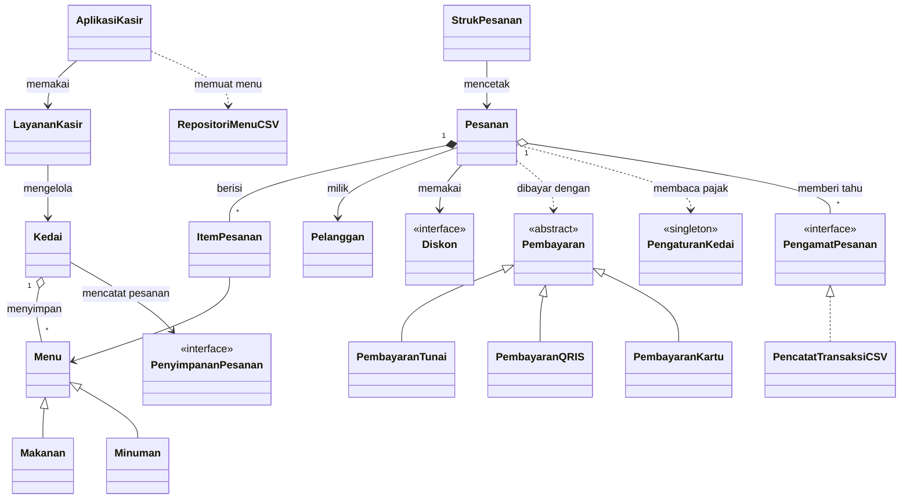

# Pemrograman Berorientasi Objek (PBO) 2026

[Mulai dari Persiapan ➡️](00-Persiapan/README.md) · [Rencana Pembelajaran](RENCANA-PEMBELAJARAN.md) · [Lampiran](Lampiran/README.md)

> Materi kuliah **Pemrograman Berorientasi Objek** untuk mahasiswa S1 Informatika, Universitas Mulawarman, Samarinda. Setiap konsep dijelaskan dulu dengan bahasa sehari-hari, lalu dipraktikkan dalam dua jalur: 🐍 **Python** dan ☕ **Java**. Sepanjang semester, kita membangun satu aplikasi yang tumbuh sedikit demi sedikit: kasir kafe **KedaiKita**.

Selamat datang! Kalau kamu sudah pernah menulis program dengan variabel, percabangan, perulangan, dan fungsi, kamu siap memulai. Di mata kuliah ini, kamu akan belajar **cara berpikir baru**: memandang program sebagai kumpulan objek yang saling bekerja sama, seperti kasir, dapur, dan pelanggan di sebuah kafe.

Tenang, materi ini disusun untuk pemula. Setiap istilah dijelaskan, setiap kode bisa langsung dijalankan, dan setiap pertemuan punya latihan beserta pembahasannya.

## Daftar Isi

1. [Untuk Siapa Materi Ini?](#1-untuk-siapa-materi-ini)
2. [Dua Jalur: Python dan Java](#2-dua-jalur-python-dan-java)
3. [Cara Belajar Setiap Pertemuan](#3-cara-belajar-setiap-pertemuan)
4. [Peta 16 Pertemuan](#4-peta-16-pertemuan)
5. [Studi Kasus KedaiKita](#5-studi-kasus-kedaikita)
6. [Struktur Folder Repositori](#6-struktur-folder-repositori)
7. [Struktur Folder Setiap Pertemuan](#7-struktur-folder-setiap-pertemuan)
8. [Mulai dari Mana?](#8-mulai-dari-mana)
9. [Cara Menjalankan Kode (Ringkas)](#9-cara-menjalankan-kode-ringkas)
10. [Informasi Mata Kuliah](#10-informasi-mata-kuliah)
11. [Dokumen Pendukung](#11-dokumen-pendukung)
12. [Menemukan Kesalahan?](#12-menemukan-kesalahan)

---

## 1. Untuk Siapa Materi Ini?

Materi ini ditulis untuk mahasiswa S1 Informatika yang **sudah lulus mata kuliah pemrograman dasar**, kebanyakan dengan Python. Kamu tidak perlu jago. Cukup pastikan kamu sudah pernah memakai hal-hal berikut:

| Prasyarat | Contoh sederhana |
|---|---|
| Variabel dan tipe data | `harga = 18000`, `nama = "Kopi"` |
| Percabangan | `if`, `elif`/`else if`, `else` |
| Perulangan | `for` dan `while` |
| Fungsi | fungsi yang menerima parameter dan mengembalikan nilai (`return`) |
| *List* atau *array* | menyimpan banyak data lalu membacanya dengan perulangan |

> [!TIP]
> Merasa lupa sebagian? Tidak masalah. Pertemuan 01 punya bagian **pemanasan** yang mengulang dasar-dasar itu di Python maupun Java sebelum kita masuk ke kelas dan objek.

Yang **tidak** perlu kamu kuasai sebelumnya: kelas, objek, Java, Git, atau UML. Semuanya dibahas dari nol di sini.

## 2. Dua Jalur: Python dan Java

Setiap pertemuan punya **satu halaman konsep** yang tidak terikat bahasa tertentu, lalu **dua halaman praktik**: satu untuk Python dan satu untuk Java. Kamu cukup memilih **satu jalur utama**.

| | 🐍 Jalur Python | ☕ Jalur Java |
|---|---|---|
| Cocok untuk | yang ingin fokus memahami konsep PBO dengan sintaks ringkas | yang ingin terbiasa dengan bahasa bertipe statis yang banyak dipakai di industri dan Android |
| Kesan pertama | lebih singkat, mirip pemrograman dasar yang sudah kamu kenal | lebih panjang, tetapi aturannya tegas dan kesalahan cepat ketahuan |
| Versi yang dipakai | Python 3.10 ke atas (disarankan 3.12 atau lebih baru) | Java 17 ke atas (disarankan JDK 25 atau 21, keduanya LTS) |
| Halaman praktik | `python/README.md` di setiap pertemuan | `java/README.md` di setiap pertemuan |

**Bagaimana memilih?** Jika masih ragu, pilih **Python**. Kamu sudah mengenalnya sehingga energimu bisa dipakai untuk memahami konsep. Pilih **Java** jika kamu ingin tantangan, atau jika dosen dan rencana kariermu (misalnya pengembangan aplikasi skala besar) mengarah ke sana.

Hal penting yang perlu kamu tahu:

- **Konsepnya sama persis.** Kelas, objek, enkapsulasi, pewarisan, polimorfisme, dan semua materi lain berlaku di kedua bahasa. Yang berbeda hanya cara menuliskannya.
- ***Output* studi kasusnya identik.** Program KedaiKita versi Python dan Java mencetak hasil yang sama persis, karakter demi karakter.
- **Boleh pindah jalur.** Halaman **Jembatan Python ↔ Java** di setiap pertemuan membantumu membaca kode di bahasa satunya. Pindah jalur di tengah semester tetap mungkin karena konsep yang sudah kamu pahami tidak hilang.
- **Bahasa kedua adalah bonus.** Kamu tidak wajib mempelajari keduanya. Namun, membaca jalur lain sesekali akan memperdalam pemahamanmu.

> [!NOTE]
> Konsultasikan pilihan jalurmu dengan dosen pengampu, terutama untuk ujian praktik dan proyek akhir. Ketentuan resmi kelasmu selalu mengikuti pengumuman dosen.

## 3. Cara Belajar Setiap Pertemuan

Semua pertemuan materi memakai alur yang sama. Setelah dua atau tiga pertemuan, alur ini akan terasa otomatis.



| Langkah | Bagian | Isinya | Perkiraan waktu |
|---|---|---|---|
| 1 | **Konsep** | masalah pemicu, analogi sehari-hari, definisi, diagram, miskonsepsi | 40 menit |
| 2 | **Praktik** (Python **atau** Java) | contoh kode dari yang paling kecil, studi kasus KedaiKita, cara membaca pesan *error* | 90 menit |
| 3 | **Jembatan Python ↔ Java** | tabel perbandingan sintaks dan jebakan saat pindah bahasa | 15 menit |
| 4 | **Latihan** | 5—7 soal bertingkat (Dasar, Menengah, Tantangan) beserta solusi, ditambah tugas mandiri | 60 menit |
| 5 | **Kuis** | 10 soal pilihan ganda beserta kunci dan pembahasan | 15 menit |

> [!TIP]
> Saran belajar yang terbukti ampuh: **ketik ulang** kodenya, jangan hanya menyalin. Jalankan, lalu ubah sedikit dan lihat apa yang terjadi. Bagian bertanda **Coba sendiri** di setiap halaman praktik dibuat khusus untuk itu.

## 4. Peta 16 Pertemuan

| Pertemuan | Topik | Inti materi | KedaiKita bertambah apa? |
|---|---|---|---|
| [Pertemuan 01](Pertemuan-01-Pengenalan-PBO/README.md) | Pengenalan PBO | paradigma prosedural vs berorientasi objek, empat pilar PBO sekilas, pemanasan dasar Python/Java | versi prosedural yang datanya tertukar saat diurutkan, lalu kilasan versi berorientasi objek |
| [Pertemuan 02](Pertemuan-02-Kelas-dan-Objek/README.md) | Kelas dan Objek | kelas, objek, konstruktor, `self`/`this`, *method* | kelas `Menu` pertama dengan `hitung_total()`/`hitungTotal()` |
| [Pertemuan 03](Pertemuan-03-Atribut-dan-Method/README.md) | Atribut dan *Method* | atribut kelas (*static*), *method* kelas, representasi teks objek, referensi | `Menu` lebih lengkap (kode, kategori, stok), format Rupiah, kelas `Pelanggan` dengan poin |
| [Pertemuan 04](Pertemuan-04-Enkapsulasi/README.md) | Enkapsulasi | *access modifier*, *getter*/*setter*, `@property`, validasi data | harga tervalidasi, stok dan poin hanya berubah lewat *method* resmi |
| [Pertemuan 05](Pertemuan-05-Relasi-Antarkelas/README.md) | Relasi Antarkelas | dependensi, asosiasi, agregasi, komposisi, program banyak *file* | `ItemPesanan`, `Pesanan` bernomor otomatis dengan struk, dan `Kedai` |
| [Pertemuan 06](Pertemuan-06-UML-Class-Diagram/README.md) | UML *Class Diagram* | notasi kelas, visibilitas, relasi, multiplisitas, diagram Mermaid | diagram kelas lengkap KedaiKita dan rancangan pewarisannya |
| [Pertemuan 07](Pertemuan-07-Pewarisan/README.md) | Pewarisan | kelas induk dan anak, `super`, *override*, *is-a* vs *has-a* | `Makanan` (level pedas) dan `Minuman` (dingin atau panas) |
| [Pertemuan 08](Pertemuan-08-UTS/README.md) | UTS | ulasan Pertemuan 01—07, kisi-kisi, latihan soal dan pembahasan | evaluasi dengan kasus latihan baru |
| [Pertemuan 09](Pertemuan-09-Polimorfisme/README.md) | Polimorfisme | *dynamic dispatch*, *upcasting*/*downcasting*, *overloading*, *duck typing* | pembayaran tunai, QRIS, dan kartu lewat satu *method* `bayar()` |
| [Pertemuan 10](Pertemuan-10-Abstract-Class-dan-Interface/README.md) | *Abstract Class* dan *Interface* | kelas abstrak, *interface*, `Protocol`, *default method* | `Pembayaran` menjadi abstrak, *interface* `DapatDicetak` |
| [Pertemuan 11](Pertemuan-11-Exception-Handling/README.md) | *Exception Handling* | `try`/`except`/`catch`/`finally`, `raise`/`throw`, *exception* buatan sendiri | `KedaiError`/`KedaiException` dan turunannya: stok kurang, menu tidak ditemukan, pembayaran gagal |
| [Pertemuan 12](Pertemuan-12-Koleksi-dan-Generics/README.md) | Koleksi dan *Generics* | *list*/set/dict vs `List`/`Set`/`Map`, *generics*, pengurutan, kesamaan objek | menu disimpan per kode, kategori unik, `Pasangan<A, B>`, `LaporanPenjualan` |
| [Pertemuan 13](Pertemuan-13-Prinsip-SOLID/README.md) | Prinsip SOLID | SRP, OCP, LSP, ISP, DIP, *refactoring* | membongkar `KasirSerbaBisa` menjadi `Diskon`, `StrukPesanan`, dan `PenyimpananPesanan` |
| [Pertemuan 14](Pertemuan-14-Design-Pattern/README.md) | *Design Pattern* | *Singleton*, *Factory*, *Strategy*, *Observer* | pengaturan pajak 10%, `PembayaranFactory`, diskon *happy hour*, layar dapur dan notifikasi |
| [Pertemuan 15](Pertemuan-15-Proyek-Terintegrasi/README.md) | Proyek Terintegrasi | arsitektur berlapis, *package*, *file* CSV, *input* yang aman, *unit test* | aplikasi kasir lengkap dengan menu teks, mode demo, dan penyimpanan *file* |
| [Pertemuan 16](Pertemuan-16-UAS/README.md) | UAS | ulasan Pertemuan 09—15, presentasi proyek akhir, refleksi | evaluasi dengan kasus latihan baru |

> [!NOTE]
> Folder UTS dan UAS berisi **latihan persiapan**, bukan soal ujian sungguhan. Format ujian yang pasti selalu mengikuti pengumuman dosen.

## 5. Studi Kasus KedaiKita

**KedaiKita** adalah kedai kopi kecil di **Jl. Pramuka No. 10, Samarinda**, tidak jauh dari kampus. Selama ini kasirnya mencatat pesanan di buku tulis. Hitungan sering keliru, stok sering tidak cocok, dan laporan harian dibuat dengan tergesa-gesa. Pemiliknya ingin program kasir sederhana, dan kamulah yang membuatnya.

Menu awal KedaiKita:

| Kode | Menu | Harga | Kategori |
|---|---|---|---|
| M01 | Kopi Susu Gula Aren | Rp18.000 | Minuman |
| M02 | Es Teh Manis | Rp8.000 | Minuman |
| M03 | Nasi Goreng Kampung | Rp25.000 | Makanan |
| M04 | Mie Goreng Jawa | Rp23.000 | Makanan |
| M05 | Pisang Goreng Keju | Rp15.000 | Makanan |

Pelanggan setianya antara lain **Budi Santoso** dan **Siti Aminah**. Di Pertemuan 15, daftar menu dibaca dari *file* dan bertambah satu menu baru.

### Aplikasi yang tumbuh setiap minggu

Kita tidak membuat aplikasinya sekaligus. Setiap pertemuan menambahkan **satu kemampuan baru** sesuai materi hari itu, persis seperti aplikasi sungguhan yang berkembang sedikit demi sedikit.



### Rancangan akhir di Pertemuan 15

Diagram berikut menampilkan kelas-kelas utama KedaiKita versi akhir beserta hubungannya. Jangan khawatir jika simbolnya masih asing. Cara membacanya kita pelajari di Pertemuan 06, dan setiap kelas dibahas di pertemuannya masing-masing.



Agar diagramnya tetap mudah dibaca, beberapa kelas tidak digambar. Berikut daftar lengkapnya, dikelompokkan menurut pertemuan saat kelas itu pertama kali muncul:

| Kelompok | Kelas | Muncul di |
|---|---|---|
| Menu | `Menu`, lalu `Makanan` dan `Minuman` | Pertemuan 02, 07 |
| Pelanggan dan pesanan | `Pelanggan`, `ItemPesanan`, `Pesanan`, `Kedai` | Pertemuan 03, 05 |
| Pembayaran | `Pembayaran`, `PembayaranTunai`, `PembayaranQRIS`, `PembayaranKartu` | Pertemuan 09, 10 |
| Kontrak | `DapatDicetak` | Pertemuan 10 |
| Penanganan *error* | `KedaiError` beserta turunannya, lalu `FormatDataError` (di Java: `KedaiException` dan `FormatDataException`) | Pertemuan 11, 15 |
| Koleksi | `Pasangan`, `LaporanPenjualan` | Pertemuan 12 |
| Desain SOLID | `Diskon` (`TanpaDiskon`, `DiskonPersen`, `DiskonMember`), `StrukPesanan`, `PenyimpananPesanan`, `PenyimpananMemori` | Pertemuan 13 |
| Pola desain | `PengaturanKedai`, `PembayaranFactory`, `DiskonHappyHour`, `PengamatPesanan`, `LayarDapur`, `NotifikasiPelanggan` | Pertemuan 14 |
| Aplikasi | `RepositoriMenuCSV`, `PencatatTransaksiCSV`, `LayananKasir`, `AplikasiKasir` | Pertemuan 15 |

> [!NOTE]
> Di jalur Python, fungsi bantu `format_rupiah()` mengubah `18000` menjadi `Rp18.000`. Di jalur Java, tugas yang sama dikerjakan oleh kelas utilitas `Rupiah` lewat `Rupiah.format()`. Alasannya dibahas di Pertemuan 03.

Seperti apa hasil akhirnya? Berikut cuplikan struk yang dicetak aplikasi KedaiKita Pertemuan 15 dalam mode demo. Versi Python dan Java mencetak struk yang sama persis.

```text
========================================
KedaiKita
Jl. Pramuka No. 10, Samarinda
========================================
No. Pesanan : P002
Pelanggan   : Siti Aminah
Status      : LUNAS
----------------------------------------
2 x Es Teh Manis                Rp16.000
1 x Pisang Goreng Keju          Rp15.000
----------------------------------------
Subtotal                        Rp31.000
Diskon Happy Hour (minuman)     -Rp3.200
Pajak 10%                        Rp2.780
TOTAL                           Rp30.580
========================================
```

Dari satu kelas `Menu` di Pertemuan 02 sampai struk lengkap dengan diskon dan pajak ini, kamu akan membangun semuanya sendiri, selangkah demi selangkah.

## 6. Struktur Folder Repositori

```text
PBO2026/
├── README.md                              <- halaman ini (beranda)
├── RENCANA-PEMBELAJARAN.md                <- capaian, rencana 16 pertemuan, dan penilaian
├── 00-Persiapan/                          <- instalasi Python, JDK, VS Code, dan cara menjalankan program
├── Pertemuan-01-Pengenalan-PBO/
├── Pertemuan-02-Kelas-dan-Objek/
├── Pertemuan-03-Atribut-dan-Method/
├── Pertemuan-04-Enkapsulasi/
├── Pertemuan-05-Relasi-Antarkelas/
├── Pertemuan-06-UML-Class-Diagram/
├── Pertemuan-07-Pewarisan/
├── Pertemuan-08-UTS/
├── Pertemuan-09-Polimorfisme/
├── Pertemuan-10-Abstract-Class-dan-Interface/
├── Pertemuan-11-Exception-Handling/
├── Pertemuan-12-Koleksi-dan-Generics/
├── Pertemuan-13-Prinsip-SOLID/
├── Pertemuan-14-Design-Pattern/
├── Pertemuan-15-Proyek-Terintegrasi/
├── Pertemuan-16-UAS/
└── Lampiran/                              <- glosarium, cheat sheet, referensi, dan FAQ
```

## 7. Struktur Folder Setiap Pertemuan

Pertemuan materi (01—07 dan 09—15) memakai susunan berikut:

```text
Pertemuan-NN-Judul/
├── README.md                  <- 1. Konsep (tidak terikat bahasa)
├── gambar/                    <- ilustrasi untuk halaman konsep (hanya di sebagian pertemuan)
├── python/
│   ├── README.md              <- 2. Praktik Python
│   ├── contoh/                <- contoh01_....py, contoh02_....py, dan seterusnya
│   ├── studi-kasus/           <- KedaiKita versi pertemuan ini
│   └── solusi/                <- solusi latihan (buka setelah mencoba sendiri)
├── java/
│   ├── README.md              <- 2. Praktik Java
│   ├── contoh/                <- Contoh01....java, Contoh02....java, dan seterusnya
│   ├── studi-kasus/           <- KedaiKita versi pertemuan ini
│   └── solusi/                <- solusi latihan
├── jembatan-python-java.md    <- 3. Perbandingan Python dan Java
├── latihan.md                 <- 4. Latihan bertingkat + tugas mandiri
└── kuis.md                    <- 5. Kuis 10 soal + kunci dan pembahasan
```

| Folder atau *file* | Isinya |
|---|---|
| `contoh/` | Program kecil yang masing-masing mengajarkan satu ide. Contoh bernomor sama di Python dan Java membahas ide yang sama. |
| `studi-kasus/` | Aplikasi KedaiKita versi pertemuan itu. *Output* versi Python dan Java selalu identik. |
| `solusi/` | Satu *file* solusi untuk setiap latihan, di kedua bahasa. Coba kerjakan sendiri dulu, ya. |
| `gambar/` | Gambar penjelas yang ditampilkan di halaman konsep. Kamu tidak perlu membuka folder ini secara langsung. |

Beberapa pertemuan punya susunan khusus:

| Pertemuan | Perbedaannya |
|---|---|
| 08 (UTS) dan 16 (UAS) | Berisi `README.md` (informasi dan kisi-kisi), `latihan-soal.md`, `pembahasan.md`, serta folder `python/` dan `java/` berisi solusi soal praktik beserta penjelasannya. Tidak ada jembatan, latihan, atau kuis biasa. |
| 13 (SOLID) | Studi kasusnya terbagi dua: `studi-kasus/sebelum/` (kode berantakan) dan `studi-kasus/sesudah/` (hasil *refactoring*). *Output* keduanya sama persis. |
| 15 (Proyek) | Ada tambahan [`proyek-akhir.md`](Pertemuan-15-Proyek-Terintegrasi/proyek-akhir.md). Studi kasusnya berupa proyek ber-*package* dengan folder `data/` dan pengujian otomatis. |

## 8. Mulai dari Mana?

1. **Baca halaman ini** sampai selesai, terutama bagian [Dua Jalur](#2-dua-jalur-python-dan-java).
2. **Siapkan alat** di [00-Persiapan](00-Persiapan/README.md): pasang Python dan/atau JDK, unduh materi ke laptopmu, pasang VS Code, lalu coba jalankan program pertamamu.
3. **Mulai [Pertemuan 01](Pertemuan-01-Pengenalan-PBO/README.md)** dan ikuti alur Konsep → Praktik → Jembatan → Latihan → Kuis.
4. **Simpan Lampiran** untuk dibuka kapan saja: [Glosarium](Lampiran/glosarium.md) untuk istilah yang lupa artinya, dan [*Cheat Sheet* Python ↔ Java](Lampiran/cheatsheet-python-java.md) untuk sintaks yang lupa cara menulisnya.

## 9. Cara Menjalankan Kode (Ringkas)

Setiap halaman praktik selalu menuliskan perintah lengkapnya. Tabel ini hanya gambaran besarnya. Semua perintah diketik di **terminal** (PowerShell, Command Prompt, Terminal macOS/Linux, atau terminal VS Code), dari folder tempat programnya berada. Cara paling mudah tanpa terminal: buka *file*-nya di VS Code, lalu klik tombol ▷ atau **Run**.

| Jenis program | 🐍 Python | ☕ Java | Dipakai di |
|---|---|---|---|
| Satu *file* | `python nama_file.py` | `java NamaFile.java` | semua `contoh/` dan `solusi/`, studi kasus Pertemuan 01—04 |
| Banyak *file* (masuk dulu ke folder `studi-kasus`) | `python main.py` | `javac *.java` lalu `java Main` | studi kasus Pertemuan 05—14 |
| Proyek ber-*package* | `python main.py --demo` | skrip `.\jalankan.bat --demo` (Windows) atau `bash jalankan.sh --demo` (macOS/Linux) | studi kasus Pertemuan 15 |

> [!NOTE]
> Di macOS dan Linux, ketik `python3` sebagai ganti `python`. Perintah `java NamaFile.java` membutuhkan Java 11 ke atas, dan kelas yang memiliki `main` harus ditulis paling atas di dalam *file*. Semua perintah `cd` di halaman praktik ditulis dari **folder utama materi** (`PBO2026` atau `PBO2026-master`). Penjelasan lengkap dan cara mengatasi pesan *error* ada di [Menjalankan Program](00-Persiapan/menjalankan-program.md) dan [Mengatasi Masalah](00-Persiapan/mengatasi-masalah.md).

## 10. Informasi Mata Kuliah

| | |
|---|---|
| Mata kuliah | Pemrograman Berorientasi Objek (PBO) |
| Program studi | Informatika |
| Perguruan tinggi | Universitas Mulawarman, Samarinda, Kalimantan Timur |
| Tahun | 2026 |
| Jumlah pertemuan | 16 (14 pertemuan materi, UTS, dan UAS) |
| Bahasa pemrograman | Python dan Java (pilih satu jalur utama) |
| Bahasa pengantar materi | bahasa Indonesia |

## 11. Dokumen Pendukung

| Dokumen | Kegunaan |
|---|---|
| [Rencana Pembelajaran](RENCANA-PEMBELAJARAN.md) | capaian pembelajaran, rencana 16 pertemuan, metode, penilaian, dan proyek akhir |
| [00-Persiapan](00-Persiapan/README.md) | instalasi alat dan cara menjalankan program |
| [Lampiran](Lampiran/README.md) | pintu masuk ke semua lampiran |
| [Glosarium](Lampiran/glosarium.md) | daftar istilah PBO dari A sampai Z beserta pertemuan yang membahasnya |
| [*Cheat Sheet* Python ↔ Java](Lampiran/cheatsheet-python-java.md) | sintaks penting kedua bahasa berdampingan, dari Pertemuan 01 sampai 15 |
| [Referensi](Lampiran/referensi.md) | buku, dokumentasi resmi, situs belajar lanjutan, dan sumber gambar |
| [FAQ](Lampiran/faq.md) | jawaban atas pertanyaan yang sering diajukan mahasiswa |

## 12. Menemukan Kesalahan?

Materi ini disusun dengan teliti, tetapi tetap mungkin ada salah ketik, kode yang tidak berjalan di komputermu, atau penjelasan yang membingungkan. Laporanmu sangat membantu teman-teman lain.

Cara melapor:

1. Buka halaman [Issues repositori ini](https://github.com/antonprafanto/PBO2026/issues) (perlu akun GitHub gratis), lalu klik **New issue**.
2. Tuliskan ***file*** dan **bagian** yang bermasalah, misalnya `Pertemuan-05-Relasi-Antarkelas/java/README.md`, bagian 3.
3. Jelaskan **apa yang terjadi** dan **apa yang seharusnya terjadi**.
4. Jika ada pesan *error*, **salin teksnya** (bukan hanya tangkapan layar), lalu sebutkan sistem operasi serta versi Python atau Java yang kamu pakai.

Tidak punya akun GitHub? Sampaikan langsung kepada dosen atau asisten praktikum.

---

Belajar pemrograman itu seperti meracik kopi: takarannya dipelajari pelan-pelan, dan setiap percobaan membuatmu makin mahir. Selamat belajar, dan sampai jumpa di Persiapan!

[Mulai dari Persiapan ➡️](00-Persiapan/README.md) · [Rencana Pembelajaran](RENCANA-PEMBELAJARAN.md) · [Lampiran](Lampiran/README.md)
